# 第二章 开始使用 InDesign

有些读者可能是 InDesign 的新手，因此我将用本章简要介绍 InDesign 中一些有助于你快速上手的重要功能。这只是对你在程序中创建设计所需了解的一些工具和命令的概述。

如果你打算处理 EPUB、动画、交互式元素，并将你的 InDesign 文件导出为 EPUB、交互式 PDF，或使用 `Adobe Publish Online`（预览版），你绝对希望个性化设置 InDesign，以便根据你从事的工作类型来配置工具、菜单、面板和首选项。

在本章中，我将讨论如何创建自定义工作区、修改首选项和键盘快捷键、创建模板以及自定义预设，以根据一般需求个性化工作环境。我的建议可能包含也可能不包含你特定工作所需的所有选项，但我提供了一个起点。在阅读本章时，请随意修改一些设置。

我还介绍了一些使用重要功能（如使用字体、主页、创建网格）的基础知识，以及你需要了解的在 InDesign 中导入素材的知识。本书篇幅有限，无法详尽解释如何使用 InDesign 提供的所有功能。如果你想了解更多关于使用 InDesign 的信息，我建议你查阅 Wiley 出版社出版的《Adobe InDesign CS 达人迷》或《Adobe InDesign CS 圣经》。

## 2.1 设置数字出版工作区

你对工作区面板位置和键盘快捷键所做的所有更改都可以保存为自定义工作区。当你启动 InDesign 并选择一个工作区时，你为自定义工作环境所做的所有设置都会恢复为之前保存的设置。如果你移动了面板并弄乱了工作区，你可以轻松地将其恢复为原始的保存设置。当你查看可供选择的各种工作区选项时，你会多次保存设置并覆盖已保存的工作区设置，以创建最终的工作区。

### 2.1.1 定位工作区选项

打开 InDesign，观察窗口右上角。默认情况下，您可能会看到 `Essentials`（基本功能）字样并带有一个向下箭头，如图 2-1 所示。如果您的 InDesign 窗口中没有工作区选项，则说明应用程序栏未显示（仅限 Mac）。请选择 `Window ➤ Application Bar`（窗口 ➤ 应用程序栏），工作区菜单便会显示。点击箭头打开菜单，您会发现 Adobe 为您提供的几个工作区。请注意，菜单中还有 `New Workspace`（新建工作区）和 `Delete Workspace`（删除工作区）选项。稍后我将介绍这些功能。现在，您只需了解菜单中有哪些工作区和选项即可。

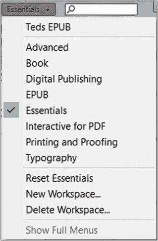

图 2-1. 点击 `Essentials`（基本功能）旁的向下箭头，打开工作区菜单

### 2.1.2 整理面板

要开始为数字出版创建个性化工作区，请注意 Adobe 已为您提供了 `Digital Publishing`（数字出版）工作区。然而，本书中将用到的所有面板并非都包含在 `Digital Publishing`（数字出版）工作区中。您需要从某个起点开始，因此请在工作区菜单中选择 `Digital Publishing`（数字出版）。这将为您提供一个绝佳的起点。

当您选择一个工作区时，首先看到的界面变化是 InDesign 窗口右侧的面板。稍后我们将添加一些面板。现在，您需要了解的是，可以通过将面板从“面板停靠区”拖出，使其脱离停靠区。点击 `Liquid Layout`（版面调整）并将其从面板停靠区拖出，如图 2-2 所示。它将成为浮动面板，您可以在 InDesign 窗口中移动它。使用浮动面板有助于您在创建文档时处理某些特定项目。就我们目前的目的而言，我们只需点击面板右上角（Windows）或左上角（Macintosh）的 `X` 按钮将其关闭。

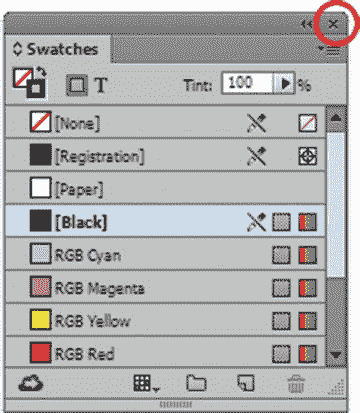

图 2-2. 点击浮动面板中的 `X` 按钮以关闭面板

当您希望重新调整用于打印的文档，并更改设计以适应 EPUB 或“在线发布”时，`Liquid Layout`（版面调整）选项会很有帮助。但对于您其余的工作，它用处不大。

您可以打开面板以显示面板图标和面板名称。默认情况下，交互式面板会显示图标和面板名称。要显示面板停靠区右侧的面板名称，请将光标移到分隔线上并向左拖动。

另一个您不常用的面板是 `Preflight`（印前检查）面板。将其从面板停靠区移出并关闭。

您可以通过点击面板并向上或向下拖动来重新排列面板列表。同样，如果面板有两列，您可以将面板从一个列表拖到另一个列表。当您将面板拖到新位置时，请注意面板名称上方出现的蓝色条。该蓝色条显示面板将要放置的位置。

### 2.1.3 向工作区添加面板

InDesign 拥有大量面板，它们都列在 `Window`（窗口）菜单中，或作为独立项目，或嵌套在分组中。要打开一个面板，请选择 `Window ➤ <面板名称>`，例如，位于 `Window`（窗口）菜单顶部的 `Articles`（文章）面板（见图 2-3）。

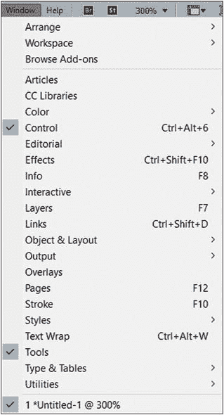

图 2-3. 点击 `Window`（窗口）以打开 `Window`（窗口）菜单

请注意，在图 2-4 中，`Articles`（文章）面板与另外两个面板捆绑在一起。要单独移除 `Articles`（文章）面板，请点击其名称并将其从捆绑组中拖出。将各个独立面板从嵌套组中拖出，以分离所有面板。然后将每个面板拖到面板停靠区。您可以通过在面板停靠区中向上或向下拖动，或在面板停靠区的各列之间拖动，随时按您喜欢的顺序整理面板。

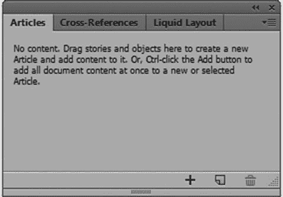

图 2-4. `Articles`（文章）面板与另外两个面板捆绑在一起

请注意，在 `Window`（窗口）菜单中，有几个窗格带有向右的尖括号，表示有子菜单，例如 `Type and Tables`（文字和表格）菜单命令。当您将光标放在 `Type and Tables`（文字和表格）上时，会弹出一个子菜单，其选项从 `Character`（字符）开始，到子菜单底部的 `Table`（表格）结束。当您选择其中一项时，面板会以浮动面板的形式打开，您可以在 InDesign 工作区中移动它，或将其停靠在面板停靠区中。

现在，您应该已经了解如何访问面板并将其移动到面板停靠区了。在图 2-5 中，您可以看到我建议用于创建自定义工作区（您可能用于 EPUB 和数字出版文档）的面板。这些面板包括：

*   `文章`：如果你从 InDesign 导出可重排 EPUB 并选择布局顺序，所有图像通常会出现在文档末尾。在 InDesign CS 5.5 及“文章”面板引入之前，要让图像按照与设计类似的阅读顺序出现在文本段落之间是一项挑战。“文章”面板让这一过程变得容易许多，结合锚定对象（有关“文章”面板和锚定对象的更多信息，请参见第 12 章），你可以轻松创建阅读顺序模拟布局的可重排 EPUB。

*   `颜色`：“颜色”组包含几个你可能想添加到工作区的面板。其中包括：
    *   `色板`：“色板”面板使你能够将颜色应用于文本和对象。
    *   `渐变`：这是个人选择。如果你的文档包含带有渐变的对象，请将该面板添加到面板停靠区。如果你不使用渐变，则不要添加。
    *   `Adobe 颜色主题`：此面板可访问以前称为 Adobe Kuler 的功能。你可以创建各种调色板并将它们添加到“色板”面板。我将在本章后面的“创建调色板”部分介绍这一点。

*   `效果`：“效果”面板除其他功能外，使你能够对对象使用混合模式，并向文本和对象添加透明度。

*   `交互`：“窗口”菜单中的“交互”菜单项包含用于创建交互式作品的面板，例如固定版式 EPUB、交互式 PDF 和 `Adobe Publish Online` (预览)。将这些面板添加到你的工作区。其中包括：
    *   `动画`：你可以通过多种方式为文本和对象设置动画，这些将在第 8 章中介绍。动画可以在固定版式和 `Adobe Publish Online` 中查看。对于交互式 PDF，你需要一种变通方法，如我在第 14 章所述。
    *   `书签`：在 EPUB 和交互式 PDF 中使用目录的替代方案时，书签会很有帮助。
    *   `按钮和表单`：按钮用于在固定版式 EPUB、交互式 PDF 和 `Adobe Publish Online` 中触发事件。表单域仅用于 PDF 文档。

*   `EPUB 交互性预览`：这是一个预览面板，允许你按页面和按文档预览 EPUB 布局以及动画。

*   `超链接`：可以设置超链接以链接到 EPUB、交互式 PDF 和 `Adobe Publish Online` 中的页面、锚点和 URL。

*   `媒体`：“媒体”面板用于预览视频和声音，并从视频内部或外部文档向视频添加海报图像。你还可以在页面加载时触发视频播放。

*   **对象状态**：此面板用于多状态对象 (MSO)，可在固定版式 EPUB、交互式 PDF（仅在使用变体方法的台式计算机上）和 Adobe Publish Online 中查看。有关 MSO 的详细说明，请参见第 10 章。

*   **SWF 预览**：Adobe Flash SWF 文件现在不用于大多数交互式文档，但交互式 PDF 仍支持 SWF，iOS 设备除外。如果你的工作包含交互式 PDF，请将此面板添加到面板停靠区。

*   **计时**：“计时”面板与“动画”面板结合使用。

*   **图层**：对于你创建的任何类型的文档，使用图层都是必不可少的。当你使用动画和 MSO 时，“图层”面板是一大福音。

*   **链接和页面**：这些面板对于任何设计都至关重要。“链接”面板可帮助你识别缺失的链接并更新链接。“页面”面板允许你从文档中添加/删除页面。

*   **对齐**：在“对象和布局”面板中，你会在子菜单中找到“对齐”。当你需要对齐和分布对象时，此面板很有用。它对于处理 MSO 尤其有帮助。

*   **描边**：“描边”面板允许你更改线宽和样式。

*   **样式**：子菜单中出现许多不同的面板。你应该从列表中添加以下几个，包括：
    *   **字符样式**：字符样式和段落样式对于创建 EPUB 或你在 InDesign 中创建的任何其他文档都是必需的。对于 EPUB，你需要使用样式识别所有正文文本和显示类型。这些样式将导出到 HTML 和 CSS 文件中，你可以在 HTML 编辑器中轻松进行编辑。
    *   **段落样式**：原因与字符样式相同。你需要使用它们，尤其是对于 EPUB。
    *   **对象样式**：当你想要将效果应用于对象并将相同的效果设置匹配到其他对象时，对象样式将为你节省大量时间。
    *   **单元格和表格样式**：如果你在文档中使用表格，则应创建单元格和表格样式。

*   **文本绕排**：“文本绕排”面板允许你使文本围绕对象排列并设置偏移距离。

*   **工具**：“工具”面板显示 InDesign 窗口左侧的各个工具。此面板对于所有文档都是必不可少的。

*   **应用程序框架 (仅限 Mac)**：对于 Macintosh 用户，你可能想要选择“应用程序框架”。“应用程序框架”可消除桌面上任何分散注意力的背景。在 Windows 上启动 InDesign 时，默认情况下始终使用“应用程序框架”。

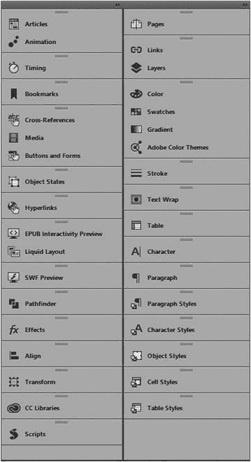

**图 2-5.** 为获得最佳交互式文档开发工作流程而组织的面板

### 2.1.4 保存新工作区

鉴于你可能需要进行一些需要修改自定义工作区的其他调整，一旦设置好面板，就应该保存该工作区。打开“工作区”菜单，然后选择“新建工作区”。在打开的对话框中，为工作区提供一个名称。在此示例中，由于“数字出版物”已经是一个工作区，我们将新的自定义工作区称为 `EPUB`。在“名称”文本字段中键入名称，然后单击“确定”。默认情况下，面板位置会随工作区一起保存。

在工作会话期间，你可能会将面板移出面板停靠区，并将它们排列在 InDesign 窗口周围。如果要返回到已保存的工作区，请打开“工作区”菜单并选择“重置 [工作区名称]”，其中工作区名称是你保存工作区时使用的名称。

如果你对工作区进行了其他调整，请使用相同的菜单命令。没有更新工作区的选项，因此你需要选择“新建工作区”并键入相同的名称以覆盖上次保存的工作区。

## 2.3 修改键盘快捷键

键盘快捷键是指当你按下修饰键与某个按键组合时应用于某个编辑操作的快捷键。例如，按 `Ctrl/⌘+N` 会打开新建文档窗口。许多默认键盘快捷键非常适合你的设计创作。不过，你可能希望在自定义键盘快捷键列表中更改其中一些快捷键。

要打开“键盘快捷键”，请选择**编辑** ➤ **键盘快捷键**。“键盘快捷键”窗口将打开，如图 2-9 所示。

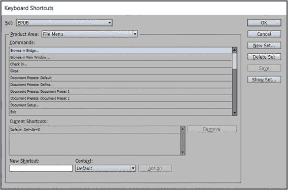

**图 2-9.**“键盘快捷键”窗口显示所有默认快捷键

要创建新列表，请单击窗口右侧的**新建集**按钮。为你的自定义键盘快捷键提供一个名称，然后单击“确定”。此操作仅复制默认设置，但你可以在新集中删除或添加快捷键。

在窗口顶部，有一个“产品区域”菜单。打开菜单，你将找到顶级菜单、面板菜单、工具、脚本以及其他各种可以添加或更改键盘快捷键的区域列表。

### 2.3.1 重新设置粘贴快捷键

从列表中选择`编辑`菜单，向下滚动到`粘贴`选项。点击`粘贴`，然后在`当前快捷键`列表中选择`Ctrl/⌘+V`命令并点击`移除`按钮将其删除。我们将把`粘贴`（将剪贴板中的任意对象粘贴到文档中心）替换为`原位粘贴`，后者会将复制的内容直接粘贴到原对象的上方。你会发现这个快捷键比`粘贴`更常用，尤其是在处理多状态对象时。

删除`粘贴`后，点击列表中的`原位粘贴`并按下`Ctrl/⌘+V`。旧快捷键仍会保留在`当前快捷键`列表中，因此请点击该旧快捷键（`Ctrl/Alt+V` 或 `⌘/⌥+V`）并点击`移除`按钮。完成这些步骤后，你的窗口应如图 2-10 所示。

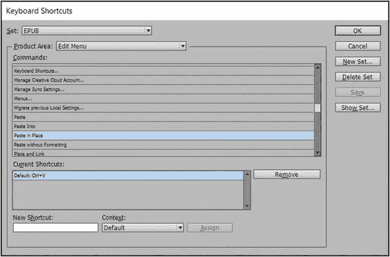

**图 2-10.** 为菜单命令`原位粘贴`添加了自定义快捷键

**注意：** 当你对面板视图进行更改后，需要重新保存工作区，以便为窗口调整捕获新的尺寸。

我在此提供了一些我常用的快捷键。你可以根据自己的工作内容选择并修改更多快捷键。不必一次性修改大量快捷键，而是从少数几个容易记住的快捷键开始；之后你可以返回`键盘快捷键`窗口，对你的自定义设置进行补充编辑。

### 2.3.2 为表格单元格中的制表符添加快捷键（仅限 Windows）

如果你经常处理表格，你会希望在不使用菜单命令的情况下快速在表格中移动。当你在表格中按下`Tab`键时，光标会移动到下一个单元格。在 Macintosh 系统中，如果要在单元格内插入制表符，你需要按`Option+Tab`。在 Windows 系统中，如果按`Alt+Tab`，则会触发系统应用切换器。

在 InDesign 中，通过菜单命令在单元格内插入制表符的方法是：选择`文字` > `插入特殊字符` > `制表符`。

要为在表格单元格内插入制表符添加键盘快捷键，可以在`键盘快捷键`对话框的`产品区域`中打开`文字菜单`，向下滚动到`插入特殊字符: 其他: 制表符`。使用类似`Alt+F1`（功能键）或你希望使用的任意功能键。如果你经常需要在表格单元格内插入制表符，一个键盘快捷键将有助于加快你的工作速度。

## 2.4 创建新建文档预设

当你选择`文件` > `新建文档`时，默认设置为创建用于印刷的文档——这在我们创建数字出版物时几乎不相关。你可以更改默认设置，也可以在`新建文档`窗口中添加自定义预设。

按`Ctrl/⌘+N`打开`新建文档`窗口。从`用途`菜单中选择`移动设备`。在`页面大小`中，你可以选择 iPad、Kindle Fire 或 Android 的尺寸，或设置自定义页面大小。就本教程而言，我们选择 iPad 作为尺寸。点击`横向`或`纵向`选择`方向`。在`边距`中，点击`锁形`图标以解锁四个调整项。将上、左、右边距设为 44 磅，下边距设为 88 磅。对于 iPad 上的文档来说，这种尺寸的边距会很合适，能让内容避开滚动条。取消勾选`主要文本框架`（见图 2-11）。

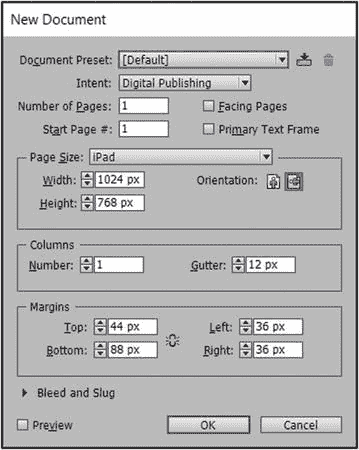

**图 2-11.** iPad 的自定义设置

**注意：** 图 2-11 是 InDesign CC 2017 的截图。如果你使用的是早期版本的 InDesign，请从`用途`菜单中选择`数字出版`。

此时，你可以将这些设置指定为新的默认设置。每次打开`新建文档`时，默认值都将是你在此处应用的设置。如果你有几种不同类型的出版物，你可能不希望将这些设置设为新的默认值，但你可能需要时常调取这些设置。

点击`文档预设`菜单旁边的`存储预设`按钮。当窗口打开时，你可以输入`[默认]`，使新设置成为新建文档的默认选择。点击`确定`，会弹出一个警告对话框，提示该名称已存在。点击`是`覆盖之前的默认设置。

**提示：** 如果你想使用默认的新建文档并跳过`新建文档`窗口，请按`Ctrl+Alt+N`（Windows）或`⌘+Option+N`（Macintosh）。

如果你想创建一个新的预设，请在`存储预设`对话框中提供一个名称，然后点击`确定`。

## 2.5 创建调色板

设计师们深知为新的项目创建调色板的重要性，但有些读者可能是想出版自己电子书的作者，并没有设计背景。因此，我想简要介绍一些在设计项目中创建调色板和使用字体时的重要设计技巧。

### 2.5.1 创建调色板

您拥有一个绝佳的机会，可以利用 `InDesign` 创建由各种色调、互补色、类似色、三元色、粉彩等颜色组成的调色板。我在此不深入讨论色彩理论。只想为您指明一条追随资深设计师和著名艺术家的方向。

在 `InDesign` 中，打开 `Adobe 颜色主题面板`。如果工作区没有显示`颜色主题面板`，请选择 `窗口 ➤ 颜色 ➤ 颜色主题`。对于使用 Creative Cloud 应用程序之前旧版 Adobe 软件的用户，此面板曾被称为 `Adobe Kuler`。

面板中有三个选项卡，如图 2-12 所示。第一个选项卡是 `创建`。在此，您可以根据从显示`类似色`的菜单中选择的多个选项来创建颜色。打开菜单，从列出的颜色关系中选择一项。移动滑块选择一种色相，您将看到一组五种颜色。您可以点击颜色光谱上方的圆圈并移动它们来调整鲜艳度和饱和度。确定一组颜色后，您可以在面板底部输入名称并点击 `保存`，将这些颜色添加到`色板面板`中。此时会弹出`保存到库`对话框。选择一个库或创建一个`新库`，然后点击`保存`。要访问这些颜色，请点击`我的主题`选项卡。

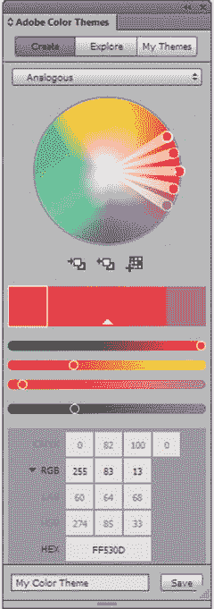

**图 2-12.** `颜色主题面板`中的`创建`选项卡，让您能够创建自定义颜色集。

> **注意：** 您必须拥有 Adobe ID 才能保存颜色色板。如果没有 Adobe ID，请登录 [`www.adobe.com`](http://www.adobe.com) 并点击`登录`按钮。页面切换后，点击`获取 Adobe ID`。此 ID 让您能使用许多 Adobe 服务，并且对于您在创建数字出版文档时的工作至关重要。

您可能希望将库中的色板添加到`InDesign 色板面板`中。要将颜色组添加到`色板面板`，请从`我的主题面板`中打开一个库，滚动窗口以定位要添加到色板的颜色。将光标置于`操作`上，会弹出一个菜单。在弹出的菜单中点击`添加到色板`，这些颜色即被添加到`色板面板`中的一个新文件夹中。

`颜色主题`真正酷的地方在于`探索`选项卡。在此，您可以搜索各种不同的选项。您可能想要一个大地色调或天空色调的调色板。只需在`搜索`字段中输入文本，然后按 `Enter/Return` 键。通常，您会看到一长串搜索结果。

我最喜欢的搜索项之一是搜索绘画大师。如果您想要一组鲜艳的颜色，可以搜索一些印象派艺术家的名字，例如 Monet 或 Van Gogh。如果您想要后印象派时期的风格，例如像塞尚使用的那种清晰结构搭配强烈鲜艳的颜色，只需在`探索`选项卡的搜索文本框中输入 `Cezanne`。按 `Enter/Return` 键后，系统会返回一个列表，您可以从中将各种颜色集添加到`InDesign 色板面板`中。在图 2-13 中，您可以看到搜索 `Cezanne` 的结果。如果您想要更具当代感的风格，只需搜索当代艺术家即可。可能性是无穷无尽的。而且，在 `Adobe 颜色主题面板`中随意探索本身就乐趣无穷。

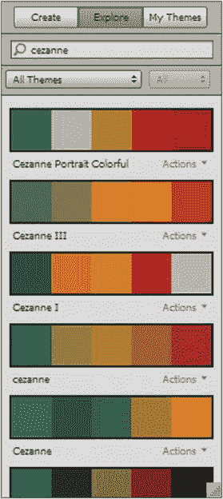

**图 2-13.** 在`探索`选项卡中搜索 `Cezanne` 的结果。

使用`颜色主题面板`不会让您成为色彩理论和运用的大师，但它是一个起点，尤其对没有设计背景的人来说非常有帮助。使用`颜色主题面板`的一个好处是，在 Adobe Photoshop 和 Adobe Illustrator 中也能找到相同的面板。如果您在这些应用程序中创建素材，可以轻松同步您的调色板。

### 2.5.2 创建字体调色板

如果您不是设计师，那么对字体以及在设计中选择何种字体有个基本了解将会大有裨益。互联网上有大量信息，介绍哪些字体搭配效果好，以及应避免哪些字体组合。在选择同一大型字体系列（例如 `Univers` 或 `Helvetica Neue`）中的多种字体时，通常比较安全。

为出版物选择字体时，您可以考虑同一历史时期的字体、同一设计师的字体、具有相似字身高度的字体，在很多情况下，您也可以选择截然相反、对比强烈的字体。应该避免的是风格冲突，例如在同一作品中使用 `Eurostile` 和 `Cochin`。

您应仔细考虑用于`正文`和`标题`的字体。您可以在互联网上搜索了解更多关于哪些字体搭配效果好的信息。如果要在设计作品中引入第三种字体，也许是像 `Rockwell` 或 `Museo Slab` 这样的粗衬线体，或是像 `Bickham Script` 这样的正式手写体，或像 `Zapfino` 这样的书法字体。

#### 2.5.2.1 使用正确的字体类型

在创建可重排 EPUB 时，字体选择不那么重要，因为最终读者可以在其阅读设备上少数已安装的字体中进行选择。但所有其他类型的出版物确实需要您做出良好的字体选择。

在出版物中应使用的字体类型是 `TrueType` 和 `OpenType` 字体。请远离其他字体类型，因为在设备上查看文档时可能会遇到一些问题。

您还需要确保拥有在文档中嵌入字体的权利。这对于固定版式、交互式 PDF 和 Adobe Online 出版物非常重要。字体公司可能允许您在设计中使用的字体，但并未授予您嵌入该字体的许可。有关许可和嵌入字体的更多信息，请参见第 13 章。

### 2.5.2.2 使用 Adobe Typekit

如果你是 Creative Cloud 用户（我建议任何严肃的文档开发者都订阅 Adobe Creative Cloud），你可以通过 Adobe Typekit 使用字体。Adobe Typekit 的字体可以嵌入到你的出版物中，并且对 Creative Cloud 用户免费使用。

要访问 Typekit，请从控制面板打开 `字体` 菜单，然后点击 `从 Typekit 添加字体`（见图 2-14）。

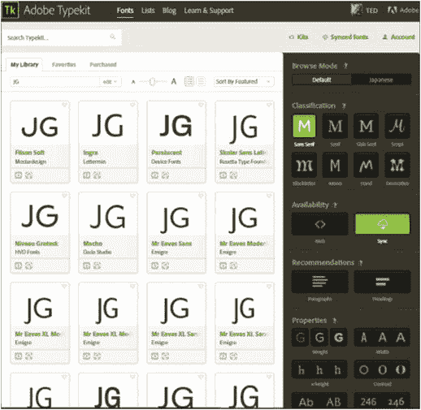

图 2-14.

Adobe 的 Typekit 网站让你能够从一个令人印象深刻的字体库中同步字体

进入 Typekit 后，你可以按分类和属性搜索字体。点击右侧面板中的某个分类项目，查看字重、字宽、x 高度、对比度等属性，然后点击你喜欢的字体属性。

当你找到想要使用的字体时，将鼠标悬停在左侧面板中的该字体上。会弹出一个菜单，你可以点击 `使用字体`。点击 `使用字体` 后，会打开一个窗口，你可以在其中勾选该字体族中想要同步到电脑的字体。点击 `同步所选字体`，如图 2-15 所示。当字体同步到电脑完成后，会有一个消息窗口通知你字体已准备就绪。

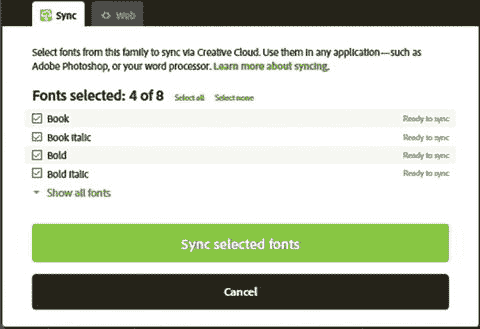

图 2-15.

点击 `同步所选字体` 将字体同步到你的电脑

> **注意：** 你必须拥有有效的互联网连接才能将 Typekit 字体同步到电脑，并且必须每 30 天连接一次互联网以维持你的 CC 许可证。

回到 InDesign，当你打开 `字体` 菜单时，你会看到菜单左上角的 `筛选`，旁边有两个图标。选择一个字体，点击星形图标将其添加到“收藏列表”。`收藏列表` 会出现在字体菜单的顶部。如果你安装了很多字体，`收藏列表` 可以避免你滚动长列表来查找字体。请注意，当你打开 `字体` 菜单时，你会看到一些实心星形和空心星形。当字体名称旁边出现实心星形时，表示该字体属于 `收藏列表`。如果你想从 `收藏列表` 中移除某个字体，点击该星形即可。当星形变为空心时，该字体便从 `收藏列表` 中移除（见图 2-16）。

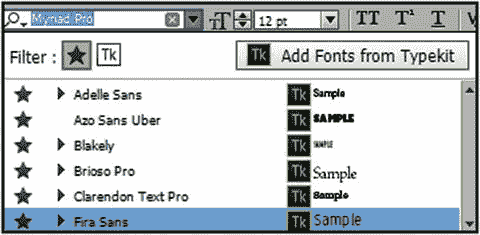

图 2-16.

显示实心星形的字体属于菜单顶部的 `收藏列表`

另一个图标用于筛选字体。你系统上安装的所有字体都会显示在字体列表中。点击 `筛选` 图标，列表将只显示 Typekit 字体。当仅使用 Typekit 字体进行设计项目，并且需要在布局中切换字体时，这会使工作变得简单。

## 2.6 熟悉图层面板

在处理复杂设计时，使用 `图层面板` 至关重要。如果你使用动画和嵌套的多状态对象，你可能需要隔离项目以使工作更容易。在你的设计工作中，只需要了解关于使用图层的几个要点。

### 2.6.1 命名图层

当你创建新图层时，为每个图层命名非常重要。提供一个描述性的名称，以便你能轻松找到与内容关联的图层。要创建新图层，请按住 `Alt/⌥` 键并点击 `图层面板` 底部的新建图层图标。这将打开 `新建图层` 窗口，你可以在创建图层时添加名称。

### 2.6.2 选择图层上的对象

当图层上有对象并且你想要选择一个项目时，请使用 `图层面板`。打开任何嵌套的组，然后点击一个对象或文本。要选择该对象，请点击图层名称右侧的方块。如果你想选择多个对象，请按住 `Shift` 或 `Ctrl/⌘` 键点击，分别用于连续和非连续选择。

### 2.6.3 在图层间移动对象

如果你想把一个对象从一个图层移动到另一个图层，请打开`图层面板`，点击对象名称右侧的方块图标，并将其拖到目标图层。当你添加新对象时，该对象会出现在活动图层上（在`图层面板`中选中的图层）。如果你不小心在选中的图层上创建了一个对象，而你想把它放到其他图层上，只需在`图层面板`中将该方块拖到目标图层即可。

### 2.6.4 粘贴对象

通常情况下，当你复制一个项目并想将其粘贴到文档中时，你会希望将其粘贴到复制该项目的原始图层上。要在同一图层上粘贴，请打开`图层面板`菜单并选择`粘贴时记住图层`。

### 2.6.5 隐藏和锁定图层

如果你的设计很复杂，隐藏某个图层或锁定某个图层以确保额外的内容不会被添加到不需要的图层上，可能会更容易。在`图层面板`中，要隐藏图层，请点击眼睛图标。要锁定图层，请点击眼睛图标和图层名称之间的列（见图 2-17）。

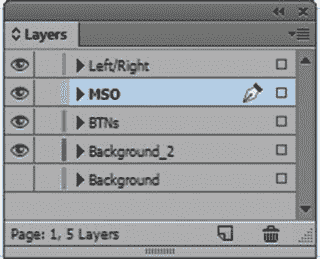

图 2-17. 点击图层名称旁边的眼睛图标来显示/隐藏

**提示**
要隐藏或锁定除选中图层之外的所有图层，请按住`Alt/⌥`键并点击眼睛（显示/隐藏）图标，或点击眼睛图标（锁定/解锁）与图层名称之间的列。要显示所有图层或解锁图层，请使用相同的快捷键。

如果你以前从未使用过图层的程序，遵循这些简单的步骤可以帮助你在创建设计时快速上手。

## 2.7 使用主页

当对象放置在主页上时，该对象将出现在所有分配给该主页的页面上。例如，如果你有主页 A、主页 B 和主页 C，并且第 1-3 页都分配给了主页 A，那么你放置在主页 A 上的任何对象都会出现在第 1-3 页上。

主页项目不会出现在可回流 EPUB 中，但其他类型的数字出版物可以通过将页码、页眉、徽标等项目放置到主页上而受益。

要向主页添加页码，请从`页面面板`打开主页。双击你想用于所有带页码页面的主页。创建一个文本框，然后选择`文字 ➤ 插入特殊字符 ➤ 标记 ➤ 当前页码`。设置文本的字体和大小，页码就会出现在分配给该主页的所有页面上。

**注意**
主页项目不会出现在可回流 EPUB 中。

如果你想创建一个新的主页，但又希望在新的主页分配的页面上也使用页码，请打开页面菜单并选择`新建主页`。在`新建主页`对话框中，从`基于主页`菜单中选择包含页码的主页（见图 2-18）。InDesign 会使用第一个主页的内容，并允许你在新主页上添加额外的项目，这些项目将出现在分配给第二个主页的所有页面上。

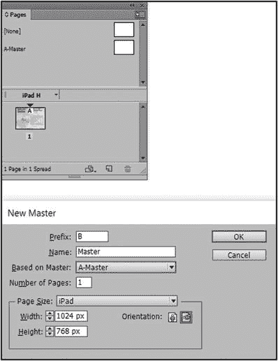

图 2-18. 选择`基于主页`以将给定主页的所有内容添加到一个新的主页上