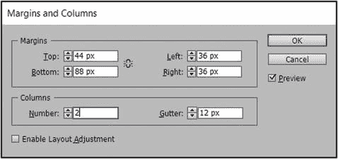

# 2.8 使用网格

利用网格可以帮助你在设计工作中增加结构和秩序。创建网格后，你会发现布局文档比在页面上随机放置文本、图像和对象要容易得多。网格有助于在设计中提升清晰度和精致感，并能帮助你为文档建立秩序和一致性。

网格可以添加到主页中，也可以添加到单个页面上。当将网格应用于某个已有主页网格的页面时，页面网格会取代主页网格，即应用于页面的网格具有优先权。换句话说，页面网格会覆盖主页网格。例如，你可以在主页上添加一个七栏网格，使所有页面遵循同一网格布局。然而，在文档的第 3 页，你可能想使用一个两栏网格。当你将两栏网格应用于该页面时，七栏网格就会消失。

无论是在主页还是单个页面上添加网格，都通过相同的菜单命令处理。选择 `布局 ➤ 边距和分栏` 以打开 `边距和分栏` 对话框，如图 2-19 所示。在“栏”区域中，输入你希望网格包含的栏数。

图 2-19.

在 `边距和分栏` 对话框中设置网格

请记住，当你创建一个网格（例如一个九栏网格）时，你所有的元素并不都需要包含在单个栏内。你可以让文本框架跨两栏，图像跨五栏，侧边栏占一栏。