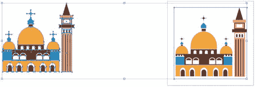

# 2.9 导入资源

添加到设计中的大多数资源都通过使用 `文件 ➤ 置入` 命令来处理。你可以通过这一个菜单命令导入照片、对象、视频、音频文件、PDF 页面以及来自其他 InDesign 文件的页面。

在某些情况下，你可能需要在 InDesign 中粘贴对象。通常，最好使用 `文件 ➤ 置入` 来导入图像。但在其他情况下，粘贴对象可能是更好的选择。例如，如果你有一个 Adobe Illustrator 文件，并且想要访问其中的单个对象，请在 Illustrator 中选择这些对象，然后选择 `编辑 ➤ 复制`。打开 InDesign 并选择 `编辑 ➤ 粘贴`。当你粘贴 Illustrator 图稿时，可以单独选择每个元素，并更改其填充、描边和变换等属性（参见图 2-20）。

图 2-20.

粘贴的 Illustrator 图稿（左）和置入的 Illustrator 图稿（右）

如果你在 InDesign 中置入一个 Illustrator 文件，其内容将被编组，你无法在 InDesign 中取消该图稿的编组来隔离和更改单个对象的属性。

