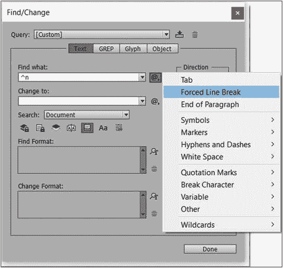
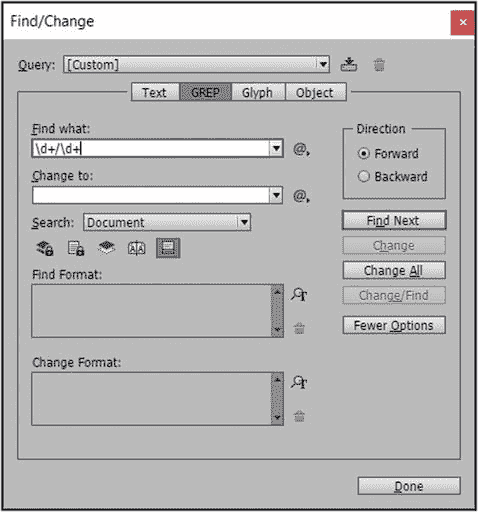

# 2.10 使用查找/更改

InDesign 拥有所有软件程序中最好的 `查找/更改` 工具之一。查找一个单词并将其更改为另一个单词非常直接，无需过多解释。然而，InDesign 中的 `查找/更改` 对话框能提供的远不止查找单词。你还可以查找和更改诸如空白、换行符、回车符、元数据和其他变量、符号和标记等更多内容。此外，InDesign 还允许你搜索和替换 GREP 模式和样式。

## 2.10.1 更改格式

假设你在文档中添加了一些换行符（`Shift+Enter/Return`），而不是回车符（`Enter/Return`）。重排式 EPUB 无法像其他类型的文档那样解释换行符，因此你应避免使用它们。

如果你想用回车符替换换行符，请通过选择 `编辑 ➤ 查找/更改` 打开 `查找/更改` 对话框。在 `查找/更改` 对话框中，点击 `查找内容` 文本框右侧的 `@` 符号。选择 `强制换行符`，如图 2-21 所示。

图 2-21. 点击 `@` 符号打开菜单，并选择一项用于查找格式

在 `更改为` 区域，点击 `@` 符号并选择 `段落结束符`。如果你想替换整个文档中的所有实例，请从 `搜索` 菜单中选择 `文档`。点击面板右侧的 `全部更改`，InDesign 会将所有换行符实例更改为回车符。

## 2.10.2 搜索 GREP 模式

`GREP` 代表 `全局搜索正则表达式并打印`。在 `查找/更改` 窗口中，你会看到一个 `GREP` 选项卡。当你使用此选项卡进行搜索时，InDesign 会搜索模式和表达式。

假设你在版式中使用上标和下标添加了分数。你想将这些分数更改为支持分数的字体中的字形。在 `查找/更改` 窗口的 `GREP` 选项卡中，你可以搜索所有使用了上标和下标的分数。

在 `查找内容` 文本框中，输入：`\d+/\d+`（参见图 2-22）。

图 2-22. 输入用于在文档中查找分数的代码，然后点击 `查找下一个` 按钮

这行简单的代码将查找文档中的任何分数。点击 `查找下一个` 按钮，InDesign 会显示搜索到的第一个匹配表达式。

互联网上有很多不同的 GREP 代码可供你使用。只需搜索 GREP 模式，你就会找到许多可以在 InDesign 中使用的表达式。有关使用 GREP 的更多信息，请参见第 6 章。

## 2.10.3 保存查询

在 `查找/更改` 对话框的顶部，你会看到 `查询`。点击默认项打开菜单，你会发现一些已保存为预设的搜索项。当你执行搜索并多次使用某个搜索时，可以将该搜索添加为新的查询。

点击 `垃圾桶` 图标左侧的 `保存查询` 按钮，将打开 `保存查询` 对话框。输入名称并点击 `确定`。你新保存的查询现在将作为菜单选项出现在 `查询` 菜单中。