# 3. 格式化文本

所有出版物，无论是印刷出版还是数字出版，都包含文本和图形。对于任何旨在作为印刷材料或在任何设备上查看的文档来说，文本都至关重要。文本的外观和设计，与出版物的整体物理布局和外观同样重要。很简单，在 InDesign 中，不向文档页面添加文本，你就寸步难行。

在处理文本方面，InDesign 功能强大。你可以以几乎每一种可以想象到的方式对文本进行布局和格式化。并且 InDesign 为你提供了丰富的工具和命令集，所有这些都旨在帮助你设置字体并实现排版的杰作。

在本章中，我们将探讨设置字体的多种方式，以及如何管理和格式化文本。除了在文档中管理和格式化文本之外，你还需要了解大量关于创建字符样式和段落样式的知识。这对于你创建的任何文档都至关重要。我将在第 6 章中介绍样式。现在，让我们先看看一些关于在 InDesign 中设置字体你需要了解的基本内容。

## 3.1 使用文本框架

在 InDesign 中了解文字的首要问题是，所有文本都存在于文本框架中。如果你在工具面板中选择`文字`工具，然后在文档页面上单击，不会发生任何事情。InDesign 需要一个文本框架。与文字处理程序、文本编辑器、Adobe Illustrator 等绘图程序以及 Adobe Photoshop 等图像编辑程序不同，在这些软件中，你单击文字工具，光标就会开始闪烁，准备让你输入文本，而 InDesign 的行为则不同。InDesign 需要一个由你创建或由 InDesign 为你创建的文本框架，具体取决于你如何向文档添加文本。

### 3.1.1 创建文本框架

要向文档添加文本，你需要创建文本框架或导入文本，在这种情况下，InDesign 会为你创建文本框架。如果你从一个新文档开始并想添加文本，有几种方法可以创建文本框架。

- `创建文本框架`：使用`文字`工具，点击并拖动以绘制一个矩形。此操作会创建一个文本框架。当你松开鼠标按钮时，熟悉的闪烁光标默认会出现在框架的左上角。

- `创建框架`：选择工具面板中的`矩形框架`、`椭圆框架`或`多边形框架`工具，然后绘制一个框架。点击工具面板中的`文字`工具，然后在框架内部单击。该框架现在变成了一个文本框架。

- `创建形状`：点击`矩形`、`椭圆`或`多边形`工具并创建一个形状。点击工具面板中的`文字`工具，然后单击该形状。该框架现在是一个文本框架。

- `创建线条`：使用`直线`工具或`钢笔`工具创建一条线。按住鼠标按钮点击工具面板中的`文字`工具，以弹出文字工具栏，选择`路径文字`工具，然后输入文本。

- `在文档中粘贴文本`：复制其他程序中的任何文本，然后选择`编辑` ➤ `粘贴`（`Ctrl`/`⌘`+`V`）。此操作会将剪贴板内容粘贴到 InDesign 文档中。粘贴后，InDesign 会创建一个包含所粘贴文本的文本框架。

- `导入文本`：当你选择`文件` ➤ `置入`并选择一个文本文件时，文本将被导入，同时 InDesign 会创建一个文本框架。

### 3.1.2 了解文本框架的构成

文本框架有几个常见属性，在向出版物中添加文本时，你应该熟悉这些属性。如图 3-1 所示，这些属性包括：

1. `入口`：通过框架左上角小正方形的外观，入口可以告诉你文本是否已串接，或者该文本段落是否为串接的起始端。图 3-1 左侧的框架显示一个空正方形。这表示框架起始处没有文本被串接。换句话说，该框架显示该文本是一个段落的开头。右侧的入口显示一个小的箭头，表示该文本之前有一个文本框架。换句话说，第二个框架是一个段落的延续。

2. `出口`：文本框架右下角的正方形是出口。这可以告诉你一个文本段落的结束，或者是否有更多文本被串接到另一个文本框架。在图 3-1 中，左侧的出口处有一个箭头，右侧的出口处有一个`+`符号。箭头表示该段落被串接到另一个文本框架，而`+`符号表示段落中还有更多文本尚未被放入文档。这通常被称为溢流文本。每当你在文本框架中看到`+`符号时，InDesign 都会提示你段落中还有更多文本。当你导出为 PDF 或对文件进行印前检查时，InDesign 会在错误对话框中提示文档包含溢流文本。

3. `控制柄`：当你选择一个文本框架时，框架的边角和中点处会出现控制柄。使用`选择`工具点击并拖动控制柄可以调整框架大小。

4. `串接线`：你可以通过选择`视图` ➤ `其他` ➤ `显示(隐藏)文本串接`来开启或关闭显示文本串接的线条。文本串接线显示了文本框架的链接顺序以及框架是如何链接在一起的。

5. `描边`：图 3-1 中左侧的文本框架显示的是无边框的框架。右侧则显示了一个带边框的框架。你可以通过在“描边”面板中进行选择来为文本框架添加边框。

6. `填充`：文本框架可以像任何其他对象一样进行填充。选择框架，打开“色板”或“颜色”面板。在选中框架的情况下单击一种颜色，框架就会被填充为所选颜色。

7. `角选项调整`：文本框架右侧的小黄框用于更改角选项。点击小黄框，框架上会出现四个黄色菱形。向左或向右点击并拖动菱形，可以同时调整所有四个角。按住`Shift`键并拖动，则可以调整单个角。

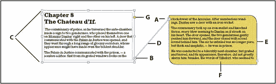

Figure 3-1. 两个选中的文本框架

### 3.1.3 使用文本框架选项

当你在工具面板中选择`文字`工具并点击包含文本的文本框架内部时，你会看到熟悉的闪烁光标。点击并拖动可以选中文本。在键盘上打字即可向框架中添加文本。

如果你选择`选择`工具并点击某个框架，则该框架会被视为一个对象。如果你想更改文本的属性，请使用`文字`工具并点击文本框架内部。然后你可以从`文字`菜单中选择选项。如果你想更改框架的属性，则需要再次切换到`选择`工具并点击该框架。作为对象，你可以在`对象`菜单中找到相关选项。选中框架后，选择`对象` ➤ `文本框架选项`。这时会打开“文本框架选项”对话框，如图 3-2 所示。

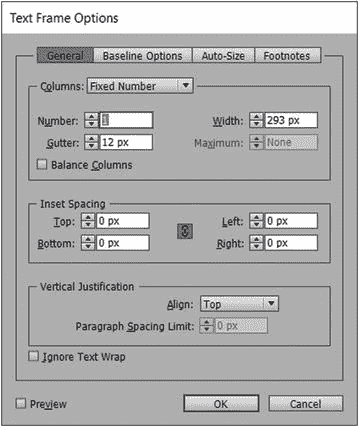

Figure 3-2. 使用选择工具选中文本框架，然后选择对象 ➤ 文本框架选项

**提示：** 使用`选择`箭头工具双击文本框架，该工具会切换为`文字`工具，你便可以在框架中选择文本或输入新文本。

在“文本框架选项”对话框中，你可以通过将`栏数`从默认的 1 栏更改为任意所需数量，将框架分为多栏。你可以通过在`栏间距`文本框中输入新值来更改栏间距（栏与栏之间的间距）。

**注意：** 带有多个栏的文本框架在导出为可重排的 EPUB 时会恢复为单栏。

如果你想在文本和框架之间创建一些空间（类似于内边距设置），请编辑`内边距`文本框。“内边距”区域中的链接图标用于在链接激活时，在框架所有边上均匀设置内边距值。如果你想分别调整每一边，请点击链接，使图标显示为断开的链条，然后单独设置每一边。

要在框架中垂直对齐文本，请从`对齐`菜单中选择选项。如果你希望在调整文本框架大小时避免出现溢流文本，请点击“文本框架选项”对话框中的`自动调整大小`选项。自动调整大小的可用选项显示在图 3-3 的菜单中。

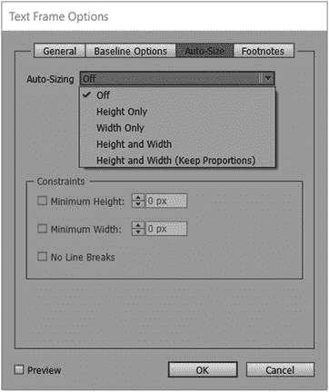

Figure 3-3. 点击自动调整大小，然后从自动调整大小菜单中选择一个选项

当你调整控制柄并重新调整文本框架大小，或编辑文本时，框架会调整到能够容纳框架中所有文本的尺寸。换句话说，你无法将框架大小调整到低于能够显示所有文本的尺寸。

## 3.2 使用字符面板

与 InDesign 中的许多功能一样，你有多种方式可以更改属性。设置字体选项也是如此。例如，你可以通过打开 `Type` 菜单并选择所需字体来选取字体。`Font` 菜单会显示 InDesign 中所有可用的字体。你也可以在控制面板中打开 `Fonts` 菜单。第三种选择字体的方法是打开字符面板中的 `Font` 菜单，如图 3-4 所示。

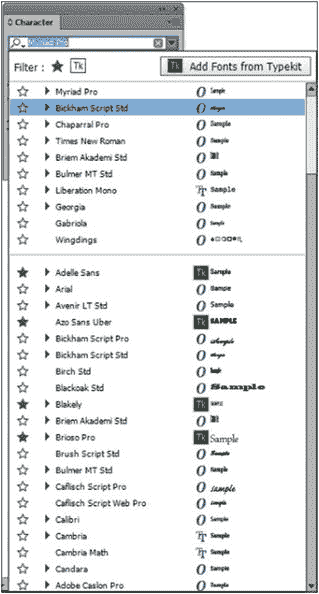

图 3-4. 系统安装的所有字体列表会显示在字符面板字体菜单中

使用 `Type` ➤ `Font` 菜单与其他两种方法的区别在于，控制面板和字符面板都提供了字体筛选选项。如果你点击控制面板或字符面板中的 `Tk` 图标，则仅会显示 Typekit 字体（见图 3-5）。再次点击，则会显示系统中加载的所有字体。

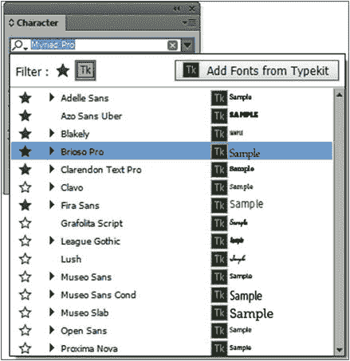

图 3-5. 点击 `Tk` 图标，菜单中将仅显示 Typekit 字体

控制面板和字符面板提供许多相同的选项。请随意使用适合你的那一个。当你选择 `Type` 工具时，请注意控制面板左上角有两个图标——`A` 字符和一个 `¶`（段落标记）符号。点击 `A` 字符，面板会发生变化，显示字符属性选项。点击段落标记 `¶`，控制面板会发生变化，显示段落属性选项。

**提示：** 控制面板是访问字符和段落工具的快速便捷方式。熟悉其选项并经常使用它。在控制面板中设置选项比使用菜单命令要快得多。

### 3.2.1 使用字符面板选项

在字符面板（如图 3-6 所示）和控制面板中找到的基本排版设置选项包括：

*   **字体菜单：** 点击向下箭头以打开字体菜单。在此菜单中进行选择即可选择一种字体。
*   **字体样式菜单：** 如果在意字体菜单中选择了 Helvetica，你实际上选择了整个字体系列。在字体样式菜单中，你可以选择类似 Helvetica Bold 的选项，这是 Helvetica 字体系列中的一种字体。
*   **字号：** 为所选字体选择点大小。
*   **行距：** 行距表示一行文本的基线与下一行文本的基线之间的距离。选择“自动”时，行距将是字体大小的 120%（或比字体大小大两个点）。你可以选择其他值来增加或减少行距。
*   **字偶间距：** 字偶间距是字符之间的距离。许多字体内置了字偶间距对。例如，当你输入 `Ty`、`Wa`、`Ke`、`Va` 及类似字符时，每对中的第二个字符会稍微缩进到第一个大写字母下方。你还可以选择“视觉”和“度量”。如果选择“视觉”，字偶间距会稍微紧凑一些。
*   **字间距：** 此设置决定了选定内容、一行文本、一个段落或一段文字中所有字符之间的距离，具体取决于你更改字间距时选择的文本。你可以通过在菜单中选择值或在文本框中输入自定义值，来使所有字符彼此靠得更近或更远。
*   **垂直缩放：** 用于垂直缩放文本。
*   **水平缩放：** 用于水平缩放文本。
*   **基线偏移：** 你可以通过点击箭头或在文本框中输入值，将文本在基线上方或下方进行偏移。
*   **倾斜：** 使用此选项可以人为地将文字变为斜体。
*   **语言：** 从语言菜单中选择一种语言，用于拼写检查和断字。

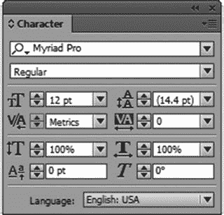

图 3-6. 字符面板中的排版选项

#### 缩放和倾斜文字

有时你可能会想使用字符面板中的水平缩放、垂直缩放或倾斜选项。我的建议是**永远不要**使用这些控件。

排版远不止是简单的图形设计或插入一些文本的插图。字体系列是精心制作的艺术品，在字符大小、宽度、x-高度、上升部和下降部等方面都有精确的细节。字体设计师花费大量时间创造新的字体系列，并且非常注重字符在大小和形态上如何组合在一起。

当你缩放或倾斜文字时，就像是在毕加索或康定斯基的画作上泼洒油漆。

### 3.2.2 使用字符面板菜单

与 InDesign 中的其他面板一样，字符面板也带有一个菜单，你可以在其中选择更多选项。点击字符面板中的菜单图标（右上角）即可打开菜单，如图 3-7 所示。

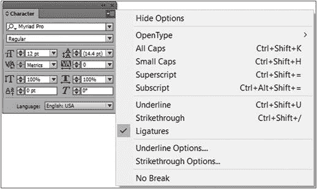

图 3-7. 点击字符面板中的菜单图标以打开菜单

该菜单为你提供了以下选项：全部大写字母、小型大写字母、上标/下标、下划线、删除线、使用连字（字符对，例如 `fl`、`fi`、`ffi` 等，这些字符组合本身被视为一个单一字符），以及一些用于设置下划线和删除线格式的选项。应用于所选文本时，“不换行”将不会断开某个单词。这对于保持某些单词对不分开、防止长 URL 换行或防止特定单词内断字非常有用。

字符面板菜单中的另一个菜单项是 `OpenType`。当你选择字符面板菜单中的 `OpenType` 命令时，会显示 `OpenType` 字体的选项。如图 3-8 所示，在使用 `OpenType` 字体时，你有很多选择。我在此不逐一解释每个选项。要熟悉这些选项，可以多尝试使用 `OpenType` 字体并观察效果。许多选项都是不言自明的。

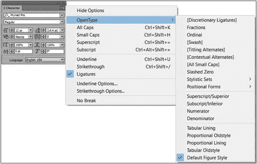

图 3-8. 使用 `OpenType` 字体时有更多选项

作为一般规则，应避免全部使用大写字母输入文本。相反，例如，如果你希望某个副标题以全大写形式显示，请以小写字母输入该副标题，然后改用“全部大写字母”命令。

## 3.3 使用字形面板

字形是特定字体中的单个字符。字体中不同字形的数量取决于你所使用的字体类型。对于 `OpenType` 字体，你拥有标准字体，其字符集较为有限；此外你还有专业字体，可提供更多字形。如果你想从多种特殊字符中进行选择，请使用专业字体，如 `Clarendon Text Pro`、`Adobe Caslon Pro`、`Myriad Pro`、`Minion Pro`、`Warnock Pro`，或任何名称中包含“Pro”字样的字体。

要查看字体中的所有字符，请选择“窗口”➤“文字和表”➤“字形”以打开字形面板，或打开“文字”菜单并选择“字形”。如果字形面板已位于工作区中，请单击面板停靠区中的“字形”。字形面板将打开，如图 3-9 所示。

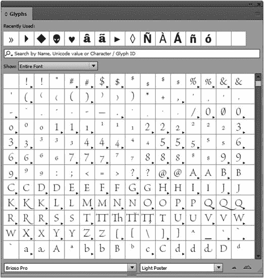

图 3-9. 选择“文字”➤“字形”，或单击面板停靠区中的“字形”面板名称以打开字形面板

当前活动的字体会显示在字形面板中。如果你想更改字体，请打开面板左下角的“字体”菜单。从“显示”菜单中，你可以选择显示“整个字体”，或从多种选项中进行选择，例如“数学符号”、“货币”、“比例数字”、“小型大写字母”等等。在菜单中进行选择可以缩小显示范围，以便你轻松定位所选字体中的特殊字符。

在字形面板的右下角，你可以选择放大或缩小字符。如果字符显示过小且难以辨认，请单击“放大”图标（以两个大山峰图标表示）。

假设你想添加一个字符，用于项目符号列表中的项目符号。从“显示”菜单中选择“符号”，显示范围将缩小，仅显示字体中的符号字符。找到你想使用的符号并双击它。该符号将被添加到文档中当前光标所在位置，同时也会显示在字形面板顶部的“最近使用”栏中，如图 3-10 所示。

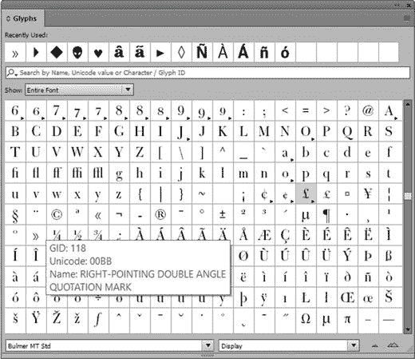

图 3-10. 双击字符可将其插入光标所在位置，该字符会自动添加到“最近使用”列表中

通过使用字形面板，你无需记忆快捷键即可输入商标、版权符号以及在设置字体时需要的任何其他特殊字符。

## 3.4 为字符添加笔画

我不会断言你绝不应该为字符添加笔画。事实上，在某些情况下，添加笔画效果相当不错。一个例子是《体育画报》刊头中应用的精美字体设计，其中为字符添加了多道笔画。在创作刊头时，《体育画报》的艺术家们需要设计出一种能够与封面任何类型的照片搭配使用的刊头。由于体育报道涵盖夜间赛事、白色雪坡上的滑雪、黎明和黄昏时的拍摄等等，因此刊头必须在各种色调和颜色的背景上都清晰可见。

传统的刊头采用了白色填充的字体。字体包含一道粗中灰色笔画、一道细黑色笔画、一道厚重的黑色投影，以及一道柔和的黑色投影。应用了多道笔画和投影。最终效果是设计精美的刊头，能够与封面上的任何照片形成良好对比（见图 3-11）。

图 3-11. 为字符添加笔画，使其能与任何颜色背景形成对比

在为字体应用笔画时，应避免添加厚重的黑色笔画或对字符毫无益处的装饰性设计。黄金法则是：“保持简洁优雅。”

## 3.5 设置段落属性

到目前为止，我们已经了解了如何格式化单个字符和单词。接下来，让我们继续探讨 InDesign 为我们提供的用于格式化段落的众多选项。你可以使用段落面板设置段落格式选项，也可以使用控制面板进行许多与段落面板中相同的选择。使用控制面板时，请单击段落（`¶`）符号（段落标记）。

### 3.5.1 使用“段落”面板

如果工作区中包含“段落”面板，请单击“面板停靠区域”中的`段落`。如果看不到“段落”面板，请选择`窗口 ➤ 文字与表格 ➤ 段落`，即可打开“段落”面板，如图 3-12 所示。

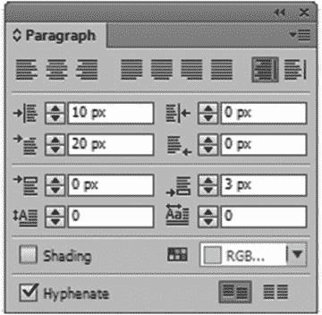

图 3-12. 单击“面板停靠区域”中的`段落`，或选择`窗口 ➤ 文字与表格 ➤ 段落`，以打开“段落”面板

您将在“段落”面板中找到以下选项：

- **对齐**：在第一行中，您将找到一系列对齐功能的选项。前三个是左对齐、居中对齐和右对齐。接下来的四个是用于两端对齐文本的各种对齐选项。最后两个是朝向书脊的对齐（左和右）。
- **左缩进**：整个段落会根据您在文本框中添加的值进行缩进。
- **右缩进**：从右侧缩进段落。
- **首行左缩进**：缩进段落中的第一行。
- **末行右缩进**：将段落中的最后一行向右缩进。
- **段前距**：在段落前添加间距。
- **段后距**：在段落后添加间距。
- **首字下沉行数**：设置首字下沉的行数。
- **首字下沉一个或多个字符**：如果您想使用整个单词或几个字符作为首字下沉，请在文本框中输入数字，并确保设置了行数（参见“首字下沉行数”）。

- **`底纹`**：选中`底纹`复选框可为单个段落添加颜色底纹。从下拉菜单中选择一种颜色。如果您的多个段落被回车或段前/段后距分隔，则只有文本区域会显示底纹，如图 3-13 左侧所示。如果您希望框架内的所有文本都带有底纹，如图 3-13 右侧所示，则需要在“段落底纹”对话框中进行调整。
    - 要打开“段落底纹”对话框，请从“段落”面板菜单中选择`段落底纹`。此时将打开“段落底纹”对话框，如图 3-14 所示。要延续图 3-14 中文本框架的底纹，请首先单击链条图标以断开左侧、右侧、顶部和底部设置的链接。在`顶部`文本框中添加数值，以覆盖段落之间的间距。在本示例中，第一段之后的段后距设置为 14 点；因此，在`顶部`文本框中输入 14 点即可充分覆盖该间隙。
    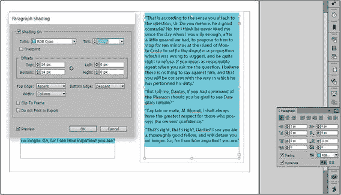
    图 3-14. 在“段落底纹”对话框中进行编辑并勾选`预览`
    - 在“段落底纹”对话框中，将该对话框移至您正在编辑的文本框架旁边并勾选`预览`。进行编辑后，按 `Tab` 键预览结果（参见图 3-14）。
    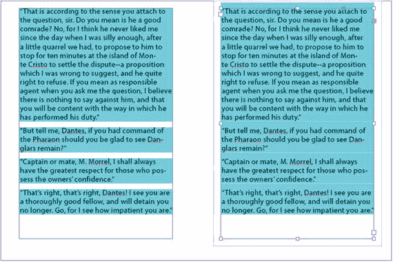
    图 3-13. 默认的`段落底纹`（左图）以及在“段落底纹”对话框中编辑后的`段落底纹`（右图）
- **连字**：启用`连字`复选框以应用连字符连接。
- **对齐到基线网格**：单击第一个图标可关闭对齐到基线网格。单击第二个图标可开启对齐到基线网格。网格和参考线在`InDesign 首选项`中设置。如果需要更改网格线细分，请按 `⌥/Alt` 并单击其中一个图标。`首选项`对话框中将打开`网格`首选项选项。在此处进行调整，然后单击`确定`以更改网格大小。

### 3.5.2 使用“段落”面板菜单

正如“字符”面板为您提供了丰富的字符设置选项一样，“段落”面板为您提供了另一组用于格式化段落的选项，如图 3-15 所示。
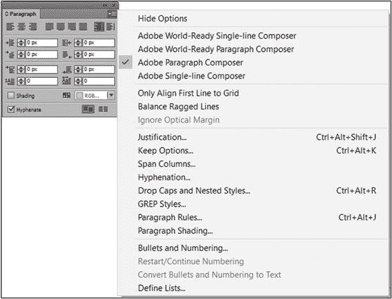
图 3-15. 单击“段落”面板右上角的图标以打开面板菜单

再次说明，我不会解释面板中所有可用的选项。请查阅 `Adobe InDesign 帮助`文档以深入了解各种选项。您可能经常使用的一些设置包括`跨栏`、`段落线`和`项目符号和编号`。

选择某个选项时，`InDesign` 会打开一个对话框，您可以在其中选择希望如何表示给定设置。对于`跨栏`，您可以在“跨栏”对话框中选择单栏、多栏或拆分栏。对于`段落线`，您可以选择在段落上方和/或下方设置线条，指定线型和线粗、线条颜色，以及线条相对于段落出现的距离。对于`项目符号和编号`，您可以选择项目符号或编号（用于编号列表）、字符和对齐方式。

用于字符和段落格式的排版选项非常丰富。大多数人不会使用 `InDesign` 提供的所有功能。人们倾向于选择与其工作类型相符的选项。如果您是 `InDesign` 的新手，请熟悉这两个面板和`控制面板`，并使用您需要的选项。随着您在工作中变得更加熟练，可以探索其他功能，这些功能有助于节省时间并提高制作效率。

## 3.6 在路径上创建文字

在“工具”面板中，有两个文字工具。默认工具是`文字工具`。如果在“工具”面板中单击`文字工具`并按住鼠标按钮，则会弹出一个工具栏，您可以同时看到这两个工具。第二个工具是`路径文字工具`。您可以使用此工具在路径上添加文字。

路径可以是您使用`钢笔工具`或线条工具绘制的任何路径，也可以是您使用形状工具绘制的任何形状。您可以将文字添加到椭圆、矩形、多边形、其他形状以及自由形状的线条上。

在图 3-16 中，您可以看到一些路径文字示例。当您使用`路径文字工具`单击路径时，I 形光标会在您单击的位置开始闪烁。输入文本，文本将沿着路径排列。
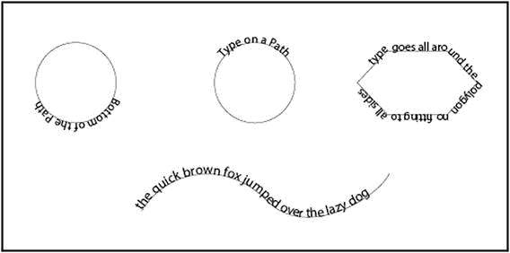
图 3-16. 路径文字的一些示例

使用“路径文字”时，您可以更改一些选项。选择该路径，然后选择`文字 ➤ 路径文字 ➤ 选项`以打开“路径文字选项”对话框。

默认效果是`彩虹`。您可以选择其他选项，例如`倾斜`、`3D 带状`、`阶梯`和`重力`。当您更改效果时，会看到许多不同的结果，如图 3-17 所示。您还可以控制文字相对于基线的位置。默认情况下是对齐到`基线`。您还可以选择对齐到`上升线`、`下降线`和`居中`，并在相邻的`到路径`菜单中为`顶部`、`底部`和`居中`做出选择。`间距`文本框使您能够调整字符间距。
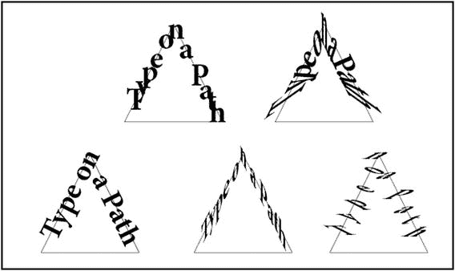
图 3-17. 打开“路径文字选项”对话框以细化文字相对于形状的位置

## 3.7 在故事编辑器中编辑文本

InDesign 的故事编辑器就像是在软件内部内置了一个文字处理程序。与专业的文字处理软件相比，故事编辑器虽然非常简单，但功能强大，它让你无需退出 InDesign 程序即可编辑文本。

故事编辑器的一个实用功能是编辑存在溢流文本的文本框架中的内容。你可能希望在一个特定的文本框架处结束一段文字，但文本发生了溢流，因此你需要进行一些编辑，使副本内容适合该框架。

要打开故事编辑器，请先在文本框架中点击文字工具，然后选择 `编辑 ➤ 在故事编辑器中编辑` 或按 `Ctrl/⌘+Y` 键。故事编辑器窗口会显示在你的 InDesign 文档上方，如图 3-18 所示。
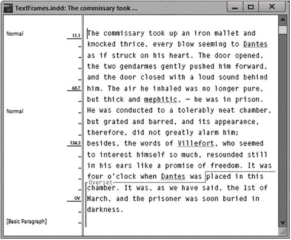
图 3-18. 选择 `编辑 ➤ 在故事编辑器中编辑` 或按 `Ctrl/⌘+Y` 键，在故事编辑器中打开文本

如图 3-18 所示，故事编辑器的底部有一条水平线，线的左侧显示有“溢流”字样。这条线表示文本框架中当前所有溢流的文本。

在故事编辑器中，你可以剪切、复制和粘贴文本。你也可以使用“查找/更改”对话框来搜索文本和 GREP 模式，并替换文本。如果在故事编辑器内部右键单击鼠标，你会在菜单中找到许多格式选项，如图 3-19 所示。
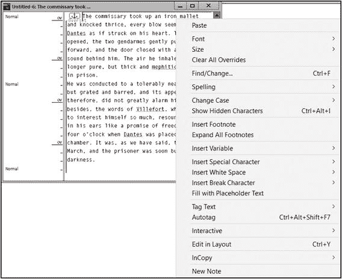
图 3-19. 在故事编辑器中右键单击可打开上下文菜单

在 InDesign 中进行文档排版时，你会发现故事编辑器非常有用，尤其是在发现文本框架中有溢流文本时。

## 3.8 创建文本绕排

当你以线性方式（即一个接一个地在文本段落之间）放置对象时，设计可能会显得乏味。在某些情况下，当你将文本绕排到图像周围时，可以创造出更有趣的设计。你可以设计一个页面，让文本流动并成为图像的一部分，从而形成一种图形化的表达，类似于图 3-20。

图 3-20. 文本绕排到图像周围

### 3.8.1 使用文本绕排面板

要围绕图像绕排文本，你需要使用 InDesign 中的文本绕排面板。要访问该面板，请选择 `窗口 ➤ 文本绕排` 或按 `Ctrl/⌘+Alt/⌥+W` 键。文本绕排面板会打开，如图 3-21 所示。
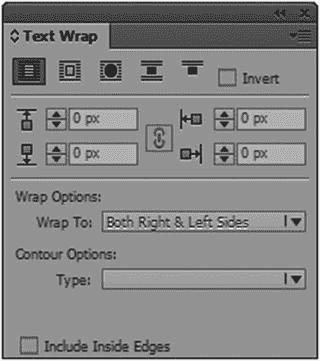
图 3-21. 选择 `窗口 ➤ 文本绕排` 以打开文本绕排面板

该面板中的重要选项包括：
- **无文本绕排**：默认情况下，此选项处于选中状态。表示对象未应用文本绕排。
- **沿定界框绕排**：此选项使文本围绕对象的所有边进行绕排。
- **沿形状绕排**：当你希望文本沿着形状的轮廓绕排时，请使用此选项。
- **对象跳跃**：选择此选项时，文本会从对象的顶部跳跃到底部。水平方向不会发生绕排。
- **跳转到下一栏**：文本会从图像的顶部跳转到下一栏。文本框架需要链接在一起，文本才能流向下一栏。
- **边距**：点击链接图标可取消边的链接，或再次点击可链接所有四个边。在文本框中输入数值，可以使文本与图形之间产生偏移。
> **提示**：在偏移文本框中点击，然后按键盘上的向上箭头键可增加数值。按向下箭头键可减小偏移值。
- **绕排选项**：在下拉菜单中，你可以选择在右侧绕排、左侧绕排、两侧绕排、朝向书脊绕排、远离书脊绕排以及最大区域绕排。（如果对象靠近栏的一侧，那么最大区域就是另一侧，因此绕排只会在那一侧进行。）

### 3.8.2 沿形状绕排

要围绕图像和对象绕排文本，你需要经过几个步骤。InDesign 无法自动检测图像和对象的边缘，除非你正确地设置了图像并告知 InDesign 你想要沿形状绕排。

# 光栅图像与文本绕排

对于光栅图像（如 Photoshop 文件），你可以使用剪切路径，或者直接使用位于带有透明度的图层上的图像。将文件保存为 `.psd` 格式，然后在 InDesign 中导入该图像。打开文本绕排面板，然后点击“沿形状绕排”图标。你可能还看不到文本沿形状绕排。

文本没有绕排的原因是，你还没有告诉 InDesign 去检测形状的边缘。点击“沿形状绕排”图标后，打开 `对象` 下拉菜单，选择 `剪切路径 ➤ 选项`。在“剪切路径”对话框中，打开 `类型` 菜单，选择 `检测边缘`。现在，文本应该会围绕形状绕排，如图 3-22 所示。

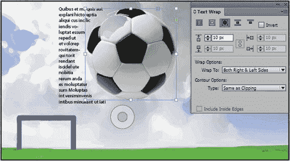

图 3-22. 当你想沿形状绕排文本时，务必在 `类型` 菜单中选择 `检测边缘`

有趣的是，如果在 InDesign 中创建文本轮廓，例如选中一个单词或字符，然后选择 `文字 ➤ 创建轮廓`（`Ctrl/⌘+Shift+O`），该文本字符会被转换为一个可编辑的对象。如果你想围绕一个已转为对象的字符绕排文本，只需选中该对象，然后在文本绕排面板中点击“沿形状绕排”图标即可。

Adobe Illustrator 和其他矢量图稿在导入 InDesign 时行为会有所不同。当你在 InDesign 中选中一个导入的矢量对象，并在文本绕排面板中点击“沿形状绕排”图标时，你无法实现沿形状绕排。同样，你必须从 `类型` 菜单中选择 `检测边缘`，才能使文本围绕图像的形状绕排。

请记住，如果你发现文本绕排效果不如预期，请检查 `类型` 菜单，确保你已经在该菜单中选中了 `检测边缘`。

## 3.9 运行拼写检查

在发布文档之前，设计流程的最后一步是检查拼写错误。我使用 Microsoft Word 已经快 30 年了，在升级到 Word 2016 之前，我对 Word 的拼写检查功能一直有意见。而 InDesign 的拼写检查则直观且易于使用。

### 3.9.1 探索拼写检查选项

拼写检查功能位于“编辑”菜单中。当你选择 `编辑 ➤ 拼写检查` 时，会出现一个子菜单，提供四个选项：

- `拼写检查`：选择此选项后，“拼写检查”对话框会打开。在“拼写检查”对话框中，InDesign 会报告拼写错误，并提供几个编辑拼写的选项。

- `动态拼写`：乍一看，你可能会认为此选项可以在你输入时自动更正错误。但实际情况并非如此。InDesign 会在它认为拼写错误的单词下方显示一条波浪线。当线条为红色时，表示 InDesign 判断该单词拼写错误。当线条为绿色时，表示拼写正确但存在其他问题。例如，如果你输入的一个句子以小写字母开头，并且单词拼写正确，InDesign 会显示一条绿色波浪线，因为句子中的第一个单词应该以大写字母开头。因此，这条线指示的错误类型并非单纯的拼写错误。

- `自动更正`：当你勾选“自动更正”后，InDesign 会在你输入时自动将常见的拼写错误和输入错误替换为正确的拼写。

- `用户词典`：点击此菜单项，会打开“用户词典”对话框。你可以向用户词典添加单词，从文本文件导入单词，或者用新词典替换现有词典。

### 3.9.2 检查拼写错误

选择 `编辑 ➤ 拼写检查 ➤ 检查拼写`，打开如图 3-23 所示的 `检查拼写` 对话框。你需要在此对话框中选择的第一项是对话框底部的 `搜索` 菜单。你可以选择 `所有文档`，此时 InDesign 将搜索所有打开的文档。可以选择 `文档`，此时 InDesign 将搜索该打开文档中的所有故事。下一个选项是 `故事`。当光标位于某个文本框架内并选择 `故事` 时，InDesign 将搜索相应的故事，并忽略未与选中框架链接的其他文本框架。你可以搜索至 `故事末尾`。如果你将光标置于故事中间并选择此选项，InDesign 将搜索到故事末尾然后停止。菜单中的最后一项是 `选区`。如果你在框架中选中文本并选择此选项，InDesign 将仅搜索选中的文本，然后停止搜索。

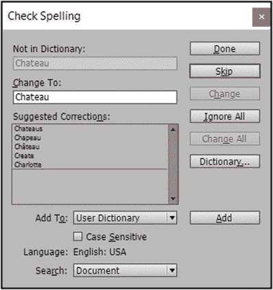

图 3-23. 选择 `编辑 ➤ 拼写检查 ➤ 检查拼写` 以打开 `检查拼写` 对话框

在选定搜索内容后，InDesign 会将第一个拼写错误的单词列在 `未在词典中` 文本框中。如果 InDesign 能给出正确的拼写建议，建议会显示在 `建议更正` 框中。若找到合适的更正项，点击框中的更正建议，该单词会被放入 `更改为` 文本框。点击 `更改` 按钮，选中的单词即被替换为建议的更正。如果同一个单词出现多次，可点击 `全部更改`，InDesign 将纠正所有拼写错误的单词。

如果使用了外来语单词，请退出 `检查拼写` 对话框，将光标置于该外来语单词之前。点击 `控制面板` 中的 `A` 图标以选择 `字符` 选项，然后从 `控制面板` 中选择一个词典，如图 3-24 所示。

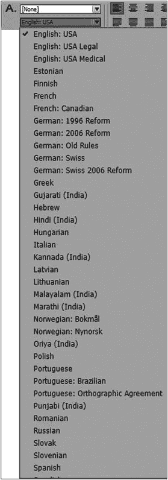

图 3-24. 为特定语言单词选择对应的语言词典

选择 `编辑 ➤ 拼写检查 ➤ 检查拼写` 打开 `检查拼写` 对话框，如果单词拼写正确，InDesign 会跳过该单词并跳至下一个拼写错误。如果单词拼写错误，则可能会出现一个建议更正列表，此时应选择正确的拼写并点击 `更改` 或 `全部更改`。

### 3.9.3 更正文档中的拼写错误

如果在文本框架中点击鼠标右键，会弹出一个菜单，其中包含多个更改字符属性和访问若干菜单命令的选项。如果右键点击一个拼写错误的单词，菜单会发生变化，仅提供与拼写错误相关的选项。菜单顶部是一个 `建议更正`。如果建议正确，在菜单中选择它，InDesign 便会将单词更改为正确拼写。

> **注意**
>
> 为了在文档中看到拼写错误的单词（单词下方的红色波浪线），必须勾选 `编辑 ➤ 拼写检查 ➤ 动态拼写检查`，并且必须处于 `正常` 视图（而非 `预览` 视图）下。

## 3.10 本章小结

在本章中，我们学习了文本操作，涉及设置字体、格式化文本、使用各种字体特性以及设置多种属性。你学会了如何选择字体、使用 Adobe 的 Typekit，以及在设置字体时的一些注意事项。

在下一章中，我们将离开文字排版，探讨在使用图形和对象时需要的许多 InDesign 功能。