# 4. 使用图形

在第 3 章中，我介绍了许多在操作文本时可用的功能。相信我，第 3 章仅触及了在 InDesign 中对文本所能做操作的一小部分。然而，通读第 3 章后，你应该为在 InDesign 中设置字体打下了基础。

在本章中，我将介绍使用图形，包括图像、对象以及所有非文本的素材。同样地，我也只能浅谈在 InDesign 中使用图形，因为图形处理远比我能在此分享的要丰富得多。但希望这足以让你开始为数字出版物添加图形，并探索一些奇妙的效果。

将图形导入 InDesign 相对直接，因此没什么挑战性。真正需要更多学习和掌握的是，在将这些图像和对象导入 InDesign 后，你能对它们进行哪些操作。

在本章中，我们将探讨将图形导入布局、在 InDesign 中创建图形对象、应用颜色，以及在对象上运用特殊效果的精妙方法。

## 4.1 导入图形

所有图形，包括图像、插画作品、影片文件、SWF 文件，以及文本文件和音频文件，都使用相同的菜单命令导入。选择 `文件 ➤ 置入` 以将素材导入 InDesign。除了较短的文本段落和一些矢量艺术插画外，你应该始终使用`置入`命令，而不是将元素复制粘贴到 InDesign 中。唯一的例外是在向项目添加 Adobe Illustrator 作品时。当你复制粘贴 Illustrator 作品时，可以访问 Illustrator 绘制的所有独立路径。而当你置入 Illustrator 作品时，则无法分解插画。

### 4.1.1 置入单个对象

当你选择 `文件 ➤ 置入` 时，会打开`置入`对话框，如图 4-1 所示。在对话框底部，你会找到几个复选框。左侧是`显示导入选项`。启用此复选框后，会在放置对象前打开另一个对话框。在`导入选项`中，你可以对页面范围（如果打算置入多页文档，如 PDF 文件）、图像属性、颜色配置文件和分层文档的图层进行一些选择。

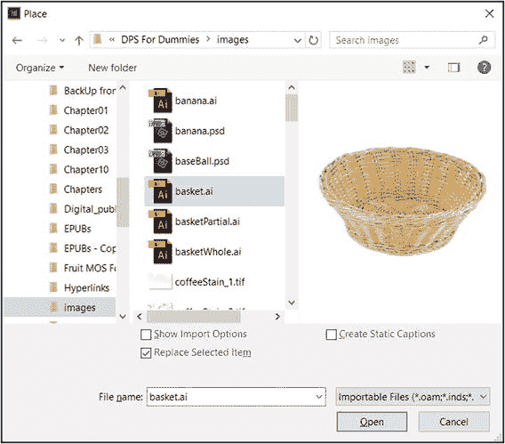

*图 4-1. 选择 `文件 ➤ 置入` 以打开 `置入` 对话框*

下一个复选框是`替换所选项目`。如果你选中了一个图像框架并选择此选项，则框架中的所有内容都将被新导入的内容替换。最后一个复选框是`创建静态题注`。使用此复选框可基于文件名添加题注。

如果在点击`置入`对话框中的`打开`之前选中了`显示导入选项`，则会打开`导入选项`对话框。根据文件类型，选项会发生变化。在图 4-2 中，我选择了一个 Adobe Illustrator 文件。你看到的选项与矢量艺术作品相关。如果你选择图像文件，选项会有所不同。

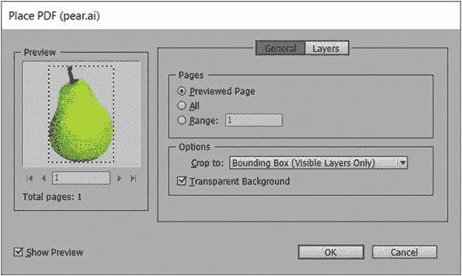

*图 4-2. 在 `置入` 对话框中点击 `打开` 后，会显示另一个对话框中的 `导入选项`*

无论文件类型如何，你都会看到正在放置文件的预览。如果该文件正是你想要的，点击`确定`，光标就会加载相应的对象。

> `警告`

> 当你使用`置入`命令导入文件时，该文件会被放置在一个框架内。与文本一样，所有图形都存在于框架内。

### 4.1.2 放置多个对象

如果你有多个对象，并希望将其排列成网格或类似表格的布局，请选择 `文件` ➤ `置入`。通过按住 `Ctrl/⌘+单击`（非连续选择）来选择对象，然后单击 `打开`。拖动已加载的光标，在按住鼠标按钮的同时，按下键盘上的 `上箭头` 键可创建行，按下 `右箭头` 键可创建列。这就是 InDesign 的 `网格化` 功能。

当参考线显示出的矩形数量恰好能容纳你想要导入的对象数量时，松开鼠标按钮，所有对象都会被放置到按列和行排列的框架中，如图 4-3 所示。

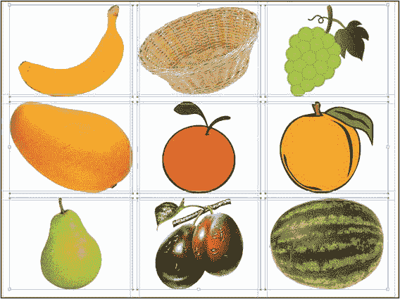

图 4-3. 单击并拖动已加载的光标，按下 `上箭头` 键创建行，按下 `右箭头` 键添加列

### 4.1.3 将对象适配到框架中

你在 InDesign 中置入的所有对象都会被放置到框架内部。在控制面板中，有多个选项可用于调整对象如何适配框架。在图 4-4 中，你可以看到控制面板中包括以下适配选项：

1.  `按比例填充框架`：单击此项可用对象填充框架，同时保持对象的比例。图像的宽度或高度之一将填满框架，图像的一部分可能会被裁剪。

2.  `按比例适配内容到框架`：单击此项可将内容按比例适配到框架大小。

3.  `适配内容到框架`：单击此项后，内容将适配到框架，但会失去比例。使用此选项时，你可能会看到对象出现一些变形。

4.  `适配框架到内容`：实际使用时，你应该对大多数图像采用此选项。框架将根据内容的大小进行调整。对于文本框，框架大小会适配其中的文本内容。这可以消除可能过大并妨碍页面上其他布局项的框架。

5.  `内容居中`：使用此项可将内容在框架内水平和垂直居中。

6.  `自动适配`：启用此复选框可使内容自动适配框架。请参阅下一节“调整对象大小”，以更全面地了解 `自动适配` 如何帮助你。

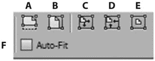

图 4-4. 使用控制面板中的适配选项来调整适配设置

### 4.1.4 调整对象大小

InDesign 在大多数其他 Creative Cloud 程序中是个异类。在其他程序中，你按住 `Shift` 键并拖动控制柄即可按比例调整对象大小。如果在 InDesign 中使用此方法，你调整的是框架的大小，而非对象的大小。如果框架小于对象，那么在拖动框架四周的控制柄时，你会裁剪对象（见图 4-5）。

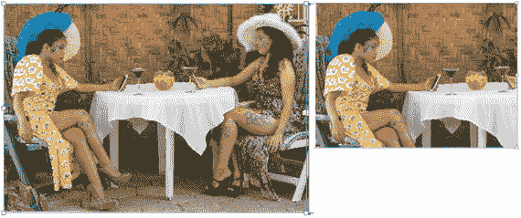

图 4-5. 左侧为使用按键修饰符调整大小的对象，右侧为启用 `自动适配`（见控制面板中的复选框）的情况——在不使用修饰键或未启用 `自动适配` 时移动角控制柄的效果

要调整对象大小，你可以使用两种方法。如果禁用了 `自动适配` 复选框，请按住 `Ctrl/⌘+Shift` 键并拖动控制柄。务必在移动控制柄之前按下键盘上的这些键。

第二种方法使用 `自动适配` 复选框。如果启用了 `自动适配` 复选框，你可以按住 `Shift` 键并拖动控制柄来调整对象大小。对象将按比例调整大小。如果你想使用 `Shift+拖动` 来调整对象大小，需要为每个对象启用 `自动适配`。如果要调整多个对象的大小，请按 `Ctrl/⌘+A` 选择这些对象，然后启用 `自动适配` 复选框。

一旦为某个对象设置了 `自动适配`，它就会一直保留在该对象上。如果你以后想要裁剪图像，需要禁用 `自动适配` 复选框，然后拖动控制柄来裁剪框架内的图像。

你对导入的图像和对象所做的所有编辑都是非破坏性的，这意味着你不会永久性地改变对象本身。例如，如果你裁剪了一张图像，保存文件，然后在另一个编辑会话中再次打开它，你可以拖出框架来显示之前被裁剪的区域。

## 4.2 为置入的图像应用色彩

为图像着色最常见的用途之一就是为纹理添加色彩。你可以在互联网上找到大量免版税的纹理图片。下载这些文件并在 Photoshop 中打开。

若要在 InDesign 中对栅格图像进行着色，需要遵循一些规则。文件必须是灰度模式或位图（文件中所有颜色信息必须被移除）。图像必须保存为拼合后的（单图层）`.psd` 或 `.tif` 文件。

导入图像后，请注意该图像位于一个框架内部。默认情况下，当你使用选择工具点击时，框架会被选中。如果你应用色彩，色彩会应用于框架而非图像。双击框架以选中图像，然后才能应用色彩。

`警告`

当你使用选择工具点击框架时，点击会选中框架。当你使用选择工具双击框架时，你会选中框架内部的内容（或称为内容）。

为了更好地理解这一切是如何运作的，让我们一步步来完成在 InDesign 中为图像着色的操作。

1.  在 Photoshop 中准备文件。如果文件是 RGB 图像，你需要将其转换为灰度模式。选择“图像 ➤ 模式 ➤ 灰度”，或者使用 Photoshop 中的“调整”面板，点击“创建新的黑白调整图层”图标。然后拼合图层，并将其保存为 `.psd` 或 `.tif` 文件。

2.  打开一个 InDesign 文件或创建一个新文档。

3.  在 InDesign 中置入图像。选择“文件 ➤ 置入”并导入图像。通过拖动图像将其定位到所需位置。在我的示例中，我置入了一个用作背景的纹理，如图 4-6 所示。

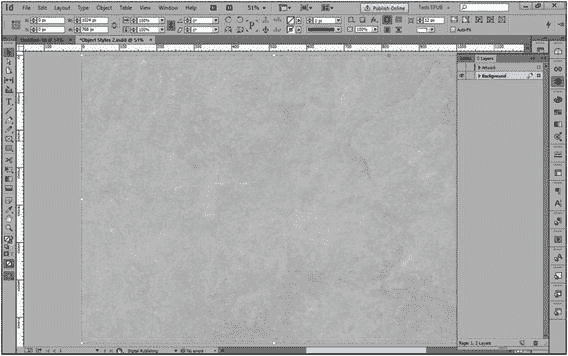

图 4-6. 在 InDesign 文件中置入图像

## 4.3 绘制描边

多年前，大约在 20 世纪 90 年代中后期，QuarkXPress 是主流的排版软件，也是图形设计师和广告公司的核心工具。设计师用它来做所有事情，包括创建徽标、插画作品以及绘制图标和符号。当文件被送到服务商输出到印前设备时，服务商的技术人员为了在这些高端设备上打印文件而绞尽脑汁。当时的排版软件根本无法妥善处理设计师用来向文档添加对象的诸多方法——这些对象在屏幕上看起来很好，但打印出来时就问题百出。

软件开发者很快意识到，设计师喜欢坚守一个他们熟悉的软件，并在其偏好的程序中创建一切。有些人早在 Adobe Illustrator 支持多个画板之前，就使用它创建多页版面。有些设计师在制作海报和小册子时，则完全依赖 Adobe Photoshop。版面设计师在绘制形状和自定义描边时，会使用他们偏爱的软件。

随着 InDesign 的成熟，Adobe 提供了更高级的方法来创建自定义描边和对象。如今，对于那些创建交互式数字出版文档的人来说，在制作自定义按钮、精美边框、3D 对象、透视绘图以及具有各种特效的对象时，可能完全无需离开 InDesign。你会发现 InDesign 中用于绘制插画的工具既丰富又令人印象深刻。此外，你在 InDesign 中创建的所有内容同样适用于印前和印刷。

### 4.3.1 使用描边工具

你可以使用`钢笔工具`、`铅笔工具`和`直线工具`绘制描边。描边也可以应用于形状和框架。在图 4-8 中，你可以看到使用这三种绘图工具绘制的描边、应用于形状的描边以及应用于文本框的描边。

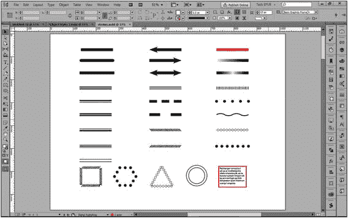

**图 4-8.** 应用于线条、形状和带文本框架的描边

对于对象和文本，你还可以添加填色。描边出现在对象的外部，而填色则出现在描边的内部。

### 4.3.2 使用“描边”面板

`描边`面板用于更改描边属性。选择`窗口 ➤ 描边`（`F10`）即可打开`描边`面板，如图 4-9 所示。

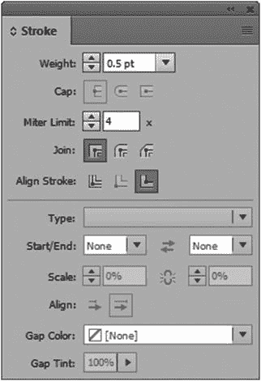

图 4-9.

选择`窗口 ➤ 描边`或按`F10`键打开`描边`面板

`描边`面板为您提供了多个选项，包括：

*   **粗细**：在文本框中输入一个值，或从下拉菜单中选择描边粗细的不同尺寸。
*   **端点**：提供了三种端点样式。您可以使用默认的`平头端点`，此时描边的起点和终点与描边宽度相同，没有端点。点击第二个图标可应用`圆头端点`，为描边添加圆形末端。选择第三个图标可使用`投射端点`，此时端点会向描边两端外侧延伸。
*   **斜接限制**：当您使用`钢笔工具`或`铅笔工具`绘制线条时，线条的连接处可能出现`平头端点`且同一路径上带有尖角——类似于图 4-11 左侧所示的情况。如果提高`斜接限制`值，则可以消除`平头端点`，如图 4-10 右侧所示。编辑`斜接限制`值的缺点是，最终可能会出现大小不一的尖角，如图 4-10 所示。

    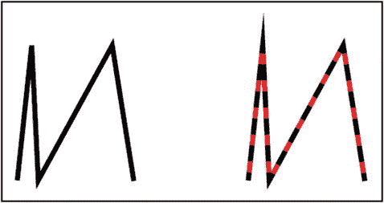

    图 4-10.

    斜接限制设置为默认值`4x`（左侧）和斜接限制设置为`13x`（右侧）

> **注意**
>
> 仅当选择了`斜接连接`选项时，才能编辑`斜接限制`。

*   **连接**：包括`斜接连接`、`圆角连接`和`斜面连接`三个选项。
*   **对齐描边**：可选择`描边居中对齐`、`描边内侧对齐`和`描边外侧对齐`。
*   **类型**：打开下拉菜单，可从一长列描边样式中进行选择。
*   **起点/终点**：从下拉菜单中选择不同的箭头及其他起点/终点选项。
*   **间隙颜色**：有时，您可能希望使用虚线，并希望用某种颜色或该颜色的淡色填充虚线之间的间隙。如果描边类型为实线，此选项无效。
*   **间隙淡色**：通过在文本框中输入数值或移动点击右向箭头后出现的滑块，来更改间隙颜色的淡色值。

如果您发现文档中多次使用到具有相同属性的描边，可以为描边设置一个文档偏好。创建新文档后，请勿选择文档页面上的任何内容。打开`描边`面板，设置您希望用于所绘制或应用于框架的描边的属性。这些设置将成为新的默认值（仅适用于当前打开的文档），这样每次您绘制或应用描边时，就无需在`描边`面板中进行其他编辑了。

### 4.3.3 创建自定义描边

在 Adobe Illustrator 中，您可以使用`外观`面板来创建对象，并为单个对象应用多个描边和/或填充。遗憾的是，InDesign 没有`外观`面板，并且在撰写本文时，我们还无法像在 Adobe Illustrator 中那样强大地处理 InDesign 中的描边。不过，好消息是，我们可以使用一些变通方法和技巧，超越`描边`面板中的选项，创造出一些有趣的效果。

要创建新的自定义描边，请打开`描边`面板菜单并选择`描边样式`。系统将打开`描边样式`对话框，如图 4-11 所示。

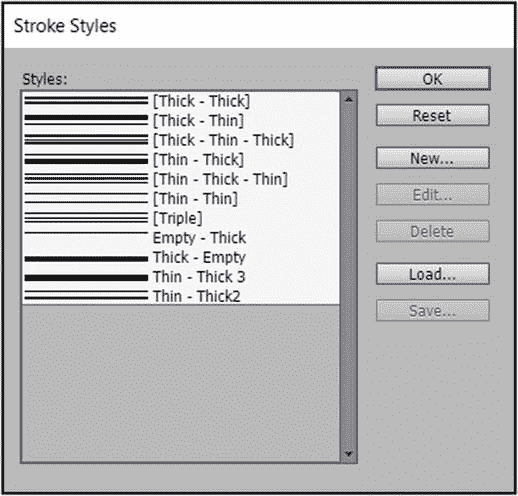

图 4-11.

从`描边`面板菜单中选择`描边样式`以打开`描边样式`对话框

在`描边样式`对话框中，您可以看到 InDesign 为您提供的一些默认样式。您可以通过单击`新建`按钮来修改和编辑这些样式。如果在单击`新建`时未选择任何样式，InDesign 会为新建样式添加`新建描边样式`名称。如果您选择了一种样式并单击`新建`，InDesign 会沿用该样式名称，并在名称末尾添加`副本`，如图 4-13 所示。这确保了您不会覆盖默认样式。默认描边样式无法编辑或删除。

在`名称`字段下方，您可以看到`类型`下拉菜单。您可以选择添加`条纹`、`点线`或`虚线`描边。如果您选择诸如`粗细 – 细 – 粗细`之类的样式并单击`新建`（见图 4-12），您将在`新建描边样式`对话框中看到当前样式。

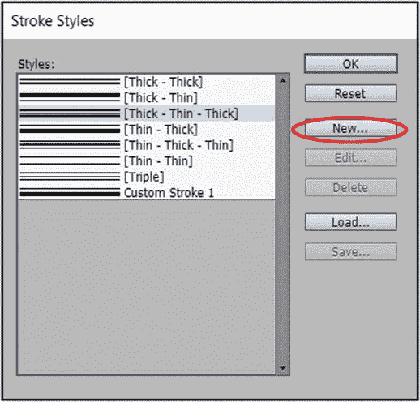

图 4-12.

在`描边样式`对话框中点击一种描边样式，然后单击`新建`。`新建描边样式`对话框将打开，您可以在其中编辑描边样式

有三种编辑可以应用于描边样式：

*   **删除描边**：点击`条纹`预览区域中的一条描边，并将其拖离对话框。这将从样式中删除该描边。
*   **调整描边大小**：每条描边左侧都有一个标记，带有从`0%`到`100%`的刻度尺。要调整描边大小，请单击并向上或向下拖动其中一个标记。
*   **添加描边**：将光标点击到（对话框中描边之间的）某个间隙处，以添加一条新描边。向上或向下拖动标记以调整新描边的大小。

为新的描边样式键入一个名称，然后单击`确定`。新样式将添加到`描边`面板的`类型`下拉菜单中。

#### 创建新描边样式

4.  选择吸管工具。假设你想使用已应用在文档中某个对象上的颜色，请在“工具”面板中点击吸管工具，或按键盘上的`I`键。确保你选中了吸管工具。在“工具”面板中，有两个吸管工具：一个是吸管，另一个是颜色主题工具。颜色主题工具图标下方带有一组微小的色板。如果你看到选中了此工具，请再次按键盘上的`I`键，吸管工具即被选中。或者，你也可以在“色板”面板中点击一种颜色。
5.  点击一个对象以吸取颜色。如果你的对象是从 Adobe Illustrator 等矢量绘图程序导入的矢量文件，则会弹出一个警告对话框，提示采样基于图像的低分辨率代理。在大多数情况下，对矢量对象进行颜色采样是没问题的。点击对话框中的“确定”，该颜色将显示为“工具”面板中新的默认前景色。
6.  将颜色添加到你的“色板”面板。右键单击“工具”面板中的前景色色板，选择“添加到色板”。
7.  将色彩应用于导入的灰度图像。你会看到吸管图标的外观发生变化，吸管从指向左下角变为指向右下角。点击一个对象将应用所选颜色。如果你的图像未被选中，请按住`Ctrl`/`⌘`键并双击图像以选中图像本身而非框架。松开修饰键后吸管工具仍处于选中状态，然后点击图像。
8.  更改色调。由于已将颜色添加到“色板”面板，你可以调整色调。点击新颜色，然后点击“色调”的右向箭头。向左拖动滑块以调整色调，如图 4-7 所示。

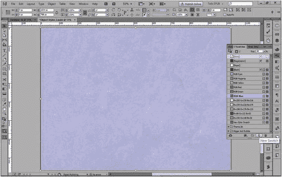

**图 4-7.** 调整色调

**注意**

当你在选中的图像上移动光标时，如果看到选择箭头图标，则表示选中了框架。如果看到抓手图标，则表示选中了图像。当你向对象应用色彩时，如果颜色显得不透明且比预期暗得多，则你可能将色彩应用到了框架而非图像上。撤销该步骤，双击图像以选中它，然后再应用色彩。

为了更清晰一点，让我们通过执行以下步骤来创建一个新的描边样式：

1.  打开“`描边`”面板，然后从“`描边`”面板菜单中选择“`描边样式`”。

    **注意**

    无需在 InDesign 中打开文档即可创建新的描边样式。

2.  在“`描边样式`”面板中点击“`粗细 – 细 – 粗细`”。

3.  单击“`新建`”以打开“`新建描边样式`”对话框。InDesign 添加到新样式名称中的名称是“`粗细 – 细 – 粗细副本`”。在“`条纹`”区域，您可以看到此样式的三条描边，如图 4-13 所示。

    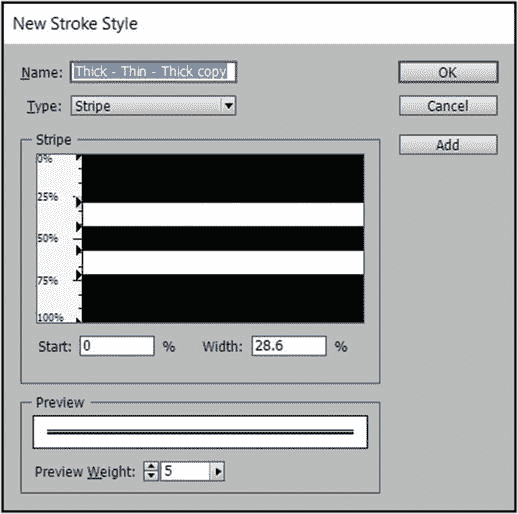

    图 4-13. “`粗细 – 细 – 粗细`”样式的“`新建描边样式`”对话框

4.  点击顶部描边并将其向上拖动，使描边变细。

5.  向下移动底部标记以将描边尺寸调小。

6.  点击描边之间的间隙以添加一条新描边。使此描边比其他两条更粗。

7.  再添加一条描边，如图 4-14 所示。您可以根据喜好自由调整描边的大小。在我的示例中，您可以在图 4-14 中看到编辑后描边大小的结果。

    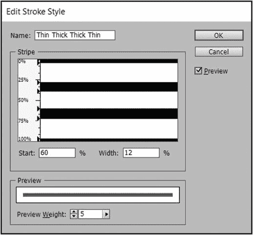

    图 4-14. 调整两条描边大小并添加两条描边后的新样式编辑结果

8.  为新样式键入一个名称，然后单击“`确定`”。

9.  应用描边。

10. 您可以对线条、框架、对象或文字应用描边。在我的示例中，我将描边应用到了一个框架上，如图 4-15 所示。

    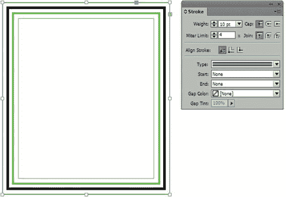

    图 4-15. 应用了新描边样式的框架

11. 为描边应用颜色（可选）。

12. 应用描边后，打开“`色板`”面板，点击您想要用作描边颜色的颜色。请确保在点击颜色色板时，在“`色板`”面板中选中了“`描边`”。最终结果如图 4-15 所示。

### 4.3.4 保存和加载自定义描边样式

如果在 InDesign 中未打开任何文档时创建自定义描边样式，则新建文档时该自定义描边样式可用，且一直存在直至你将其删除。

但是，如果在打开文档时创建描边样式，则描边样式专属于该文档。当你关闭文档或新建文档时，之前在打开的文档中添加的任何描边样式都会丢失。

你可以将描边样式保存到文件中，并在希望将自定义描边用于 InDesign 中创建的任何文档时加载它们。要在打开文档时保存一个或多个描边样式，请从`描边面板`菜单中选择`描边样式`。此时将打开`描边样式`对话框。你必须在`描边样式`对话框中选择一个或多个自定义描边，才能激活`保存`按钮。选择一个描边并单击`保存`。

InDesign 允许你将描边样式保存到硬盘上的任意位置。你可以将它们添加到存放特定设计项目资源的文件夹中，或者保存到根文件夹以便在多个文档中使用。单击`保存`按钮时，将打开`另存为`对话框。为自定义设置集键入一个名称，在硬盘上导航至要保存该设置集的目标位置，然后单击`保存`。

当你新建文档并希望使用自定义描边集时，请打开`描边样式`对话框并单击`加载`。此时将打开`打开文件`对话框。导航到硬盘并找到要加载的自定义设置集。选择该设置集并单击`打开`。该自定义设置集现在即可在`描边面板`的`类型`菜单中使用。

一旦加载了自定义描边样式集并保存了文档，此后每次处理该文档时就无需再加载该设置集了。保存文档后，这些描边样式便成为文档的一部分。

### 4.3.5 使用描边为对象分层

自定义描边样式的一个限制是，你不能为不同的描边使用多种颜色。如果你使用`粗细 – 细 – 粗细`作为描边样式，并在`色板面板`中单击以应用颜色，则所有单独的描边都将接受相同的颜色值。InDesign 将每个描边样式视为一个单一的描边。（截至目前）无法在`描边样式`对话框中进行选择，以便为同一样式中的不同描边应用不同的颜色。

解决此问题的方法是创建一个描边样式并将其应用于一个对象（例如一个框架），然后创建该对象的副本，并对其应用另一种颜色的描边。

#### 使用描边为对象分层

让我们看看如何实现为多个描边添加不同颜色。

1.  打开`描边面板`，并从`描边面板`菜单中选择`描边样式`。

2.  在`描边样式面板`中单击`细 – 粗`，然后单击`新建`。在我的示例中，我想创建两个尺寸相同但颜色不同的描边。对于外侧描边，我想要纯黑色，内侧描边为红色。我先从红色的内侧描边开始。

3.  通过单击并将顶部描边拖离对话框来删除它。

4.  将描边高度设置为 50%。

5.  键入名称，然后单击`确定`。我们称此样式为`空 – 粗`。

6.  创建一个新的描边样式。我想创建一个与第一个样式完全相反的样式。在第一个样式中，底部有一个占 50% 的描边。现在我想创建一个底部为空、顶部有一个约 10% 描边的新样式（类似于你在图 4-16 中看到的情况）。我们称此样式为`细 – 空`。

    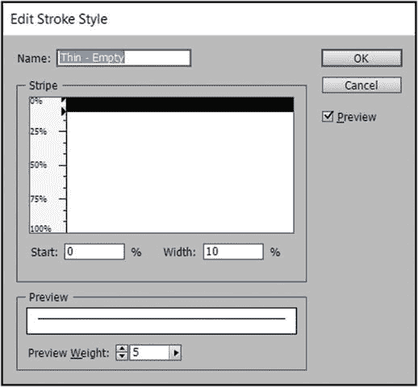

    图 4-16. 创建第二个样式并命名为`细 - 空`

7.  单击`确定`退出`描边样式`对话框。

8.  将`空 – 粗`样式（我们创建的第一个样式）应用于一个框架。

9.  在`描边面板`中将`粗细`设置为 20 点，并将`对齐`设置为`描边对齐到外侧`。

10. 从`色板面板`中应用一种颜色。在我的示例中，我使用了渐变。

11. 选择该框架，然后选择`编辑` ➤ `复制`（`Ctrl/⌘+C`）。

12. 选择`编辑` ➤ `原位粘贴`。新副本将精确位于页面上原始框架的相同位置之上。

13. 选择前景框架，并应用`细 – 空描边样式`。

14. 在`描边面板`中将`粗细`设置为 20 点，并将`对齐`设置为`描边对齐到内侧`。

15. 在`色板面板`中选择`黑色`作为描边颜色。

最终结果如图 4-17 所示。

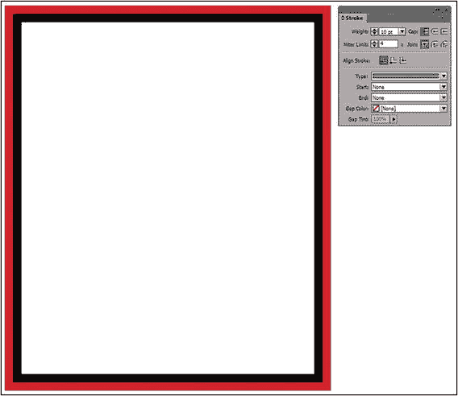

图 4-17. 应用于框架的两个不同颜色的描边

你可以通过复制和粘贴框架，并对每个框架应用不同的描边颜色和粗细来创建多个描边。你需要记住的是，描边样式的开发需要包含描边和空白（即表示所需样式的间隙），并且描边粗细必须相同。

### 4.3.6 调整箭头大小

在 InDesign CC 2017 之前的版本中，调整箭头大小的唯一方法是调整描边粗细。箭头无法独立于描边粗细进行大小调整。现在，在 InDesign CC 2017 中，你可以同时且独立地调整箭头和描边的大小。

在图 4-18 中，你会看到两个带有箭头的描边。第二个描边有一个起始箭头和一个结束箭头。显然，此处为了说明问题，箭头尺寸被放大了。在`描边面板`中，你会看到`缩放`选项有一个链式链接。当链接断开时，如图 4-18 所示，你可以独立于描边粗细来缩放箭头。在相应的文本框中输入值以调整箭头大小。如图 4-18 所示，第二条线的`起始`箭头设置为 125%，而`结束`点设置为 175%。

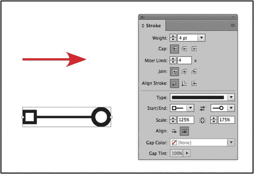

图 4-18. 编辑`缩放`文本框以调整箭头大小

## 4.4 绘制对象

到目前为止，在本章中我们了解了如何使用`直线工具`、`铅笔工具`和`钢笔工具`绘制描边。描边绘制只是 InDesign 中可用绘图功能的一小部分。你不会想在 InDesign 中创建复杂的技术图纸或插画，这类作品最好在 Adobe Illustrator 中完成。然而，创建按钮、图标、徽标以及中等复杂形状都在 InDesign 强大的对象处理工具能力范围之内。

### 4.4.1 创建几何形状

在`工具面板`中，当你单击`矩形工具`并按住鼠标按钮以打开隐藏工具时，可以使用三种几何形状。这里有`矩形工具`、`椭圆工具`和`多边形工具`。

要绘制其中一种形状，请在`工具面板`中选择一种形状工具，然后使用该工具单击并拖动以创建形状。如果要从中点开始绘制，请在绘制时按下`Alt/⌥`键。如果要约束形状（例如绘制正方形或正圆），请在绘制时按下`Shift`键。如果你开始在文档页面上绘制，并希望在绘制过程中移动形状，请在按住鼠标按钮的同时按下`空格键`，在页面上移动形状，然后继续绘制。

### 4.4.1 绘制多种形状

假设您想创建一个包含多种形状的网格——类似于日历设计。在工具面板中点击一种形状工具，按住`Shift`键并拖拽出一个形状。在鼠标按钮和`Shift`键都按下的状态下，按`向右箭头`键可添加一列。按`向上箭头`键可添加一行。继续按`向右`和`向上箭头`键可添加更多列和行。在图 4-19 中，您可以看到使用箭头键添加列和行所产生的多个正方形。

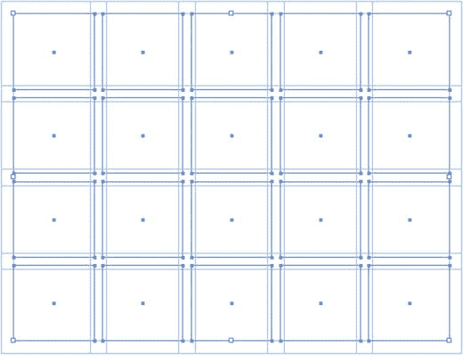

图 4-19. 绘制时按下`向右`和`向上箭头`键，即可创建额外的列和行

### 4.4.1.2 绘制指定尺寸的形状

如果您想绘制指定尺寸的形状，请在工具面板中点击所需的形状，然后在文档中点击。相应的工具对话框将打开。在图 4-20 中，我在文档中点击了多边形工具，随后多边形对话框打开。

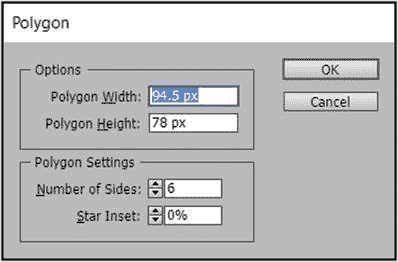

图 4-20. 点击一种形状工具，然后在页面上点击，即可打开相应的形状对话框

在对话框中输入`宽度`和`高度`值，然后点击`确定`。形状将以形状对话框中设定的尺寸被创建。

### 4.4.1.3 转换形状

您可以使用`对象 ➤ 转换形状`菜单，然后从子菜单中的九种形状里选择一种，来将形状转换为不同的形状。在路径查找器面板中可以找到一种更简便的转换形状的方法。选择`窗口 ➤ 对象和版面 ➤ 路径查找器`以打开该面板。

如果您绘制了多个形状并希望将它们转换为另一种形状，请选中所有形状，然后在路径查找器面板中点击一种新形状。在图 4-21 中，我将图 4-19 中所示的形状转换成了三角形。

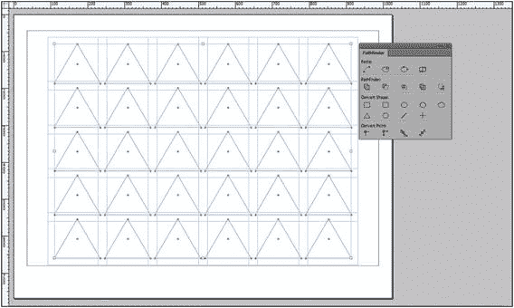

图 4-21. 点击路径查找器面板中的某个“转换形状”选项

### 4.4.1.4 编辑路径

使用`钢笔`工具绘制路径时，您可能希望连接路径、闭合路径或反转路径。如果您绘制了一个几何形状，您可能想开放一条路径。在路径查找器面板中，您可以找到用于编辑路径的选项。

在面板顶部，您会找到四个路径选项。第一项是`连接路径`。点击路径查找器路径（从左到右）后会出现底部一行：`连接路径`、`开放闭合路径`、`闭合开放路径`和`更改路径方向（反转路径）`。使用`开放闭合路径`选项时，您不会看到对象发生变化。InDesign 会断开路径，而您需要使用`直接选择`工具来移动路径断开处的点。

### 4.4.1.5 编辑角

您可以使用多种方法更改形状和路径上的角选项。InDesign 支持五种不同的角修改选项。默认为`无`。当选择`无`时，角会按照您绘制原始路径时的样式显示。您可以将一个或多个角更改为`花式`、`斜角`、`内陷`、`反向圆角`和`圆角`。在图 4-22 中，您可以看到将角选项更改为这五种选项后的效果。

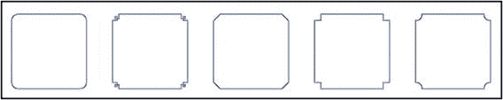

图 4-22. InDesign 提供了五种角选项

更改角选项可以通过使用`对象 ➤ 角选项`菜单命令来完成。当您选择该菜单命令时，“角选项”对话框会打开。您可以编辑单个角或所有角，并选择五种角选项之一。您还可以将应用于角的大小设置为更小或更大。`预览`复选框使您能够动态预览结果。

您也可以使用控制面板来更改角。在控制面板中选择一个角选项，并编辑大小文本框。按`Alt/⌥`键并点击大小文本框旁边的方形图标，即可打开“角选项”对话框。

也许更改角选项的最佳方式是在路径上直接编辑。当您绘制一个几何形状时，您会看到每个角和各边中点处有控制柄。这些控制柄用于缩放和旋转对象。您还会在靠近右上角处找到一个黄色方块。点击黄色方块，InDesign 会在每个角处显示四个黄色菱形，如图 4-23 所示。

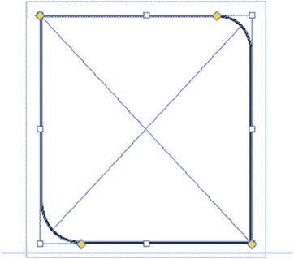

图 4-23. 点击形状上的黄色方块，角上会出现黄色菱形

要修改所有角，请点击并拖动一个菱形。默认效果是圆角。当您将菱形从角处拖开时，形状会变为带有圆角的物体。如果您想编辑单个角，请按住`Shift`键并拖动该角。如果您想更改角的样式，请按住`Alt/⌥`键并点击一个菱形。

使用形状上的菱形来编辑角的好处在于，您无需离开该对象即可进行编辑。您会发现，这种方法比打开对话框或使用控制面板更快。

## 4.4.2 创建星爆和装饰图案

您可以创建可能用作图形元素和按钮的星爆和装饰图案。作为对象，您可以像对在 InDesign 中创建的任何其他对象一样，对这些项目应用描边和填充。

### 4.4.2.1 创建星爆

当您使用`多边形`工具绘制形状时，默认会得到一个六边形。您可以通过在工具面板中双击`多边形`工具，轻松更改多边形的属性。此时将打开“多边形设置”对话框，如图 4-24 所示。

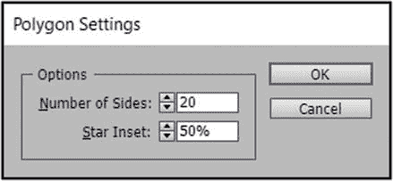

图 4-24. 在工具面板中双击`多边形`工具以打开“多边形设置”对话框

在“多边形设置”对话框中，输入边数的值。要获得星爆效果，请使用一个夸张的数字，如 20。对于“星形内陷”值，请使用一个较大的值，如 50%。此设置会将中心向内拉，从而在对象的末端形成大的尖刺。点击`确定`，然后为对象应用渐变或颜色，如图 4-25 所示。

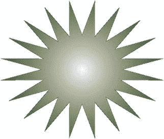

图 4-25. 一个内陷 50% 的 20 边形

“多边形设置”对话框没有预览选项，您在创建对象时不会看到动态预览。如果您想更改外观、增加更多边数或更改内陷值，请再次双击`多边形`工具。您上次所做的设置会出现在“多边形设置”对话框中。编辑这些值并点击`确定`。如果您需要完善对象，只需再次双击`多边形`工具并编辑数值即可。