# 创建装饰图案

利用自由绘制的线条，再借助变换功能稍加处理，即可轻松创建装饰图案。

要创建类似螺旋图案的效果，请遵循以下步骤：

1. 单击`铅笔`工具，绘制一个简短、粗略的形状。
2. 你不需要成为艺术家。最终结果的妙处在于，任何粗略的形状都能创造出漂亮的图案。
3. 变换形状。
4. 单击控制面板最左侧中间靠下的方块，将参考点设置在底部中心。选择`对象 ➤ 变换 ➤ 旋转`。此时会打开`旋转`对话框。
5. 设置变换角度。
6. 你可以在`角度`文本框中输入任意数值。只需确保该值能被 360 整除即可。在我的示例中，我使用了 10°。单击`复制`，创建形状旋转 10°后的副本。
7. 变换序列。
8. 选择`对象 ➤ 再次变换 ➤ 再次变换序列`。请注意，`再次变换序列`菜单项有一个键盘快捷键。按下`Ctrl/⌘+Alt/⌥+4`。持续按下该快捷键，直到形状旋转回第一个对象。
9. 根据你的喜好应用描边、颜色、渐变等效果。
10. 在图 4-26 中，你可以看到我用`铅笔`工具绘制的原始粗略形状。该形状右侧的三个图案展示了应用了描边设置和带渐变的描边颜色的形状。

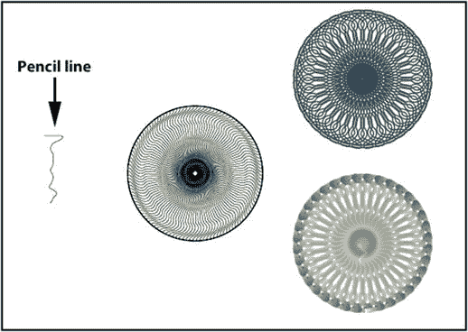

图 4-26. 从简单的粗略形状创建螺旋图案

使用这些步骤的妙处在于，每当你创建一个新的自由形状，你也就创造了一个新图案。可以稍加尝试，并像我稍后在“创建按钮”一节中讨论的那样，使用渐变、斜角和浮雕效果，以及像我稍后在“使用霓虹效果”一节中讨论的那样，应用一些霓虹效果。

**提示**  
你可以将在`InDesign`中创建的对象与其它 Creative Cloud 编辑程序（如`Adobe Illustrator`和`Photoshop`）共享。选择`窗口 ➤ CC 库`。将对象拖到`CC 库面板`中。在其他 Creative Cloud 程序中，打开`库面板`，将对象拖放到你的文档中。你无法在其他程序中分解或扩展该对象，但当你在其他程序的布局中需要通用设计元素时，可以使用这些对象。

## 使用路径查找器

在`路径查找器面板`中，你可以找到路径查找器选项和转换点选项。对于路径查找器选项，你需要两个或更多对象才能使用面板中的五个选项。对于转换点选项，你需要选择路径上的一个或多个点来应用四个选项之一。

要理解路径查找器选项，你需要对路径有一个基本的了解。当你使用`钢笔`工具 (`P`) 绘制路径，并使用`直接选择`工具 (`A`) 选中该路径时，你会看到整个路径、锚点（显示为路径上的微小白色方块）、线段（锚点之间的路径）、方向线（当选中某个锚点时）、方向点（方向线的末端）以及端点（路径末端的点）（见图 4-27）。

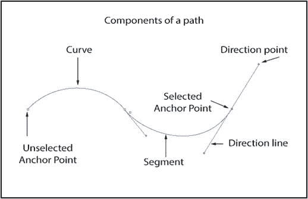

图 4-27. 路径由若干组件构成

使用`路径查找器面板`，你可以修改形状之间的相互关系。`路径查找器面板`中的选项包括：

*   **合并：** 选择两个对象，单击此选项，这些对象将合并成一个单一对象。
*   **减去顶层：** 此选项会减去最前面的对象。当对象被减去时，底部的对象看起来像是被挖空了一样。
*   **交集：** 在两个对象重叠处，`交集`选项会删除交集周围的所有内容。
*   **排除重叠：** 对象相交的区域会从对象中删除。
*   **减去底层：** 此选项与`减去顶层`相反。最底部的对象会被删除。

在图 4-28 中，你可以看到使用每个路径查找器选项后的结果。

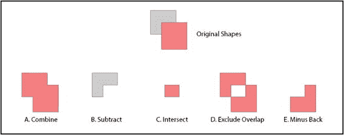

图 4-28. 路径查找器选项有五种可选

### 使用转换点选项

在`路径查找器面板`中，针对转换点的四个选项包括：

*   **普通：** 选择路径上的点，单击此选项可消除方向线。
*   **转角：** 默认情况下，方向线有两半（或两侧）。当你移动一个方向点时，方向线的两半/两侧都会移动。你可以分割方向线，使得只有一半/侧能独立于另一半移动。选择曲线路径上的一个点，单击此工具。锚点将变为独立的方向线。
*   **平滑：** 选择一个角点（没有方向线），单击此选项，即可将该点转换为带有方向线的平滑点。
*   **对称：** 将选定的点更改为带有方向线的平滑点。

## 使用脚本

有几个脚本支持在`InDesign`中绘制对象。要查看这些脚本，请打开`脚本面板`（`窗口 ➤ 实用程序 ➤ 脚本`）。当`脚本面板`打开时，你会找到一个`应用程序`文件夹。从`应用程序`向下钻取到`示例`，再到`JavaScript`。这里有许多脚本可用于协助处理对象。

#### 添加辅助线

要执行脚本，请在`脚本面板`中双击脚本名称。选择一个对象，然后双击脚本名称 (`AddGuides`)。此时会打开`添加辅助线`对话框。你可以为对象添加辅助线以确定其中心，方法是在对话框中取消选中不必要的复选框，只启用`水平中心`和`垂直中心`。单击`确定`，辅助线便会添加到所选对象的水平和垂直中心，如图 4-29 所示。

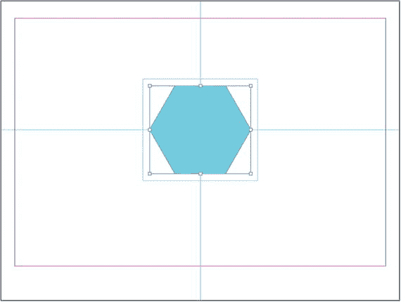

图 4-29. 使用`AddGuides`脚本为选定对象的中心添加辅助线

#### 添加点

`AddPoints`脚本在路径上的对象中点处添加点。绘制一个形状，然后在`脚本面板`中双击该脚本名称。锚点将被添加到现有节点之间。

#### 创建角效果

选择一个形状，然后双击`CornerEffects`脚本。会打开一个`角效果`对话框，你可以在其中选择五种角效果中的任意一种。你可以设置`偏移`量，并选择要将效果应用于哪些角。

#### 使用霓虹效果

`Neon`是一个精巧的脚本。你可以在描边上使用此效果。绘制一条描边或一个对象，然后双击`Neon`脚本。`Neon`对话框将会打开。在`Neon`对话框中，你可以选择渐变的步数，并定义起点（`从`），以及`描边颜色`、`描边粗细`和`描边色调`。你可以为终点（`到`）选择`描边粗细`和`描边色调`的选项，并选择目标图层或为霓虹效果创建一个新图层。单击`确定`，霓虹效果便会应用于对象的描边或路径上。在图 4-30 中，你可以看到应用于对象和描边的霓虹效果结果。

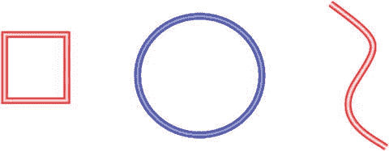

图 4-30. 选择一条描边或路径，然后运行`Neon`脚本，在描边上创建霓虹效果

#### 使用路径效果

`PathEffects`脚本为您提供了多种转换形状的选项——类似于 Photoshop 中的滤镜。选择一个形状，然后双击`PathEffects`脚本，即可打开`PathEffects`对话框。在您想要创建的效果类型中，共有九种选择。在图 4-31 中，您可以看到这九种效果应用于三角形、正方形、椭圆和多边形的示例。

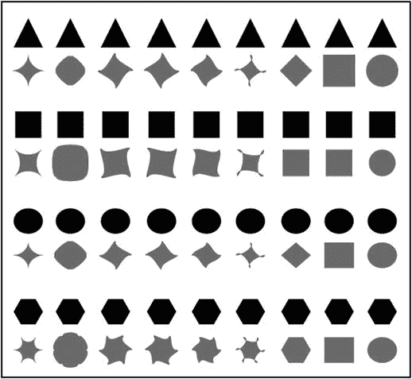

*图 4-31. `PathEffects`脚本让您能在选定对象上创建九种不同的效果*

### 复制与对齐对象

在页面上添加对象后，您通常需要复制、旋转或倾斜它，而面对多个对象时，您常常需要对齐或分布它们。幸运的是，InDesign 为您提供了多种完成所有这些任务的工具和方法。

#### 了解变换的基本要素

在我们深入探讨如何创建变换之前，有两件重要的事情需要了解。第一，使用`Alt/⌥`键可以复制操作结果。如果您按住`Alt/⌥`键并单击拖动一个对象，您就复制了它。当您在`控制面板`中按住`Alt/⌥`键并单击某个变换工具时，同样会复制对象。请记住，当您对 InDesign 对象应用许多操作时，如果同时使用`Alt/⌥`键，就会复制这些对象。

第二件需要了解的事情是，当您变换对象时，变换是基于当前活动参考点进行的。在页面上绘制一个对象，然后查看`控制面板`的左上角。您会看到一个正方形，其中心、四个角和各边的中点处都有小方块。这些就是您变换对象时将使用的参考点。在图 4-32 中，活动参考点是中心。因此，如果我旋转一个对象，旋转将以中心锚点为基准进行。如果我单击左上角的参考点，旋转则以左上角锚点为基准进行。

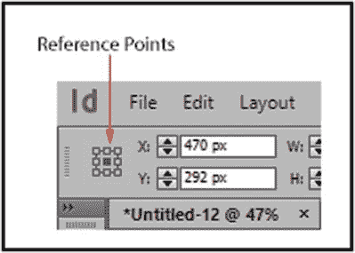

*图 4-32. 中心的方块为黑色，表示当前活动参考点位于中心*

您并不局限于在`控制面板`中选择参考点的九种选项。当您在`工具面板`中选择一个变换工具后，可以在选定对象上的任意位置单击。此时会显示一个带有四条互成 90°虚线的微小虚线圆，指示出参考点。再次单击，该图标将移动到新的位置。

当您对对象应用变换时，首要任务是选择参考点。如果您想在变换的同时复制对象，请按住`Alt/⌥`键并单击您想要的变换工具。

#### 复制对象

在 InDesign 中，复制项目有多种方法。传统的`剪切`、`复制`和`粘贴`、`原位粘贴`以及`粘贴入`命令只是其中几种复制方式。我们知道，当您按住`Alt/⌥`键并拖动对象时，您也能创建一个副本。

##### 使用“复制”命令

请注意，在`编辑`菜单中有一个`复制`命令。假设您通过`Alt/⌥`拖动复制了一个项目，然后选择邻近的另一个对象并选择`编辑 ➤ 复制`，第二个对象会被复制，并放置在与第一次复制相同的水平（或垂直）平面上。在图 4-33 中，左侧是一个我通过`Alt/⌥`并垂直向下拖动复制的对象。当我选择第一行中的第二个对象并选择`编辑 ➤ 复制`时，第二个项目被复制，并放置在与第一个复制对象相同的水平位置上（见图 4-33 右侧）。

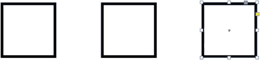

*图 4-33. 复制一个对象后，选择另一个对象并选择`编辑 ➤ 复制`*

InDesign 会记住偏移值，因此您可以移动到不同页面，选择对象，然后选择`编辑 ➤ 复制`。复制出的对象将定位在相同的偏移位置上。

##### 使用“步长和重复”

要复制多个对象，您可以使用`编辑 ➤ 步长和重复`命令。在页面上选择一个对象，然后选择`编辑 ➤ 步长和重复`。将打开`步长和重复`对话框，如图 4-34 所示。

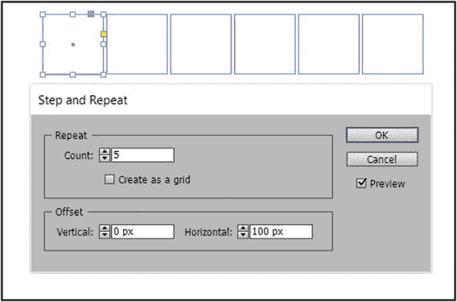

*图 4-34. 选择一个对象，然后选择`步长和重复`以打开`步长和重复`对话框*

在`步长和重复`对话框中，您可以沿着列或行复制对象，也可以创建包含多列和多行的网格。当您启用`预览`复选框时，偏移值很容易确定。当您更改偏移值时，您会看到结果的动态预览。当您以正确的偏移值创建出所需数量的副本时，请单击`确定`。

##### 使用快捷键复制

单击一个对象，按住`Alt/⌥`键，然后点击并拖动到新位置。松开`Alt/⌥`键，但保持鼠标按钮按下。用另一只手按`上箭头键`可垂直创建副本，按`右箭头键`可水平创建副本（见图 4-35）。您可以多次按`上箭头键`和`右箭头键`来创建一个类似于使用`步长和重复`时创建的网格。

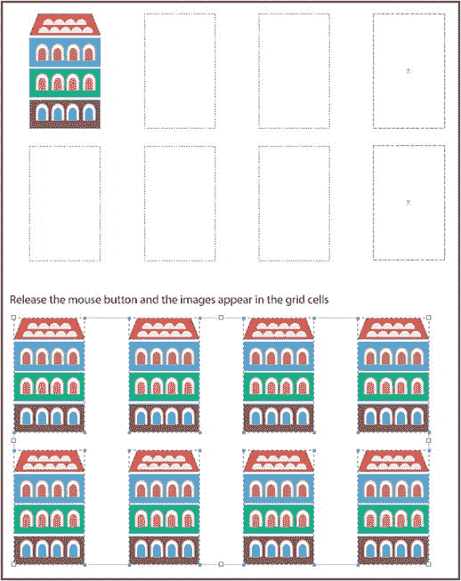

*图 4-35. 按住`Alt/⌥`键并将对象拖动到新位置。松开`Alt/⌥`键，然后按`上箭头键`和`右箭头键`*

在 InDesign 术语中，像图 4-35 那样在一个网格中创建多个对象通常被称为*网格化*。

##### 使用精确测量值复制

假设您想要复制一个或多个对象，并使副本出现在原始对象下方 300 像素的位置。首先要做的是在`控制面板`中设置参考点——比如设置为左上角。然后看参考点的右侧，您会看到两个文本框。这些就是`X`和`Y` `位置`文本框。

要向下移动对象，请使用`Y 位置`文本框。将光标移到右侧，并通过单击`链`形链接来取消设置的关联（见图 4-36）。在`Y 位置`文本框中输入`+300`。按住`Alt/⌥`键并按`Enter/Return`键。通过按住`Alt/⌥`，该项目被复制，如图 4-36 所示。

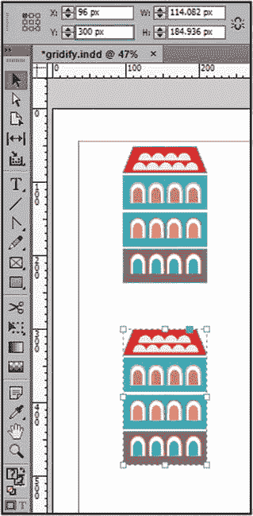

*图 4-36. 在`X`或`Y 位置`文本框中输入一个值，然后按`Alt+Enter/Return`*

### 4.5.3 对齐与分布对象

当你在页面上创建多个对象时，经常需要对它们进行对齐和/或分布，尤其是在你没有使用“步长和重复”或“网格化组”功能，而是手动添加对象的情况下。

要使用对齐和分布工具，请打开“对齐”面板。选择 `窗口 ➤ 对象和版面 ➤ 对齐`，或按 `Shift+F7`，即可打开“对齐”面板，如图 4-37 所示。你也可以使用控制面板中的对齐和分布选项。

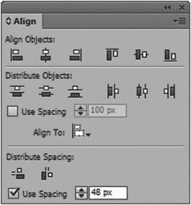

图 4-37. 选择 `窗口 ➤ 对象和版面 ➤ 对齐` 或按 `Shift+F7` 以打开“对齐”面板

**注**：如果你没有看到图 4-37 中显示的所有选项，请打开面板菜单并选择 `显示选项`。

在“对齐”面板的顶部有两行图标。第一行图标用于对齐对象。你可以选择左对齐、水平居中对齐、右对齐、顶对齐、垂直居中对齐和底对齐。第二行图标用于分布对象，其选项与第一行图标基本相同。分布对象时，还有一个用于设置对象间距的额外选项。启用 `使用间距` 复选框，并在文本字段中输入你希望对象之间的间距值。

在“对齐”面板中，一个重要的选择是告诉 InDesign 你要以什么为基准进行对齐。点击 `对齐依据` 图标，可以打开一个下拉菜单。菜单中有五种不同的选择。通常情况下，你会希望将对象对齐到选区，这是默认选项。然而，有时你可能需要将对象对齐到页面边距、页面或跨页。

在 `对齐依据` 菜单中，另一个选择是“对齐关键对象”。当你选中多个对象，然后再次点击其中一个对象时，该对象即被指定为关键对象。关键对象会显示一个粗边框。默认的关键对象是最上方、最左侧、最下方或最右侧的对象。假设你有几个在页面上垂直位置不同的对象，如图 4-38 所示。如果你选中所有对象并希望顶对齐，最上方的对象就是默认的关键对象。然而，如果你希望将所有这些对象与第三个对象对齐，你可以再次点击第三个对象，将其设为关键对象。这样，所有其他对象都会移动到第三个对象的垂直位置。

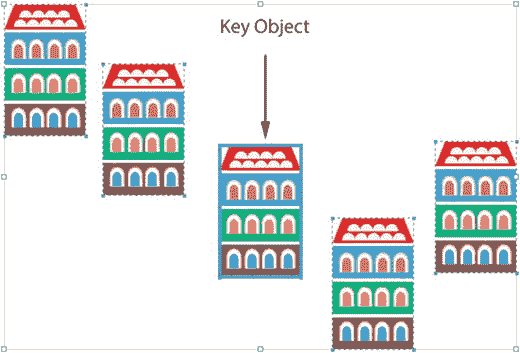

图 4-38. 在选中的对象组中按 `Ctrl/⌘` 键以指定关键对象

在“对齐”面板的底部，你可以看到“分布间距”选项。这里有两个图标。左侧图标用于垂直间距，右侧图标用于水平间距。启用 `使用间距` 复选框，并在文本框中输入一个间距值。

**注**：所有文本要么包含在路径上，要么包含在框架内。路径和框架都是对象；因此，你可以同样使用对齐选项来对齐文本框和路径上的文本。

## 4.6 变换对象

InDesign 提供了用于变换对象的工具和菜单命令。你可以使用“工具”面板、“变换”面板、“控制”面板、`对象 ➤ 变换` 和 `对象 ➤ 再次变换` 命令来以多种方式变换对象。

### 4.6.1 使用工具面板

在“工具”面板中，你可以找到四个变换工具，包括：

*   **自由变换工具** (`E`)：选择该工具或按键盘上的 `E` 键。“自由变换工具”允许你以不同方式变换对象。拖动手柄可以缩放对象。将工具移动到手柄外侧并拖动可以旋转对象。将手柄拖过对侧或对向手柄可以翻转对象。轻微拖动一个手柄，然后按 `Ctrl/⌘` 键并拖动可以倾斜对象。按 `Ctrl/⌘+Alt/⌥` 键并拖动可以从对象两侧进行倾斜。
*   **旋转工具** (`R`)：长按“自由变换工具”上的鼠标按钮，打开工具弹出菜单。选择“旋转工具”或按键盘上的 `R` 键。在控制面板中设置参考点，然后点击并绕参考点拖动以进行旋转。
*   **缩放工具** (`S`)：首先设置参考点，然后点击该工具或按键盘上的 `S` 键，并拖动一个手柄以缩放对象。
*   **倾斜工具** (`O`)：设置参考点，然后点击该工具或按键盘上的 `O` 键，并拖动以倾斜对象。

### 4.6.2 使用变换面板

选择 `窗口 ➤ 对象和版面 ➤ 变换` 以打开“变换”面板。在该面板中，你拥有工具和菜单命令的组合来处理变换，如图 4-39 所示。

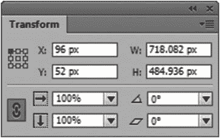

图 4-39. 选择 `窗口 ➤ 对象和版面 ➤ 变换` 以打开“变换”面板

注意，在“变换”面板中，你可以设置参考点并应用不同的变换。`X`, `Y` 文本框是对象在页面上的水平和垂直位置。你可以编辑这些值来将对象移动到不同位置。`W` 和 `H` 文本框用于设置对象的宽度和高度。右侧和下方的箭头文本框用于按百分比缩放对象。最后两项是按角度旋转和按百分比缩放的选项。

面板上方三分之二部分的菜单选项是你可以使用变换工具和控制面板工具应用的变换。底部部分对于确定如何处理描边和效果缩放至关重要。默认情况下，所有选项都是启用的。

### 4.6.3 使用控制面板

在控制面板中，你拥有与“变换”面板中非常相似的选项。你可以按百分比缩放、按角度旋转和倾斜、顺时针和逆时针旋转，以及水平或垂直翻转对象。在控制面板中变换工具的右侧，你会看到一个大的 `P` 字符。默认情况下，该字符垂直显示，类似于你在文本框内键入字符时的样子。如果你应用了变换，该字符会模仿变换的类型。例如，如果你水平翻转一个对象，该字符也会水平翻转。要清除所有变换，请右键单击控制面板中的 `P` 字符，然后选择 `清除变换`。

如果你想在变换对象的同时复制对象，请按住 `Alt/⌥` 键并点击控制面板中的变换工具。例如，在图 4-40 中，你可以在打开的文档（左侧）中看到一个三角形。如果你想复制并翻转该三角形，使其显示为图 4-40 右侧所示的样子，请按住 `Alt/⌥` 键并点击 `水平翻转` 工具。当然，在这个例子中，我会在执行变换之前，将我的参考点设置到中间右侧。

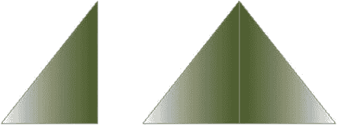

图 4-40. 按住 `Alt/⌥` 键并点击控制面板中的变换选项，可同时进行复制与变换

### 4.6.4 使用菜单命令

`InDesign` 提供了两个包含变换相关命令的菜单项。`对象 ➤ 变换` 菜单中包含的变换命令，与 `工具面板` 和 `变换面板` 中的类似。选择 `移动`、`缩放`、`旋转` 和 `切变` 会打开各自的对话框，你可以在其中输入该变换类型的数值。

当你选择 `对象 ➤ 再次变换` 时，会看到四个菜单项。这些菜单命令代表了实现变换的一些真正强大功能。选中一个对象并将其旋转 30° 是个不错的功能，但算不上令人印象深刻。复制一个对象并将其旋转 10° 也不错，但同样不算出彩。

然而，如果你想缩放一个对象、旋转 30° 并稍微移动它，而你还有 15 个对象需要应用相同的缩放、旋转和移动变换时，情况会怎样？这正是这些菜单命令大显身手的地方，它们相当令人印象深刻。

在图 4-41 中，你可以看到我对每行第一个黑色对象进行变换后，应用于五个红色对象的变换效果。我没有复制红色对象，而是使用了 `再次变换` 菜单命令。以下是操作方法的说明。

1.  **再次变换。** 在第一行中，我按 `Alt/⌥` 键将第二个对象向右拖动。然后我执行了 `对象 ➤ 再次变换 ➤ 再次变换` 菜单命令。此命令将重复对对象执行的最后一次变换。
2.  **再次变换。** 在第二行中，我应用了相同的命令。不过，这次我稍微旋转了黑色对象，选中了第二行中的五个红色对象，然后选择了 `对象 ➤ 再次变换 ➤ 再次变换`。请注意，所有五个红色对象作为一个整体一起旋转了。
3.  **逐个再次变换。** 在第三行中，我旋转了黑色对象，选中了五个红色对象，然后选择了 `对象 ➤ 再次变换 ➤ 逐个再次变换`。此操作会变换这些对象，并且它们保持在同一垂直位置。
4.  **再次变换序列。** 在第四行中，我应用了多个变换。我缩放并旋转了黑色对象，然后将其向下移动了一点。我应用了 `对象 ➤ 再次变换 ➤ 再次变换序列` 命令。请注意，右侧红色对象上出现了与 `再次变换` 类似的阶梯效果。
5.  **逐个再次变换序列。** 在最后一行，我对第一列中的黑色对象应用了相同的缩放、旋转和移动变换。我选中了最后一行中的五个红色对象，然后选择了 `对象 ➤ 再次变换 ➤ 逐个再次变换序列`。此菜单命令会复制变换和移动效果，并且所有对象都位于相同的垂直位置。

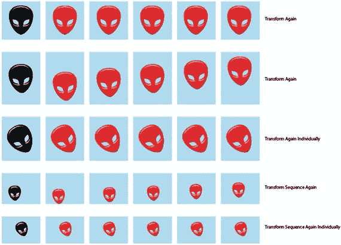

图 4-41. 使用 `再次变换` 菜单命令的效果

请注意，在 `再次变换` 子菜单中，唯一有键盘快捷键的项是 `再次变换序列` 命令。在大多数工作会话中，你会发现这个命令是你最常用的。当你需要使用 `逐个再次变换序列` 时，则需要使用菜单命令。你使用此命令的频率可能远低于按 `Ctrl/⌘+Alt/⌥+4` 来变换一个序列。

## 4.7 应用效果与透明度

`InDesign` 中可对对象和导入文件进行的另一类功能丰富的编辑，体现在 `效果面板` 中提供的众多选项上。你可以对图像和对象应用透明度、添加投影、应用斜角、发光和羽化，以创建惊人的效果。此外，你还拥有许多在其他程序（如 `Illustrator` 和 `Photoshop`）中才能找到的混合模式。

你可以将文本转换为轮廓并修改锚点来改变字体的形状，还可以创建文字蒙版，使图像和对象显示在文字字符内部。你可以创建复合路径、封闭路径，并使用 `路径查找器` 选项来添加、减去和连接路径。总而言之，`InDesign` 为你提供了许多工具和菜单命令，帮助你实现设计作品中所需的艺术构想。

### 4.7.1 探索 InDesign 效果

为图像、对象和文本添加效果，能为设计带来生命力，例如投影、3D 效果、发光和透明度，这些效果对于数字出版物和印刷品同等重要。除了在数字出版文档中使用的明显设计特性外，效果还能帮助你为图标和元素增添一丝精致感，这些元素可能用于更改对象状态、播放媒体或跳转到超链接目标。

### 4.7.2 使用`效果`面板

要开启学习并使用 InDesign 效果之旅，你需要先熟悉`效果`面板。要打开`效果`面板，请选择`窗口 ➤ 效果`。`效果`面板随即打开，如图 4-42 所示。

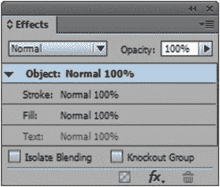

图 4-42. 选择`窗口 ➤ 效果`以打开`效果`面板

在`效果`面板中，你将找到以下选项：

- **混合模式**：打开显示有`正常`的下拉菜单。InDesign 中的混合模式与 Adobe Illustrator 中的相同。Adobe Photoshop 中有更多混合模式，但 InDesign 中提供的模式足以让你以多种不同方式按堆叠顺序混合对象。
- **不透明度**：向左移动滑块，或在文本框中输入数值，即可为所选对象添加透明度。此设置的效果与使用`对象 ➤ 效果 ➤ 透明度`命令或从`效果`面板菜单中选择`透明度`相同。
- **目标**：你首先需要决定的是要针对哪个目标应用效果或透明度。InDesign 为你提供了四个选项：
    - **对象**：`对象`项及其后的三项允许你针对不同区域。选择`对象`可将透明度和效果应用于整个对象。
    - **描边**：如果你有一个框架，可以针对描边（而非填充和对象本身）仅对描边应用效果和透明度。
    - **填充**：如果你有一个框架，并希望仅对填充应用效果或透明度，请选择此项。
    - **文本**：选择一个文本框架，即可对框架中的所有文本应用效果或透明度。
- **隔离混合**：当你更改对象的混合模式并将其与下方的对象混合时（例如使用`正片叠底`使堆叠顶部的对象变暗），堆叠中所有下方的项目都会受到该混合模式的影响。假设你有三个项目彼此堆叠。你对最顶部的项目应用了`正片叠底`混合模式。该混合模式会穿透堆叠中的每个项目，并对所有项目应用相同的混合。如果你想混合堆叠中的前两个项目，需要先将它们编组。然后启用`隔离混合`复选框。前两个已编组项目下方的所有项目将不受影响且不会发生混合。在图 4-43 中，你可以看到应用 `正片叠底` 混合模式时*不*启用（左）和*启用*（右）隔离混合的效果。

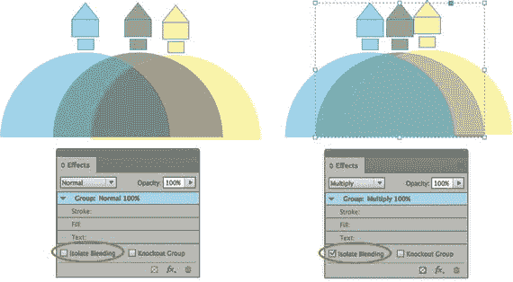

图 4-43. 未启用与启用隔离混合时添加混合模式的效果

- **挖空组**：使用此选项可挖空所选组中每个项目的不透明度和混合属性。在某种程度上，这类似于创建复合路径。当你绘制两个同心圆，选择它们，然后选择`复合路径`时，中心圆会变得透明——就像一个甜甜圈。`挖空组`在使用透明度和效果时行为类似。
- **Fx**：当你对某个项目应用效果后，会注意到 `fx` 图标出现在`效果`面板的右上角。当你想将同一效果应用于另一个对象时，请单击并拖动 `fx` 图标到该对象上。目标对象会采用在`效果`面板中为第一个对象创建的相同格式。在某种程度上，这类似于使用对象样式。
- **效果面板菜单**：`效果`面板菜单中的选项包括：
    - **隐藏选项**：选择此项可缩小`效果`面板尺寸，隐藏`隔离混合`和`挖空组`复选框。
    - **效果**：其子菜单列出了所有可以应用于项目的不同效果（见图 4-44）。选择任意一个子菜单命令，将打开`效果`窗口，如图 4-45 所示。

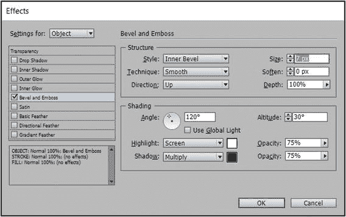

图 4-45. 在`效果`窗口中点击`斜面和浮雕`

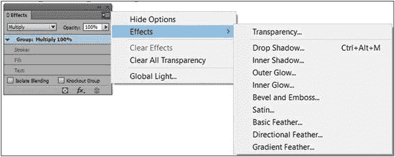

图 4-44. 点击`效果`子菜单中的任一项目以打开`效果`窗口

    - **清除效果**：清除应用于某个项目的所有效果。
    - **清除所有透明度**：清除所选对象上的所有透明度。
    - **全局光**：选择此项时，将打开`全局光`对话框。你有两个选项：`角度`和`高度`。`角度`设置是光源的方向。`高度`用于调整光的强度。当你创建一个效果并在`效果`窗口中使用了`全局光`，然后将此项目复制并粘贴到另一个 InDesign 文档中（该文档已通过此对话框设置了`全局光`），粘贴的对象将继承你在该文档中的设置。仅当你希望版式中所有对象的光照方向和强度一致时，才使用此选项。
    - **面板底部的按钮包括**：
        - **清除所有效果并使对象不透明**：单击此图标可移除效果和透明度。
        - **fx**：单击以打开`效果`选项的下拉菜单。此菜单与在`效果`面板菜单和`控制面板`菜单中访问到的菜单相同。
        - **垃圾筒**：选择一个项目并点击以清除效果。如果该项目应用了任何透明度，则透明度保持不变。

在常规工作流程中，你打开`效果`面板，选择目标，然后使用面板菜单或下拉`fx`菜单，选择所需效果。

### 4.7.3 使用`效果`窗口

`效果`窗口中可供你使用的选项和开关数量之多，远非本章所能详述。你在窗口左窗格中可以选择的十个项目，会根据你选择的项目显示不同的选项。例如，当选中`斜面和浮雕`项目时，查看一下`效果`菜单，如图 4-45 所示。你会在窗口的右上方看到一个用于`样式`的菜单。你可以在此选择要应用的斜面与浮雕类型。该菜单下方是`方法`菜单，其中有更多选择，再往下是`方向`菜单，也有更多选择。你可以找到用于控制大小、柔化和深度的文本框。窗口右下半部分提供了角度和高度、高光和阴影、混合模式以及不透明度设置的选项。

点击左列中的另一个项目以选择其他类型的效果，窗口会提供不同的选项。当你第一次打开`效果`窗口时，可能会感到眼花缭乱甚至有些望而生畏。

目前，请记住这个窗口是所有操作发生的地方，当你想应用某个效果时，就是在这里设置所需效果的属性。我们将在本节稍后部分探讨其中一些效果。

### 4.7.4 创建投影

打开“效果”面板菜单并选择“效果”时，请注意子菜单中唯一带有键盘快捷键的效果是“投影”。创建投影是目前为止 InDesign 版面设计师使用最频繁的效果。

你可以为设计中的任何对象（文本、图像、对象、描边、路径等）应用投影。要添加投影，请选中对象并按 `Ctrl/⌘+Alt/⌥+M`，或从“效果”面板的 `fx` 菜单中选择“投影”。

此时“效果”窗口会打开，并在左侧窗格中选中“投影”。默认情况下，不透明度设置为 75%。我建议你在创建投影时，将其不透明度降低到 35–40%。我很少使用不透明度为 75% 的投影。你想要实现的效果是简洁而优雅。投影并非主角，它们只是辅助性的“配角”，帮助将聚光灯投射到主要对象上。添加投影是为了给你的文本或对象带来一丝生机与立体感。

在图 4-46 中，你可以看到我为一些文本应用投影时使用的设置。当启用了“预览”复选框时，你在“效果”窗口中进行调整的同时，可以看到调整效果的动态预览。

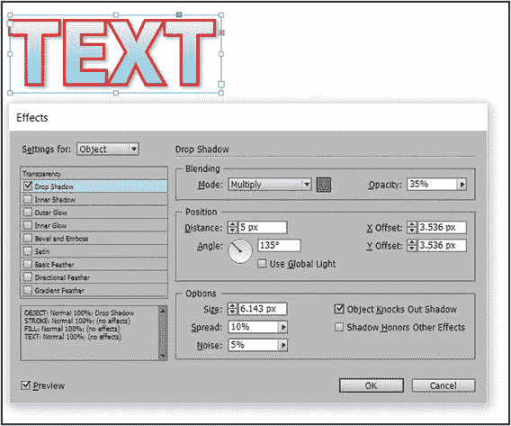

图 4-46. 启用了“预览”复选框的文本投影

在图 4-46 中，我将不透明度设置为 35% 以淡化阴影。投影的默认混合模式是“正片叠底”。我保留了默认的混合模式，但通过点击“模式”菜单旁边的色板，并从“色板”面板中选择了一种蓝色，从而更改了投影的颜色。

我将“大小”距离设置为 5 像素，使阴影更靠近文字，但将“扩展”设置为 10%，以便将边缘更远地融合开来。“杂色”设置是你应该会在许多效果中用到的一项。对于印刷，你可以将杂色数量设置为 1 或 2 像素。对于屏幕显示，请将“杂色”设置为 5 像素。这会在阴影中添加少量杂色，使其看起来不那么生硬。

对于屏幕显示，你无需担心“对象使阴影挖空”选项。第二个复选框用于多种效果。例如，如果你同时应用了投影和斜面和浮雕效果，则应启用“阴影与其他效果交互”复选框。

### 4.7.5 创建按钮

继投影之后，InDesign 用户第二常用的效果是“斜面和浮雕”。在为数字出版准备文档时，你会发现 InDesign 中“斜面和浮雕”效果有很多用途。其最常见的用途之一便是创建自定义按钮。你可以使用按钮来设置超链接操作（如我在第 7 章所述）、启动动画（如我在第 8 章所述）、更改对象状态（如我在第 6 章所述），或为媒体创建播放/暂停/停止按钮（如我在第 10 章所述）。

#### 4.7.5.1 调整斜面和浮雕选项

InDesign 在“按钮和表单”面板中提供了许多默认按钮，但当你可以使用 InDesign 效果创建一些更有趣的按钮时，为何还要使用 InDesign 自带的按钮呢？

要创建带有斜面和浮雕效果的按钮，请选择一个对象或在页面上绘制一个对象。为对象应用颜色填充。在我的示例中，我给一个椭圆应用了非常浅的灰色。在大多数情况下，对于白色对象，你应该添加一点黑色，而不是直接使用纯白色。接下来，打开“效果”面板（`Ctrl+Shift+F10`），并从“效果”面板的 `fx` 下拉菜单中选择“斜面和浮雕”。

对于我的按钮，我使用了“内斜面”，并将“大小”设置为 4 像素，“软化”设置为 6 像素，“方法”设置为“平滑”，方向保留默认的“向上”。在“着色”部分，我希望光源从顶部照射，因此将“角度”设置为 90°。

“高度”调整就像是在高光和阴影之间取得平衡。当你在“高度”文本框中将值提高到 70–80 这样的较高数值时，阴影会变亮，并且在高光区域会出现一点光泽。我将“高光”和“阴影”的不透明度都设置为 70°，如图 4-47 所示。

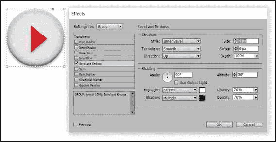

图 4-47. 应用于椭圆的斜面和浮雕选项设置

#### 4.7.5.2 添加内阴影

你不必将效果限制于仅应用在一个对象上。在完成斜面和浮雕设置后，你可以选择“效果”左侧窗格中的任意项目并添加更多效果。在图 4-48 中，你可以看到在添加了斜面和浮雕效果后，又对同一个对象应用了轻微的内阴影。我将不透明度设置为 17%，距离值设置为 1 像素，并在“选项”区域中将“大小”和“阻塞”分别设置为 7 像素和 20%。“阻塞”可以使内阴影边缘更硬朗，看起来羽化程度更低，从而在对象内部形成一点环形效果。

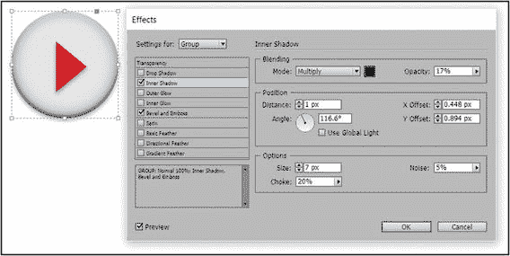

图 4-48. 内阴影效果使用的选项

“内阴影”效果窗格中的最后一个设置是“杂色”。在图 4-48 中，你可以看到我为“内阴影”使用的选项。

#### 4.7.5.3 为带有斜面和浮雕效果的对象添加投影

天哪！如果不添加投影，我们还能做什么呢？设计师喜欢在各种对象上使用投影。所以，我们就不与他们争论了，并给我们的按钮再添加一个效果。不过，我们的投影将是一个非常轻微的效果——刚好足以暗示对象从页面上微微浮起，并在其周围添加阴影。

通过在左侧窗格中点击“投影”，从“内阴影”效果切换到“投影”。我首先将不透明度设置为 35%，以淡化阴影（默认值为 70%）。然后我将“距离”和 Y 偏移量都仅设置为 3 像素。

在“效果”面板的“选项”区域中，我将“大小”设置为 5 像素，“扩展”设置为 2%，并添加了 5% 的“杂色”。在“投影”效果的右侧，你会找到一个“阴影与其他效果交互”复选框。在此示例中，启用该复选框不会产生太大区别，但在使用其他效果时，你可能会发现它很有必要。例如，如果你在椭圆形状上看到一个大的方形投影，你可能就需要启用此复选框。作为一项原则，我通常会启用它，除非明显没有必要。

在图 4-49 中，你可以看到我在已应用其他效果的基础上添加投影所使用的设置。请注意，你应用到对象上的所有效果的复选框都已被启用。

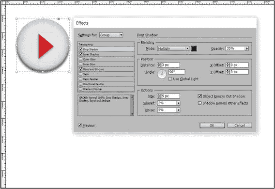

图 4-49. 投影效果的选项设置

请记住，在应用效果时，大多数情况下并没有绝对的对错。这最终取决于你个人对所创建效果的构想，以及你认为对象上的效果在你整体设计中的契合程度。我在这里提供了一些我使用的设置选项，但你的品味可能大不相同。这完全没问题。这是你自己的设计，你可以自由地进行实验，并按自己的意愿创建效果。

#### 4.7.5.4 复制效果

到目前为止，我创建了一个按钮，并为其应用了斜面和浮雕、内阴影以及投影效果。假设我想将这个按钮用作设计中的媒体播放按钮。我有一个指向右方的三角形形状，它能提示观众点击或轻触按钮后会发生什么操作。但我想将按钮上的相同效果也应用到三角形上。

在 InDesign 中，这很简单。你无需选中三角形并逐一设置所有效果。只需选中带有效果的按钮，并在打开“效果”面板的情况下，将面板右上角的 `fx` 图标拖拽到三角形（或任何其他你想要复制效果的对象）上。当你将 `fx` 图标拖向目标对象时，会看到光标变为带有 `+` 符号的手形图标。看到光标变化时，松开鼠标按钮——瞧，所有应用于按钮的效果都会同样应用到目标对象上。

将第二个对象移动到按钮的中心，然后选中这两个对象，按下 `Ctrl/⌘+G` 将它们编组。如图 4-50 所示的图形现在就可以转换为按钮了。有关创建按钮的更多信息，请参见第 9 章。

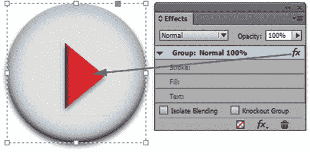

图 4-50.

将“效果”面板中的 `fx` 图标拖拽到其他对象上，以应用复制的效果

### 4.7.6 创建双斜面效果

使用效果时的一个限制是，你无法对文本的填充和描边分别应用不同的效果。

请看图 4-51。在这个示例中，我想添加一个 20 磅的描边，并且希望斜面和浮雕以及投影效果仅应用于文本本身，而非描边。要实现这种效果，我需要创建两个对象并将它们叠放在一起。

图 4-51.

当你在堆叠中拥有两个对象时，即可获得双斜面和浮雕效果。
创建双斜面效果

要了解如何创建这种效果，请按照以下步骤操作：

1. 在页面上的文本框架中添加一些文本。创建文本后，双击其中一个手柄，使框架紧密贴合文本。
2. 选中文本框架，在“效果”面板中单击“文本”，然后应用斜面和浮雕效果。根据你的喜好使用选项。在我的示例中，我使用了内斜面，选择了“凿刻硬边”，并将“大小”设置为 2。我将“阴影角度”设置为 90°，“高度”设置为 60°，并将“高光”和“阴影”的“不透明度”都设置为 100%。
3. 应用投影。同样，使用你想要的投影设置，但让阴影看起来非常微妙。在我的示例中，我将阴影“不透明度”设置为 40%，将“距离”设置为 5 磅，“角度”设置为 90°。我将“Y 偏移”设置为 1 磅，以使阴影紧贴文本。我将“大小”设置为 2 像素，“扩展”设置为 7%，并添加了 5% 的“杂色”。
4. 复制带有效果的文本。
5. 就地粘贴。选择 `编辑 > 就地粘贴`，将副本直接粘贴到原文本的正上方。
6. 添加描边。我想给文本添加一个非常粗的描边。双击文本以在文本中获取插入点，然后按下 `Ctrl/⌘+A` 选中所有文本。请务必要选中文本，而不是框架。打开“描边”面板并设置描边的大小。在我的示例中，我将描边大小设置为 20 磅。
7. 为描边添加颜色。不要为描边颜色使用纯纸色，而是添加一点黑色。在我的示例中，我为描边颜色添加了 5% 的黑色。
8. 设置堆叠顺序。带有描边的副本需要位于应用了斜面和浮雕的文本之后。按下 `Ctrl/⌘` 键并单击以选中位于最底层的对象。右键单击打开上下文菜单，选择 `对象 > 排列 > 置于顶层`。
9. 为文本添加颜色。在我的示例中，我为文本应用了渐变。

由于我们没有从文本创建轮廓，因此文本仍然是可编辑的。你可以编辑堆叠中的两个对象，并轻松地更改文本。

### 4.7.7 挖空文本

当你想要创建类型蒙版时，在“效果”面板中使用“挖空组”非常有用。在图 4-52 中，我使用的类型被挖空了，并通过文字显示出其背后的图像——就像类型蒙版一样。

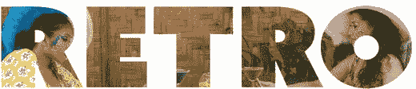

图 4-52.

文本被挖空，在文字内部显示图像
挖空文本

要实现这种效果，请执行以下操作：

1. 在图像上绘制一个框架或矩形。
2. 选中框架，然后在框架内单击“文字”工具。要调整偏移和对齐，你可以选择 `对象 > 文本框架选项` 并编辑偏移和垂直对齐。
3. 设置框架颜色。你可以为框架使用纸色填充，或使用 5% 的黑色填充。
4. 更改文本颜色。将用于框架的相同颜色应用于文本。在我的示例中，我使用了 5% 的黑色填充，因此我选中文本并对其应用 5% 的黑色填充。
5. 选择“格式效果容器”（`J`）。在“色板”面板中，单击面板顶部色板旁边的 `T` 图标以设置“格式效果容器”，或者按下键盘上的 `J` 键。
6. 打开“效果”面板，将文本混合模式设置为“正片叠底”。在“效果”面板中，你可以选择多个对象。在“对象”列表的底部是“文本”。单击“文本”，然后从下拉菜单中选择“正片叠底”，如图 4-53 所示。

   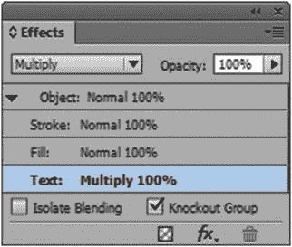

   图 4-53.

   选择文本对象，并在“效果”面板中选择“正片叠底”
7. 挖空组。单击“效果”面板中的“对象”，然后启用“挖空组”复选框。

同样，文本是可编辑的。你可以通过在文本中设置文本插入光标，按下 `Ctrl/⌘+A` 全选所有文本，然后输入新文本来更改文本。新文本将保留挖空组效果。

### 4.7.8 反射文字

你见过一些很酷的文字效果，比如带有渐变的反射文字。它看起来像是文字在水面、玻璃、草坪或许多其他背景上逐渐淡出成倒影。别再羡慕那些能创作出酷炫效果的人了。现在你可以将反射文字添加到你的设计中，比如你在图 4-54 中看到的相当简单的效果。

图 4-54.

带有反射效果的文字
创建反射文字效果

要创建反射文字效果，请按照以下步骤操作：

1. 创建一个文本框架并添加一些文字。使用“选择”工具双击其中一个手柄，使框架紧密贴合文字。
2. 设置参考点。单击“控制”面板中参考点的底部中间方格。
3. 反射文字的副本。按下 `Alt/⌥` 键，然后单击“控制”面板中的“垂直翻转”工具。
4. 检查文字的位置。放大到文字（`Ctrl/⌘+空格键`），并在页面周围拖拽以查看文字。如果反射的文字没有接触到上方的文字，请使用“上方向键”微调，使两个框架中的文字彼此接触。
5. 创建渐变羽化。单击“工具”面板中的“渐变羽化”工具，或按下 `Shift+G`。从反射文字的顶部向下拖拽以创建渐变。如果你不喜欢渐变效果，可以再次单击并拖拽。重复此操作，直到渐变效果令你满意。
6. 倾斜反射的文字。不要忘记在“控制”面板中设置参考点。将控制点设置为顶部中心。选择“切变”工具，然后从文字下方的中心位置向左单击并拖拽。

这个示例是创建反射文字的一个简单任务。当你想在不同背景上反射文字，并为文字使用不同颜色时，可以遵循相同的步骤。

### 4.7.9 创建 3D 箭头

在 3D 对象方面，InDesign 无法与 Adobe Illustrator 和 Adobe Photoshop 中能创建出的 3D 效果相媲美。不过，你仍可运用一些技巧来创建 3D 对象和透视图。你所需要的只是一点诀窍和想象力。

3D 对象会带给观者一种跃然纸上的感觉。通过在数字出版文档中添加 3D 对象，你可以吸引用户对内容及按钮操作的注意力。以图 4-55 为例。文档的读者应该能一目了然地看出，点击或轻按箭头右侧的徽标和 URL 会跳转到公司网站。由于 URL 指定了一个目标位置，大多数人会凭直觉知道，点击或轻按此区域很可能会将浏览者带到该超链接的目标位置。

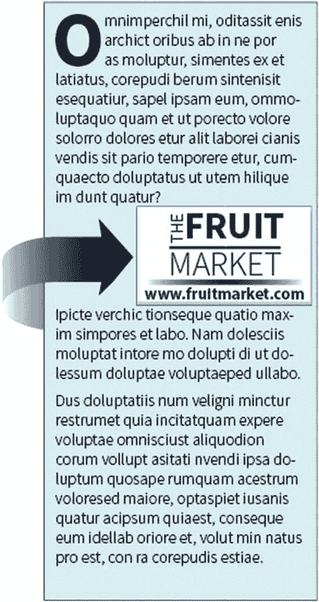

**图 4-55.** 3D 对象可以吸引读者对某种交互形式的注意

图 4-55 中的 3D 箭头是一个夸张的提示，表明页面上存在超链接。像这样的效果是一些小技巧，你可以利用它们轻松地将读者的注意力吸引到某种交互上。

#### 创建 3D 箭头

以下是我用来创建 3D 箭头的一些步骤：

1.  创建一个椭圆。椭圆的高度应与图 4-55 中看到的类似。
2.  复制/原位粘贴。复制椭圆，选择**编辑** ➤ **原位粘贴**，或按 `Ctrl/⌘+Alt/⌥+V`。
3.  将形状转换为矩形。选择粘贴的副本，选择**对象** ➤ **转换形状** ➤ **矩形**。
4.  将矩形的左边缘移至椭圆的中点。通过向右拖动矩形来实现。使用选择箭头移动形状。按住**Shift**键以约束水平移动。矩形的左侧应与下方椭圆的中点对齐，如图 4-56 所示。

**图 4-56.** 将矩形的左边缘移动到椭圆的中点

5.  合并形状。选中两个形状，打开**路径查找器面板**（**窗口** ➤ **对象和版面** ➤ **路径查找器**）。在路径查找器面板中单击**添加**图标。
6.  复制对象。
7.  将视图中的对象发送到底层。此时，文档中应有一个框架。将该对象发送到框架后面。
8.  锁定对象或将其隐藏在一个图层上。选中对象，选择**对象** ➤ **锁定**，或按 `Ctrl/⌘+L`。这样做的目的是，在接下来的几步操作中，杜绝任何意外选中该对象的可能。
9.  原位粘贴。复制的对象仍在剪贴板上。选择**编辑** ➤ **原位粘贴**，或按 `Ctrl/⌘+Alt/⌥+V`。
10. 删除粘贴对象底部的两个点。单击**直接选择**工具（或按键盘上的 `A` 键）。单击对象以显示锚点。选中右下角的点，按住**Shift**键，再点击下边的中点。按**Delete**键，此时对象应如图 4-57 所示。

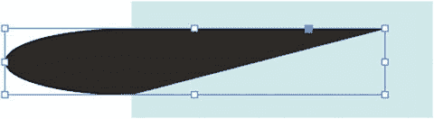

**图 4-57.** 删除底部两个点

11. 复制一个对象副本。按住 `Alt/⌥` 键并将对象向上拖动约 50 点。
12. 使用**直接选择**工具选择两个形状上的左端两个点。按键盘上的 `A` 键激活直接选择工具，然后框选两个形状上的左边两个点。
13. 打开路径查找器面板，单击**连接路径**工具。
14. 为两个对象应用渐变填充。通过渐变填充在两个对象之间创造细微区别，使其表现出一定的深度感，如图 4-58 所示。

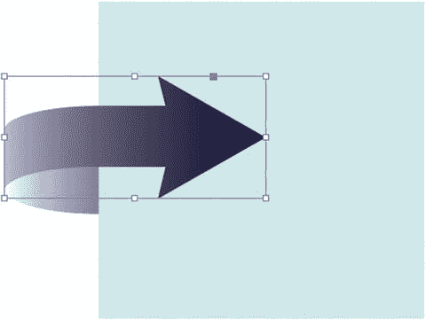

**图 4-58.** 对两个对象应用渐变

15. 绘制箭头头部。绘制一个正方形，然后选择**对象** ➤ **转换形状** ➤ **三角形**。选中该对象，单击控制面板中的**顺时针旋转 90°**工具。
16. 合并对象。将箭头头部移动到形状的右侧。同时选中三角形和前景的形状，然后在路径查找器面板中单击**添加**图标。为了让箭头头部更精致一点，单击顶部和底部的锚点，然后按几次**向左箭头键**，使其看起来更像箭头头部，如图 4-59 所示。

**图 4-59.** 某些文字效果需要先将文字转换为轮廓

如果需要调整对象大小，请使用**选择箭头**工具单击并拖动控制手柄。如果你使用 `Shift+拖动`，别忘了在控制面板中启用**自动调整**。

### 4.7.10 将文字轮廓镂空

到目前为止，我们探讨了如何使用实时文字来实现几种效果。在某些情况下，你需要在应用效果之前将文字转换为轮廓。一个例子是，当你使用重叠的框架，并且希望镂空背景框架中的文字时。使用实时文字无法创建这种效果。

文档中的任何文字都可以转换为轮廓，这意味着文字不再可编辑，而是变成了包含路径和锚点的图形。通常，你应该尽量减少将文字转换为轮廓，尤其是在创建可重排的 EPUB 时。内容提供者希望文字是活的，以便可以被搜索，并且读者可以在可重排的 EPUB 中更改字体和字号。

添加一些转换为轮廓的文字（例如章节标题和特殊效果）可以通过内容提供者的审核。但是，在创建可重排的 EPUB 时，你需要将这些文字的数量控制在最低限度。

在图 4-59 中，你看到的效果中，将文字转换为轮廓是必要的。该图像有一个边框，并且文字的顶部跟随边框的颜色，仿佛应用了描边一样。然而，图像外部的文字却没有显示描边。

#### 将文字轮廓镂空

创建类似图 4-59 的效果相当容易。你只需注意正确的编辑顺序。让我们看看如何创建这种效果：

1.  在 InDesign 页面中置入一张图像。按 `Ctrl/⌘+D` 打开**置入**对话框，找到你想要置入的图像。在置入对话框中选择它，然后单击**打开**。
2.  为框架添加描边。这一步很重要。你必须为图形框架添加描边。打开**描边面板**，应用一个较大的描边——比如 6 点。
3.  添加一个文字框架。输入文字，并将文字向下移动，使文字的顶部稍微覆盖在描边之上。
4.  将文字转换为轮廓。选中文字框架，选择**文字** ➤ **创建轮廓**。
5.  复制文字轮廓。
6.  从背景（图像）中减去最前面的对象（文字轮廓）。选中文字和图像，在**路径查找器面板**中单击**减去**图标（左起第二个）。
7.  原位粘贴。
8.  选择**编辑** ➤ **原位粘贴**（`Ctrl/⌘+Alt/⌥+V`）。

如果你严格遵循了这些步骤，你应该会看到与图 4-59 所示类似的效果。

### 创建拼图效果

在 Photoshop 和 Photoshop Elements 中，你可以使用拼图效果，将一张照片分割开来，创建出一种每块拼图都可以移动、变换并应用各种效果的拼图效果。

在 InDesign 中，你也可以创建一种拼图效果。但是，你无法创建任意形状的拼图块。你在 InDesign 中能创建的拼图效果会生成一个方形网格。然后你可以将网格拆分开来并应用效果。在图 4-60 中，你会看到在 InDesign 文档中创建的拼图效果。

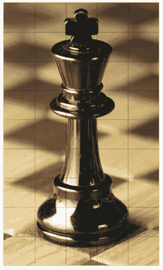

图 4-60.

你可以直接在 InDesign 中创建拼图效果 创建拼图效果

要创建此效果，你需要借助脚本。使用脚本时，网格的分割部分会断开，你就可以移动和变换这些拼图块。请按照以下步骤创建类似效果：

1. 在 InDesign 页面中放置一张照片。
2. 双击 `MakeGrid` 脚本。选中图像并打开“脚本”面板。打开“应用程序”文件夹，然后打开“示例”文件夹，最后打开“JavaScript”文件夹。向下滚动找到 `MakeGrid`。双击 `MakeGrid` 脚本。此时会打开 `MakeGrid` 对话框。
3. 设置网格属性。将行数和列数设置为网格中所需的数量。在我的示例中，我使用了九行和五列。将行距和列距设置为 0（零）。点击“确定”，网格便创建完成。
4. 添加投影（可选）。投影可以让各个拼图块易于区分。选中所有拼图块，打开“效果”面板，然后从 `fx` 下拉菜单中选择“投影”。在“投影”窗口中，将“距离”设置为 0，并将“大小”设置为 3 像素。点击“确定”，网格便会显示出细微的分割线，如图 4-61 所示。

    

    图 4-61.

    添加投影以便看到分割线

5. 移动、缩放和/或旋转单个拼图块。每个拼图块都是可选中的。使用“选择”工具按照你的喜好移动、缩放和旋转拼图块。

### 创建复古风格

如果你是 1983 年以后出生的，你的阁楼里可能没有存放任何宝丽来照片。如果你和我一样是个老家伙，你可能有一堆宝丽来照片，以及幻灯片、底片和照片打印件，希望有一天能扫描并转换成数字形式。

如果你无法扫描宝丽来照片，你可以使用 InDesign 中的各种效果来创建宝丽来外观，使用描边并在描边中添加一点黑色（大约 5–7%），使填充看起来略带灰色。我喜欢使用原始的宝丽来照片并进行扫描。扫描的图像会带上一些灰尘和淀粉颗粒，这能增添一点复古感。

在图 4-62 中，你可以看到一张我手头有的宝丽来照片。我扫描了这张照片，使边框与原始照片完全一致。照片上有一些污点，但我想再添加一点。于是我在左下角放置了一个咖啡渍的 Photoshop 文件，并将透明度设置为 40%。

图 4-62.

宝丽来照片非常适合营造复古风格

我想在边框上添加一张不同的照片，于是我在旧照片收藏中翻找，找到了一张几年前与圣诞老人的旧照片。我画了一个框架，将照片放在宝丽来扫描图的上方，然后通过选择 `对象 ➤ 排列 ➤ 置于顶层` 将咖啡渍移到堆叠顺序的最上面。

我应用了投影，并将不透明度设置为 40%，距离设置为 2 像素，角度设置为 90°，大小设置为 5 像素，扩展设置为 7%，并添加了 5% 的噪点。

像这样添加一张照片，可能适合用于通过 Adobe Publish Online 发送给家人和朋友的设计的圣诞贺卡。要了解如何使用 Publish Online，请查看第 14 章。

本章讨论的各种效果只是冰山一角。效果面板中有如此多的选项，不可能在这里全部涵盖。有关更多信息，并发现使用 InDesign 效果可以做的许多酷炫事情，请搜索互联网。首先，可以访问 [`www.indesignsecrets.com`](http://www.indesignsecrets.com) 网站，浏览 David Blatner、Anne-Marie Concepcion 及其贡献者发布的众多文章。还可以查看 Adobe 发布的许多帮助文档和视频。作为起点，请访问 InDesign 效果介绍：[`https://helpx.adobe.com/indesign/how-to/create-special-effects.html`](https://helpx.adobe.com/indesign/how-to/create-special-effects.html).

## 使用链接面板

在 InDesign 中置入对象时，这些文件会链接到存储原始对象的硬盘驱动器或其他源位置。如果你移动、编辑或删除了源图像，则当你打开包含这些链接的文件时，InDesign 会打开一个警报对话框。

在“链接”面板中，你可以找到文档中置入的所有对象的列表。如果你在“正常”模式下查看文档并显示框架边缘，则已缺失或已修改的链接会在放置图像的每个框架中显示警告图标或缺失图标（红色问号圆圈）。已修改对象和缺失对象也会显示在“链接”面板中，如图 4-63 所示。

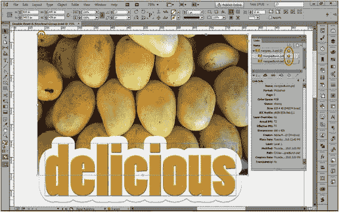

图 4-63.

缺失和已修改的链接显示在文档页面和“链接”面板中

黄色警告图标表示链接对象在导入 InDesign 后被修改过。你可以通过单击文档窗口中的警告图标或双击“链接”面板中的图标来轻松更新链接。

红色问号圆圈表示 InDesign 找不到文件位置。你可能已将对象移动到了其他源、其他文件夹或硬盘上的其他位置。

若要重新链接缺失文件，请单击文档窗口中的缺失图标，双击“链接”面板中的缺失图标，或单击“链接”面板底部的“重新链接”图标（显示为链条）。双击缺失图标或使用其他查找链接的方法时，会打开“定位”对话框。导航到链接文件所在的位置，选择该文件，然后单击“打开”。

## 打包文件

有时你可能会在一个文档中导入许多对象，而这些对象可能分散在你的硬盘各处。如果在放置对象之前没有将每个对象添加到一个共同的文件夹，那么这可能会造成组织上的噩梦。

一旦检查了“链接”面板并确认文档没有缺失或已修改的链接，请选择 `文件 ➤ 打包`。InDesign 会打开一个摘要屏幕，并报告文档中发现的任何错误。如果一切正常，请单击“打包”对话框底部的“打包”按钮。

单击“打包”后，下一个窗格用于打印说明。如果这些信息对你没有帮助，请单击“继续”。最后一个屏幕是“打包出版物”屏幕。选择目标位置并单击“打包”。InDesign 会将你的文档、所有链接的资源以及所有文档字体添加到一个共同的文件夹中。

### 4.10 本章小结

通过阅读本章，您可以看到 InDesign 为您提供了丰富的功能和方法来处理对象和图像。您学习了如何导入图像、在 InDesign 中创建图形、为对象和形状应用自定义设置，以及多种显示图形的方法。

在下一章中，我们将介绍表格的使用。您将学习如何格式化表格单元格和整个表格、在表格中使用文本和图像，以及为表格添加交互功能。

