# 5. 创建表格

如果您在 90 年代初上网冲浪，您会在网景浏览器中看到大量表格。颜色通常非常单调，使用的是我称之为“网景灰”（红、绿、蓝均设置为 128，产生中灰色）的颜色。那时的网站在图形化方面不如今天这么吸引人，我们也没有 CSS（层叠样式表）。但早期的 HTML 版本确实提供了创建表格的标签来显示表格数据，借助 `border=0` 标签，网页设计师可以创建网格布局。那些早期的网页设计可以使用 HTML 表格标签来更简洁地显示表格数据，而不是仅仅在段落标签内添加文本。

有些人可能会争辩说，自 1996 年底 CSS 出现以来，由于 `Div` 标签和 CSS 的存在，网页设计师可以避免在网页设计中使用表格，这样做在很大程度上是可避免的。

然而，当谈到在 InDesign 中创建的表格时，版面设计师的艺术天赋可以达到新的高度。对象的基础可能是一个表格，但表格数据的外观可以通过如此多的创意方式来表达，以至于结果看起来都不像表格了。

为了深入探讨一些表格的创意使用方法，首先您需要了解 InDesign 表格的基础知识。之后，我们可以探索多种变化，并着眼于超越传统表格设计，实现更有趣的布局。

在本章中，我将讨论创建表格的基础知识以及如何格式化表格单元格。然后，我会继续介绍一些创意方法，帮助您创建更具动态性和趣味性的表格设计。

## 5.1 理解表格的基础知识

您需要理解的一个重要的基本概念是，表格与文本及所有其他对象一样，都存在于框架内。这一点很好，因为如果您有一个想要跨页或多页显示的表格，您可以单击框架的导出端口，导航到另一页，然后点击以扩展表格。

就像文本框一样，包含表格的框架中可能存在溢出的文本，在普通视图模式下查看文档时，您会看到一个溢出标记。您也可以控制拐角设计，就像我们在第 4 章中介绍的图形对象那样。当您选择一个框架时，单击黄色方块，四个菱形图标会出现在拐角处。可以一起或单独移动菱形以更改拐角选项。按下 `Ctrl/⌘+Alt/⌥` 并单击黄色菱形可以更改拐角效果。（有关编辑拐角的更多信息，请参阅第 4 章。）尽管表格确实有拐角控制功能，但最好还是在表格后面创建一个框架并应用拐角效果。如果表格单元格中有数据，拐角效果可能会干扰数据。

您还可以通过缩放、倾斜和反射来变换表格。使用第 4 章中描述的方法对表格进行变换。您可以在表格单元格中放置图形对象、格式化单元格内的文本，以及为表格单元格添加描边。您可以将对象锚定到单个单元格，也可以在文本框内锚定表格。

要将表格锚定到文本框，请单击框架顶部的蓝色方块并将其拖动到文本框中所需的位置。按住 `Shift` 并拖动，可使对象成为文本框中的内联对象；或按住 `Alt/⌥` 并拖动，以打开“锚定对象选项”对话框。

## 5.2 掌握表格指南

处理表格时，您需要做的第一件事就是创建表格。InDesign 为您提供了四种创建表格的方法。您可以使用菜单命令、将现有文本转换为表格，以及从电子表格或文字处理程序导入数据。我们来看看每种方法。

**创建表格**

1.  使用表格填充边距参考线。在页面上未选择任何内容的情况下，打开“表格”菜单并选择“创建表格”。将打开“创建表格”对话框，如图 5-1 所示。在“创建表格”对话框中，您可以设置行数和列数，并指示是否需要表头行和/或表尾行。如果您有表格样式（如我在第 6 章中所述），您可以从“表格样式”下拉菜单中选择该样式。单击“确定”，光标将加载表格枪。

    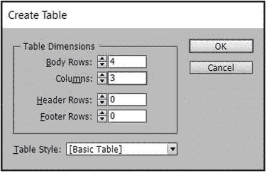

    图 5-1。从“表格”菜单中选择“创建表格”，将打开“创建表格”对话框

2.  单击文档页面。如果您在边距参考线顶部附近单击，表格将填充边距参考线之间的区域，如图 5-2 左侧所示。

    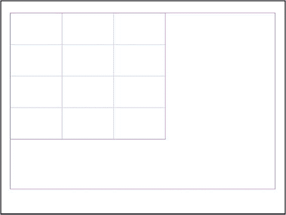

    图 5-2。单击并拖动以为表格设置自定义大小

3.  为新表格指定大小。此项目与您创建表格的第一种方法类似。在您希望表格出现的文本框中的某处单击。然后选择 `表格 ➤ 插入表格`，在“创建表格”对话框中指定表格属性，然后单击“确定”。

4.  将文本转换为表格。您可以将在 InDesign 中键入或置入的文本转换为表格。选择要转换为表格的文本，然后选择 `表格 ➤ 将文本转换为表格`。将打开“将文本转换为表格”对话框，如图 5-3 所示。在此对话框中，您可以选择列分隔符和行分隔符。

    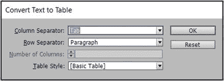

    图 5-3。选择列数和行数以及列分隔符，然后单击“确定”

5.  如果文本由逗号分隔，且每行末尾有回车符，请从“列分隔符”下拉菜单中选择“逗号”。将“行分隔符”保留为默认的“段落”选项。同样，如果文本包含制表符，请为“列分隔符”选择“制表符”。

6.  单击“确定”，InDesign 会将文本转换为表格。

7.  导入数据。在 InDesign 中创建表格的最后一种方法是从文本文档导入文本。您可以导入仅保存为纯文本的文件以及 RTF 文件，但数据的转换效果不如导入 Microsoft Excel 文件那么整齐。您也可以使用 CSV 格式导入文件，但同样不如导入 Excel 电子表格那么清晰。如果您使用 OpenOffice 和 IBM Lotus Symphony 等开源应用程序，则需要将文件保存为 Excel 格式。

8.  您使用 `文件 ➤ 置入` 命令来导入电子表格数据。您可以选择两种方式之一来处理数据。将数据作为静态文本块导入，或者选择将数据链接到电子表格。如果您希望链接数据，以便每次在电子表格应用程序中进行编辑时，InDesign 中的数据都能更新，则需要调整首选项设置。

9.  按 `Ctrl/⌘+K` 打开 InDesign 首选项。单击左侧窗格中的“文件处理”。在右侧窗格中，启用“置入文本和电子表格文件时创建链接”复选框，如图 5-4 所示。置入数据文件并单击“确定”，将打开“导入选项”对话框。

    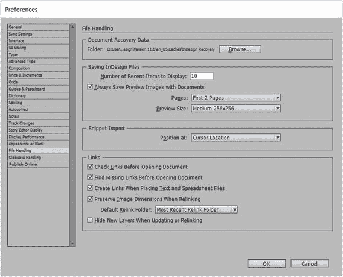

    图 5-4。选择列数和行数，然后单击“确定”

在图 5-5 中，你会看到对话框的标题显示为 `Microsoft Excel Import Options`，括号内包含文件名。对话框的标题会根据你选择导入的文件类型而变化。

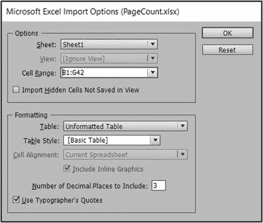

图 5-5. 导入 Excel 电子表格时的导入选项

在 `Import Options` 对话框中，你可以为工作簿中的工作表、单元格区域以及一些格式选项做出选择。点击 `OK`，表格数据便会作为表格导入。如果你将表格与数据链接，那么对原始电子表格进行任何更改后，可能需要更新该链接。关于链接对象的更多信息，请参见第 4 章。

## 5.3 使用表格工具与命令

你首先会注意到菜单栏中有一个 `Table` 菜单，这表明你拥有许多与表格相关的命令。`InDesign` 为你提供了一系列专门用于处理表格的命令，它们整齐地放置在 `Table` 菜单中，如图 5-6 所示。

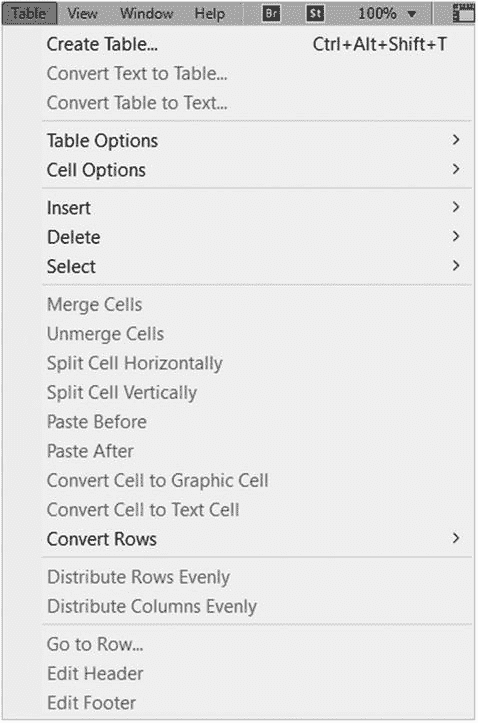

图 5-6. 单击菜单栏中的 `Table` 以打开表格菜单

与 `InDesign` 中的许多其他功能类似，`Control Panel` 中也有许多与菜单命令相同的选项。此外，当你选中一个表格或表格中的某个单元格时，可以右键单击鼠标打开一个上下文菜单，从而轻松访问许多表格命令。

### 5.3.1 使用表格菜单

在深入探讨 `Table` 菜单中的命令之前，你应该知道，自 `InDesign CC 2015` 起，存在两种不同类型的表格单元格：文本单元格和图形单元格。显然，当你在单元格中输入文本时，该单元格会被解释为文本单元格；当你在单元格中置入图形时，该单元格会被转换为图形单元格。话虽如此，让我们来看看在 `InDesign` 中可用于格式化表格的一些 `Table` 菜单命令。

#### 5.3.1.1 使用表格选项

在 `Table` 菜单的 `Table Options` 子菜单中，你拥有多个选项。要使用子菜单选项，你必须先选中表格。你可以将类型工具点击在某个单元格中，此时子菜单命令便会激活。你也可以将光标移动到表格的左上角，当光标变为一个 45 度角的箭头时，单击即可选中整个表格。

使用上述任一方法，然后选择 `Table` ➤ `Table Options`，并选择任意一个子菜单项，或者按 `Ctrl/⌘+Alt/⌥+Shift+B` 组合键，即可打开 `Table Options` 对话框，如图 5-7 所示。请注意，在对话框顶部，你会看到对应五个子菜单项的选项卡。因此，无论你选择哪个子菜单项，通过选择一个 `Table Options` 子菜单命令或按 `Ctrl/⌘+Shift+B` 组合键，你都能访问所有这些选项卡。

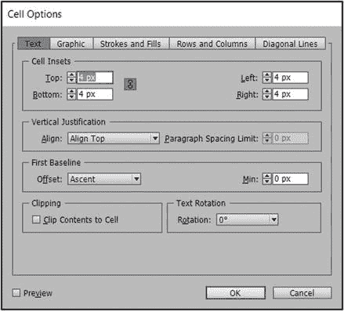

图 5-7. 按`Ctrl/⌘+Shift+B`组合键，打开`Table Options`对话框

`Table Options`对话框中有五个选项卡。当你选择`Table Setup`子菜单命令或按`Ctrl/⌘+Alt/⌥+Shift+B`组合键时，默认打开的是`Table Setup`选项卡。

*   `Table Setup`（表格设置）：你可以在`Table Dimensions`（表格尺寸）区域更改行数和列数，并添加表头行和表尾行。对于表格边框，需指定边框的粗细、颜色和描边类型。你可以创建间隙并使用纸色填充（如果你的背景是白色），这样设计就不会看起来像表格。
    *   将`Table Spacing`（表格间距）保持为默认值。如果你希望在文本框架内的表格前后添加间距，请使用段落样式，我将在第 6 章中解释。在`Draw`（绘制）下拉菜单中，你可以选择将行和列的单元格描边显示在`Front`（前面）。

*   `Row Strokes`（行描边）：此选项卡中的设置与列行的描边相关，如图 5-8 所示。在`Alternating Pattern`（交替模式）下拉菜单中，你可以交替显示行的描边模式（例如为交替的行应用不同的描边或颜色）。`InDesign`允许你将模式应用于每隔一至三行。如果你想交替超过三行，请选择`Custom`（自定义）。
    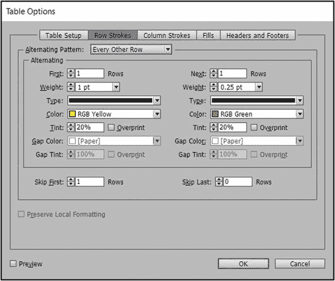
    图 5-8. 在`Table Options`对话框中点击`Row Strokes`选项卡
    *   `First/Next`（第一行/下一行）：如果你想交替超过三行，请在文本框中输入一个值，`Alternating Pattern`将变为`Custom Row`。对于`Type`（类型）、`Color`（颜色）和`Tint`（色调），从下拉菜单中选择`Stroke`（描边）样式，在`Color`下拉菜单中为交替行选择颜色，并在`Tint`文本框中更改颜色色调值。如果你希望行之间使用默认`Paper`（纸色）以外的间隙颜色，请从下拉菜单中选择一种颜色。
    *   `Gap Color/Tint`（间隙颜色/色调）：这些设置仅适用于条纹、点线和虚线描边。如果你使用的是实线描边样式，则下拉菜单不可用。为条纹、虚线和点之间的间隙选择颜色和色调。
    *   `Skip First/Last`（跳过第一行/最后一行）：编辑文本框中的数值，以指定模式中要跳过的行数。
    *   `Preserve Local Formatting`（保留局部格式）：如果你希望之前应用于表格的格式化描边保持有效，请启用此复选框。

*   `Column Strokes`（列描边）：`Column Strokes`选项卡提供与`Row Strokes`选项卡相同的选项，只是这些设置应用于列描边。

*   `Fills`（填充）：对于单元格填充，你有类似于行描边的选项。你可以选择交替模式、从下拉菜单中选择颜色、对选中的颜色应用色调，并跳过第一行/最后一行。

*   `Headers and Footers`（表头与表尾）：在最后一个选项卡中，你拥有添加一个或多个表头行和/或表尾行的选项。当表格跨列或跨页拆分时，使用表头和表尾尤其有用。如果你在此选项卡中添加了表头和/或表尾，表格的每个拆分部分都会显示它们。

### 5.3.1.2 设置单元格选项

选择 `表格 ➤ 单元格选项 ➤ 文本` 或按 `Ctrl/⌘+Alt/⌥+B` 时，将打开`单元格选项`对话框并显示在`文本`选项卡。单元格选项与表格选项类似，对话框顶部有多个选项卡，如图 5-9 所示。在此对话框中进行的所有设置都将应用于选定的表格单元格。

- **文本**：`文本`选项卡包含单元格内文本的选项。您可以为文本添加偏移值、垂直对齐文本、偏移文本基线、将内容裁剪到单元格以及旋转文本。

- **图形**：表格单元格可以是文本单元格或图形单元格。单击`图形`选项卡，您可以对图形单元格进行调整，例如调整内嵌值和将内容裁剪到单元格。

- **描边和填色**：您可以对单个单元格应用描边和填色。与表格描边的区别在于，您可以针对单元格的单个边应用描边和颜色，如图 5-10 所示。单击对话框顶部的网格线可以取消选择或重新选择描边。应用描边值或颜色时，选定的描边将受到影响。请注意，您也可以在`控制面板`中选择表格中的描边。
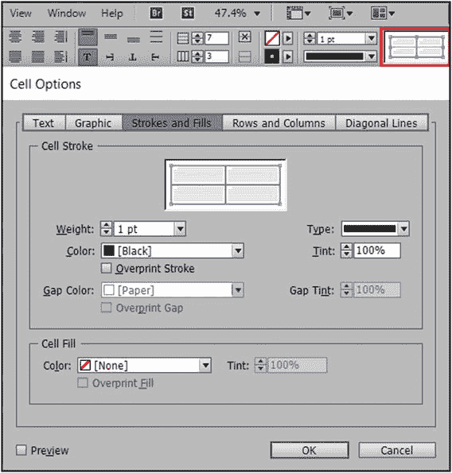
*图 5-10。默认情况下，所有描边均处于选中状态。单击某个描边可取消选中，并将描边粗细和颜色应用于其余选中的描边。*

- **行和列**：如果您希望将行高设置为固定值，请打开`行高`下拉菜单并选择`精确`。

- **对角线**：单击`对角线`选项卡，您可以从四个选项中选择：`无`、从单元格左上角到右下角的 45 度角、从单元格左下角到右上角的 45 度角，以及两条对角线（形如 X）。您可以选择将对角线描边置于底层，或使其显示在文本或对象的上方。

*图 5-9。按 `Ctrl/⌘+Alt/⌥+B` 键，`单元格选项`对话框将打开。*

### 5.3.1.3 插入、删除和选择单元格

在`表格`菜单中的`单元格选项`之后，您会找到三个菜单项，分别用于插入行和列；删除行、列和表格；以及选择单元格、行和列，选择页眉行和页脚行，以及选择表格。

### 5.3.1.4 合并单元格/取消合并单元格

选择表格中的单元格，然后选择 `表格 ➤ 合并单元格`。这些单元格将合并为一个单元格。如果要取消合并单元格，请选择一个合并单元格，然后选择 `表格 ➤ 取消合并单元格`。

### 5.3.1.5 水平/垂直拆分单元格

您可以水平和/或垂直拆分单个单元格。当您选择一个单元格并选择任一命令时，该单元格将被均匀拆分。

### 5.3.1.6 在行前/后粘贴

这些命令与复制到剪贴板的行和列有关。复制一行或一列后，选择在选定的行/列的`前方粘贴`或`后方粘贴`。

### 5.3.1.7 将单元格转换为图形和文本单元格

要使用这些命令，单元格中不得包含任何文本/图形。选择一个空单元格，然后选择将文本单元格转换为图形单元格或将图形单元格转换为文本单元格。

### 5.3.1.8 转换行

当您选择 `表格 ➤ 转换行` 时，您会看到三个选项：`转换为页眉行`、`转换为主体行`（主体行是页眉行和页脚行之间的所有行）和 `转换为页脚行`。

### 5.3.1.9 均匀分布行/列

选择一个列或行范围，然后选择 `表格 ➤ 均匀分布行`（或`列`）。所选行的高度或列的宽度将均匀分布。

### 5.3.1.10 导航行

选择一个表格，然后选择 `表格 ➤ 转到行`。将打开`转到行`对话框，如图 5-11 所示。如果您的表格包含页眉和页脚，您会看到一个下拉菜单，您可以在其中选择`主体`、`页眉`和`页脚`。在菜单右侧的文本框中输入一个值，即可跳转到该行。此选项最常用于跨多页的长表格。
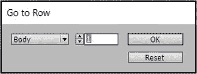
*图 5-11。选择 `表格 ➤ 转到行` 可打开`转到行`对话框。*

### 5.3.1.11 编辑页眉和页脚

`表格`菜单中的最后两个菜单项是`编辑页眉`和`编辑页脚`。当您选择其中一个命令时，相应页眉/页脚的最左侧单元格将被选中。

### 5.3.2 使用控制面板

选择一个或多个单元格或选择一个表格，`控制面板`将会改变，为您提供编辑行、列和单元格的选项。在图 5-12 中，您可以看到选定的表格以及`控制面板`中可用的选项。这些选项是`表格`菜单命令的子集。
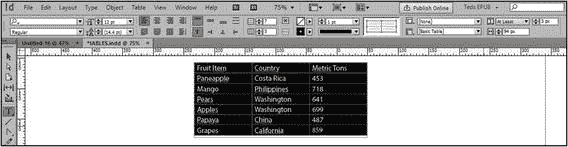
*图 5-12。选择一个表格，`控制面板`将显示用于编辑表格的选项。*

在`控制面板`中，您将找到以下内容：

- **字体和字体样式**：从下拉菜单中选择字体和字体样式。

- **字体大小和行距**：单击箭头图标或在相邻文本框中输入数值以更改字体大小和行距。

- **对齐**：单击八个图标之一可更改所选单元格中的文本对齐方式。

- **垂直对齐**：单击四个图标之一，可将单元格内的文本垂直对齐到顶部、居中、底部或两端对齐。

- **文本旋转**：单击四个图标之一，可将文本旋转到图标所示的旋转方向。

- **行数/列数**：单击文本框左侧的图标可选择文本框中的相应文本。单击箭头键或在文本框中输入数值。

- **合并/取消合并单元格**：选择两个或多个单元格，然后单击`合并单元格`图标可合并这些单元格。选择一个合并单元格，然后单击`取消合并单元格`图标可取消合并。

- **描边颜色/填色**：单击右箭头打开一个下拉菜单，显示`色板面板`中的颜色。选择一种颜色应用于单元格填色或描边。

- **粗细/描边样式**：编辑文本框或为边框和单元格的描边粗细选择一个选项。打开`描边样式`下拉菜单并选择一种描边样式。

- **目标描边**：该网格与您在单元格选项的描边和填色中看到的图 5-10 相同。单击`控制面板`中您希望从选择的描边属性编辑选项中排除的描边。

- **单元格和表样式**：这些选项与您为单元格和表格创建的样式有关。有关如何创建和使用单元格和表样式的信息，请参阅第 6 章。

- **列宽和行高调整**：从下拉菜单中选择`精确`可将行高设置为固定值。选择`至少`，然后单击箭头或在文本框中输入文本以调整行和列的大小。

- **内嵌距**：编辑文本框或单击箭头以调整单元格的上、下、左、右内嵌距。

## 5.4 创建新表格

上一节“使用表格工具和命令”是一个参考指南，您可以将其标记出来，以便在需要查找创建表格时所用的正确命令或工具时随时翻阅。现在，我们来实际查看工作流程并创建一个表格。

在本练习中，我们将学习如何着手创建并格式化一个简单的表格。在图 5-13 中，您可以看到一个在 InDesign 中创建的相当简单的表格。要创建类似于图中所示的表格，请执行以下操作：

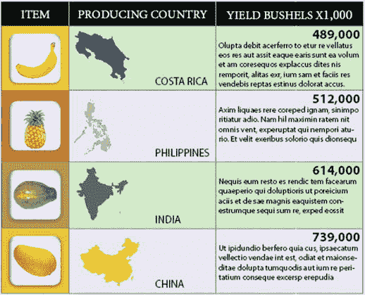

图 5-13. 在 InDesign 中创建的表格 创建新表格

1.  创建新表格。首先，让我们从头开始创建一个新表格。选择 `表格 -> 创建表格`，或按 `Ctrl/⌘+Alt/⌥+Shift+T`。此时将打开`创建表格`对话框。

2.  指定行和列。要创建与图 5-13 类似的设计，请在`正文行`中输入 `5`，在`列`中输入 `3`。对于这个简单的表格，我们不需要`表头行`，因此在指定行和列后单击`确定`。

3.  设置第一行的行高。使用`选择`箭头双击表格，并选中第一行。将光标移至第一行的最左侧，当看到向右的箭头时，单击鼠标。在`控制面板`中，将行高`精确`设置为 36 像素（见图 5-14）。

图 5-14. 表格粗略设置

4.  将接下来的四行行高设置为 100 像素。单击从第二行到最后一行的左向箭头以选中它们，并再次在`控制面板`中将大小`精确`设置为 100 像素（见图 5-15）。

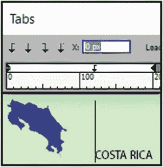

图 5-15. 按 `Ctrl/⌘+Shift+T` 打开`制表符标尺`

5.  设置列宽。将光标移至表格顶部并选中第一列。将列宽设置为 100 像素。选中接下来的两列，并将宽度设置为 220 像素（见图 5-16）。

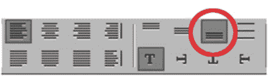

图 5-16. 单击`控制面板`中的`对齐按钮`工具

6.  将单元格转换为图形单元格。单击`文字`工具，然后单击左侧列的第二行单元格。向下拖动以选中这四个单元格。选择`表格 -> 将单元格转换为图形单元格`。

7.  在图形单元格中置入图形对象。您可以使用任何类型的图形——照片、绘图、InDesign 艺术品等等。选择`文件 -> 置入`，并单击一个图形单元格以将文件置入其中。如果页面上有作品，请将其复制并单击该图形单元格。选择`编辑 -> 粘贴入`。将图形置入第一列的四行中。

8.  添加一些内联图形。在我的示例中，第二列中有另一个图形。由于该列中也有文本，您可以将图形作为内嵌对象添加。复制一个图形，并单击单元格中的插入点。选择`编辑 -> 粘贴`或按 `Ctrl/⌘+V`。

9.  在包含内联图形的单元格中设置制表位。选择`文字 -> 制表符`或按 `Ctrl/⌘+Shift+T` 打开`制表符标尺`。在内联图形的右侧设置一个制表位，如图 5-15 所示。将光标单击到其中一个单元格中，然后在 Mac 上按 `Option -> Tab`。在 Windows 上，选择`文字 -> 插入特殊字符 -> 制表符`。输入一些文本。在我的示例中，我输入了国家名称。

10. 设置垂直对齐。选中第二列底部的四行，并单击`控制面板`中的`底端对齐`图标，如图 5-16 所示。这会将文本和图形对齐到单元格底部。

11. 向最后一列添加文本。在我的示例中，最后一列的第一行文本是右对齐的。其他行文本是左对齐的。您可以在`控制面板`中设置类型属性，就像对文本框中的任何文字进行设置一样。选中单元格中的第一行文本，并单击`控制面板`中的`右对齐`图标。选中单元格中的其余文本，并单击`控制面板`中的`左对齐`图标。

12. 向第一行添加反白文字。通过单击第一行左侧的向左箭头选中第一行，并单击`色板面板`中的`前景色`色板。将颜色设置为`黑色`。单击`文字`工具，然后单击第一行的第一个单元格。在`色板面板`中将填充颜色设置为`纸色`，并为第一列输入一个标题（见图 5-17）。按 `Tab` 键，为第二列添加文字。再次按 `Tab` 键，为最后一列添加文字。

图 5-17. 将行填充颜色设置为黑色，并将文字颜色设置为纸色

13. 设置文字对齐。选中第一行，并单击`控制面板`中的`居中对齐`工具。单击`控制面板`中的`垂直居中`工具以垂直对齐文字。

14. 添加交替行填充。将光标单击到一个单元格中，或者将光标移到所选表格的左上角，并单击斜向箭头以选中整个表格。选择`表格 -> 表格选项 -> 交替填色`以打开`表格选项`对话框中的`填色`选项卡（见图 5-18）。从`交替模式`下拉菜单中选择`每隔一行`。从下拉菜单中选择`第一行`和`下一行`的颜色，并为每个颜色输入一个`色调`值。在`跳过前`文本框中输入 `1`。单击`确定`，表格看起来应类似于图 5-13 所示。

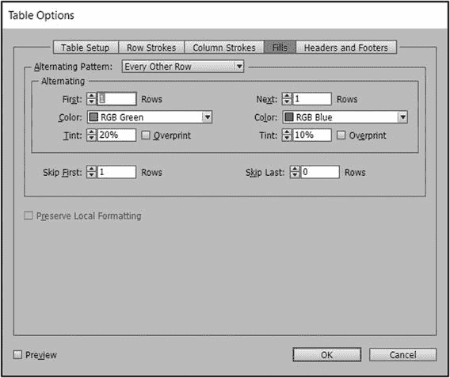

图 5-18. 为交替行单元格填充颜色选择颜色和色调

## 5.5 设计创意图表

与其逐一浏览一系列展示表格数据并说明表格可用选项的表格，不如让我们看看一些设计表格的创意方法，以便将其包含在您的数字出版文档中。

您可以使用第 3 章中介绍的许多功能，我在其中讨论了格式化文本以及将不同的文字格式应用于表格单元格中的文本。您还可以使用我在第 4 章中介绍的许多处理图形的不同技巧。

为了让您的工作更加轻松，使用样式（字符样式、段落样式、图形样式和表格样式）将是您的一大优势。但我还没有开始讨论样式，这是第 6 章的主题。现在，让我们先看一些创建有趣表格的技巧。如果您需要对多个单元格应用编辑时需要使用重复步骤，请先查看第 6 章，然后再返回到本章。

### 5.5.1 圆角与锚定对象

你可以为表格设置圆角；然而，其效果往往难以达到预期。请记住，创建表格时涉及两个不同的对象——表格本身及其容器框架。如果你为容器框架设置了圆角，表格会与框架产生偏移。如果尝试选中表格，你将找不到任何可控制的圆角选项。你需要使用其他方法来创建圆角效果。

在创建表格时，锚定对象非常重要。查看图 5-19。在该表格中，我为第一列中的对象设置了圆角，并将其锚定到文本框。要使单元格同时包含文本和图形，你需要将对象锚定到单元格文本字段。

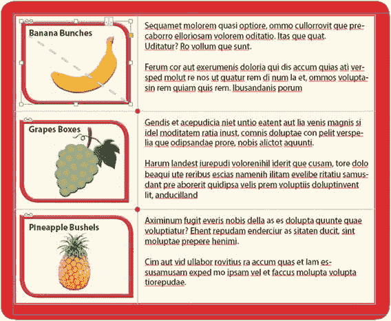

**图 5-19.** 一个带有圆角和锚定对象的表格

**注意**

想要查看锚定线，请选择 `视图 ➤ 其他 ➤ 显示文本串接`，或按下 `Ctrl/⌘+Alt/⌥+Y`。你必须在**正常**视图模式下才能看到串接线。

图 5-19 中的圆角应用于一个框架。包含表格的文本框被粘贴到这个框架中（通过 `编辑 > 贴入内部`），从而营造出表格边框带有圆角的外观。由于第 1 列中的对象已被锚定，因此剪切并粘贴表格时会包含所有元素。

在图 5-20 中，你可以看到另一个类似表格的例子。锚定对象是位于单元格交叉点处的菱形。这营造出单元格具有斜角的视觉效果。

**图 5-20.** 菱形形状即为锚定对象

**设计创意表格**

以下是我创建该表格的方法。

1.  **创建表格**。我创建了一个六行四列的表格。我将第一行的高度设置为 125 像素，第二行设置为 33 像素，其余行设置为 75 像素。最后这个设置非常重要。所有包含菱形的行高度必须相同，稍后我在讨论复制对象时会解释原因。

2. **格式化表格**。我将第一行填充为黑色，并将文字颜色设置为“纸色”，以此实现反白效果。我将内部描边值设置为 4 点，并为第三行下方的描边应用了颜色。我还将反白单元格的描边设置为 4 点，并应用了“纸色”。初始设置时，我在第 2 列和第 3 列的文本中添加了逗号。这便于稍后添加菱形对象后，将逗号转换为段落回车符。

3. **创建菱形对象**。你可以创建一个圆形、正方形或其他形状。在我的示例中，我打开了`字形面板`，并在`Wingdings`字体中查找菱形形状。我将一个菱形添加到文档中，并将文本转换为轮廓。我没有添加描边，只设置了颜色填充。我也在表格的左侧创建了这个对象。

4. **锚定对象**。按住 `Alt/⌥` 键，将锚点拖拽至第一个文本框。在我的示例中，我将锚点拖拽至第一行第二列中，刚好位于文本的左侧。当你按住 `Alt/⌥` 键拖拽锚点时，`锚定对象选项`对话框将自动打开。

5. **设置`锚定对象选项`**。参考点默认位于左下角位置，这没问题。锚定位置是左侧（在此例中为单元格文本的左侧），这也没问题。你需要更改的一项内容是`X 相对于`。打开下拉菜单并选择`锚点标记`，如图 5-21 所示，然后点击确定。

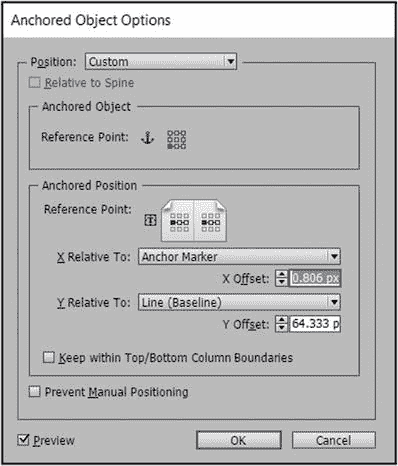

**图 5-21.** 按住 `Alt/⌥` 键同时将锚点拖拽到文本框，以打开`锚定对象选项`对话框

6. **将对象移动到正确位置**。将对象拖拽到行列描边的第一个交叉点。

7. **创建一个`对象样式`**。我一直避免在 InDesign 中讨论样式表的使用，因为我有整整一章的内容专门介绍样式，尤其是图形样式。然而，除非你创建一个`对象样式`，否则这个设计工作确实无法继续。打开`窗口`菜单，选择`样式 ➤ 对象样式`。当面板打开后，点击面板底部的`创建新样式`图标。点击该对象，然后选择新创建的样式，确保图形继承了该样式。有关创建`对象样式`的更多信息，请参阅第 6 章。

8. **查看锚定线**。选择 `视图 ➤ 其他 ➤ 显示文本串接`，或按下 `Ctrl/⌘+Alt/⌥+Y`。确保你处于**正常**视图模式，而非**预览**视图模式。如果锚点已正确设置在文本字段中，你应该会看到一条从该对象延伸到第二列第三行文本段落开头的蓝色虚线，如图 5-22 所示。

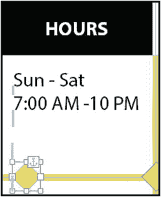

**图 5-22.** 选择 `视图 ➤ 其他 ➤ 显示文本串接` 或按下 `Ctrl/⌘+Alt/⌥+Y` 以查看文本串接

9. **剪切对象**。选中锚定的对象，按下 `Ctrl/⌘+X` 将其剪切到剪贴板。

10. **选择要更改的单元格**。拖拽光标选中所有要添加锚定对象的单元格。在我的示例中，我从第三行第二列到最后一行的第四列范围内的单元格是我想更改的目标。

11. **打开`查找/更改`对话框**。在第 3 章中，你已经初步了解了如何使用 GREP 模式进行查找和替换。你需要使用 GREP 模式进行查找和替换，以便将对象添加到所有行列交叉点。要确保此操作正常执行，所有行的高度必须相同，并且所有文本内边距的值也必须一致，这一点非常重要。

12. **选择 `编辑 ➤ 查找/更改`** 以打开`查找/更改`对话框。点击`GREP`选项卡以打开`GREP`窗格。

13. **设置`GREP 查找/更改`参数**。打开`查找内容`菜单（带向下箭头的`@`符号）。选择`位置`，然后选择`段落开头`，如图 5-23 所示。这就是为什么我们需要连接句子，并使用稍后要更改为回车符的逗号。我们希望每个单元格内只有一个段落。返回菜单，选择`通配符 ➤ 任意字符`。这指示 InDesign 将锚点位置设置在段落开头，无论第一个字符是什么都适用。

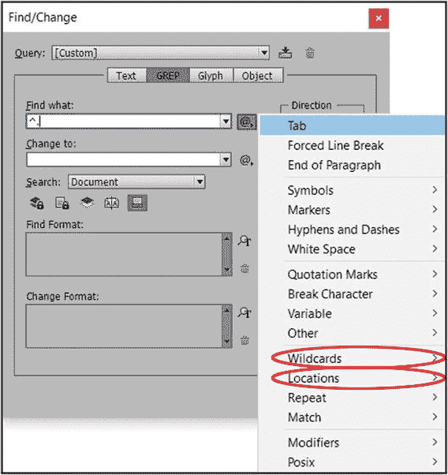

**图 5-23.**

### 5.5.2 使用浮动对象

点击 `GREP` 选项卡，然后打开 `查找内容` 菜单。

14. 打开 `更改为` 菜单。选择 `其他 ➤ 剪贴板内容：带格式`。由于我们将带有文本锚点的对象剪切到了剪贴板，此选项将使用该对象和锚点作为替换内容。再次打开 `更改为` 菜单，选择 `已找到 ➤ 已找到的文本`。此项确保你不会删除段落中的第一个字符。

15. 执行 `查找/更改 GREP` 搜索。在 `搜索` 下拉菜单中选择 `选区`，点击 `查找下一个`，然后点击 `更改` 来测试搜索，确保一切正常工作。如果更改操作在正确位置（第三行，第二列）创建了对象，那么一切应该正常。点击 `全部更改`，你的表格就应该被这些对象填满了。

16. 设置段落回车符。现在应该很明显，为什么我需要确保单元格中没有多余的回车符。`查找/更改 GREP` 的更改会在每个段落的开头停止，而不是只在列单元格中的单个段落处停止。在我的示例中，我在想要回车符的位置使用了不带空格的逗号（`,`）。要将逗号改为回车符，首先选择包含你想要更改的文本的列。在我的示例中，第三列第二行以下的文本中，在我想实际使用回车符的位置使用的是逗号（见图 5-24）。选中单元格后，打开 `查找/更改` 对话框（`编辑 ➤ 查找/更改`），点击 `文本` 选项卡。在 `查找内容` 字段中输入一个逗号。在 `更改为` 文本框中输入插入符号和 `p` (`^p`)。点击 `全部更改` 按钮，替换结果应显示为段落，同时逗号被删除。

图 5-24. 选择你要替换字符的单元格

17. 添加框架并描边。这是最后一步，因为如果你在表格上方添加框架，编辑单元格和表格属性时就会遇到麻烦。最好在最后创建框架，或者将其放在一个图层上并隐藏起来，或者在设置表格时将其置于背景并锁定（`Ctrl/z+L`）。在我的示例中，我在表格周围绘制了一个框架，添加了 20 点描边，并将填充设置为无。调整框架大小，使其与表格边缘略微重叠，然后选中它。选择 `对象 ➤ 排列 ➤ 置于顶层`（或按 `Ctrl/⌘+Shift+]-右中括号键`）将框架置于表格顶部。

这整个过程看起来工作量很大。实际上，工作量确实很大！但是，一旦你创建了几个带有装饰性边框和锚定对象的表格，你应该就能轻松地完成这些步骤，并开始创建一些有趣的表格设计了。

### 5.5.2 使用浮动对象

有时你无法将所有对象都锚定到单元格中。至少，试图让单元格拥有合适的宽度以便将对象锚定在正确位置，可能会让你抓狂。与其费力调整锚点设置，你可能会发现使用浮动对象要容易得多。

在图 5-25 中，设计被设置为一个表格。该表格有三行四列。行与行之间是 20 点的白色描边。这造成了一种错觉，即该设计不是一个表格，而是彼此偏移的独立框架。

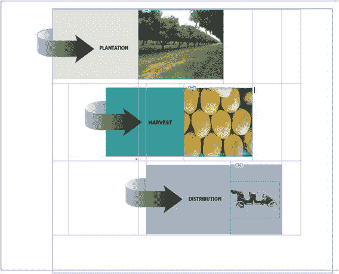

图 5-25. 此表格有三行四列，行与行之间用大面积的白色描边分隔

使用表格时遇到的一个问题是，你无法像使用多个对象那样创建堆叠顺序——至少在 5-25 所示的设计中是这样。3D 箭头几乎像是从单元格后面穿出来。实际上，箭头的顶部是与单元格紧贴在一起的——这是我们在插图程序中尽量避免的情况。元素之间总有可能出现微小的间隙。

无法将箭头放在表格后面创建堆叠顺序的原因是，单元格是用白色边框构建的。例如，在 Harvest 单元格中，单元格宽度超出了箭头的左侧，因为外部边框设置为 20 点。该单元格的顶部和左侧都有白色边框。因此，你无法将箭头的顶部部分置于单元格之后，所以紧贴单元格是你唯一的选择。

我没有使用锚定对象，而是添加了元素并尽可能将它们放置到位。全部完成后，你需要将所有元素编组。你可以在所有数字出版文档（包括可重排的 EPUB）中使用这种类型的表格设计。

### 5.5.3 在单元格偏移中锚定对象

在图 5-26 中，你可以看到一个相当简单的表格，我为文字使用了单元格偏移。箭头锚定在文本上，使得每个单元格中每行文字的左侧都留出充足的空间来放置箭头。

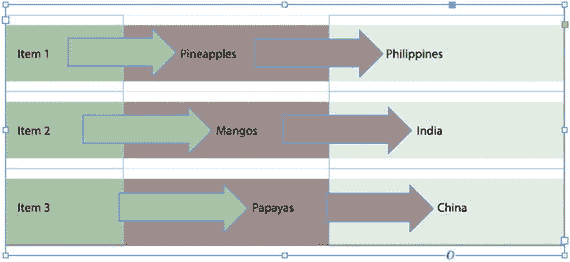

图 5-26. 此表格有三行三列，箭头锚定在第二列和第三列的单元格中

要创建这种表格，我执行了以下操作：

1. 创建一个表格。在我的示例中，我创建了一个三行三列的表格。水平线设置为 20 点并填充为白色，这造成了存在多个对象的假象，尽管我们只有一个表格。

2. 设置单元格内边距。在第二列和第三列中，我为每一行设置了不同的内边距值。你可以在 `控制面板` 中轻松更改内边距值，并在更改时动态查看结果。

3. 创建箭头。我使用了 `Wingding` 字体，并在 `字形面板`（`文字 ➤ 字形` 或 `Alt/⌥+Shift+F11`）中找到了一个箭头。我设置了文字，然后将文字转换为轮廓。

4.  锚定箭头。我将箭头锚定到每一行和每一列的文本中。如果你创建一个`对象样式`，这个任务会更容易。

5.  调整箭头大小。由于箭头被转换成了轮廓，每个箭头现在都是一个矢量对象，你可以轻松调整其大小。选择`直接选择`工具，将箭头的左侧向左拖动。这样会拉长箭头。

### 5.5.4 变换表格

你可以使用第 4 章描述的变换技术，在 InDesign 中变换表格。在变换表格之前，请务必确定表格的格式和设计已最终完成。在图 5-27 中，你可以看到我在变换表格前创建的设计。

图 5-27。

这个表格有三行三列，并包含粘贴在图形框架内的内联图形和对象。

如果单元格中包含对象，你必须谨慎执行变换操作。对设置在文本单元格中的内联对象以及粘贴在图形单元格中的对象进行分组，可以轻松旋转或倾斜而不会出现问题。然而，如果你尝试缩放表格，单元格内的对象将无法保持在单元格内。你可能需要在事后单独缩放这些对象，并将其移动到合适的位置。

## 变换表格

我按如下步骤创建了图 5-27 所示的表格：

1.  **创建表格。** 选择`Table ➤ Create Table`。当`Create Table`对话框打开时，输入列数和行数的值。在我的示例中，我创建了一个三列三行的表格。

2.  **格式化单元格大小。** 在我的表格中，我在`控制面板`中将行高和列宽设置为 125 像素。我在`控制面板`右侧的下拉菜单中选择`精确`，并在相邻的文本框中输入 125。我选中整个表格，并将所有描边值设置为 0。

3.  **填充单元格。** 在我的示例中，我将中心单元格转换为图形单元格，并将一个编组对象粘贴到该单元格内。我向其他单元格添加了文本，并使用`控制面板`中的文本旋转选项，将文本方向设置为你在图 5-28 中看到的四个视图。我向外围单元格添加了渐变填充，并为图形框架添加了实色填充。

    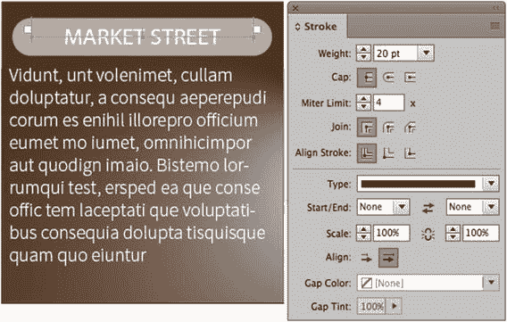

    图 5-28。

    将描边设置为 20 磅，并使用`路径文字`工具向路径添加文字（左图）。将`基线偏移`设置为 -6 磅（右图）。

4.  **添加按钮。** 每个文本单元格的顶部都有一个按钮。我使用`路径文字`工具创建了一条描边，并沿路径设置了文字（图 5-28，左图）。我将描边值设置为 20 磅，并单击`描边面板`中的`圆头端点`图标。我向描边应用了一种颜色，并将基线设置为 -6 磅。你可以在`控制面板`中设置基线，或者按`Alt/⌥+Down Arrow`向下移动基线偏移（见图 5-29）。然后，我将文字在路径上居中对齐（`Ctrl/z+Shift+C`），并水平拖动描边的末端以匹配文字长度。在创建一条路径描边后，我将其复制了三份，并为每条路径应用了不同的文字和颜色。

    

    图 5-29。

    旋转、倾斜和缩放后的表格。

5.  **编组所有对象。** 用选框选中整个表格，然后选择`Object ➤ Group`将对象编组。

6.  **变换表格。** 我使用`自由变换`工具旋转了表格，并使用`倾斜`工具对其进行了倾斜。我还稍微缩放了一下表格，但图形发生了移动且未能正确缩放。我不得不移动图形单元格内的对象并单独缩放它。要选择图形，双击表格，然后双击图形。最终结果如图 5-29 所示。

### 5.5.5 创建照片网格

你可以使用`File ➤ Place`命令将多张照片放置到网格中，并可以使用`Object ➤ Captions`子菜单命令添加静态和动态题注。然而，表格在将照片放置到网格方面为你提供了更大的自由度。你可以轻松地更改单元格之间的距离，从无描边到粗描边，并为描边应用不同的颜色。使用表格为你提供了极大的自由度，并提供了管理表格中照片的简便方法。

在图 5-30 中，我创建了一个两列两行的表格，向你展示一个如何展示照片网格的示例。

图 5-30。

一个在图形单元格中放置了照片的表格。

使用表格的一个优势是，你可以轻松调整单元格之间的列宽。如果使用`File ➤ Place`放置多张照片，你也可以通过使用修饰键达到相同效果，但这会极大地扭曲你的身体动作。你需要按下键盘上的`Up`和`Right Arrow`键来确定网格单元格。在列设置正确后，你需要调整列宽。在按住鼠标按钮的同时，按下`Ctrl/⌘`键，然后再按方向键。与使用表格相比，使用修饰键的繁琐操作是一种折磨。

我发现使用表格处理起来更简单的另一件事是在表格单元格内创建多状态对象。我将在第 9 章中介绍如何创建多状态对象。现在，你只需认识到，多状态对象通常用于在页面的同一位置更改状态视图。例如，如果你想要创建一个按钮，用于在单个表格单元格内浏览多张照片，那么你可以创建多状态对象并添加一个按钮来切换不同的状态。

完成对象设置的方法非常简单。将一张照片放入表格单元格的图形框架中。复制该框架并将其粘贴到你的文档中。复制该框架，并在复制的框架中放置另一张照片。你可以根据需要添加任意数量的框架。使用`对齐面板`对齐对象，并通过光标拖过组来选中它们。打开`对象状态面板`并创建多状态对象。剪切该对象，然后单击表格中的图形框架。选中该图形单元格，选择`Edit ➤ Paste Into`，对象状态即被粘贴到图形框架中。然后，你创建一个按钮来切换各个状态。

如果这听起来现在有点令人困惑，请耐心等待，直到你阅读第 9 章。到时，我会详细解释如何使用多状态对象，以及如何创建能够切换状态的按钮。

### 5.5.6 放大单元格

您可能希望吸引读者注意表格中某个特定单元格的内容。在图 5-31 中，您会看到一个放大镜展示地图放大视图的示例。这种技术可以放大单元格的内容，并将读者的注意力吸引到该表格单元格上。

图 5-31. 一个在图形单元格中放置照片的表格：放大单元格

要创建此设计，我执行了以下操作：

1.  创建放大镜。我按住`Alt/⌥+Shift`键，从中心绘制一个约束的圆形形状。我选择了`缩放`工具，按住`Alt/⌥`键，点击该圆形以打开`缩放`对话框。然后我将圆形缩小 75% 并点击`复制`。文档页面上有了两个圆形后，我选中两者，选择`对象 ➤ 路径 ➤ 建立复合路径`。我将描边设置为 4 点，并为描边颜色选择黑色。

2.  对于手柄，我绘制了一个矩形并添加了圆角。我在矩形的左上侧添加了一些白色描边，并对矩形应用了`斜面浮雕`效果。然后我将对象编组并旋转了手柄。

3.  创建椭圆框架。我选择了`椭圆框架`工具，绘制了一个比放大镜复合路径对象内部稍大的圆形。

4.  放置照片。我选择`文件 ➤ 置入`，并置入了原始照片。

5.  粘贴到椭圆框架内。我将置入的照片剪切到剪贴板，然后选中圆形框架。接着选择`编辑 ➤ 粘贴入`。

6.  将放大镜移至顶层。我选中放大镜框架，选择`对象 ➤ 排列 ➤ 置于顶层 (Ctrl/z+Shift+])`。

7.  调整照片大小。我选中照片并将其放大。

8.  编组并定位对象。我选中地图和放大镜元素，将它们编组。然后将对象移动到所需位置。

您可以将同样的技术应用于表格单元格框架。当使用表格单元格时，首先通过删除要放大的区域之外的列和行来简化表格。尽量使表格变得尽可能小而简单，只保留您想要放大的单元格。

**注意：** 当您尝试剪切表格并使用`粘贴入`命令时，InDesign 有崩溃的倾向。

当表格大小调整合适后，剪切表格并粘贴到图形框架中。按住`Ctrl/⌘+Shift`键并向外拖动控制柄来调整表格单元格的大小。当大小接近您想要的大小时，剪切表格并粘贴到图形框架中。

选中图形框架的内容有点棘手。如果您双击包含文本单元格的内容，光标会在单元格中变为 I 型光标。双击单元格后，按键盘上的`Esc`键。此操作将选中该单元格。将光标向左移动，选中任何相邻的行，再向上移动选中任何相邻的列。当表格被选中时，使用键盘上的方向键将内容定位在框架内。

**提示：** 当您选中一个对象并按方向键时，对象每次移动一个像素。若要更大步长（10 点）移动，请按住`Shift`键再按方向键。

### 5.5.7 使用表格脚本

与许多其他可以使用脚本执行的编辑序列一样，互联网上有许多低价和免费的脚本专门用于处理表格。我最喜欢的一个是日历生成脚本。这个脚本非常强大，只需在`脚本`面板中双击一个脚本名称，即可创建一个月、几个月、一年或几年的日历。

#### 5.5.7.1 下载和安装脚本

Adobe InDesign 日历向导由 Scott Selberg 创建，您可以在 [`www.scourceforge.net`](http://www.scourceforge.net) 找到该 InDesign 脚本。进入主页后，在搜索字段中输入 `calendar`，您将看到一份文档列表，其中一个是 Adobe InDesign 日历向导。

您也可以通过在浏览器搜索字段中输入 `InDesign Calendar Script` 来找到下载链接。无论哪种方式，您都会找到下载页面。进入下载页面后，点击`下载`按钮。

下载完成后，解压压缩包。要安装脚本，请在 InDesign 中打开您的脚本文件夹。打开 `JavaScripts` 文件夹，右键单击以打开上下文菜单。选择`在资源管理器中显示`（Windows）或`在访达中显示`（Macintosh）。将下载的脚本复制到选择`显示`时打开的文件夹中。

### 5.5.7.2 运行日历脚本

安装脚本后，双击`脚本`文件夹中的 `calendarWizard.js` 脚本。Adobe InDesign 日历向导对话框将打开，如图 5-32 所示。

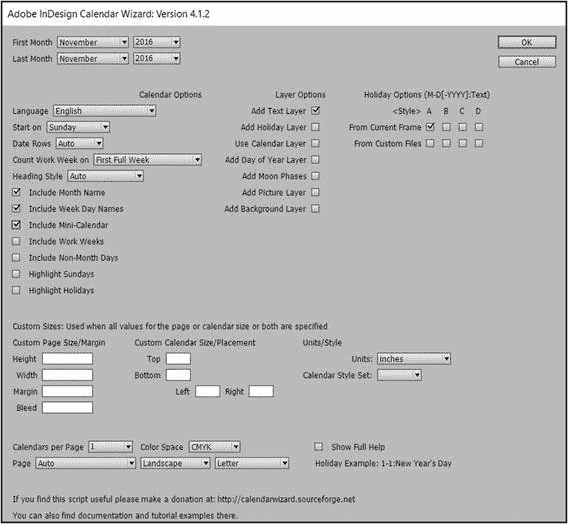

图 5-32. 在脚本面板中双击 `calendarWizard.js` 文件以打开日历向导

在此对话框中，您有多种选择。您可以从左上角的下拉菜单中选择月份范围。您可以从与`首月`和`末月`菜单相邻的菜单中选择年份。要在日历中包含节假日，请启用向导右侧的某个复选框。您可以选择添加显示在右上角和左上角、用于显示上个月和下个月的小日历。您还可以选择颜色空间和页面尺寸。查看向导中的选项，做出选择，然后点击`确定`。

日历打开后如图 5-33 所示。这只是您在互联网上可以找到的众多帮助处理表格的脚本之一。您还可以获取其他脚本，帮助您在其它编辑任务中提高效率。

图 5-33. 使用 `calendarWizard.js` 脚本创建的日历

**注释：** 您在互联网上找到的许多脚本都是免费或低价下载的。许多开发者会请求捐赠。如果您使用某个脚本并觉得它有价值，请给开发者一些酬劳。对于投入时间为您提供这些优秀工具（这些工具能在您设计过程中提供巨大帮助）的人来说，5-10 美元将意义重大。

## 5.6 总结

在本章中，我们探讨了创建表格。您学习了如何格式化表格和表格单元格，如何设计创意表格，如何变换表格，以及如何为表格添加一些交互性。正如您在阅读本章时所看到的，InDesign 中的表格远不止是包含数据的网格。您可以发挥创意，设计出与传统表格截然不同的表格。我们还探讨了在表格中锚定对象。当您创建可重排的 EPUB 时，锚定对象和锚定表格将变得非常重要，您将在后续章节中看到这一点。

在下一章中，我们将继续讨论资源的使用，并研究与为文本创建样式相关的至关重要的功能。在导出为 EPUB 时，样式是必须的，下一章将包含您需要了解的关于处理文本样式的全部内容。