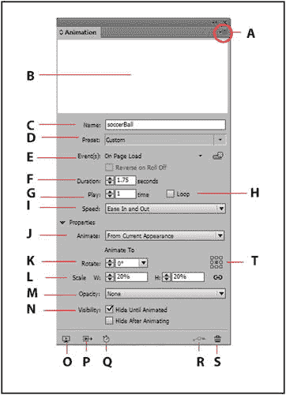
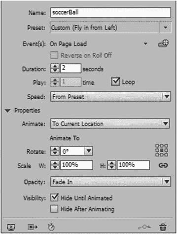
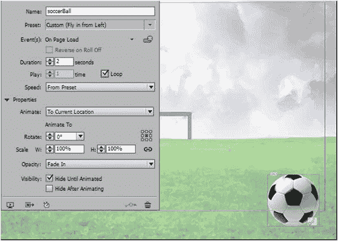
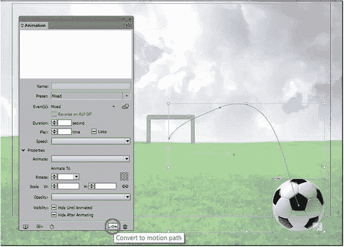
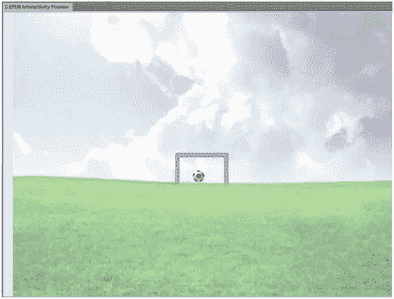
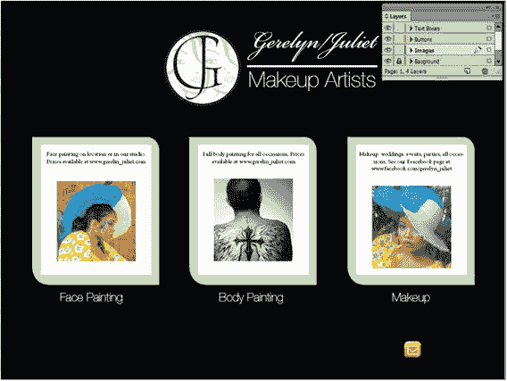
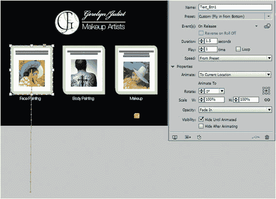
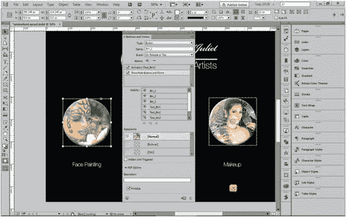

# 动画面板指南

1. `动画面板菜单`：点击面板右上角的图标即可打开菜单。在菜单顶部，您将看到`保存`选项。在面板中进行各种选择后，您可以将设置保存为预设。

2. `预览`：动画的顶部区域会显示一个代理预览，预览内容对应于您从`预设`菜单中选定的动画。

3. `名称`：该名称来源于`图层面板`。创建动画时，您应在`图层面板`中为对象和文本框架命名。或者，如果您在此处更改了对象名称，`图层面板`中的名称也会随之改变。

4. `预设`：`预设`菜单为您提供了大量不同的动画选项。当您从`预设`菜单中选择一个动画时，`动画面板`顶部的预览窗口会显示该动画的代理视图。

5. `事件`：请注意文本旁边的向下箭头。点击该箭头可打开一个菜单，您可以在其中选择事件触发器。默认情况下，事件触发器设置为`页面加载时`，这意味着当页面被查看时动画将播放。菜单右侧有一个图标。点击此图标可创建一个将触发事件的按钮。

6. `持续时间`：在文本框中，您可以设置最小可接受值`.125`，这将加快动画速度；或将其设置为`60`秒，从而减慢动画速度。

7. `播放`：通过输入`1`到`99`之间的数值，您可以设定动画想要播放的次数。

8. `循环`：勾选此框可使动画循环播放，反复进行。

9. `速度`：在`速度`菜单中，您可以选择`来自预设`、`无`、`渐入`、`渐出`以及`渐入并渐出`。缓动可加速动画。当您选择`渐入`时，动画最初缓慢出现，随后加速。`渐出`则正好相反。`渐入并渐出`则是缓慢开始，加速，最后再缓慢结束。

10. `动画`：`动画`菜单包含三个选项：
    * `从当前外观`：如果您让一个球体执行缩小动画，那么“从”外观会以您在`InDesign`中放置球体时的大小为起点。随着动画进行，球体会缩小。
    * `到当前外观`：动画从一个外观运行到当前外观。例如，如果您从一个小球开始，而页面上小球显示为大尺寸，那么您将小球从较小的对象放大到当前较大的外观。
    * `到当前位置`：如果让一个球体弹跳，动画将在设计中球体出现的当前位置结束。

11. `旋转`：`旋转`可将对象旋转最多`7,200°`。

12. `缩放`：`缩放`可使对象放大或缩小。可用的最大尺寸为`7,200%`。

13. `不透明度`：您对于不透明度只有两个选择：`淡入`和`淡出`。其范围是`0%`到`100%`（或`100%`到`0%`）。

14. `可见性`：您可以选择在动画播放前将其隐藏，并且可以通过启用相应的复选框，在动画播放完毕后将其隐藏。

15. `预览`：点击面板左下角的图标，可在`EPUB 交互`面板中预览动画。按住`Alt/⌥`键并点击，可在`SWF 预览面板`中预览动画。

16. `动画代理`：`预览`图标右侧的图标非常有用。点击该图标，会显示一个灰色方框作为代理，用以指示动画的起点或终点。

17. `定时面板`：点击`动画代理`右侧的下一个图标，可打开`定时面板`。

18. `转换为运动路径`：在面板的右下侧，您会找到`转换为运动路径`。您在文档中绘制的任何线条，无论是直线还是贝塞尔曲线，都可以用作运动路径。当您选择一个对象和一条路径，然后点击此图标时，路径的描边粗细会消失，对象将沿着该路径运动。

19. `移除动画`：选择一个已分配了动画的对象，然后点击垃圾桶图标。此操作将移除该动画（您的对象仍保留在文档窗口中）。

20. `轴点`：点击九个点之一来设置轴或原点。例如，如果您想从中心旋转对象，请点击中心方块。`动画面板`菜单中的第二个项目是`管理预设`。选择此选项，会打开一个窗口，其中列出了所有预设。您可以删除自定义预设、复制预设、加载预设文件以及将预设保存到新文件。`InDesign`的默认预设无法删除。

图 8-1. 在文档窗口中选择一个对象并打开`动画面板`

`动画面板`菜单中的其余项目与本列表讨论的内容相同，唯一的例外是`预览选择 SWF`。您可以选择一个对象，并在`SWF`预览窗口中仅预览该对象的动画。

## 8.1.2 创建动画

既然我们已经了解了`动画面板`中的所有开关和切换选项，那么让我们来轻松愉快地创建几个简单的动画吧。

### 创建动画

1. 在`InDesign`中创建一个新文档。使用一种`EPUB`页面尺寸。在我的示例中，我将把`用途`设置为`移动设备`，`页面尺寸`设置为`iPad`，方向设置为横向。

2. 选择`文件 ➤ 置入`，将一个对象放置在页面上。如果您想要一个背景图形，请先置入背景，然后再置入对象。该对象可以是图像或插图。我们将使用一个预设来制作这个动画，使其从左侧飞入，因此请将对象移至页面中心偏右的位置（参见图 8-2）。

   
   图 8-2. 选中一个对象后，在`动画面板`中设置该动画的属性

3. 选择该对象并打开`动画面板`。

4. 在`动画面板`中设置动画属性。打开`预设`菜单，选择`从左侧飞入`，然后在`持续时间`中输入`2`。在`动画属性`中，从菜单中选择`到当前位置`，将`不透明度`设置为`淡入`，并勾选`隐藏直到动画开始`复选框。设置后应如图 8-2 所示。

5. 预览动画。点击`动画面板`中的`预览页面：EPUB` 图标（面板左下角）。在某些情况下，您可能需要点击`EPUB 交互预览面板`左下角的`播放`按钮（指向右方的三角形）来播放动画。当您将文件导出为固定版式`EPUB`时，动画会在页面加载时播放。这是`定时面板`中的默认设置。您将看到一个简短的动画：从不透明度`0%`开始，对象向右移动并淡入，直至不透明度达到`100%`。

## 8.2 使用运动路径

大多数动画预设都使用了运动路径。运动路径定义了动画的长度和方向。当您在`动画面板`中选择一个预设时，`InDesign`会为您创建路径。您可以编辑运动路径，使其变长或变短、改变路径方向、为路径添加点，以及移动各个点来创建向上、向下、向左和向右的方向。此外，您还可以使用`钢笔`工具或`铅笔`工具创建自定义运动路径。

### 8.2.1 编辑运动路径

沿用之前的示例，我们来看看动画效果。当你选中对象时，会看到一条水平线，右侧带有一个箭头。这是一条运动路径线，箭头指示了对象在播放动画时的移动方向。

**提示：** 如果你想查看动画的精确起始位置，请单击`显示动画代理`图标（面板底部左起第二个图标）。代理会在动画沿路径开始或结束的位置显示一个灰色方块。

假设你想增加运动路径的距离。请单击`工具`面板中的`选择`工具（或按`V`键），然后点击路径。选中路径后，移动端点即可延长（或缩短）路径。

假设你希望球（在此示例中，我使用一个足球）在向右移动时带有轻微的弹跳效果。我们来看看如何实现这一点。

#### 向运动路径添加点

1. 使用`钢笔`工具创建一条路径。

2. 选中路径后，在`工具`面板中选择`添加锚点工具`（按住鼠标按钮单击`钢笔`工具，然后从菜单中选择`添加锚点工具`，或按`=`键）。

3. 点击路径以添加一个锚点，如图 8-3 所示。

   
   **图 8-3.** 使用`添加锚点工具`，点击路径添加一个点。

4. 选择`转换方向点工具`（也在`钢笔`工具子菜单中）并拖动一个点以创建贝塞尔曲线。

5. 使用`直接选择工具`（`工具`面板中的白色箭头）将点移动到动画需要跟随的位置。

6. 移动到另一个位置，重复相同的操作。

当你预览动画时，会看到对象根据你在路径上移动点的位置而上下移动。

### 8.2.2 创建自定义运动路径

当你在`动画`面板中使用预设时，InDesign 会为你创建一条运动路径。你不必依赖 InDesign 提供的运动路径方向。你可以使用`钢笔`工具或`铅笔`工具创建任意路径并绘制。

#### 创建自定义运动路径

请按照以下步骤创建自定义运动路径：

1. 在 InDesign 中创建一个新文档。

2. 使用 EPUB 页面尺寸之一。在我的示例中，我使用 iPad 并将方向设置为横向。

3. 选择`文件 ➤ 置入`，在页面上放置一个对象。

4. 如果你想要背景图形，先放置背景，再放置对象。对象可以是图像或插图。

5. 使用`钢笔`工具或`铅笔`工具绘制一条代表你希望对象遵循的运动路径。

6. 选中路径，按住`Shift`键点击对象以同时选中两者，然后点击`动画`面板中的`转换为运动路径`按钮，如图 8-4 所示。

   
   **图 8-4.** 选择对象和路径，然后点击`动画`面板中的`转换为运动路径`按钮。

7. 现在，对象将沿着自定义运动路径进行动画。

8. 在`动画`面板中，从`速度`菜单中选择`缓入缓出`。

9. 我们将为动画添加一点特色。在我的示例中，足球将缓慢启动，在弧顶加速，然后在射门时减速。

10. 调整缩放比例。

11. 对于此示例，将对象缩放至 20%。随着球动画并远离视线，球的尺寸会缩小到更小。

12. 点击`动画`面板中的`预览跨页：EPUB`按钮来预览动画。

动画的最后一帧显示对象在路径末端缩小尺寸（见图 8-5）。

**图 8-5.** 动画结束时显示足球已被缩小。

## 8.3 显示和隐藏动画

你可以显示/隐藏任何类型的动画并触发播放。此外，你还可以显示/隐藏任何对象（文本、图像、插图、视频等）。执行此类操作所需的唯一要素是一个按钮。

如果你能组织好元素并为它们命名以描述其用途，在 InDesign 中的操作会轻松得多。在图 8-6 中，你会看到一个包含三个按钮的版面。我想要点击一个按钮并分配一个动作来启动动画并显示正在动画化的项目。

**图 8-6.** 包含三个按钮的版面。

要实现我想要的结果，需要完成几件事。首先，我需要将对象放置在不同的图层上。我为前三个按钮设置一个图层，为想要动画化的对象设置另一个单独的图层。当所有对象都设置好动画后，你会看到图 8-7 中的结果。图中的三个文本框也是按钮。我使用按钮动作来隐藏当前视图并返回默认视图。

**图 8-7.** 将不同的对象放置在单独的图层上。

让我们一步步看如何添加按钮来触发动画。

#### 在按钮点击时飞入元素

1.  设置文件的第一步是创建动画。三个文本框均设置为从底部飞入。将第一个文本框拖到页面边缘下方。

2.  打开`动画`面板。选择`从底部飞入`预设。默认情况下，动画在页面加载时触发。

3.  打开`事件`的下拉箭头，取消选中`页面加载时`。

4.  将`持续时间`设置为 1.5 秒，选择`淡入`，并勾选`隐藏直到动画开始`。

5.  运动路径比所需的要短得多。点击路径并将底部端点向下移动到所需的动画起始点，如图 8-8 所示。

    

    **图 8-8.** 分配动画并延长运动路径。

    对剩余的两个文本框重复相同的步骤。

6.  打开`按钮和表单`面板，选择第一个框架，然后从`类型`下拉菜单中选择`按钮`。此时，我们只是创建按钮。稍后我们将为它们分配动作。将三个框架都转换为按钮。

7.  打开`图层`面板并隐藏文本框。现在你可以访问默认按钮。

8.  将此图层上的三个圆圈转换为按钮。此时，你已拥有所需的所有按钮，现在可以为它们分配动作。

9.  点击第一个圆形按钮，然后点击`按钮和表单`面板中的`+`图标。

10. 从下拉菜单中选择`动画`，然后选择你想要动画化的项目。在我的示例中，我将文本框按钮命名为`Text_Btn1`、`Text_Btn2`和`Text_Btn3`。这种命名约定使我能够轻松分辨要分配动作的项目及其位置。第一个圆形按钮设置为对`Text_Btn1`项目运行动画，第二个圆形按钮对`Text_Btn2`运行动画，依此类推。

11. 添加另一个动作。点击`+`图标并选择`显示/隐藏按钮和表单`。你在此处做出的选择将影响按钮的可见性。

12. `Text_Btn2`和`Text_Btn3`项目设置为隐藏，如眼睛图标上的斜线所示。我需要设置的其他项目是`Btn_1`、`Btn_2`和`Btn_3`。当前图层上显示了三个圆圈。我需要确保它们都可见。在图 8-9 中，你可以看到第一个圆形按钮的设置。

    

    **图 8-9.**