# 第一个圆形按钮的设置

13. 对另外两个圆形按钮重复相同的步骤。

14. 接下来，打开图层面板并显示文本框。我们也将这些框设为按钮。现在让我们为按钮分配动作。此图层上的所有三个按钮都设置为隐藏所有文本框。当用户点击第一个图层上的按钮时，文本框会显示出来。当用户点击文本框时，视图将恢复为默认视图。

15. 为每个按钮添加一个动作。点击 `+` 图标并选择“显示/隐藏按钮和表单”。您在此处所做的选择将影响文本框按钮的可见性。

16. 对于每个文本框按钮，将该按钮的可见性设置为带斜线的眼睛图标，表示它应被隐藏。然后为其他每个按钮指定一个“x”，表示这些按钮的可见性应保持不变。在图 8-10 中，您可以看到我用于隐藏文本框的设置。

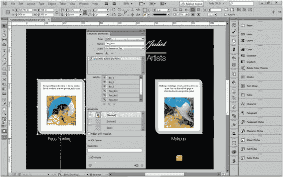

`图 8-10.` 添加“显示/隐藏按钮和表单”动作并隐藏所有文本框

17. 完成后，预览最终结果。实际上，您应该在编辑过程中预览几次。不过，在预览之前，请打开图层面板并确保所有图层都已打开。

18. 选择 `Window ➤ Interactive ➤ EPUB Interactivity Preview`。点击每个按钮。

您应该会看到点击一个按钮后出现一个文本框，再次点击该框后它就会消失。在图 8-11 中，您可以看到我点击第三个按钮后的预览效果。

`图 8-11.` 在 EPUB 交互性预览面板中测试结果

## 8.4 在“定时”面板中重新排序动画

如果您想更改动画的顺序，请打开“定时”面板。如图 8-12 所示，您会在面板中看到动画项目列表。如果您想重新排序动画，只需点击并拖动某个动画到新位置即可。例如，对象从篮子右侧开始淡入。我们希望香蕉先淡入，然后是木瓜，接着是菠萝，依此类推。

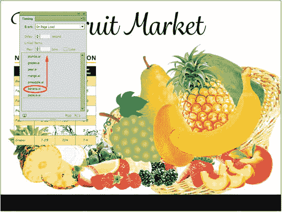

`图 8-12.` 动画在“定时”面板中显示

要让香蕉首先出现，请在“定时”面板中点击 `banana.ai` 并将其向上移动到堆栈顶部。接下来，点击并拖动 `pineapple.ai` 动画，将其向上移动到 `banana.ai` 动画下方，如图 8-12 所示。

### 8.4.1 链接动画

有时您可能希望一个动画与另一个动画同时播放。以水果篮为例，假设我们希望篮子里所有的水果同时淡入。您可以在“定时”面板中处理此操作。

点击您希望链接在一起以便同时播放的动画。要在“定时”面板中以连续顺序选择项目，请点击一个动画，然后按住 Shift 键选择最后一个动画。第一个和最后一个之间的所有动画都会被选中。要以非连续顺序选择项目，请点击一个动画，然后按 `Ctrl/⌘-点击`。

选择好希望同时播放的动画后，点击“定时”面板中的“一起播放”按钮（参见图 8-12）。“一起播放”按钮位于面板底部的右数第二个。

### 8.4.2 延迟动画播放

默认情况下，动画设置为在页面加载时播放，这意味着当您在查看器中打开动画时，动画就会开始播放。如果您想延迟播放，请在“延迟”文本框中输入一个值。您可以输入介于 0.001 到 60 秒之间的值。

## 8.5 自动滚动文本

Adobe DPS（数字出版解决方案）文档包含可滚动的框架，查看者可以点击该框架并滚动框架内的文本。这是 DPS 文档中一项出色的功能。您可以创建这样的设计：大量文本副本不会影响页面设计。设计师们一直在与那些希望在页面上放置比美观布局更实际更多的文本的客户作斗争。

不幸的是，截至撰写本文时，可滚动框架在固定版式 EPUB、交互式 PDF 和在线发布（预览）文档中不受支持。但是，您可以为文本副本添加动画效果，使其看起来像是文本在文档中滚动。在这个示例中，我使用了一个表格，但您也可以使用文本框来创建相同的效果。在图 8-13 中，您可以看到一个动画表格从页面底部飞入的最终效果。

`图 8-13.` 一个被设置为从页面底部滚动进入的表格

注意页面底部的渐变。渐变逐渐过渡为透明。要创建渐变，请绘制一个矩形或框架，然后选择 `Object ➤ Effects ➤ Gradient Feather`。您也可以点击控制面板中的效果图标 (`fx`) 来打开效果菜单。

添加渐变羽化效果会使动画看起来像是表格在页面上向上移动时正在改变不透明度。表格需要出现在图层堆栈中渐变的下方，才能使效果正确动画化。在图 8-14 中，您可以看到图层面板，其中表格位于渐变的下方。

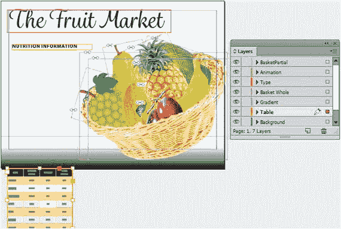

`图 8-14.` 动画对象应出现在图层面板中渐变羽化效果的下方

### 创建滚动文本动画

要创建类似的动画，请遵循以下步骤：

1. 在设置为 90° 的矩形或框架上创建渐变羽化效果。

2. 将文本框或表格放置在页面边界边缘。在我的示例中，动画设置为从底部飞入。因此，我将表格放置在页面下方的剪贴板上。确保文本框（或表格）出现在图层面板中渐变的下方，如图 8-14 所示。

3. 应用动画。

4. 打开“动画”面板，为您希望动画飞入的位置选择动画预设。在我的示例中，我使用了 `Fly-In from Bottom`。在“动画”菜单中选择 `To Current Location`。对于不透明度，选择 `None`。勾选 `Hide until Animated` 并将持续时间设置为 6 秒。

5. 调整位置。

6. 将文本框/表格移动到动画结束时的最终位置，如图 8-15 所示。

   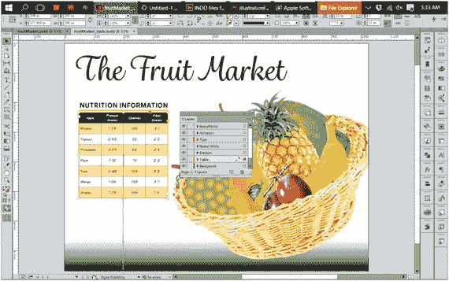

   `图 8-15.` 将对象移动到最终位置

7. 调整运动路径。

8. 点击运动路径的起点（参见图 8-15）并将其移动到页面边缘。确保动画从页面边缘开始并移动到当前位置。

9. 检查“定时”面板。

10. 注意此示例中的“定时”面板（参见图 8-16）。我将所有水果链接在一起以同时淡入。该组显示在“定时”面板的顶部。在水果淡入之后，文本/表格开始动画。

    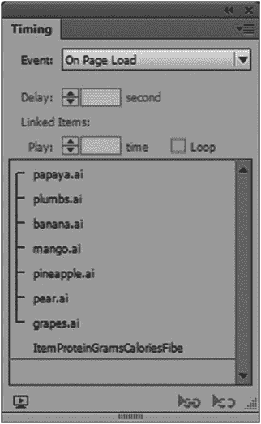

    `图 8-16.` 动画顺序在“定时”面板中显示

11. 预览动画。点击“定时”面板中的 `Preview Spread: EPUB` 按钮来预览动画。

## 8.6 为动画添加音效

添加音效能让动画更加生动。音频文件需要保存为 `.mp3` 格式。如果你有 `.wav` 或 `.aiff` 格式的音频文件，可以使用 Adobe Media Encoder 将其转换为 `.mp3` 格式。

如果需要获取音频文件，可以在 [`www.Freesound.org`](http://www.freesound.org) 找到许多免费下载资源。浏览丰富的 Freesound 库，你会发现大量不同的音效。

准备好音频文件和动画后，就可以为动画项目添加音效了。在 InDesign 中，音频文件的导入方式与其他资源相同。选择 `文件 ➤ 置入` 并放置音频文件。默认情况下，音频文件会在 InDesign 的版面视图中显示一个海报图形。当你在 EPUB 交互预览窗口中查看该文件，或导出文档时，会在音频文件底部看到一个控制条。如果版面中的海报图像尺寸过小，控制条可能难以查看和使用。

如果打算使用按钮来控制播放，可以将音频文件的导入尺寸设置得很小（例如 1 像素 × 1 像素）以使其不碍事。此外，你可以将音频文件添加到单独的图层中，如图 8-17 所示。

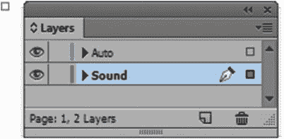

`图 8-17.` 如果无法将音频文件放置在填充对象后方，请将音频帧尺寸设置为 1 像素 × 1 像素

### 8.6.1 设置媒体属性

放置音频文件后，打开 `媒体` 面板。默认情况下，你会在预览区域看到一个扬声器图标。如果你将海报图像设置为 `无`，则音频图标将不会显示在音频帧中。

你在此处需要进行的唯一设置是勾选 `页面加载时播放` 复选框。你可以使用按钮来触发声音事件，但如果不使用按钮，则勾选此复选框。

### 8.6.2 同步音频与动画

如果你希望音频文件与动画同步播放，需要在 `定时` 面板中进行同步设置。打开 `定时` 面板，选择要与音频文件同步的动画。按住 Shift 键单击选择音频文件，然后点击面板底部的 `一起播放` 按钮。

## 8.7 结合多状态对象使用动画

有时你可能有多个不同的动画希望在按钮事件中播放。你可能希望根据读者点击按钮来让多个不同的对象和文本框产生动画效果。问题在于，点击按钮时，你只能看到图层堆栈中的第一个项目或项目组产生动画。为了解决这个问题，你可以使用多状态对象 (MSO)，并分配不同的按钮来显示 MSO 中的不同状态。我们将在第 9 章更详细地介绍 MSO。

查看图 8-18。你将看到在 MSO 的一个状态上播放两个动画的最终效果。页面底部的地图是按钮。当用户点击一个按钮时，大地图会改变，右侧的文字会从左侧飞入，中间的解释框会使用`放大`动画进行缩放。

图 8-18。动画播放后看到的最终 MSO 状态

要构建类似的设计，你需要遵循一系列步骤。首先，必须使用`图层`面板来简化工作，并且每个图层都应具有描述性名称。如果不合理利用`图层`面板，你很容易迷失方向。

窗口左侧的大地图是一个置入的对象。另外两个对象则是动画对象。你首先创建动画并预览每个动画，以确保其能正常播放。完成动画制作后，将对象编组。在我的示例中，我有七个组。每组编组完成后，创建一个多状态对象。底部的按钮用于触发相应的对象状态。听起来很简单，对吧？要查看项目是如何设置的，请按照以下步骤操作。

## 创建多状态对象

1.  创建一个新的 InDesign 文档。

2.  打开`图层`面板，将图层 1 重命名为`背景`。如果希望在设计中添加任何背景图像或标题文本，将这些对象添加到背景图层。隐藏背景图层并创建一个新图层。在我的设计中，我使用了七个图层来分别显示每个国家/州。你可以预先创建所有预计会用到的图层，也可以在后续布局设计过程中逐步创建。

3.  命名一个新图层，并将对象和文本放置在该图层上。在我的示例中，我从加利福尼亚州开始。我将加州的大地图放在左侧，添加一个解释框，并添加一个包含文字的文本框。

4.  为第一个对象制作动画。我们从右侧的文本框开始。我们希望这个框从左侧飞入。将文本框移动到右侧。如果需要参考线来对齐其他所有文本框，可以从左侧标尺拖出一条参考线。打开`动画`面板，选择`从左侧飞入`预设。将动画设置为`当前位置`。点击对象并将运动路径向左移动，使动画从地图的右侧开始（见图 8-19）。

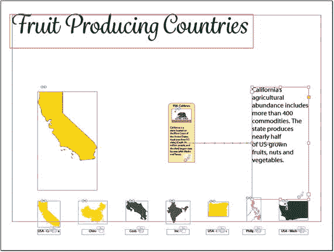

图 8-19。调整运动路径，使其从地图右侧开始

5.  为第二个对象制作动画。在我的示例中，中间的对象使用`放大`预设进行动画制作。我们将比例设置为 150%。根据放置时对象的大小，你可能需要稍微调整比例。不断预览动画，直到效果符合你的要求。

6.  设置按钮事件。在我的示例中，页面底部有小地图和文字。选择一个对象及其对应的文字，并将它们编组（`对象 ➤ 编组`或`Ctrl/⌘+G`）。选中编组后的对象，打开`按钮和表单`面板并创建一个新按钮。（点击新建按钮图标或从类型菜单中选择`按钮`。）点击`+`图标添加一个事件。从动画菜单中选择该事件。再次点击`+`图标，并从动画菜单中选择第二个动画（见图 8-20）。

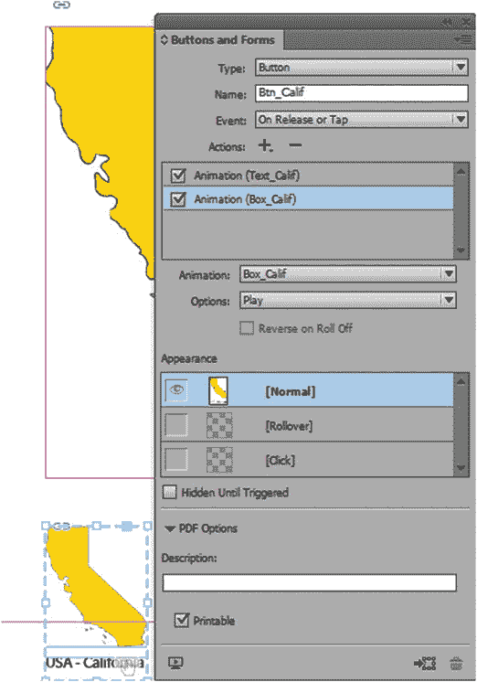

图 8-20。在“按钮和表单”面板中添加动画

7.  **检查时间轴面板。** 选中按钮后，打开“时间轴”面板，确认动画按照您希望的顺序播放。如果需要更改顺序，请在“时间轴”面板中点击并上下拖动动画。

8.  **预览动画。** 点击“动画”面板中的预览图标。点击“播放”按钮播放动画。如果动画显示不正确，您需要返回对象并仔细检查动画。

9.  **将项目编组。** 在创建 MSO 时，选择您希望在某个给定状态下显示的所有项目，并将它们编组（`Ctrl/⌘+G`）。

10. **在图层面板中重命名该组。** 默认情况下，InDesign 会将编组的项目放在一个新图层上，并将图层名称添加为组名。在处理动画组时，请将其更改为一个描述性的名称。在我的示例中，我将图层重命名为`California`。

11. **按照相同的步骤创建其他动画组。** 请确保在完成每个组后预览动画。

至此，您可以创建一个新的多状态对象。

我在第 9 章中详细介绍了多状态对象。为了让您了解本项目的进展方向，我从编组的对象和动画创建了一个 MSO。您可以在图 8-21 中看到不同的对象状态。版式底部的按钮操作被分配了触发器，用于查看 MSO 中的不同状态。我们将在第 9 章中讨论具体操作方法。现在，您需要知道的是，可以创建包含不同状态（这些状态下包含内容和动画）的 MSO，并通过单击按钮来查看不同的状态。

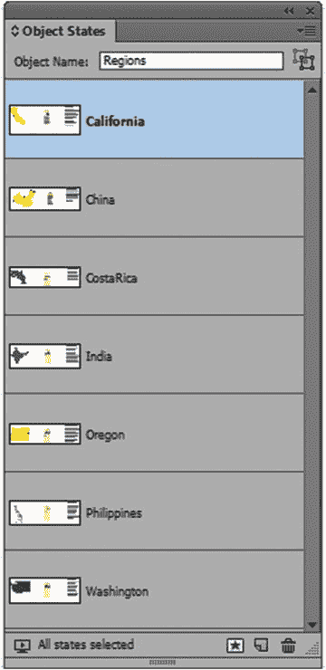

图 8-21。“对象状态”面板显示根据“图层”面板中指定的名称命名的每个状态的名称

MSO 和动画可以在固定版式的电子书阅读器和 Adobe Publish Online（预览）中查看。对于交互式 PDF 文档，您需要创建一种变通方法。有关动画和交互式 PDF 的更多信息，请参见第 15 章。

## 8.8 探索一些项目创意

您可以使用动画创建大量项目。为了激发您的创造力，我将在这里讨论几个。剩下的就看您的了。只要跳出思维定势，您就会发现许多使用 InDesign 动画功能的新颖有趣的方式。

### 8.8.1 为徽标添加动画

当您添加交互性、视频、声音和动画时，数字出版物在许多方面都比印刷品更具优势。印刷品需要一个引人注目的图形或醒目的标题来吸引读者进入文档或故事。在创建出版物时，您应该尝试思考如何让读者融入内容。让它变得有趣，让它充满动感，并提供一些惊喜元素。这些方法能保证在瞬间抓住读者的注意力。

对于数字出版文档，一种引人注目的方法是在首页添加一个影片文件或动画。与其使用简单的标题，不如让封面变得有趣，并创造出相当酷的效果。

在图 8-22 中，是一个商业文档的封面。这可以是一份年度报告、财务报告、五年计划或任何其他此类商业文档。图中所示的封面包含几个动画，具体如下：

*   **竖线：** 您在图中看到的竖线是从中心开始绘制的两条线。

*   **动画文本：** 第一行文本逐个字符地出现。在第一行文本出现后，单词`THE`从顶部飞入。单词`MARKET`淡入。

*   **动画徽标：** 竖线左侧的徽标旋转到当前外观。

图 8-22。包含动画的商业文档封面 为徽标添加动画

要创建类似的设计，请遵循以下步骤：

1.  **创建一个新的 InDesign 文档。** 使用您想要查看文档的设备上的输出设置。在我的示例中，我使用 iPad。在“图层”面板中，将默认图层命名为`Background`，并为一个矩形框架应用颜色。如果您希望背景为白色，则无需填充矩形形状或框架。

2.  **绘制两条竖线。**

3.  **在每条线上绘制一个框架，并用与背景相同的颜色填充这些框架。**

4.  **为线条添加动画。** 选择上方线条上方的顶部框架，打开“动画”面板。从“预设”菜单中选择`Appear`。从“动画”菜单中选择`From Current Appearance`，然后点击“动画”菜单下方、“旋转”菜单右侧的“参考点”图标中的顶部中央方块，如图 8-23 所示。编辑 H 文本框并输入零 (`0`)。对于“不透明度”，从菜单中选择`None`。对第二个框架重复这些步骤，隐藏底部线条，但点击“参考点”图标中的底部中央方块。

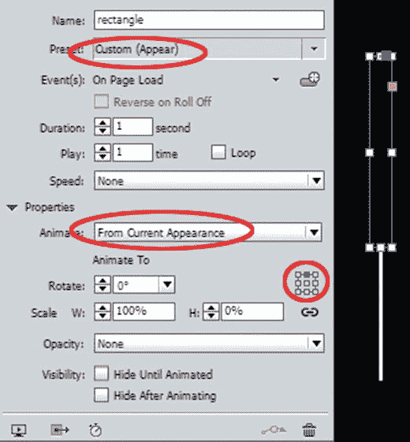

图 8-23。为线条和框架添加动画时设置原点

5.  **设置“时间轴”面板以一起播放线条动画。** 打开“时间轴”面板并选择这两个动画。点击“一起播放”图标。

6.  **为单词 FRUIT 添加动画。** 文本由单独的文本框架组成——每个字符一个框架。按您希望它们动画化的顺序选择所有字符，然后打开“动画”面板。从“预设”菜单中选择`Appear`。将“持续时间”设置为`.125`秒，并勾选“隐藏直到动画化”。**注意：** 默认情况下，动画按您选择的顺序播放。

7.  **为单词 THE 添加动画。** 选择该单词，然后从“预设”菜单中选择`Fly In From Top`。移动运动路径，使动画从页面顶部开始。

8.  **为单词 MARKET 添加动画。** 该单词在字符动画完成后简单地淡入。选择该单词，然后从“预设”菜单中选择`Fade In`。对于“不透明度”，从菜单命令中选择`Fade Out`。我们知道这似乎与动画相矛盾，但请相信我，这会产生您期望的动画效果。

9.  **为徽标添加动画。** 选择徽标，然后选择 `Rotate` ➤ `180 CW`。在“旋转”文本框中输入 `720°`，并勾选“隐藏直到动画化”复选框。

10. **预览文档。** 点击“动画”面板中的预览图标以预览结果。

这种动画可以在固定版式 EPUB 和 Adobe Publish Online（预览）中查看。对于交互式 PDF，您需要创建一种变通方法，如我在第 15 章中所述。

### 8.8.2 创建商业图表

你可以通过各种设计让静态图表变得有趣。然而，为商业图表添加一些动画效果会使其更具吸引力。你可以先通过动画展示图表的一部分来引导观众关注关键点，然后再淡入其余部分，或者选择添加辅助动画。

有许多不同的动画可以添加到图表中。你可以分解饼图的不同扇区并使其移入或移出，让柱状图从基线向上运动，为折线图中的线条添加动画，等等。

在这个示例中，我使用一个简单的折线图来演示一些可能性。在图 8-24 中，你会看到图表完成动画后的最终效果。在这个图表中，我们为线条添加动画并淡入数据点。从底部行开始，每条线条仿佛被绘制出来，随后第二个数据点出现，线条继续延伸到最后一个数据点。接下来，中间线条以相同方式动画，最后是顶部线条。

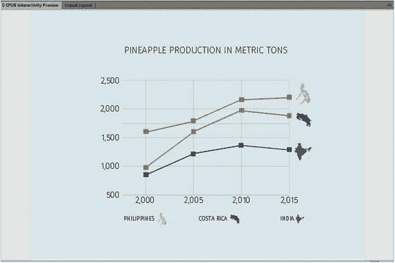

**图 8-24.** 动画完成后的折线图

#### 创建动画图表

要创建类似的动画图表，请执行以下操作：

1.  在一个新的 InDesign 文档中，为图表网格和文本添加元素，然后添加所有其他非动画内容。

2.  放置好背景元素后，锁定 `Background` 图层，并为动画创建一个新图层。

3.  绘制线条。关于动画线条，需要理解的主要一点是，你必须先绘制一条水平线。你不能绘制一条斜线，然后像图 8-24 中那样沿着路径为其添加动画。绘制一条水平线后，使用 `Rotate` 工具旋转线条。当线条旋转到合适角度后，你可以使用 `Direct Selection` 工具移动端点，根据需要使线条变短或变长。以相同方式继续绘制多条线条，并将其放置在与图 8-24 中类似的位置。务必在 `Layers` 面板中使用描述性名称命名这些线条。对于底部线条，我使用的图层名称如 `Line Bottom 1`、`Line Bottom 2` 等等。

4.  添加数据点。我在线条上方添加了数据点，以隐藏任何轻微偏移。这样，动画时线条看起来就是一条连续的线。请确保在 `Layers` 面板中使用描述性名称命名数据点。我将数据点命名为 `Point Bottom 1`、`Point Bottom 2` 等等。

5.  创建线条动画。你可以选择所有线条并添加一个统一的动画。你可能需要为单个线条更改的唯一设置是 `Animation` 面板中的原点。选中线条后，打开 `Animation` 面板。从 `Preset` 菜单中选择 `Appear`。将持续时间设置为 0.75 到 1 秒。从 `Animate` 菜单中选择 `To Current Appearance`。在 `Scale` 文本框中，为宽度输入 `0%`（这会在动画期间保持宽度恒定）。将 `H`（高度）设置保留为 100%。点击 `Reference Point` 图标中的左下角方块。为 `Opacity` 选择 `None`，并勾选 `Hide Until Animated`（见图 8-25）。

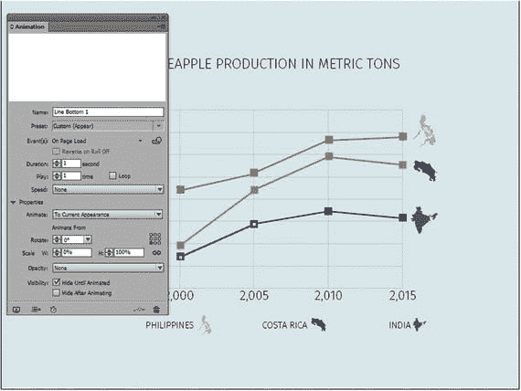

**图 8-25.** `Animation` 面板中所需的设置

6.  更改原点。在我的示例中，底部和中间组的最后一条线条需要调整原点。选中这两条线条，点击 `Animation` 面板中的 `Reference Point` 图标左上角。确保检查所有设置。当你在 `Animation` 面板中进行调整时，其他某些项目可能会发生变化。

7.  为数据点添加动画。选中所有数据点，在 `Animation` 面板的 `Preset` 菜单中选择 `Appear`。将持续时间设置为 0.25，`Opacity` 设置为 `None`，并勾选 `Hide Until Animated`。

8.  设置线条和数据点的时间。打开 `Timing` 面板。选中属于同一组的线条和数据点。这些名称来自 `Layers` 面板。如果你使用描述性名称命名图层，这项任务会容易得多。这是因为，正如你在图 8-17 中所见，`Timing` 面板会显示这些描述性名称。你需要关联图 8-17 中看到的项目。从面板顶部开始，底部行的第二条线条与底部行的第二个数据点关联。当动画播放时，数据点会在第二条线条开始绘制时出现。

9.  预览最终设计。当动画按你设计的方式运行正常时，就可以将其发布到固定版式 EPUB 和 Adobe Publish Online（预览）中供人查看了。如果你希望将此类图表包含在交互式 PDF 中，则需要一种变通方法，我将在第 15 章中讨论。

## 8.9 总结

InDesign 为你提供了大量的动画预设。本章仅涉及了其中一部分。不过，所有预设的设置方式都类似。你需要关注 `Animation` 面板中的选项并理解这些设置。尝试使用几种预设，并创建一些你自己的动画来练习。

在下一章中，我们将离开动画，探索多状态对象（MSO）的世界。你会发现 MSO 在文档中有许多绝佳用途，下一章将详细解释如何创建和使用它们。