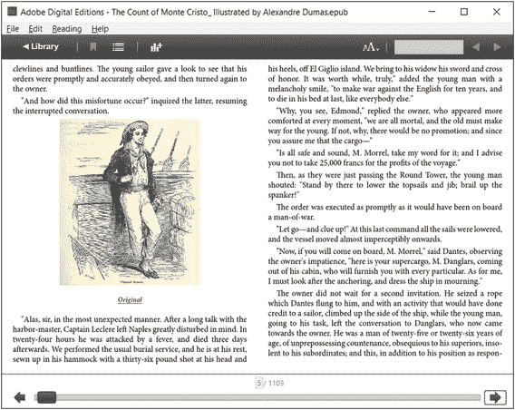
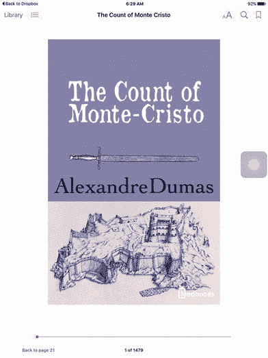
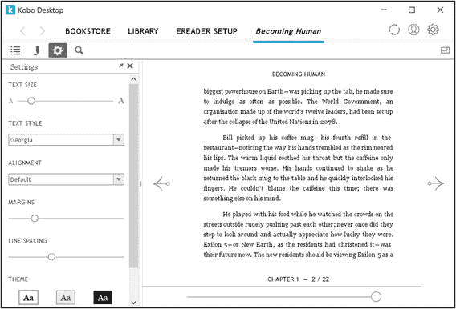
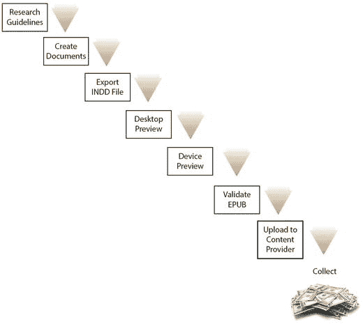
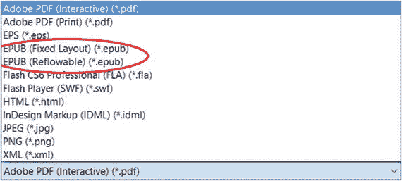

# 第 1 章 理解数字出版

在处理数字出版的文档时，有许多需要了解的内容。文件格式种类繁多，阅读设备也各不相同。而且每当你回头一看，新的东西又层出不穷。这足以让你头晕目眩。

在开始创建文档之前，你需要明确自己打算制作哪种类型的出版物，以及使用哪种设备来展示你的作品。在此基础上，你还需进行一些调研，以确保所创建的内容符合在线出版商的要求。

在本章中，我首先定义“数字出版”这一术语，以便我们对接下来的章节内容有共同的理解。我还会讨论文件格式和阅读设备。我将尽力为你提供众多理由，说明为什么 `Adobe InDesign` 是任何类型出版文档的首选程序，并建议你遵循的工作流程，以创建格式规范且有效的 EPUB 文件。

在阅读本章及后续章节时，请记住，你无需掌握本书讨论的所有内容。你可能只对 Kindle 电子书感兴趣，因此可以略过与 Kindle 无关的讨论。或者你可能只对 Apple iBooks 感兴趣，同样可以略过所有与 iBooks 无关的内容。我努力为你提供数字出版创作与发行的广阔视野，由你自行决定哪些特定领域与你的工作相关。

## 1.1 定义数字出版

就本书而言，我们来拆分“数字出版”这个术语。首先看看广义上的出版，然后再看“数字”的含义。

出版被定义为文学作品、音乐或信息的制作与传播过程——即向公众提供信息的活动。

当我们谈及“数字”一词时，它通常指数值数据。然而，更广泛的定义则包括以电子形式提供、可被计算机读取和操作的信息。

简单来说，我们将“数字出版”视为可供在电子设备上查看的内容（文本、图形和图像），这些设备包括智能手机、平板电脑、智能电视、计算机以及任何其他能够显示供人类消费的内容的电子设备。

如今我们熟悉的电子内容涵盖了网页、杂志、文章、书籍、宣传册、简报、手册等，一直到单页项目，如贺卡和邀请函。

## 1.2 理解文件格式

要了解数字出版中使用的文件类型，我们还需要知道哪些设备会显示我们的内容。这两者紧密相连，很难分开讨论。为了清晰起见，请查看表 1-1。

表 1-1. 文件格式与显示设备

| 文件格式 | 文件类型 | 显示设备 |
| --- | --- | --- |
| HTML | `.html`、文本 | 台式机、手机、平板电脑 |
| EPUB（流式布局） | `.epub`、`.mobi`* | 电子阅读器、台式机、手机、平板电脑 |
| EPUB（固定布局） | `.epub`、`.kf8` | 电子阅读器、台式机、手机、平板电脑 |
| PDF（交互式与静态） | `.pdf` | 台式机、手机、平板电脑 |
| Adobe Publish Online | HTML、Adobe 专有格式** | 台式机、手机、平板电脑 |

\* `MOBI` 是 Amazon Kindle 用于在 Kindle 阅读器上查看 EPUB 的格式。** 此处列出 Adobe 专有格式是因为 Publish Online 的内容会上传到 Adobe 的服务器，你无法访问最终文件。

## 1.3 熟悉显示设备

用于显示内容的软件和/或设备有多种选择。你可以在台式机或笔记本电脑上查看内容以测试效果，并相对确信内容能在特定设备上正确显示。在某些情况下，你可以将设备连接到计算机，并直接在特定设备上查看内容。

### 1.3.1 在桌面应用程序中预览内容

你可以将多种不同的查看应用程序下载到计算机上，用于预览你的作品。我强烈建议在上传任何内容到内容提供商之前进行此操作。

可供选择的选项包括：

*   **HTML**：我们大多数人都熟悉网页浏览应用程序，如 MS Edge、Internet Explorer、Firefox、Safari、Google Chrome 等。这些应用程序用于查看网页。对于某些 EPUB 工作，你可能希望安装 Google Chrome，因为 Chrome 可以借助免费的 Readium 应用程序（用于 Google Chrome）来预览 EPUB 文档。

*   **EPUB**：EPUB3 文档有两种类型：流式布局和固定布局。流式 EPUB 用于支持字号更改和文本（有时也包括图像）随字号增大或减小而重排的电子阅读器。固定布局 EPUB 类似于 PDF 文档，提供完整的所见即所得视图。用于桌面预览 EPUB 的应用程序包括 `Adobe Digital Editions`（4.0 及以上版本），如图 1-1 所示，以及 Apple iBooks 和 Readium（从 Google Chrome 启动）。此外，还有适用于 iOS 和 Android 设备的各种电子阅读器。

    

    图 1-1. 在 `Adobe Digital Editions` 中显示的电子书

> **注**
>
> EPUB 市场在不断变化。更多的电子阅读器正在被推出，支持 EPUB 创建的应用程序也不断发布。如果你在 EPUB 出版方面是认真的，请定期搜索互联网，寻找能帮助你开发和展示作品的新产品。

*   **MOBI**：Kindle EPUB 需要不同类型的阅读器。你可以从 Amazon 下载 `Kindle Preview` 并安装到计算机上。`Kindle Previewer` 会按 Kindle 设备上的显示效果来展示你的 EPUB。

*   **PDF**：桌面查看器包括 `Adobe Reader`、`Adobe Acrobat` 以及 Mac 上的 Preview，此外还有各种第三方应用程序。在智能手机和平板电脑上，查看 PDF 也有很多选择。某些应用程序提供添加评论注释、填写表单、支持 EPUB 以及支持多媒体查看等功能。Adobe 发布了免费的 `Adobe Reader` 用于查看 PDF 文档。其他应用程序要么免费，要么以象征性费用出售。

### 1.3.2 在计算机上获取 EPUB 内容

作为数字出版工作流程的第一步，你需要获取必要的工具，以便在计算机及/或设备上预览 EPUB。我推荐的工具包括：

-   **Kindle Previewer**：在 [`http://www.amazon.com/gp/feature.html?docId=1000765261`](http://www.amazon.com/gp/feature.html?docId=1000765261) 为 Mac 或 Windows 系统下载 `Kindle Previewer` 应用程序。

-   **Apple iBooks**：遗憾的是，`iBooks` 仅适用于 Mac 系统，并且无法在 Windows 上模拟 `iBooks` 阅读器。对于 Mac 用户，你可以使用 `iTunes` 并通过 USB 线将 iPad 连接到电脑，直接在设备上预览内容。但是，如果你的书库中有大量图书，则需要等待 iPad 与 `iTunes` 同步完成。一个更简单的方法是使用 `Dropbox`。你可以将 EPUB 上传到 `Dropbox`，然后在 Windows、Android 设备和 iPad 上访问电子书。请访问 `Dropbox.com` 并为你的设备下载相应版本。

-   **Kobo 阅读器**：`Kobo` 是当今增长最快的电子阅读器之一。你可以从 [`https://www.kobo.com/desktop`](https://www.kobo.com/desktop) 下载适用于 `Kobo` 的桌面阅读器。

-   **Android File Transfer**：你可以使用 `Android File Transfer` 工具为 Android 设备传输文件，该工具可在 [`http://android-file-manager.en.softonic.com`](http://android-file-manager.en.softonic.com) 找到。

-   **Adobe Digital Editions**：`ADE` 4.0 及以上版本现在支持 EPUB 3 格式，可用于预览可重排和固定版式 EPUB。`ADE` 适用于 Windows 和 Macintosh 系统。你可以从 [`http://www.adobe.com/solutions/ebook/digital-editions/download.html`](http://www.adobe.com/solutions/ebook/digital-editions/download.html) 免费下载此应用程序。

-   **Readium**：`Readium` 是 `Google Chrome` 浏览器的一个插件。请从 [`https://support.google.com/chrome/answer/95346?hl=en`](https://support.google.com/chrome/answer/95346?hl=en) 安装 `Google Chrome`。安装 Chrome 后，访问 Chrome 网上应用店 [`https://chrome.google.com/webstore/category/apps`](https://chrome.google.com/webstore/category/apps) 并搜索 `Readium`，然后下载并安装该插件。

### 1.3.3 在电子阅读设备上预览 EPUB 内容

桌面预览应用程序通常运行良好；然而，它们并非完美无缺，使用桌面应用程序时可能无法获得文档的精确视图。通常，你会使用桌面应用程序来预览在 InDesign 文件中所做的编辑，然后在设备上预览整个出版物。你可能拥有的设备包括：

-   **Apple iPad**：你可以通过 USB 线将 iPad 直接连接到电脑，在 `iTunes` 中拖放 EPUB 文件进行预览（见图 1-2），或者使用 `Dropbox` 上传 EPUB 文件并下载到你的 iPad 上。

    

    图 1-2. 通过 `Dropbox` 下载后在 iPad 上显示的 EPUB

-   **Kobo 阅读器**：你可以将 Kobo 阅读器连接到电脑，通过 USB 线直接在 Kobo 上预览 EPUB。如果你没有 Kobo 阅读器，可以使用 `Kobo Desktop Reader`（见图 1-3）。

    

    图 1-3. 在 `Kobo Desktop Reader` 上显示的 EPUB

-   **Kindle**：你可以将 EPUB 转换为 Kindle 的 `.mobi` 格式，然后使用 `Kindle Previewer` 预览这个 Mobi 格式的文件。遗憾的是，在将最终文件提交给亚马逊之前，你无法将 Kindle 阅读器连接到电脑直接在设备上预览。要将 EPUB 转换为 MOBI，你可以使用 `KindleGen`，该工具可在 [`http://www.amazon.com/gp/feature.html?docId=1000765211`](http://www.amazon.com/gp/feature.html?docId=1000765211) 从亚马逊免费下载。`KindleGen` 在 Mac 或 Windows 的命令行中运行。如需更方便的转换器，你可以从 Softonic 网站 [`http://ebook-converter.en.softonic.com`](http://ebook-converter.en.softonic.com) 免费下载适用于 Windows 的 `eBook Converter`。对于 Macintosh 版本，请访问 [`http://ebook-converter-mac.en.softonic.com/mac/download?ex=SWH-1608.6`](http://ebook-converter-mac.en.softonic.com/mac/download?ex=SWH-1608.6)。此转换器允许你将文档转换为 MOBI 格式，同时也支持将 PDF 文档转换为 MOBI 格式。

-   **Barnes & Noble Nook**：将你的 Nook 平板电脑连接到电脑，找到文件夹（Mac 的 Finder 或 Windows 的资源管理器）：`My Nook > My Files > Books`。将一个 EPUB 文件拖放到该文件夹中，即可在设备上查看。

几乎所有设备都允许你在将出版物提交给在线平台之前，先在计算机上进行预览。

## 1.4 为什么选择 InDesign？

本书的主要内容是在 Adobe InDesign 中进行设计创作。我们选择 InDesign 而非其他应用程序的原因在于，InDesign 提供了众多工具，使你能够创建动态且引人入胜的文档。使用 InDesign 可以做到的事情包括：

-   **添加动画**：动画在固定版式 EPUB、仅桌面计算机可用的交互式 PDF 文件（有一些变通方法）和 Adobe Publish Online 中均受支持。我将在第 8 章中讨论如何创建 InDesign 动画。

-   **使用多状态对象**：你可以使用多状态对象（MSO）制作幻灯片，按钮事件在固定版式 EPUB、交互式 PDF（仅桌面计算机，有变通方法）和 Adobe Publish Online 中受支持。我在第 9 章中涵盖了所有你需要了解的关于 MSO 的知识。

-   **包含富媒体**：音频和视频文件在可重排 EPUB、固定版式 EPUB、PDF 文件（有一些限制）和 Adobe Publish Online 中均受支持。请查看第 10 章，了解如何在你的出版物中包含视频和声音。

-   **创建交叉引用和超链接**：在所有格式中都受支持。第 7 章涵盖了超链接和交叉引用。

-   **组织内容流**：借助 InDesign 的“文章”面板，你可以确保在可重排 EPUB 中，对象和文本框完全按照你期望的顺序显示。

-   **使用样式**：InDesign 支持样式表（这对创建任何 EPUB 都至关重要），不仅支持字符样式和段落样式，还支持表格样式和单元格样式。

-   **直接导出为 EPUB3**：InDesign CC 2015 及更高版本支持将可重排和固定版式 EPUB 导出为 EPUB3 格式。

InDesign 还为你提供了更多工具和命令。你拥有绝佳的机会来使用“对象导出选项”、使用 HTML 标签标记样式、使用图层（对复杂页面至关重要）、应用特殊效果以及从各种来源导入资源。

Adobe InDesign 是一个出色的程序，它为你提供了庞大的工具集，用于创建几乎任何类型的数字出版文档。

## 1.5 设置 EPUB 工作流程

EPUB 内容提供商制定了详尽的指南，你需要在上传内容之前遵循这些指南。你需要了解特定平台是否支持富媒体、首字下沉、图像和对象的投影、封面图片是作为单独文件还是包含在出版物内、目录的结构等等。

对于 EPUB，你的工作流程比发布 PDF 文档和使用 Adobe Publish Online (APO) 时要复杂得多。对于 PDF 和 APO，你可以预览作品，无需进行验证。通常所见即所得，如果在你的计算机上看起来不错，通常就可以将文件上传给内容提供商。但对于 EPUB，你还需要几个额外的步骤，如图 1-4 所示。

图 1-4. 典型的 EPUB 开发工作流程

让我们更详细地了解每个步骤：

# 研究

如果你打算在 Apple、Amazon 或其他内容提供商上分发 EPUB，这些提供商通常会有你需要遵循的指南。对于 Apple 的 iBooks，截至撰写本文时，Apple Asset Guide 5.1 修订版 2 文档以 PDF 文件形式托管在 [`https://itunesconnect.apple.com/docs/iBooksAssetGuide5.1Revision2.pdf`](https://itunesconnect.apple.com/docs/iBooksAssetGuide5.1Revision2.pdf)。对于 Kindle 图书，截至撰写本文时，Amazon Kindle 出版指南 2015.2 版可从 [`http://kindlegen.s3.amazonaws.com/AmazonKindlePublishingGuidelines.pdf`](http://kindlegen.s3.amazonaws.com/AmazonKindlePublishingGuidelines.pdf) 下载。Kobo 用户指南可从 [`http://download.kobobooks.com/writinglife/en-US/KWL-User-Guide.pdf`](http://download.kobobooks.com/writinglife/en-US/KWL-User-Guide.pdf) 下载。对于 Barnes & Noble Nook，你可以登录 Nook Press 网站 [`https://www.nookpress.com/ebooks`](https://www.nookpress.com/ebooks) 查找更多信息。关于 Sony eReader 指南，请查阅 [`https://docs.sony.com/release/PRST2.pdf`](https://docs.sony.com/release/PRST2.pdf)。Smashwords 风格指南可从 [`https://www.smashwords.com/books/view/52`](https://www.smashwords.com/books/view/52) 下载。对于 ISSUU，你可以在 [`http://help.issuu.com/hc/en-us/articles/204816098-How-to-upload-and-publish-on-issuu`](http://help.issuu.com/hc/en-us/articles/204816098-How-to-upload-and-publish-on-issuu) 找到视频和指南。网上还有许多其他文档可以帮助你了解更多关于电子书出版的信息。你可以找到操作指南、格式指南、自助出版指南等等，只需在网上搜索出版指南即可。与其查阅众多不同的内容托管平台，不如将范围缩小到最受欢迎的两个。最大的两个分销商是 Amazon Kindle 和 Apple iBooks。如果你刚开始涉足电子书出版，请在开始在 InDesign 中排版文档之前，仔细阅读 Apple 和 Kindle 的指南。

# 创建文档

当你熟悉了所选出版商的出版指南后，就可以开始创建文档了。这个过程需要在预览内容和编辑文档之间反复切换。你通常会在一页上工作，将其导出为 EPUB，然后返回 InDesign 进行编辑。了解电子书的构成非常重要。EPUB 文档就像一个包含在压缩文件中的完整网站。有一些工具可以用来解压文件，打开 HTML 和 CSS 文档，并对 HTML 进行一些修改。我将在第 12 章介绍编辑 HTML 和 CSS 的内容。如果你不是程序员或不熟悉编写代码，现在不必担心。我们只会介绍一些简单的步骤来对文档进行修改。

# 导出为 EPUB

使用 InDesign CC，你有两种导出 EPUB 的选择：可重排文本和固定布局。使用 `文件 ➤ 导出` 菜单中的导出选项（如图 1-5 所示），选择你想要分发的 EPUB 类型。你需要检查导出窗口各个面板中的所有选项，以创建最终的文档。

*图 1-5.* InDesign 导出选项

# 预览 EPUB

在你打算使用的所有设备的桌面应用程序中进行预览。

# 在设备上预览

连接 iPad、Android 平板电脑、Kobo 阅读器或任何其他允许预览作品的设备。

# 验证你的 EPUB

从 InDesign 导出时会进行一些验证。为确保你的 EPUB 有效，最后请使用验证检查器或验证服务来验证你的文档。你可以从 [`https://github.com/IDPF/epubcheck`](https://github.com/IDPF/epubcheck) 下载一个 EPUB 检查器，它通过命令行运行。如果你想要更简单的解决方案，可以看看这里列出的几个。国际数字出版论坛 (IDPF) 托管了一个网站，你可以在该网站上上传 EPUB 进行验证。请访问 [`http://validator.idpf.org`](http://validator.idpf.org)。Sigil 是一个桌面应用程序，可以让你编辑 HTML 和 CSS 代码，它也可以验证 EPUB。你可以从 [`http://sigil.en.softonic.com`](http://sigil.en.softonic.com) 下载免费的 Windows 和 Mac 版本。Mac 用户可以免费下载 AppleScript ePubCheck，网址为 [`https://code.google.com/p/epub-applescripts/downloads/detail?name=ePubCheck_3.0b5.zip&can=2&q`](https://code.google.com/p/epub-applescripts/downloads/detail%3Fname=ePubCheck_3.0b5.zip%26can=2%26q)。只需将你的 EPUB 文件拖放到此脚本上即可。一个用于编辑 HTML 和验证 EPUB 的价格较高的应用程序是 Oxygen。如果你愿意花 200 美元或更多购买其中一个 Oxygen 应用程序，请访问 [`http://www.oxygenxml.com/download.html`](http://www.oxygenxml.com/download.html)。

# 上传到内容提供商

发布作品的最后一步是将你的文档上传到内容提供商。这一步的前提是你已经在该提供商处注册了账户，提供了所有必要的标识符和付款信息，并且为要求提供 ISBN 的提供商获取了 ISBN 号码。

## 1.6 本章小结

本章介绍了 EPUB、EPUB 格式以及在各种阅读设备上查看 EPUB 的基本知识。一旦你确定了最终产品的目标设备，开始开发过程就会容易得多。

至此，你已经准备好了解如何排版文档以便在各种设备上查看。当然，选择的程序是 Adobe InDesign，我们将从了解一些与在 Adobe InDesign 中工作的基础知识开始，踏上 EPUB 创作的旅程。
