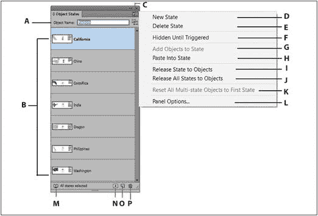

# 9. 使用多状态对象更改对象视图

多状态对象（通常称为 MSO）为交互式出版物带来了丰富的可能性。MSO 可用于固定版式 EPUB 和 Adobe Publish Online（预览）。你可以通过一种变通方法将包含 MSO 的文档导出为交互式 PDF 文件，但遗憾的是，它们只在桌面电脑上有效。截至目前，我还没有找到支持 PDF 文件中 MSO 的 PDF 阅读器。

你可以使用 MSO 查看幻灯片、更改页面内文本、图像和对象的视图。你可以在不同状态中播放动画（如第 8 章所述），并且可以将 MSO 嵌套在其他 MSO 中。

使用多状态对象为数字出版物带来了巨大的机遇，这是印刷文档无法复制的。MSO 的使用范围只受限于你的想象力。

## 9.1 使用对象状态面板

开始讨论 MSO 时，我们先来看一下所有操作发生的地方——`Object States` 面板。如果你尚未为交互式文档设置工作区，请选择 **窗口** ➤ **交互** ➤ **对象状态**。如果该面板已在你工作区内，请点击 `Object States` 面板。默认情况下，该面板打开时除创建新 MSO 外无其他可用选项。当你创建新的 MSO 时，面板会显示与 MSO 内容相关的信息，如图 9-1 所示。

**图 9-1.** 选择 **窗口** ➤ **交互** ➤ **对象状态** 以打开 `Object States` 面板

在 `Object States` 面板中，一旦你创建了新的 MSO，你会找到以下选项：

