# 1. 对象状态面板概述

**对象名称**：默认情况下，当您首次向文档添加新的 MSO 时，`对象名称`为`多状态 1`。即使文档中只有一个 MSO，您也应该在此文本框中输入描述性名称。养成命名`对象名称`和`状态`名称的习惯，以便在您重新查看文档或分配按钮操作时更加轻松。

**状态**：在`对象名称`下方的列表中，显示了 MSO 中各状态及其缩略图。单击某个状态，该状态便会显示在文档窗口中。您可以轻松选中某个状态，然后在文档中通过双击该状态来编辑其内容。默认情况下，状态名称依次为`状态 1`、`状态 2`、`状态 3`等。如需重命名状态，请单击一次，稍作停顿，再单击一次，然后为状态输入新名称。您应该为 MSO 中的所有状态添加描述性名称。

**对象状态菜单**：单击`对象状态面板`右上角的图标，即可打开`对象状态`菜单。您可以在此选择多个菜单项，包括以下内容：

- `新建状态`：单击`新建状态`可创建新的 MSO，或复制现有 MSO 中选定的状态。

- `删除状态`：在面板中选择一个状态，然后单击即可从 MSO 中删除该状态。

- `隐藏直至触发`：如果您希望 MSO 在文档打开时处于隐藏状态，请单击此项。当您单击分配了查看某个状态的按钮时，该状态便会在文档中打开。

- `向状态添加对象`：选择一个状态，然后按住 `Shift` 键单击页面中不属于该状态的对象。随后，当您选择此命令时，该对象将被添加到该状态中。

- `粘贴至状态`：如果您复制了一个对象并希望将其粘贴到 MSO 中，请单击此项，将剪贴板上的内容粘贴到当前可见的 MSO 状态中。

- `将状态释放为对象`：单击菜单中的此项时，选定的状态会从 MSO 中提取出来，但其余状态仍包含在 MSO 中。此菜单命令与`删除状态`命令的区别在于，提取出的状态会保留在文档中，而`删除状态`则类似于剪切状态，会将其从文档中移除。

- `将所有状态释放为对象`：当您想要重新开始时，此命令非常有用，例如，您可能需要进行多次编辑，然后再重新创建 MSO。选择此命令后，MSO 会从文档中删除，但其所有内容仍然保留。

- `将所有多状态对象重置为第一状态`：如果您选择了除第一状态以外的某个状态，此命令会将默认视图重置为在文档中查看时打开第一状态。

- `面板选项`：默认情况下，缩略图设置为显示最小视图。如果您单击`面板选项`，则会打开一个弹出菜单，您可以在其中选择将缩略图更改为更大的视图。

- `预览跨页`：单击此按钮可在`EPUB 交互预览面板`中预览文档。按住 `Alt/⌥` 键并单击，可在`SWF 预览面板`中预览。

- `将复制的对象粘贴到选定状态`：当您想要创建嵌套的 MSO 时，此按钮非常有用。您可以将一个 MSO 粘贴到某个给定状态中，更改状态视图，再将另一个 MSO 粘贴到第二个状态中，依此类推。嵌套 MSO 需要一点技巧，我将在“创建嵌套 MSO”一节中解释。

- `创建新状态`：单击此按钮可根据文档中选定的对象创建 MSO，或复制现有 MSO 中选定的状态。单击此按钮所产生的效果与单击`新建状态`菜单命令相同。

- `删除选定状态`：单击一个状态，然后单击垃圾桶图标，该状态便会从 MSO 中删除。使用垃圾桶图标与从菜单中选择`删除状态`的效果相同。

## 9.2 创建多状态对象

要创建新的多状态对象，您必须在页面上选中一些对象。这些对象可以是图像、对象、文本框，或是它们的组合。一旦选中图像/对象和/或文本框，请单击`对象状态面板`右下角的`将所选内容转换为多状态对象`图标，或打开`对象状态面板`菜单并单击`新建状态`。

当您创建 MSO 时，如果这是您在文档中创建的第一个 MSO，`对象状态面板`会将其命名为`多状态 1`。您创建的下一个 MSO 将被命名为`多状态 2`，依此类推。

在对象名称下方，您会看到创建 MSO 时选中的每个对象都对应一个独立的状态。如果您将对象放置在有图层名称的图层上，状态名称将继承图层名称。如果这些对象被放置在 InDesign 的同一图层上，您将看到不同状态被命名为`状态 1`、`状态 2`等，如图 9-2 所示。

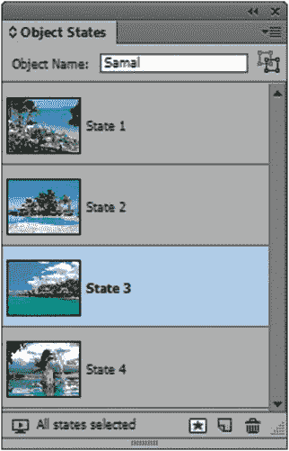

**图 9-2.** 如果您没有将对象放置在具有图层名称的图层上，MSO 将使用默认名称

您的首要任务是为对象名称和各个状态名称添加一些描述性名称。如果您想通过按钮事件触发状态视图，这将使您的工作变得轻松得多。

通常，MSO 中的第一个项目会被选中，成为该 MSO 的默认视图。实际上，MSO 的工作方式类似于处理图层。您可以隐藏一个图层（或状态），然后下一个图层（或状态）便会显示出来。如果您单击`对象状态面板`中的某个状态，该状态将成为默认视图。在图 9-3 中，我为对象名称和各个状态添加了名称。我还选中了`日落`。如果我们关闭`对象状态面板`，`日落`状态将成为默认视图。

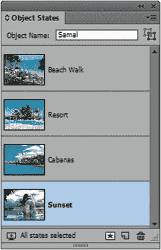

**图 9-3.** 编辑了对象名称和状态名称的 MSO。

要编辑状态的名称，请单击该状态名称一次，稍作停顿，然后再次单击。状态名称即被选中，您可以输入一个新名称。

如果您想缩放 MSO，首先需要选中它。当您选中 MSO 时，您会看到其边界框上出现一条虚线。您可以使用`选择`工具单击并拖拽划过 MSO 来选中它，或者单击边界框的边缘直到看到虚线。MSO 被选中后，您可以像缩放任何图形一样缩放它；也就是说，按住 `Ctrl/⌘+Shift` 键并拖动角手柄即可。

### 创建新的 MSO

请按照以下步骤创建新的 MSO：

1.  在 InDesign 文档中导入一些图像，使用几个文本框，或同时使用两者。

2.  （可选）对齐对象。

3.  打开`对齐面板`（`窗口 ➤ 对象和版面 ➤ 对齐`）。对象不必非要对齐，但如果您有多个相同大小的对象，对齐后它们在页面上看起来会更美观。选中所有对象，然后单击`水平居中对齐`或`左对齐`图标。再次单击`垂直居中对齐`或`顶对齐`图标。**注意：** 如果您想在一个状态下对齐多个对象，您必须将这些对象编组。

4.  创建一个新的多状态对象。使用`选择`工具框选所有对象，然后打开`对象状态面板`。单击`将所选内容转换为多状态对象`按钮，或打开`对象状态面板`菜单并选择`新建状态`。

5.  为 MSO 命名，并为每个状态命名。MSO 的默认名称是`多状态 1`。在`对象名称`文本框中输入更具描述性的名称。如果对象没有放置在单独的图层上，您应该会看到`状态 1`、`状态 2`等。要更改状态名称，请单击名称一次，稍作停顿，然后再次单击。为每个状态输入新名称。在图 9-4 中，您可以看到我创建的 MSO，并为对象名称和状态名称添加了名称。

## 9.3 编辑 MSO

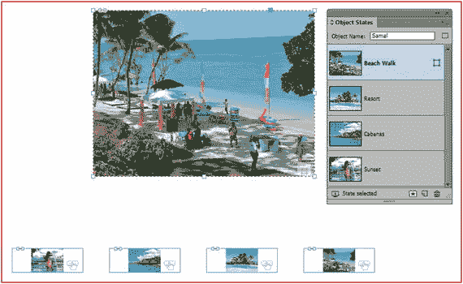

**图 9-4.** 为对象名称键入一个名称，并重命名每个状态的名称。

6. 设置默认视图。堆栈中的第一项通常会被选中，当 MSO 在页面上显示时，它将成为默认视图。要将视图更改为另一个状态，请点击您希望作为默认视图显示的状态。

> **注意：** 当您在`对象状态面板`中点击某个状态时，没有用于确认操作的`确定`按钮。您只需点击，该状态便会成为默认状态。

## 9.3 编辑 MSO

在图 9-1 中，您会看到一些用于编辑 MSO 的选项。我为每个菜单命令提供了简要说明，但现在我们要更详细地探讨其中一些选项。在处理 MSO 时，您可能需要移除状态、添加状态、编辑状态的内容，或者添加一些空内容，以使 MSO 中的某个状态显示为空。让我们从更深入地研究这些任务开始。

### 9.3.1 删除状态

在图 9-5 中，您可以看到一个 MSO 以及在`对象状态面板`中被选中的最后一个状态。与`对象状态面板`相对应，您还可以看到文档中正在查看的状态。

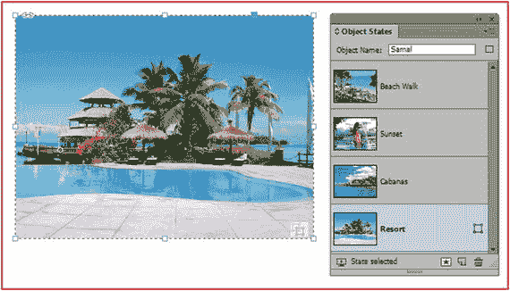

**图 9-5.** MSO 中的最后一个状态被选中。

如果您想移除底部的状态，有两种方法可以处理状态的删除。理解这两种选项及其作用对您来说很重要。

如果您点击面板中的垃圾桶图标，或打开`对象状态`菜单并选择`删除`，或者右键点击该状态并选择`删除`，则该状态将从 MSO 中被永久删除，同时该对象也会从您的文档中被删除。除非您按 `Ctrl/⌘+Z` 撤销此操作，否则无法恢复。如果您绝对确定要从文档中删除该状态/对象，这样做没问题。

另一种移除状态的方法是，选中该状态，然后在`对象状态面板`菜单中选择`将状态释放为对象`，或者右键点击该状态并选择`将状态名称释放为对象`，其中 `state name` 是对象状态的名称。使用此方法时，该状态会从 MSO 中移除，但状态会转换回对象并保留在文档中。因此，第一种方法是从文档中彻底删除该状态，而第二种方法则是移除状态但保留文档中的内容。

> **提示：** 如果您不确定是否要从文档中删除某个状态/对象，并且想将其暂时保留，以防以后可能重用，可以创建一个新图层并将其命名为类似 `Not Used` 的名称。将释放的状态对象移至该图层，并在**图层面板**中隐藏该图层。该对象会保留在您的文档中，但会从布局中隐藏。您可以随时前往该图层，将该对象移动到另一个可见的图层中。

### 9.3.2 将状态释放为对象

当我们选中一个状态并在**对象状态面板**中选择**将状态释放为对象**时，我们知道会发生什么。该状态会转换为一个对象，并保留在文档中。假设您想重新开始。比如说，您需要做大量工作来编辑 MSO 内的对象，并且您想添加新状态，也许还要删除一些其他状态。

重新开始的方法是将所有状态都转换回对象。为此，请选中 MSO，然后在**对象状态**菜单中选择**将所有状态释放为对象**。这些状态会转换为对象，并像您创建 MSO 时一样，相互堆叠在相同的位置。在图 9-6 中，您可以看到左侧有一个 MSO，右侧是将其所有状态释放为对象后的效果。

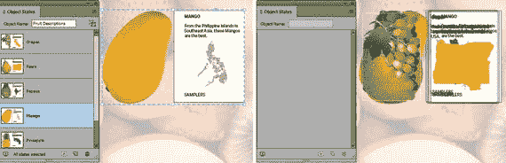

**图 9-6.** 选中一个 MSO，然后选择**将所有状态释放为对象**。

从这里开始，您可以移动这些对象、进行编辑、向 MSO 添加新对象以及删除对象。编辑完成后，只需选中所有对象，然后点击**将所选内容转换为多状态对象**按钮，或者在**对象状态面板**菜单中选择**新建状态**。

### 9.3.3 添加新状态

假设您正在处理一个布局并创建了一个 MSO。之后，您意识到还有另一个状态要添加到该 MSO 中。这个状态可能是包含更多内容的状态，或者您可能希望将默认视图设置为空白视图，以便内容仅在用户点击按钮时才出现。

我们以空白状态为例。在 MSO 可见的情况下，在该 MSO 上方绘制一个无描边且无填充的框架。框架可以很小，并且不需要占据 MSO 的整个边界区域。

同时选中 MSO 和该框架，然后点击**对象状态面板**中的**将所选内容转换为多状态对象**按钮，或者打开菜单并选择**新建状态**。该框架将作为新状态添加到 MSO 中。您可以重复使用此方法向 MSO 添加新状态。

> **注意：** 当您选中对象并查看**对象状态面板**底部的按钮时，工具提示显示为**将所选内容转换为多状态对象**。当您向现有 MSO 添加新状态时，工具图标会变为一个左下角带有 `+` 符号的空白页面，并且工具提示显示为**将对象添加到可见状态**。

如果您创建了一个空白状态，并希望它作为默认视图显示，请在**对象状态面板**中将该状态拖到堆栈顶部并选中它，如图 9-7 所示。当用户打开文档时，添加了 MSO 的位置不会显示任何内容。如果您为查看不同状态分配了按钮，则每次点击按钮时都会看到相应的状态。

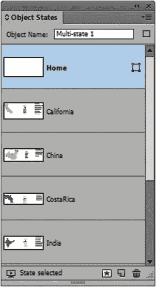

**图 9-7.** 默认状态为空，并显示在堆栈顶部。

### 9.3.4 选择状态中的内容

假设在某个给定状态下有多个不同的对象，而您想删除这些对象或修改它们的外观。当您点击 MSO 时，您选中的是 MSO 本身。双击，您会选中 MSO 中当前选中状态内的一个对象。如果某个给定状态下有多个对象，按下 `Shift` 键并再次点击，您可以选中两个对象。如果您再次按下 `Shift` 键并点击，则前两个对象会被取消选中，而第三个对象会被选中。InDesign 不允许您通过 `Shift`-点击在某个给定状态下选中超过两个对象。

假设您在地图上有许多图钉，而您想更改这些图钉的外观或调整它们的大小。选择对象的最佳方式是在**图层面板**中。当然，这意味着您需要有组织良好的图层，并且图层应使用描述性名称进行命名。

打开**图层面板**，点击图层名称最右侧的框，或者按下 `Alt/⌥` 键并点击图层名称以选中该项目，如图 9-8 所示。要选择多个对象，请在点击图层名称右侧的框或按住 `Alt/⌥` 键点击图层名称时，同时按下 `Shift` 键。

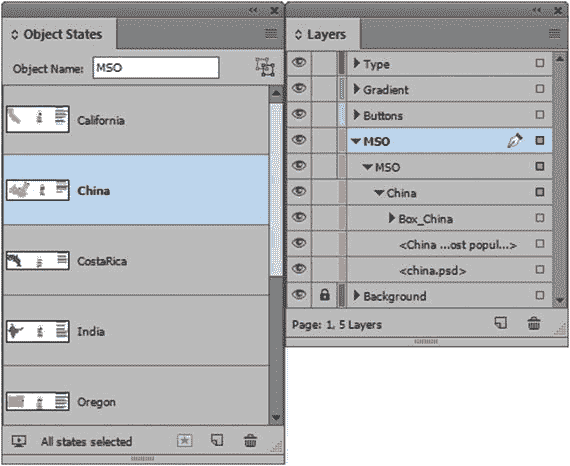

**图 9-8.** 在**图层面板**中点击图层名称最右侧的框以选中该对象。

> **注意：** 当您按下 `Alt/⌥` 键并点击图层名称时，您会选中目标图层上的所有内容。如果您需要选择图层上的单个对象，请在**图层面板**中展开以查看单个对象，然后`Shift`-点击各个对象，或者按下 `Alt/⌥` 键并点击每个对象名称。

### 9.3.5 将内容粘贴到 MSO 中

这项任务你会经常用到，尤其是在创建嵌套 MSO 时，稍后我将在“创建嵌套 MSO”一节中解释这一点。如果你复制了一个对象或文本框，打开`对象状态面板`，选择一个特定状态，然后点击`对象状态面板`右下角的`将复制的对象粘贴到所选状态`按钮，如图 9-9 所示。

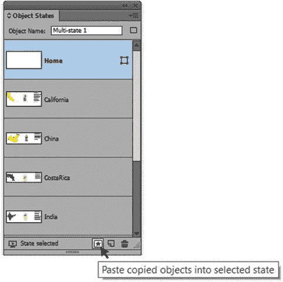

**图 9-9.** 点击`将复制的对象粘贴到所选状态`，将剪贴板上的内容粘贴到该状态中

当你只有一个对象要粘贴到某个状态时，这种方法很好用。在文档中查看该状态，并将对象放置在你希望它在状态中显示的位置。选择`编辑` ➤ `剪切`，将对象剪切到剪贴板。在`对象状态面板`中选择该状态，然后点击按钮粘贴对象。

然而，当你想要将多个对象粘贴到某个状态时，可能会遇到问题。如果你将对象放置在你希望它们在状态中显示的位置，并使用相同的方法进行剪切并点击`将复制的对象粘贴到所选状态`，最终结果会是粘贴后的对象并未出现在你预期的位置。

为了将多个对象精确添加到指定位置，你需要采用不同的方法：

- 将对象移动到它们应该出现的位置，但不要复制或剪切。
- 选中对象后，按住 `Shift` 键并点击 MSO（确保在选中 MSO 时，其边界框上出现虚线），如图 9-10 所示。

    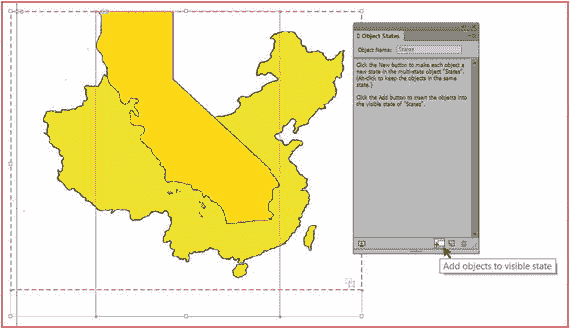

    **图 9-10.** 选择对象和 MSO

- 当包括 MSO 和目标状态在内的所有对象都在`对象状态面板`中可见时，将光标移到`对象状态面板`中的按钮上。注意，工具提示现在显示为`将对象添加到可见状态`。
- 点击该按钮，对象就会被添加到`对象状态面板`中所选的状态中。

当你想要将按钮添加到各个状态时，这个方法尤其有用。这些按钮仅在特定状态可见时才处于活动状态。

## 9.4 创建按钮以更改状态视图

除非你能更改视图以查看堆栈中的其他状态，否则 MSO 的价值不大。要更改视图，你可以创建一个可以循环浏览每个状态的单个按钮，或者创建多个单独的按钮来查看各个状态。例如，假设你想设置一个类似幻灯片的功能。你可以创建一个按钮，当读者单击或点按该按钮时，它会逐个推进各个状态。你也可以使用图片的缩略图，并将每个缩略图转换为一个按钮。当读者单击或点按某个按钮时，该缩略图对应的大图就会显示出来。

在按钮点击时显示不同状态的选择，是在`按钮和表单面板`中处理的。当你选择一个对象并打开`按钮和表单面板`时，点击`转换为按钮`图标（面板右下角），或者从`类型`菜单中选择`按钮`。然后，点击`按钮和表单面板`中的`+`图标，打开一个包含多个选项的菜单，如图 9-11 所示。

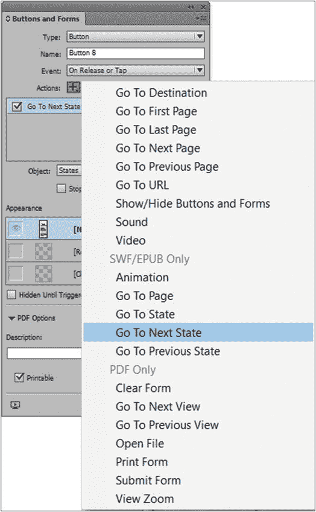

**图 9-11.** 点击`+`图标打开`动作`菜单

对于 MSO，你可以选择的选项是`转到下一个/上一个状态`或`转到状态`。如果你选择`转到下一个状态`，读者单击或点按一个按钮即可查看下一个状态。再次单击/点按，则会打开下一个状态，依此类推。这样一来，只需要一个按钮就能推进状态视图。如果你选择`转到状态`，则该动作会显示分配给特定按钮的状态。此行为旨在配合多个按钮使用，每个按钮分配不同的状态视图。

### 创建分配了独立状态的按钮

要创建分配了独立状态的按钮，请按照以下步骤操作：

1.  创建一个 MSO。
2.  按照前面“创建多状态对象”一节中的步骤，在 InDesign 页面中添加一个 MSO。创建你想要用作按钮的图标或文本，以便查看各个状态。将第一个对象转换为按钮。在我的示例中，我使用了图 9-12 中文档左侧的苹果切片作为按钮。选择第一个对象，打开`按钮和表单面板`。从`类型`菜单中选择`按钮`（或点击面板底部的`转换为按钮`图标）。为按钮输入一个名称。

    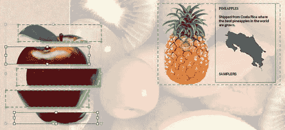

    **图 9-12.** 创建你想要用作按钮的独立对象或文本

3.  设置按钮动作。
4.  点击`+`图标打开`动作`菜单，并选择`转到状态`。如果你希望一个按钮能循环浏览不同的状态，请选择`转到下一个状态`。

5. 选择对象和状态。默认情况下，如果你的跨页上只包含一个 MSO，则该 MSO 会以其名称显示在`对象`菜单中。当你使用不同的按钮来打开不同的状态时，你需要在`状态`菜单中指定对应的状态。在我的示例中，对象名称为`水果描述`，顶部的按钮显示名为`葡萄`的第一个状态。第二个按钮设置为打开名为`梨`的下一个状态，依此类推。每个状态都在`状态`菜单中被选中。`状态`菜单仅在您使用`转到状态`动作时可用。如果您选择`转到下一个状态`，则无法在`状态`菜单中选择不同的状态。InDesign 会假定您想循环浏览各个状态。

6. 完成其余按钮的分配。同样，如果你有多个用于查看不同状态的按钮，请对剩余按钮重复相同的步骤（步骤 3 到步骤 5）。如果你只有一个设置为`转到下一个状态`的按钮，并希望用它来循环浏览不同的状态，那么你在`按钮和表单面板`中的工作就完成了，可以准备预览了。

7. 预览文档。点击`按钮和表单面板`左下角的`预览跨页`图标。在`EPUB 交互预览`窗口中，点击按钮以确保其工作正常。

## 9.5 创建嵌套 MSO

假设你有一个 MSO，其中包含欧洲之旅的各种状态。你有一些图片和文字，展示了意大利、法国、英国和德国的不同地点。当你点击意大利的按钮时，会显示一张图片和一段文字（或者该状态中的任何内容）。假设你想展示你参观过的一些景点，但仅限于意大利境内的景点。你创建了第二个 MSO，其中包含罗马斗兽场、万神殿、比萨斜塔、梵蒂冈博物馆等的图片和描述。在这种情况下，你将有一套按钮用于选择不同的国家，另一套按钮用于浏览单个国家对应的内容。

### 9.5.1 在一个多状态对象内粘贴另一个多状态对象

尽管本节标题暗示你可以将一个多状态对象（MSO）粘贴到另一个多状态对象内部，但在处理 MSO 时，你无法使用 `编辑` ➤ `粘贴入` 命令。你需要使用其他方法在 MSO 内部粘贴 MSO。

在此示例中，我们需要嵌套 MSO，以便通过点击按钮切换到下一个州/省，从而查看各个国家/地区内的不同站点。使用我在上一节（“创建用于切换状态视图的按钮”）中讨论的示例，我们将使用相同的 MSO，并针对不同的水果（而非国家/地区）创建第二个 MSO。

**嵌套多状态对象**

要嵌套 MSO，你需要使用一点小技巧。具体操作如下：

1. 在 InDesign 文档中创建一个 MSO。对于此示例，我们使用在“创建用于切换状态视图的按钮”一节中创建的第一个 MSO。

2. 为第二个 MSO 创建内容。如果页面上有背景元素，请使用`图层面板`并隐藏背景。为第二个 MSO 的内容创建一个新图层。添加对象、文本或两者，并将每个对象编组。创建要在新 MSO 中使用的其他内容。使用`对齐面板`对齐对象。

3. 创建第二个 MSO。选择对象，然后从`对象状态面板`菜单中选择`新建状态`，或单击面板中的`将所选内容转换为多状态对象`图标。此时，你可能会认为可以直接剪切第二个 MSO，选择你想要它出现的状态，然后从`编辑`菜单中选择`粘贴入`。但不幸的是，当你剪切或复制 MSO 时，`粘贴入`命令是不可用的。

4. 将 MSO 锚定到一个空文本框架。你应该打开`对象状态面板`并选择要用于第二个 MSO 的状态。将第二个 MSO 定位在你希望它在第一个 MSO 内出现的位置。创建一个文本框架——一个没有描边、没有填充、没有文本的小框架。单击第二个 MSO，然后从锚点拖动到空文本框架，如图 [9-13] 所示。

    

    **图 9-13.** 将第二个 MSO 锚定到一个空文本框架

5. 剪切文本框架。

6. 选择文本框架，然后选择`编辑` ➤ `剪切`或按 `Ctrl/⌘+X`。剪切文本框架时，MSO 也会被剪切，两者都将被放入剪贴板。

7. 将剪贴板内容粘贴到选定的状态中。

8. 不使用`编辑` ➤ `粘贴入`命令，而是单击`对象状态面板`中的`将复制的对象粘贴到选定的状态`按钮（参见图 [9-14]）。确保在`对象状态面板`中选中了要粘贴到的目标状态。

    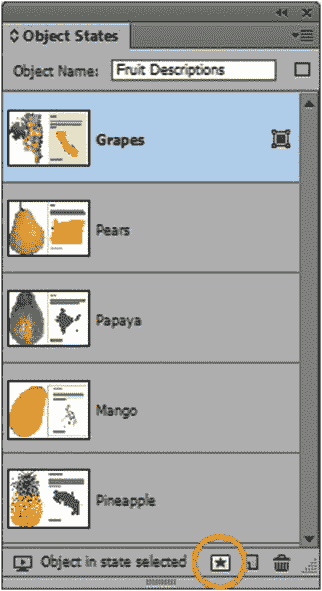

    **图 9-14.** 单击`将复制的对象粘贴到选定的状态`

9. 添加按钮以查看第二个 MSO 中的不同状态。在图层堆栈的顶部创建一个新图层。为“下一个”和“上一个”视图按钮绘制框架。如果你在 MSO 的状态中已有显示按钮点击方向的美术字，例如左右箭头，你可以创建无描边和无填充的框架并将其转换为按钮。如果状态中没有美术字，请创建或导入一个图形并将其转换为按钮。

10. 重复相同的步骤（步骤 2 到 7）以添加 MSO 并将其锚定到第一个 MSO 中的不同状态。

### 9.5.2 为嵌套的 MSO 添加按钮

创建嵌套的 MSO 后，下一步是添加用于更改第二个 MSO 状态视图的按钮。你可以创建`转到下一个状态`和`转到上一个状态`按钮，或者创建一个可以循环到下一个状态的按钮。在这方面，MSO 会循环遍历其状态。

**为嵌套的 MSO 添加按钮**

1. 第一步是创建按钮，但不用担心为按钮添加任何事件。你需要在完成向 MSO 添加按钮后处理动作。要将按钮放入给定的状态，你需要将按钮定位在你希望它们作为活动区域的位置，然后选择`编辑` ➤ `剪切`。

2. 打开`对象状态面板`，单击要添加按钮的状态。如果你有多个状态并想添加一个`下一项`和`上一项`按钮，则需要将它们添加到每个状态中。

3. 将按钮放在剪贴板上后，单击`对象状态面板`中的`将复制的对象粘贴到选定的状态`按钮。

4. 单击面板中的下一个状态，然后使用`对象状态面板`中的同一按钮粘贴对象。

5. 将所有按钮粘贴到各个状态后，你需要分配按钮动作。对于每个按钮，你需要根据按钮类型添加`转到下一个状态`或`转到上一个状态`动作。

你可以在图 [9-14] 中看到我的示例。默认视图在右侧显示加利福尼亚州的地图。在“Samplers”一词上有一个可以打开嵌套 MSO 的按钮。在嵌套的 MSO 上，我们有覆盖整个状态的不可见按钮，以便用户点击或轻触时，他们会看到下一个状态。在此示例中，当用户点击加利福尼亚州地图时，右侧会变为“Robotic Farming”，如图 [9-15] 所示。

**图 9-15.** 嵌套 MSO 在 MSO 右侧显示并前进到下一个状态时的外观

## 9.6 显示/隐藏对象状态

到目前为止，你已经学会了如何创建 MSO（多状态对象）以及如何通过按钮触发事件。你现在知道如何前往一个给定的对象状态，也知道了如何在 MSO 中切换到下一个状态。然而，到目前为止你所完成的操作，都是在按钮事件上显示一个对象状态，但当点击另一个按钮时，你还没有隐藏之前显示的对象状态。为了更清楚地说明这一点，请查看图 9-16。

**图 9-16.** 设计中的窗口是按钮

当你点击一个按钮时，一个图形会出现在相应的窗口中。继续点击按钮，每个窗口都会显示一张图片，如图 9-17 所示。

**图 9-17.** 当用户点击每个按钮时，窗口中出现图片

在这个特定的设计中，最好将文件设置为在每个相应的窗口中仅显示一张图片。当用户点击一个按钮时，之前的图片被隐藏，同时新图片出现。这样，当用户与文档交互时，只有一张图片是可见的。

### 创建只有单个状态可见的状态

要创建一个页面上只有单个状态可见的效果，请执行以下操作：

1. 正确设置文件。对于这类文档，最好使用图层。在本例中，我有一个用于空窗口的图层，一个用于已占用窗口的图层，以及一个包含其余素材的背景图层。

2. 在图片旁边绘制一个空框架（无描边和无填充）。

3. 选择该框架和图片。（见图 9-18。）

    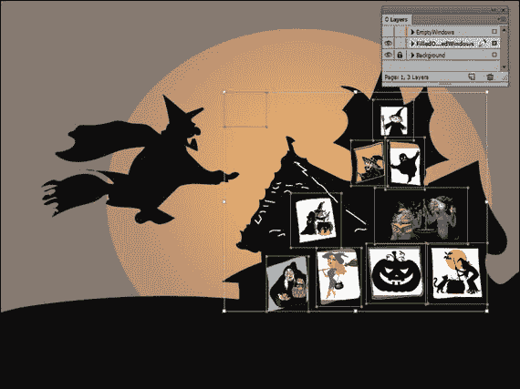

    **图 9-18.** 选择空框架和图片

4. 创建一个 MSO。

5. 命名不同的状态。在本例中，我使用从顶部开始的数字 1-9 来命名，如图 9-19 所示。将空状态命名为`Empty`、`Home`或任何容易识别为空白状态的名称。

    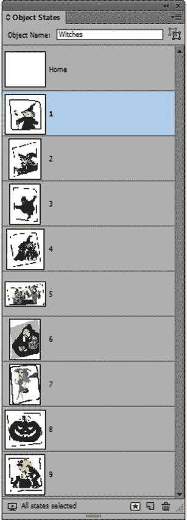

    **图 9-19.** 已命名的对象状态

6. 选择每个窗口并将其转换为按钮。

7. 从第一个按钮开始，将按钮操作设置为`Go to State`，并从`State`下拉菜单中选择`1`，如图 9-20 所示。

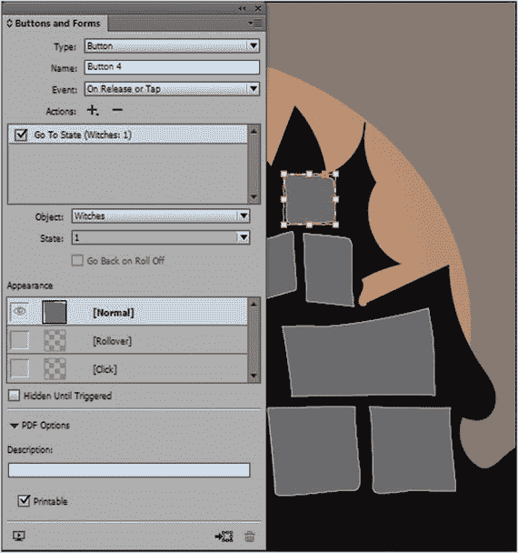

**图 9-20.** 将每个窗口转换为按钮，并将操作设置为`Go To State`

8. 继续将其余的空窗口转换为按钮，并将操作设置为`Go To State`。

当用户点击一个按钮时，该按钮下方的图片就会出现。当用户点击第二个按钮时，前一张图片被隐藏，同时新图片进入视野。

## 9.7 总结

在本章中，我们学习了多状态对象。你学会了如何创建 MSO 以及如何通过添加、更改和删除特定状态来编辑它们，如何添加空白状态，以及如何设置默认状态。你还学会了如何嵌套 MSO、将 MSO 锚定到文本框架以及粘贴到状态内部。

关于 MSO 的使用还有很多东西要学。一旦你熟悉了创建和设置 MSO 属性，你就会发现它们可以应用于固定版式 EPUB 和`Publish Online`文档的许多用途。

在下一章中，你将学习如何在 InDesign 文档中包含富媒体（视频和音频）。