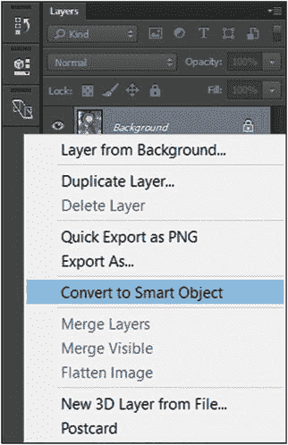
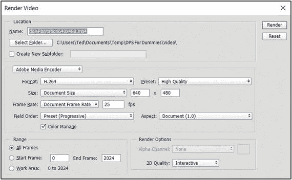
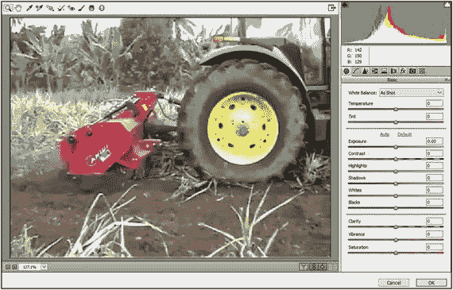
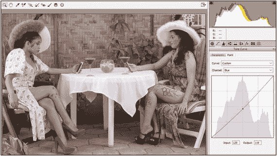
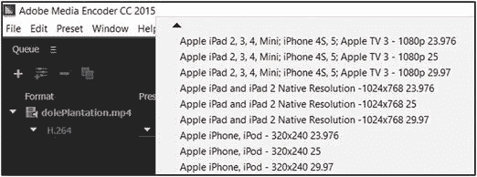
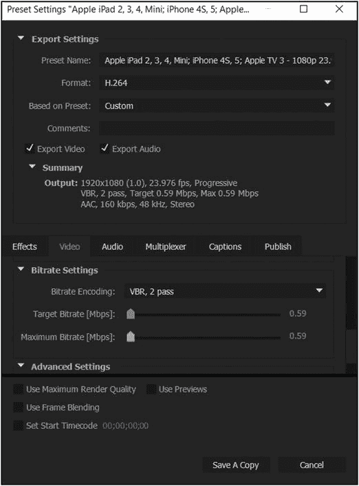
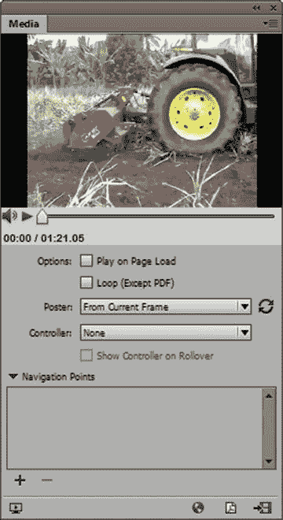
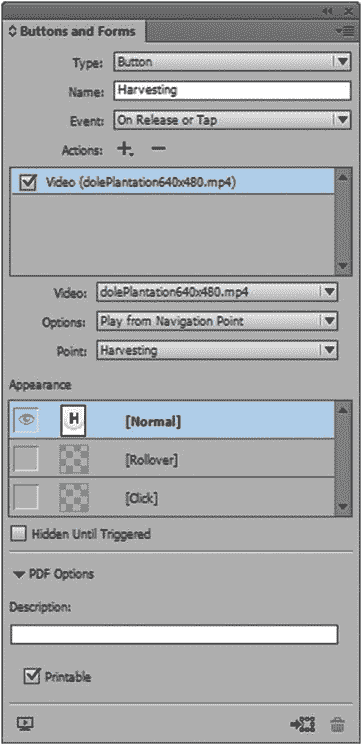
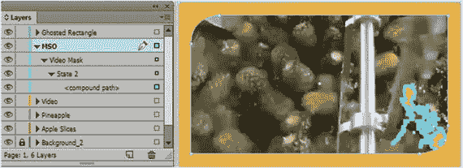

# 10. 使用富媒体

你可能会认为使用音频和视频是一项简单的任务，因为 InDesign 可以轻松导入音频和视频。然而，在数字出版方面，如果你不是视频专家，确实有很多东西需要学习。

你需要熟悉使用正确的媒体格式、如何裁剪视频上那些难看的黑条、为视频添加海报帧、将视频压缩到尽可能小的尺寸、为视频添加遮罩等等。在本章中，我将介绍如何准备你的媒体，并提供一些技巧，以便在为导出为各种格式时获得最佳效果。

## 10.1 准备媒体

如果能够用智能手机或摄像机拍摄视频，将文件下载到电脑，放入 InDesign，然后导出为你想要用于数字出版文档的格式，那就太好了。然而，现实是，在拍摄视频后，在将文件放入 InDesign 之前，你还有一些工作要做。

### 10.1.1 使用正确的媒体格式

简单地说，在准备媒体时，你应该使用两种文件格式。这些文件格式包括：

*   **音频：** 在你的出版物中使用音频文件时，只有一个选择。你必须将文件保存为`.mp3`格式。如果你有`.aiff`、`.wav`或其他格式，你需要将音频转换为`.mp3`。
*   **视频：** InDesign 支持 Flash `FLV`、`F4V`和`SWF`格式。但是，Apple 用户无法在其 iOS 设备上查看这些内容。你可以使用的最佳格式，并且是支持查看视频文件的所有设备均可使用的格式，是采用`H.264`编码的`MP4`或`M4V`格式。

如果你有媒体文件，可以使用 Adobe Creative Cloud 应用程序将大多数音频和视频格式转换为可接受的格式。对于音频文件，你可以使用 Adobe Audition 或 Adobe Media Encoder 转换文件。有关使用 Media Encoder 的更多信息，请参阅本章后面的“使用 Adobe Media Encoder”部分。如果你不是 Creative Cloud 订阅者，可以通过在互联网上搜索找到一些免费的音频转换应用程序和价格适中的应用程序。

转换视频最好使用 Adobe Media Encoder。但是，你需要是 Creative Cloud 订阅者才能使用 Media Encoder。与音频转换器类似，你也可以通过互联网搜索找到许多不同的视频转换应用程序。

> **注意：** 仅对音频文件使用`.MP3`格式，对视频文件使用采用`H.264`编码的`MP4`或`M4V`格式。

### 10.1.2 旋转视频

你可能有一些用智能手机拍摄的视频文件，这些视频可能是以竖屏模式拍摄的。当你预览视频时，它显示为旋转状态。你可以使用 Adobe Photoshop 轻松解决此问题。

- **在 Photoshop 中打开视频：** 要理解视频是由一系列不同的帧组成的。如果你尝试进行一些调整（例如在某一帧上绘画），则该调整仅应用于相应的帧。你可以裁剪一帧，并且该裁剪操作会应用于后续所有帧。不过，在某些情况下，你可能想要使用智能对象来确保所有编辑都应用于所有帧。
- **将视频图层转换为智能对象：** 当你在 Photoshop 中对视频进行调整时，需要将视频转换为智能对象。要执行此操作，请在“图层”面板中右键单击视频文件，然后选择`转换为智能对象`，如图 10-1 所示。

    

    **图 10-1.** 将图层转换为智能对象
- **变换视频图层：** 此时，你可以使用 Photoshop 的变换工具来旋转视频。选择`图像` ➤ `旋转`，然后根据所需的旋转方向选择`90°顺时针`或`90°逆时针`。
- **渲染视频：** 完成编辑后，选择`文件` ➤ `导出` ➤ `渲染视频`。在`渲染视频`对话框中，选择视频的格式和大小，如图 10-2 所示，然后单击`渲染`。

    

    **图 10-2.** 设置视频导出属性并单击`渲染`以渲染视频

请注意，从 Photoshop 渲染的视频在导出的文件中会带有一些开销。从 Photoshop 导出视频后，你应该始终使用 Adobe Media Encoder 来压缩视频并减小文件大小。

### 10.1.3 编辑视频

假设你想要调整视频的亮度、色彩校正和对比度，或者想要将视频从 RGB 色彩转换为灰度并应用棕褐色调。对这些类型的调整，最佳解决方案是使用 **Adobe Photoshop**。像 Adobe Premiere 和 Adobe After Effects 这样的程序可以帮助你制作出一些惊艳的效果，但这需要深入学习新的应用程序。如果你是 Photoshop 用户，那么你可以直接在 Photoshop 中轻松完成所需的大多数调整。

当你在 Photoshop 中打开视频时，必须将图层转换为智能对象，正如我在上一节“旋转视频”中讨论的那样。对于亮度和对比度调整、色彩校正，甚至将视频转换为灰度，最佳方案是使用 Camera Raw 滤镜。一旦视频被转换为智能对象，选择 `滤镜 ➤ Camera Raw 滤镜`。Camera Raw 滤镜将打开，如图 10-3 所示。

图 10-3. 将视频图层转换为智能对象后，打开 Camera Raw 滤镜

如果你之前没有使用过 Camera Raw 滤镜，第一次打开时，这个对话框可能会看起来很复杂。但是，在这个窗口中你只需要处理少数几个调整选项。这些调整包括：

*   **色温**：向左或向右移动色温滑块，可以使视频看起来偏冷或偏暖。在某些情况下，这里没有绝对的对错。你只需要让视频呈现出你想要的视觉效果。在其他情况下，你可能会发现某个视频确实需要调暖或调冷。使用此滑块进行调整。
*   **曝光**：你可能会有一个在黄昏或夜晚拍摄的视频片段需要稍微提亮，或者有一个过曝的视频片段需要稍微压暗。向左或向右移动曝光滑块来调整曝光。
*   **对比度**：要增加对比度，请将滑块稍微向右移动。要降低对比度，请将其向左移动。注意不要过度增加或减少对比度。
*   **高光与阴影**：我把这两个调整选项放在一起，因为几乎每个图像或视频片段都需要调整高光和阴影。高光可能是云层等视频片段中最亮的区域。阴影可能是风景中的树木，其阴影区域丢失了细节。将高光滑块向左移动以增加亮部区域的细节，将阴影滑块向右移动以突出暗部区域的更多细节。

> **注意**：照片或视频片段中最亮和最暗区域之间的度量称为动态范围。市面上最好的单反相机和摄像机拥有大约 10 档光圈的范围。人眼的动态范围约为 18 档光圈。因此，所有用于捕捉静帧和视频片段的数码设备都会截断媒体文件中最亮和最暗的区域。通过使用高光/阴影调整，你可以恢复一些通常能改善媒体文件的丢失数据。

*   **清晰度、鲜艳度和饱和度**：向右移动滑块以增加中间调、鲜艳度和饱和度。数字出版相对于印刷品的一个优势是所见即所得（WYSIWYG）。进行在屏幕上看起来不错的调整。你将在查看你作品的所有设备上看到类似的结果。
*   要将 RGB 视频片段转换为灰度，只需将饱和度滑块向左移动到头，以降低颜色饱和度。

#### 应用棕褐色调

要应用棕褐色调，请在降低片段饱和度后，单击右上角的色调曲线图标。

1.  单击“点曲线”选项卡，然后从“通道”菜单中选择“红色”。
2.  单击对角线中间，并在“输出”文本框中输入 `141`。
3.  从“通道”菜单中选择“绿色”，然后单击线条中间的一个点。
4.  在“输出”文本框中输入 `131`。
5.  从“通道”菜单中选择“蓝色”，然后单击线条中间的一个点。在“输出”文本框中输入 `119`。（参见图 10-4。）

图 10-4. 在“色调曲线”选项卡中对每个通道进行调整

这些调整为你提供了在视频上创建棕褐色调效果的起点。你可以调整色调曲线点来加深或减淡棕褐色效果。

在 Camera Raw 转换器中完成调整后，单击“确定”，然后选择 `文件 ➤ 导出 ➤ 渲染视频`。

### 10.1.4 裁剪视频

视频的两侧、顶部和底部出现了那些讨厌的黑条。如何去除它们？你可以使用以下两种方法之一来裁剪视频：

1.  在 Photoshop 中打开视频。使用裁剪工具裁剪视频，然后使用 `文件 ➤ 导出 ➤ 渲染视频` 导出视频文件。
2.  你也可以在 InDesign 中裁剪掉视频上任何不需要的侧边栏。移动包含视频的框架手柄来裁剪视频。如果使用此方法裁剪，你可能会丢失控制器，并且需要在布局中添加播放、暂停和停止视频的按钮。

如果你可以接受丢失控制器，请选择 `文件 ➤ 置入` 并导入一个视频片段。移动边界框以裁剪边缘，如图 10-5 所示。裁剪视频仅适用于固定布局的 EPUB，在 iBooks 和 Adobe Digital Editions 上均支持，并且当你导出到 Adobe Publish Online（预览版）时也适用。对于交互式 PDF 文件，如果你在 InDesign 中裁剪视频，则裁剪区域将不会在 PDF 文档中生效。为了在交互式 PDF 文档中移除裁剪区域，你需要在 Photoshop 中裁剪视频。

图 10-5. 在 InDesign 中裁剪视频

### 10.1.5 移动控制器

如果你将动画和动画表格转换为视频文件（正如我将在第 12 章中解释的那样），你可能希望将控制器向下移动一点，以便视频控制器不会遮挡最下面一行数据。你可以重新排列版式的 EPUB 中向下移动控制器，但此视图仅在桌面版电子书阅读器上生效。设备上的电子书阅读器会将控制器显示在视频顶部。要了解如何将控制器移动到视频下方，请参见第 12 章。

## 10.2 使用 Adobe Media Encoder

由于用户会下载你的出版物，你需要控制文件大小，避免过长的下载时间。你可能身处拥有 4G 网络的区域，下载速率可能超过 40 Mbps。但是，有些查看你作品的人可能生活在第三世界国家，甚至美国农村地区，那里仍在使用拨号连接。在以上两种情况下，带宽都很窄，连接速度可能比你习惯的速度要慢得多。因此，作为经验法则，请尽量将你的视频文件控制在每分钟小于 10MB，并在出版物中仅使用短视频片段。

### 10.2.1 选择预设

打开 Adobe Media Encoder 时，你会看到一个略显复杂的画面。这是因为其中有大量预设，允许你将视频导出为不同尺寸的多种设备，以及高清、标清等各种质量格式。

使用 Media Encoder 的第一步是导入视频。你可以点击“队列”字样正下方的 `+` 图标，也可以直接将视频片段拖拽到队列面板中。

将媒体文件加载到 Media Encoder 后，点击默认预设选项旁边的向下箭头即可选择预设，如图 10-6 所示。请选择一个你想用于导出视频的预设。

图 10-6. 从预设菜单选择一个预设

在 Media Encoder 窗口的左侧，你会看到预设浏览器。如果你选中某个预设并右键点击其名称，可以通过在弹出的菜单中选择“预设设置”来打开预设设置。我通常会对预设做一项调整。如果你滚动预设设置窗口，在窗口底部会找到比特率设置。你可以尝试降低目标比特率和最大比特率的值。将两者都设为 `0.59` 作为起始值，如图 10-7 所示。最终，你需要测试渲染结果，确保视频达到你期望的质量标准。

图 10-7. 右键点击预设浏览器中的预设，并选择“预设设置”以打开所选预设的设置

调整比特率时请务必谨慎。如果数值降得过低，视频画面会出现斑驳瑕疵，整体质量很可能无法令人满意。

选择预设并完成其他调整后，点击队列面板右上角的绿色右向箭头。Media Encoder 会在视频渲染时显示进度条。

### 10.2.2 保存预设

如果你对预设进行了更改（例如更改了比特率），你可能希望将这些设置保存为一个新预设。这样，每次想使用相同设置时，就无需再打开预设设置窗口进行调整。

要创建新预设，请在预设设置窗口（如图 10-7 所示）中进行调整，并为你的新预设输入一个描述性名称。你可以保留默认名称的一部分，然后在名称末尾添加一些文本，以便在长长的预设列表中轻松识别。在我的示例中，我使用了“Apple TV, iPad, iPhone, 3G and Newer – 360 Widescreen 29.5”预设，并将其重命名为“Apple iPad 360 Wide 0.5 Bitrate”。你必须先完成新预设的命名。如果在更改名称之前就选择“保存副本”，你将无法回头编辑名称。

更改新预设名称后，点击“保存副本”。屏幕上可能看不出太多变化，但副本已保存，并且会出现在左侧窗格预设列表的最顶部。导入一个视频并打开预设列表，你应该会看到新预设出现在菜单顶部。

为了让您了解我所实现的文件压缩效果，我的原始媒体片段在对“Apple iPad 360P Widescreen 23.9”预设进行调整后为 104MB。使用默认预设后，我将文件大小减小到 9.0MB。使用调整后的预设（降低了比特率）后，文件大小减小到了 6.5MB。我成功将视频大小比默认预设进一步减小了 2.5MB。考虑到用户下载您的数字出版物，这节省了相当大的流量。

## 10.3 使用媒体面板控制媒体

准备好视频后，你会发现将视频添加到数字出版物的后续步骤要轻松得多，也更有趣一些。

在 InDesign 中导入视频，就像导入其他内容一样。选择“文件” ➤ “置入”，选择一个视频，然后点击“确定”。你也可以从媒体面板导入视频。打开媒体面板：点击“窗口” ➤ “交互” ➤ “媒体”。媒体面板打开后，点击右下角的“置入视频或音频文件”按钮。

### 10.3.1 使用媒体面板

当你导入视频并打开媒体面板时，会看到所有可用于调整媒体片段播放方式的选项，如图 10-8 所示。

图 10-8. 导入视频后，你可以在媒体面板中选择多个选项

让我们看看使用媒体面板时你拥有的所有选项：

*   **选项**：如果你希望媒体在页面可见时自动播放，请勾选“载入页面时播放”复选框。你也可以通过按钮触发播放，或者让用户直接点击视频帧。如果你使用按钮，或者希望用户点击视频帧，则不要启用“载入页面时播放”复选框。你还可以选择循环播放媒体文件（反复播放）。如媒体面板中提示，媒体循环功能不适用于交互式 PDF 文件。

注：“载入页面时播放”功能在设备上不起作用。从 iOS 6 开始，苹果公司禁用了在页面加载时播放视频的功能，以保护那些按运营商流量计费的用户的利益。在大多数设备和电子阅读器上，你需要点击视频或播放控件才能播放视频。

**Poster**：海报图像是媒体剪辑的默认视图。海报图像可以从视频帧中派生。您可以选择`None`不使用任何图像，选择`Standard`（会显示一个难看的视频图标），或选择`From Image`。如果选择`From Image`，将打开一个对话框，您可以在其中定位并导入图像文件。在大多数情况下，您会希望使用视频帧，方法为选择`From Current Frame`。使用`Media Panel`（媒体面板）中预览区域下方的滑块，移动它直到找到您想用作海报图像的帧。当页面在查看器中加载时，海报图像会立即显示。当您找到帧后，点击`Poster`菜单右侧的圆圈图标。您也可以定位一个帧，打开菜单并选择`From Current Frame`，这也会将当前视图中的帧用作海报图像。

**Controller**：对于控制器皮肤，您有大量的选择。这些皮肤是出现在媒体剪辑底部的媒体控制器。如果您选择一些简单的皮肤（例如`SkinOverPlay`），控制器只有一个按钮——一个播放按钮和一个恢复按钮。请记住，如果在`InDesign`中裁剪视频，您会丢失控制器。当导出到`Publish Online`和`EPUB`时，网络浏览器和电子阅读器会使用它们自己的控制器。此处的设置仅适用于交互式 PDF。

**Show Controller on Rollover**：如果您使用控制器，则应勾选此框。当用户将鼠标悬停或点击媒体时，控制器会出现。将鼠标移开或点击视频框外部，则会关闭控制器。

**Navigation Points**：您可以向媒体剪辑添加标记，这些标记将在用户点击按钮时将其发送到某个位置。点击`+`图标，在当前视图中的帧上添加一个标记。滚动剪辑，并在相应位置添加另一个标记。

**Preview Spread**：您可以通过点击`Media Panel`（媒体面板）左下角的按钮，在`EPUB Interactivity Preview Panel`（EPUB 交互性预览面板）或`SWF Preview Panel`（SWF 预览面板）中预览跨页。要预览 SWF，请按住`Alt/⌥`键并点击`Media Panel`中的`EPUB Interactivity Preview`图标。

**Place a Video from a URL**：如果您有一个很大的媒体剪辑，不适合包含在出版物中，您可以让媒体从网站流式传输。点击此按钮，并在其中输入文件位置的 URL。

**Set Options for Exporting Interactive PDF**：在打开的对话框中，您的选择是：当出版物是交互式 PDF 文档时，使用`Adobe Reader`或`Acrobat`中的浮动窗口。如果您有 SWF 文件，请务必不要使用此选项。浮动窗口会布满 PDF 查看器的页面，您无法将其移动到想要的位置。

**Place Video or Audio File**：使用此按钮导入媒体。

> 注意：您可以导入音频文件以及以 MP3 格式保存的视频文件。

### 10.3.2 使用按钮控制导航点

导航点使文档的读者能够跳转到媒体剪辑中的不同部分。用户通常会点击分配给导航点的按钮。

使用按钮控制导航点

要了解如何完成此任务，请执行以下操作：

1.  将媒体剪辑导入`InDesign`后，为其添加导航点。请参见图 10-8 以帮助您添加导航点。
2.  在页面布局中，在媒体剪辑旁边创建按钮。这些对象可以是文本框、图像或同时包含文本和图像。如果同时使用了文本和图标或图像，请将这些项目编组。选中该对象后，打开`Buttons and Forms Panel`（按钮和表单面板），并从菜单中选择`Button`。
3.  将第一个按钮分配到一个导航点。在`Buttons and Forms Panel`（按钮和表单面板）中，点击`+`图标添加新动作。
4.  从菜单中选择`Video`，然后选择您要使用的视频剪辑。如果页面上只有一个视频，`InDesign`会默认使用当前视频。
5.  在`Options`菜单中，选择`Play from Navigation Point`。在`Point`菜单中，选择您希望与该按钮关联的导航点，如图 10-9 所示。

    

    图 10-9。

    从相应菜单中选择视频、选项和点
6.  重复相同的步骤（步骤 2-3）以向不同按钮添加类似的事件。请记住，您必须选择一个新按钮，然后分别向第二个、第三个等按钮添加动作。
7.  预览跨页。点击`Buttons and Forms Panel`（按钮和表单面板）左下角的`Preview`图标，在`EPUB Interactivity Preview Panel`（EPUB 交互性预览面板）中进行预览。

## 10.4 创建视频遮罩

也许你想为视频添加一个边框，或者让公司标志出现在视频上方。你可以通过创建视频遮罩来添加此类元素。需要注意的一点是，视频等互动元素应放置在自己的图层上。这并非必须，但会让你的 InDesign 工作轻松许多。

另一点需要注意的是，在创建复合路径或 MSO 时，同一图层上不应有任何其他对象。如果你在创建复合路径或 MSO 时意外选中了其他对象，情况会变得非常混乱。只需将不同对象放置在不同图层上，并在拼版时锁定图层，就能保持整洁。

## 创建视频遮罩

要了解如何创建视频遮罩，请遵循以下步骤：

1.  如果你希望设计中出现背景对象，请将它们添加到最底层图层，并将该图层命名为 `Background`。锁定背景层，然后创建两个新图层。将一个图层命名为 `Video`，另一个图层命名为 `MSO` 或类似名称。
2.  将遮罩放置在 `MSO` 图层上。在我的示例中，我使用了一个包含地图插图的边框框架，如图 10-10 所示。

    

    图 10-10.

    添加遮罩并将其放置在单独的图层上

3.  选中遮罩的所有对象，然后选择**对象** > **路径** > **建立复合路径**。创建复合路径就像制作一个甜甜圈，你可以透过中心看到东西。在我的示例中，边框和地图可以填充，而对象的其余部分是透明的。
4.  为路径着色。此步骤为可选。如果你想要颜色填充，请选中该路径，然后从**色板**面板中应用颜色。（只需选中对象，然后点击面板中你想要应用的颜色即可。）
5.  创建多状态对象。这是重要的一步。如果不创建 MSO，你将无法将遮罩移动到视频上方。
6.  在 `Video` 图层上导入视频。锁定所有其他图层，然后选中 `Video` 图层。接着选择**文件** > **置入**并导入视频。
7.  在**图层**面板中调整顺序。如果遮罩位于视频下方，你需要移动 `Mask` 图层，使其在图层面板堆栈中位于视频上方。
8.  设置视频在页面加载时播放。选中视频并打开**媒体**面板。勾选**加载页面时播放**复选框。
9.  预览结果。点击**媒体**面板中的**预览**图标。如果所有步骤都正确执行，你应该能看到视频在遮罩后面播放。在图 10-11 中，你可以看到我们示例的结果。

    

    图 10-11.

    播放视频时，它会出现在遮罩后面

如果你的遮罩覆盖了视频的底部，你将无法访问任何控制器皮肤。如果你希望用户能够播放、暂停和停止视频，可以添加按钮来执行这些操作。创建一个按钮并打开**按钮和表单**面板。点击 `+` 图标，然后从**动作**菜单中选择**视频**。如果你的设计中只有一个视频，默认视频会出现在**视频**菜单中。在**选项**菜单中，选择**播放**或其他你希望处理视频的方式。为不同的选项（如**暂停**、**停止**等）创建多个按钮。

## 10.5 添加多状态对象

如果你阅读过第 9 章，你就会知道 InDesign 中使用多状态对象的功能有多么强大。Adobe Systems 那些出色的软件工程师为 InDesign 用户提供了惊人的工具，使你能够创建出色的交互式文档。

在富媒体方面，你可以使用 MSO 来显示/隐藏视频。这为你提供了更大的版面空间，读者可以看到内容，并且只需点击一下按钮，就会出现一个类似弹出视频的窗口。读者观看视频后，可以关闭它并返回版面。

在图 10-12 中，我们有这样一个文档。页面底部的文本和图形与 **观看视频** 文字以及文字上方的一个按钮一起出现。

图 10-12.

在 **观看视频** 文字上方有一个播放按钮

当读者点击该按钮时，会打开一个视频。在图 10-13 中，你可以看到点击按钮的结果。MSO 包含一个空框架和一个带有透明黑色矩形的框架。矩形内部是视频。

图 10-13.

当读者点击按钮时，MSO 中的第二个状态打开

### 添加 MSOs

设置方法如下：

1.  创建两个框架，并将其中一个填充为黑色。
2.  对黑色框架应用一些透明度。使用**对象** > **效果** > **透明度**命令，调整黑色矩形的透明度。另一个框架没有填充和描边。当文档打开时，会显示**空状态**，隐藏黑色矩形和视频。
3.  为这两个矩形创建一个 MSO，并在**对象状态**面板中为其命名。选中这两个对象，打开**对象状态**面板，然后点击**创建新状态**按钮或从**对象状态面板**菜单中选择**新建状态**。
4.  绘制一个文本框架，并显示视频状态。在**对象状态**面板中，选中视频状态。在视频状态上绘制一个小文本框架。
5.  将视频锚定到文本框架。将视频锚点拖到文本框架上。要了解有关嵌套 MSO 的更多信息，请参阅第 9 章。
6.  剪切文本框架。在这种情况下，视频也会被剪切。
7.  将文本框架和视频粘贴到视频状态中。在**对象状态**面板中，点击**将复制的对象粘贴到选中状态**。请确保你在**对象状态**面板中选中的是正确的状态。在此示例中，视频状态被选中。
8.  创建一个按钮，范围从 MSO 顶部到 **观看视频** 文字上方。到目前为止，一切设置正确。但是，我们需要让读者在观看视频后能返回版面。这就是我们隐藏视频的地方。在视频遮罩的右上角有一个关闭框。我们将使用这个元素作为关闭按钮。
9.  设置按钮动作。在**按钮和表单**面板中，选择**转到状态**，然后选中**空状态**。当读者点击按钮时，视频和透明框架就会消失。

你可以使用图标或文本供读者点击以隐藏视频状态，但这整个过程有点复杂，我想尽可能简化它。

## 10.6 总结

在本章中，我们学习了如何将视频导入 InDesign，以及如何设置视频播放的各种属性。我们还学习了如何使用 MSO 和创建视频遮罩。

到目前为止，你已经学习了向 InDesign 文档添加交互性的多种方法。你可以使用 **EPUB 交互性预览面板**在 InDesign 中预览结果，但交互式文档的最终用途是在各种设备上查看这些文件。

在下一章中，我们将探讨将文件上传到查看设备的各种方法。

