# 11. 上传和下载文件

数字出版文档格式多样，可通过多种不同类型的阅读器查看，并且能在多种不同设备上访问。某些阅读器可以直接打开你复制到台式电脑、笔记本电脑和安卓设备上的文件。苹果的封闭生态系统阻止你将文件直接从电脑复制到 iOS 设备，除非使用第三方应用程序。因此，在创作完你的杰作后，接下来的问题是：“如何将文件放到设备上？”以及“如何将文件添加到我的应用程序中？”

当你在设备（尤其是在台式机和笔记本电脑上）启动应用程序时，大多数应用程序允许你在设备本地上使用 `文件 ➤ 打开` 命令来打开文件。当你使用平板电脑和移动设备时，你要么通过 Wi-Fi 连接，要么让平板电脑或移动设备的应用程序能够从设备的某个位置访问文件。

有许多不同的文件共享工具可供使用，以及多种不同的方法将文件放到设备上并使其能被阅读器识别。我不会在本章中涵盖所有选项，而是会介绍几种使用不同应用程序访问文件的流行方法。

在第 12 章中，我将讨论在各类`电子书`阅读器中预览 `EPUB` 文件。不过，在预览文件之前，你需要知道如何将文件放到设备上以便查看它们。在本章中，我将讨论电脑与设备之间的文件交换。

## 11.1 将文件从电脑传输到设备

为数字出版物准备文件通常在你的台式机或笔记本电脑上完成。整理好内容后，你需要将文件发送到可能查看你内容的设备应用程序。

根据你使用的电脑操作系统（Windows 或 `Mac OS X`），将文件上传到设备会存在一些特性和差异。

### 11.1.1 从非 iOS 设备传输文件

从 Windows 电脑向设备传输文件相对容易。几乎所有能通过电脑 USB 端口插入的设备，都会打开一个菜单，让你选择如何处理文件。就像插入 U 盘一样，你可以查看设备的内容。文件夹是可见的，只需将文件从电脑拖放到设备即可。同样的方法适用于安卓设备、`Kobo 电子阅读器`、亚马逊 `Kindle`、索尼 `电子阅读器` 以及巴诺 `Nook`。

更复杂的一步是知道将文件放置在哪个文件夹中，以便应用程序可以查看它。你的平板电脑上可能有存放 `图书`、`电子书`、`下载`、`数字版本`、`Amazon`、`Kindle`、`Kobo` 等的位置。有些`电子阅读器`可以访问几乎所有可能存储文件的位置，而其他`电子阅读器`则需要特定的目录位置。你可能需要打开你想要查看的阅读器，寻找一个`导入文件`的按钮。测试你是否能从多个不同的文件夹导入文件，并将文件从平板电脑复制到某个应用程序。四处摸索一下，你最终会找到为每个`电子阅读器`应用程序存储文档的正确位置。

### 11.1.2 将文件传输到 iOS 设备

你有几种方法可以将文件从电脑传输到 iOS 设备。

#### 11.1.2.1 使用 Apple iTunes

苹果在 `iTunes` 12 版本中做了许多更改，如果你运行的是最新版本的 `iTunes`，你可能会发现尝试将 `EPUB` 和 PDF 文件放入 `iBooks` 简直是一场噩梦。`iTunes` 中不再有`图书`选项卡，左侧也不再显示你的 iOS 设备。你无法像以前在早期版本的 `iTunes` 中那样同步书籍。即使你将 `EPUB` 和 PDF 文件添加到电脑上的 `iBooks` 中，你也很可能在设备上的 `iBooks` 应用中看到这些书籍时遇到问题。这真的非常令人沮丧。

与其花大量时间试图弄清楚这个烂摊子，我建议你绕过 `iTunes`，使用 `Dropbox`，正如我稍后在本章“使用 `Dropbox`”一节中所解释的那样。

## 11.2 使用 Android File Transfer

`Android File Transfer` 由谷歌开发，旨在为 `Macintosh` 用户提供一种将安卓设备连接到 `Macintosh` 电脑的方法。你可以从 [`https://www.android.com/filetransfer/`](https://www.android.com/filetransfer/) 下载这个免费应用程序。

安装 `Android File Transfer` 后，通过 USB 线将安卓设备连接到 Mac，然后启动该应用程序。当你需要在 `Macintosh` 上运行的 `InDesign` 中测试创建的文档，并希望将文件复制到安卓设备时，这个应用程序非常有用。一旦连接到电脑，你就可以访问文件和文件夹，如图 11-1 所示。你可以将文档拖放到安卓设备中（最大 4GB）。

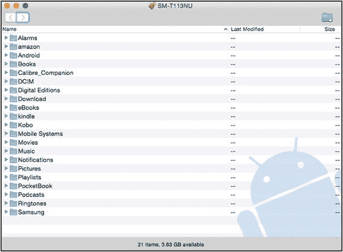

图 11-1. `Android File Transfer` 让你可以访问 `Macintosh` 上的文件和文件夹

### 11.2.1 使用 iExplorer

苹果的封闭生态系统阻止你访问 iOS 设备上的文件和文件夹。为了查看要将文件从电脑复制到 iOS 设备的目标文件夹，你需要一个第三方应用程序。`Macroplant` 出品的 `iExplorer` 能胜任此工作。你可以从 [`www.macroplant.com`](http://www.macroplant.com) 下载免费演示版。如果你想继续使用该程序，需要支付 35 美元购买许可证。

下载并安装 `iExplorer` 后，将你的 iOS 设备连接到 `Macintosh` 并启动 `iExplorer`。如图 11-2 所示，你可以访问 iOS 设备的文件和文件夹。你可以删除文件，并将文件从电脑拖放到 iOS 设备上的文件夹中。

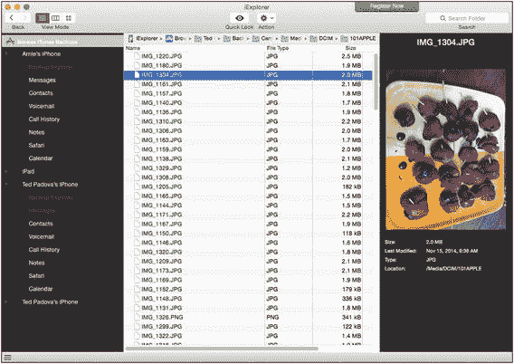

图 11-2. `iExplorer` 让你可以访问 iOS 设备的文件和文件夹

## 11.3 通过网址复制文件

在平板电脑和智能手机上运行的 PDF 阅读器中，通过网页浏览器传输文件是一种非常常见的方式。有趣的是，大多数第三方 PDF 阅读器都使用这种方法，而 Adobe 自家的 Adobe Acrobat Reader 却不支持通过网页浏览器传输文件。在平板或智能手机上使用 Adobe Acrobat Reader 时，你需要通过 Document Cloud、iCloud、Google Drive 或 Dropbox 访问托管在网站上的 PDF 文件。

如果你使用第三方 PDF 阅读器，可能会在应用中看到一个 Wi-Fi 图标，例如图 11-3 中 GoodReader 所示图标。系统会提供两种通过 URL 访问电脑的方法。

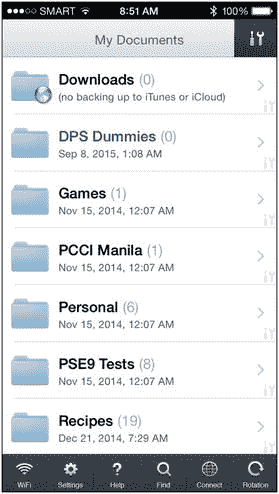

图 11-3. PDF 阅读器通常提供 Wi-Fi 传输选项，以便将 PDF 文件从电脑传输到 iOS 设备

点击 Wi-Fi 图标，会打开一个帮助屏幕，其中提供了将 iOS 设备连接到电脑的方法信息。如图 11-4 所示，你可以在电脑的网页浏览器中输入一个 IP 地址，或者访问一个 Bonjour 地址。

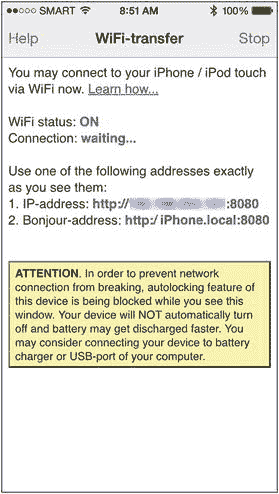

图 11-4. 帮助屏幕提供了如何将 iOS 设备与电脑连接的信息

请注意，这两种方法都提示你需要输入一个地址，并在其后加上 `:8080`。这是所有允许使用地址传输文件的应用的通用做法。

如果我们使用网页浏览器，那么在电脑上打开浏览器并输入应用帮助屏幕中提供的 URL。如果使用 Bonjour 地址，则前往 Mac 桌面，然后进入访达界面，按下 ⌘+K 或选择“前往”➤“连接到服务器”。使用 Bonjour 地址时，你无需担心需要在其他应用（如网页浏览器）中操作。一旦在“连接到服务器”对话框中输入地址，就会打开一个窗口，显示 PDF 阅读器文件所在位置，如图 11-5 所示。

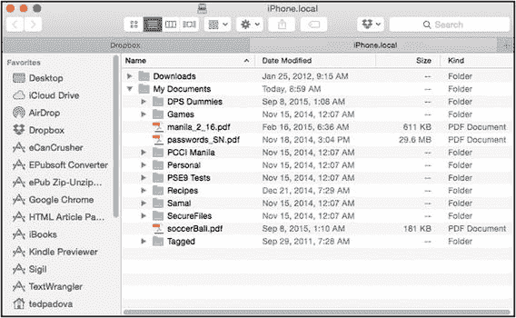

图 11-5. 使用 Bonjour 地址连接后，会打开一个新窗口，显示用于建立连接的应用中的文件

你还会发现该文件夹已挂载到你的硬盘上。因此，如果你有多个文件需要添加和/或编辑，这种方法可以让你更轻松地添加文件、更新文件和删除文件。

你看到的这个窗口就像任何其他文件夹一样。只需将文件拖放到已挂载的驱动器中，即可将它们添加到你的 iOS 设备。你也可以删除文件并重命名。你可以通过创建新文件夹并将文件嵌套在文件夹中来组织文件。请记住，在进行更改时，必须保持 Wi-Fi 传输屏幕（如图 11-5 所示）处于打开状态。

## 11.4 使用 Dropbox

Dropbox 是一款云存储应用，可让你在所有设备上共享文件。你可以在每台设备（电脑、平板电脑和移动设备）上安装 Dropbox。在选择云存储程序时，你有很多选项可选，例如 Apple 的 iCloud、Microsoft 的 OneDrive、JustCloud、ZipCloud 等等。在所有可用的云存储选项中，我认为 Dropbox 是最好的全能型服务，并且可以从 [`www.dropbox.com`](http://www.dropbox.com) 免费下载。

要在电脑与其他设备之间同步文件，你需要在电脑上下载并安装 Dropbox。你还需要在所有用于设备间传输文件的设备上安装 Dropbox。Dropbox 适用于 iOS、Android、Mac OS X 和 Windows。

### 11.4.1 使用 Dropbox 界面

要安装 Dropbox，请登录 Dropbox 网站 ([`www.dropbox.com`](http://www.dropbox.com)) 并回答几个问题（名字、姓氏、电子邮件地址并提供密码）。同意 Dropbox 条款并点击“注册”按钮。接下来你看到的屏幕会提供账户类型选择。你可以选择 Basic（免费）账户、Pro 账户（每月 9.99 美元）或 Business 套餐（允许五个或更多用户使用该账户，每位用户每月 15 美元）。对于免费账户，请确认已选中 Basic 项并点击“继续”。点击“继续”后，应用安装程序将自动下载到你的电脑。

一旦安装程序完成下载，双击安装程序并等待 Dropbox 完成安装。Dropbox 的操作方式与你电脑上的其他应用略有不同。你无需从“程序文件夹”（Windows）或“应用程序文件夹”（Macintosh）中启动它。相反，Dropbox 会向你的桌面添加一个文件夹。该文件夹看起来就像你电脑上的任何其他文件夹一样。但是，当你将文件拖放到该文件夹中时，文件就会被添加到云端，任何已登录 Dropbox 应用的移动设备都可以看到该文件。

**提示：** 对于 Macintosh 用户，你可以将 Dropbox 文件夹添加到文件夹视图的收藏夹列表中。将文件夹拖到打开的文件夹左侧列表中。当 Dropbox 显示为收藏夹时，你可以将文件拖到此项目上，或者点击以打开 Dropbox 文件夹，如图 11-6 所示。

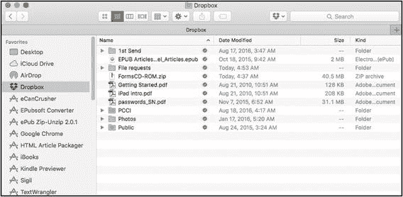

图 11-6. Dropbox 作为 Macintosh 上的收藏夹

为了从本地电脑上传文件，你需要登录你的 Dropbox 账户。当你通过网页浏览器登录时，屏幕中央会显示存储在 Dropbox 云存储中的文件，如图 11-7 所示。左侧是多个项目的链接，包括：

*   `Recents`：最近文件列表。
*   `Files`：点击“文件”，屏幕刷新并显示名称列下的文件。
*   `Team`：与他人协作。
*   `Paper`：与团队成员实时编辑。
*   `Photos`：点击此链接，即可打开一个幻灯片，展示您上传到 Dropbox 账户的照片。
*   `Sharing`：点击“共享”时，屏幕会发生变化，您会找到一个用于共享文件的按钮。您的账户可以有多个共享文件夹。点击该按钮，将弹出“共享文件夹”对话框。您可以选择共享新文件夹或向已有共享文件夹添加更多人员。做出选择后，点击“共享文件夹”对话框中的“下一步”按钮。随后您将进入一个屏幕，在该屏幕中您可以复制一个 URL 并通过电子邮件客户端发送，或者您可以选择让 Dropbox 发送一封电子邮件。电子邮件的收件人可以访问您添加到共享文件夹中的文件；即使没有 Dropbox 账户的用户也能访问这些文件。
*   您还可以右键单击计算机上 Dropbox 文件夹中出现的文件，然后选择“共享 Dropbox 链接”。选择此菜单命令后，链接将被复制到剪贴板。您可以打开电子邮件客户端并将链接粘贴到新邮件中。同样，收件人无需 Dropbox 账户即可访问文件。
*   `Links`：这与共享类似。当您共享链接时，链接的收件人可以点击查看内容并选择下载链接的文件。在您的台式电脑上，右键单击桌面 Dropbox 文件夹中的文件，然后选择“共享 Dropbox 链接”。链接 URL 会被复制到剪贴板，您可以将其粘贴到电子邮件中。在网站上，将鼠标光标悬停在文件名上，然后点击出现的“共享”按钮。会弹出一个窗口。输入收件人的电子邮件地址并点击“发送”。您已链接的所有文件都会显示在“链接”列中。
*   `Events`：点击“事件”，您会看到您在 Dropbox 账户中所做所有更改的时间线，例如共享文件、上传文件、链接到您账户的其他电脑和设备列表等。
*   `File Requests`：点击“文件请求”，您可以发送请求，让用户向您发送文件。您可以为消息添加标题，并指定一个文件夹让其他用户在其中发送文件。点击“下一步”按钮，会显示一个 URL 链接。您可以复制该链接并粘贴到新电子邮件中，或提供您请求其发送文件的用户的电子邮件地址，Dropbox 会代您发送邮件。
*   `Work Features`：管理员服务和文件恢复。

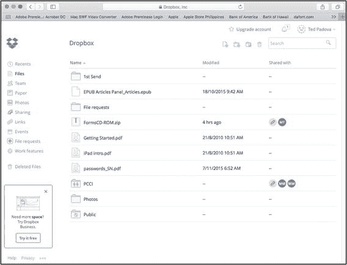

**图 11-7.** Dropbox 的登录界面

当您安装 Dropbox 时，您会在 Dropbox 网站上获得一个账户页面，并在本地硬盘上获得一个本地文件夹。您可以将文件和文件夹添加到您的本地文件夹中，文件会自动上传到 Dropbox。您可以在所有安装了 Dropbox 应用的其他移动设备上看到所有文件，但这些列表只是原始文件的别名（链接）。这在平板电脑和智能手机上尤其有用，因为您不会为可能用不到的文件占用大量磁盘空间。点击一个链接，文件就会下载到该设备。

> **注意**
> 
> 请记住，在台式电脑和笔记本电脑上，Dropbox 文件夹中的任何文件实际上都会下载到每台电脑上。这与平板电脑和智能手机上的行为不同，在平板电脑和智能手机上，文件会列出但不会下载，直到您手动指示应用进行下载。

### 11.4.2 在设备上加载文件

要学习本节内容，您需要下载 Dropbox 并将其安装到您的计算机上。登录[`www.dropbox.com`](http://www.dropbox.com)，按照步骤提供您的姓名（名和姓）、电子邮件地址和密码。勾选同意条款和条件的复选框，然后点击“下一步”。选择免费的基本账户，然后点击“继续”。应用程序安装程序将开始下载。双击安装程序以将应用程序添加到您的计算机。

在设备（平板电脑或智能手机）上，登录设备的应用商店。对于 iOS 设备，点击“App Store”图标登录苹果的 App Store。搜索“Dropbox”并安装应用程序。在 Android 设备上，点击“Play Store”图标并搜索“Dropbox”。当 Dropbox 页面打开时，点击“安装”。

将一些文件从您的计算机复制到 Dropbox 文件夹。（安装 Dropbox 时，系统会向您的计算机添加一个文件夹。）打开该文件夹并将一些文件拖入该文件夹。使用此方法实际上是将文件从您的计算机移动到您的 Dropbox 文件夹。您也可以在 Windows 上右键单击一个文件，然后选择“移动到 Dropbox”。

如果您想将文件的副本添加到 Dropbox 文件夹，请在 Mac 上按住 Option 键并将文件拖到文件夹中。在 Windows 上，右键单击一个文件，然后选择“发送到” ➤ “Dropbox”。在 Mac 和 Windows 上，您也可以复制文件并将其粘贴到 Dropbox 文件夹中。

在您的其中一台设备上启动 Dropbox。您添加到计算机上 Dropbox 中的文件会列在您设备上的 Dropbox 中。您可以将多种不同类型的文件复制到 Dropbox，例如 Microsoft Office 文件、纯文本文件、照片、PDF、EPUB 等。当您点击其中一个文件时，您将在 Dropbox 中看到文档的预览。该文件尚未下载到您的设备。Dropbox 仅打开文档的预览，以便您可以轻松浏览各种文件并找到您要使用的文件。

由于我们主要关注 EPUB 和 PDF，让我们看看如何将文件从 Dropbox 获取到设备阅读器中。

### 向设备添加 EPUB 文件

在安卓设备上，当你在 Dropbox 中点击一个 EPUB 文件时，会弹出一个屏幕，显示可用于查看文档的应用。文件扩展名应为 `.epub`。要在某个应用中查看 EPUB，请点击 Dropbox 窗口中的文件名。点击**始终**可永久使用某个特定阅读器打开 EPUB，或点击**仅一次**仅在该阅读器中查看该 EPUB 一次（参见图 11-8）。当你再次点击一个 EPUB 文件时，需要再次选择**始终**或**仅一次**。

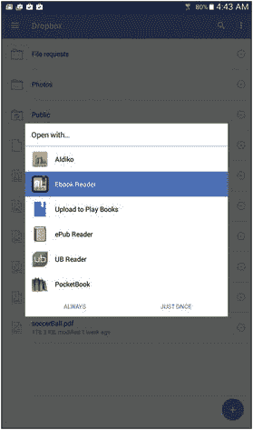

**图 11-8.** 点击你想用来打开已下载文件的阅读器

> **注意**
> 你在设备上看到的列表仅显示存储在云端 Dropbox 文件夹中的内容。这些文件存储在云端（Dropbox 服务器上）。只有当你将文件添加到某个查看应用或点击文件将其添加到设备时，Dropbox 中的文件才会下载到你的设备。这能让你的设备免受大量文件存储的困扰，这些文件你可能并不想放在设备上。

在 Macintosh 电脑上，我也使用 Dropbox 而非 iTunes 来添加文件。如果你使用 12 版本之前的 iTunes 添加图书，iTunes 需要同步你的资料库。你资料库中的所有书籍都会重新同步。如果你有很多书，同步资料库会花费一些时间。如果你需要多次查看更新，你就会浪费大量时间等待 iTunes 完成资料库同步任务。

在 iOS 设备上使用 Dropbox，你可以在 iBooks 或设备上安装的其他任何 EPUB 阅读器中打开 EPUB 文件。在 iOS 设备上点击 Dropbox 中的文件名，该文件就会下载到设备上。你首先看到的屏幕可能有预览，也可能没有。如果你看到如图 11-9 所示的无预览屏幕，不必惊慌；文件仍然在那里。

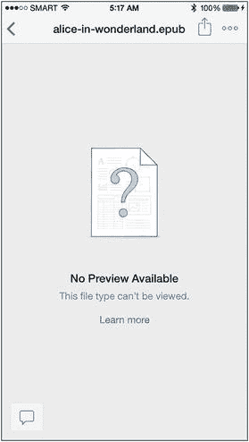

**图 11-9.** 点击 Dropbox 应用中的文件名，文件会在 Dropbox 中打开

点击右上角的分享图标，Dropbox 会打开一个类似图 11-10 所示的屏幕。你可以分享文件，也可以在某个应用中打开文件。点击**打开方式**按钮，选择用于查看文件的应用。

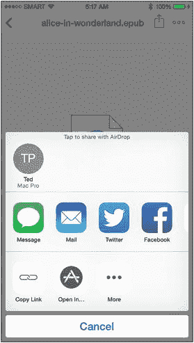

**图 11-10.** 点击 Dropbox 应用中的文件名，文件会在 Dropbox 中打开

点击**打开方式**后，屏幕会发生变化，显示设备上所有可以查看 EPUB 的应用。如果你想在 iBooks 中查看文件，请点击**在 iBooks 中打开**，如图 11-11 所示，或者选择其他应用来预览文档。使用这种方法向 iOS 设备添加 EPUB 比使用 iTunes 快得多。

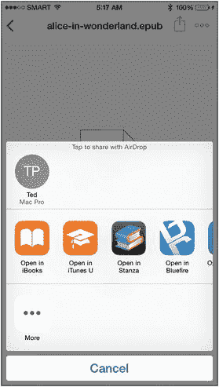

**图 11-11.** 点击你想用来查看 EPUB 的应用

有关在设备上查看 EPUB 文档的更多信息，请参阅第 13 章。

### 向设备添加 PDF 文件

你可以使用 Dropbox 在移动设备上打开 PDF 文件。在 Dropbox 应用中找到该文件，然后点击向下的箭头打开一个菜单，如图 11-12 所示。菜单中有多个选项。你需要的是**打开方式**。点击**打开方式**，屏幕会发生变化，显示设备上安装的所有 PDF 阅读器。

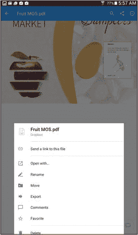

**图 11-12.** 点击右上角的图标打开菜单

许多电子书阅读器都支持查看 PDF 文件，如图 11-13 所示。不过，你的最佳选择是在 Adobe Acrobat Reader 中查看 PDF，或者使用第三方阅读器，例如 GoodReader。点击你想使用的阅读器，文件就会在目标阅读器中打开。

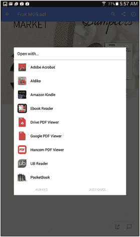

**图 11-13.** 点击你想使用的 PDF 阅读器，文件会在此阅读器中打开

如果你想在 iPhone 或 iPad 上的 iBooks 中打开 PDF，请按照相同步骤在 Dropbox 中打开 PDF 文件，选择**打开方式**，然后选择 iBooks。文件会在 iBooks 中打开，并添加到你的 iBooks 书架上。

## 总结

本章简要讨论了如何将文件从电脑传输到各种设备。我们探讨了通过 USB 设备和 Apple iTunes 复制文件，以及将文件复制到 PDF 阅读器和电子书阅读器的方法。

要复制文件，你首先需要在硬盘上有一个要复制的文件。在下一章中，我们将开始探索如何将内容从 Adobe InDesign 导出为各种格式。我们介绍的第一种格式是导出为可重排 EPUB。

