# 6. 创建与应用样式

字符、段落、表格以及框架和线条等对象，都可以被赋予样式。简单来说，样式会捕捉你应用于文本、表格单元格、表格和对象的所有属性。一旦创建了样式，你就可以在整个设计中将该样式应用于其他文本、表格单元格、表格或对象。这能显著提升编辑流程的速度和效率。

样式不仅能帮助你在 InDesign 中更快速、更高效地工作，在创建可重排式 EPUB 时，它们更是绝对必需的。在其他数字出版文档中，你可以勉强避开样式，但可重排式 EPUB 的行为方式不同。你需要使用样式来精确地显示你的出版物。

在本章中，我将介绍如何创建字符、段落、表格、对象和 GREP 样式。

## 6.1 熟悉样式

字符、段落和单元格样式可以通过 `控制面板` 或其他相应面板来创建和应用。当你选择 `窗口` ➤ `样式` 时，会打开一个子菜单，显示五种不同的样式类型。当你选择一个子菜单命令时，它将打开相应的面板。这些面板包括：

- `单元格样式`：单元格样式适用于表格单元格。
- `字符样式`：字符样式可以应用于单个字符或几个单词，但不应用于整个段落。
- `对象样式`：对象样式可以应用于任何非文本项目，例如图像和对象。
- `段落样式`：段落样式涉及应用于段落的样式。
- `表格样式`：表格样式应用于表格。最佳实践是在创建表格样式之前先创建单元格样式。
- `GREP 样式`：GREP 样式没有单独的面板。你可以在 `段落样式选项` 对话框中创建 GREP 样式。

样式捕捉了给定样式项目的格式。例如，字符样式应用于文本属性，单元格样式应用于表格单元格属性，依此类推。

单元格样式仅限于特定类型的格式设置。你可以在单元格样式中包含颜色和边框，但不能包含单元格宽度和行高。

创建样式有两种方法。你可以将某个项目精确地设置为你想要的格式。例如，如果你想创建一个字符样式，你可以设置字体、字体样式、行距、文本颜色、基线偏移等，检查文本确保其显示完全符合你的要求，然后打开 `字符样式面板`，从选定的文本创建一个新样式。新样式会继承所有文本属性并将其包含在样式中。

创建样式的另一种方法是，取消选择页面上的所有文本（或对象、单元格、表格），然后打开相应的样式面板（例如字符样式面板），点击面板底部的 `创建新样式` 图标。所有样式面板的底部都有 `创建新样式` 图标。当你点击 `创建新样式` 面板图标时，会打开一个对话框，你可以在其中设置样式的属性。

创建样式最简单的方法是将你想要的格式应用于某个项目，然后点击 `创建新样式` 图标，该图标会捕捉所有的格式。

创建样式后，你可以将样式应用于布局中的其他项目。例如，如果你为正文副本创建了一个段落样式，请点击包含正文副本的任意段落内部，然后在 `段落样式面板` 中点击相应的样式。所选段落中的所有文本和段落格式都将采用样式定义中的属性。

使用样式的真正威力在于当你想要更改各种属性时。假设你有一个包含显示类小标题的文档。你随后添加了另一个小标题，发现文本无法完全适合一行。也许可以将字号减小半磅，文本就能适应列宽了。对于这种情况，你可以轻松地编辑样式，更改字体大小，然后在 `样式` 对话框中点击 `确定`。所有使用相同样式名称的文本都会在整个文档中更新。如果你有 1000 个小标题，只需一次简单的编辑就能全部更改。

`样式面板` 菜单包含更多选项，我们将在本章后面介绍创建各种样式类型时看到其中的一些。现在，请尽力理解创建样式的价值，以及它们如何帮助你优化设计工作流程。

## 6.2 创建与应用段落样式

请注意，我是在讨论字符样式之前先谈论段落样式的。原因在于，在你的工作流程中，你应该先创建段落样式，然后再着手创建字符样式。这是 InDesign 中最常见的工作流程步骤。

段落样式应用于整个段落。创建样式后，不应更改段落内的任何内容。如果需要在段落内更改文本属性，则必须使用字符样式。如果你确实在段落样式中对文本进行了更改，就会产生覆盖。你应该避免覆盖，尤其是在将文件导出为 EPUB 格式时。

### 6.2.1 创建段落样式

要使用段落样式，您需要使用段落样式面板。选择 `窗口 ➤ 样式 ➤ 段落样式` 打开段落样式面板，如图 6-1 所示。

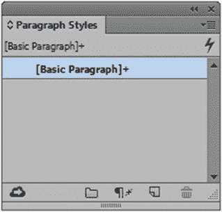

图 6-1. 选择 `窗口 ➤ 样式 ➤ 段落样式` 以打开段落样式面板

打开面板时，您会看到面板中已有一个样式。基本段落样式是 InDesign 的默认样式。您无法删除基本段落样式。

有两种方法可用于创建段落样式。同样，在使用各种样式面板时，也有两种方法可以创建任何其他样式。如果您在文档中没有选择任何内容，并单击段落样式面板底部的 `创建新样式` 图标（或打开段落样式面板菜单并选择 `新建段落样式`），则会打开“新建段落样式”对话框。（参见图 6-2。）

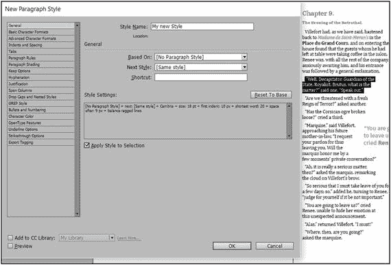

图 6-2. 格式化段落之后，将光标置于段落内，按下 `Alt/⌥` 键，并单击段落样式面板中的 `创建新样式` 图标

此时，您可以使用各种选项来格式化您的段落。如图 6-2 所示，您有许多选项可用于处理文本、缩进和间距、字符颜色、断字等。

另一种创建新段落样式的方法是：首先按照您的要求格式化一个段落，包括字体样式、行距、段前和/或段后间距、对齐方式、断字等。让段落完全符合您的要求，然后再创建段落样式。我强烈推荐这种方法。

格式化段落之后，将光标置于段落内，按下 `Alt/⌥` 键，并单击 `创建新样式` 图标，或者使用段落样式菜单并选择 `新建段落样式`。当您使用修饰键时，“新建段落样式”对话框会打开。

最终结果是新段落样式捕获了您的所有格式设置。在图 6-2 中，您可以看到一个段落的格式设置以及位于格式化文本左侧的“新建段落样式”对话框。我在创建新段落样式时，将文本光标单击在了该段落内。在这个段落中，我更改了字体、字号和行距，为首行文本添加了缩进，将断字设置为 20（从而基本上消除了所有断字），平衡了参差不齐的行，并在段落之后添加了一些间距。

请注意在图 6-2 中，样式名称已从默认名称——`段落样式 1`——更改为 `正文`。创建新样式时，为样式添加描述性名称是个好主意。还要注意在图 6-3 中，您会在“常规”面板中看到一个复选框 `将样式应用于选定内容`。勾选此框并点击 `确定`，样式即被创建并应用于该段落。您还会看到一个 `添加到 CC 库` 的复选框。

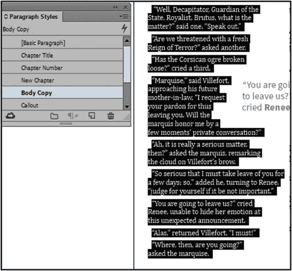

图 6-3. 选中多个段落，然后单击段落样式面板中的段落样式名称，将同一样式应用于所选段落

您还会看到“常规”面板中出现一个键盘快捷键。要向段落样式添加快捷键，请单击“常规”面板中的 `快捷键` 文本框，并按下 `Ctrl/⌘+Alt/⌥+Shift+`（数字键盘上的数字键）的任意组合。键盘快捷键会显示在段落样式面板中，这样就能很好地提醒您为不同样式分配了哪些按键。创建正文时，每次都使用相同的键盘快捷键来创建正文文本样式。您可以选择 `Ctrl/⌘+1` 用于所有正文样式，这样便于记忆。

### 6.2.2 应用段落样式

一旦创建了段落样式，您可能希望将同一样式应用于文档中的其他段落。为此，请单击光标并拖过要应用相同样式的段落。如果您想将样式应用于一个故事中的所有段落，请按 `Ctrl/⌘+A` 选择所有链接在一起的文本框内的所有文本。选中文本后，单击段落样式面板中的段落样式名称。在图 6-3 中，您可以看到 `正文` 样式已应用于页面上的所有文本。

### 6.2.3 修改样式

假设您想要更改段落样式中的某个属性。也许您想更改字体、字体样式、段后间距、首行缩进或任何其他段落属性。您可以通过两种方式之一访问“段落样式选项”对话框。双击样式名称，或使用上下文菜单，方法是右键单击段落样式面板中的样式名称，然后选择 `编辑 "<样式名称>"`。

作为一种实践，您应该始终使用上下文菜单。如果您的光标位于用于标题、标注或某些其他文本的段落中，并且您双击了一个样式名称，则第一次单击会应用该样式，第二次单击会打开“段落样式选项”对话框。如果您使用双击方法来打开“段落样式选项”对话框，很容易将样式应用到错误的文本上。始终在段落样式面板中右键单击并选择 `编辑 "<样式名称>"`，这样就不会无意中为光标所在的文本分配段落样式。

在图 6-4 中，我编辑了 `正文` 样式。我选择了 `基本字符格式` 并将字体从 `Cambria` 更改为 `Minion Pro`。当启用 `预览` 复选框时，您可以动态预览您的编辑。请注意在图 6-4 中，所有使用 `正文` 样式定义的文本都已更改为 `Minion Pro`。

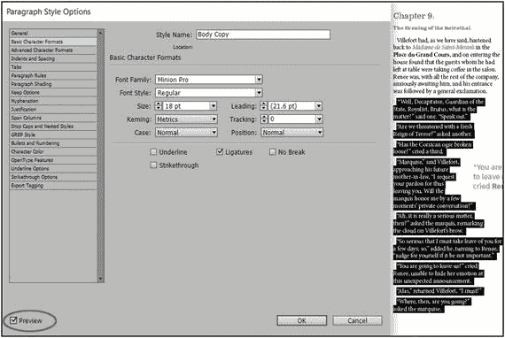

图 6-4. 启用 `预览` 复选框，您所做的编辑将动态反映在文档中

### 6.2.4 重新定义样式

假设您在文档中更改了使用段落样式的文本属性。在图 6-5 中，您可以看到一个我更改了字体的文本段落。该文本已使用 `正文` 样式定义。当我更改文本时，您会在段落样式面板中发现样式名称旁边有一个 `+` 符号。此标记提示您该段落样式存在覆盖。

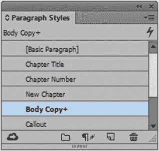

图 6-5.

当您直接在文档中编辑文本属性时，样式名称会显示一个文本覆盖，以样式名称旁边的 `+` 符号表示。

如果您想清除覆盖并恢复为原始样式的文本格式，请按下 `Alt/⌥` 键并单击加号符号。文本将恢复为`正文`样式。

假设您希望将段落样式更改为您应用于某个段落的新格式属性。要更改段落样式使其接受新的文本格式，请将文本光标置于新格式化的文本中，然后打开样式名称上的上下文菜单，并选择`重新定义样式`。段落样式会被修改，并采用光标所在文本的属性。

### 6.2.5 基于另一样式创建样式

样式可以按父子关系进行设置。例如，如果你有一个`正文副本`样式，并创建一个新样式，则可以让新样式基于`正文副本`样式。你赋予新样式的所有属性都会生效。但是，如果你在`正文副本`样式中更改了其他属性，这些更改会反映到新样式中。为了更清楚地说明这一点，让我们查看图 6-6。

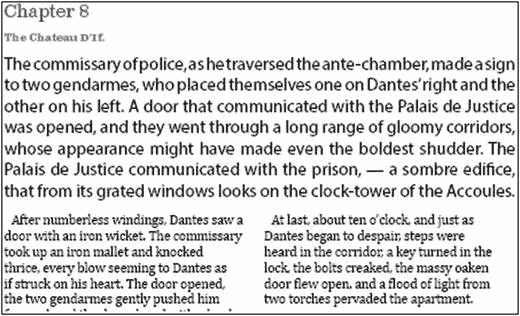

图 6-6.

文档中的文本，第一段与其他段落具有不同的文本属性，展示了基于另一样式创建样式的效果。

引导段横跨两栏，使用不同的字体，没有段落缩进，并且字体大小大于页面上的其他文本。让我们为第一段定义一个样式。

1.  创建一个新样式。将光标点击到该段落中，按下`Alt/⌥`键，并点击`段落样式面板`中的`创建新样式`图标。此时会打开`新建段落样式`对话框。为新样式键入一个名称。在我的示例中，我使用`正文第一段`作为样式名称。

2.  设置一个`基于`样式。查看样式名称下方的下拉菜单。第一项标题为`基于`，如图 6-7 所示。打开此菜单，你将看到打开文档中所有段落样式的列表。选择`正文副本`，则该样式将基于`正文副本`样式。

    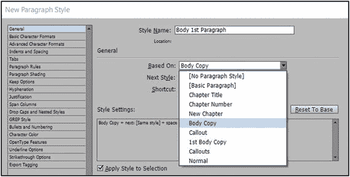

    图 6-7.

    打开`基于`下拉菜单并选择`正文副本`。

3.  点击`确定`以创建样式。

4.  编辑`正文副本`样式。在`段落样式面板`中右键点击`正文副本`样式，然后选择`编辑正文副本`。

5.  更改文本的颜色。点击左侧窗格中的`字符颜色`，然后在`字符颜色`菜单中点击不同的颜色。

6.  点击`确定`。注意页面上的文本。`正文副本`样式和第一段的颜色都已更改。第一段的其他属性保持不变，如图 6-8 所示。

    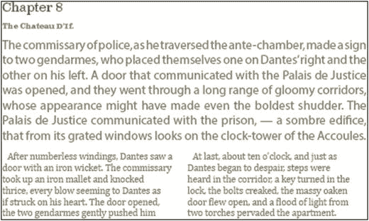

    图 6-8.

    使用两种不同样式的文本只更改了颜色。

创建基于另一样式的新样式，能为你提供一些强大的编辑能力。你可以对父样式进行更改，这些更改会反映到子段落样式中，而不会干扰你想在子样式中保留的特定项目。

### 6.2.6 使用保留选项

此功能对于创建可重排 EPUB 的用户特别有帮助。假设你希望所有章节都从页面顶部开始，并且在双页布局中让新章节出现在右侧页面。调整文本框大小和添加回车符无法实现此目的。你需要使用一个名为`保留选项`的功能。

使用`保留选项`：

按照以下步骤操作，了解如何在双页布局中将新章节放置在右侧页面（右页）的顶部：

1.  查看图 6-9。在此图中，你看到一个右侧页面，新章节从右下栏开始。`第 9 章`文本被分配了`章节编号`样式。我们想将章节编号、标题以及后续文本移动到右侧页面的顶部。

    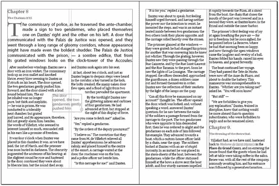

    图 6-9.

    新章节位于页面的右下侧。

2.  创建一个新的段落样式。按下`Alt/⌥`键，并点击`段落样式面板`中的`创建新样式`图标。

3.  命名样式。在我的示例中，我键入`新章节`作为样式名称。

4.  基于另一样式创建样式。在我的示例中，我从`常规面板`的`基于`下拉菜单中选择`章节编号`。

5.  打开`保留选项`选项卡。点击`段落样式选项`左侧窗格中的`保留选项`。

6.  选择`在下个奇数页`。在`保留选项`窗格中，打开`段落起始`下拉菜单并选择`在下个奇数页`。

7.  点击`确定`。现在下一个章节将定位在奇数页的顶部，如图 6-10 所示。

    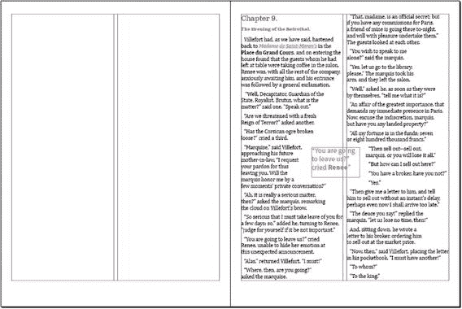

    图 6-10.

    章节从下一个奇数页的顶部开始。

## 6.3 创建并应用字符样式

当你需要偏离段落样式，对段落中的某些字符进行特殊设置时，字符样式就派上用场了。例如，如果你创建了一个段落样式，然后决定更改某个单词的字体样式（例如添加粗体或斜体字符），段落样式无法适应新的字符格式，这就会产生所谓的覆盖。在图 6-11 中，你可以看到一个使用了样式的段落。然而，该段落中有四个单词使用了粗体斜体文本，而段落其余部分则未设置任何粗体文本。

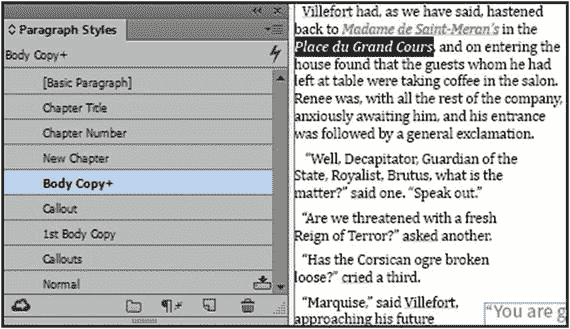

图 6-11.

样式名称右侧的`+`符号表示该样式中存在覆盖。

如果你打开`段落样式面板`，你会看到`正文副本`样式名称右侧有一个`+`符号。这个加号表示该段落样式中存在覆盖。你需要纠正这个问题。

提示

如果你将光标移到任何样式面板中的`+`符号上，工具提示会显示如何清除覆盖以及覆盖的原因。

### 6.3.1 创建字符样式

创建字符样式的方法与创建段落样式类似。与段落样式一样，最佳做法是先格式化文本，再创建样式。

创建字符样式的步骤如下：

1.  在文本段落中创建一个段落样式。将该样式应用于一个或多个段落。

2.  选中部分文本并将字体样式更改为粗体。我想为使用粗体的文本创建一个新的字符样式。首先选中文本，然后从字符控制面板中选择字体样式。

3.  为斜体文本创建一个新的字符样式。选中文本并从控制面板中选择字体样式。

4.  打开字符样式面板。打开字符样式面板（`窗口` ➤ `样式` ➤ `字符样式`，或按 `Shift+F11`——见图 6-12）。

    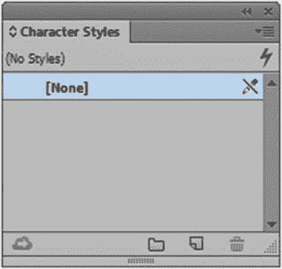

    图 6-12. 按 `Shift+F11` 打开字符样式面板

5.  选中已设置粗体格式的文本。

6.  创建一个新的字符样式。选中文本后，按住 `Alt/⌥` 键并单击字符样式面板中的 `创建新样式` 图标。按住 `Alt/⌥` 键时，将打开“新建字符样式”对话框，如图 6-13 所示。

    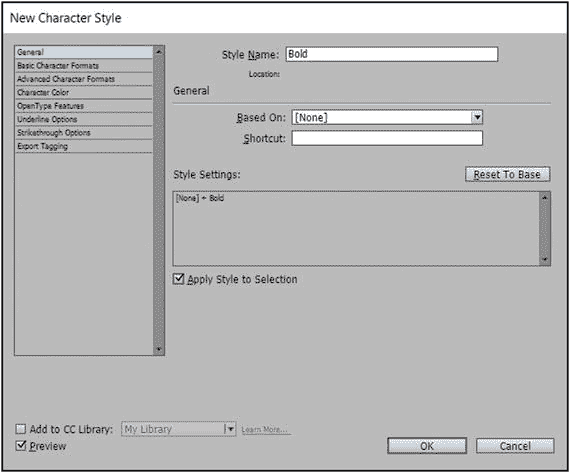

    图 6-13. 按住 `Alt/⌥` 键并单击字符样式面板中的 `创建新样式` 图标

7.  在 `样式名称` 文本框中为样式输入一个名称。由于已经格式化了文本，因此无需再指定其他属性。不过，在“新建字符样式”对话框中还有一项需要处理。选中 `将样式应用于选区` 复选框。创建新样式时，默认情况下该样式不会应用于任何文本。选中此复选框后，样式将被创建并应用于选中的文本。单击 `确定`。

8.  重复相同步骤，选中斜体文本并创建一个新的字符样式。

9.  查看字符样式面板。如图 6-14 右侧所示，字符样式面板显示了添加到面板中的新样式名称，其中一个是粗体文本的样式。在左侧，注意段落样式面板中的 `正文副本` 名称现在显示时没有覆盖（没有 `+` 符号）。

    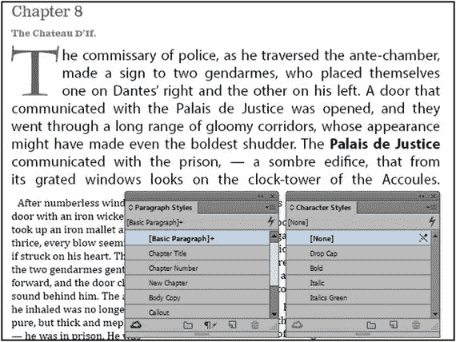

    图 6-14. 字符样式不会影响除字符样式定义之外的任何段落格式

提示：你也可以为字符样式指定键盘快捷键。在字符样式面板中，单击 `快捷键` 文本字段，然后输入任意 `Ctrl/Command+Alt/⌥+Shift+`（数字小键盘按键）组合。与段落样式快捷键一样，快捷键会显示在字符样式面板中字符样式名称的旁边。

使用字符样式的妙处在于，字符样式不会影响段落中的任何其他属性以及你创建的任何段落样式。它只会影响你选中并用于创建样式的文本格式。一旦创建了字符样式，无论使用何种段落格式，你都可以将其与其他段落样式结合使用。在图 6-14 中，你可以看到粗体字符样式应用于使用不同字体和不同段落样式格式化的文本。文本中唯一的变化是粗体样式。

### 6.3.2 重新定义字符样式

假设我们在字符样式面板中有一个字符样式，该样式已应用于某些文本，现在你想通过为文本应用不同的颜色来进行细微编辑。如果你选中文本并在色板面板中更改颜色，会看到一个覆盖——尽管不是在字符样式面板中。覆盖会出现在段落样式面板中，如图 6-13 所示。如果你打开字符样式面板菜单，会看到 `重新定义样式` 菜单项呈灰色不可用状态。

InDesign 将覆盖视为段落样式的一部分。原因是，当你创建字符样式并应用编辑时，InDesign 为字符样式处理的唯一内容正是你所更改的属性。文本中的所有其他项目保持不变。因此，当你为字符样式应用斜体类型时，没有向该样式添加颜色信息。颜色信息属于段落样式。

要正确编辑字符样式，你可以尝试以下操作：

1.  单击要更改的文本，然后 `Alt/⌥+单击` 字符样式面板中的 `创建新样式` 图标。你可以编辑现有的字符样式，但所有你想要设置斜体的文本都会应用颜色更改。最好基于原始字符样式创建一个新样式。
2.  为样式命名，并使其基于现有样式。为样式键入一个新名称。在我的示例中，我使用 `斜体 绿色` 作为样式名称。我从 `基于` 下拉菜单中选择 `斜体`。
3.  编辑文本属性。在我的示例中，我想更改文本颜色。我单击左侧窗格中的 `字符颜色`，然后在面板中单击一种颜色。
4.  单击 `确定`。将新样式应用于你想要设置为斜体并带有颜色的文本。

在图 6-15 中，你可以看到添加了新样式后的字符样式面板。如果你决定通过单击不同的颜色色板来更改文本颜色，并打开字符样式菜单，则 `重新定义样式` 菜单项变为可用。由于我们在字符样式格式中更改了颜色属性，因此对更改内容所做的任何更改都会在字符样式面板中得到体现。

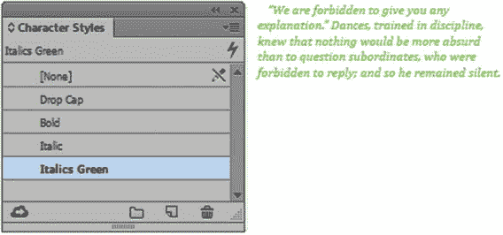

图 6-15. 添加新字符样式后的字符样式面板

### 6.3.3 删除样式

如果你想删除文档中的样式，应首先查看样式定义。如果你有一个基于另一个样式的样式，并且想要删除父样式，则所有子样式都会受到影响。根据你选择重新指定样式的操作，可能会产生一些意外结果。

如果要删除子样式，你可以将其应用于面板中的另一个样式。例如，假设我想删除带颜色的斜体文本。也许我后来决定只想要黑色文本。我会将字符样式面板中的 `斜体 绿色` 样式拖到面板的垃圾桶图标上。执行此操作时，我可以将样式替换为我创建的另一个样式，该样式会出现在字符样式面板中。

将样式拖到字符样式面板的垃圾桶图标，将打开“删除字符样式”对话框。从 `替换为` 下拉菜单中选择一个样式来替换第一个样式，如图 6-16 所示。

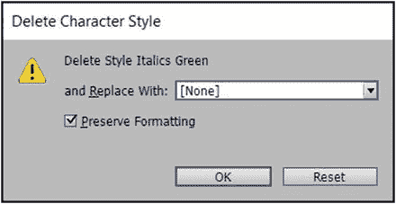

图 6-16. 将样式拖到样式面板的垃圾桶图标，将打开“删除字符样式”对话框

选择一个替换样式并单击 `确定`。你可以用同样的方法从其他样式面板中删除样式。

## 6.4 创建首字下沉和嵌套样式

在制作可重排 EPUB 时，它们主要是文本文档，这合情合理。可重排 EPUB 旨在供人阅读。你可以添加一些有趣的图标、插画，甚至采用不同的文本处理方式，将读者带入页面。首字下沉就是这种效果的典型例子。添加一个首字下沉，改变文本颜色，能在一定程度上打破页面的单调，增加一些趣味性。

如果说有一项功能在 1996 年让 InDesign 领先于 QuarkXPress，那必定是嵌套样式。嵌套样式在 InDesign CS 1 中被引入，并立即被许多曾将 QuarkXPress 作为首选排版软件的人所接受。正如你将在本节中看到的，嵌套样式为你提供了一些强大的编辑功能。

### 6.4.1 创建首字下沉字符样式

为首字下沉创建样式实际上需要同时使用段落样式和字符样式。在“段落样式选项”对话框中，你可以将首字下沉作为样式定义的一部分包含在内。在“字符样式选项”中，你为用于首字下沉的字符分配属性，并为该首字下沉创建一个字符样式。如果不创建字符样式，当你编辑字体属性（例如更改字体或字形）时，将会产生覆盖。

在“控制面板”的段落选项中，有一个用于应用首字下沉的设置。问题在于，如果你使用“控制面板”创建首字下沉，就会对你应用于段落的样式产生一个覆盖，如图 6-17 所示。然而，从“控制面板”开始操作并非一个坏主意。你可以试验一下希望首字下沉占用的行数以及想使用的字体。这些设置同样可以在“段落样式选项”对话框中找到，并且借助动态预览，你可以在“段落样式选项”对话框中工作时轻松查看首字下沉的效果。这是一个个人偏好问题。我更喜欢先使用“控制面板”调整首字下沉和字符设置，之后再处理覆盖问题。

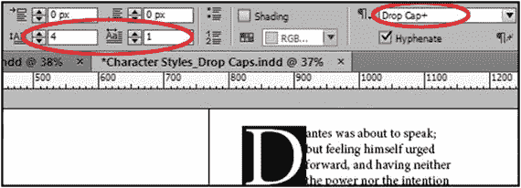

图 6-17. 在“控制面板”中添加首字下沉会导致分配给段落的段落样式产生覆盖

> **提示**
> 要在控制面板中将首字下沉的行数和首字下沉大小按一个点递增，请点击控制面板中“首字下沉”工具旁边的文本框，并按向上箭头键增加一行。按 **Shift + 向上箭头键** 可跳至四行。

#### 创建首字下沉字符样式

若要将首字下沉添加到文本段落中，并为该首字下沉定义样式，请遵循以下步骤：

1.  选择段落中的第一个字符，右键单击“段落样式”面板中的段落样式名称。这些步骤假定你已经为你想要添加首字下沉的段落定义了段落样式。在本例中，我们直接以“段落样式选项”对话框为起点。右键单击“段落样式”面板中的段落样式名称，然后选择编辑“`<样式名称>`”。
2.  在左侧窗格中单击“首字下沉和嵌套样式”。
3.  设置首字下沉属性。在“段落样式选项”对话框中输入首字下沉的行数。在此示例中，我们使用一个字符作为首字下沉，因此将“字符”文本框保留为默认值。选中“预览”复选框，以便能够动态查看你的编辑效果，如图 6-18 所示。

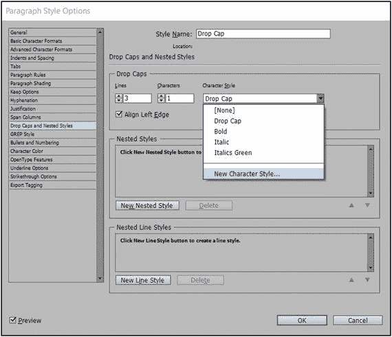

图 6-18. 输入希望用于首字下沉的行数值

4.  创建一个新的字符样式。你不必离开“段落样式选项”对话框即可创建新的字符样式。打开“段落样式选项”对话框中的“字符样式”下拉菜单，然后从菜单中选择“新建字符样式”，如图 6-18 所示。
5.  设置文字属性。为字符样式输入一个名称。在我的示例中，我使用 `Drop Cap` 作为字符样式名称。设置字体并为其选择一种颜色。从“段落样式选项”对话框中创建字符样式时，你面临的一个缺点是无法看到编辑效果的动态预览，即使你启用了“预览”复选框也是如此。这就是为什么我喜欢先在“控制面板”中设置首字下沉选项，然后再处理段落样式覆盖问题的原因。
6.  设置字偶间距。你需要在“新建字符样式”对话框中进行的另一项编辑是为文本行添加一些字偶间距。默认情况下，InDesign 会将文本推到首字下沉的右侧——紧靠着首字字符。你需要添加一点呼吸空间。单击“基本字符格式”，并在字偶间距文本框中输入大约 40（参见图 6-19）。如果你的编辑需要一些修改，你可以在离开“段落样式选项”对话框后随时修改字符样式。

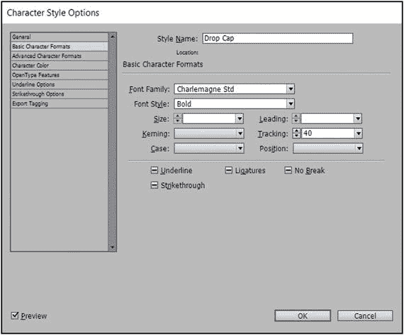

图 6-19. 从“字符样式选项”对话框的“基本字符格式”面板为文本行添加字偶间距

7.  “新建字符样式”对话框。你返回到“段落样式选项”对话框，“首字下沉”窗格显示了用于首字下沉的字符样式以及结果的动态预览。

当你返回文档页面并检查“段落样式”和“字符样式”面板时，你会发现样式上没有覆盖。

### 6.4.2 创建嵌套样式

正如我在本章前面以及本书引言中所述，当嵌套样式在 InDesign CS 1 中引入时，对 Adobe 来说，它们是排版领域的一个游戏规则改变者。在 Adobe 推出 InDesign 时，它在捕捉排版应用程序市场份额方面面临着一场艰难的战斗。企业和大型出版社花费了大量资金安装和更新 QuarkXPress 的副本，许多公司还重金投资了 Quark XTensions（类似于插件）。有些专业 XTensions 每个售价超过 8500 美元！对于 Adobe 来说，要说服企业界、独立设计师和广告公司放弃 QuarkXPress，并将 Adobe InDesign 视为他们的首选排版程序，是一个巨大的挑战。

Adobe 需要一种“哇塞”因素，不是作为插件，而是作为硬编码到应用程序中的功能。Adobe InDesign 众多天才般创新中的第一个就是嵌套样式。嵌套样式使创建目录、年度报告、产品手册及其他类似文档的排版人员能够更高效地工作。

从某种程度上说，嵌套样式是将多个字符样式集中到一个段落样式中。观察图 6-20。第一段没有使用样式定义进行格式化。ISBN 文本和数字设置为 14.5 磅，文本为斜体。书名以粗体显示，字号为 16 磅。作者姓名是斜体，字号也是 16 磅。日期设置为 14.5 磅，而括号设置为 16 磅。

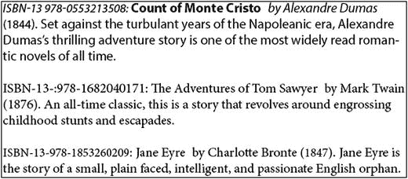

图 6-20. 第一段应用了文本格式设置，但尚未定义样式

我们可以使用 InDesign 的嵌套样式功能捕获所有这些文本属性，并将它们包含在一个单独的段落样式中。初次看到嵌套样式选项时，可能会觉得令人生畏。然而，只要对其创建方式稍加了解，你就会发现它们很容易构建并应用于你的数字出版文档。

#### 6.4.2.1 使用特殊字符

# 创建嵌套样式

要创建嵌套样式，你需要一些分隔符。分隔符是一个字符，你可以在其中告知 InDesign 样式的开始或结束位置。冒号、句点、逗号、制表符等都可以用作分隔符。然而，有时你可能会在希望开始或结束样式的字符之间留有一个空格。按下键盘上的空格键并不能提供分隔符。你需要插入一些特殊字符。

选择 `Type` ➤ `Insert White Space`。在 `White Space` 子菜单中，你将看到几个选项，如图 6-21 所示。你可能用作分隔符的一些字符包括：

- `En Space` (半身空格)：半身空格的宽度等于当前字体的字符 `n` 的宽度。半身空格会根据你使用的字体而变化。
- `Em Space` (全身空格)：全身空格的宽度等于当前字体的字符 `m` 的宽度。全身空格也会根据你使用的字体而变化。

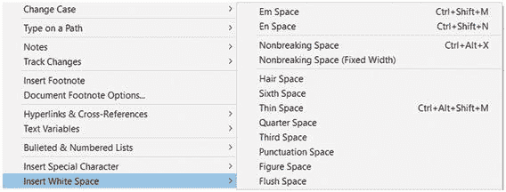
图 6-21. 选择 `Type` ➤ `Insert White Space` 以打开 `White Space` 子菜单

这两个字符应该能够处理当你没有其他字符可用作分隔符时的分隔符需求。

## 创建字符样式

你需要为每一组属性与段落正文不同的字符创建一个字符样式。在我的示例中，我为 ISBN 号、书名、作者名和出版年份创建了字符样式。我的示例中的 `Character Styles` 面板如图 6-22 所示。

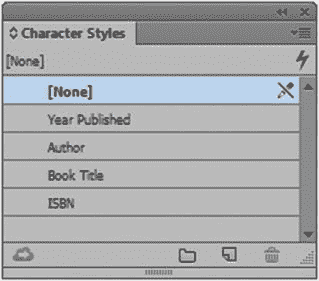
图 6-22. 为文本属性的每个变化创建字符样式

## 创建嵌套样式

在本示例中，我使用图 6-18 中第一段格式化后的文本，同时也使用如图 6-20 所示的字符样式。

如果你想使用其他示例跟着操作，请务必格式化文本、创建字符样式，并在字符样式格式之间插入用于开始和结束点的分隔符。

请按照以下步骤创建嵌套样式：

1.  单击包含要格式化为嵌套样式的文本的段落。按住 `Alt`/`⌥` 键并按 `Paragraph Styles` 面板中的 `Create new style` 图标。为样式键入一个名称。在我的示例中，我使用 `Nested Style` 作为样式名称。
2.  打开 `Drop Caps and Nested Styles` 窗格。单击左窗格中的 `Drop Caps and Nested Styles`。
3.  添加一个新嵌套样式。单击 `New Nested Style` 按钮。
4.  从下拉菜单中选择一个字符样式。在我的示例中，`ISBN` 样式是段落中出现的第一个样式。打开菜单并选择 `ISBN`，如图 6-23 所示。
    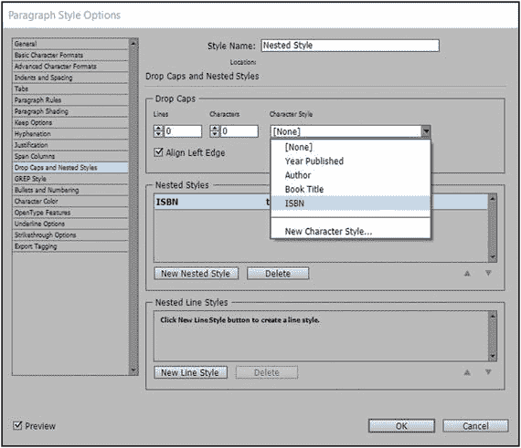
    图 6-23. 为相应的文本元素选择一个字符样式
5.  标识分隔符。在我的示例中，ISBN 号以冒号结尾。将默认的 `through` 选择保留为默认值，并在最后一个字段中键入一个冒号 (`:`)。当你看到 `Words` 时，单击光标即可键入冒号字符。
6.  添加一个新嵌套样式。段落中接下来出现的项目是书名。单击 `New Nested Style` 按钮创建另一个样式并打开下拉菜单。从菜单中选择 `Book Title`。`Book Title` 是我在文档中创建的另一个字符样式。
7.  标识分隔符。我在书名后添加了一个半身空格。单击 `Words`，会打开一个下拉菜单。从菜单中选择 `En Spaces`，如图 6-24 所示。
    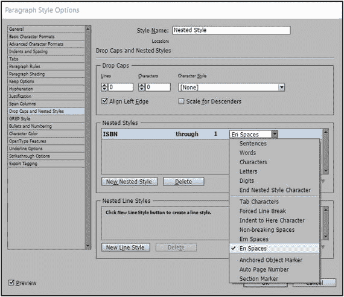
    图 6-24。单击 `Words` 并从下拉菜单中选择 `En Spaces`
8.  添加一个新嵌套样式。单击 `New Nested Style` 按钮，并在菜单中选择 `Author`。在我的示例中，我为 `Author` 添加了一个字符样式。
9.  设置分隔符。单击 `through` 打开一个下拉菜单，并在菜单中选择 `Up To`。我们在左括号字符之前停止上一个字符样式。在 `Words` 文本框中键入一个左括号字符。
10. 创建一个新嵌套样式。单击 `New Nested Style` 按钮，并在下拉菜单中选择 `Year Published`。单击 `through` 打开下拉菜单并选择 `Up To`。单击 `Words` 并键入一个右括号字符。在我的示例中，我添加了另一个字符样式并将其命名为 `Year Published`。
11. 单击 `OK` 并应用样式。在另一个要使用相同嵌套样式的段落中单击光标。在图 6-25 中，你可以看到我用于其余段落的嵌套样式格式。
    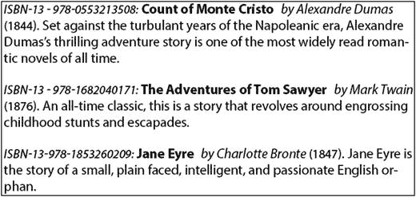
    图 6-25。在一个段落中单击光标，然后在段落面板中单击样式名称以将样式应用于该段落

## 创建嵌套行样式

假设你想要更改引导段落的章节标题中前几行的字符属性。例如，将前几行文本设置为全部大写或小型大写字母。如果你为全部大写或小型大写字母设置了一个字符样式，并将其应用于前两行文本，如图 6-26 所示，那一切都没问题。

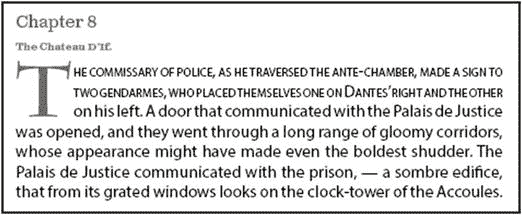
图 6-26. 前两行文本是小型大写字母

你可以将该字符样式包含在一个段落样式中，并将同一样式应用于文档中的多个段落。然而，问题是，如果你将该样式应用于两栏或三栏布局中的段落，或者你调整了文本框的大小使其变大或变小，会发生什么？

在图 6-27 中，你可以看到当我们调整文本框大小以适应两栏布局时发生的情况。两栏布局中的小型大写文本贯穿了几乎五行文本。

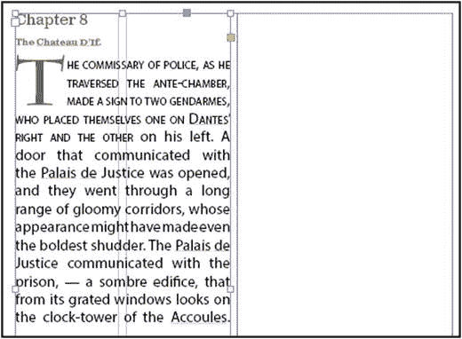
图 6-27. 限制在两栏布局中的文本显示小型大写字母跨越了超过两行

我们可以通过创建嵌套行样式来克服这个问题。

要创建嵌套行样式，请遵循以下步骤：

1.  创建一个字符样式。在我的示例中，我为小型大写字母创建了一个字符样式。你可以在 `Basic Character Formats` 窗格的 `Case` 下拉菜单中找到 `Small Caps` 选项。
2.  打开 `Paragraph Style Options`。在我的示例中，段落样式名称为 `1^(st) Body Copy`。右键单击 `Paragraph Styles` 面板中的样式名称，并选择 `Edit "1^(st) Body Copy"`。
3.  打开 `Drop Caps and Nested Styles` 窗格。单击左窗格中的 `Drop Caps and Nested Styles`。
4.  创建一个新的嵌套行样式。单击对话框底部的 `New Line Style`，并选择 `Small Caps` 字符样式。单击 `1`（表示行数）并键入 `2`，如图 6-28 所示。
    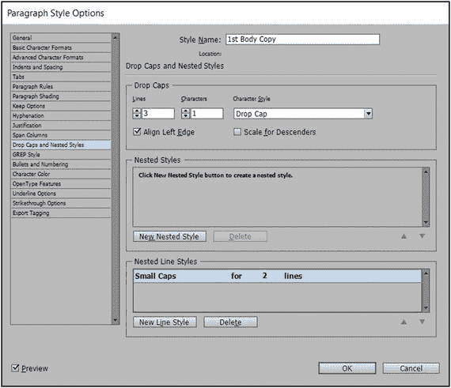
    图 6-28。添加一个新的嵌套行样式
5.  单击 `OK` 并将该样式应用于一个新段落。在图 6-29 中，你可以看到该样式应用于两个不同的分栏。注意，小型大写字母仅出现在每个文本块的前两行文本中。
    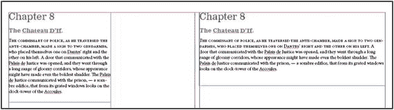
    图 6-29。在一个段落中单击，然后点击包含该嵌套行样式的段落样式

# 创建列表样式

`InDesign` 为您提供了许多创建列表的选项。您可能已经创建过项目符号列表或编号列表，并发现某些编辑任务有些令人困惑。也许您想更改项目符号样式或让数字右对齐。经过一番令人沮丧的尝试后，您可能放弃了创建列表，转而使用制表位标尺来格式化列表。我知道你们中的一些人可能这样做过。我知道你们就在那里。我不会告诉任何人。这是我们之间的秘密。希望读完本节后，您无需再为创建列表而采用这类变通方法。

## 创建项目符号列表样式

创建项目符号列表时，项目符号在文本框架内是无法编辑的。项目符号的指定方式有以下几种：单击`控制面板`中`段落`设置里的`项目符号列表`图标；从`文字`菜单中选择`项目符号和编号`；单击`控制面板`中最右侧的图标并从下拉菜单中选择`项目符号和编号`；或者通过添加新的段落样式。列表在`InDesign`中随处可见，并且您有多种方法可以创建它们。在本练习中，我们将在`段落样式面板`中进行操作。

在图 6-30 中，您可以看到一个未设置格式的文本框架（上方），以及添加了用于设置首字下沉和项目符号列表的段落样式后的效果（下方）。

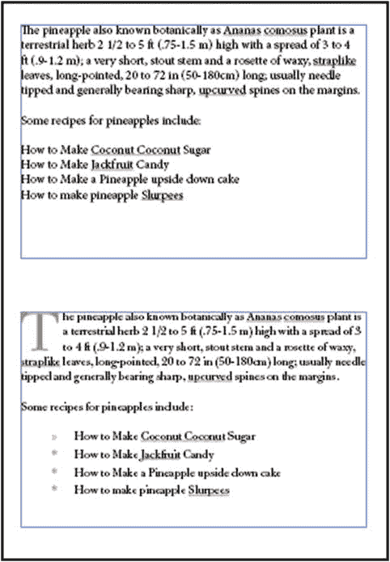

图 6-30。格式化的文本（下方）包含一个用于项目符号列表的段落样式

### 创建项目符号列表样式

以下是创建格式化列表的方法：

1.  创建一个字符样式。在我的示例中，我为首字下沉和颜色创建了一个字符样式。我可以在首字下沉和项目符号中应用同一个字符样式。我只更改了首字下沉的颜色和字偶间距，以使首字下沉与文本保持一点距离。字偶间距不会影响项目符号字符，您唯一能看到的变化就是项目符号的颜色。

2.  创建一个新的段落样式。按住`Alt 键/⌥键`并单击`段落样式面板`中的`创建新样式`图标。为样式键入一个名称，然后在左侧面板中点击`项目符号和编号`。

3.  选择项目符号字符。`InDesign` 会为您提供一个不同项目符号样式的列表。默认样式是一个圆点。这些样式看起来都不太好，因此我们可以通过添加一个新字符来修改样式。在`段落样式选项`对话框中点击`添加`，如图 6-31 所示。此时会打开一个与`字形面板`非常相似的对话框。

    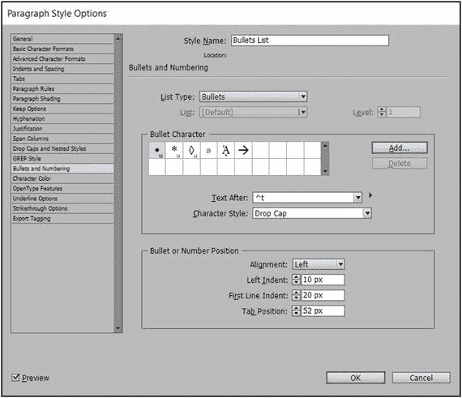

    图 6-31。在`段落样式选项`对话框的`项目符号和编号`窗格中点击`添加`

4.  选择字体。在我的示例中，我通过打开`字体系列`下拉菜单并选择`Wingdings`字体来选取该字体。

5.  选择一个字符。找到您想要的字符并双击，或者点击`添加`按钮，然后点击`确定`。您将返回到`段落样式选项`对话框，新字符会出现在`项目符号字符`列表中。选择该字符即可将默认值替换为您的新字符。

6.  调整项目符号和文本的位置。在`段落样式选项`对话框的`项目符号或编号位置`中，您可以看到针对`左缩进`、`首行缩进`和`制表符缩进`的调整选项。确保选中`预览`复选框，然后根据您的喜好调整项目符号和文本的位置。当您编辑这些值时，会看到结果的动态预览。点击`确定`。将此样式应用到您的段落，您应该会看到一个类似于图 6-30 所示的列表。

与其他段落样式一样，您可以选择文本，然后在`段落样式面板`中点击`项目符号列表`样式，以将该样式定义应用到其他段落。

### 6.5.2 创建编号列表样式

创建编号列表与创建项目符号列表的操作非常相似。如果您希望编号的格式与列表文本不同，则可以定义一个字符样式。然后创建一个新的段落样式，并在`新建段落样式`对话框中进行调整（见图 6-32）。

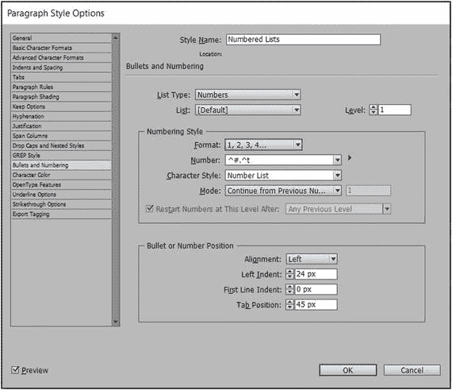

图 6-32。为编号列表创建新样式

如图 6-32 所示，在`列表类型`中选择了`编号`。我为编号创建了一个字符样式，并从`字符样式`下拉菜单中选择了`编号列表`字符样式。此样式仅更改了编号的颜色。在`段落样式选项`对话框的底部，我对编号的位置进行了调整。点击`确定`，新样式便创建完成。您可以像应用项目符号列表样式一样，将此样式应用到列表中。选择文本，然后在`段落样式面板`中点击段落样式名称即可。

默认情况下，每次将同一样式应用到不同的文本主体时，`InDesign` 都会生成新的编号。如果出于某种原因，编号从第一个文本主体延续到了新的编号列表，请选择`文字` ➤ `项目符号和编号列表` ➤ `重新开始编号`。

如果您想将编号列表转换为可编辑的文本，请选择该列表，然后选择`文字` ➤ `项目符号和编号列表` ➤ `将项目符号和编号转换为文本`。

### 6.5.3 对齐数字

由于您无法选择编号列表中的数字，因此无法更改对齐方式或为数字设置制表符。您需要返回到`段落样式选项`对话框，或者从菜单中选择`项目符号和编号`。如果您有一个应用了样式的编号列表，例如图 6-33 顶部的列表，您可以编辑该段落样式（或创建一个新样式）并更改数字对齐方式。在图 6-33 的底部，您可以看到`对齐`菜单命令设置为`右对齐`，并且位置选项也略有更改，以创建您所看到的外观。

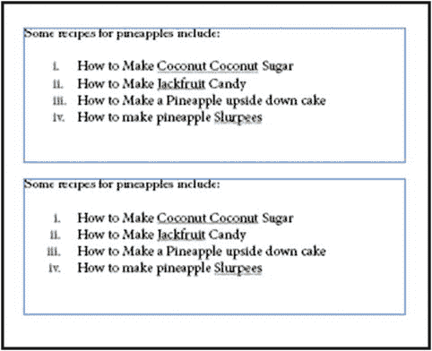

图 6-33。数字右对齐

## 6.6 使用对象样式

版面中的每个元素都是一个对象。文本存在于文本框架内，而框架就是对象。您置入`InDesign`的文件是对象。您在`InDesign`中绘制的任何内容都是对象。描边也是对象。更改对象的属性时，您可以将这些格式设置捕获到对象样式中。为文本框架添加填充和透明度，您可以将填充和透明度包含在对象样式中。为对象应用文本绕排，您可以将文本绕排设置添加到对象样式中。应用我在第 4 章中介绍的任何效果，您都可以将这些效果属性添加到对象样式定义中。创建对象样式时，您在`新建对象样式`对话框中设置对象样式属性。在这个对话框中，您会发现大量的开关和选项。

在创建对象样式时，您无法应用的设置非常少。在对象样式中无法控制的内容包括对象在页面上的大小和位置。某些变换操作也无法包含在对象样式中。您无法修改或创建色板、创建渐变或创建颜色的淡印。与对象样式能够实现的功能相比，这个限制列表非常简短。

### 探索“对象样式选项”对话框

要了解 `对象样式选项` 对话框中可用的选项，我们先从简单的开始。在图 6-34 中，你可以看到我为章节编号文字应用的一些效果。我对文字使用了投影和浮雕效果。当对文字应用此类效果时，你需要将文字转换为轮廓，或者选中文本框再应用效果。你不能选中文本框内部的文字然后直接应用效果。


图 6-34. 包含投影、斜面和浮雕效果的文字

在此示例中，我为文字创建了一个段落样式。文字位于一个单独的文本框中，你可以将该独立文本框锚定到显示其余文字的文本框上。设置好文字属性和文本框位置后，选中文本框并打开 `对象样式` 面板。按下 `Alt/⌥` 键并点击 `创建新样式` 图标，即可打开 `对象样式选项` 对话框，如图 6-35 所示。

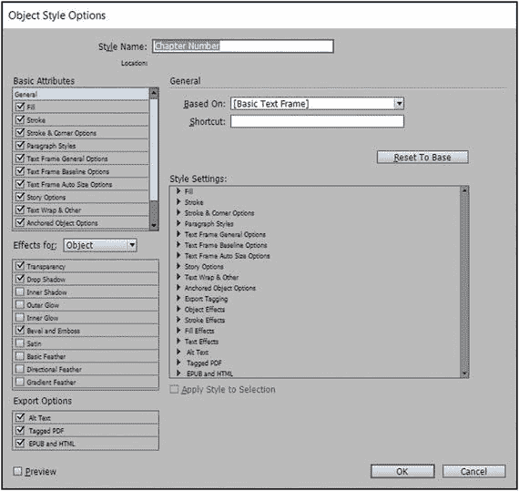

图 6-35. `Alt/⌥`+点击 `对象样式` 面板中的 `创建新样式` 图标以打开 `对象样式选项` 对话框

如你所见，`对象样式选项` 对话框中有许多可供编辑的选项。这些选项包括：

- 在对话框顶部，你可以为样式输入名称。注意，你还有一个快捷键选项。按下 `Ctrl/Command`+`Alt/⌥`+`Shift` 与（数字小键盘键）的任意组合，即可添加快捷键。

- 在对话框左侧，有各种可以包含在样式定义中的选项。请注意，默认情况下段落样式会显示一条水平线。这表示该选项不会被包含在对象样式定义中。由于我在打开 `对象样式选项` 对话框之前添加了段落样式，因此我希望将该段落样式包含到定义中。单击一次复选框，水平线会变为对勾标记，表示该段落样式将被包含在对象样式定义中。

> **注：** 复选框中的水平线与未勾选的复选框含义相同。水平线代表中性设置，与该选项相关的任何内容均不包含在样式定义中。

- 在 `基本属性` 下方，你会看到一系列效果。我为对象添加了投影、斜面和浮雕，因此这些项被包含在样式定义中。

- 需要理解的一点是，当你看到复选框中有水平线或没有任何标记时，这两种情况本质上是一样的。带有这些标记的项不会被包含在样式定义中。假设你想在样式定义中只包含单个项，`文本绕排` 就是一个很好的例子。要将所有选项都改为水平线，请按下 `Alt/⌥` 键并点击 `文本绕排与其他`。此操作会使文本绕排项被禁用（以水平线表示）。再次按下 `Alt/⌥` 并点击 `文本绕排` 项，则其他所有项都会被禁用，而文本绕排项被启用。本质上，第一次点击会关闭所选中的项，第二次点击则在关闭其余项的同时开启该项。当你应用带有此定义的对象样式时，唯一应用到对象上的就是文本绕排。

- 在效果下方是 `导出选项`。这些选项与通过选择 `对象` ➤ `对象导出选项` 打开的 `对象导出选项` 对话框中的选项相同。我将在第 12 章讲解如何将文档导出为可重排 EPUB 时，更详细地介绍 `对象导出选项`。目前，只需知道这些选项位于 `对象样式选项` 对话框中即可，我们会在后面的第 12 章探讨它们对于可重排 EPUB 的重要性。

- 在右侧，你看到的是 `样式设置` 列表。点击向右的箭头可以深入查看嵌套项。`对象样式选项` 的这个区域是信息性的。你可以查看到对象样式定义中每一项所使用的设置。

乍一看，`对象样式选项` 对话框可能有点吓人。它是 InDesign 中最大的对话框之一，并且充满了各种选择。学习如何使用 `对象样式选项` 的最佳方法就是直接上手并开始创建对象样式。这正是我们在下一节“创建和应用对象样式”中要做的事情。

### 6.6.2 创建并应用对象样式

格式化一个对象可能会花费不少时间。如果你想将相同的格式应用于另一个对象，就必须重复这些步骤，或者在某些情况下，可以复制一个已格式化的对象，然后用新内容替换原有内容。所有这些都比实际需要的工作量大得多。借助对象样式，你可以让 InDesign 替你完成大部分工作。

在图 6-36 中，你会看到一个包含文本的对象框架、一个内嵌对象以及应用于该框架的效果。这个对象非常适合创建对象样式。


图 6-36. 一个已格式化并准备好创建新对象样式的对象

### 创建对象样式

要为类似对象创建对象样式，请执行以下操作：

1.  **格式化一个对象。** 与我们创建段落样式和字符样式的方式类似，最好是先打造出你想要的精确外观，然后再创建样式。在图 6-36 中，我创建了一个对象框架，添加了一些文本，并应用了一个段落样式。我选取了两个对象，将它们编组，然后将该组内嵌到文本段落的最后一行。我向框架添加了投影、斜面和浮雕效果，还添加了一些透明度。

2.  **创建一个新的对象样式。** 当对象外观完全符合你的要求后，选中该对象，按住 `Alt/⌥` 键，然后单击“对象样式”面板中的“创建新样式”图标。此时会打开“新建对象样式”对话框。

3.  **命名新样式。** 创建任何类型的样式时，都要养成先输入名称的习惯。在“样式名称”文本框中键入一个描述性的名称。

4.  **添加快捷键。** 如果这是一个你会频繁在文档中使用的样式，请为其添加快捷键。与字符样式和段落样式一样，你可以使用 `Ctrl/Command`、`Alt/⌥`、`Shift` 修饰键以及键盘上的数字小键盘键。将光标点击到“快捷键”文本框中，然后按下 `Shift` 键和一个数字小键盘键。在我的示例中，我使用了 `Shift+Num 1`，如图 6-37 所示。

    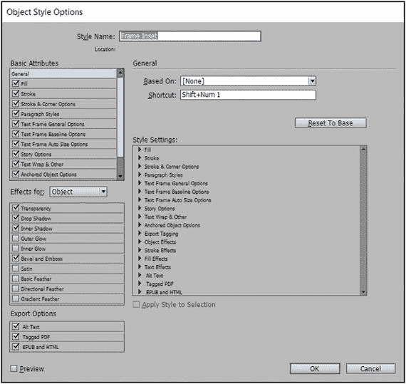

    图 6-37. 键入名称并添加快捷键

5.  **启用段落样式。** 如果在你的格式化中使用了段落样式，则需要在“基本属性”中启用“段落样式”项目。在我的示例中，我使用了一个段落样式，因此我点击了默认显示为水平线的复选框，勾选标记随即出现在“段落样式”旁边。这样，该选项便被启用了。

6.  **单击“确定”。** 完成“对象样式选项”的编辑后，单击“确定”。新样式便会添加到“对象样式”面板中。

7.  **应用该样式。** 点击另一个对象，然后在“对象样式”面板中单击该对象样式的名称，或按下对应的快捷键。在图 6-38 中，你可以看到左侧是用于捕获样式的原始框架，中间是一个新的布局，右侧则是将样式应用于新布局后的效果。

    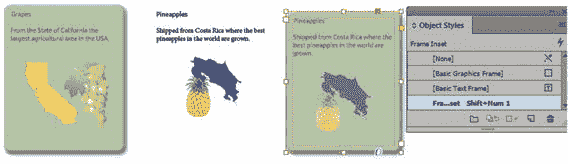

    图 6-38. 原始框架（左），新布局（中），应用样式后，以及右侧显示快捷键的“对象样式”面板

## 6.6.3 创建单一属性的对象样式

有时你可能只想在对象样式定义中使用单个格式化属性。例如，你可能想在所有框架上都应用一个转角效果。然而，这些框架可能还具有其他不同的属性，比如框架填充颜色、描边值等等。当你创建一个对象样式时，InDesign 会自动启用多项样式属性。你需要关闭除所需样式属性之外的所有其他属性。

### 创建包含单一属性的样式

要创建包含单一属性的样式，请遵循以下步骤：

1.  **创建一个新的对象样式。** 在编辑单一属性时，你不需要先格式化对象再创建对象样式。

2.  **命名样式并指定快捷键**，如果你会频繁使用该样式的话。

3.  **选择单个样式属性。** 按住 `Alt/⌥` 键并点击你想编辑的项目旁边的复选框。再次按住 `Alt/⌥` 键并点击以启用该项目。

4.  **编辑该项目的选项。** 在我的示例中，我只想使用转角效果。我希望样式的其他属性在使用时保持中性或不受影响。点击该属性的名称，右侧窗格会随之变化。点击左侧窗格中的“描边与转角效果”。在“新建对象样式”对话框中会显示该效果的所有选项。在我的示例中，我为对象的右上角和左下角添加了 16 像素的圆角。设置如图 6-39 所示。完成后单击“确定”，新样式便会添加到“对象样式”面板中。

    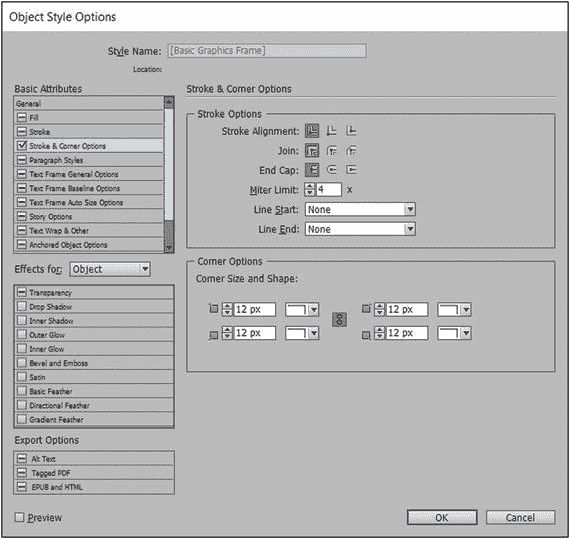

    图 6-39. 直接在“新建对象样式”对话框中编辑对象属性

    **注意：** InDesign CC 2017 额外增加了用于设置起始和终止箭头缩放比例的文本框。如果你使用的是 InDesign CC 2017 之前的版本，你的“描边和转角选项”会与图 6-39 所示有所不同。

5.  **应用该样式。** 点击一个对象，然后点击样式名称或使用快捷键。在我的示例中，有三个框架被分配了不同的颜色和不同的描边值。当我将对象样式应用于每个对象时，唯一改变的就是转角选项，如图 6-40 所示。

    

    图 6-40. 将具有转角效果的对象样式应用于不同颜色和描边值的框架

## 创建带有锚定对象的对象样式

在第 5 章中，我讨论了将对象锚定到表格单元格，并指出需要使用对象样式通过 GREP 模式查找/更改向多个单元格添加对象。然而，我当时没有深入介绍如何创建用于锚定对象的对象样式。现在，是时候讨论如何将对象样式与锚定对象结合使用了。

在图 6-41 中，您会看到一个文本框架以及该框架中每个段落旁边的图像。这些图像被锚定到每个段落的第一行文本。要设置此文档，我们需要将一个框架锚定到相应的文本行，调整锚定选项，然后为锚定对象指定一个对象样式。

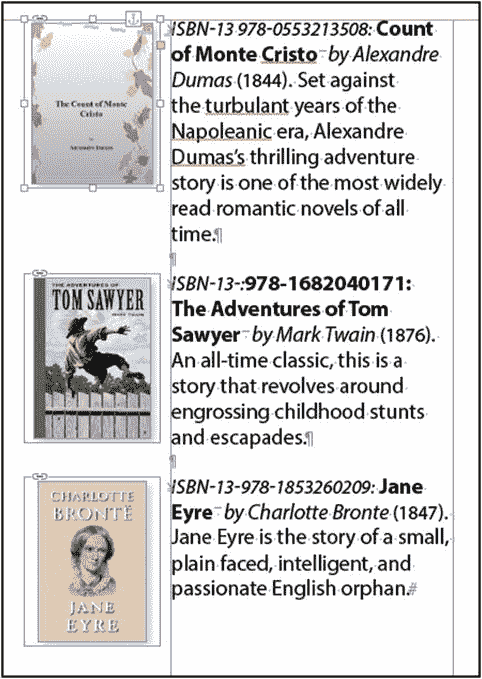

图 6-41. 文本框架旁边的锚定对象

### 使用锚定对象创建对象样式

以下是使用锚定对象创建对象样式的方法：

1.  **将框架锚定到第一段文本。** 我们从一个文本框架和一个文档页面上的框架开始此操作。单击该框架，并将蓝色小方块拖到第一行文本的第一个字符之前。您可能需要放大文档，以便将锚点定位到第一个字符的左侧。当您将锚点拖到文本框架时，会看到一个箭头，其下方和右侧有一个小的`T`字符。当您将光标移到文本框架时，光标上会出现一个竖线。将竖线移动到第一个字符的左侧。

2.  **打开“锚定对象选项”对话框。** 单击该框架，您会在右上角看到一个小锚点图标。按 `Alt`/`⌥` 并单击该图标以打开“锚定对象选项”对话框。您也可以使用 `Object` ➤ `Anchored Object` ➤ `Options` 菜单命令，或右键单击锚定对象并从上下文菜单中选择 `Anchored Object` ➤ `Options`。

3.  **调整锚定对象选项。** 在“锚定对象选项”对话框中，单击右上角的参考点。然后为“锚定位置”单击中间左侧的参考点。调整偏移量。在我的示例中，我输入了 `110` 作为 `X-Offset`，`-12` 作为 `Y-Offset`，如图 6-42 所示。单击 `OK` 关闭对话框。

    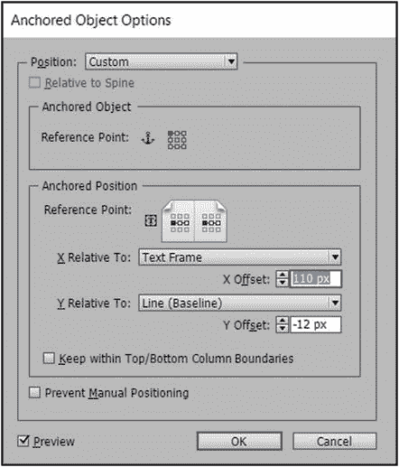

    图 6-42. 做出选择后，单击 `OK` 接受更改

4.  **打开“新建对象样式”对话框。** 选择锚定对象，然后按 `Alt`/`⌥` 并单击“对象样式”面板中的“创建新样式”图标。将打开“新建对象样式”对话框。

5.  **编辑“新建对象样式”对话框中的选项。** 为新的对象样式键入一个名称。单击“框架适合选项”，右侧窗格将更改以显示“框架适合选项”的选择。从适合菜单中选择“按比例填充内容”，如图 6-43 所示。单击“常规”并确保已启用“将样式应用于选定项”。单击 `OK` 创建新样式。

    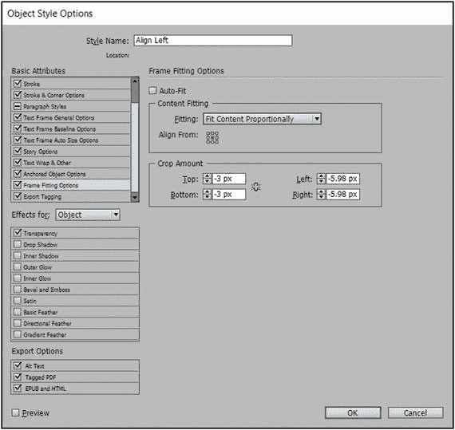

    图 6-43. 编辑框架适合选项

6.  **复制并粘贴锚定对象。** 此文档页面只有几段文本。如果我们有多个页面，并且需要向每个段落添加框架，我们可能会使用 GREP 模式来搜索文档并自动将框架添加到每个段落。不过，在这个示例中，我们只需复制粘贴几次即可。

7.  **单击锚定对象，并按 `Ctrl`/`⌘`+`C` 复制该对象。** 将光标单击到第二段第一个字符之前，然后按 `Ctrl`/`⌘`+`V` 粘贴。将光标插入到第三段第一个字符之前，再次按 `Ctrl`/`⌘`+`V` 粘贴。最终结果应如图 6-41 所示。

---

## 6.7 创建表格单元格和表格样式

当我们创建段落样式和字符样式时，我们通常先创建段落，然后创建字符样式。本质上，我们是先创建整体，再创建部分。在处理表格时，您的工作流程正好相反。我们先创建部分，再创建整体。在表格术语中，这意味着我们先创建单元格样式，然后再创建表格样式。

为单元格和表格创建样式的方式与创建段落样式和字符样式类似。您首先使用多种格式选项来格式化单元格，然后创建单元格样式。对于表格，工作流程是相同的。您首先使用单元格样式格式化表格，然后创建表格样式。

### 6.7.1 格式化表格

当您准备一个需要添加单元格样式和表格样式的表格时，第一步是格式化表格中的所有内容，使其外观完全符合您的要求。在图 6-44 中，您会看到一个格式化好的表格。所有单元格都设置了文本属性，表格有页眉行和页脚行，并且表格包含字符样式和段落样式。这是为创建单元格样式和表格样式而设置表格的第一步。

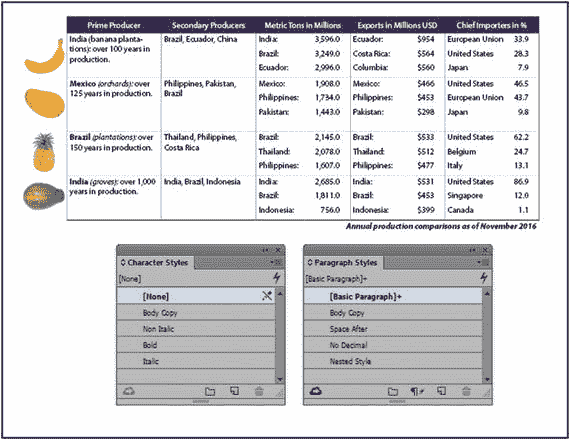

`图 6-44.` 在创建单元格样式和表格样式之前，使用所有表格和单元格属性格式化表格

为单元格中的文本创建段落样式，并添加字符样式以确保样式中没有覆盖。在继续创建单元格样式之前完成此操作。

### 6.7.2 命名单元格样式

您可以随意命名单元格样式，但如果遵循一些固定的命名约定，您的工作会轻松得多。在图 6-45 中，您会看到“表格样式选项”对话框。我们稍后将在“创建表格样式”一节中继续处理此对话框。现在，我想将您的注意力吸引到对话框底部“单元格样式”区域。请注意，有五个选项可供选择单元格样式。您需要为那些与主体样式不同的单元格格式创建单元格样式。在我的示例中，我创建了五种不同的单元格样式，并将它们命名为 `Header`、`Footer`、`Body`、`Left Column` 和 `Right Column`。当我打开“表格样式选项”对话框时，对于需要从五个下拉菜单中选取的单元格样式，就没有任何混淆了。

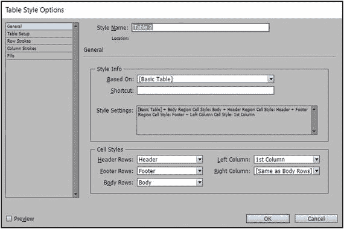

`图 6-45.` 一个表格样式可以为最多五个单独的项目使用单元格样式

创建单元格样式时，请记住，在创建表格样式时，您需要在“表格样式选项”对话框中选取样式。如果您使用了一些不同的命名约定，可能很难为相应的菜单项选择正确的样式。

### 6.7.3 创建单元格样式

创建单元格样式的方法与创建字符样式和段落样式类似。你首先需要格式化一个单元格，然后打开`单元格样式`面板（选择`窗口` ➤ `样式` ➤ `单元格样式`）。

将光标点击在单元格内。你无需选中单元格内容或单元格本身。只需将光标点击在单元格内，然后点击`单元格样式`面板底部的`创建新样式`图标。此时会弹出`单元格样式选项`对话框，如图 6-46 所示。

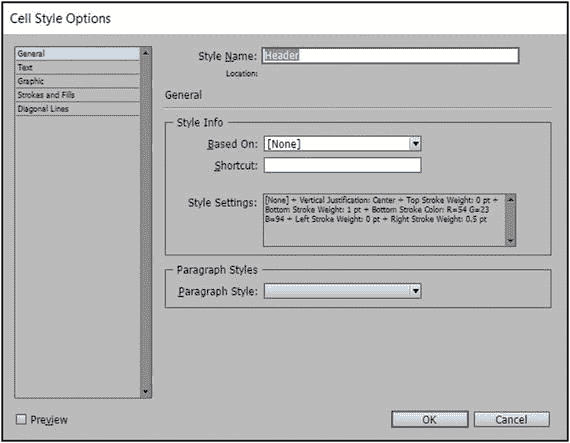

`图 6-46.` 按住`Alt/⌥`键并点击`单元格样式`面板中的`创建新样式`图标。

与在 InDesign 中创建的其他样式一样，首要任务是为此样式命名。如果你已创建了一个样式，并希望基于前一个样式来创建下一个样式，请从`基于`下拉菜单中选择一个样式名称。例如，假设你为正文文本创建了一个样式，并希望将某个单元格内的文本设为斜体。那么你可以创建一个新的单元格样式，并将其基于`正文`样式。`正文`样式中的所有属性都会添加到你的新样式中，唯一的区别就是添加了斜体文本。

如果你希望为某个单元格样式使用键盘快捷键，请在`快捷键`文本框中点击，然后按下 `Ctrl/⌘+Alt/⌥+Shift+`（一个`数字小键盘`键）的任意组合。

为表头、表尾和正文文本（即表头与表尾之间、表格左右两侧之间的所有单元格）创建单元格样式。

### 6.7.4 创建表格样式

在继续创建表格样式之前，请先检查你的工作。确保你已使用段落样式、字符样式和单元格样式定义了所有单元格的格式。确认所有样式均已应用后，通过点击`表格样式`面板中的`创建新样式`图标来打开`表格样式`面板（`窗口` ➤ `样式` ➤ `表格样式`）。此时会弹出`表格样式选项`对话框，如图 6-47 所示。

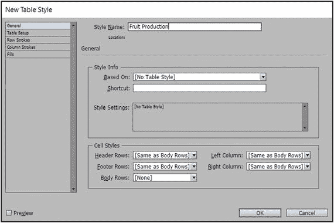

`图 6-47.` 按住`Alt/⌥`键并点击`表格样式`面板中的`创建新样式`图标，即可打开`表格样式选项`对话框。

为样式命名。如果你想指定键盘快捷键，请按下 `Ctrl/Command+Alt/⌥+Shift+`（一个`数字小键盘`键）的任意组合。

如果希望行有交替的填充，请点击左侧窗格中的`填色`。为第一种颜色选择一种填色颜色和色调，为下一行选择另一种颜色和色调。如果你有表头和表尾，请跳过第一行和最后一行。点击`确定`，该表格样式便会出现在`表格样式`面板中。

### 6.7.5 应用表格样式

在图 6-48 中，你看到的是一个未设置格式的表格。如果我想将表格样式应用于这个新表格，我需要选中该表格。点击单元格内的任意位置，然后按 `Ctrl/⌘+A` 进行`全选`，或者将光标置于表格的左上角。等待光标变为斜向箭头后点击，即可选中整个表格。

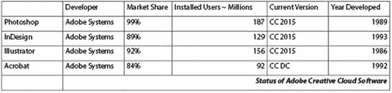

`图 6-48.` 一个没有格式的表格

打开`表格样式`面板，点击你想要应用到所选表格的表格样式。遗憾的是，InDesign 中的表格样式并非完美无缺。你总是需要进行一些小的清理和重新格式化。在图 6-49 中，你可以看到左上角的单元格需要清除填充颜色，并且正文行右侧的描边需要去除。当将表格样式应用于原始、未格式化的表格时，这类编辑操作十分常见。

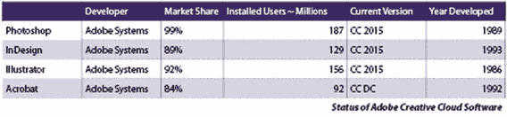

`图 6-49.` 将表格样式应用于未格式化的表格后，需要进行一些清理工作

我在格式化图 6-49 所示的表格时用到的一个小技巧是关于表尾行的。我合并了该行第一个单元格右侧的单元格。但是，我保留了表尾行的第一个单元格不变。由于左列的文字是左对齐的，如果表尾处只设一个单行，那么文字就会向左对齐。通过在表尾行保留一个无描边、无填充的单独单元格，当我应用表格样式时，表尾行就能正确格式化。重新格式化表尾行并非难题，但当文档中有大量表格时，消除额外清理工作的需要有助于你更快地完成文档编辑。

## 6.8 熟悉 GREP

仅看到 GREP 这个名字可能就会吓到一些人。当你看到 GREP 的定义是“使用正则表达式进行全局搜索并打印”时，可能会增添几分焦虑。当你了解到 GREP 是 UNIX 系统中的命令行实用工具时，你的担忧可能就达到顶峰了。在某种程度上，如果你是一个右脑型的艺术家，对编码没什么兴趣，你的担心是有道理的。有些 GREP 表达式非常复杂，需要具备一定的编码知识和能力。然而，在 InDesign 中使用 GREP 的好处在于，有许多简单易行的例程可以让你轻松地应用于页面布局中。

首先，让我们从 InDesign 的角度来理解 GREP 是什么。你使用 GREP 模式来搜索文档，并用新模式、单词、字符或其他内容替换该模式。模式可以是类似日期（例如，2017 年 1 月 1 日）这样的东西。这里的日期就是一个模式。“姓氏，名字，中间名首字母”是姓名的一种模式。以 q（或任何其他字符）开头并以 y（或任何其他字符）结尾的单词也是一种模式。几乎所有你能轻松定义的字符组合，都可以被视为一种模式。

InDesign 中的 GREP 可用于定位文本模式，并将这些文本替换为其他文本、更改文本格式或删除文本。举一个实际例子，你可能希望搜索括号内的所有单词，并将其字体样式更改为斜体。或者，你可能希望搜索所有电子邮件地址，并更改文本颜色或为地址添加下划线。你可能希望删除双空格或多余的回车符。所有这些例子都可以通过搜索 GREP 模式并将其替换为另一种模式来轻松处理。

GREP 代码可以在`查找/更改`对话框中添加，你也可以在`段落样式选项`对话框中创建 GREP 样式。InDesign 中没有专门用于 GREP 样式或表达式的独立面板。

### 6.8.1 理解保留字符

GREP 表达式看上去可能类似这样：

```
(?<=\().+?(?=\))
```

如果我们在“查找/更改”对话框的 GREP 选项卡中输入这段代码，该表达式将搜索括号内的任何文本，但不包括括号本身。如果你更改了括号内语句的文本或字体，内容会发生变化，而括号字符保持不变。

GREP 表达式使用保留字符，这意味着某些字符具有特定的含义，GREP 不会将它们解释为字面意义的字符。例如，在上面的表达式中，问号 `?`、加号 `+` 和句点 `.` 都是 GREP 的保留字符。问号 `?` 是 GREP 用来表示可能存在也可能不存在某物的代码。加号 `+` 表示一个或多个实例（例如一个或多个字符）。句点 `.` 是一个“通配符”，可以匹配任何字符。

假设你想要搜索美元符号并将其替换为另一种货币的符号。美元符号也是一个保留字符。在 GREP 术语中，它表示段落结尾。如果你想再次搜索加号，就不能在 GREP 搜索中直接输入 `+`，因为 GREP 会将 `+` 解释为一个或多个实例。

当你想要搜索在 GREP 中具有特殊含义的字符时，解决方法是转义保留字符。你需要输入一个反斜杠加上该字符。例如，如果我想搜索美元符号，我会输入 `\$`；搜索加号 `+` 则输入 `\+`；查找句点则输入 `\.`。你也可以通过将保留字符放在方括号 `[$]` 中来转义它们。

了解这些特殊字符中的许多能帮助你更好地理解 GREP。此外，知道如何转义保留字符可以帮助你调试自己创建的一些表达式。

## 6.8.2 使用 GREP 搜索与查找

关于 GREP 有很多内容要讨论，我希望能涵盖几个有助于设计项目的 GREP 表达式，尤其是在你希望导出为可重排 EPUB 格式时，更是如此。以下表达式不仅用于创建可重排 EPUB，在某些情况下，它们对于可重排 EPUB 格式来说是必不可少的。让我们来看几个你可能经常使用的表达式。

### 6.8.2.1 消除段落末尾的空格、字符和回车符

你可能会在段落末尾添加一个回车符以提供段落间距，或者你可能放置了客户创建的需要纳入设计的文本，其中包含双回车符。如果导出为可重排 EPUB 格式，EPUB 格式会忽略额外的回车符。在段落之后添加空间的唯一方法是使用段落样式，并在样式定义中调整“段后距”设置。

另一件可能非常麻烦的事情是你的文档中使用了不同于设计中所包含字体的字体间距。每次打开文档时，你都会看到一个警告对话框，提示你缺少字体。

消除多余的空格和回车符是 GREP 查找和更改的一个很好的应用。

**执行 GREP 搜索并消除字符**

要执行 GREP 搜索并消除字符，请执行以下操作：

1.  单击一个段落或一个文章。如果要搜索包含多个文章的文档，可以跳过此步骤，并选择在“查找/更改”对话框中搜索整个文档。

2.  按 `Ctrl/⌘+F` 打开“查找/更改”对话框。由于我们要输入 GREP 表达式，请点击“查找/更改”对话框中的 GREP 选项卡。

3.  在“查找内容”文本框中输入表达式。在本例中，以下表达式将查找段落末尾的空白并删除多个回车符。它非常简单，即使是最不自信的程序员也能轻松复制这个表达式：

    ```
    \s+$
    ```

    该表达式只有四个字符——一个反斜杠、一个用于表示任意空白的小写字母 `s`、一个用于表示一个或多个实例的 `+`，以及一个用于表示段落结尾位置的 `$` 符号。如果你忘记了一些保留字符，InDesign 可以帮你一点小忙。你不会在 GREP 面板中找到所有保留字符，但可以通过打开 `@` 菜单来选择许多常用定义。只输入 `\s+`，并将 `$` 符号排除在表达式之外。点击 `@` 符号打开“查找内容”菜单，向下滚动到“位置”。在子菜单中，选择“段落末尾”，如图 6-50 所示。`$` 符号会被添加到“查找内容”文本框的表达式后面。

    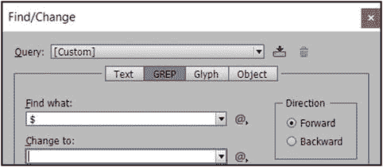

    图 6-50. 点击 @ 符号打开“查找内容”菜单，并在“位置”子菜单中选择“段落末尾”

4.  将“更改为”文本框保留为默认值。要删除段落末尾的多余空格并删除多个段落，你可以将“更改为”文本框留空。InDesign 会将表达式搜索并替换为空，这等同于删除空格和回车符。

5.  点击“查找”。在尝试更改所有实例之前，先点击“查找”按钮几次来测试你的表达式。如果你通过选择 `视图 ➤ 其他 ➤ 显示隐含字符` 来显示隐藏字符，会很有帮助。

6.  当你点击“查找”时，应该会在文档中看到第一个找到的匹配项被选中。如果出现提示未找到任何内容的警告框，请点击文章中的光标位置，然后再次点击“查找”。你可以在不关闭“查找/更改”对话框的情况下点击文档中的文本框架。

7.  全部更改。如果点击“查找”按钮时一切正常，并且你确信 InDesign 找到了你想要查找的表达式，请点击“全部更改”。在图 6-51 中，你可以看到左侧是包含问题文本的文本框架，右侧是我应用 GREP 查找/更改后修正后的结果。

    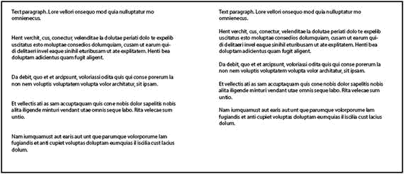

    图 6-51. 执行查找/更改后，空白和多余的段落回车符被消除了

### 6.8.2.2 格式化列表

请看图 6-52。这个数字列表是一团糟。某些行插入了制表符，而其他行却使用了不同数量的空格。您的列表可能没这么乱，但如果您从客户那里获取文本文档，就会发现许多人仍然没有正确使用标尺，而是用空格来格式化列表。当您调整文本框大小时，这些格式都会乱套。这个文档需要使用 GREP 来修复。

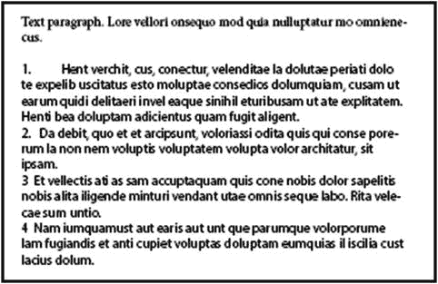

图 6-52. 格式混乱的编号列表

为了清理这个列表，我执行了以下编辑操作：

1.  创建字符样式。如果您想为编号应用与文本不同的颜色，可以创建一个字符样式。在这个例子中，我创建了一个字符样式，并且只更改了文本颜色。

2.  创建段落样式。点击“`段落样式`”面板中的“`创建新样式`”图标；此时会打开“`段落样式选项`”对话框。为这个样式输入一个名称。

3.  在左侧面板中点击“`项目符号和编号`”。在右侧面板中，打开“`字符样式`”菜单，为编号颜色选择字符样式，然后点击“`确定`”以创建新的段落样式。

4.  打开“`查找/更改`”对话框。按 `Ctrl/⌘` 键打开“`查找/更改`”对话框，然后点击“`GREP`”选项卡。

5.  在“`查找内容`”文本框中添加一个 GREP 表达式。我们要搜索的是每个段落开头的一个或多个数字，后面跟一个句点（也可能没有），如果我们对数字后没有句点的行应用同样的表达式，可能还有一些空格（也可能没有），再后面是任何内容。要添加这个表达式，以下代码执行了搜索：

    ```
    ^\d+\.?\s*(.)
    ```

    在这段代码中，`^` 用于定位段落的开头。`\d` 表示任意数字，`+` 表示一次或多次。`\.` 用于查找句点，`?` 表示句点可能存在也可能不存在。`\s` 用于查找可能存在也可能不存在的空格。表达式末尾有一个句点。然而，这个句点出现在括号 `(.)` 中。我们需要将句点放在括号中的原因是，运行这个表达式会复制段落开头的数字。如果添加了 `(.)`，数字会被添加，但在运行“`更改/全部更改`”后会立即被删除。在“`更改为`”文本框中，您会看到 `$1`，如图 6-53 所示。这个表达式会选取括号中的内容。您需要在“`查找/更改`”对话框的底部更改格式。点击放大镜图标，会打开“`更改格式设置`”对话框。在此对话框中选择“`段落样式`”，然后点击“`确定`”返回“`查找/更改`”对话框，如图 6-53 所示。

    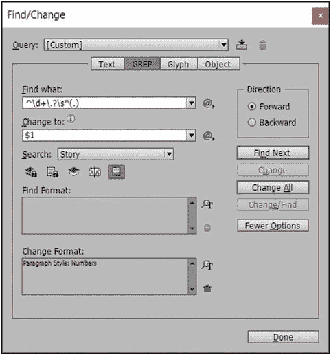

    图 6-53. 添加“查找内容”、“更改为”和“更改格式”设置

6.  点击“`查找`”按钮确保表达式找到了正确的模式，然后点击几次“`更改`”以确认替换是准确的。如果更改不起作用，您可以随时撤销。当您确认一切正常后，点击“`全部更改`”。新的格式化列表出现在图 6-54 中。

    

    图 6-54. 运行“全部更改”后，列表的格式发生了变化

### 6.8.2.3 保存预设（查询）

如果您发现自己经常使用某个 GREP “查找/更改”表达式，那么您可能不希望每次更改格式时都重新输入代码。幸运的是，InDesign 为您提供了一个保存查询的选项。点击“`查找/更改`”对话框中的“`保存查询`”按钮，并为查询输入一个名称。点击“`确定`”，该查询就会被添加到“`查询`”下拉菜单中。在我的示例中，我输入了 `Numbered Lists` 并点击了“`保存查询`”按钮。新的查询显示在图 6-55 中，以及用于更改编号列表格式的代码。


图 6-55. 点击“保存查询”将查询保存为预设

## 6.8.3 创建 GREP 样式

正如我在本章前面提到的，没有专门的 GREP 面板用于创建 GREP 样式。您可以创建 GREP 样式，但这在“段落样式选项”对话框中进行处理。当您在“查找/更改”对话框中保存查询时，该查询是应用程序级别的，这意味着您可以在其他 InDesign 文档中使用该表达式。当您创建 GREP 样式时，该表达式是文档级别的，这意味着代码仅保存在您创建该样式的文档中。您可以打开“段落样式”面板并将包含 GREP 样式的样式加载到新文档中，但这是您能够保留代码的唯一方式。

如果您发现自己经常使用 GREP 样式，可以创建一个包含段落样式、字符样式、对象样式、表格单元格样式、表格样式和 GREP 样式的主文档。在处理新文档时，将样式加载到相应的面板中。InDesign 的妙处在于，您可以（通过样式面板菜单“载入样式”）只从各个面板中加载您想要的样式，并为每个面板导入的样式做出选择。这样就不会使您的样式面板过于杂乱。

到目前为止，我们探讨了在“查找/更改”对话框中创建 GREP 表达式。在您完成一个故事的编辑后，通过“查找/更改”来更改模式是没问题的。但是，如果您需要对使用 GREP 查找和更改后的内容进行额外编辑怎么办？您需要重新运行“查找/更改”。通过将 GREP 样式添加到段落样式，您在段落中所做的任何更改都会自动更新。当我们实际创建一些 GREP 样式时，这一点会变得更加清晰。

现在，让我们看看一些可以在“段落样式”面板中添加的 GREP 样式。

#### 6.8.3.1 创建 OpenType 分数

当你想要创建真正的分数时，`GREP` 样式是一个不错的选择。无需尝试设置上标和下标来凑合出一个分数，你可以使用 OpenType 字体来创建更美观的分数。与其通过一系列步骤来创建一个分数，不如让 `GREP` 样式替你完成这项工作。

**注意**

OpenType 分数在可重排版式或固定版式的 EPUB 中均无法生效。你可以在交互式 PDF 中使用它们。有关在可重排版式 EPUB 中使用分数的更多信息，请参阅第 12 章。

**使用 GREP 样式创建真正的分数**

要添加一个能将基数词转换为分数的 `GREP` 样式，请执行以下操作：

1.  创建一个段落样式。如果你希望所有正文副本都使用分数转换，请使用正文样式，或者创建一个新的段落样式。

2.  添加 `GREP` 表达式。编辑一个段落样式或创建一个新样式。在“段落样式选项”对话框中，单击左侧窗格中的 `GREP` 样式。默认情况下，你会在“应用到文本”字段中看到一个 `\d+`。起初，你似乎无法编辑该表达式。这个对话框看起来像是一个半成品。但是，你可以在此添加代码。只需单击默认代码，“应用到文本”文本框就会变为可用状态，你可以在此删除默认表达式并输入自己的代码。要在文本中查找分数，请键入以下代码：

    ```
    \d+/\d+
    ```

    这段代码非常简单。我们查找一个或多个数字 `\d+`，后跟一个斜杠 `/`，再后跟一个或多个数字 `\d+`。这非常容易。

3.  创建一个字符样式。下一步是创建一个字符样式。你可以使用一个已正确格式化的字符样式，也可以在不离开“段落样式选项”对话框的情况下创建字符样式。点击表达式上方的行，会出现一个下拉菜单。滚动到菜单底部并选择“新建字符样式”。此时会打开“新建字符样式”对话框。

4.  设置字符样式格式。单击左侧窗格中的 `OpenType 功能`。当 `OpenType 功能`窗格打开时，勾选`分数`复选框，如图 6-56 所示。在我的示例中，我还更改了字符的颜色并将字体样式设置为粗体。这是可选的。我这样做只是为了让你在图 6-57 中能更轻松地看到截图。

    

    图 6-57. 文本框中的文本使用了 OpenType 分数

    

    图 6-56. 设置字符样式格式以使用 OpenType 分数

5.  为样式命名并返回“段落样式选项”对话框。在“样式名称”文本框中键入名称，然后单击 `确定` 返回“段落样式选项”对话框。

6.  在“段落样式选项”对话框中单击 `确定`。在你应用该样式的文本框（一个或多个）中，文本将被格式化，如图 6-57 所示。如果你在文本框中键入新的分数，新文本将使用 `分数` 字符样式进行格式化。

#### 6.8.3.2 格式化数字和首字母缩写词

当你排版并使用首字母缩写词和数字时，快速扫一眼往往会觉得这些字符太大了。根据你使用的字体，它们可能会显得很突兀。在许多情况下，你可能希望将首字母缩写词和数字的字号设置得比段落样式中“`基本字符格式`”定义所用的字号小一个或两个点。在图 6-58 的上半部分，你可以看到一个段落中的几个首字母缩写词和数字。这些首字母缩写词和数字明显看起来比正文要大。这是使用 `GREP` 样式的好时机，你可以通过它来降低首字母缩写词和数字的字号。


图 6-58. 首字母缩写词和数字通常看起来比段落中的字号要大

**降低数字和首字母缩写词的字号**

要降低字号，请执行以下操作：

1.  为文本设置一个段落样式。在我的示例中，我使用了“正文”样式。

2.  编辑段落样式。右键单击段落样式并选择“编辑‘正文’”（或你使用的任何段落样式名称）。

3.  打开 GREP 样式。单击左侧窗格中的 `GREP 样式` 以打开 `GREP 样式`面板。

4.  添加一个字符样式。默认表达式 `\d+` 适用于数字。单击“应用样式”并向下滚动到“新建字符样式”。

5.  设置字体大小。在“新建字符样式选项”对话框中，单击“基本字符格式”。

6.  减小字体的字号。在我的示例中，我将字体的字号设置为 22 磅。我将字号减小到 20 磅，然后单击 `确定` 返回“段落样式选项”对话框。

7.  添加另一个 GREP 样式。单击“新建 GREP 样式”按钮，第一组 `GREP` 样式下方会出现新的一组。

8.  键入表达式。单击“应用到文本”字段并键入以下代码：

    ```
    \u\u+
    ```

    此表达式搜索大写字符 `\u`，并重复执行以避免选中仅首字母大写的单词。

9.  添加一个字符样式。用于数字的同一个字符样式也可以用于首字母缩写词。打开“应用样式”菜单，选择为数字表达式创建的字符样式。单击 `确定`；最终结果显示在图 6-58 的底部。

如你所见，你可以在“段落样式选项”对话框中叠加使用 `GREP` 样式。如果你有一些难以编写完整表达式的例程，你可以尝试将它们分解，并编写几个 `GREP` 样式。

有许多 `GREP` 模式，其代码可在博客文章和网站上找到。搜索互联网，你可能会找到一些可以复制并用于文档的模式。

## 6.9 总结

本章我们涵盖了很多内容。你学习了如何使用字符样式和段落样式、对象样式、表格和单元格样式以及 `GREP` 样式。样式对于 EPUB 至关重要，它们能让在 InDesign 中的排版工作变得轻松许多。当你需要修改文档或编辑由同事或其他用户创建的文档时，你会体会到样式的妙用。你对样式了解得越多，处理任何 InDesign 任务的速度就越快。

本章结束了对在 InDesign 中工作的一些基础知识和要点的回顾。从第 7 章开始，我们将探讨交互性。下一章我们将首先理解超链接。
