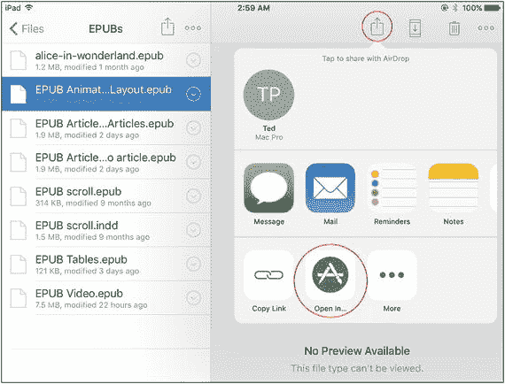
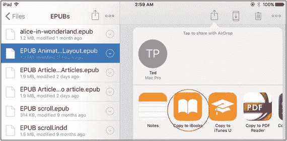
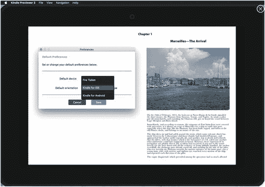

# 12.9 在设备上阅读 EPUB

在第 11 章中，我讨论了如何将文件从电脑上传到设备。在大多数情况下，我发现最好的方法是使用 Dropbox。如果你通过 USB 将电脑连接到安卓设备，也可以将出版物直接复制到设备上，但在多数情况下，Dropbox 效果最佳。使用 Dropbox 时，你可以选择想要用来打开出版物的阅读器类型。

目前有多种不同的阅读器可用于打开 EPUB。当你通过内容提供商托管出版物时，你希望尽可能多地让各种电子阅读器都能访问你的出版物。因此，你应当计划在多种设备上打开 EPUB。

## 12.9.1 使用苹果 iBooks

复制到 Dropbox 的文件是别名，在你查看出版物之前并不会下载到设备上。在 iPad 或 iPhone 上，打开 Dropbox 并点击文件列表中的某个文档。此时，Dropbox 列表中的文件便会下载到你的设备上。点击屏幕顶部的“共享”按钮，如图 12-37 所示。

图 12-37.

点击 AirDrop 共享按钮

在第一行图标的下方，你会找到“在...中打开”按钮。点击此按钮，屏幕会显示能够打开你出版物的应用程序，如图 12-38 所示。点击“拷贝到 iBooks”按钮，出版物便会在苹果 iBooks 中打开。

图 12-38.

点击“拷贝到 iBooks”以在 iBooks 中查看出版物

## 12.9.2 使用 Kindle KF8 格式

电子书市场的绝大部分份额由 `Amazon.com` 占据。如果你想销售电子书，就不能忽视亚马逊。早期的 Kindle 电子阅读器使用亚马逊专有的 MOBI 格式。如今，Kindle 设备使用亚马逊所谓的 KF8 格式。有点令人困惑的是，当你为 Kindle 导出文件时，文件扩展名仍然显示为 `.mobi`。不过不用担心，如果你使用更新的 Kindle 工具来创建可在 Kindle 阅读器上阅读的 EPUB，生成的文件实际上是 KF8 格式。

要将 EPUB 转换为 KF8 (MOBI)，请下载并安装 Kindle Previewer。你可以从 [`http://www.amazon.com/gp/feature.html?docId=1000765261`](http://www.amazon.com/gp/feature.html?docId=1000765261) 下载 Kindle Previewer，或者通过谷歌搜索“Kindle Previewer”获取。

你还需要从 [`http://www.amazon.com/gp/feature.html?docId=1000765211`](http://www.amazon.com/gp/feature.html?docId=1000765211) 下载 KindleGen，或者搜索“KindleGen”并跟随链接到下载页面。当你在 Kindle Previewer 中打开文件时，该文件会被 KindleGen 转换并以 `.mobi` 扩展名保存，但如果你使用的是较新版本的 Kindle Previewer，它会被转换为 KF8 格式。

安装 Kindle Previewer 后，启动该应用程序，你会看到一个欢迎屏幕。欢迎屏幕上有许多链接，指向亚马逊托管的帮助文档，你可以在“帮助”部分看到这些链接。点击“打开图书”按钮，在 Previewer 中打开一个 EPUB。支持的文件类型包括 MOBI、EPUB、HTML 和 OFP。你会看到 MOBI 被列为支持格式，是因为你可以将旧的 `.mobi` 文件转换为新的 KF8 格式。

截至撰写本文时，Kindle Previewer 3 应用程序仍处于测试阶段。Kindle Previewer 3 在将 EPUB 转换为 KF8 格式方面表现出色。在图 12-39 中，你可以看到一个 EPUB 的预览以及 Kindle Previewer 3 应用程序的偏好设置对话框。

图 12-39.

使用 Kindle Previewer 3 转换的 EPUB

右键点击桌面上的文件，然后从上下文菜单中选择“打开方式”。如果你的电脑上安装了 Kindle 电子阅读器，Kindle 应用程序会显示为默认阅读器。

要将电子书发送到设备并在 Kindle 电子阅读器或设备上的 Kindle 阅读器应用中查看，请使用“发送到 Kindle”应用程序，你可以从 `Amazon.com` 的 [`http://www.amazon.com/gp/sendtokindle/pc`](http://www.amazon.com/gp/sendtokindle/pc) 下载。启动“发送到 Kindle”应用，然后将 EPUB 文件拖放至应用程序窗口。

## 12.9.3 使用专用 EPUB 阅读器

市面上有许多软件应用程序和专用电子阅读器可供选择。通常，你可以下载各种电子阅读器和应用的桌面版。Kobo 阅读器在加拿大和欧洲很受欢迎。你可以从 [`https://store.kobobooks.com`](https://store.kobobooks.com) 为你的桌面电脑下载 Kobo 阅读器。

各种设备的电子阅读器应用均可下载。你可以获取 Stanza 或 Calibre 作为桌面和设备的电子阅读器，此外还有许多其他应用。你可以下载几个来测试你的 EPUB，并验证它们在多种阅读器中是否正常工作。

电子阅读器和数字出版的世界在不断变化。请定期搜索互联网，了解 EPUB 格式的趋势、流行应用和发展动态。

