# 7. 创建超链接

如果你在互联网上探索过，肯定知道超链接。每次你点击一个 `HREF` 标签（与按钮或文本相关联）并跳转到新位置时，你就体验了超链接的目标位置。

超链接有两部分：源和目标位置。在 `InDesign` 中，源可以是文本、文本框、图像、对象、交互式元素和对象框架。超链接的目标位置可以是 URL、启动默认电子邮件应用程序、文档内的页面、文档内包含的锚点以及指向外部文档的链接。

如你所见，`InDesign` 超链接的功能远不止打开网页那么简单。在本章中，我将介绍如何从各种源创建超链接，以及如何为各种目标位置设置它们。

> **警告**
> 正如我在第 15 章中讨论的那样，在导出到交互式 PDF 文档时，应避免在 `InDesign` 中创建超链接。请使用 Acrobat 的工具来处理 PDF 文件中的所有超链接创建。

## 7.1 了解超链接的基础知识

`InDesign` 超链接可以链接到 URL、外部文件、电子邮件客户端、文档内的页面、文本锚点和共享目标。共享目标由两个或多个源共享。当目标被共享时，它们会以层级结构出现在 `超链接面板` 中，并嵌套在一个文件夹下。当不共享时，每个目标会单独列在面板中。

### 7.1.1 熟悉超链接面板

`InDesign` 文档中的所有超链接都会显示在 `超链接面板` 中，如图 7-1 所示。要打开此面板，请选择 `窗口 ➤ 交互 ➤ 超链接`。该面板包含许多用于处理超链接的选项。

*   `URL`：当你点击一个对象（文本、文本框、图像、对象、矩形框、形状等）时，`URL` 文本框会变为可编辑状态。要链接到外部 URL，请在文本框中输入 URL 地址。
*   `名称`：你会在 `名称` 右侧看到两个相邻的图标。第一个是页面图标。面板中的每个超链接都带有一个表示超链接类型的图标。图标旁边是一个数字，对应超链接所在的页码。如果你点击该数字，`InDesign` 会跳转到该页面并选中源。
*   每个超链接还带有颜色编码。绿色圆圈表示 URL 有效。红色圆圈表示 URL 无效。点击有效图标会带你跳转到目标位置。
*   `刷新 URL 状态`：点击此按钮可刷新列表。
*   `创建新超链接`：必须在文档中选中某个对象后，此图标才会变为可用。当文本或对象被选中时，点击该图标即可创建新超链接。
*   `垃圾桶图标`：要删除一个超链接，请在 `名称` 列表中点击你想要删除的那个超链接，然后点击 `垃圾桶图标`。

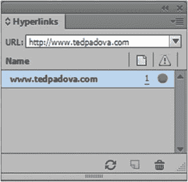

图 7-1. 选择 `窗口 ➤ 交互 ➤ 超链接` 以打开 `超链接面板`

`超链接面板` 有大量的菜单命令，如图 7-2 所示。要打开菜单，请点击 `超链接面板` 右上角的图标。菜单打开后，包含以下选项：

*   `新建超链接`：点击此菜单项可创建新超链接。其行为与点击 `超链接面板` 底部的 `创建新超链接` 图标相同。
*   `从 URL 新建超链接`：如果你在文档的文本中选中了一个 URL，点击此菜单项会创建一个指向该 URL 的新超链接。
*   `将 URL 转换为超链接`：请谨慎使用此功能。`InDesign` 不区分有效 URL 和无效 URL。如果你有类似 `realize.It` 的文本，`InDesign` 也会创建一个 URL。在 `InDesign` 中，任何句子结尾处有一个句点且下一个单词之间没有空格的文本，都会被当作 URL 处理。
*   `删除超链接`：使用此命令的结果与使用 `超链接面板` 中的 `垃圾桶图标` 相同。
*   `新建超链接目标`：点击此菜单项，会打开一个对话框，你可以在其中为页面、文本锚点或 URL 选择目标。
*   `编辑超链接`：在 `超链接面板` 中选中一个超链接，然后点击此菜单项以打开 `编辑超链接` 对话框。在 `编辑超链接` 对话框中，你可以编辑 URL 或更改目标、选择字符样式以及编辑 PDF 选项。
*   `超链接目标选项`：点击此菜单项，会打开 `超链接目标选项` 对话框。在其他更改中，你可以修改超链接的名称。（请注意，你也可以在 `超链接面板` 中通过点击名称、稍作停顿、再次点击，然后为名称输入新文本来更改超链接名称）。超链接名称对目标没有影响。你可以一边工作一边重命名超链接名称，并为超链接的作用添加更具描述性的名称。
*   `删除未使用的目标`：当你完成工作并准备发布时，使用此命令是一个好习惯。`InDesign` 会删除文档中所有未使用的目标。
*   `转到源`：这类似于点击 `超链接面板` 中超链接名称右侧的数字。当你选择此命令时，`InDesign` 会跳转到源所在的页面并选中该源。
*   `转到目标`：点击此命令，会执行超链接动作。如果超链接是一个 URL，该 URL 会在你的默认网页浏览器中打开。如果目标是某个页面，`InDesign` 会跳转到目标页面，依此类推。
*   `重命名超链接`：此功能略显多余，因为你已有另外两种方法可以重命名超链接。当你点击此菜单项时，会打开一个简单的对话框，你可以在其中输入新名称。
*   `重置超链接`：假设你有一个源是某些文本的超链接。后来你意识到希望该超链接使用不同的源。你可以选中新的源，然后在 `超链接面板` 中选中该超链接并选择 `重置超链接`。新的源将使用从原始源建立起来的超链接目标。
*   `更新超链接`：当你链接到外部文档（如 PDF 文件）时，请使用此菜单项。如果你更改了文件名或位置，请选中 `超链接面板` 中的超链接并点击 `更新超链接`。
*   `排序`：默认情况下，你不能在 `超链接面板` 中移动超链接。但是，如果你在菜单中选择 `排序 ➤ 手动`，就可以在列表中上下拖拽项目。其他排序选项包括 `按名称` 和 `按类型`，你可以按超链接的名称排序，也可以按目标类型排序。
*   `小面板行`：当你选择此命令时，列表中的字体变小，以便你可以在面板中看到更长的列表。
*   `自动更新 URL 状态`：默认情况下，此项是勾选的。如果你离线工作，可以取消勾选此项，等你重新在线时再启用它。启用后，`InDesign` 会自动更新 URL 状态，并为你提供有效和无效 URL 的实时反馈。

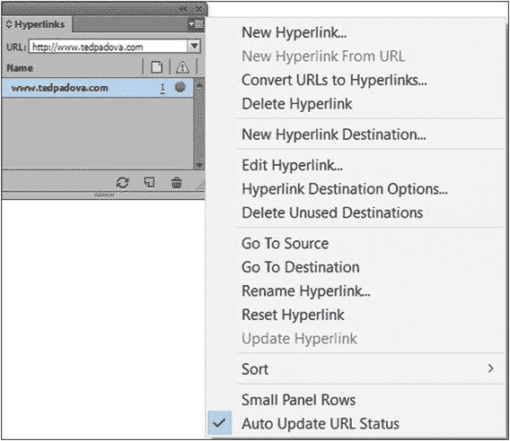

图 7-2. 打开 `超链接面板` 菜单以访问超链接选项

### 7.1.2 使用超链接样式

当你在 `InDesign` 文档中创建第一个超链接时，你可能不会立即意识到，但 `InDesign` 实际上为你创建了一个 `字符样式`。（有关 `字符样式` 的更多信息，请参阅第 6 章。）

打开 `字符样式面板`（`窗口 ➤ 样式 ➤ 字符样式`）。`字符样式面板` 随即打开。如果你想更改该样式的属性，请在 `字符样式面板` 中右键点击 `Hyperlink` 样式并选择 `编辑 Hyperlink`（这里的 `Hyperlink` 是 `字符样式` 的名称）。`字符样式选项` 对话框会打开，如图 7-3 所示，你可以在其中更改字体、字号、行距、文本颜色等。我在第 6 章中详细解释了如何使用 `字符样式选项` 对话框。

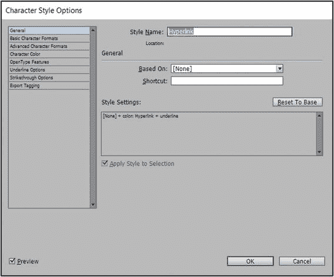

图 7-3. 当你创建第一个超链接时，`InDesign` 会自动创建一个 `字符样式`

### 7.1.3 编辑超链接

若要编辑超链接以更改目标、URL、字符样式或 PDF 外观，请在 `超链接面板` 中选择该超链接，然后从 `超链接面板菜单` 中选取 `编辑超链接`。此时将打开 `编辑超链接` 对话框，如图 7-4 所示。

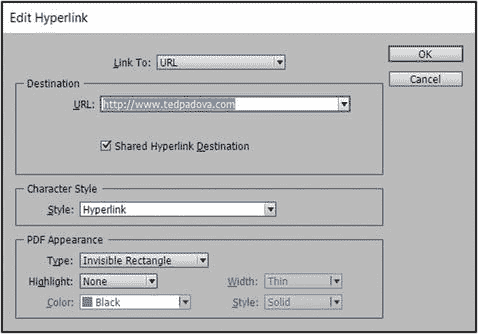

图 7-4. 在 `超链接面板菜单` 中点击 `编辑超链接`

你在 `编辑超链接` 对话框中可能会注意到的其中一项是 `共享超链接目标` 复选框。如果该复选框未选中，且你有一长串使用相同目标的超链接，你可能想要编辑它们并勾选此复选框。这些超链接将嵌套在 `超链接面板` 的一个文件夹中，如果你的文档包含许多不同的超链接，这将使其更易于管理。

### 7.1.4 编辑超链接目标

点击 `超链接面板菜单` 中的 `超链接目标选项`，打开 `超链接目标选项` 对话框，如图 7-5 所示。文档中的所有超链接目标都会列在 `目标` 菜单中。当你添加新目标时，它们会被动态添加到该菜单中。

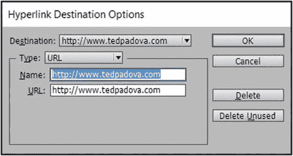

图 7-5. 在 `超链接面板菜单` 中点击 `超链接目标选项`

在此对话框中，你可以更改目标类型、更改超链接名称，并且如果目标是 URL，还可以更改 URL。

## 7.2 链接到 URL

如你所见，`InDesign` 提供了一套非常完备的用于处理超链接的功能和命令。现在你已经熟悉了这些对话框和 `超链接面板`，是时候在文档中创建一些超链接了。

### 创建超链接

要创建一个打开 URL 的超链接，请执行以下操作：

# 7.3 链接到电子邮件客户端

当你链接到电子邮件客户端时，会在默认的电子邮件客户端中创建一封新邮件。你可以控制目标电子邮件地址、主题行，甚至邮件内容。一切从`超链接面板`开始，你在其中创建指向电子邮件地址的新超链接。

你可能有一份文档，希望获得内容读者的反馈，想要分享文件链接中的附加信息，或者希望读者以任何其他方式与你沟通。创建电子邮件超链接相当简单。但当需要在`超链接`文本框中添加较长的文本行时，事情就变得稍微复杂一些。

## 7.3.1 创建电子邮件超链接

首先，我们来看看如何创建一个相当简单的电子邮件超链接。

### 创建电子邮件超链接

要创建你的第一个电子邮件超链接，请按照以下步骤操作：

1.  在文档中选择一个对象、文本或其他项目，然后点击`超链接面板`中的`创建新超链接`图标。此时会打开`新建超链接`对话框。
2.  从`链接到`菜单中选择`电子邮件`。在`地址`字段中键入一个有效的电子邮件地址。键入主题行（可选），如图 7-7 所示。点击`确定`。

    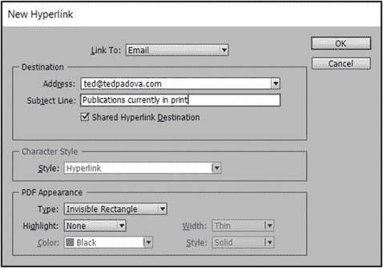

    图 7-7. 从`链接到`菜单中选择`电子邮件`

3.  注意`超链接面板`中的 URL。你会看到一些代码以及电子邮件地址（见图 7-8）。

    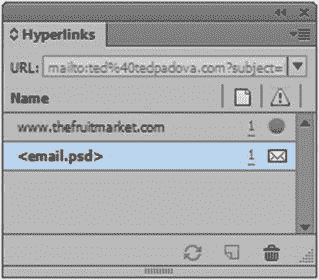

    图 7-8. 添加电子邮件链接后的`超链接面板`

4.  点击`超链接面板`中的电子邮件图标以测试该地址。你应该会看到一个新的消息窗口在你的默认电子邮件客户端中打开。如果一切正常，你就完成了电子邮件链接任务。

这个电子邮件链接是一个简单的任务。要探索电子邮件链接的更多选项，你可以在消息字段中添加描述，创建指向外部文件的链接，并将所有信息添加到`超链接面板`中的 URL 名称中。

## 7.3.2 创建带消息的电子邮件超链接

在 InDesign 中，用于输入 URL 链接的行非常小，并且没有其他添加 URL 信息的方式。即使是允许你编辑 URL 的对话框，其文本框也只有一行。如果你有一个长 URL 并且需要编辑其中的信息，比较好的做法是在 InDesign 的粘贴板上创建文本，然后将文本复制粘贴到 URL 文本行中。

在图 7-9 中，你看到了 InDesign 粘贴板上的文本。该文本包含一个可以下载 PDF 文档的超链接。我添加了一些回车换行以便于编写并使其更具可读性。编写完代码后，你需要删除回车换行，这样就得到了一行文本。

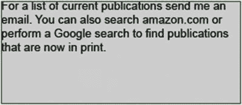

图 7-9. 在 InDesign 粘贴板上键入电子邮件内容的信息

这还没完。你需要删除所有空格，并将其替换为`%20`。你可能见过这样显示的网址，因为 URL 地址行中不允许有空格。

> **注意：** URL 行中不允许有空格。`%20` 是 URL 字符串中空格的 ASCII 编码值。

与其手动整理，不如使用脚本来自动处理格式。此脚本来自 Keith Gilbert，网址为 [www.gilbertconsulting.com](http://www.gilbertconsulting.com)。我加载了 Keith 的脚本并在粘贴板上的文本上运行。结果如图 7-10 所示。

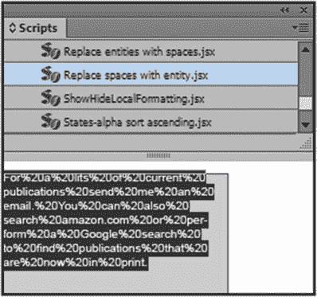

图 7-10. 在运行 Keith Gilbert 的`用实体替换空格`脚本后，所有空格都被替换为正确的代码。

> **注意：** Keith Gilbert 是一位作家、会议演讲者和顾问，专精于 InDesign 和 Adobe DPS。他的网站（[www.gilbertconsulting.com](http://www.gilbertconsulting.com)）提供了大量关于数字出版的信息以及他编写的一些精巧的 InDesign 脚本。他的两套脚本（数字出版包 1 和数字出版包 2）对于从事 DPS 和数字出版工作的人来说是非常好的工具，我强烈建议你去看看。

运行脚本后，复制文本并将其粘贴到 URL 文本字段中。

# 7.4 链接到页面

你可能会想在文件中创建一些交叉引用，方便读者跳转阅读与特定主题相关的内容，或者创建一个链接到各章节的目录页。

## 链接到页面

使用“超链接”面板可以轻松链接到页面：

1.  要链接到文档中的某个页面，请打开“超链接”面板并选择一个源。此源可以是文本或图形。单击“超链接”面板中的`创建新超链接`按钮。此时将打开`新建超链接目标`对话框，如图 7-11 所示。

    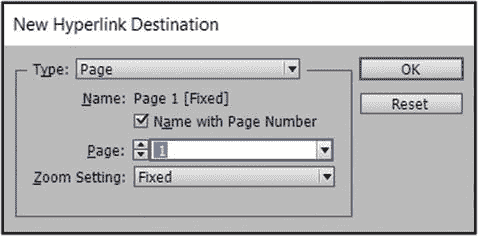

    图 7-11.

    选择`页面`并选择页码。

2.  在`链接到`菜单中选择`页面`，然后在`页面`菜单中选择页码。你的文档中的所有页面都会列在该菜单中。单击`确定`以创建超链接。

另一种页面导航方式是链接到锚点。（有关创建锚点的更多信息，请参见第 4 章和第 12 章。）

## 链接到锚点

要链接到锚点，请执行以下操作：

1.  在文本框架中单击文字工具，或选择框架内的文本，然后打开“超链接”面板。
2.  打开“超链接”菜单，选择`新建超链接目标`。此时将打开`新建超链接目标`对话框。
3.  从`类型`菜单中选择`文本锚点`，并为文本锚点输入一个名称（见图 7-12）。默认名称为`锚点 1`，后续添加到文档中的锚点依次为`锚点 2`、`锚点 3`，依此类推。最好为锚点赋予一个描述性名称，尤其是当文档中有很多锚点时。

    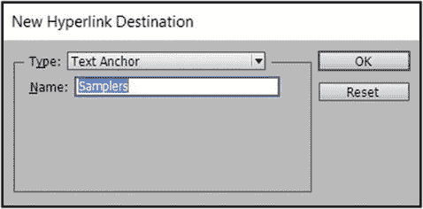

    图 7-12.

    要创建一个锚点作为目标，请单击光标或选择文本，然后在`新建超链接目标`对话框中选择`文本锚点`。到目前为止，我们创建了目标，但尚未指定源。

4.  创建一个框架，选择一个对象，或为源选择文本。
5.  在“超链接”面板中，单击`创建新超链接`按钮。
6.  当`新建超链接`对话框打开时，在`链接到`菜单中选择`锚点`，然后在`文本锚点`菜单中选择锚点名称。

当你创建指向文本锚点的超链接时，该超链接会在“超链接”面板中显示为锚点符号。你可以通过单击“超链接”面板中的锚点符号轻松检查该超链接。如果链接设置正确，InDesign 将跳转到链接目标所在的页面。

# 7.5 本章小结

在本章中，我们开始了在 InDesign 中创建交互式元素的旅程。超链接只是为文档添加交互性的众多方法之一。

本章我们从一些简单的任务入手。当你开始学习其他交互功能（如下一章将介绍的动画）时，事情会变得更加复杂。
