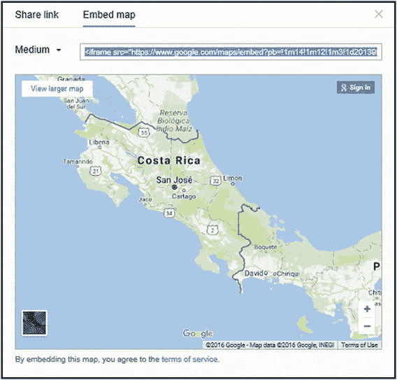
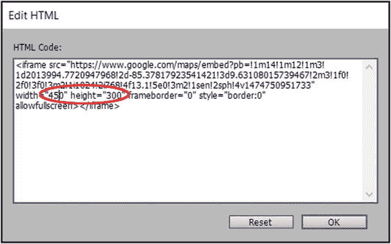
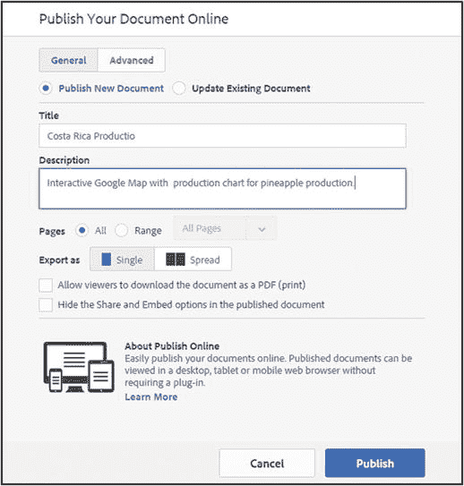
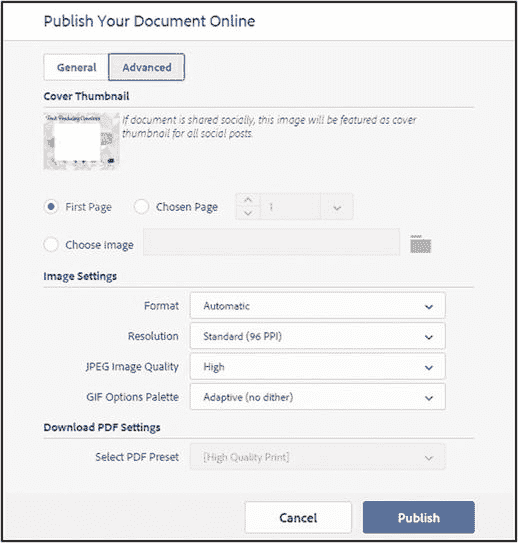
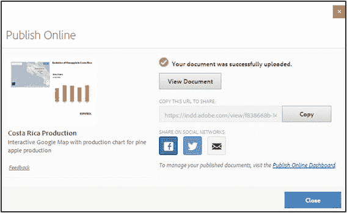
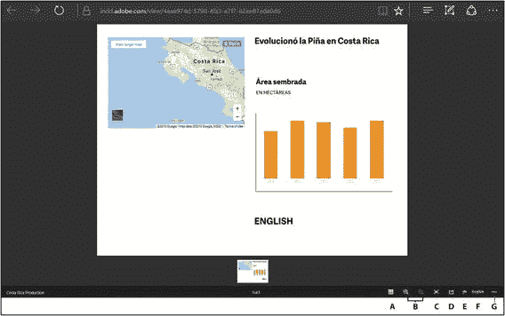
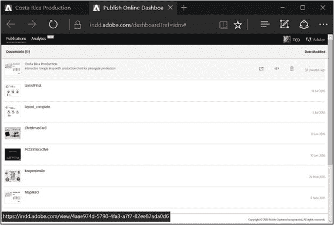

# 14. 发现 Adobe Publish Online

Adobe 在 InDesign CC 2015 中引入了 Publish Online，在开发期间最初被称为 Publish Online（预览版）。不要低估这个 InDesign 中出色的新功能，以及你能用它做的不可思议的事情。

你既可以重新利用为印刷设计的内容，也可以创建一个新文档。在这两种情况下，你都可以利用我在之前章节中讨论的几乎所有交互功能。你不需要专门的查看器，几乎所有设备（包括智能手机、平板电脑、笔记本电脑、便携式电脑和台式电脑）上都可以看到内容和交互效果。

完成作品后，你可以与任何人分享你的文档，方法是：将文档嵌入网站或博客、托管 URL 链接、通过电子邮件将链接发送给朋友和同事、发布到 Facebook 或分享到 Twitter 账户。

在本章中，我将介绍如何创建用于 Publish Online 的文档，以及如何分享你的作品。

## 14.1 在 Publish Online 中使用交互功能

我在之前章节中介绍的 InDesign 交互功能都被支持。你可以使用动画、媒体、多状态对象、按钮和超链接（URL、电子邮件、页面目标、目录标记、索引标记和交叉引用超链接）。在撰写本文时，不支持你在 Acrobat PDF 中可以执行的一些操作，例如更改图层可见性或向按钮添加 JavaScript。这些限制存在于 InDesign 中，并且 Publish Online 需要直接从 InDesign 导出。因此，如果你无法在 InDesign 中创建它，它就无法在 Publish Online 中工作。此外，由于 Publish Online 是使用 HTML5 和 JavaScript 编写的，因此不支持 SWF 文件。

在覆盖面板中找到的许多功能也不被支持。遗憾的是，诸如可滚动框架和使用网页内容等功能目前尚不可用。

在固定版式 EPUB 和交互式 PDF 文档中不支持的、但你可以使用 Publish Online 完成的一些事情包括：

*   **多页跨页：** 你可以创建超过两页的跨页。在 Publish Online 中查看时，你可以让跨页带有动效。例如，你可以使用全景图像在屏幕上自动滚动。
*   **多种页面大小：** InDesign 支持创建具有不同页面大小的文档。在线文档会保持各个页面的尺寸。
*   **交互式 Google 地图：** 你可以在 InDesign 文档中插入显示交互式 Google 地图的 HTML 代码。地图的交互性在固定版式 EPUB 和交互式 PDF 文件中会丢失，但你可以在 Publish Online 文档中使用交互式 Google 地图。
*   **Adobe Animate 文件：** Adobe Animate（以前称为 Adobe Edge Animate）将动画提升到了一个新水平。Adobe Animate 类似于 Adobe Flash，你可以创建非常令人印象深刻的动画。文件是用 HTML5 和 JavaScript 编写的，因此它们可以在所有平台上播放。当你从 Animate 导出文件时，请在发布设置（文件 ➤ 发布设置）对话框中选择 Adobe 部署包（`.oam`）选项。OAM 文件可以导入 InDesign 并发布为在线文档。来自 Adobe Animate 的 OAM 文件在 Publish Online 和固定版式 EPUB 中得到支持，但不支持在交互式 PDF 中使用。

## 14.2 使用 Publish Online

在 Adobe InDesign 中提供的所有文档创建选项中，使用 Publish Online 是创建数字出版物最简单的方法。只需简单的菜单选择即可打开“Publish Online 选项”对话框，在其中进行一些选择，然后单击“确定”将文件发送到 Adobe 的服务器。任何使用任何类型设备、任何操作系统的人都可以查看你的作品。由于所有内容都在网页浏览器中查看，因此无需专门的阅读器。

与 InDesign 中可用的所有其他文档导出方式不同，一旦你使用 Publish Online 发布了文档，你就无法访问保存的文件。该文件会被发送到 Adobe 的服务器并驻留在那里，直到你将其删除。返回给你的是一个 URL，你可以将其复制并用作网站或博客中的超链接，通过电子邮件分享，或直接分享到你的 Facebook 和 Twitter 账户。

**提示**

保持你已发布的在线文档整洁。如果你没有使用某些文档，请将它们从 Adobe 的服务器中删除。帮助 Adobe 将其存储负担降至最低。

### 14.2.1 发布文档

你首先需要像为任何其他类型的导出一样创建你的数字出版物。Publish Online 为你提供的一项功能是发布 Google 交互式地图。让我们从创建指向 Google 地图的链接开始，然后研究如何发布文档。

#### 14.2.1.1 向文档添加 Google 地图

要向文档添加交互式地图，请登录 Google 地图并搜索一个地图位置。在我的示例中，我将哥斯达黎加作为一个目的地，因此我们在“搜索 Google 地图”文本框中输入 `Costa Rica`，然后单击搜索图标。到达地图位置后，打开菜单（Google 地图中的左上角），然后单击“分享或嵌入地图”链接。

当屏幕显示“分享或嵌入地图”的选项时，单击“嵌入地图”，如图 14-1 所示。文本框中的文本会被选中。按 Ctrl/⌘+C 复制 URL。

**图 14-1.** 单击“嵌入地图”并复制 URL

打开你的 InDesign 文档，然后选择“对象”➤“插入 HTML”。你会看到一长串代码。在代码中找到宽度和高度（请参见图 14-2），然后编辑这些值以匹配你希望地图在文档中占据的尺寸。单击“确定”，等待几分钟，直到看到地图出现在文档中心。

**图 14-2.** 将宽度和高度值编辑为你希望地图在文档中占据的尺寸

当地图出现在文档中时，你可以使用选择工具在页面上移动它。如果地图太大或太小，请检查文档顶部和左侧的标尺以确定你需要的精确尺寸。删除地图，再次选择“对象”➤“插入 HTML”，粘贴 URL，并编辑宽度和高度。单击“确定”并检查地图的大小。

你可以使用我在之前章节中讨论过的任何其他交互元素，例如动画、MSO、富媒体、超链接等。文档定稿后，你就可以发布了。

#### 14.2.1.2 提交文档以在线发布

要通过 Publish Online 发布文档，请选择 `File ➤ Publish Online` 或单击 `InDesign` 窗口顶部的 `Publish Online` 按钮，随后将打开 `Publish Online Options` 对话框。默认面板为 `General`。在 `General` 面板中，您可以提供与文档文件名不同的 `Title`（标题）和 `Description`（描述）（参见图 14-3）。

图 14-3. 为 `Title` 和 `Description` 输入名称

您可以通过选择可用选项来发布所有页面或指定范围的页面。通过单击相应的单选按钮，您可以将文档导出为单页或跨页。

`Publish Online Options` 中的第二个面板是 `Advanced`。单击左侧列的 `Advanced` 以打开 `Advanced` 面板，如图 14-4 所示。面板顶部，您可以为封面缩略图进行选择。当有人在社交媒体上分享您的内容时，此图像将被用作封面。您可以选择文档中的第一页作为缩略图图像，也可以滚动浏览页面并选择您希望显示为缩略图的页面。如果您想使用图像文件，请单击 `Choose Image`，然后点击文件夹图标浏览您的电脑，并选择 `GIF`、`PNG` 或 `JPEG` 图像。

图 14-4. 单击左窗格中的 `Advanced` 以打开高级选项

在 `Image Settings` 区域，您可以选择三种支持的格式之一，或保留默认的 `Automatic` 让 `InDesign` 自动选择格式。除非您有特殊原因要将所有图像转换为某种可接受的格式，否则请使用 `Automatic` 选项。`Automatic` 将优化性能。

对于 `Resolution`，您可以使用 `96ppi` 制作较低分辨率的文档，或者选择 `HiDPI` 以获得更高分辨率的图像。如果您的文档很长且包含许多图像，下载时间将更长。您可以尝试测试不同选项，找到最适合您设计的选项。

对于 `JPEG Image Quality`，请像处理大多数 EPUB 文档一样，选择 `High` 作为标准。对于 `GIF` 选项，如果文件中有任何渐变或颜色阴影，请选择 `Adaptive`。如果是纯色，您的最佳选择可能是 `Web`。

在 `Publish Online Options` 对话框中设置完所有选项后，单击 `OK`，您的文件将上传到 Adobe 的服务器。如果上传时间较长，您可以继续在 `InDesign` 中工作。

上传完成后，您将看到 `Publish Online` 屏幕，如图 14-5 所示。在这里您可以进行多种选择，包括以下内容：

*   **View Document**：单击 `View Document` 按钮，您的文档将加载到默认网络浏览器中。在 Mac 上，文件会加载到 `Safari` 中（假设 `Safari` 是默认浏览器）。在 Windows 10 上，文件会在 `Microsoft Edge` 中打开。如果未安装 `Edge`，文件会在 `Internet Explorer` 中打开。如果您使用 Windows 10，可能需要切换应用程序并打开 `Edge` 才能查看文件。在 Mac 上，`Safari` 窗口会覆盖在 `InDesign` 窗口之上。
*   **Copy**：如果您想复制 URL，请单击复制按钮，URL 地址将复制到您的剪贴板。如果您想在之后的网页或博客网站中使用该链接，可以将其粘贴到文本编辑器中。
*   **Share on Social Networks**：单击 `Facebook` 图标、`Twitter` 图标或 `E-mail` 图标，可在相应网站上分享。如果选择 `E-mail`，您的默认电子邮件客户端将打开一个新邮件窗口，文件描述会放在邮件主题行中，文件名和 URL 会添加到邮件正文中。

图 14-5. 当文档完成下载时，会出现 `Publish Online` 屏幕，您可以在其中找到多种选择

如果您分享到 `Facebook` 或 `Twitter`，系统会提示您先登录账户。

*   **Close**：单击 `Close` 按钮关闭窗口。

### 14.2.2 更改已发布文档中的查看属性

当您单击 `View Document` 时，您将看到已发布的内容以及一些提供查看和分享选项的按钮。在图 14-6 中，您可以看到屏幕底部的图标，用于这些选项。其中包括：

1.  **Toggle Thumbnails**：默认视图是窗口底部不显示缩略图。在图 14-6 中，我单击了 `Toggle Thumbnails` 按钮，所有页面缩略图都显示在浏览器窗口底部。由于此文档仅包含一页，因此您只能看到一个缩略图。要返回默认视图，请再次单击 `Toggle Thumbnails` 按钮。
2.  **Zoom buttons**：单击带有 `+` 符号的放大镜可放大文档。单击带有 `–` 符号的放大镜可缩小。
3.  **Full Screen**：单击此按钮进入全屏模式。再次单击退出全屏模式。
4.  **Share**：单击 `Share` 按钮打开一个窗口，您可以在其中复制 URL、分享到 `Facebook` 或 `Twitter`，或添加到新电子邮件中。
5.  **Report Abuse**：单击此按钮时，会打开一个窗口，您可以在其中对包含 `Defamation`（诽谤）、`Pornography`（色情）、`Abuse`（滥用）、`Copyright`（版权）或 `Other`（其他）选项的菜单进行滥用投诉。将出现一个姓名栏供您输入姓名，一个电子邮件栏供您添加电子邮件地址，以及一个评论框供您进一步描述投诉内容。填写完信息后，单击 `Submit` 按钮，投诉将发送给 Adobe。
    **Caution**：Adobe 会监控投诉，并努力保护最终用户免受非法和不法内容的侵害。创建内容时，请牢记要保持内容清洁并遵守版权法。
6.  **Language**：弹出菜单包含语言选项。单击该按钮打开菜单。两个选项包括：
    *   **Embed**：此选项生成一个“嵌入代码”，允许您将 Publish Online 文档嵌入到另一个网站中。单击 `Embed` 会打开一个窗口，为您提供多种文档尺寸选项和嵌入代码。嵌入代码类似于我之前在“向文档添加 Google 地图”一节中讨论的 `Google Maps` 所使用的代码。如果默认尺寸不满足您的需求，您可以在文本编辑器中编辑宽度和高度。
    *   **Turn OFF Volume**：单击此按钮可关闭文档中的声音。

图 14-6. 查看出版物时，您会看到几个控制查看和分享的按钮

### 14.2.3 使用 Web Dashboard

管理您的在线内容是通过 `InDesign` 中的一个单独菜单命令来处理的。请记住，当您使用 `Publish Online` 上传文件时，您无法编辑或更新该文件。每次在 `InDesign` 文件中进行更改时，您都需要删除文件并上传新文件，或者直接用编辑过的新文件替换现有文件。

要在 `InDesign` 中删除和管理文件，请选择 `File ➤ Web Dashboard`。选择此命令后，您已发布的文档将显示在您的默认网络浏览器中。您必须使用 Adobe ID 登录才能查看文件。

在屏幕左侧，您会看到按最后发布日期排序的已发布文档列表。当鼠标悬停在一个文档上时，浏览器窗口右侧会出现一个 `Delete` 按钮，如图 14-7 所示。单击 `Delete`，文件即被移除。如果您想打开已发布的文档，请单击文档缩略图。

图 14-7. 当鼠标悬停在一个出版物上时，会出现一个 `Delete` 按钮

## 14.3 总结

在本章中，你学习了如何为 Adobe Publish Online 服务导出文件。你学习了如何导出交互式文档、查看结果以及使用 Web 仪表板监控文件。你还学习了如何将文件发布到 Facebook 和 Twitter 账户，以及如何复制 URL 以便在网站上使用。

在下一章中，我们将探讨如何创建交互式 PDF 文件。

