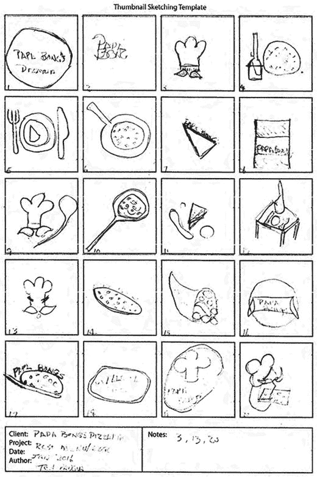
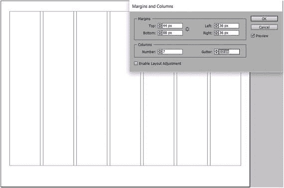
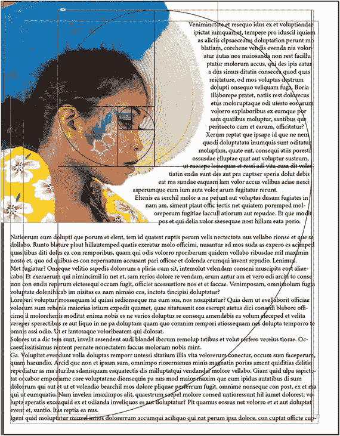
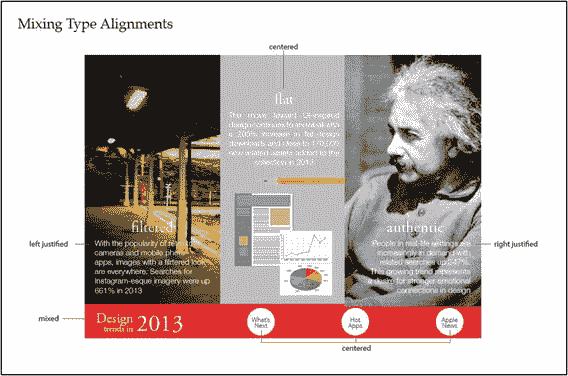
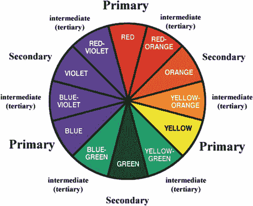
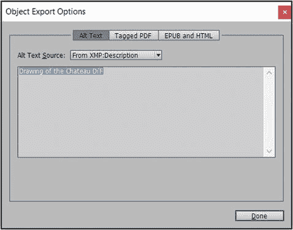
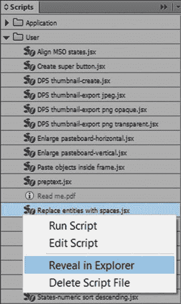

# 16. 创建数字出版文档的技巧

通过遵循一些版面设计和最终定稿的注意事项与技巧，你可以为所有数字出版物创造出更好的设计。这里所有的技巧都是免费的，不会花费你额外的金钱——它们只是一些值得思考的点子。

## 16.1 在 Adobe Photoshop 中编辑图像

页面上一张精美的图片无可替代。图形能吸引读者的注意力，并让观众聚焦于你的信息。图形需要清晰、干净，并在页面中“脱颖而出”。

所有照片，尤其是那些在摄影棚外拍摄的照片，都需要一些校正——即便是用高端数码相机拍摄的图像也不例外。你可以在 Photoshop 的 Camera Raw 转换器中打开图像，并应用编辑功能执行以下操作：

*   在“基本”面板中，调整色温。
*   在“基本”面板中，调整曝光和对比度。
*   在“基本”面板中，调整高光和阴影。
*   在“基本”面板中，调整饱和度、清晰度和自然饱和度。
*   在“镜头校正”面板中，使用相机配置文件并进行镜头校正。
*   使用拉直工具拉直照片，使其不偏离地平线。
*   如果你必须使用一张无法在 RGB 模式下改善的照片，请将其转换为黑白，或创建一张高调照片并应用棕褐色调（参见图 16-1）。

    

    图 16-1. 左侧为原始图像。右侧为同一图像转换为灰度、创建高调图像并应用棕褐色调后的效果

## 16.2 创建缩略图草图

软件开发者们不断为平板电脑推出草图程序，希望主导市场。近期研究表明，超过 66% 的平面设计师仍然更喜欢使用素描本和 2 号铅笔这种传统方法。

在设计新概念时，通过坐在沙滩上、在山间休息、骑自行车或做任何其他能帮助你放松的活动来解放你的思绪。一天结束时，在约 2.5 英寸的方块内创建 50 个缩略图草图。快速绘制它们，如果你不擅长绘画，可以使用简笔人物。你可能会讨厌所有的草图（参见图 16-2）。

图 16-2. 为一个新概念画出缩略图草图

去睡觉，第二天早上起床后，回顾你的草图。挑出三四个你认为有可行性的草图，并绘制一些粗略稿。挑选出你认为最适合的设计，然后去你的电脑前开始创建图形并整合你的设计。

## 16.3 使用网格

在 InDesign 的母版页上创建一个主网格。在浏览文档时，你可能需要修改单个页面的网格。选择 `布局 ➤ 边距和分栏`，并在“栏”区域的“数量”文本框中输入一个值。从顶部标尺拖出标尺线以创建水平参考线（参见图 16-3）。

图 16-3. 一个七栏网格。

## 16.4 使用黄金比例

自然界中的图案遵循着被称为“黄金比例”或“黄金分割”的路径。找到一张你可以从网上下载的、具有黄金比例形状的矢量艺术图。将此图放在其自己的图层上，并使用图层面板显示/隐藏该图。在页面中工作时，放置元素使其沿着黄金比例路径排列。你可以翻转黄金比例模板，并根据布局将其顺时针或逆时针旋转（参见图 16-4）。

图 16-4. 图层上的黄金比例有助于在页面上定位元素

黄金比例可能并不适用于每个页面，但它可以在许多布局中提供帮助。在文档页面中尝试使用它，它可以为你提供一些微调文本框架和对象的线索。

## 16.5 考虑方向与动感

布局中的每个页面都应将读者引入页面。大段的文字对读者来说并不有趣。你需要添加一些技巧使页面更有趣。添加空白区域和对象，并定位元素，使其将读者的注意力保持在页面中心。对于图像，让照片中的人物视线朝向页面中心，而不是偏离页面。对于文字，你可以混合对齐方式，使文字对齐暗示朝向中心的方向（参见图 16-5）。

图 16-5. 文字和图像的对齐方式可以帮助读者聚焦于页面中心

## 16.6 了解色彩心理学

色彩被创造性地用于在设计里捕捉某种情绪或情感。在选择颜色时，要注意这些颜色所代表的情绪或情感类型（参见图 16-6）。

图 16-6. 显示原色和互补色的色轮

*   暖色：红色、橙色和黄色。这些颜色代表幸福和热情，并传达出一种力量感和活力感。
*   冷色：蓝色、紫色和绿色。这些颜色代表平静、稳定和专业性。它们能建立信任感。
*   互补色：这些颜色在色轮上位置相对。例如，红色和绿色是互补色。

## 16.7 运用字体和谐

正如色彩能营造情绪和情感一样，字体选择同样影响着设计的情感表达。选择能够帮助你传达信息且相互协调的字体。你可以通过互联网搜索找到大量关于字体排印学的信息。搜索哪些字体搭配起来效果好。在网页浏览器中，搜索“搭配效果好的字体”或类似的检索词。你经常会发现一些提供 10 到 20 种字体组合建议的文章。将感兴趣的文章转换成 PDF 文档，并在创建新设计项目时将它们放在手边。

如果你没有设计经验，或许可以先坚持使用十种搭配效果最好的顶级字体。随着你对字体排印学了解得更多，你可以拓宽你的字体选择范围。

## 16.8 在 Adobe Bridge 中添加元数据

数字出版文档中的 Alt 标签对于依赖屏幕阅读器阅读数字内容的视觉障碍人士尤其重要。设计中的所有对象和图像都应该有对每个图形的描述。

### 在 Adobe Bridge 中打开图像

你可以通过在 Adobe Bridge 中打开所有图像来加快工作流程。

1.  在将所有照片和矢量艺术图像导入 InDesign 之前，将它们放在一个文件夹中。 
2.  打开 Adobe Bridge 并导航到你的图像文件夹。 
3.  单击每个图像，然后在 Bridge 窗口右侧打开“元数据”选项卡。 
4.  在“IPTC 核心”类别中，在“说明”字段中输入描述该图像的描述性文本正文。 
5.  在出版物中选择每个图像，然后选择 `对象 ➤ 对象导出选项`。 
6.  在 `对象导出选项` 对话框中，单击 `Alt 文本` 选项卡（参见图 16-7）。

    

    图 16-7. `对象导出选项` 对话框 
7.  打开 `Alt 文本来源` 菜单，并选择 `来自 XMP-说明` 选项。 
8.  所有图像和对象都被标记后，导出你的文件。

好的，作为一名高级文档工程师和翻译员，我将严格遵循您的注意事项和示例，将给定的英文文本翻译成中文。

## 16.9 使用 InDesign 脚本

使用 `InDesign` 脚本可以极大地帮助创建版面。通过安装和运行脚本，你可以加快工作进度。搜索互联网可以找到大量免费的或只需象征性购买的 `InDesign` 脚本。

在浏览互联网时，请登录 [`www.indesignsecrets.com`](http://www.indesignsecrets.com)。`InDesign Secrets` 网站拥有丰富的信息，专门为 `InDesign` 用户提供提示和技巧。该网站还有大量关于 `InDesign` 脚本的文章，并且提供了一些可供下载的脚本。

## 使用 InDesign 脚本

下载脚本后，你需要将其安装在正确的文件夹中。

1.  在 `InDesign` 中打开 `脚本面板`。`InDesign` 脚本有两个位置：`应用程序`文件夹和`用户`文件夹。选择 `用户` 文件夹。
2.  在 Windows 上，选择 `在资源管理器中显示` 以找到 `脚本` 文件夹。（在 Macintosh 上，选择 `在访达中显示`。）该文件夹将在你的桌面上打开。
3.  将要添加的新脚本复制到该文件夹中，或者在 `用户` 文件夹内创建一个新文件夹，然后复制要添加的脚本（见图 16-8）。

图 16-8. 打开 `脚本面板` 并选择 `用户`。打开 `脚本面板` 菜单并选择 `在资源管理器中显示`（Windows）或 `在访达中显示`（Macintosh）

## 16.10 打包文件

在处理文档时，你可能会忘记导入到 `InDesign` 中的图像和其他资源的位置。如果你更改了资源的文件位置，则在打开文档时，`InDesign` 会报告链接缺失。

完成出版物后，让 `InDesign` 帮你组织出版物中的所有内容。选择 `文件 ➤ 打包`。在 `打包` 对话框中，查看摘要信息，然后单击 `打包`。`InDesign` 会告知你内容将被添加到的文件夹名称。你可以接受默认文件夹或更改文件夹名称。在最后一个屏幕中单击 `打包`，`InDesign` 文件、所有资源和所有字体都将被添加到一个文件夹中。

当你想要进行编辑时，可以删除原始文件夹并使用打包的文件夹。由于字体也已复制到该文件夹，当你重新打开文档时，就不会有任何缺少字体的问题了。

## 16.11 总结

在本章中，你学习了一些设计技巧，可以为你的交互式文档创建更好的版面。你对设计和排版了解得越多，你的文档就会显得越专业。

在下一章中，我们将探讨一些项目构想。

