# 12. 创建可重排 EPUB

EPUB 分为两种类型：可重排版式和固定版式。可重排 EPUB 通常用于长文档，例如小说和篇幅较长的阅读材料。固定版式 EPUB 则是看起来类似于 PDF 文件的文档。其文字和对象的版式与组织在很大程度上模仿了版式设计。

在交互性方面，可重排 EPUB 比固定版式 EPUB 受限得多。你不能在可重排 EPUB 中使用按钮来改变事件，也不能直接查看动画。这些类型的交互性仅在固定版式 EPUB 中可用。

然而，可重排 EPUB 并不完全局限于静态内容。你可以导入音频和视频文件，并且可以创建在可重排 EPUB 中正常运行的超链接。你还可以通过一些变通方法添加一些动画，尽管这有点笨拙。

本章全部内容都是关于创建可重排 EPUB。它展示了创建符合常见 EPUB 标准的 EPUB 所需了解的许多最佳实践和注意事项。在第 13 章中，我们将探讨如何创建固定版式 EPUB。

## 理解可重排 EPUB

EPUB 几乎完全在平板电脑和智能手机等设备上查看。尽管如此，你也可以在台式电脑上查看可重排 EPUB。要查看 EPUB，你需要在你的设备上安装一个能够打开 EPUB 文件的应用（例如 `story.epub`，其中文件扩展名是公认的 EPUB 格式），这种应用通常被称为电子书阅读器。你可以获取适用于 iOS、Android 和 Linux 操作系统以及台式电脑的多种不同电子书阅读器。

大多数电子书阅读器都内置了调整字体大小和更改字体的工具。当字体大小放大或缩小时，可重排 EPUB 会重新排列内容，使其适应设备上显示的页面大小——因此得名“可重排”。

所有电子书阅读器都会寻找扩展名为 `.epub` 的文件。当文件扩展名为 `.epub` 时，它就可以在电子书阅读器中打开——前提是内容是按 EPUB 文件格式创建的。`.epub` 文件本身不过是一个包含 XHTML 文件的压缩 `.zip` 存档。本质上，EPUB 就像网站一样，你可以通过滑动设备上的手势在网页之间导航。

了解什么是 EPUB 有助于你理解文本格式化的某些方面。你需要遵循 HTML 使用的标准，并使用标签、`div`、CSS 以及相关的 HTML 编码。幸运的是，InDesign 负责处理 HTML 和 CSS 的编写，并且几乎总能生成一个有效的 EPUB，可以在几乎任何带有任意电子书阅读器的设备上查看。

## 12.2 为可重排 EPUB 设置格式

由于 EPUB 是 HTML 文件的集合，在导出为 EPUB 格式时，你需要考虑一些设计因素。若内容的格式和结构组织不当，可能会导致一些奇怪且意想不到的后果。在 InDesign 中预览的布局，在电子阅读器中可能会大相径庭。请看图 12-1。这是 Adobe InDesign 预览模式下的一个布局。

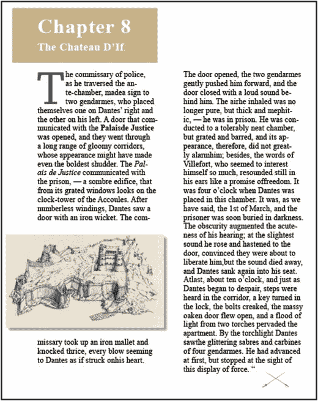

**图 12-1.** Adobe InDesign 预览模式中的布局

当你导出此文件并在桌面电脑的电子阅读器中查看时，可能会看到类似图 12-2 的样子。在页面顶部，你会看到照片图像，后面跟着包含颜色的框。由于章节编号和标题的文本颜色设置为纸张色，文本不显示，且并未被设置在框内。

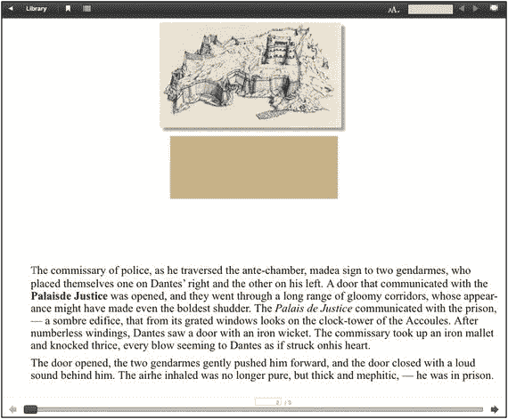

**图 12-2.** 与图 12-1 相同的 InDesign 布局在电子阅读器中的显示效果

正如我在前几章中提到的，在创建可重排 EPUB 时，你需要对所有内容使用样式。你还需要调整阅读顺序，以便图形和文本按照你期望的顺序出现。简而言之，在导出为 EPUB 格式之前，你需要在 InDesign 中控制相当多的格式设置。

### 12.2.1 为可重排 EPUB 设置文本格式

在 InDesign 中，你可以轻松地移动文本框、添加回车键来增加段落间距、添加首字下沉、为文本框添加分栏和边距、添加行缩进以及为图形添加文本绕排。你无需创建样式（尽管应该创建）即可使布局达到你想要的效果。

然而，对于 EPUB，在设置文本格式时你需要关注每一个细节，并且你在 InDesign 中执行的某些格式设置任务无法转换到 EPUB 格式。例如，设置多栏页面无法转换到 EPUB 格式。将文本框彼此分开以创建空白区域的做法在 EPUB 中不会被保留，添加多个制表符和回车键同样无效。

#### 理解文本格式设置指南

以下是准备导出为 EPUB 的文档时需要遵循的一些指南：

- **为段落和文本添加样式**：我已经说过很多次，每个段落以及任何格式覆盖都需要转换为样式。如果你添加了粗体、斜体或彩色文本，则需要创建字符样式。

- **为首字下沉添加样式**：创建首字下沉时，你需要添加一个字符样式，用于定义首字下沉字符的格式。

- **添加空白区域**：在 HTML 中，你需要使用 `<break>` 标签来强制在段落间换行或硬中断。创建 EPUB 时，你需要使用样式，并通过添加上/下间距来增加段落间的空间。

- **对齐文本**：在段落样式中包含文本对齐方式。不要在没有定义样式的情况下在控制面板中对齐文本。

- **锚定对象和图像**：如果你希望对象在你的布局中出现在同一页面的相同位置，则不能使用浮动对象。如果你希望对象紧邻文本包含在内，则需要将对象锚定到文本。如果不锚定对象，所有对象都会显示在文本的末尾。例如，如果你有一本书，一个故事跨越了多页，那么图像和对象会出现在故事的结尾。作为实践，使用自定义设置或基线对齐来锚定对象。不要使用行内锚定。关于如何在文本中锚定对象的更多信息，请参阅本章后面的“格式化图形”部分。

- **修正所有格式覆盖**：使用样式面板中的“重新定义样式”设置来重新定义样式，并在段落样式中格式化字符时使用字符样式。

- **字体**：嵌入字体时尽量使用 Typekit 字体。这些字体无需任何许可即可嵌入。对于所有其他字体，请始终检查嵌入字体的权限。不支持 OpenType 分数。

- **列表**：在 HTML 中，有由标签定义的有序列表和无序列表。在 InDesign 中，你需要为创建的每个列表设置样式。

- **分页符**：如果你希望章节页或某个部分从页面顶部开始，则需要调整段落样式选项对话框中的保留选项。在“段落样式选项”对话框的“保留选项”选项卡中，从“起始段落”下拉菜单中选择一个选项。

- **规则线**：你可以在文本上方和下方添加规则线。如果使用规则线，则需要使用段落样式，并在“段落样式选项”对话框中添加规则线。不要在页面上段落之间绘制规则线。

- **文本绕排**：你可以创建文本绕排并导出到 EPUB，但需要遵循与使用对象和图像时相同的规则。设置文本绕排选项后，需要将对象锚定到你希望其定位的文本位置。

#### 清理布局

你可以使用“查找/更改”对话框搜索格式化的文本覆盖，并将其更改为字符样式。

以下是如何搜索字体样式并将格式更改为字符样式的步骤：

1.  选择“编辑”➤“查找/更改”以打开“查找/更改”对话框。

2.  单击“文本”以打开“文本”选项卡，并单击“查找格式”框。此时会打开“查找格式设置”对话框。

3.  单击“基本字符选项”，然后从“字体样式”下拉菜单中选择“粗体”。单击“确定”返回“查找/更改”对话框。你可以在对话框中选择任何格式。例如，假设你想搜索“粗体”字体。

4.  选择一个字符样式。单击“更改格式”框，打开“更改格式设置”对话框。从“字符样式”下拉菜单中选择一个样式。如果你没有样式，请从菜单中选择“新建字符样式”并创建一个新的字符样式。单击“确定”返回“查找/更改”对话框。

5.  单击“查找”，然后单击“更改”。测试“查找/更改”条件，并先单击一次“查找”按钮，如图 12-3 所示。文本中第一次出现粗体字的地方应被高亮显示。单击“更改”并观察结果。粗体字体应被更改为新格式（纯文本、彩色文本、斜体等——取决于你在字符样式中定义的设置）。

    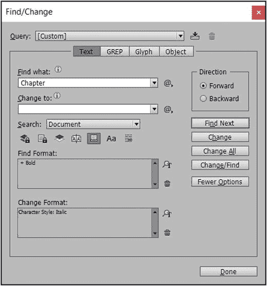

    **图 12-3.** 使用“查找/更改”来搜索并更改格式

6.  全部更改。当一切看起来工作正常时，单击“全部更改”以全局更改文档中的文本。

> **注意**：你可以在“搜索”下拉菜单中对“所有文档”、“当前打开的文档”、“一篇故事”和“到故事末尾”进行更改。

#### 查找覆盖项

你可以从互联网下载一个由 Mark Autret 编写的出色 InDesign 脚本，名为 `FindChangeLocalFormatting`。请登录 [`http://www.indiscripts.com/post/2010/05/show-local-formatting-in-indesign-cs4`](http://www.indiscripts.com/post/2010/05/show-local-formatting-in-indesign-cs4) 或在 Google 中搜索“Find Change Local Formatting”。下载该脚本并安装在 Scripts 文件夹中。有关安装脚本的更多信息，请参见第 6 章。

运行此脚本时，文档中的所有覆盖项都会以不可打印的删除线标记出来，如图 12-4 所示。当你消除覆盖项时，删除线标记也会随之消失。如果你从客户那里获取文本并需要进行大量清理工作，这个脚本可以为你节省大量时间。

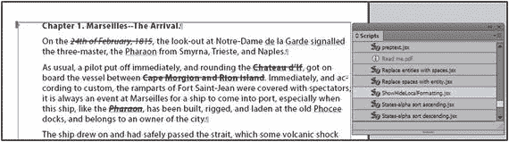

图 12-4.

打开脚本面板，双击 `FindChangeLocalFormatting` 脚本，即可在带有覆盖项的文本上看到删除线。注意此脚本适用于所有 InDesign CC 2015.2 及更早版本的用户。如果你使用的是 InDesign CC 2015.3 及以上版本，则可以使用段落样式面板菜单中的“切换样式覆盖项高亮显示”功能。

## 自动化覆盖项修正

计算机本应让生活更轻松，并神奇地为我们执行任务，而无需我们手动进行更改，对吗？如果我们只需点击一个按钮，所有文本覆盖项就能转换为不同的字符样式，那该多好啊？好吧，在 InDesign 中，确实可以实现一些神奇的事情。

同样，这种魔法以脚本的形式出现。这个脚本是由 Theunis DeJong（又名 jongware）编写的 `PerfectPrepText`，你可以在我最喜欢的 InDesign 资源网站 InDesignSecrets.com 上找到它（[`www.indesignsecrets.com/downloads/PerfectPrepText.zip`](http://www.indesignsecrets.com/downloads/PerfectPrepText.zip)）。下载并安装该脚本。这是 David Blatner 和 Anne-Marie Concepcion 在其 [`www.indesignsecrets.com`](http://www.indesignsecrets.com) 网站上为 InDesign 社区提供的众多有用工具之一。

安装脚本后，双击 `preptext`，所有局部覆盖项都会转换为字符格式。在图 12-5 中，你会看到字符样式面板中有两个字符样式。我并未创建这些字符样式。`preptext.jsx` 找到了局部覆盖项，创建了新的字符样式，并将这些样式应用到了覆盖项上。

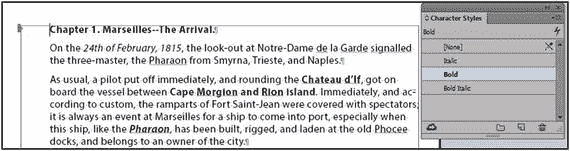

图 12-5.

使用 `preptext.jsx` 脚本向字符样式面板添加了新的字符样式

开发者们不断创作新的脚本，其中许多人不收取任何费用或只要求少量捐赠。要发现 InDesign 工具的最新最棒功能，请定期登录 InDesignSecrets（[`www.indesignsecrets.com`](http://www.indesignsecrets.com)）。如果你找到了一个对你有帮助的脚本，而开发者要求小额捐赠，请务必捐赠几美元。能够让开发者因他们的辛勤工作获得一些报酬意义重大，这会激励他们继续为整个 InDesign 用户社区创作更多有用的脚本。

# 12.2.2 格式化图形

在第 6 章中，我讨论了如何使用对象样式面板。当你为对象添加某些效果时，需要创建一个对象样式。像投影或斜面和浮雕这样的效果，除非你定义并将其样式应用于对象，否则在某些 EPUB 中不会显示。

你还需要将对象锚定在文本中，这样对象就不会出现在 EPUB 的最后一页。

以下是在 EPUB 中使用图形时需要考虑的一些事项。

## 准备图像

可重排 EPUB 旨在供阅读。人们使用各种显示 EPUB 的应用程序在设备上阅读小说、书籍、报告等。在创建 EPUB 时，你希望抓住最大的可用市场，让你的文档能被尽可能多的人访问。一个重要的、热衷于阅读的少数群体是有视觉障碍的人。无法在电脑或设备上看到文本的人，通常使用屏幕阅读器或文本转语音软件来为他们朗读文本文件。

屏幕阅读器在处理计算机文件时表现出色，但它们需要你的一点帮助才能使文档完全可访问。对于图像，你需要为图像文件添加一个标签。这些标签是 `Alt`（替代）标签，你可以在其中提供图像的文本描述。你可能有像 `img_001.jpg`、`DCIM677.tiff`、`photo1.psd` 或其他文件名这样的图像。当屏幕阅读器遇到没有 `Alt` 标签的图像时，它会直接读出文件名。这对使用屏幕阅读器的人来说显然会造成混淆。

你可以在照片编辑应用程序、Adobe Bridge 或直接在 InDesign 中为图像添加 `Alt` 标签。基本上，前两个是最佳选择。这完全取决于你。你可以在 Adobe Bridge 中查看 InDesign 资源的“链接”文件夹，并在 IPTC 核心描述中添加描述字段，如图 12-6 所示。添加图像的简短描述。例如，公司红绿配色的徽标图像。

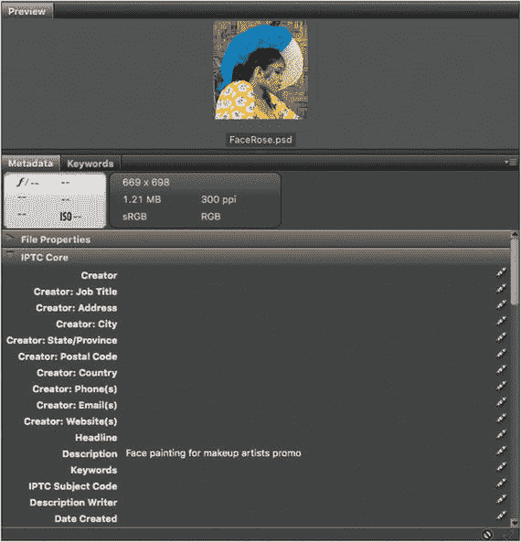

图 12-6.

在 Adobe Bridge 中添加 `Alt` 标签

在将图像置入 InDesign 之前，使用 Adobe Bridge 添加所有 `Alt` 标签。请确保使用 IPTC 核心数据区域中的同一个字段。数据会从 Adobe Bridge 自动保存为 XMP 数据。

另一种向图像添加 `Alt` 标签的方法是在 InDesign 中。选择一个图像，然后选择“对象”➤“对象导出选项”。当“对象导出选项”对话框打开时，“替代文本”选项卡默认处于显示状态。你可以选择添加自定义文本，或通过从“替代文本来源”菜单中选择一个菜单项来导入带有描述的 XMP 数据。如果选择“自定义”，你可以键入你想要的 `Alt` 标签文本，如图 12-7 所示。

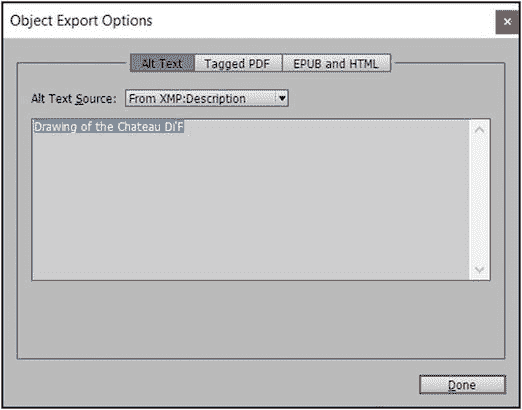

图 12-7.

从“替代文本来源”中选择“自定义”，然后键入描述

你使用的具体方法各有利弊。如果在 Bridge 中添加描述，你可以快速添加上 `Alt` 标签的数据。如果你在 InDesign 中添加 `Alt` 标签，则每置入一个图像，都需要打开“对象导出选项”对话框。在 InDesign 中添加 `Alt` 标签的优势在于，你可以使用与页面布局上下文相关的描述。在 Bridge 中，图像本身是相同的；但在某些情况下，图像的使用背景可能会影响你的描述。

这是一个个人选择。我更喜欢在 Adobe Bridge 中添加描述。这种方法似乎快得多。如果你确实在 Bridge 中添加了描述，那么就不要使用“对象导出选项”对话框来导入 XMP 数据。有一种更好的方法可以使用对象样式从 Bridge 导入数据。

## 使用对象样式

如果你只有少量图片（六张或更少），不使用对象样式也能应付。但如果你在 EPUB 中使用了十几张甚至更多图片，最好为它们创建对象样式。在某些情况下，这必不可少，而在其他情况下，它也能帮你加快工作流程。

你希望在对象样式中设置的几个内容包括 `Alt` 标签（如果你使用 Adobe Bridge 添加 `Alt` 标签）和定位对象位置。新建一个对象样式，然后在左侧窗格中点击 `Alt 文本`。从 `Alt 文本来源` 下拉菜单中选择 `来自 XMP 描述`，如图 12-8 所示。如果你在 Bridge 的 IPTC 核心数据中的 `描述` 字段里添加了 `Alt` 标签，那么所有图片的描述都将通过该对象样式处理。要验证描述是否已成功导入，请打开 `对象导出选项` 对话框并检查 `Alt 文本` 选项卡。你应该能看到从 XMP 数据中导入的描述。

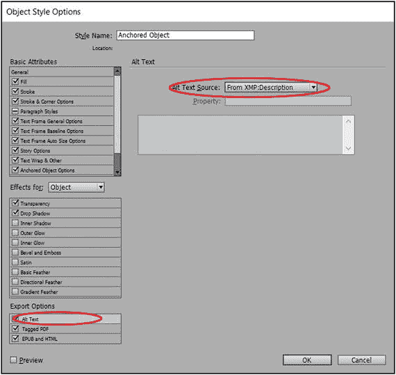

图 12-8. 选择“来自 XMP 描述”以导入 XMP 数据

对象样式的另一个重要设置是定位对象的位置。如果你有一些对象位置使用了 `行上方`，而另一些使用了与书脊对齐，那么你可以基于为 `Alt` 标签所使用的样式创建两个样式。取消选中所有选项，只为你的图片选择所需的 `定位对象选项` 来设置特定位置，但在 `常规面板` 中，将此样式基于你为 `Alt` 文本所使用的样式名称。

要为定位对象创建样式，请按 `Alt`/⌥+点击 `对象样式面板` 中的 `创建新样式` 图标。将此样式基于 `Alt 文本` 样式，并取消选中面板中所有其他选项。然后在左侧窗格中点击 `定位对象选项`。

在为 EPUB 定位对象时，实践中不要使用 `嵌入`。你应该选择 `行上方`，如图 12-9 所示。在此处，你可以设置段前/段后间距并选择对齐方式。如果你从 `位置` 下拉菜单中选择 `自定义`，则可以选择相对于书脊的对齐方式并调整偏移量。当启用 `预览` 复选框时，你可以看到在 `定位对象选项` 中所做的选择在布局中对象的位置。

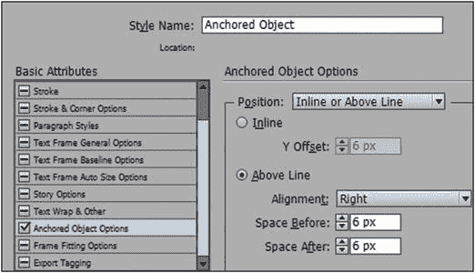

图 12-9. 选择“行上方”并调整“段前间距”和“段后间距”设置

## 定位对象

### 对象定位与文本换行

如果你有一段文本，并希望某个对象出现在文本中的某个位置，则需要定位该对象。如果浮动对象未定位到文本，它们总是会出现在你的 EPUB 末尾。

有些人尝试添加换行符和回车符，以便在文本框中为嵌入对象留出合适的空间。你可以剪切一个对象，在文本框中点击光标，然后粘贴来创建一个嵌入对象。你也可以按住 `Shift` 键并拖动定位控件（选中对象顶部的蓝色方框）到你想要定位对象的文本行。使用嵌入对象在页面上定位可能很麻烦，有时还会在某些电子阅读器中产生意外结果。你的解决方案和最佳实践是在 `定位对象选项` 对话框中使用 `行上方` 选项。

要定位一个对象，请点击并拖动定位控件（选中对象框上的蓝色方框）到你希望对象在文本中出现的位置。你马上会注意到对象并没有移动，也看不到对象放置位置的预览。别担心，我们可以解决这个问题。

定位对象后，你可以通过以下两种方式之一修改其位置：选择定位对象，然后选择 `对象` ➤ `定位对象` ➤ `选项` 以打开 `定位对象选项` 对话框；或者使用我之前在“使用对象样式”一节中讨论的对象样式。如果你有多个对象，那么创建对象样式是最佳选择。

之前在图 12-9 中，你已经看到了 `对象样式选项` 对话框中定位对象位置的选项。请务必启用 `预览` 复选框，以便在 `对象样式选项` 对话框中进行调整时，能在文档中实时查看效果。

### 编组对象

如果你向一个框架添加文本，文本和框架颜色在 EPUB 中显示正常。你可能会在不同电子阅读器之间看到一些细微差异，但大多数情况下，你为框架分配的属性（例如内边距）在 EPUB 中都会被保留。

如果出于某种原因，你有一个文本框位于几何图形之上，你需要将这些对象编组（`对象` ➤ `编组` 或 `Ctrl/⌘+G`），然后定位它们。

### 文本换行

在 EPUB 中可以给对象设置文本换行，但只能应用于矩形对象。你不能使用 `Text Wrap Panel` 或 `Float Left`、`Float Right` 来使用圆形或椭圆形。

### 为对象设置文本换行

以下描述了如何在 InDesign 中为对象设置文本换行，以便导出到可重排的 EPUB：

1.  在要锚定对象的段落之前添加一个回车符。如果将对象锚定在段落开头，第一行文本可能无法正确换行，并且对象会遮挡第一行部分文本。

2.  锚定对象。将所选对象顶部的蓝色方块拖到您希望对象出现的文本框架位置。当对象被锚定后，您会看到一个锚点图标，如图 12-10 所示。

    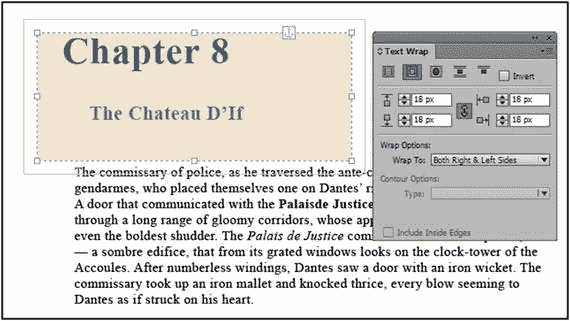

    **图 12-10.** 在对象旁边查看 `Text Wrap Panel` 以查看位置和文本换行偏移量。

3.  打开 `Text Wrap Panel`。打开 `Text Wrap Panel`（`Window` ➤ `Text Wrap` 或按 `Ctrl/⌘+Alt/⌥+W`）。

4.  为对象应用文本换行。选择对象并将其移动到合适位置。在 `Text Wrap Panel` 中单击 `Wrap Around bounding box` 图标（左起第二个）。通过在 `Offset` 文本框中输入值来调整偏移量。进行调整时，您会在文档页面上看到结果，如图 12-10 所示。

5.  创建对象样式。选择对象，按 `Alt/⌥`，然后在 `Object Style Panel` 中单击 `Create New Style`。

6.  设置锚定对象的属性。在 `Object Style Options` 对话框中，单击左侧窗格中的 `Anchored Objects`。从 `Position` 下拉菜单中，确保选择了 `Custom`，如图 12-11 所示。（不要将 `Inline` 作为 `Position` 的选择。）由于在创建样式之前应用了文本换行，新的对象样式捕获了文本换行设置。单击 `OK` 关闭 `Object Style Options` 对话框。

    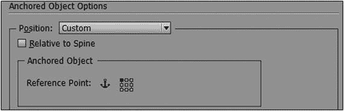

    **图 12-11.** 将单独的对象分组，并将单个对象锚定到文本框架。

7.  打开 `Object Export Options` 对话框。选择对象，然后选择 `Object` ➤ `Object Export Options`。单击对话框中的 `EPUB and HTML` 选项卡。

8.  调整 `Object Export Options`。启用 `Custom Layout` 并选择 `Float Left`（如果对象位于文本框架右侧，则选择 `Float Right`），如图 12-12 所示。

    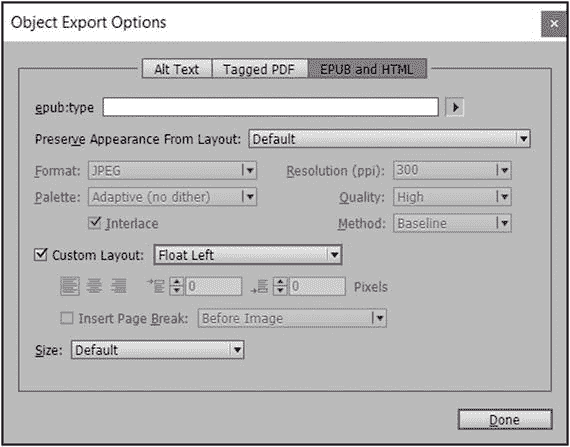

    **图 12-12.** 从 `Custom Layout` 下拉菜单中选择 `Float Left` 或 `Float Right`。

9.  导出为 EPUB。选择 `File` ➤ `Export` 或按 `Ctrl/⌘+E`。选择 `EPUB (Reflowable)` 作为文件格式并单击 `Save`。将打开 `EPUB – Reflowable Layout Export Options` 对话框，如图 12-13 所示。

    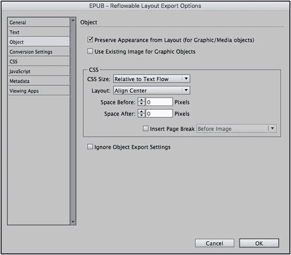

    **图 12-13.** 从 `CSS Size` 菜单中选择 `Relative to Text Flow`。

10. 调整对象设置。在 `EPUB – Reflowable Layout Export Options` 对话框的左侧窗格中单击 `Object`。确保第一个复选框已启用，如图 12-13 所示，并且 `CSS Size` 选项设置为 `Relative to Text Flow`。

11. 单击 `OK` 并导出文件。

12. 在桌面计算机上预览文档。在此示例中，使用 `Adobe Digital Editions (ADE)` 进行预览。将文件添加到 `ADE` 库后，双击该文件将其打开。如图 12-14 所示，文本换行在 EPUB 预览中得到了保留。

    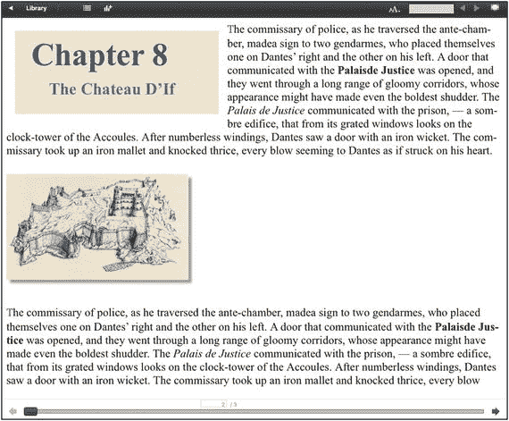

    **图 12-14.** 在 Adobe Digital Editions 中查看 EPUB。

如果您希望在段落中间围绕对象设置文本换行，步骤与在段落开头围绕对象设置类似，但有一些例外。首先，不要在段落内使用回车符。将对象锚定在段落内部并将其移动到合适位置。InDesign 中的页面视图应接近您希望在 EPUB 中看到的视图。

此外，不要使用 `Object Export Options` 中的 `Float Left` 或 `Float Right`。从 `Custom Layout` 下拉菜单中选择 `Alignment and Spacing`。导出为 `EPUB (Reflowable)`。

> **注意**
>
> 本书涵盖在 Adobe InDesign CC 2015 中创建内容。如果您使用的是较早版本的 InDesign，设置文本换行的过程会非常不同。

### 栅格化对象

EPUB 中的页面几何形状非常特定且有些苛刻。如果您想围绕圆形对象设置文本换行或绘制对角线和不规则形状，这些对象在 EPUB 中会显示为矩形形状，或者通常导致外观与您在 InDesign 中看到的视图不同。

为了优化不规则形状的外观，您可以栅格化该形状，然后应用文本换行，或者让这些形状像在布局中一样显示。在图 12-15 中，您会看到围绕椭圆形状的文本换行。要产生这种效果，您需要栅格化该框架。

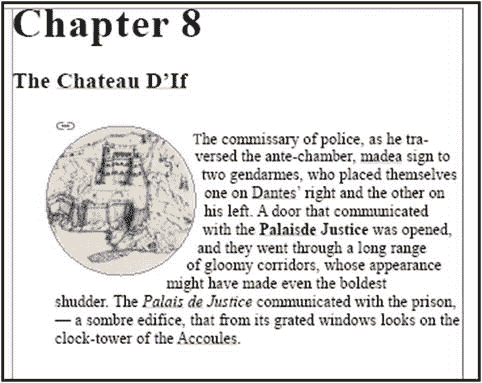

**图 12-15.** 围绕椭圆框架的文本换行。

要栅格化对象或文本，请打开 `Object Export Options` 对话框（`Object` ➤ `Object Export Options`）。从 `Preserve Appearance From Layout` 下拉菜单中选择 `Rasterize Container`，然后单击 `OK`（见图 12-16）。应用用于文本换行的其他设置，然后导出为 EPUB。

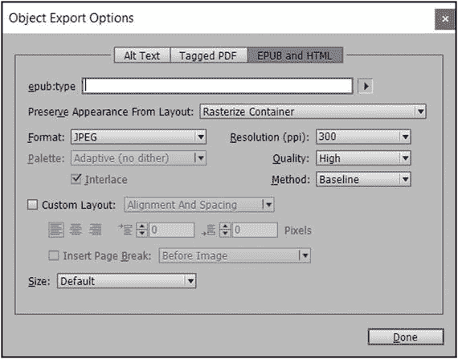

**图 12-16.** 在 `Object Export Options` 对话框中选择 `Rasterize Container`。

添加到布局中非直线（水平或垂直）的描边也需要进行栅格化。如果您在非矩形框架中使用拉引引用，也需要栅格化该对象。当您栅格化文本时，该文本不再是实时文本。它是一个对象，因此无法在 EPUB 中调整大小或搜索。

如果您将多个对象编组，编组后的对象会有一个矩形边界框，因此您不需要栅格化这些对象。在图 12-17 中，您会看到一条对角线描边。如果该描边是单独的项目，则必须对其进行栅格化。但是，当该描边与两个形状编组时，这些对象在 EPUB 中的显示效果与在 InDesign 布局中相同。

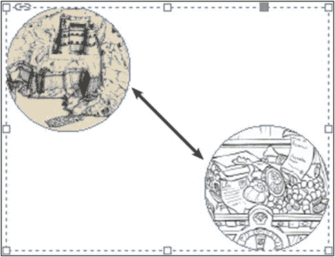

**图 12-17.** 编组对象无需栅格化。

### 12.2.3 格式化表格

如果你应用了第 6 章中介绍的所有单元格样式选项，那么在可重排 EPUB 中添加表格就非常简单。你不必在文档中为引入表格而进行任何特殊处理。

在 InDesign 2015 之前，你无法导出带有交替填充的表格，而且单元格中的文本偏移也会出现问题。在 InDesign 2015 中，你只需根据版面中看到的单元格创建单元格样式，然后导出到 EPUB 即可。在许多阅读器中，即使不使用单元格样式也能导出 EPUB，但其他阅读器在处理表格时——尤其是单元格文本偏移方面——会存在问题。作为一种实践规范，你应该始终创建单元格样式。对于 EPUB 阅读而言，表格样式并非必需，但如果文档中有大量表格，它们会很有帮助。

在图 12-18 中，你会看到一个在 Apple iBooks 中显示的、未应用任何单元格样式的表格。即使没有任何单元格样式，InDesign 的表现也相当不错。在许多 EPUB 阅读器中，即使不使用任何样式，表格格式也能得到很好的保留。

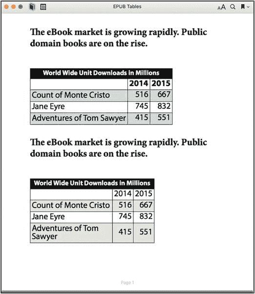

图 12-18. 在 Apple iBooks 中查看的表格：未使用单元格样式（上方）与使用了单元格样式（下方）的对比

## 12.3 创建导航目录

在所有的 EPUB 中，你需要做的一件事就是创建一个目录（TOC）样式。你不需要向 EPUB 中添加目录页面，但你必须创建该目录样式。实际上，所有电子阅读器都有内置目录。如果你不创建目录样式，那么目录中只会显示你的文件名。如果你创建了目录样式，那么内置目录会根据你应用于该样式的格式，显示文档中的章节/文章列表。

### 创建导航目录

要在 EPUB 中创建导航目录，请遵循以下步骤：

1.  创建段落样式。为你希望出现在目录中的章节、副标题或其他项目添加段落样式。

2.  选择 `版面` ➤ `目录样式`。系统将打开 `目录样式` 对话框（见图 12-19）。

    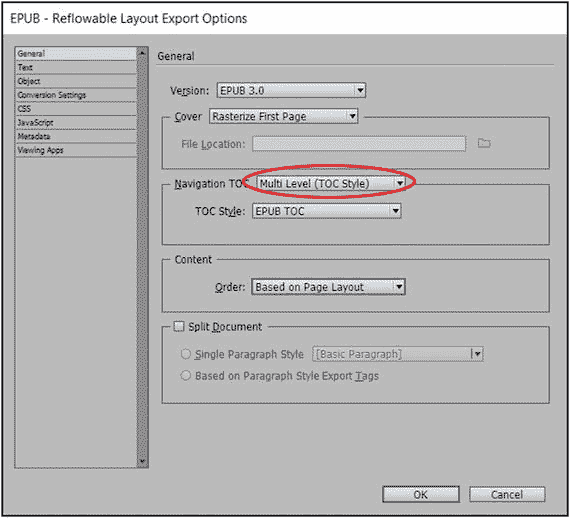

    图 12-19. 从 `导航目录` 下拉菜单中选择 `多级目录`

3.  创建新的目录。在 `目录样式` 对话框中单击 `新建`。系统将打开 `编辑目录` 对话框。

4.  将段落样式设置为你希望包含在目录中的样式。在图 12-19 中，`目录样式` 文本框显示了样式名称。此示例中，我使用 `EPUB TOC` 作为样式名称。文档中所有段落样式的列表显示在面板右侧。单击你打算用于目录列表的样式。在 `其他样式` 列表下方还有其他项目。

5.  单击 `确定` 关闭 `编辑目录` 对话框。再次单击 `确定` 关闭 `目录样式` 对话框。此时，光标并未加载，你也不会在文档中放置目录。我们只是在这里定义了样式。如果你想在 EPUB 中包含一个单独的目录页面，可以打开 `版面` 菜单并选择 `目录`。系统会打开 `目录` 对话框。如果一切设置符合你的要求，单击 `确定`，光标会加载一个文本工具。你可以将文本放置在页面上，目录就会被生成。对于大多数可重排 EPUB 而言，包含一个目录页面并非必要，因为阅读器更可能使用其内置的目录。

6.  导出为 EPUB。选择 `文件` ➤ `导出` (`Ctrl/⌘+E`)，然后在格式中选择 `EPUB（可重排）`。

7.  编辑常规设置。在 `常规` 面板中，从 `导航目录` 下拉菜单中选择 `多级（目录样式）`。打开 `目录样式` 菜单，选择在第 4 步中添加的样式名称，如图 12-19 所示。

8.  单击 `确定` 将文件导出为 EPUB。

9.  预览文档。在图 12-20 中，你可以在 Adobe Digital Editions 中看到 EPUB 的预览，其中目录列表已展开。列表中的每一项都是一个超链接，可将读者带到相应的章节。

    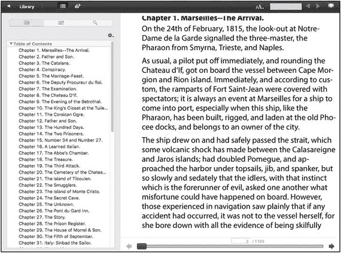

    图 12-20. Adobe Digital Editions 中显示的目录

## 12.4 导出为可重排 EPUB 格式

在使用段落和字符样式格式化文本、添加单元格样式（如果使用表格）以及添加对象样式之后，你还需要了解其他一些任务。首先，你需要根据元素的出现顺序（先出现什么，后出现什么等）来设置 InDesign 版面的顺序。设置好元素顺序后，你需要控制所有导出 EPUB 的选项。

### 12.4.1 使用文章面板

当你导出到 EPUB 时，InDesign 会查看页面几何结构，并按照从左到右、从上到下的顺序导出。你可以调整版面，移动文本框和对象，使它们按你想要的顺序导出，但通常很难获得满意的结果。在 InDesign 中，你可以在以下两种导出元素顺序的选项中选择：(1) 使用页面版面顺序，以及 (2) 使用 `文章面板`。

在 InDesign 增加 `文章面板` 之前，也就是 EPUB 1.0 格式的时代，要从 InDesign 导出任何像样的 EPUB 都是一个挑战，需要大量的手动工作。当 InDesign CS5.5 引入 `文章面板` 时，整个电子书出版界都发生了变化。版面设计师和图书出版商发现 InDesign CS5.5 是创建电子书的一大福音，它免去了调整版面顺序的繁重任务。

#### 使用页面版面顺序导出 EPUB

在图 12-21 中，你会看到 InDesign 中的一个版面。页面顶部是书籍标题，文本右对齐。章节编号和章节标题出现在标题下方。接下来是一个文本框，然后是一张图片、另一个文本框和一张图片。你在图 12-22 中看到的是文档预览，但页面版面顺序却大不相同。

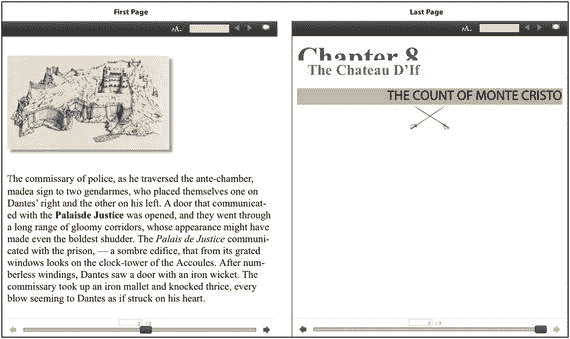

图 12-22. 使用页面版面顺序导出的 EPUB

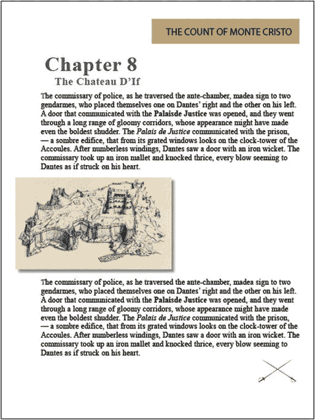

图 12-21. 文档的页面版面顺序

页面版面顺序基于页面几何结构，从左到右、从上到下。页面上最左边的对象是页面中央的图片。正文是下一个顺序的对象，接着是章节编号，然后是章节标题。书籍标题紧随其后，最后是页面底部的图形。

如果你导出到 EPUB 并选择默认的 `基于页面版面`（在 `常规` 面板的 `排序依据` 下拉菜单中），EPUB 将遵循页面版面顺序。当你将 EPUB 交给设备时，文档可能看起来像图 12-22 那样。在此示例中，第一页显示的是版面中最左侧的图片，接着是文本，然后最后一页（右侧显示）显示章节编号和标题。

### 使用文章面板进行导出

如果你的 EPUB 中的元素排序不正确，解决方法非常简单。

通过以下简单步骤，使用`文章面板`按照你希望出现的顺序排列文本和对象：

1.  打开`文章面板`。选择`窗口 ➤ 文章`。

2.  将元素添加到`文章面板`。你可以按 `Ctrl/⌘` 键并点击`文章面板`中的 `+` 图标，或者将元素拖放到面板中。按住 `Ctrl/⌘` 键会将所有元素作为文章添加到`文章面板`中。

3.  排列元素顺序。单击并上下拖动文章以重新排序。在图 12-23 中，你可以看到`文章面板`中填充了文档页面上的元素，其顺序与你希望导出的顺序一致。

    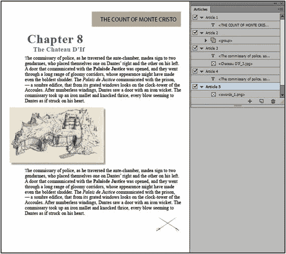

    图 12-23. 将元素拖放到`文章面板`

4.  导出为 EPUB。选择`文件 ➤ 导出`或按 `Ctrl/⌘+E`，然后导出为 `EPUB (可重排)`。此时将打开`EPUB – 可重排布局导出选项`对话框。

5.  基于`文章面板`导出顺序。选择`与文章面板相同`，如图 12-24 所示，然后单击`确定`。

    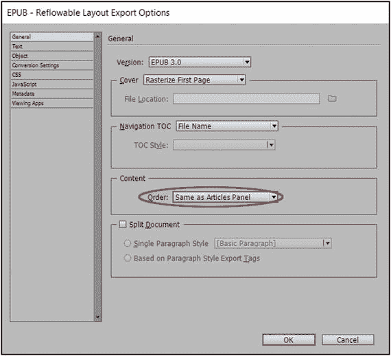

    图 12-24. 选择`与文章面板相同`

6.  预览 EPUB。在图 12-25 中，你可以看到 Adobe Digital Editions 中的 EPUB。其顺序与 InDesign 文件中的顺序一致。

    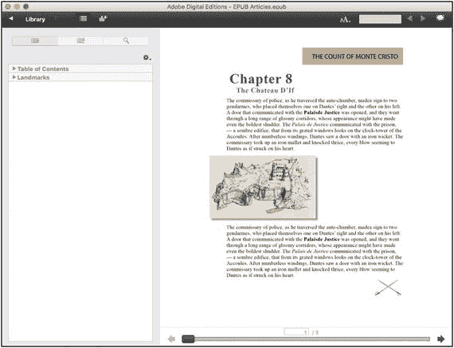

图 12-25. 在 iPad 上使用`与文章面板相同`导出为 EPUB 的结果

## 12.4.2 控制导出选项

在本章中，我多次提到`EPUB – 可重排布局导出选项`和`对象导出选项`。在这些对话框中进行的正确设置决定了你的出版物是否符合 EPUB 标准，并成为可在内容提供商网站上托管的有效文档。

花点时间查看一下你可以为文档和对象导出所做的所有设置是值得的。

### 使用常规导出选项

当你选择`文件 ➤ 导出`并选择 `EPUB (可重排)` 格式时，`EPUB – 可重排布局导出选项`对话框将打开。你会在对话框左侧找到八个类别。默认是`常规`选项，如图 12-26 所示。

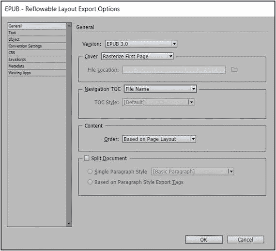

图 12-26. 常规导出选项

可以在`常规`面板中进行的调整包括：

*   `版本：` 选择 EPUB 的版本 `2.01` 或 `3.0`。选择版本 `2.01` 的一个原因是为了兼容一些不支持 `EPUB 3.0/3.01` 格式的老式电子阅读器。许多流行的电子阅读器已更新为接受 `EPUB 版本 3.0`，但如果你发现某个电子阅读器无法正常显示文档，可以尝试导出 `2.01` 格式。

*   `封面：` 从下拉菜单中，你有三个选项：`无`、`栅格化首页`和`选择图像`。某些内容提供商要求封面使用单独的图像。如果是这种情况，请选择`无`。按照惯例，你可以为 EPUB 添加封面并栅格化首页。如果封面图像出现像素化或质量下降，请使用`选择图像`。栅格化首页时，务必将所有对象编组。如果你有一个背景，并在背景上放置了一个文本框，除非所有对象都已编组，否则文本将不会显示。栅格化首页作为封面的另一个问题是，封面可能无法填满页面，或者可能被分割到两页上。如果你在导出 EPUB 时发现以上任一问题，请创建一个与你的 EPUB 尺寸相同的单页，然后从 InDesign 中将该页导出为 `JPEG` 文件。在`封面`下拉菜单中选择`选择图像`，并使用该 `JPEG` 文件作为封面图像。

*   `文件位置：` 仅当你在封面上使用`选择图像`时激活。单击`文件夹`图标以定位要用于封面的图像。

*   `导航目录：` 作为最佳实践，始终创建一个`导航目录`并选择`多级（目录样式）`。如果你从菜单中选择`文件名`，电子阅读器中的`目录`将显示文件名。

*   `目录样式：` 当使用`多级（目录样式）`时，从下拉菜单中选择你在 InDesign 中创建的`目录`样式。

*   `内容：` 从`顺序`菜单中，选择`基于页面布局`或`与文章面板相同`。你很少会用到`与 XML 结构相同`。如果你使用`文章面板`设置顺序，请选择`文章面板`。

*   `拆分文档：` 如果你希望将 EPUB 拆分为单独的 HTML 文件，请启用此复选框。你可以选择`单个段落样式`来拆分文档，或者选择`基于段落样式导出标签`。有关`段落样式导出标签`的更多信息，请参见本章后面的“使用样式导出标签”一节。

### 使用文本导出选项

在`EPUB – 可重排布局导出选项`对话框中单击`文本`，右侧窗格会发生变化，如图 12-27 所示。

*   `删除强制换行符：` 启用复选框以删除强制换行符。强制换行符在 EPUB 中有效，但通常是不期望出现的。在窄屏上或使用大字排版查看时，强制换行符（或软回车）可能会造成混乱。如果你没有手动删除文档中的换行符，可以通过启用此复选框让 InDesign 为你删除它们。

*   `脚注：` 如果你使用脚注，请选择脚注的显示位置。你可以选择在节末、段落后或弹出窗口中显示脚注（仅在 `EPUB 3.0` 格式中支持）。

*   `列表：` 从菜单中，你可以选择分别将项目符号列表和编号列表映射为无序和有序的 HTML 标签，或者选择将列表转换为文本。

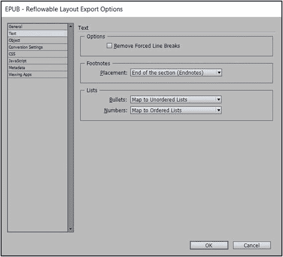

图 12-27. 文本导出选项

### 使用对象导出选项

点击左侧窗格的`对象`，右侧窗格将随之变化，如图 12-28 所示。

- `对象`：您有两个选项。第一个选项是`保留版面中图形/媒体对象的外观`。这是大多数导入图片和对象时使用的默认设置。如果您调整了对象大小、裁剪对象、应用了效果或以任何方式更改了对象，都应启用此复选框。第二个选项是`对图形对象使用现有图像`。如果您已在 `Photoshop` 等程序中准备好优化图像，且图像以 100% 比例放置，则可使用此选项。图片未做任何更改，也未应用任何效果。

- `CSS 大小`：在 `CSS` 区域中，您在此处所做的调整将写入一个 `CSS` 文件，该文件在打包 EPUB（导出为 EPUB 文件）时随 `HTML` 文件一起生成。对于 `CSS` 大小，您有两个选项。第一个选项是`固定`。如果从下拉菜单中选择此项，图像和对象将根据版面中的相对大小保持固定尺寸。如果选择`根据文本重排调整大小`，图像将随文档中文本的重排而调整大小。例如，如果一张图片在文本框的水平宽度中占 50%，那么在电子阅读器中调整文本大小时，图片会随之调整大小，并始终保持相对于文本的 50% 大小。实际操作中，您应选择此选项，因为它能优化在平板电脑和智能手机等多种设备上的显示效果。

- `版式`：从下拉菜单中选择左对齐、居中对齐或右对齐。如果希望在图像和对象前后留出空白，请编辑`段前间距`和`段后间距`文本框。

- `插入分页符`：如果希望在图像之前、之后或前后插入分页符，请启用此复选框。

- `忽略对象导出设置`：如果您想忽略在“对象导出选项”对话框中应用于单个对象的设置，请勾选此框。

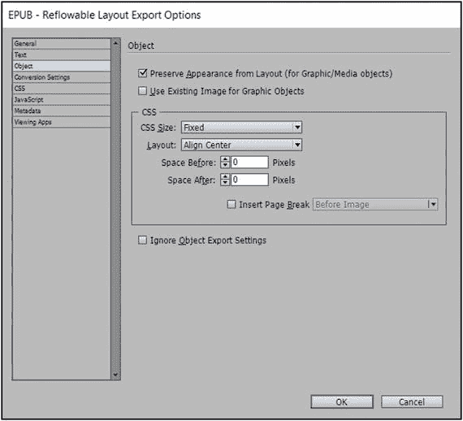

图 12-28. 对象导出选项

### 使用转换设置

点击左侧窗格的`转换设置`，右侧窗格将随之变化，如图 12-29 所示。

- `格式`：下拉菜单中的选项包括自动、`JPEG`、`GIF` 和 `PNG`。选择自动选项，让 InDesign 自行决定文件格式的最佳转换方案。如果选择其他选项，则所有图像都将转换为所选格式。

- `分辨率`：下拉菜单中的选项包括 `72`、`96`、`150` 和 `300` ppi。鉴于 `Apple 视网膜设备`等较新的屏幕技术支持更高的分辨率，图像分辨率在质量和文件大小之间的最佳折衷方案是 `150` ppi。将此设置设为默认值。

- `图像品质`：当您使用自动方法进行转换时，`JPEG` 和 `GIF` 格式均有相应选项。将 `JPEG` 图像质量设为高，并将格式方法保留为渐进式。对于 `GIF` 图像，选择自适应（无仿色）。只有在图像中包含大面积特定颜色或颜色数量有限时，才可能使用 `GIF` 图像。请勿将连续色调图像（如照片）保存为 `GIF` 格式。

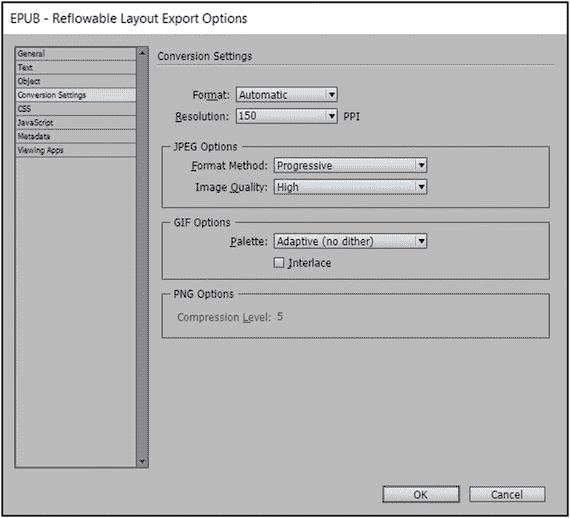

图 12-29. 转换设置面板

### 使用 CSS 选项

您可以在 `CSS` 面板中添加 `CSS` 样式表和自定义 `CSS` 代码。

### 使用 JavaScript 选项

`JavaScript` 只能添加到 `3.0` 格式的 EPUB 导出文件中。您需要在常规面板中选择 EPUB `3.0`，然后 `JavaScript` 选项才可访问。`JavaScript` 代码在文本编辑器中编写（请勿使用 `Microsoft Word` 编写脚本）。将 `JavaScript` 文件保存为扩展名为 `.js` 的文本文件。InDesign 无法识别没有 `.js` 扩展名的文本文件。点击`添加 JavaScript 文件`按钮，文件便会列在 `JavaScript` 面板中。

### 使用元数据选项

点击左侧窗格的`元数据`，右侧窗格将随之变化，提供多个用于添加元数据的文本框。许多在线内容托管商要求您向 EPUB 文件添加元数据。在最终确定 EPUB 文件之前，请务必填写此对话框中的数据字段。

### 使用查看应用程序选项

点击左侧窗格的`查看应用程序`，右侧窗格将随之变化，提供用于添加查看应用程序以预览导出文件以及选择所需查看器的选项。点击`添加应用程序`按钮，然后在硬盘上找到查看器。选择新的查看器并启用查看器名称旁的复选框。导出到 EPUB 时，文档将在选定的查看器应用程序中打开。

## 12.5 使用样式导出标签

导出到 EPUB 时，InDesign 会根据文档中使用的字符样式和段落样式创建 `CSS` 文件。您无需了解任何有关编写 `HTML` 和 `CSS` 代码的知识。InDesign 会为您处理所有工作。

InDesign 在创建 `HTML` 和 `CSS` 文件方面表现出色，但在将样式映射到 `HTML` 标签时略显不足。如果您了解一些 `HTML` 代码编写知识，可能希望将样式映射到不同的 `HTML` 标签。将样式映射到标签的原因是 EPUB 和电子阅读器的世界日新月异。新的应用程序频繁推出，随着开发者利用 EPUB `3.0` 格式，他们可能会要求遵守 `HTML5` 和 `CSS3` 标准。

要将段落样式映射到标签，请使用段落样式选项。创建一个新的段落样式或编辑现有段落样式，然后点击左侧窗格的`导出标记`。假设您有一个文档，其中各章节使用一种段落样式，子标题使用另一种段落样式，而二级子标题则指定了另一种样式。在`导出标记`选项中，您可以将章节标题标记为 HTML `h1` 标签，子标题标记为 `h2` 标签，二级子标题标记为 `h3` 标签。在`段落样式选项`对话框的`导出标记`选项中，从`标签`下拉菜单中选择标题标签，如图 12-30 所示。

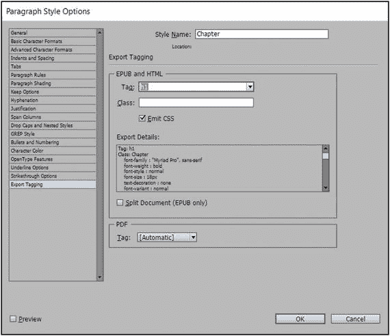

图 12-30. 从标签下拉菜单中选择标题标签

请注意，`标签`下拉菜单非常有限。如果您有其他标签，例如有序列表（`ol`）、表格行（`tr`）、块引用（`blockquote`）等，您可以在默认显示“自动”的`标签`文本框中直接输入。

要编辑文档中的多个标签，可以使用`编辑所有导出标签`对话框。打开字符样式面板菜单或段落样式面板菜单，然后选择`编辑所有导出标签`。`编辑所有导出标签`对话框随即打开。

`编辑所有导出标签`对话框中的标签列是可编辑的。点击列中的“自动”或某个标签，将打开一个下拉菜单，如图 12-31 所示。您还可以通过点击选择文本框并输入新的标签名称来编辑标签列中的项目。

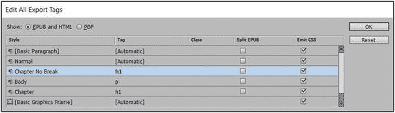

图 12-31. 打开字符或段落样式面板菜单，选择`编辑所有导出标签`以打开`编辑所有导出标签`对话框

## 12.6 编辑 EPUB 的内容

如我多次所述，EPUB 文件不过是一个或多个 HTML 文件连同 CSS 文件，全部打包在一个压缩存档中。您可以打开 `.zip` 存档的内容，编辑 HTML 和 CSS，然后将文件重新打包回 `.zip` 存档。

### 12.6.1 解压压缩的压缩包

当你创建一个 EPUB 文件时，文件扩展名是 `.epub`。你可以将扩展名改为 `.zip`，然后使用多种工具解压该压缩包。在 Windows 系统中，请确保你能够看到文件扩展名。如果你只是在文件名后添加一个 `.zip` 扩展名，它并不会被转换为 `.zip` 文件。首先，打开文件资源管理器（Windows 10），选中一个文件，点击功能区中的“查看”选项卡。启用功能区右侧的“文件扩展名”复选框。

当你看到扩展名为 `.epub` 的 EPUB 文件时，将扩展名重命名为 `.zip`。然后右键点击该文件，从上下文菜单中选择“全部提取”。

在 Macintosh 系统上，将 `.epub` 文件重命名为文件名加上 `.zip` 扩展名。macOS 系统只需双击 `.zip` 文件即可解压任何 `.zip` 文件。你可以从 [`https://code.google.com/p/epub-applescripts/downloads/detail?name=ePub%20Zip%20Unzip%202.0.1.app.zip&can=2&q`](https://code.google.com/p/epub-applescripts/downloads/detail%3Fname=ePub%20Zip%20Unzip%202.0.1.app.zip%26can=2%26q) 下载一个名为 `ePub_Zip_Unzip` 的 AppleScript。如果你已安装 StuffIt Expander，也可以在 Mac 上用它来解压文件。或者，你也可以在互联网上搜索 ePub Zip，点击 `ePub_Zip_Unzip` 链接，就会进入下载页面。

对于 Windows 和 Macintosh 系统来说，最好的工具是 eCanCrusher。你可以从 [`http://www.docdataflow.com`](http://www.docdataflow.com) 下载这个免费应用。将一个 EPUB 文件拖拽到 eCanCrusher 上，该文件就会展开，显示一个与您的 EPUB 同名的文件夹。在该文件夹内，有两个文件夹和一个文件。编辑完 HTML 和/或 CSS 文件后，将根文件夹拖拽到 eCanCrusher 上，即可转换回 EPUB 格式。使用此工具时，你无需担心更改文件扩展名的问题。

所有你需要编辑的文件都包含在 OEBPS 文件夹中。打开该文件夹，你会看到一个 XHTML 文件列表和一个包含 CSS 文件的 CSS 文件夹。这就是你可以在文本编辑器中打开并对 HTML 和 CSS 代码进行编辑的两个项目。

### 12.6.2 编辑 HTML

要编辑 HTML 和 CSS 文件，你需要一个文本编辑器。有许多文本编辑器可以免费下载。你可以在 Mac 上使用 TextWrangler，在 Windows 上使用 NotePad++ 以及 Dreamweaver。你也可以下载免费的*开源*程序 Brackets，它适用于 Mac 和 Windows。请从 [`http://brackets.io`](http://brackets.io) 下载 Brackets。

在图 12-32 中，你看到了在 Windows 版 Brackets 中显示的代码。要编辑 HTML 或 CSS 文件，你需要具备一些 HTML 编码知识。你可以从对代码进行一些小的修改开始，但要小心，并确保你*知道*如何进行修改。

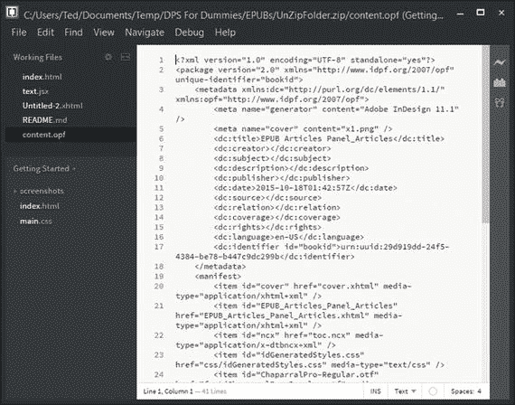

图 12-32. 在 Brackets 中查看的 HTML 代码

提供 HTML 编码的指导超出了本书的范围。只需了解你可以访问代码、进行修改并转换回 EPUB 格式这一事实即可。

在 HTML 代码中进行编辑后，使用 eCanCrusher、WinZip、Stuffit Zip 或其他用于压缩文件的工具，压缩提取出的 EPUB 的根文件夹。压缩文件夹后，将文件扩展名从 `.zip` 改为 `.epub`，就可以使用了。如果你使用 eCanCrusher，则无需更改文件扩展名。

## 12.7 在流式 EPUB 中使用交互性

在流式 EPUB 中添加交互元素是相当受限的，这也是合情合理的。流式 EPUB 通常是长篇文本文档，例如小说、报告、散文等。但这并不意味着某些类型的交互不能吸引内容消费者。

你不能在流式 EPUB 中使用按钮和多状态对象。你只能使用超链接和富媒体。你可能想在 EPUB 的首页播放一段视频、添加一些旁白或添加指向其他资源的链接。

### 12.7.1 使用超链接

你可以在你的 EPUB 中链接到 URL 或目标位置。在某些电子书阅读器中，你可以通过超链接打开默认的电子邮件客户端。然而，电子邮件超链接并非在所有电子书阅读器中都有效。

在第 7 章中，我介绍了在 InDesign 文档中添加超链接所需的所有知识。请按照第 7 章的说明创建指向 URL、文本锚点和电子邮件的链接。请务必在你预期读者会使用的电子书阅读器类型上测试结果。

### 12.7.2 使用富媒体

在“媒体”面板中，你可以选择在页面加载时播放视频。然而，在你导出为 EPUB 后，某些电子书阅读器不会自动播放视频。大多数电子书阅读器需要读者点击视频才能播放。流式 EPUB 和视频的另一个限制是，你对控制器没有任何选择。即使在 InDesign 中设置文档时为控制器选择了“无”，控制器也会始终存在。

理论上，如果你使用 EPUB 3.0 格式导出，视频应该能够在所有支持 EPUB 3.0 标准的电子书阅读器中播放。有关在 InDesign 中处理音频和视频的更多信息，请参阅第 10 章。

### 12.7.3 使用动画

当你创建动画时，动画会生成为 SWF 文件。SWF 不是适合用于 EPUB 的文件格式，尤其是 Apple iOS 设备不支持 SWF 格式。

不过，你可以通过一种变通方法让动画在 EPUB 中播放。在图 12-33 中，你可以看到在 EPUB 交互预览面板中预览的 InDesign 布局。该表格包含动画。图表顶部的黑色条会向上移动，显露出柱子。还要注意，图表有一个水印。我稍后会处理这个问题。

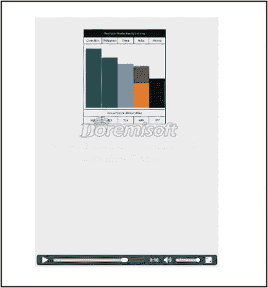

图 12-33. 一个包含已转换为视频文件的动画的布局

将动画添加到流式 EPUB 的方法是将 SWF 文件转换为视频文件。按钮和多状态对象不起作用，但 InDesign 动画可以被使用。

### 将 SWF 转换为视频格式

将 SWF 转换为视频文件有两种选择。你可以使用视频转换器，也可以使用屏幕录像软件来捕捉视频。市面上有许多不同的 SWF 转视频转换器，但这些应用程序都需要付费。不过要注意，尽管开发者声称能转换，实际上很少有软件能真正将 SWF 转为视频。

我花了一些时间寻找 SWF 视频转换器，发现最可靠的是 Doremisoft 的 SWF to Video Converter（Windows 版）和 Mac SWF Video Converter（Macintosh 版）。你可以从[`www.doremisoft.net`](http://www.doremisoft.net)下载该软件。截至撰写本文时，该转换器的价格为 99 美元。你可以下载软件并以演示模式运行，但生成的视频文件会包含水印，如图 12-33 所示。如果你觉得该应用程序满足需求，购买并注册产品后水印就会消失。

## 向 EPUB 添加动画

要向 EPUB 添加动画，你需要遵循几个简单步骤。

1.  在 InDesign 的空白页面上创建一个动画。用于书籍或章节的引导动画效果不错，能为你的出版物增添更多趣味。你可以使用我在第 8 章中讨论的任何动画选项。

2.  导出到 Flash 播放器（SWF）。选择`文件 ➤ 导出`或按`Ctrl/⌘+E`，然后从`保存类型`菜单（Windows）或`格式`菜单（Macintosh）中选择`Flash Player (SWF)`。

3.  转换 SWF 文件。在转换器应用程序中打开 SWF 文件并保存。在我的示例中，我使用了 Doremisoft 的 Mac SWF Video Converter（演示模式），因此生成的视频中会出现水印。

4.  裁剪视频。在许多情况下，你可能需要裁剪视频，尤其是当它不符合标准视频大小时。你可以在 Adobe Photoshop 中打开视频，使用`裁剪`工具进行裁剪。裁剪完成后，在 Photoshop 中选择`文件 ➤ 导出 ➤ 渲染视频`。

5.  将视频放置到版面中。按`Ctrl/⌘+D`，将视频置入 InDesign。有关视频处理的更多信息，请参见第 10 章。

6.  导出为 EPUB（可重排）。遵循本章多次讨论的导出视频的相同步骤。

7.  预览 EPUB 文件。在电子阅读器中打开文件，点击视频即可播放。在图 12-34 中，你可以在 Adobe Digital Editions 中看到正在播放的动画。进度条从左向右水平移动。

    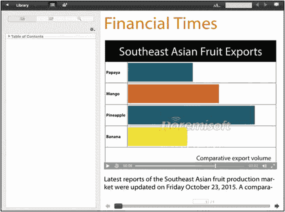

    图 12-34. 在 Adobe Digital Editions 中播放的、由动画转换成的视频

## 自动播放视频

你可以将动画设置为自动播放，但这仅适用于桌面电子阅读器。自动播放视频在设备电子阅读器上无法使用。要设置在桌面电脑上的 Apple iBooks 和 Adobe Digital Editions 中自动播放，你需要编辑包含视频标签的 HTML 文件。

### 设置视频自动播放

要在桌面电子阅读器上实现自动播放，请进行以下编辑：

1.  解压 EPUB 文档。选择扩展名为`.epub`的文件，将其改为`.zip`。在 Windows 上右键单击并选择`全部提取`，或在 Macintosh 上将`.zip`文件拖拽到 Stuffit Expander。更好的选择是使用 eCanCrusher，你可以从[`http://www.docdataflow.com`](http://www.docdataflow.com)免费下载 Windows 和 Macintosh 版本。使用 eCanCrusher 时，无需更改文件扩展名。

2.  在文本编辑器中打开 HTML 文件。使用像 Adobe Brackets 这样的程序，在 Brackets 中打开包含视频标签的文件。

3.  编辑视频标签。找到以`<video id =...`开头的视频标签，并插入`autoplay = "autoplay"`。

4.  保存并重新压缩文件。保存文件，然后使用 WinZip、Stuffit Zip 或 eCanCrusher 将其压缩成 zip 格式。

5.  更改文件扩展名。将文件扩展名从`.zip`改为`.epub`。该 EPUB 视频文件即可在桌面电脑的 Apple iBooks 和 Adobe Digital Editions 中自动播放。

## 将控制器移至视频下方

如果你查看 InDesign 中的媒体面板并打开控制器菜单，会看到许多可供选择的控制器外观。所有控制器都将控制条覆盖在媒体之上。当控制器可见时，它会遮挡视频中的内容。这不是什么大问题，因为控制器几秒钟后会自动隐藏。然而，这可能会让人有些困扰，对于播放动画的视频，你可能希望将控制器移到视频下方。这仅适用于在电脑上显示的 EPUB。此变通方法不支持设备电子阅读器。

### 将控制器移至视频下方

要在桌面电子阅读器上将控制器移到视频下方，请执行以下操作：

1.  解压 EPUB。使用 WinZip、Stuffit Zip 或 eCanCrusher 解压 EPUB 归档文件。

2.  打开`OEBPS`文件夹，然后打开该文件夹内的`CSS`文件夹。

3.  打开 CSS 文件。如果你有多个 CSS 文件，需要稍微搜索一下`idContainer`类。

4.  编辑 CSS 文件。你应该会看到一个`idContainer`部分，后面跟着一个`div`。每个项目的图像高度应相同。在`div`中找到高度值，并将其修改为大于默认值（见图 12-35）。你可能需要测试几次，以确保控制器刚好位于动画下方。

    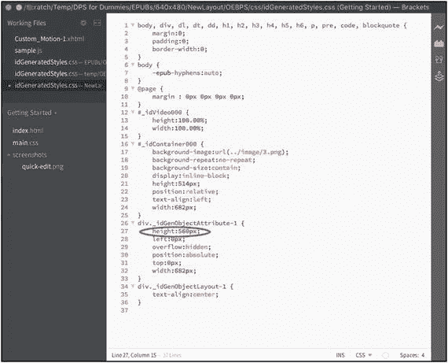

    图 12-35. 编辑 div 标签中的高度值

5.  保存并重新压缩。保存文件，使用 WinZip、Stuffit 或 eCanCrusher 将其转换回 EPUB 格式。

6.  在桌面电子阅读器中打开文件。控制器已移至视频下方，如图 12-36 所示。

    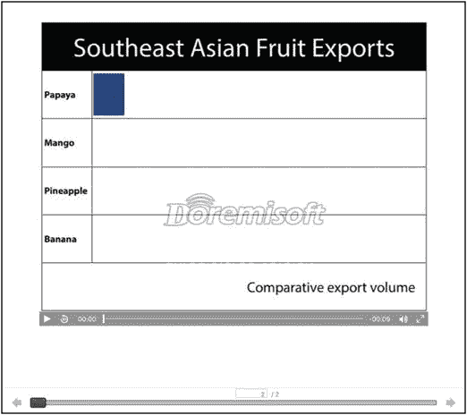

    图 12-36. 在桌面电子阅读器中查看时，控制器位于视频下方

## 验证 EPUB 文件

如果你解压了压缩的 EPUB 文件，进行了一些编辑，然后重新压缩回 EPUB 格式，则绝对需要使用 EPUB 检查器来验证该 EPUB 文件。作为最佳实践，你应该在上线托管之前验证所有的 EPUB 文件。

你可以下载一些免费的 EPUB 检查器，在本地计算机上运行；也可以找到在线服务，上传 EPUB 文件并使用在线检查器。

你可以在[`www.pagina-online.de`](http://www.pagina-online.de)找到一个 EPUB 检查器应用。该网站位于德国，网页为德语。如果你是英语使用者，请向下滚动页面找到英文版本。你可以下载 Windows 和 Macintosh 版本。你还可以在[`https://github.com/IDPF/epubcheck/releases`](https://github.com/IDPF/epubcheck/releases)找到一个不错的 EPUB 检查器。当你下载了任一 EPUB 检查器后，它们都是命令行工具。

如果你不习惯在 Windows 或 Mac 终端中使用`运行`命令，可以使用在线 EPUB 检查器服务。登录[`www.validator.idpf.org`](http://www.validator.idpf.org)，将文件上传到 EPUB 验证网页。上传完成后，你会看到一份关于 EPUB 文件中发现问题的报告，或者也可能显示验证通过，未发现问题。

> **注意**
>
> [`www.idpf.org`](http://www.idpf.org)（国际数字出版论坛）网站是 EPUB 作者和爱好者获取信息的绝佳来源。在那里你可以找到文章、新闻、公告、EPUB 标准等。请定期查看该网站上的帖子，以了解更多关于 EPUB 出版的信息。

你还可以找到其他用于验证 EPUB 的商业应用程序和在线服务。只需在 Google 上搜索 EPUB 验证器即可。

# 12.9 在设备上阅读 EPUB

在第 11 章中，我讨论了如何将文件从电脑上传到设备。在大多数情况下，我发现最好的方法是使用 Dropbox。如果你通过 USB 将电脑连接到安卓设备，也可以将出版物直接复制到设备上，但在多数情况下，Dropbox 效果最佳。使用 Dropbox 时，你可以选择想要用来打开出版物的阅读器类型。

目前有多种不同的阅读器可用于打开 EPUB。当你通过内容提供商托管出版物时，你希望尽可能多地让各种电子阅读器都能访问你的出版物。因此，你应当计划在多种设备上打开 EPUB。

## 12.9.1 使用苹果 iBooks

复制到 Dropbox 的文件是别名，在你查看出版物之前并不会下载到设备上。在 iPad 或 iPhone 上，打开 Dropbox 并点击文件列表中的某个文档。此时，Dropbox 列表中的文件便会下载到你的设备上。点击屏幕顶部的“共享”按钮，如图 12-37 所示。

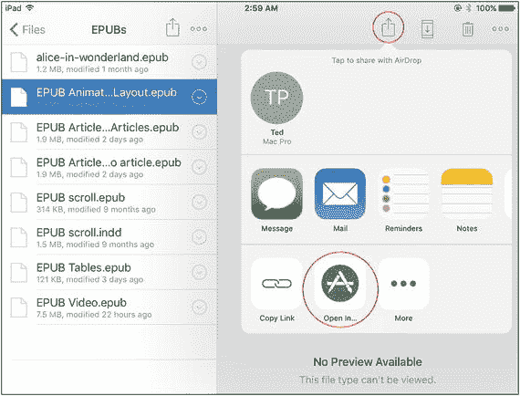

图 12-37. 点击 AirDrop 共享按钮

在第一行图标的下方，你会找到“在...中打开”按钮。点击此按钮，屏幕会显示能够打开你出版物的应用程序，如图 12-38 所示。点击“拷贝到 iBooks”按钮，出版物便会在苹果 iBooks 中打开。

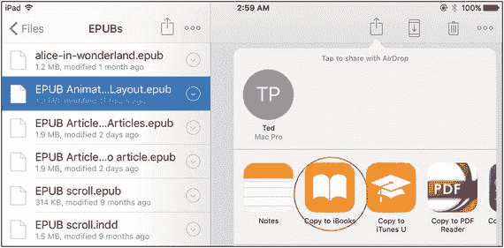

图 12-38. 点击“拷贝到 iBooks”以在 iBooks 中查看出版物

## 12.9.2 使用 Kindle KF8 格式

电子书市场的绝大部分份额由 `Amazon.com` 占据。如果你想销售电子书，就不能忽视亚马逊。早期的 Kindle 电子阅读器使用亚马逊专有的 `MOBI` 格式。如今，Kindle 设备使用亚马逊所谓的 `KF8` 格式。有点令人困惑的是，当你为 Kindle 导出文件时，文件扩展名仍然显示为 `.mobi`。不过不用担心，如果你使用更新的 Kindle 工具来创建可在 Kindle 阅读器上阅读的 EPUB，生成的文件实际上是 `KF8` 格式。

要将 EPUB 转换为 `KF8` (`MOBI`)，请下载并安装 `Kindle Previewer`。你可以从 [`http://www.amazon.com/gp/feature.html?docId=1000765261`](http://www.amazon.com/gp/feature.html?docId=1000765261) 下载 `Kindle Previewer`，或者通过谷歌搜索“Kindle Previewer”获取。

你还需要从 [`http://www.amazon.com/gp/feature.html?docId=1000765211`](http://www.amazon.com/gp/feature.html?docId=1000765211) 下载 `KindleGen`，或者搜索“KindleGen”并跟随链接到下载页面。当你在 `Kindle Previewer` 中打开文件时，该文件会被 `KindleGen` 转换并以 `.mobi` 扩展名保存，但如果你使用的是较新版本的 `Kindle Previewer`，它会被转换为 `KF8` 格式。

安装 `Kindle Previewer` 后，启动该应用程序，你会看到一个欢迎屏幕。欢迎屏幕上有许多链接，指向亚马逊托管的帮助文档，你可以在“帮助”部分看到这些链接。点击“打开图书”按钮，在 Previewer 中打开一个 EPUB。支持的文件类型包括 `MOBI`、`EPUB`、`HTML` 和 `OFP`。你会看到 `MOBI` 被列为支持格式，是因为你可以将旧的 `.mobi` 文件转换为新的 `KF8` 格式。

截至撰写本文时，`Kindle Previewer 3` 应用程序仍处于测试阶段。`Kindle Previewer 3` 在将 EPUB 转换为 `KF8` 格式方面表现出色。在图 12-39 中，你可以看到一个 EPUB 的预览以及 `Kindle Previewer 3` 应用程序的偏好设置对话框。

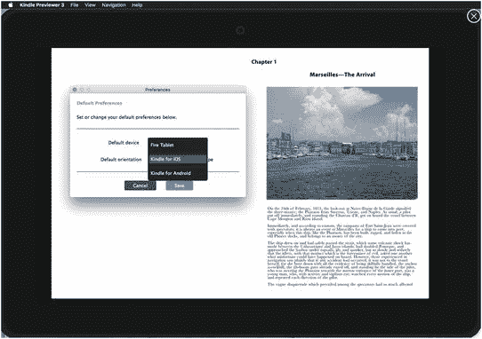

图 12-39. 使用 `Kindle Previewer 3` 转换的 EPUB

右键点击桌面上的文件，然后从上下文菜单中选择“打开方式”。如果你的电脑上安装了 Kindle 电子阅读器，Kindle 应用程序会显示为默认阅读器。

要将电子书发送到设备并在 Kindle 电子阅读器或设备上的 Kindle 阅读器应用中查看，请使用“发送到 Kindle”应用程序，你可以从 `Amazon.com` 的 [`http://www.amazon.com/gp/sendtokindle/pc`](http://www.amazon.com/gp/sendtokindle/pc) 下载。启动“发送到 Kindle”应用，然后将 EPUB 文件拖放至应用程序窗口。

## 12.9.3 使用专用 EPUB 阅读器

市面上有许多软件应用程序和专用电子阅读器可供选择。通常，你可以下载各种电子阅读器和应用的桌面版。`Kobo` 阅读器在加拿大和欧洲很受欢迎。你可以从 [`https://store.kobobooks.com`](https://store.kobobooks.com) 为你的桌面电脑下载 `Kobo` 阅读器。

各种设备的电子阅读器应用均可下载。你可以获取 `Stanza` 或 `Calibre` 作为桌面和设备的电子阅读器，此外还有许多其他应用。你可以下载几个来测试你的 EPUB，并验证它们在多种阅读器中是否正常工作。

电子阅读器和数字出版的世界在不断变化。请定期搜索互联网，了解 EPUB 格式的趋势、流行应用和发展动态。

# 12.10 营销 EPUB

如果你想销售 EPUB，你需要一个在线托管商。最受欢迎的托管商是面向 Kindle 电子阅读器的亚马逊和面向 iOS 设备的苹果。为了覆盖最广泛的潜在买家，你需要同时考虑这两个内容托管商。

在你采取任何行动之前，甚至在创建 EPUB 之前，你都需要彻底审查提供商对其销售图书的要求。你需要了解 EPUB 中可以包含什么、不能包含什么、特定的格式规则以及一长串其他要求。

## 12.10.1 通过亚马逊分发

像亚马逊和苹果这样的大型内容提供商要求你遵循其出版指南中规定的标准。对于亚马逊，你可以通过 [`www.kdp.amazon.com`](http://www.kdp.amazon.com) 查找出版指南和帮助信息。

你必须创建一个亚马逊账户。如果你已有用于购物的账户，可以使用相同的登录名和密码。如果你没有账户，则需要注册一个新账户。如果你想将现有账户与用于出版的账户分开，可以创建第二个账户。

遗憾的是，KDP 网页上没有指向 KF8 网页的链接。要查看有关 KF8 格式的指南和帮助信息，请访问 [`http://www.amazon.com/gp/feature.html?docId=1000729511`](http://www.amazon.com/gp/feature.html?docId=1000729511)，或者直接在谷歌搜索窗口中输入“KF8”。在谷歌中看到的第一个链接是指向 KF8 格式页面的链接，如图 12-40 所示。

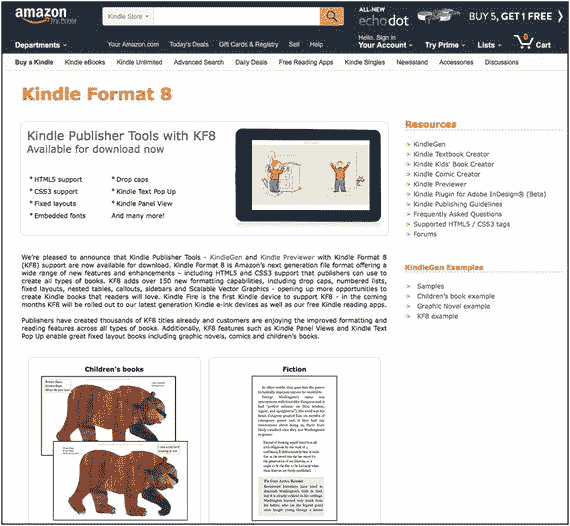

图 12-40. Kindle KF8 网页

在该网页的右侧，你会找到许多帮助页面的链接。其中有一个是“Kindle 出版指南”的链接。点击该链接，会打开一个 PDF 文档。该文档有 91 页，包含了大量关于亚马逊为 Kindle 设备制作图书所制定的标准和要求的信息。在为在 `Amazon.com` 上分发而创建 EPUB 之前，请务必彻底审阅该文档。

请注意，在 KF8 网页上，你会看到一个 Adobe InDesign 插件的链接。不必费心下载这个插件。它一直处于测试阶段，并且只支持到 InDesign CS6。它不支持 InDesign CC。

要通过亚马逊分发图书，你需要仔细查看 Kindle 直接出版网页上概述的步骤。在网页浏览器中输入“Kindle Direct Publishing”以搜索指向亚马逊网页的链接。你看到的第一个结果就是亚马逊详细介绍如何在 `Amazon.com` 上上传和出版电子书信息的链接。

### 12.10.2 通过 Apple iTunes 发布

Apple 也有发布指南，你需要遵守这些指南才能在 Apple iTunes 商店中托管书籍。同样，你需要在 `http://developer.apple.com` 注册一个 Apple 账户。创建账户是免费的，你需要先创建账户，才能继续查找有关通过 iTunes 发布的信息。

创建账户后，登录 `www.itunesconnect.apple.com`。点击 iTunes Connect 网页上的 `Resources and Help`（资源与帮助）按钮，即可找到指南和帮助信息。点击 `iBooks Store Formatting Guidelines`（iBooks Store 格式指南）和 `iBooks Publisher User Guide`（iBooks 出版商用户指南）链接。在创建打算通过 Apple iTunes 分发的 EPUB 之前，请彻底审阅这些文档。在 Apple 的网站上，你可以找到格式化出版物并上传至 Apple 所需的所有信息。

首次登录 Apple 的 iTunes Connect 网页时，除了 `Resources and Help`（资源与帮助）按钮外，你还会看到 `My Books`（我的书籍）和 `Sales and Trends`（销售与趋势）按钮。Apple 让你可以在 `Sales and Trends`（销售与趋势）网页上轻松跟踪出版物的销售情况，如图 12-41 所示，在该网页的 `My Books`（我的书籍）页面上可以看到你的出版物列表。

图 12-41. 销售与趋势网页

在每个书名下方，你可以看到下拉菜单，分别显示按国家/地区统计的、销售你书籍的商店数量，以及未销售你书籍的商店数量。我在 Apple 上发布的一本书显示有 51 家商店在售，1 家商店未售。当我点击 `Not in 1 Store`（1 家商店未售）按钮时，下拉菜单显示该书在中国地区不可用。

在 Apple iTunes 上发布书籍后，务必定期访问 iTunes Connect 网站。你可以查看销售进度以及按国家/地区统计的销售商店数量。

### 12.10.3 使用其他电子书经销商

你可能希望将书籍分发到 Amazon 和 Apple 之外的其他渠道。一旦创建了有效的 EPUB，大部分工作就完成了。不同电子书经销商之间的差异可能包括：是否将封面作为单独文件包含、是否添加前言和/或致谢页、是否需要获取 ISBN 编号或由托管方获取 ISBN 编号、段落样式是否需要 HTML 标签等。

每家电子书经销商都在其网站上提供了帮助页面，说明你需要准备的内容以及如何上传文件。要探索其他电子书经销商，可以搜索 Kobo、Nook Press、Smashwords，或直接搜索电子书经销商以找到小型出版商列表。当你浏览不同网站时，请查找每家出版商要求的发布指南和标准。

## 12.11 总结

本章全部关于可重排 EPUB。你学习了如何创建可重排 EPUB、正确创建 EPUB 的一些最佳实践、如何打开 EPUB 归档并查看其内容，以及从 InDesign 导出到可重排 EPUB 格式时的各种注意事项。

你还了解了向可重排 EPUB 添加交互性的局限性，以及一些允许你添加交互性的变通方法。

就交互式 EPUB 而言，可重排 EPUB 的限制非常大。当你向文档添加交互性并导出为固定版式 EPUB 时，束缚就解开了。在下一章中，你将学习创建固定版式 EPUB 的所有优势。
