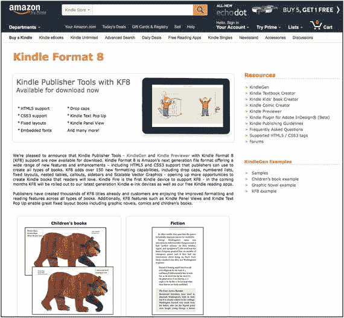
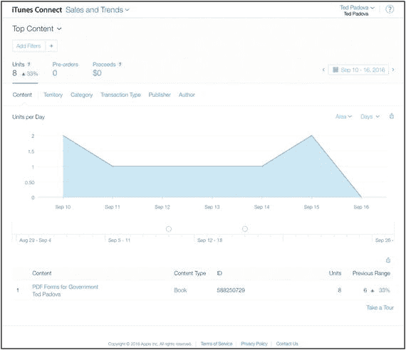

# 12.10 营销 EPUB

如果你想销售 EPUB，你需要一个在线托管商。最受欢迎的托管商是面向 Kindle 电子阅读器的亚马逊和面向 iOS 设备的苹果。为了覆盖最广泛的潜在买家，你需要同时考虑这两个内容托管商。

在你采取任何行动之前，甚至在创建 EPUB 之前，你都需要彻底审查提供商对其销售图书的要求。你需要了解 EPUB 中可以包含什么、不能包含什么、特定的格式规则以及一长串其他要求。

## 12.10.1 通过亚马逊分发

像亚马逊和苹果这样的大型内容提供商要求你遵循其出版指南中规定的标准。对于亚马逊，你可以通过 [`www.kdp.amazon.com`](http://www.kdp.amazon.com) 查找出版指南和帮助信息。

你必须创建一个亚马逊账户。如果你已有用于购物的账户，可以使用相同的登录名和密码。如果你没有账户，则需要注册一个新账户。如果你想将现有账户与用于出版的账户分开，可以创建第二个账户。

遗憾的是，KDP 网页上没有指向 KF8 网页的链接。要查看有关 KF8 格式的指南和帮助信息，请访问 [`http://www.amazon.com/gp/feature.html?docId=1000729511`](http://www.amazon.com/gp/feature.html?docId=1000729511)，或者直接在谷歌搜索窗口中输入“KF8”。在谷歌中看到的第一个链接是指向 KF8 格式页面的链接，如图 12-40 所示。

图 12-40. Kindle KF8 网页

在该网页的右侧，你会找到许多帮助页面的链接。其中有一个是“Kindle 出版指南”的链接。点击该链接，会打开一个 PDF 文档。该文档有 91 页，包含了大量关于亚马逊为 Kindle 设备制作图书所制定的标准和要求的信息。在为在 `Amazon.com` 上分发而创建 EPUB 之前，请务必彻底审阅该文档。

请注意，在 KF8 网页上，你会看到一个 Adobe InDesign 插件的链接。不必费心下载这个插件。它一直处于测试阶段，并且只支持到 InDesign CS6。它不支持 InDesign CC。

要通过亚马逊分发图书，你需要仔细查看 Kindle 直接出版网页上概述的步骤。在网页浏览器中输入“Kindle Direct Publishing”以搜索指向亚马逊网页的链接。你看到的第一个结果就是亚马逊详细介绍如何在 `Amazon.com` 上上传和出版电子书信息的链接。

### 12.10.2 通过 Apple iTunes 发布

Apple 也有发布指南，你需要遵守这些指南才能在 Apple iTunes 商店中托管书籍。同样，你需要在 `http://developer.apple.com` 注册一个 Apple 账户。创建账户是免费的，你需要先创建账户，才能继续查找有关通过 iTunes 发布的信息。

创建账户后，登录 `www.itunesconnect.apple.com`。点击 iTunes Connect 网页上的 `Resources and Help`（资源与帮助）按钮，即可找到指南和帮助信息。点击 `iBooks Store Formatting Guidelines`（iBooks Store 格式指南）和 `iBooks Publisher User Guide`（iBooks 出版商用户指南）链接。在创建打算通过 Apple iTunes 分发的 EPUB 之前，请彻底审阅这些文档。在 Apple 的网站上，你可以找到格式化出版物并上传至 Apple 所需的所有信息。

首次登录 Apple 的 iTunes Connect 网页时，除了 `Resources and Help`（资源与帮助）按钮外，你还会看到 `My Books`（我的书籍）和 `Sales and Trends`（销售与趋势）按钮。Apple 让你可以在 `Sales and Trends`（销售与趋势）网页上轻松跟踪出版物的销售情况，如图 12-41 所示，在该网页的 `My Books`（我的书籍）页面上可以看到你的出版物列表。

图 12-41. 销售与趋势网页

在每个书名下方，你可以看到下拉菜单，分别显示按国家/地区统计的、销售你书籍的商店数量，以及未销售你书籍的商店数量。我在 Apple 上发布的一本书显示有 51 家商店在售，1 家商店未售。当我点击 `Not in 1 Store`（1 家商店未售）按钮时，下拉菜单显示该书在中国地区不可用。

在 Apple iTunes 上发布书籍后，务必定期访问 iTunes Connect 网站。你可以查看销售进度以及按国家/地区统计的销售商店数量。

### 12.10.3 使用其他电子书经销商

你可能希望将书籍分发到 Amazon 和 Apple 之外的其他渠道。一旦创建了有效的 EPUB，大部分工作就完成了。不同电子书经销商之间的差异可能包括：是否将封面作为单独文件包含、是否添加前言和/或致谢页、是否需要获取 ISBN 编号或由托管方获取 ISBN 编号、段落样式是否需要 HTML 标签等。

每家电子书经销商都在其网站上提供了帮助页面，说明你需要准备的内容以及如何上传文件。要探索其他电子书经销商，可以搜索 Kobo、Nook Press、Smashwords，或直接搜索电子书经销商以找到小型出版商列表。当你浏览不同网站时，请查找每家出版商要求的发布指南和标准。

## 12.11 总结

本章全部关于可重排 EPUB。你学习了如何创建可重排 EPUB、正确创建 EPUB 的一些最佳实践、如何打开 EPUB 归档并查看其内容，以及从 InDesign 导出到可重排 EPUB 格式时的各种注意事项。

你还了解了向可重排 EPUB 添加交互性的局限性，以及一些允许你添加交互性的变通方法。

就交互式 EPUB 而言，可重排 EPUB 的限制非常大。当你向文档添加交互性并导出为固定版式 EPUB 时，束缚就解开了。在下一章中，你将学习创建固定版式 EPUB 的所有优势。
