# 13. 创建固定版式 EPUB

在第 12 章中，我讨论了可重排 EPUB。如果你阅读了该章，肯定知道创建可重排 EPUB 需要大量工作。你需要不断导出为 EPUB，检查结果，然后不可避免地返回 InDesign 对出版物进行更正和修改。之后必须再次导出并检查结果。在计算机屏幕上看到的版面和设计，往往与电子书阅读器中的显示效果不同。

固定版式 EPUB 则完全不同。固定版式 EPUB 与从 InDesign 导出的 PDF 文件非常相似。其版面和结构通常在最终导出时得以保留，并且你添加到文档中的所有交互性在固定版式 EPUB 中均得到支持。

可重排 EPUB 自 InDesign CS 4 以来就已存在。固定版式 EPUB 相对较新。它是作为 InDesign CS 6 中的导出选项引入的。作为一种较新的文件格式，你会发现电子书阅读器以及在设备上支持查看内容的工具存在一些局限性。不过，市场正在发展壮大；随着开发者们加紧提供对该格式的更多支持，我关于在设备上查看固定版式 EPUB 的讨论内容很可能会发生变化。

## 13.1 理解可重排式与固定版式 EPUB 的差异

在创建用于导出为固定版式 EPUB 的文档时，你会发现相较于处理可重排式 EPUB，既有许多优势，也有一些劣势。固定版式 EPUB 的优势包括以下几点：

*   **易于创建**：在 InDesign 中创建文档时，几乎所有设计方面都能轻松地完整导出到固定版式 EPUB。你无需锚定对象；可以将文本置于图像之上，添加透明度，按你希望在最终版式中呈现的方式格式化文本和图形，并且 InDesign 在 99.9% 的情况下都能导出为有效的固定版式 EPUB。

*   **保持设计完整性**：你在屏幕上看到的所见即所得视图会被捕捉到固定版式 EPUB 中。文本绕排、首字下沉、嵌套样式等都能精确呈现，与你导出的 PDF 文档中的效果完全一致。

*   **开放标准**：PDF 基于 PostScript，其代码不可编辑；而固定版式 EPUB 是一种开放标准，其底层代码完全可访问，就像可重排式 EPUB 一样。

*   **支持交互性**：你在 InDesign 文档中添加的所有交互功能，包括超链接和交叉引用、书签、多状态对象、动画、按钮和事件、音频以及视频，在固定版式 EPUB 中都得到支持。

*   **创作自由**：在固定版式 EPUB 中，你可以获得与用于打印和导出为 PDF 的文件相同的创作自由。你可以随心所欲地设计文档，无需费力使用各种工具就能使最终结果在电子阅读器中按照你喜欢的方式呈现。

当然，当你选择一种格式而非另一种格式时，在获得每项优势的同时，也可能发现一些劣势。单一格式无法囊括其对应格式的所有特性。你会发现的固定版式 EPUB 的劣势包括以下几点：

*   **无法重排以适应小型设备**：页面尺寸可以适配智能手机等小型设备，但文本会与页面尺寸保持比例关系，无法像可重排式 EPUB 那样自由放大或缩小。

*   **支持查看固定版式 EPUB 的设备较少**：对于可重排式 EPUB，有大量可安装在平板电脑和手机上的电子阅读器应用支持查看 EPUB。然而，对于固定版式 EPUB，支持它们的应用则要少得多。（有关支持的设备列表，请参见第 12 章的“在设备上查看 EPUB”一节）。

*   **字体必须嵌入**：某种程度而言，你可能会认为这是一个优势。然而，在计划分发的文档中嵌入字体，需要你研究是否可以合法地嵌入这些字体。你必须遵守字体供应商的许可协议，并彻底调查你在文档中包含某种字体的权利。对于可重排式 EPUB，你可以选择是否嵌入字体。固定版式 EPUB 则没有选择权，InDesign 会自动嵌入字体。（有关嵌入字体及其许可的更多信息，请参见本章后面的“使用字体”一节）。

*   **创建无障碍版式更具挑战性**：如果你想创建无障碍的固定版式 EPUB，你需要比创建可重排式 EPUB 做更多的工作。图像中的替代文本（Alt 标签）在固定版式 EPUB 中不起作用。你需要编辑 CSS 并修改设计，以便为不了解 CSS 的屏幕阅读器包含图像和对象的标题。

*   **Kindle 不完全支持**：截至撰写本文时，你可以将固定版式 EPUB 转换为 Kindle KF8/MOBI 格式，但无法获得其他电子阅读器支持的所有交互功能。亚马逊正在不断更新其 KF8/MOBI 格式，因此最终你可能会看到这种变化，使 Kindle 设备获得更强的交互支持。

### 13.1.1 剖析固定版式 EPUB 的结构

正如我在第 12 章中提到的，你可以将 `.epub` 文件转换为 `.zip` 文件，然后解压内容以访问 HTML 文件。对于固定版式 EPUB，你也可以这样做。在可重排式 EPUB 中，你可能有一个或多个 HTML 文件，这些文件基于 InDesign 文档中的文章。而在固定版式 EPUB 中，每一页都是一个 HTML 文件。在图 13-1 中，你可以看到左侧来自可重排式 EPUB 的 HTML 文件，以及右侧来自固定版式 EPUB 的 HTML 文件。

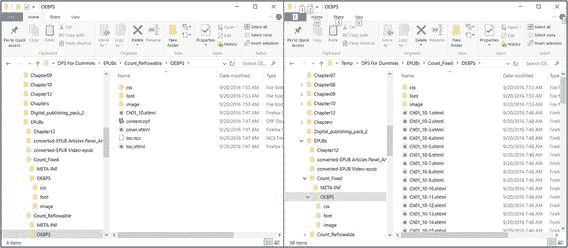

图 13-1. OEBPS 文件夹中可重排式 EPUB（左）和固定版式 EPUB（右）的 HTML 文件

当你检查某个固定版式文件中的 HTML 时，会看到文本带有异常多的标签。HTML 中的每个单词都用一个单独的类标签和绝对位置进行标记，如图 13-2 所示。

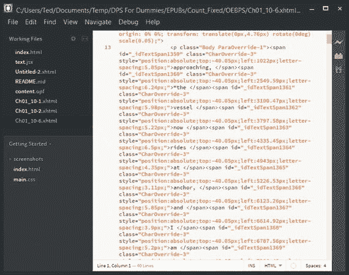

图 13-2. 固定版式 EPUB 中的每个单词都用一个单独的类标签和绝对位置进行标记

当你查看固定版式 EPUB 的 HTML 时，你会注意到，实际上不可能为文档中的文本编写代码。你可以对 HTML 进行编辑，但 InDesign 在导出为固定版式方面近乎完美，你无需担心对 HTML 进行任何编辑。

### 13.1.2 为特定体裁的书籍进行设计

当你在规划为某本书使用哪种格式时，可以考虑表 13-1 中列出的建议。该表列出了可能受益于固定版式 EPUB 的书籍，以及那些可能受益于创建可重排式 EPUB 的书籍。在许多情况下，PDF 文件效果很好。然而，如果你选择 EPUB 格式，则应考虑最适合你所部署文档类型的格式。

表 13-1. 固定版式与可重排式 EPUB

| 固定版式 EPUB | 可重排式 EPUB |
| --- | --- |
| 宣传册 | 散文 |
| 儿童读物 | 小说 |
| 漫画书 | 诗集 |
| 烹饪书 | 专业期刊/文章 |
| 图像小说 | 参考书 |
| 摄影集 | 大众图书 |
| 旅行指南 | 用户手册 |
| 教程 | 白皮书 |
| 教科书 |   |

表 13-1 只是关于哪些类型的书籍可能更适合使用某一种 EPUB 格式的基本指导。你可能会发现某些书籍体裁存在重叠，例如无插图的教科书更适合可重排式 EPUB，可能包含动画的用户手册更适合固定版式，而带有插图和旁白的诗集则更适用于固定版式 EPUB。一般来说，如果你的文档包含大量图像和/或图形以及交互功能，你可能希望创建固定版式 EPUB。如果你的文档以文字为主，图形处理较少且没有交互功能，那么通常可重排式 EPUB 效果最好。

## 13.2 设置图形格式

像 Photoshop 文件这样的光栅图像需要符合与设备阅读器一致的规范。与可重排式 EPUB 的情况一样，你应该查看内容托管网站以获取指南，尤其是在你的 EPUB 中使用照片时。

### 13.2.1 准备图像

图像应仅保存为以下两种格式之一：`JPEG` 和 `PNG`。原则上，除非图像需要透明背景，否则优先使用 `JPEG` 而非 `PNG`。`PNG` 文件在电子书阅读器设备上的渲染速度比 `JPEG` 文件更慢。

关于图像的另一个考量是文件分辨率。像 Apple 这样的内容提供商要求图像大小不超过 2M 像素。因此，在 Photoshop 中打开文件时，请查看标尺并将度量单位更改为像素（或点）。或者，你也可以选择“图像 ➤ 图像大小”来检查文件大小。你还可以在 Photoshop 的状态栏中查看文档大小。如果将 Photoshop 标尺上显示的水平值和垂直值相乘，即可得到照片的总像素数。如果该数值超过两百万像素，则需要对照片进行降采样或更改其物理尺寸。在图 13-3 中，你可以看到打开的 Photoshop 文档中可见的标尺，当水平值与垂直值相乘时，图像像素数超过了 200 万。另请注意，文档大小报告了水平和垂直像素值。总像素数也会在“图像大小”（图像 ➤ 图像大小）对话框中显示。

图 13-3. 将水平值与垂直值相乘以确定总图像分辨率

在使用封面图像并将文档中的首页栅格化为封面时，应选择 `150ppi` 作为默认选项。`150ppi` 是在保持视觉质量和控制文件大小之间的最佳平衡点。（有关栅格化封面图像的更多信息，请参阅本章后面的“导出为固定版式 EPUB 格式”部分）。

**注意**

除非你使用其他程序创建 EPUB，否则 InDesign 会根据你导出的文件格式自动处理文件转换和降采样。

### 13.2.2 应用对象样式

在第 [12] 章中，我讨论了为文档中的每个元素创建样式。我们研究了在添加效果、透明度和投影时创建对象样式。在应用样式方面，固定版式 EPUB 比重排 EPUB 宽容得多。即使不创建对象样式，你也可以应用效果、透明度和投影。

当你处于设计模式时，使用样式是合理的。如果需要编辑文本和对象属性，或者页面包含大量文本和图像，那么创建样式总是一个好主意。然而，对于渲染固定版式 EPUB 来说，样式并非必需。

### 13.2.3 处理透明度

在创建重排 EPUB 时，你可能还记得：无法在图像上叠加可编辑文本，也无法在图像上添加带透明度的框架，除非将所有组件栅格化并合成为一个图形。一旦将文本栅格化，它将无法被搜索，也不再是可编辑文本。

对于固定版式 EPUB，你可以在图像上添加文本，也可以为出现在图像上方的框架添加透明度。你无需担心对象的锚定，因为在 InDesign 中看到的版面布局在固定版式 EPUB 中会得到保留。如图 [13-4] 所示，一个带有透明度和文本的框架出现在图像上方，且文本是可编辑的。

图 13-4. 你可以在图像上添加文本和透明对象，并且在固定版式 EPUB 中，文本保持可编辑状态

## 13.3 处理交互性

我在第三部分中讨论的所有功能在固定版式 EPUB 中都能完美运行。由于本书是关于交互式数字出版的，我们希望充分利用 InDesign 提供的功能，在我们的出版物中添加交互元素。正如你在第 [12] 章中所知，在重排 EPUB 中添加交互性受到限制，有时需要变通方法才能为 EPUB 添加一些交互性。而使用固定版式 EPUB，你可以使用 InDesign 的所有功能来创建交互性，无需任何变通方法。

### 13.3.1 创建书签

向文档添加书签有助于创建目录。对于我在第 [12] 章中讨论的重排 EPUB，你可以在让 InDesign 生成导航目录时使用段落样式。而在固定版式 EPUB 中，某些页面可能没有章节标题甚至文本，但你希望这些页面成为目录的一部分。在生成目录时，你可以使用书签作为源，我将在后面的“创建导航目录”部分进行说明。

**向文档添加书签**

要向文档添加书签，请执行以下操作：

1.  打开书签面板。选择“窗口 ➤ 交互 ➤ 书签”。书签面板将打开，如图 [13-5] 所示。

    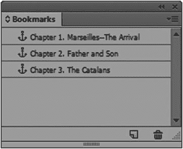

    图 13-5. 已填充书签的书签面板

2.  导航到要添加书签的页面。你需要手动创建文档中的所有书签。

3.  创建新书签。单击面板底部的“创建新书签”图标，或打开书签面板菜单并选择“新建书签”。第一个书签在面板中显示为 `书签 1`。文本处于高亮状态，以便你为书签输入描述性名称。

4.  继续在文档中导航并添加书签。滚动浏览文档，为你希望出现在目录中的每个页面添加一个书签。

在本章后面的“创建导航目录”部分中，我们将探讨如何在创建导航目录时使用书签作为源。

### 13.3.2 创建超链接

你可以使用超链接链接到文档内的页面、电子邮件帐户、在线 URL 和文本锚点。

**创建超链接**

要创建超链接，请执行以下操作：

1.  选择文本或对象，然后打开超链接面板（窗口 ➤ 交互 ➤ 超链接）。

2.  单击“创建新超链接”图标，或打开面板菜单并选择“新建超链接”。

3.  在“新建超链接”对话框中，从“链接到”下拉菜单中选择要链接到的项目。对于页面链接，选择“页面”，如图 [13-6] 所示。

    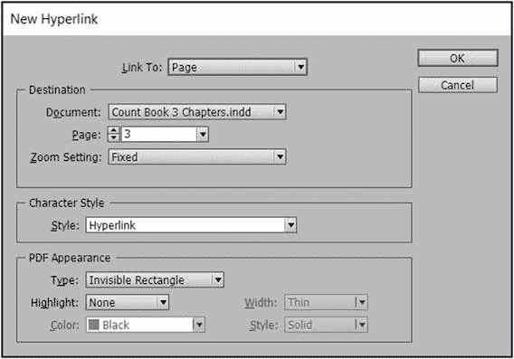

    图 13-6. 从“链接到”下拉菜单中选择“页面”以链接到文档中的某个页面

4.  单击“确定”，超链接即设置完成。当你导出到固定版式 EPUB 时，在设备上点击该链接即可打开目标页面。

### 13.3.3 使用富媒体

视频和音频可以添加到固定版式 EPUB 中，这与添加到重排 EPUB 的方式非常相似。虽然某些电子书阅读器可能支持除 `MP3` 以外的音频格式，并且某些阅读器支持诸如 `.mov` 和 `.avi` 等视频格式，但你仍应计划将所有音频转换为 `MP3`，将所有视频文件转换为采用 `H.264` 编码的 `MP4` 或 `M4v` 格式。最终，一些电子书阅读器可能会停止对旧格式的支持，转而采用更新的标准。

固定版式 EPUB 支持自动播放，但 iOS 设备除外。Apple 早在 iOS 6 版本中就禁用了自动播放功能。因此，用户需要点击视频才能播放。

### 13.3.4 使用动画

第 [8] 章中涵盖的所有动画在固定版式 EPUB 中均受支持。使用 EPUB 交互预览面板时看到的结果，通常与在固定版式 EPUB 中看到的结果一致。使用动画时无需任何变通方法，所有动画预设都能在固定版式 EPUB 中正常工作。

### 13.3.5 使用多状态对象

第 9 章中介绍的多状态对象在固定版式 EPUB 中均受支持，同时也支持嵌套的多状态对象。

#### 创建弹出窗口

有一种实用的按钮操作与多状态对象不完全相关，即使用“显示/隐藏”按钮操作。当你想要创建图像、文本框架或多状态对象的弹出视图时，此操作非常有用。遵循以下步骤创建一个弹出窗口：

1.  在 InDesign 中打开一个包含图像的页面。此处我用图像来说明如何使用弹出窗口。你也可以使用其他版式，但图像对此示例来说效果很好。

2.  创建弹出窗口。在我的示例中，我使用一个填充了颜色并添加了少许透明度的文本框架。在右上角，我添加了一个 `X` 来表示关闭框，如图 13-7 所示。将这些对象编组。

    

    图 13-7. 在图像上方创建的弹出窗口

3.  在图像上方的左下角或右下角创建一个图标。此图标代表一个按钮，用于提示用户点击该按钮时会触发某些操作。

4.  将图标转换为按钮。打开“按钮和表单”面板，选中图标图像。点击“转换为按钮”图标创建一个按钮，并为其命名。在我的示例中，我将按钮命名为 `Show Popup`。此时不要为按钮添加任何操作。

5.  将弹出窗口框架转换为按钮。选中弹出窗口，点击“按钮和表单”面板中的“创建新按钮”图标。为按钮添加一个名称。在我的示例中，我将按钮命名为 `Popup`，如图 13-8 所示。

    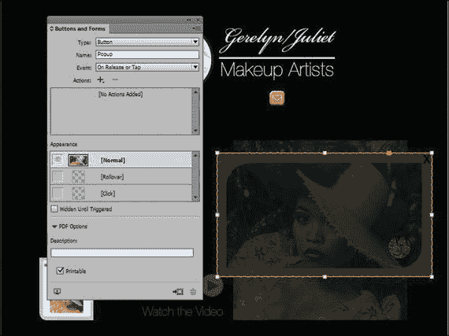

    图 13-8. 将对象转换为按钮

6.  添加一个按钮操作。选中第二个按钮（名为 `Popup`），点击加号图标添加操作。从“操作”下拉菜单中选择“显示/隐藏按钮和表单”。在“操作”下拉菜单下方的列表中，你会看到这两个按钮。此按钮的作用是显示图标并隐藏弹出窗口。因此，点击按钮名称（`Popup`）旁的默认 `X`，并点击名称旁的图标，直到眼睛图标上出现反斜杠（`\`）。点击 `Show Popup` 名称旁的图标，并点击该框直到看到眼睛图标。这些操作分别用于隐藏弹出窗口和显示图标按钮。

7.  添加第二个按钮操作。选中按钮（`Show Popup`），并显示 `Popup` 和关闭按钮，如图 13-9 所示。在我的示例中，我还添加了一个透明屏幕来调暗版式中的视频。

    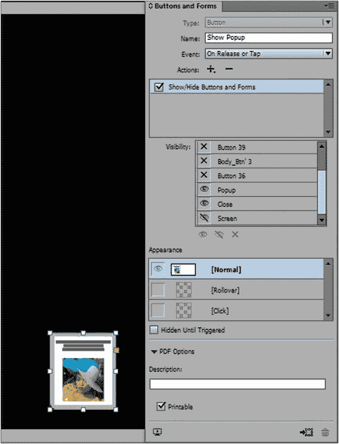

    图 13-9. 将按钮操作设置为“显示/隐藏按钮和表单”

8.  打开“EPUB 交互性预览”窗口并测试按钮。当你点击按钮图标时，应能看到弹出窗口出现，如图 13-10 所示。要关闭弹出窗口，请点击 `Popup` 按钮。`Popup` 按钮图标将再次显示。

    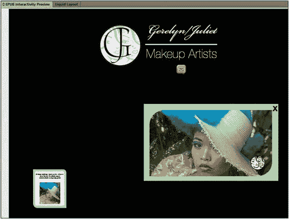

    图 13-10. “EPUB 交互性预览”窗口中显示的弹出窗口

## 13.4 创建导航目录

对于固定版式 EPUB 来说，目录并非必需。能够显示固定版式 EPUB 的电子阅读器会为每个页面生成缩略图。当你在文档中滑动浏览时，设备底部会显示缩略图。然而，如果文档篇幅较长，你可能仍需要创建一个目录。

在可重排 EPUB 中创建目录时，你会使用段落样式和目录样式选项。对于固定版式 EPUB，你可能有新的章节页面不包含文本。你可能在希望按逻辑分割文档的位置放置了动画或图像。要在段落样式不实用时创建目录，你可以创建书签并将其用于目录样式。（要在 InDesign 文档中创建书签，请参阅本章前面的“创建书签”部分。）

创建书签后，选择 `文件 ➤ 导出`（或按 `Ctrl/⌘+E`），并将格式选为 `EPUB（固定版式）`。在“EPUB – 固定版式导出选项”对话框的“常规”设置中，从“导航目录”下拉菜单中选择 `书签`，如图 13-11 所示。

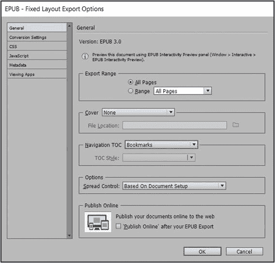

图 13-11. 从“导航目录”下拉菜单中选择 `书签`

点击 `确定`。文件即被导出为固定版式 EPUB。当你打开内容页面时，会发现目录已根据书签构建完成，如图 13-12 所示。

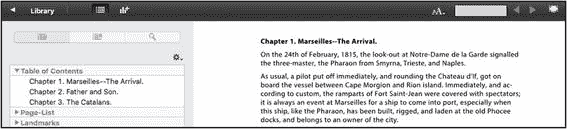

图 13-12. 固定版式 EPUB 中的目录页面

## 13.5 使用字体

在固定版式 EPUB 中，你无法选择是否嵌入字体。InDesign 会替你做出选择，并且你在“导出为 EPUB（固定版式）”选项中无法禁用字体嵌入。InDesign 会在固定版式 EPUB 中嵌入 TrueType 和 OpenType 字体。较旧的 PostScript 字体格式无法嵌入。

### 13.5.1 了解字体许可

由于 InDesign 会嵌入你在固定版式 EPUB 中使用的字体，因此你需要做一些研究，以确定你是否可以合法地以这种方式使用它们。你可能以 24.95 美元的价格购买了一种字体，但你购买的字体可能仅被授权用于打印文档。当你查看字体供应商的网站时，可以找到在网页、EPUB、PDF 等用途中的许可要求。你以 24.95 美元购买的同一字体，嵌入 EPUB 的成本可能高达 200-500 美元。此外，你可能会发现，EPUB 的许可证可能只允许你在一个 EPUB 中使用该字体一次。有些情况确实荒谬至极，你的最佳实践是远离那些收取过高费用的字体供应商——尤其是针对单个 EPUB 使用的情况。

你最好的选择是使用 Adobe Typekit 字体。所有通过你的 Creative Cloud 订阅在 Typekit 上可用于桌面的字体，均可合法地嵌入 EPUB 中，无需额外费用。

### 13.5.2 使用可接受的字体属性

在开始一个项目时，最好将各种字符组合导出到固定版式 EPUB 中，以确保你使用的字符能正确转换到 EPUB。一些高级 OpenType 字符属性无法导出到 EPUB，有些只能部分导出，而另一些则完全失败。例如，花体连字无法导出到固定版式 EPUB，其效果与 InDesign 中的页面版式差异很大。手动字距调整和 OpenType 分数同样不起作用。

如图 13-13 所示，在 InDesign 中设置的原始文本（左侧）显示了一些在 EPUB 文档（右侧）中丢失的文本属性。

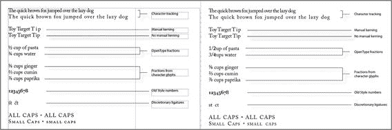

图 13-13. 在 InDesign 中设置并导出到固定版式 EPUB 的文本（左侧为 InDesign 中的排版，右侧为导出至固定版式 EPUB 的结果）

旧式数字在 InDesign CC 2015 中可以正常导出。如果你使用的是旧版 InDesign，旧式数字将无法正常导出。第一组分数源自 OpenType，第二组分数是使用字符字形设置的。

## 13.6 导出为固定版式 EPUB 格式

要创建固定版式 EPUB，其导出过程与导出可重排 EPUB 类似。选择 `文件` ➤ `导出` 命令，或按 `Ctrl/⌘+E`，然后在 `保存类型`（Windows）或 `格式`（Macintosh）下拉菜单中选择 `EPUB（固定版式）`。

此时会弹出 `EPUB – 固定版式导出选项` 对话框，默认显示 `常规` 面板，如图 13-14 所示。

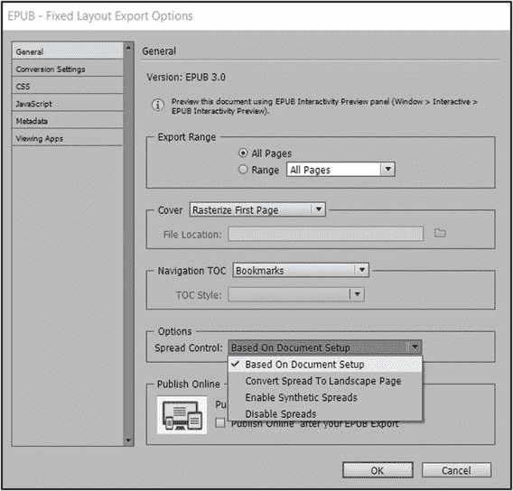

图 13-14. `EPUB – 固定版式导出选项` 对话框中的 `常规` 面板

### 13.6.1 使用常规导出选项

与可重排 EPUB 相比，固定版式 EPUB 的常规导出选项有几点不同。在 `导出范围` 中，你可以选择页面范围。`封面` 选项与导出为可重排 EPUB 时相同。你可以选择不导出封面、将第一页栅格化为封面，或选择一张图片作为封面。

在 `导航目录` 下拉菜单中，你可以选择 `书签` 来生成目录。

在 `跨页控制` 下拉菜单中，你可以选择生成的 EPUB 文档中跨页的显示方式。在此处所做的选择会写入 `OPF` 文件的元数据标签中，该文件控制页面视图（在 HTML 文件中也称为视口）。你的选项包括：

- **基于文档设置**：使用此设置，通过 `文档设置` 对话框（`文件` ➤ `文档设置`）中的设置来导出固定版式 EPUB。在 `文档设置` 中，你可以选择单页或对页。你还可以指定页面大小和方向。使用 `基于文档设置` 菜单选项导出 EPUB 时，将应用 `文档设置` 中的所有设置。

- **将跨页转换为横向页面**：如果你的文档设置为对页，则可以将所有跨页转换为单个横向页面。

- **启用合成跨页**：如果你的文档设置为单页，此选项允许你导出具有对页的 EPUB。无论文档如何设置，这都会强制导出的文档创建对页。

- **禁用跨页**：如果文档设置为对页，但希望将 EPUB 导出为单页，则使用此选项将跨页拆分。

### 13.6.2 使用转换设置

点击左侧窗格中的 `转换设置`，右侧窗格将显示转换设置，如图 13-15 所示。

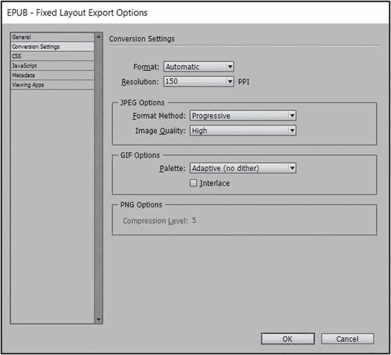

图 13-15. `EPUB – 固定版式导出选项` 对话框中的 `转换设置` 面板

转换设置主要涉及如何处理图像。实际操作中，建议将 `格式` 设置为 `自动`，`分辨率` 选择 `150ppi`。对于 JPEG 图像，将 `品质` 设为 `高`。无需担心 GIF 选项。固定版式 EPUB 应仅使用 JPEG 和 PNG 格式。

### 13.6.3 使用 CSS 面板

点击左侧窗格中的 `CSS` 后，右侧窗格会发生变化，但并没有太多选项可供选择。InDesign 会自动处理所有 CSS 的编写，你无需担心是否需要选择输出 CSS。有一个按钮可以点击以向导出内容添加样式表，但通常很少会用到。实际操作中，导出固定版式 EPUB 时，保持 CSS 选项为默认值即可。

### 13.6.4 添加 JavaScript

InDesign 会为固定版式 EPUB 自动生成自己的 JavaScript。如果你有想要添加到文件中的 JavaScript，可以通过点击左侧窗格中的 `JavaScript`，然后点击 `添加 JavaScript` 按钮来添加脚本。除非你是一个熟练的 JavaScript 程序员，否则请保持此对话框为默认设置。

### 13.6.5 使用元数据

`元数据` 面板用于提供文件标题、创作者/作者、创建日期、出版商、复制权限以及文档主题等字段的元数据，如图 13-16 所示。

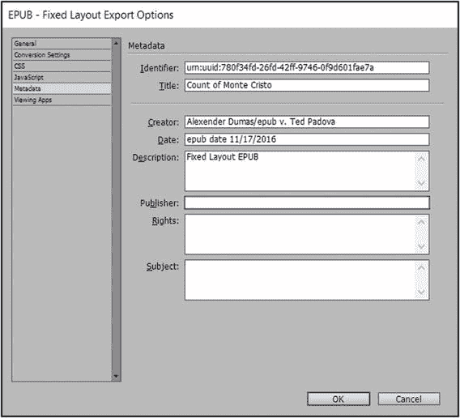

图 13-16. 导出选项中的 `元数据` 面板

请勿修改 `标识符` 字段。InDesign 会生成自己的标识符。这不是添加 ISBN 号码的地方。在将 EPUB 发送到托管服务之前，请填写文本框并提供相关信息。

### 13.6.6 定位阅读器应用

`EPUB – 固定版式导出选项` 对话框的最后一个面板是 `阅读器应用` 面板。选择阅读器应用的方式与导出为可重排 EPUB 时非常相似。选择桌面电脑上的阅读器应用，文件导出后会自动在所选应用中打开。

### 13.6.7 验证 EPUB

InDesign 在导出有效的固定版式 EPUB 方面表现出色。如果你将文档导出为固定版式 EPUB 且未报告任何错误，那么可以非常确信该 EPUB 是有效文档，并符合 EPUB 标准。

如果你编辑了任何 HTML 或 CSS 文档，则应使用 EPUB 验证应用程序运行该 EPUB。有关验证 EPUB 的更多信息，请参见第 12 章。

## 13.7 查看固定版式 EPUB

通常，导出任何格式的 EPUB 时，应首先在桌面阅读器上预览文档。如果文档显示正常，则将文件传输到设备并在多台设备上预览，然后再将文件部署到内容提供商。

虽然对于在桌面电脑和设备上查看可重排电子阅读器有许多选择，但固定版式阅读器的选择较少。截至目前，你可以通过 Google Chrome 浏览器的 `Readium` 扩展、Apple iBooks 以及 Adobe Digital Editions（4.0 及以上版本）查看固定版式 EPUB。固定版式 EPUB 可以转换为 Kindle KF8/MOBI 格式，但如果你创建了交互式文档，则会丢失大量交互性。

电子书世界的发展日新月异。因此，本书出版时可能还有其他值得使用的阅读器。目前，你可以使用 `Apple iBooks`（桌面版和设备版）或 `Adobe Digital Editions` 来查看固定版式 EPUB。在 Windows 和 Android 系统上，你可以使用 Windows 和 Android 设备上的 `Adobe Digital Editions`（`ADE`）。

你添加到固定版式 EPUB 中的所有交互功能都可以在电脑和设备的 `iBooks` 和 `ADE` 中查看。

此外，`Kobo` 阅读器也提供了对查看固定版式 EPUB 的同等支持。

## 13.8 总结

在本章中，我们研究了如何导出固定版式 EPUB，并观察了可以与固定版式 EPUB 一起使用的所有交互功能。正如你所见，你的交互式文档在固定版式格式下比可重排 EPUB 格式更具多样性。

在下一章中，我们将探讨导出到 `Adobe Publish Online` 时，在文档中使用各种交互功能的另一种方法。
