# 15. 创建交互式 PDF 文件

便携式文档格式（PDF）文件可以在所有设备上查看。每部手机、平板电脑和计算机都配有某种 PDF 查看器。在台式机和笔记本电脑上，免费的 Adobe Reader 软件是主流的 PDF 查看器。在手机和平板电脑上，则有多种免费或付费的查看器可供选择。

无论你使用哪种 PDF 查看器，PDF 文件通常都能按创建时的原样显示文档，包括图像、文本格式和字体嵌入。使用 PDF 的缺点是，一些交互功能在手机和平板电脑上不受支持。在台式机和笔记本电脑上，你可以获得更广泛的交互功能支持。

在本章中，我将讨论如何从 Adobe InDesign 导出交互式 PDF 文件、添加交互性，以及直接在 Adobe Acrobat 中执行若干添加交互性的任务。所有 Creative Cloud 用户都可以下载 Adobe Acrobat。如果你不是 Creative Cloud 订阅用户，则需要购买 Adobe Acrobat 或其他 PDF 编辑程序。免费的 Adobe Reader 应用程序不具备编辑功能。

## 15.1 准备 Acrobat 工作区

如果你是 Creative Cloud 应用程序的用户，但从未使用过 Adobe Acrobat，那么当你第一次看到 Acrobat 用户界面时，可能会怀疑这个应用程序是否真的是 Adobe Systems 开发的。所有 Creative Cloud 应用程序以及 Adobe Photoshop Elements 都使用非常相似的用户界面。然而，Adobe Acrobat 团队却独树一帜，Acrobat 并不遵循你在其他所有 Creative Cloud 应用程序中看到的用户界面设计标准。

### 15.1.1 创建自定义界面

在 Adobe Acrobat 中，你应该创建一个自定义工作区，以便能够快速选择用于交互式 PDF 的各种工具。首先，打开 Adobe Acrobat。文档窗格中不需要打开任何文档。

点击窗口左上角的 `Tools`（工具），如图 15-1 所示。

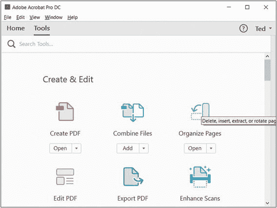

图 15-1. 点击 Acrobat 窗口左上角的 `Tools`（工具）以打开工具窗口

展开 `Edit PDF`（编辑 PDF）类别，点击 `Add`（添加）。点击 `Open`（打开），编辑工具便会出现在 Acrobat 窗口顶部的工具栏中，如图 15-2 所示。

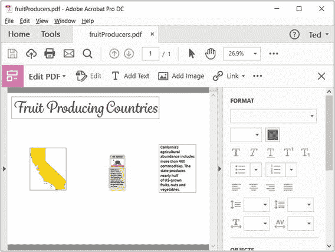

图 15-2. 点击 `Edit`（编辑）来编辑文档中的文本

你打开的工具会显示在右侧窗格中，并且在你打开其他 PDF 文件时也可使用。

## 15.2 从 InDesign 导出为 PDF

当你在 InDesign 中选择 `File ➤ Export`（文件 ➤ 导出）时，对于要导出的 PDF 类型，你有两个不同的选项。在 `Export`（导出）对话框的 `Save as Type`（Windows 系统）或 `Format`（Macintosh 系统）菜单顶部，你可以找到 `Adobe PDF (Interactive)`（Adobe PDF（交互式）），后面跟着 `Adobe PDF (Print)`（Adobe PDF（打印））。对于交互式文档，你显然需要使用 `Interactive`（交互式）选项。如果你想导出用于打印的 PDF 文档，则使用 `Print`（打印）选项。

### 15.2.1 使用“导出为交互式 PDF”对话框

当你选择 `File ➤ Export`（文件 ➤ 导出）或按下 `Ctrl/⌘+E`，选择 `Adobe PDF (Interactive)`（Adobe PDF（交互式）），然后点击 `Save`（保存）时，会打开 `Export to Interactive PDF`（导出为交互式 PDF）对话框，如图 15-3 所示。

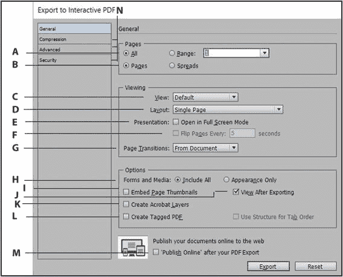

图 15-3. 打开 `Export to Interactive PDF`（导出为交互式 PDF）对话框

在该对话框中，你有几个选项，包括以下内容：

1.  `Page Range`（页面范围）：如果要导出一个页面范围，请点击 `Range`（范围）单选按钮并输入页码。例如输入 `3–5` 可导出第 3 页至第 5 页。
2.  `Pages / Spreads`（页面/跨页）：对于单页版式，请使用 `Pages`（页面）。如果你有对页，并且希望最终 PDF 中的对页显示为单个宽页，请点击 `Spreads`（跨页）。
3.  `View`（视图）：从菜单中，你可以选择不同的缩放选项。如果你希望整个页面都适合屏幕，请选择 `Fit Page`（适应页面）。无论屏幕尺寸如何，所有用户都将在文档窗格中看到整个页面。
4.  `Layout`（布局）：如果你在此菜单中选择 `Default`（默认），则 PDF 视图将遵循每台计算机上的首选项设置。用户可以将首选项设置为单页文档或连续模式查看 PDF。（当你滚动页面时，随着上一页的底部滚出视线，你将看到下一页的顶部。）如果你总是希望你的 PDF 文档以单页方式查看，以便用户在滚动页面时能自动吸附到下一页（或任何其他布局视图），请从菜单中选择该选项。当选择了除 `Default`（默认）之外的选项时，`Layout`（布局）视图会覆盖单个计算机的首选项，并强制所有用户以相同的布局视图查看你的 PDF。
5.  `Open in Full Screen Mode`（以全屏模式打开）：全屏模式是一种视图模式，在此模式下，所有 PDF 查看器的用户界面元素（如工具栏、菜单、滚动条等）都被隐藏。以全屏模式打开 PDF 的缺点是，每次打开 PDF 时，用户都会看到一个必须关闭的警告对话框。不幸的是，由于 Adobe 采取了许多安全措施以防止 PDF 在你不知情的情况下更改你的计算机，这是一个不得已而为之的“必要之恶”。
6.  `Flip Pages`（翻页）：如果启用了 `Full Screen Mode`（全屏模式）进行导出，你可以让 PDF 自动翻页。你可以在文本框中输入数值来确定翻页间隔。
7.  `Page Transitions`（页面过渡）：页面过渡发生在你浏览页面时。你可以选择保留 PDF 中包含的任何页面过渡，或从菜单中选择多种不同的过渡效果。
8.  `Forms and Media`（表单和媒体）：点击 `Include All`（包含全部）单选按钮，以包含放置在你的 InDesign 页面上的所有媒体文件和表单字段。
9.  `Embed Page Thumbnails`（嵌入页面缩略图）：始终禁用此选项。切勿勾选它。PDF 文档中的缩略图会在导航窗格内的 `Pages`（页面）窗格中显示每页的缩略图图像。自 Acrobat 6 以来，当打开 PDF 文档时会即时生成缩略图。如果你嵌入了页面缩略图，会增加额外开销，并且最终文件会更大。
10. `View After Exporting`（导出后查看）：如果你想在导出完成后自动在 Acrobat 查看器（Adobe Acrobat 或 Adobe Reader）中打开导出的 PDF 文档，请勾选此框。
11. `Create Acrobat Layers`（创建 Acrobat 图层）：在所有类型的交互式文档中，PDF 是唯一支持图层的。例如，如果你有一个多语言文档，你可以将所有图形和图像放在一个图层上，并在单独的图层上创建文本。然后，你可以使用按钮让文档的读者切换图层视图。
12. `Tagged PDF`（标记 PDF）：点击 `Create Tagged PDF`（创建标记 PDF），以便屏幕阅读器用户可以通读你的文档。点击 `Use Structure for the Tab Order`（使用结构作为 Tab 键顺序），这将继承表单字段等内容的 Tab 键顺序。
13. `Publish Online`（在线发布）：勾选此框以将文档添加为 Publish Online 文件。（有关 `Publish Online`（在线发布）的更多信息，请参见第 14 章。）
    *   `Compression`（压缩）：为文档中的图像选择压缩类型、`JPEG Quality`（JPEG 质量）和 `Resolution`（分辨率）。
    *   `Advanced`（高级）：选项包括显示 `File Name`（文件名）或 `Document Title`（文档标题），以及选择 `Language`（语言）。
14. `Security`（安全）：点击 `Security`（安全）按钮打开 `Security`（安全）对话框。你可以添加打开 PDF 的密码保护、限制对 PDF 的编辑，或同时进行两者设置。

### 15.2.2 在 InDesign 中准备版面

在处理交互式 PDF 文件时，需要进行一些特殊处理，并且可以取得一些有趣的效果。本节将介绍这两方面的内容。你将了解到一些适用于交互式 PDF 的最佳实践，这些在创建固定布局和 Adobe Publish Online 文档时则无需考虑。

### 15.2.2.1 突破常规思维

交互式 PDF 文件可以实现的一个有趣效果是，设计包含超出页面边界的对象或图像的文档。这只能通过 PDF 文档实现，而唯一能产生此效果的程序是 Adobe InDesign。在图 15-4 中，你会看到一个在 Acrobat 中显示的 PDF 页面。请注意页面左侧的菠萝，它超出了页面边界。这类似于一种越界效果，你可以使用 Adobe Photoshop Elements 来创建。

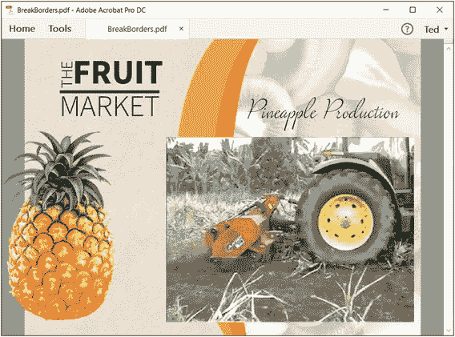

图 15-4。只有交互式 PDF 文档才能包含超出页面边界的元素 超出页面边界

你可能有一辆驶出屏幕的自行车、一个正在踢球的足球运动员、一个冲浪者正在驾驭波浪，或者其他想要为最终文档增添一点立体感的设计元素。这是一项相当简单的任务，我们逐步说明如下：

1.  在主页上放置一个对象。必须将超出边界的对象放置在主页上。打开**页面**面板，双击用于页面上其他设计元素的主页。
2.  确保对象的中心点在页面边界内。你必须确保中心点位于页面边界内。如果希望小元素位于页面边界之外，请在页面区域内创建一个无描边、无填充的框架，并将其与这个小元素成组。成组对象的中心点必须位于页面区域内。
3.  将对象转换为按钮。选择对象，打开**按钮和表单**面板。为该对象创建一个新按钮。无需担心分配动作，只需确保该对象是一个按钮即可。
4.  导出为交互式 PDF。选择**文件** ➤ **导出**（或按 `Ctrl`/`⌘`+`E`），然后选择 **Adobe PDF（交互式）**。如果勾选了**导出后查看**，PDF 会在默认的 PDF 查看器中打开。接下来，你需要使用 Adobe Acrobat 完成最后的工作。
5.  锁定按钮。如果用户点击并拖动鼠标，按钮可能会移动并被完全限制在页面区域内。为防止这种情况发生，请使用**选择对象**工具右键点击按钮，打开弹出菜单。（按键盘上的 `R` 键可访问**选择对象**工具。）从菜单中选择**属性**。默认情况下，会打开**常规属性**对话框。在左下角，勾选**锁定**复选框，如图 15-5 所示。

    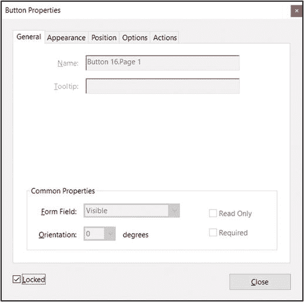

    图 15-5。锁定按钮以防止意外移动

6.  调整用户界面（可选）。如果你不希望文档以全屏模式打开，可以隐藏部分界面选项。选择**文件** ➤ **属性**或按 `Ctrl`/`⌘`+`D`。**文档属性**对话框打开。点击**初始视图**选项卡，并在**用户界面选项**区域中选择你想要隐藏的选项。你无法隐藏所有三个界面选项。通常，你需要勾选的选项是**隐藏菜单栏**和**隐藏工具栏**。不过，理想情况下，如果你创建了带有超出页面边界对象的设计，你可能会希望选择以全屏模式查看文件。

### 15.2.2.2 选择交互元素

并非 Adobe InDesign 中所有可用的交互元素都能直接导出到交互式 PDF。此外，在 Adobe InDesign 中可以创建的一些交互元素，最好在 Adobe Acrobat 中处理。

在表 15-1 中，你看到的是常见交互项目列表。请注意，MSO 不受支持，而且你无法为其创建变通方法——嗯，也不是完全不行。你可以创建用于显示/隐藏其他按钮的按钮，其工作方式与 MSO 有些类似。

表 15-1. 导出到交互式 PDF 的 InDesign 元素

| 交互元素 | 在 PDF 中可接受 | 最好在 Acrobat 中创建 | 需要变通方法 |
| :--- | :--- | :--- | :--- |
| 动画 | 否* |  | 需要变通方法 |
| 表格动画 | 否* |  | 需要变通方法 |
| 按钮 | 是 | 在 Acrobat 中创建 |  |
| 交叉引用 | 是 | 在 Acrobat 中创建 |  |
| 超链接 | 是 | 在 Acrobat 中创建 |  |
| MSO | 否 |  | 没有变通方法 |
| 叠印 | 否 |  | 没有变通方法 |
| 富媒体 | 是，有一些限制（许多移动 PDF 查看器不支持在 PDF 文件中播放视频） |  |  |

\* 可以创建变通方法来显示动画

你可能需要特别留意两件事：超链接和交叉引用。在 Adobe InDesign 中，当你创建超链接或交叉引用时，InDesign 会创建一个目标。在 Adobe Acrobat 的术语中，这些被称为命名目标。例如，如果你想要一个按钮，其动作设置为查看下一页、上一页或特定页面，InDesign 会创建一个目标，然后你设置事件以跳转到该目标。

将 InDesign 的目标与 Adobe Acrobat 进行对比。在 Acrobat 中，如果你想要导航页面，你可以设置一个按钮转到下一页、上一页或特定页面，而无需创建命名目标。命名目标会增加 PDF 文件的额外开销，如果文档中有许多目标，文件大小就不会那么小。作为最佳实践，请在 Acrobat 中创建所有超链接和交叉引用，以尽可能保持文件大小最小。

## 15.3 在 Acrobat 中创建超链接

如表 15-1 所述，你应将所有超链接和交叉引用留待 Acrobat 处理，而不是在 Adobe InDesign 中创建它们。你有两种选择来创建导航按钮：可以使用按钮，也可以使用链接。

### 15.3.1 使用按钮进行页面导航

与链接相比，按钮的优势在于它们可以在多个页面上复制。因此，如果你想创建一个能将用户带到下一页的按钮，你可以创建一个带有按钮动作的按钮，然后在多个页面间复制它。

#### 创建用于页面导航的交互式按钮

若要创建用于页面导航的交互式按钮，请执行以下操作：

1.  在 Acrobat 中打开一个多页文档。
2.  在第一页上创建一个按钮。点击按钮工具，并在你想要按钮出现的位置绘制一个按钮。
3.  添加按钮填充（可选）。如果页面上有符号或图标，则无需创建带外观的按钮。如果没有任何提示表明点击按钮会进行导航，则需要以某种方式创建按钮，让用户清楚地知道该元素是一个按钮。你可以选择用颜色填充按钮内容，或者向按钮添加图形。创建按钮后，按钮字段名称窗口会立即在按钮上打开。为按钮键入一个名称，例如 `Go Next`，然后点击“所有属性”。
4.  在“按钮属性”对话框中，点击“外观”标签页，然后点击“填充颜色”图标。从弹出菜单中选择“无颜色”。点击“选项”标签页。在“布局”菜单中，您可以选择“标签和图标”、“仅标签”或“仅图标”。在此示例中，我们将使用“仅图标”。
5.  选择“仅图标”后，Acrobat 有一个小问题：除非您先更改“行为”，否则无法选择图标。从“行为”菜单中选择“推送”，然后“选择图标”按钮变为可用。点击“选择图标”，弹出“选择图标”对话框。点击“浏览”打开“打开”窗口，在您的硬盘上导航以找到要使用的图标。在“打开”窗口中点击，然后点击“打开”（参见图 15-6）。

    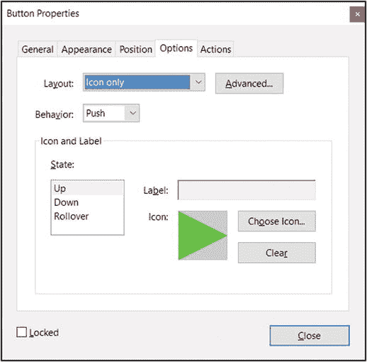

    **图 15-6.** 找到要用于按钮表面的对象，然后点击“打开”

    在“高级”窗口中，您有一些选项来定位按钮字段中的图标。
6.  点击“按钮属性”的“选项”标签页中的“高级”以调整大小和缩放比例。
7.  设置动作。仍在“按钮属性”对话框中，点击“动作”标签页。在“选择动作”菜单中选择“执行菜单项”，然后点击“添加”。“菜单项”对话框打开。找到“视图-页面导航-下一页”项目并选中它。点击“确定”，然后点击“关闭”按钮关闭“按钮属性”对话框。
8.  创建第二个按钮。按照步骤 3 和 4 中的相同过程创建第二个按钮。对于此按钮，在“菜单项”菜单中选择“视图-页面导航-上一页”。

#### 使用 JavaScript 替代“执行菜单项”动作

作为使用“执行菜单项”动作的替代方法，您可以添加一个简单的 JavaScript。在“动作”标签页中，从“选择动作”菜单中选择“运行 JavaScript”。点击“添加”，JavaScript 编辑器打开。键入以下内容：

```javascript
this.pageNum++;
```

点击“确定”，JavaScript 被添加到按钮。要导航到上一页，请在 JavaScript 编辑器中键入以下代码：

```javascript
this.pageNum--;
```

如果您想导航到文档中的特定页面，请键入以下代码：

```javascript
this.pageNum=5;
```

JavaScript 是从零开始的，因此此代码将打开文档中的第 6 页。JavaScript 区分大小写，因此请确保完全按照所示的大小写进行。

> **注意：** 用于页面导航的 JavaScript 和其他自定义 JavaScript 应仅用于桌面 PDF 查看器。大多数移动 PDF 查看器无法识别 JavaScript。

9.  复制按钮。如果您在第一页上创建了按钮，请右键单击“下一页”按钮。从菜单中选择“跨页面复制”。在“复制字段”对话框中，点击“自”单选按钮，在文本框中键入 `1`，然后键入最后一页的页码（参见图 15-7）。例如，如果您的文档有 20 页，请在第一个文本框中键入 `1`，在第二个文本框中键入 `20`。对“上一页”按钮执行相同操作。在第一页上，删除“上一页”按钮。转到文档的最后一页，双击该按钮打开按钮属性。点击“动作”，选择“执行菜单项”，然后点击“编辑”以编辑该动作。选择“视图-导航-第一页”。

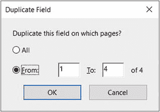

**图 15-7.** 在“复制字段”对话框中输入页面范围

10. 点击“按钮属性”中的“关闭”，然后点击按钮以确保它们正常工作。

> **注意：** 您需要使用“手形”工具来点击按钮。在键盘上按 `H` 键以使用手形工具。

### 15.3.2 链接到 URL

如果你想从文本中的 URL 创建链接，则无需在 InDesign 中执行任何操作。在 InDesign 中添加 URL 只会增加 PDF 文档的额外开销。大多数 PDF 查看器会自动打开文本中包含的 URL，前提是它们的键入方式如下：

[`http://www.mycompany.com`](http://www.mycompany.com) 或 [`www.mycompany.com`](http://www.mycompany.com)，其中 `mycompany.com` 是您要链接到的 URL。

## 15.4 在 Acrobat 中更改图层视图

能够更改图层视图为交互式文档增加了一个新的维度，这是 PDF 文档独有的功能。在 Acrobat 术语中，图层被称为 OCG（可选内容组）。您可以将 OCG 用作文档中多状态对象的变通方法，这些文档中有多种语言或任何其他类型的交互性，您希望在其中更改页面上的对象、图像和/或文本视图。

在图 15-8 中，您看到在 Acrobat 中以全屏模式查看的文档。当前视图显示带有西班牙语文本的文档。在“English”字样上方有一个按钮。当用户点击该按钮时，图像和图形保持不变，但文本变为英语。

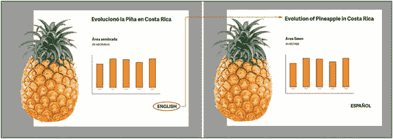

**图 15-8.** 点击“English”按钮，英语图层将显示出来

### 15.4.1 在 InDesign 中设置分层文件

在一个新的 InDesign 文档中，您可以在图层面板中添加三个图层。在此示例中，我使用两个图层用于语言，一个图层用于图像/对象。如果您创建类似的布局，请将图层命名为 `Object`、`English` 和 `Spanish`，或您想要在其他两个图层上显示的任何名称。在所有图层上都保持不变且可见的内容可以放置在 `Objects` 图层上。

如果您想为添加按钮的区域添加图标或文本，请在添加按钮以更改视图的两个图层上创建它们。

完成设计后，导出为交互式 PDF。务必在“导出为交互式 PDF”对话框中选中“创建 Acrobat 图层”（参见图 15-3）。

### 15.4.2 创建用于查看图层的按钮

当您创建彼此重叠的按钮时，需要添加三种不同的操作类型。您需要在点击按钮后隐藏它，显示第二个按钮，并更改图层视图。所有表单域都会出现在所有图层上，因此您无法同时隐藏图层和按钮。按钮会保留在所有图层上，所以如果不严格按照步骤操作，可能会有点混乱。

当您打开包含 Acrobat 图层（Layer）的 PDF 时，"图层"面板会在导航窗格（文档最左侧）中打开。点击导航窗格中的"图层"图标以打开面板。在文件名的左侧，您会看到一个小三角形。点击该三角形以展开图层，如图 15-9 所示。

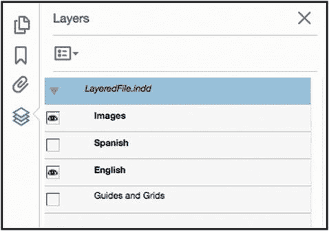

图 15-9. 点击"图层"面板图标，然后点击文件名左侧的白色小方块

您需要让图层处于可见状态，才能继续创建按钮。

#### 添加按钮以更改图层视图

要添加更改图层视图的按钮，请执行以下操作：

1.  创建一个按钮。

2.  点击工具栏中的"按钮"工具，并拖动鼠标在您希望按钮出现的位置上拉出一个矩形。为按钮命名。在本示例中，在单词"English"上方创建按钮。

3.  创建第二个按钮并为其命名。将第二个按钮移开，使其不与第一个按钮重叠。这样将更容易分配属性和测试结果。

4.  双击第一个按钮以打开"按钮属性"。如果页面上有文本或图标，请点击"外观"选项卡，并将填充设置为"无"。

5.  添加一个操作。最终，这些按钮会放置在相同的空间内。因此，默认情况下一个按钮会隐藏另一个。您需要一个操作来隐藏当前按钮，然后显示第二个按钮，最后显示相应的图层。在"操作"选项卡中，选择"显示/隐藏域"，然后点击"添加"。"显示/隐藏域"对话框随即打开。当前您正在处理"English"按钮，因此您希望显示"Spanish"按钮，如图 15-10 所示。做出选择后，点击"确定"关闭对话框。

    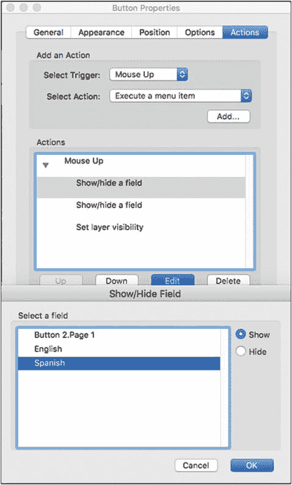

    图 15-10. 在"显示/隐藏域"对话框中选择合适的属性

6.  为同一个按钮添加第二个操作。当"操作"选项卡仍为第一个按钮打开时，创建另一个"显示/隐藏域"操作。这次您需要点击"English"项目（我们正在处理的按钮）并将其隐藏。选择"English"，点击"隐藏"单选按钮，然后点击"确定"关闭对话框。

7.  添加一个操作来查看图层。您需要将希望从按钮点击中继承的可见和隐藏图层置于视图中。因此，在"按钮属性"对话框打开时，查看导航窗格，并点击"Spanish"上的眼睛图标（当点击"English"按钮时，"Spanish"图层将变为可见）。同时，通过点击眼睛图标隐藏"English"图层，使其从视图中消失，如图 15-10 所示。现在可以添加操作了。打开"选择操作"菜单，选择"设置图层可见性"。点击"添加"按钮，Acrobat 会显示一个警告对话框，提示您所选操作将设置为当前状态。点击"确定"，即设置了以下操作：显示"Spanish"按钮、隐藏"English"按钮、显示"Spanish"图层。

8.  在"按钮属性"对话框打开时，点击第二个按钮，并确保"操作"选项卡可见。为此按钮设置类似的操作。您需要反转"显示/隐藏"按钮的选项选择。将第一个"显示/隐藏"操作设置为隐藏"Spanish"按钮。将第二个"显示/隐藏域"操作设置为显示"English"按钮。在导航窗格中更改图层视图，以显示"English"图层并隐藏"Spanish"图层。选择"设置图层可见性"并添加该操作。点击"按钮属性"中的"关闭"。

9.  测试结果。按钮在页面上彼此分开，这样更容易测试结果。点击一个按钮，查看其是否按预期执行。该按钮应消失，而第二个按钮应准备好可供使用。点击它，检查图层可见性和按钮视图是否正常工作。如果不行，您需要返回"按钮属性"进行一些更改。当一切按预期运行后，将一个按钮移动到另一个按钮之上（通过点击拖动或使用"对齐"面板）。

#### 使用 JavaScript 更改图层视图

处理按钮操作的一个更简单的方法是使用 JavaScript。以下脚本只需要放在一个按钮上，每次点击该按钮时，它都会更改图层视图。要添加用于运行 JavaScript 操作的脚本如下：

```
var docOCGs = this.getOCGs();
for (var i=0; i < docOCGs.length; i++)
{
if(docOCGs[i].name == "Spanish")
{
docOCGs[i].state = !docOCGs[i].state;
}
if(docOCGs[i].name == "English")
{
docOCGs[i].state = !docOCGs[i].state;
}
}
```

您可以轻松地从此处复制文本，并将其添加到您想要切换图层视图的文档中。只需确保引号内的名称与您的图层名称匹配即可。

### 15.4.3 创建许可协议

利用 Acrobat 图层可以完成的一项有趣功能是，让文档的首页显示一份许可协议。在首页上，你会看到一份许可协议和两个按钮。如果用户点击**不同意**，该按钮会强制 Acrobat 关闭文件。如果用户点击**同意**，则图层视图会发生变化，显示文档内容并隐藏许可协议。在图 15-11 中，你可以看到 PDF 首页上显示的此类协议。

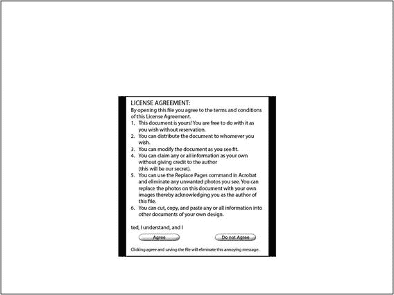

图 15-11。带有许可协议的 PDF 首页

基本上，当用户点击**同意**按钮时，该按钮只是更改了图层的状态。为了保护你的内容，你需要使用 Acrobat 安全功能对文件进行保护。按 `Ctrl/⌘+D` 打开**文档属性**窗口，然后点击**安全性**。在**安全设置**选项卡中，从**安全方法**下拉菜单中选择**密码安全**。选择**密码安全**后，会弹出**密码安全 - 设置**对话框。在**权限**区域，打开**允许更改**菜单，选择类似**注释、填写表单字段和签署现有签名域**的选项，如图 15-12 所示。这样可以防止用户访问导航窗格中的**图层面板**，并仅允许添加表单字段数据、注释和签署现有的数字签名字段。

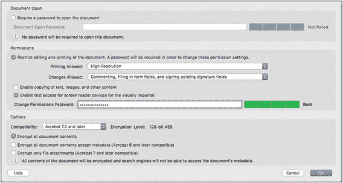

图 15-12。选择注释、填写表单字段和签署现有签名域

创建此类文档的一个注意事项是，由于文件是受保护的，因此用户点击**同意**按钮并打开内容图层后，保存文件并不会改变图层的可见性。文件将始终以显示许可协议的状态打开，用户每次打开文档都需要点击**同意**。

## 创建许可协议

请看图 15-11。以下是创建许可协议的方法：

你需要从一个包含至少两个图层的 InDesign 文件开始。在我的示例中，一个图层在 101 页上显示内容。许可协议位于第 1 页的第二个图层上。该图层在其余页面上为空。

我将文件导出为 PDF，并在**导出为交互式 PDF** 对话框中勾选了**创建 Acrobat 图层**。

## 添加接受按钮

我使用按钮工具创建了一个**接受**按钮。然后为按钮添加了以下 JavaScript：

```
var docOCGs = this.getOCGs();
for (var i=1; i < docOCGs.length; i++)
{
if(docOCGs[i].name == "LicenseAgreement")
docOCGs[i].state = false;
else
docO CGs[i].state = true;
}
this.setOCGOrder( [] );
```

这段 JavaScript 基本上将状态视图从当前图层状态更改为 `LicenseAgreement` 状态。换句话说，当用户点击**接受**按钮时，状态会发生改变，内容会显示出来。

## 添加不同意按钮

如果用户点击此按钮，表示他们不同意许可协议的条款。因此，我们只需指示 Acrobat 打开一个警告对话框，告知用户文档将关闭。当用户在警告对话框中点击**确定**时，文件就会关闭。处理此操作的 JavaScript 如下：

```
var msg = "好的，此文档即将关闭";
app.alert(msg);
this.closeDoc();
```

即使你不是 JavaScript 程序员也无需担心。只需创建一个按钮，并为该按钮的动作选择**运行 JavaScript**。点击**添加**，然后输入你在此处看到的按钮代码。对于**接受**按钮，你只需要修改包含 `"LicenseAgreement"` 的那一行。这是文件中图层的名称。如果你使用了不同的图层名称，只需在引号之间输入该名称即可。

对于**接受**按钮，信息显示在第二个脚本的引号之间。你可以通过输入自己的文本来更改该信息。只需确保你的信息位于引号之间，并且其余代码完全按照你在此处看到的格式添加到 JavaScript 动作中即可。

> **警告**：你需要为 PDF 文件添加安全设置，以防止用户手动显示和隐藏图层。

### 15.4.4 使用多个图层

请看图 15-13。文档右侧有四个按钮。这些按钮用于更改页面左侧房屋平面图的图层视图。当用户点击**固定装置**时，固定装置会消失。再次点击**固定装置**，固定装置会重新出现。这种设置就像一个多状态对象，按钮可以切换到不同的状态视图。


图 15-13。按钮用于显示/隐藏房屋平面图的不同视图

你可以使用**设置可见性**按钮动作为按钮分配不同的图层视图。这样做需要打开**图层面板**，查看所需的图层视图，然后设置动作。一个更简单的方法是使用 JavaScript。

显示/隐藏**文本**图层的代码如下（见图 15-14）：

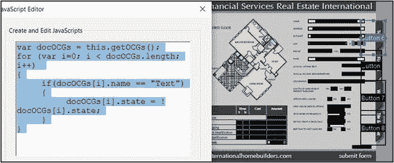

图 15-14。用于显示/隐藏文本图层的 JavaScript 代码

```
var docOCGs = this.getOCGs();
for (var i=0; i < docOCGs.length; i++)
{
if(docOCGs[i].name == "Text")
{
docOCGs[i].state = !docOCGs[i].state;
}
}
```

倒数第三行代码是一个开关，用于打开/关闭图层视图。一旦你为一个按钮编写了代码，为其他按钮复制代码就很容易了。只需复制代码，将其粘贴到另一个按钮的**运行 JavaScript** 动作中，并更改图层名称。在此示例中，图层的名称是 `Text`、`Fixtures`、`Walls` 和 `Tile & Carpet`。你只需将每个按钮对应的 `"Text"` 替换为其他图层的名称即可。通过复制和粘贴 JavaScript，你可以快速完成按钮动作的设置。

## 15.5 在交互式 PDF 中使用媒体

Acrobat 支持多种媒体格式。如我在第 10 章所述，最佳格式是用于音频的 `.mp3` 文件，以及 H.264 编码的 M4V 和 MP4 文件。在 PDF 文件中使用音频和视频有两种方法：你可以从包含音频和视频的 InDesign 文档中导出，也可以使用 Acrobat 中的工具添加音频和视频文件。大多数情况下，你应先将文件放置在 InDesign 中，然后导出为交互式 PDF。

在 Acrobat 中，你可以选择在文档中视频出现的位置查看视频文件，也可以选择在浮动窗口中查看视频。要启用浮动窗口视图，右键单击视频上的“选择对象”工具，在打开的上下文菜单中选择“属性”。在媒体的“属性”对话框中，你可以打开“编辑视频”对话框中的“启动设置”选项卡（如图 15-15 所示），并选择“在浮动窗口中播放内容”。

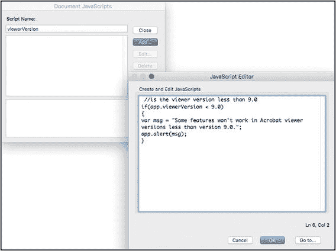

图 15-15。

点击“文档 JavaScript”打开“文档 JavaScript”对话框

你在 InDesign 中为播放、暂停、停止等创建的按钮在 PDF 文档中均可使用。控制器的工作方式也与固定布局和 Adobe Publish Online 文档中的相同。如果你愿意，也可以在 Acrobat 中创建用于管理视频的按钮。在按钮的“操作”选项卡中，针对处理你文档的 Acrobat 查看器版本，你有多种选择，包括：

*   **多媒体操作（Acrobat 9 及更高版本）：** 对在 Acrobat 或 Adobe Reader 9 或更高版本中查看的 PDF 使用此选项。

*   **播放媒体（兼容 Acrobat 5）：** 这是一个旧标准，你很可能不会用到。

*   **播放媒体（兼容 Acrobat 6）：** 当你确定文档的查看者使用的是 Adobe Reader（或 Acrobat）9 或更早版本时，使用此操作。

有时，提醒用户他们必须使用特定版本或更高版本的 Acrobat 或 Adobe Reader 可能会很有帮助。如果你的文档最好在 Reader/Acrobat 9 版中查看，那么你可以在文件中添加一个警告对话框。仅当有人使用的版本早于你指定的版本时，该警告对话框才会打开。这是一个简单的 JavaScript，你可以在文档打开时将其添加到文档中。我们将文档打开时出现的 JavaScript 称为文档级 JavaScript。

在编写 JavaScript 之前，你必须访问“文档 JavaScript”对话框。点击 Acrobat 窗口左上角的“工具”，找到“JavaScript”按钮。点击“打开”，这些工具便会加载到 Acrobat 工具栏中。在这些工具中，你会找到“文档 JavaScript”。点击此按钮打开“文档 JavaScript”对话框，如图 15-15 所示。

为脚本键入一个名称，然后点击“添加”按钮。“JavaScript 编辑器”会打开（同样如图 15-15 所示）。在“JavaScript 编辑器”窗口中键入以下代码：

```
//查看器版本是否低于 9.0
if(app.viewerVersion < 9.0)
{
var msg = "部分功能在低于 9.0 版的 Acrobat 查看器中无法正常工作。";
app.alert(msg);
}
```

在这段代码中，第一行文本是注释行，不会被执行。第二行代码检查正在使用的 PDF 查看器的版本。如果查看器版本低于 9.0，则执行消息字段。在这种情况下，会打开一个警告对话框，显示你在代码括号中看到的内容。最后一行代码指示 Acrobat 打开该警告对话框。

如果你在 PDF 文件中包含了一些仅在特定版本的 PDF 查看器中才能正常工作的内容，你应该在文档级 JavaScript 中包含类似的代码。

有关使用媒体的更多信息，请参见第 10 章。

## 15.6 让动画在 PDF 文档中播放

如果你通读了第 8 章，其中我谈到了在 InDesign 中创建动画，你可能会感到有点兴奋。毕竟，在 InDesign 中处理动画能为你的出版物注入新的活力，而且相当有趣。但是，当我说交互式 PDF 文件不支持 InDesign 动画时，你可能会失去一些兴奋感。不过别担心，因为我在这里就是要告诉你如何让你在 InDesign 中创建的所有动画都能在交互式 PDF 文件中播放。

你可能注意到了，“按钮和表单”面板中有三个部分。顶部部分包括页面导航、转到 URL、显示和隐藏按钮以及对声音和视频的支持。下一个部分写着“仅限 SWF/EPUB”。在这里你才能找到对动画的支持。

你在这里得到的线索是，动画不能导出为 PDF，但它们可以像处理 SWF 文件一样被处理。要绕过对动画缺乏支持的问题，你只需将动画转换为 SWF，它们随后便能在 PDF 中正常播放。尽管 SWF 和 Adobe Flash 的使用正在减少，但 Acrobat DC 仍然支持 SWF，而且在一切都被转换为 HTML5 和 JavaScript 之前，我们很可能会看到它在一段时间内持续获得支持。不过请记住，此技术仅适用于安装了 Adobe Flash Player 的台式机和笔记本电脑，不适用于手机或平板电脑。

### 在 PDF 中播放动画

要实现在 PDF 中播放动画，请遵循以下步骤：

1. 创建一个包含动画的 PDF 文档。你可以使用“动画”面板中的任意一个（共 48 个不同预设）。有关使用这些预设的更多信息，请参阅第 8 章。

2. 选择`文件` ➤ `导出`或按 `Ctrl/⌘+E`。从“保存类型”菜单（Windows）或“格式”菜单（Macintosh）中选择“Flash Player SWF”。

3. 在“导出 SWF”对话框中设置属性，如图 15-16 所示。取消选中“生成 HTML”。确保在“交互和媒体”区域中选中“包含全部”单选按钮。将背景设置为“透明”。（注意：SWF 在 PDF 中不会是透明的。你需要在 PDF 文档中，在 Acrobat 中进行编辑）。点击`确定`。

    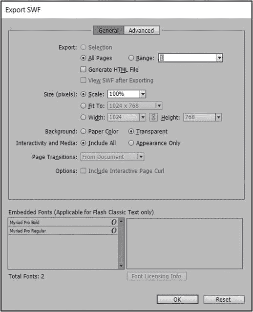

    图 15-16。为导出到`Flash Player SWF`设置属性。

4. 打开一个新的 InDesign 文档并置入 SWF 文件。

5. 选择你刚置入的 SWF 文件并打开“媒体”面板。选中“页面加载时播放”复选框。

6. 选择`文件` ➤ `导出`或按 `Ctrl/⌘+E`，从“保存类型”菜单中选择“交互式 PDF”。

7. 检查结果。如果选中“导出后查看”，文件将在 Acrobat 中打开。

8. 点击“选择对象”工具（`R`），然后右键单击 SWF 文件。会打开“编辑 SWF”对话框，如图 15-17 所示。从菜单中选择“属性”。在“编辑 SWF”对话框中，确保“启用时间”菜单选项设置为“包含内容所在页面已打开”。选中“透明背景”复选框，然后点击`确定`。保存文件。

    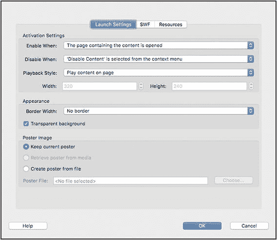

    图 15-17。在“编辑 SWF”对话框中启用“透明”。

现在，当 PDF 打开时，动画就会播放。

## 15.7 导出交互式表格

众所周知，在 `SWF/EPUB 专属`区域中为 InDesign 设置的任何按钮操作，都是设计用于在 SWF 文件中查看的。如果你使用多状态对象 (MSO) 和按钮创建了一个用于查看状态的交互式表格，那么显然需要一种变通方法才能在导出的 PDF 中查看其交互性。

**注意：** 此类交互性仅在安装了 Flash Player 的台式电脑和笔记本电脑上的 PDF 中可见。

设置方式与导出带有动画的 PDF 非常相似。你需要先从 InDesign 导出一个 SWF 文件，然后将该 SWF 文件导入，最后再将其导出为交互式 PDF 文档。

### 15.7.1 设置交互式表格

在图 15-18 中，你会看到一个包含表格的 InDesign 版面。该表格使用了一些简单的 MSO 和几个按钮来查看不同的状态。我在此用一个简单的例子来说明这个过程。你可以使用 MSO 创建更复杂的设计，正如我在第 8 章中解释的那样。有关在 InDesign 中创建表格的更多信息，请参阅第 5 章。


图 15-18. InDesign 表格版面在四个表格单元格中显示水果图像

显示水果图像的四个表格单元格就是 MSO。当你查看第一个单元格的对象状态时，只看到两个状态。一个状态显示香蕉，另一个状态显示地图，如图 15-19 中第一个表格单元格的 MSO 所示。

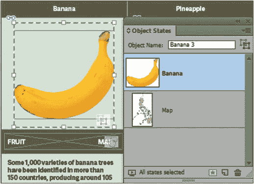

图 15-19. 四个 MSO 中的第一个

在图像下方的文本上方出现一个按钮。在“按钮和表单”面板中，为按钮操作选择 `转到下一个状态`，如图 15-20 所示。四个单元格各只需要一个按钮。单击一次显示地图，再次单击返回水果图像。

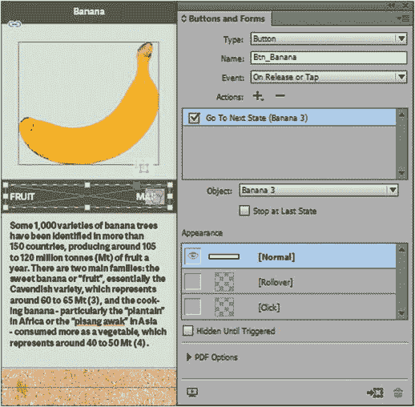

图 15-20. 按钮操作设置为 `转到下一个状态`

添加 MSO 和按钮操作后，复制表格和按钮，并将它们粘贴到新的 InDesign 文档中。粘贴表格和按钮时，可能会发现按钮丢失了`转到下一个状态`操作。

你需要在“按钮和表单”面板中重置操作。使用 SWF 预览面板预览设计，并确保单击按钮可以更改状态。一切正常后，选择`文件 ➤ 导出`（`Ctrl/⌘+E`）并将文件导出为 Flash Player (SWF)。

删除原始文件中的表格和按钮。建议保存一份文档副本，并将其命名为类似 `Fruit_No Table.indd` 的文件。删除表格和按钮后，选择`文件 ➤ 置入`并置入 SWF 文件。

### 15.7.2 导出为交互式 PDF

置入 SWF 文件后，选择`文件 ➤ 导出`（`Ctrl/⌘+E`）并选择 Adobe PDF（交互式）。勾选`导出后查看`复选框，然后在`导出为交互式 PDF` 对话框中单击`确定`。

该文件将在默认的 PDF 查看器中打开。你应该将 Adobe Acrobat 设置为默认查看器，以便能够编辑 PDF 文件。

首次在 PDF 查看器中查看文档时，可能会在屏幕左上角看到一个 Flash 图标，页面上没有显示其他内容，如图 15-21 所示。


图 15-21. InDesign 导出的默认视图

### 15.7.3 在 Acrobat 中调整属性

单击 Acrobat 工具栏中的`选择对象`工具。如果该工具不可用，请按键盘上的 `R` 键访问该工具。必须将 Acrobat 的“常规首选项”设置为使用单键加速键，才能使用键盘快捷键访问工具。

右键单击 SWF 覆盖层，然后从上下文菜单中选择`属性`。随即打开 SWF 文件的属性调整选项。在`编辑 SWF` 对话框的`启动设置`选项卡中，从`启用条件`菜单中选择`当包含内容的页面被打开时`（参见图 15-22）。

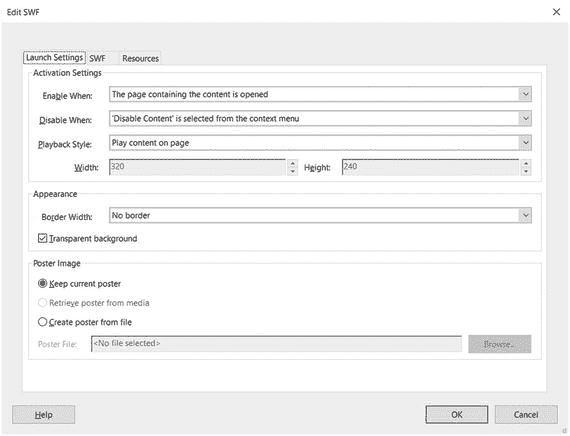

图 15-22. 从`启用条件`菜单中选择`当包含内容的页面被打开时`，并勾选`透明背景`复选框

勾选`透明背景`复选框，然后在`编辑 SWF` 对话框中单击`确定`。保存文件并在 Acrobat 中重新打开。当打开页面播放 SWF 文件时，应看到 SWF 覆盖层透明，并且可以看到表格周围的背景，如图 15-23 所示。

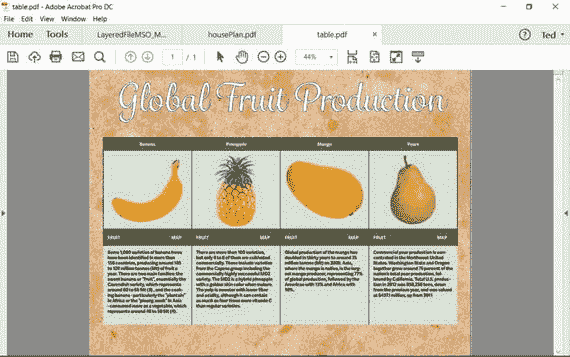

图 15-23. 重新打开文件后，应看到 SWF 覆盖层变为透明

单击按钮，对象状态应随之改变。

## 15.8 在 PDF 中使用多状态对象

在交互式 PDF 文件中，无法直接导出带有多状态对象的文档。但是，你可以遵循导出动画时的相同路径，使按钮能够推进 `MSO` 中的状态，并且还可以让嵌套的 `MSO` 在台式电脑的 Acrobat PDF 中正常工作。

与准备包含动画的文件一样，首先需要将所有包含按钮和 `MSO` 的图层导出到 Flash Player (SWF) 文件。在包含背景和其他设计元素的 InDesign 文档中置入该 SWF 文件，然后导出为交互式 PDF。

当文件在 Acrobat 中打开时，使用`选择对象`工具打开上下文菜单并选择`属性`。在`编辑 SWF` 对话框中，从`启用条件`菜单中选择`当包含内容的页面被打开时`，并勾选`透明背景`复选框。保存文件并在 Acrobat 中重新打开。

单击按钮以显示不同的对象状态。如果使用了嵌套的 `MSO`，请单击按钮以推进嵌套 `MSO` 中的状态。有关使用多状态对象的更多信息，请参阅第 9 章。

## 15.9 总结

如本章所述，在 InDesign 中创建的许多交互性并不能直接在 Acrobat 中得到支持。但是，通过一些变通方法，你可以成功播放动画、处理多状态对象，并在 Acrobat 中创建各种资源和 JavaScript，从而帮助你使用交互式 PDF 文件实现预期目标。

在下一章中，我们将探讨一些帮助你在 InDesign 中设置和创建交互式文档的技巧。
