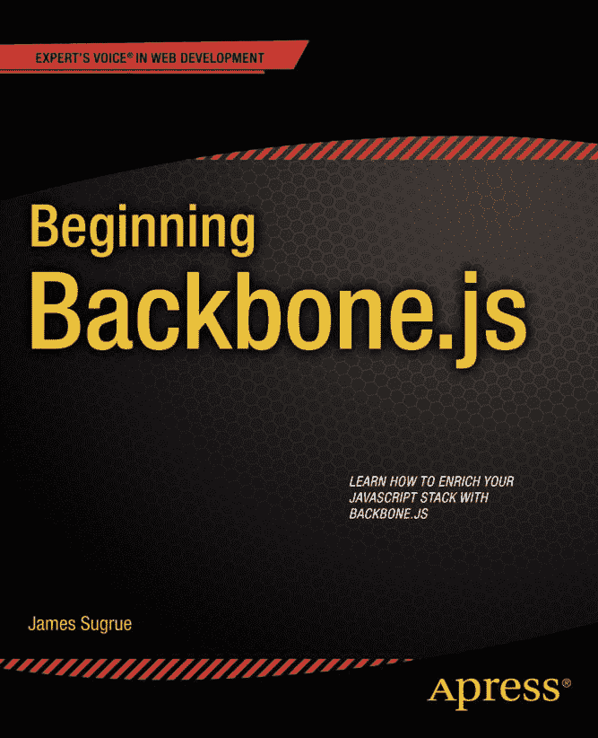

 詹姆斯·苏格鲁

*《Beginning Backbone.js》*

10.1007/978-1-4302-6335-7

© Apress 2013

詹姆斯·苏格鲁

*《Beginning Backbone.js》*

ISBN 978-1-4302-6334-0

电子书 ISBN 978-1-4302-6335-7

© Apress 2013

*《Beginning Backbone.js》*

总裁与出版人：保罗·曼宁

首席编辑：路易丝·科里根

技术审校：克里斯·威格曼

编辑委员会：史蒂夫·安格林、尤安·白金汉、加里·康奈尔、路易丝·科里根、詹姆斯·德沃尔夫、乔纳森·根尼克、乔纳森·哈塞尔、罗伯特·哈钦森、米歇尔·洛曼、詹姆斯·马克姆、马修·穆迪、杰夫·奥尔森、杰弗里·佩珀、道格拉斯·庞迪克、本·雷诺-克拉克、多米尼克·沙克沙夫特、格温南·斯皮尔林、马特·韦德、史蒂夫·韦斯、汤姆·威尔士

协调编辑：凯文·谢伊

文字编辑：金·温普塞特

排版：SPi Global

索引编制：SPi Global

美术制作：SPi Global

封面设计：安娜·伊先科

本书通过 Springer Science+Business Media New York（地址：233 Spring Street, 6th Floor, New York, NY 10013）在全球范围内发行。电话：1-800-SPRINGER，传真：(201) 348-4505，电子邮件：`orders-ny@springer-sbm.com`，或访问 [`www.springeronline.com`](http://www.springeronline.com/)。如需了解翻译相关信息，请发送电子邮件至 `rights@apress.com`，或访问 [`www.apress.com`](http://www.apress.com/)。Apress 及 friends of ED 图书可批量购买用于学术、企业或促销用途。大多数图书也提供电子书版本及许可证。更多信息，请参阅我们的特殊批量销售–电子书许可网页：[`www.apress.com/bulk-sales`](http://www.apress.com/bulk-sales)。

文中作者引用的任何源代码或其他补充材料，读者可在 [`www.apress.com`](http://www.apress.com/) 获取。有关如何查找本书源代码的详细信息，请访问 [`www.apress.com/source-code`](http://www.apress.com/source-code)。

本作品受版权保护。出版者保留所有权利，无论涉及材料的全部或部分，特别是翻译权、重印权、插图再利用权、朗诵权、广播权、以微缩胶片或任何其他物理形式的复制权，以及信息存储与检索、电子改编、计算机软件，或现在已知或未来开发的任何类似或不同方法的传输权。法律保留的例外情况包括与评论或学术分析相关的简短摘录，或专门为输入并在计算机系统上执行而提供的材料，仅供本作品的购买者专用。复制本出版物或其部分内容，仅允许在出版者所在地现行版权法的规定下进行，且使用许可必须始终从 Springer 获得。许可使用可通过版权清算中心的 RightsLink 获取。违反相关版权法将面临起诉。

本书中可能出现的商标名称、标识和图像。为避免每个商标名称、标识或图像都使用商标符号，我们仅以编辑方式使用这些名称、标识和图像，并旨在维护商标所有者的利益，无意侵犯商标权。本出版物中使用的商品名、商标、服务标记及类似术语，即使未明确标识，也不应被视为关于其是否受专有权利保护的表达。

尽管本书中的建议和信息在出版时被认为是真实准确的，但作者、编辑和出版者均不对任何可能存在的错误或疏漏承担法律责任。出版者不对本书所含内容作任何明示或暗示的保证。

## 关于作者

詹姆斯·苏格鲁在软件开发行业拥有超过 13 年的工作经验。他目前居住在爱尔兰科克，担任实时交通初创公司 Carma 的首席前端架构师。詹姆斯的职业生涯始于一家德国安全自动化公司，从毕业生逐步成长为架构师，并协助塑造了该公司的技术路线图。

詹姆斯始终热衷于探索新颖且激动人心的技术，他为代码而生，并将大量业余时间用于开发移动和 Web 应用程序作为乐趣。他还担任 JavaLobby 和 EclipseZone 的常驻编辑超过五年。这是他的第一本书。

[`www.jamessugrue.ie`](http://www.jamessugrue.ie/)

## 关于技术审校

克里斯·威格曼是 iThemes.com 的 WordPress 插件开发者，主要负责 Better WP Security 插件及其他项目。他拥有南伊利诺伊大学计算机科学硕士学位，并在圣爱德华大学计算机科学系担任兼职教师。不敲键盘时，克里斯经常出现在驾驶舱中——他持有认证飞行教员和商业飞行员执照，并尽力充分利用这些资质。克里斯与妻子及他们的四条腿的孩子们居住在德克萨斯州奥斯汀。

## 引言

用 JavaScript 以良好结构化的方式创建 Web 应用程序可能很困难，但像 Backbone 这样的库引入了急需的清晰度。自 2010 年发布以来，Backbone.js 一直被认为是处理大型应用程序代码库的最佳选择之一。

当我第一次使用 Backbone 时，它无主见的特性和代码的清晰度给我留下了深刻印象。凭借广泛的社区支持和可用的扩展，Backbone 似乎几乎无所不能。

显然，许多其他开发者和组织也对 Backbone 印象深刻。你会发现它在许多你经常使用的应用程序和网站中扮演核心角色——从《纽约时报》到 Airbnb 再到 SoundCloud。

如果你正在考虑让 Backbone 在你的技术栈中扮演主角，本书将帮助你找到它的定位并评估其适用性。如果你刚接触 Backbone，本书前半部分将帮助你快速入门。那些已经开始使用 Backbone 的人会发现本书后半部分最为有用，其中讨论了最佳实践、测试驱动开发和模块化架构。

### 本书面向的读者

本书适合任何使用 JavaScript 创建 Web 应用程序的人。无论你拥有何种水平的专业技能，书中都有适合你的主题。

无论你是在评估 Backbone 是否适合你的下一个项目，还是已经采用 Backbone 进行应用程序开发，你都会发现本书包含了进一步提升知识所需的一切。

读者将在本书开头了解面向对象 JavaScript 的基本概念，并可以继续深入探索 Backbone，同时了解模型-视图-*架构。

经验丰富的 Backbone 开发者和 Web 应用程序架构师将发现，关于 Backbone 最佳实践、测试驱动开发以及使用 RequireJS 创建模块化应用程序的更高级章节，有助于确保他们使用 Backbone 构建的任何 Web 应用程序都具有高度的架构质量。

### 本书的结构

本书共分为 12 章，每章分别探讨 JavaScript、Backbone 或 Web 应用开发流程的特定方面。

第 1 章“面向对象的 JavaScript”讨论了 JavaScript 相关的核心面向对象概念。虽然许多读者可以跳过本章，但如果你是 JavaScript 新手或仅使用过该语言的少量功能，本章将极大地帮助你理解 Backbone。

第 2 章“Backbone 简介”向读者介绍该库，回顾其发展历史，并描述 JavaScript 领域中存在的其他一些 Model-View-*框架。

第 3 章“Backbone 模型与集合”讨论了 Backbone 中处理数据层的部分。由于大多数 Backbone 应用程序都使用 RESTful API，本章将帮助你创建自己的 Node.js 服务器，以便与客户端应用程序进行通信。

第 4 章“Backbone 视图与模板库”是一份通过组合 Backbone 视图类、HTML 和各种流行模板库来创建视图的指南。阅读本章后，你将了解如何将 Underscore、Handlebars 和 Mustache 等库集成到你的 Backbone 视图中。

## 章节概览

第 5 章“路由与事件”介绍了最后的 Backbone 类，这些类有助于创建解耦的应用程序：使用路由控制不同视图之间的导航，并使用事件在应用程序的不同部分之间进行通信。

第 6 章“从始至终”运用本书前半部分介绍的所有知识，创建一个功能完备的 Backbone 应用程序。

第 7 章“Backbone 生态系统”探讨了在线 Backbone 社区开发的各种扩展，这些扩展旨在简化开发任务，并使 Backbone 在与较新的 JavaScript MV*库相比时保持相关性。

第 8 章“测试你的 Backbone 应用程序”将引导你实践测试驱动开发，使用两个领先的 JavaScript 测试框架：QUnit 和 Jasmine。

第 9 章“使用 Grunt 进行构建流程”探讨了如何利用领先的 JavaScript 任务运行器在你的项目中引入持续集成，并减少重复性任务的需求。

第 10 章“使用 Marionette 和 Thorax 扩展 Backbone”展示了如何通过利用 Marionette 或 Thorax 极大地简化 Backbone 应用程序代码。

第 11 章“Backbone 最佳实践”是一份指南，介绍了专业 Backbone 开发者使用的一些最佳实践，以确保他们能充分利用 Backbone，而不会产生任何意外的副作用。

第 12 章“创建可管理的 JavaScript 代码库”以介绍 RequireJS 以及如何将其与 Backbone 结合使用以让你的代码更具模块化来结束本书。本章还介绍了一些可在应用程序中使用的有用设计模式。

## 下载代码

本书示例的代码可在 Apress 网站（`www.apress.com`）上获取。在本书信息页面的“源代码/下载”选项卡中可以找到一个链接。该选项卡位于页面的“相关书名”部分下方。你也可以从 GitHub 获取代码，地址为：`https://github.com/jamessugrue/beginning-backbone`。

## 联系作者

如果你有任何问题或意见，甚至发现了你认为我应该知道的错误，可以通过`james@jamessugrue.ie`联系作者，或在 Twitter 上关注`@sugrue`。