# Backbone.js 简介

## 摘要

`Backbone.js` 有助于为原本难以驾驭的 JavaScript 代码库提供结构，并且可能是你项目的完美选择。本章将带你进入 `Backbone.js` 的世界，从宏观层面了解该框架的核心理念，并理解其存在的意义。

我们将深入探讨模型-视图-控制器模式，并讨论它为何对 Web 应用如此有用。在介绍模型-视图-* 框架（Backbone 只是其中一种选择）的优势时，我们还会将 Backbone 与当前 JavaScript 领域其他主流的模型-视图-* 框架进行比较。

你将看到一些知名公司目前正在使用 Backbone 的实例，我们也会坦诚地告诉你，哪些情况下 Backbone 可能是你项目的答案，以及哪些情况下它并不适用。

在我们深入编码之前，还会告诉你下载和配置 Backbone 以用于项目所需的所有信息。

## 什么是 Backbone.js？

自 2010 年底发布以来，Backbone 一直被认为是实现单页 Web 应用的主流库之一。Backbone 因轻量级而备受赞誉，并被大量商业上成功的 Web 应用广泛采用。在本章后面，我们将探讨 Backbone 与其他竞品方案的区别。

Backbone 由 Jeremy Ashkenas 创建，他也是 CoffeeScript 的创造者。该库最初是 DocumentCloud 代码库的一部分，这是一个开源项目，让记者能够协作上传和注释文档。作为一个重度依赖 JavaScript 的应用，我们现在所知的 Backbone 负责将应用结构化为一个连贯的代码库。`Underscore.js` 作为 `Backbone` 唯一的依赖，也是 DocumentCloud 应用的一部分。

### 使命宣言

简单来说，Backbone 帮助开发者在客户端 Web 应用中管理数据模型，其严谨性和结构性堪比传统服务端应用逻辑。

要理解这对 JavaScript 开发者有多重要，我们需要回顾网站和应用的开发历史，以及 Backbone 是如何融入这一演进的。

#### 服务端逻辑

直到 2005 年，网站还相当静态，所有真正的业务逻辑都在服务端使用 PHP、Java 和 .NET 等语言实现。虽然这些网站远非我们今天习以为常的动态体验，但这种方法让前端开发者拥有非常干净的代码库：HTML 负责结构，CSS 负责表现，或许再加上一点 JavaScript 用于表单验证和弹出窗口之类的事情。虽然不够激动人心，但这是一个非常可控的环境。

#### Ajax

在 2005 年，Ajax（异步 JavaScript 和 XML）开始流行，并永远地改变了网站的使用方式。随着无需重新加载整个页面即可调用服务端逻辑的能力出现，一种新型的动态网站成为可能。虽然这在当时是重大突破，但如今看来相对保守。通常，Ajax 用于更新页面的一小部分。

例如，在填写注册表单时，你可以在 JavaScript 中实现一个 Ajax 调用来检查特定用户名是否已存在，并在页面的错误区域高亮显示该信息。

为了创建这些更具吸引力的用户界面，前端开发者不得不使用更多的 JavaScript，这导致了更复杂的代码。正是在这一点上，这门语言开始被更认真地对待，因为 Ajax 实现了客户端与服务器之间更自然的通信方式。

表述性状态转移（REST）提供了一种通过 HTTP 进行客户端-服务器通信的架构。所有 Ajax 请求都使用 RESTful 服务进行，在创建 Backbone 应用时，你将必然在数据模型中消费此类服务。在本书后续章节中，当我们处理模型时，将进一步了解 REST 对你的 JavaScript 应用的重要性。

#### jQuery

JavaScript 成熟的另一个关键里程碑是 2006 年 John Resig 发布的 jQuery，这个框架承认了在编写 Web 应用 JavaScript 时需要一种更可控的方法。该框架提供了搜索和操作文档对象模型（DOM）、处理事件、创建动画以及使用简洁语法创建 Ajax 应用的能力。jQuery 还抽象了许多困扰前端工程师的跨浏览器不兼容问题。

凭借其模块化架构，开发者可以编写自己的插件并运行在 jQuery 之上。突然间，JavaScript 开发者得到了重视，更优雅的用户界面成为可能。

#### 单页 Web 应用

单页 Web 应用是一种只需加载一次页面，所有必要元素都可以动态加载到页面上而无需离开的应用。这种更具沉浸感的用户体验正是桌面应用一直以来的优势。既然 Ajax 已经证明了自己，而 JavaScript 生态系统也提供了更强大的库和框架，单页应用就更容易实现了。

这些应用并非没有挑战。为了让一个页面处理应用生命周期中的不同阶段，页面状态是必需的。此外，还需要让用户能够在特定阶段为应用添加书签——这正是 Backbone 真正有助于减轻实现此类方案复杂性的地方。

各式各样的智能手机和平板电脑，各有其平台和特性，导致绝大多数开发者都在构建基于 HTML5 的 Web 应用，其行为类似于原生应用。单页应用使得这类应用可以直接从网站构建并提供，而无需用户通过设备上的应用商店获取。


#### 持续存在的结构化需求

随着基于浏览器的应用持续占据主导地位，单页应用背后的架构变得愈发重要。由于大量逻辑现在驻留在客户端，显而易见，那些曾适用于传统桌面应用程序的实践和模式，如今在 JavaScript 中同样适用。

其核心部分是在应用程序中心建立一个数据模型。随着产品复杂度的提升，能够追踪众多不同组件的状态变得至关重要。

Gmail 就是一个典型的例子（参见图 1-1）。你需要追踪邮件是否已读，以及日期、主题、发件人和邮件内容。未读邮件的数量也会在左侧菜单中高亮显示。你越是深入观察 Gmail 这个 Web 应用程序，就越能体会到其背后数据模型的复杂性。

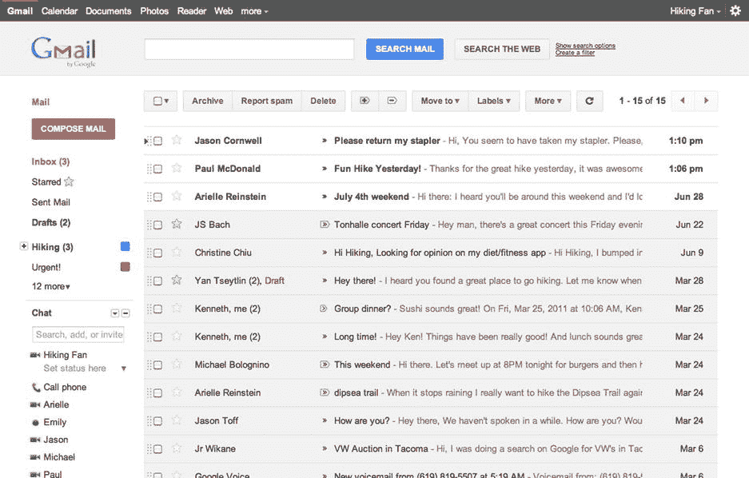

图 1-1. Gmail，一个经典的 Web 应用程序示例（图片来自 [`http://cdn.theatlantic.com/static/mt/assets/science/threadlist-large.png`](http://cdn.theatlantic.com/static/mt/assets/science/threadlist-large.png)）

尝试在没有一些支持性框架的情况下实现这样一个数据模型会相当混乱。除非你是一个单人开发团队（即便这样也值得商榷），否则就需要一定程度的统一性，以确保每个人都理解数据模型是如何定义和呈现的。

这正是 Backbone.js 的用武之地，它让开发者能够更轻松地处理数据模型、构建模块化视图，并在整个应用中发送事件。

## Web 应用程序的设计模式

设计模式被认为为软件开发带来了成熟度。自从开创性的“四人组”著作《设计模式：可复用面向对象软件的基础》介绍了构建应用程序的一系列可复用解决方案和方法以来，程序员们一直在使用模式来驾驭他们的代码库。遵循设计模式能够提高任何架构师或开发者阅读源代码的可读性，并允许你在应用程序创建过程中遵循经过验证的技术和结构。

这种亟需的规程被引入 JavaScript 世界只是时间问题，而其中应用最广泛、最适用的模式之一也是最古老的：模型-视图-控制器。真正的面向对象 JavaScript 的出现，使得许多框架能够采用这种模式的变体。

### 模型-视图-控制器

模型-视图-控制器（MVC）是一种模式，它将任何涉及用户界面的代码库的三个主要领域分离开来。这种模式的起源可以追溯到 SmallTalk 时代，这是一种备受推崇的语言，早在 20 世纪 70 年代就超前地处理了面向对象软件。自那时起，它已成为任何优秀软件系统的基础。

该模式使用了三个关键术语。

*   **模型（Model）**：模型包含了你希望在应用程序中表示的所有数据。你可以将其视为那些通过用户界面显示或操作的数据的纯粹数据表示。当发生变化时，模型会使用通知机制来提醒观察者，观察者随后可以决定是否采取行动。
    *   模型对象的典型例子是 `User` 或 `Todo` 项：现实世界项目的纯数据表示，不包含任何用户界面细节。
*   **视图（View）**：视图是模型的视觉表示，可以看作是表示层。尽管视图了解模型，但它不会直接修改模型，而是通过控制器层来处理模型编辑操作。视图通常会观察模型，以便随着任何变化而更新。
    *   在我们的 Web 应用程序中，视图是呈现给用户的 HTML/DOM 元素。
*   **控制器（Controller）**：控制器处理来自用户的输入并更新模型的状态，本质上充当了整个结构的粘合剂。当用户需要更改模型中的数据时，他们会将控制器作为中间人来完成此操作。

当你按照图 1-2 所示来思考时，这种结构的好处便显而易见。

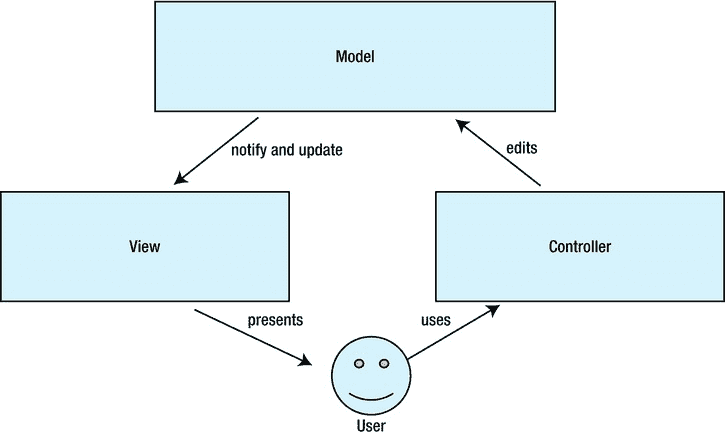

图 1-2. 基于 MVC 的应用程序交互概览

简单来说，模型是你的数据，视图是你在浏览器中看到的，而控制器则处理这两个层之间的交互。

为了进一步理解，让我们举例说明 MVC 模式如何应用于一个包含注册表单的典型 Web 应用程序。

此例中的视图是 HTML 表单，它允许用户输入或编辑关于自己的数据。控制器是当用户点击“保存”时被调用的代码。控制器还会对表单中提供的数据进行一些验证。最后，模型是用户的数据表示。图 1-3 以序列图的形式展示了这一点。

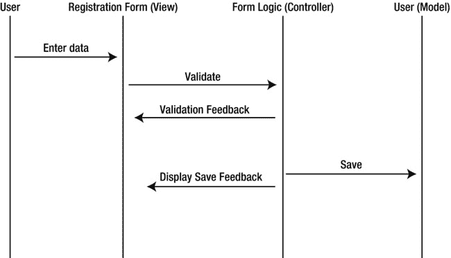

图 1-3. 注册表单的 MVC 交互序列

这种设计模式提供了两个关键优势：关注点分离和代码复用。

模型始终与视图隔离，并且只包含领域对象数据。因此，你以这种方式为桌面浏览器开发的应用程序，可以在移动版本中使用相同的模型，而无需更改任何代码。

在本书的后续部分，你将看到像这样分离代码会带来更易于测试和更易于维护的代码，同时关注点分离也为开发团队提供了更自然的工作平衡。

### 模型-视图-*

随着 UI 框架的发展，MVC 模式的各种变体应运而生，它们都遵循原始模式的精神，但略有不同。这些变体被统称为模型-视图-* 框架，因为专用控制器的概念通常被放弃了。

在构成 MV* 家族的 MVC 模式中，有两个主要的变体。虽然这些差异可能看起来近乎学术化（确实如此），但在深入研究实现这些模式的 JavaScript 框架之前，对它们有一定程度的了解是重要的。

#### 模型-视图-展示器

顾名思义，模型-视图-展示器（MVP）模式仅在于用展示器替换了控制器。展示器负责视图和模型之间的交互，并包含视图的所有业务逻辑。

重要的区别在于引入了更高程度的解耦，即展示器通过接口与视图通信。这个接口的添加意味着可以更容易地独立于真实视图来测试业务逻辑，并且你的应用程序逻辑甚至可以在任何 UI 代码编写完成之前编写。

此外，视图和模型之间通常没有直接链接，展示器负责传递数据，并充当两者之间真正的中间人。

#### 模型-视图-视图模型

在模型-视图-视图模型（MVVM）中，模型和视图部分与之前定义完全相同。ViewModel 是一个单一的实体，它负责视图所需的数据，例如对“底层”模型进行过滤或组合，以及 UI 操作或查看模型所需的所有操作。使用 ViewModel 有时会感觉像是重复，除非底层应用程序模型很复杂。


### Backbone 如何支持 MV*

正如你将在本书后面看到的，Backbone 有四个核心概念：`Backbone.Model`、`Backbone.View`、`Backbone.Router` 和 `Backbone.Collection`。目前你可以将 `Backbone.Model` 和 `Backbone.Collection` 视为都处理与模型相关的事情。集合实际上是一组模型，而模型则是单个对象或一行数据的表示。

`Backbone.View` 代表数据的呈现，但也可以被看作承担了控制器的一些职责。视图的实际渲染将在 HTML 中完成，而 Backbone 中的视图实际上只是提供了将模型信息传递到 HTML 的能力。

通常，`Backbone.Router` 会将 URL 简单地映射到函数，但在某种程度上，它也能参与控制器的职责。

因此，虽然在 Backbone.js 中明确定义了模型和视图，但并没有对控制器的定义；相反，控制器本应承担的某些任务在视图和路由器之间共享。

让我们对我们原始的 MVC 图进行一些变体，并将其应用于 Backbone，来看看交互会是怎样的（见图 1-4）。

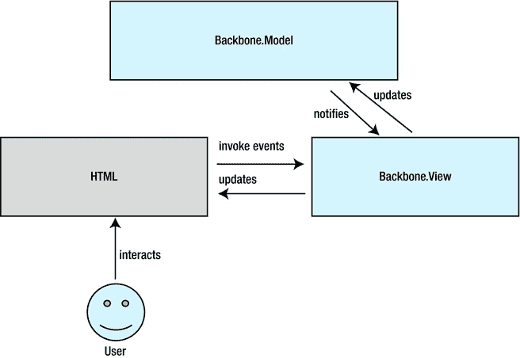
图 1-4. Backbone MV* 实现结构的图示

所有需要在 HTML 视图中表示的数据都存储在 JavaScript 对象中，而不是 DOM 中。模型是 Backbone 的一大优势，因为它提供了使用 RESTful 服务从服务器保存和检索数据的功能。

### 其他 JavaScript MV* 框架

JavaScript 开发领域中有大量的 MV* 框架可供选择。由于教程数量众多以及团队提供的文档质量很高，Backbone 往往是讨论最多的。

现在我们已经对 Backbone 应用的结构有了大致的了解，让我们看看其他一些框架与之相比如何。

#### Knockout.js

Knockout.js 首次发布于 2010 年 7 月，它遵循 MVVM 模式。与 Backbone 不同，Knockout 在用户界面的各个部分与底层数据模型之间提供了绑定，导致模型变化时 UI 会动态更新。而在 Backbone 中，这种更新需要由开发者编写代码实现。可以从 [`Knockoutjs.com`](http://knockoutjs.com/) 下载，如图 1-5 所示。

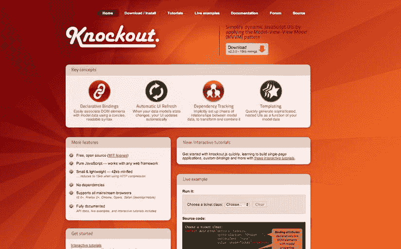
图 1-5. Knockout.js 网站

在 Knockout 中，数据绑定是包含在 HTML 中的。在这个例子中，`firstName` 是我们想要显示的模型中的属性。

```html
<p>First name: <input data-bind="value: firstName" /></p>
```

ViewModel 是模型绑定到 UI 的地方。当使用 `ko.observable()` 函数定义属性时，视图将自动更新。

```javascript
var myViewModel = {
  firstName : ko.observable('James');
};
```

定义模型后，使用 `applyBindings` 函数将其绑定到 UI。

```javascript
ko.applyBindings(myViewModel);
```

正如你所见，使用 Knockout 入门非常容易，并且与在 Backbone.js 中创建的同类应用相比，它需要的 JavaScript 代码更少。但它并非没有缺点——更复杂的 UI 交互可能难以正确处理。

尽管这两个框架都为你的 JavaScript 应用提供了结构，但 Backbone 主要关注提供 MVC 解决方案，并尽量避免介入用户界面。与此同时，Knockout 利用 MVVM 模式实现自动化的用户界面更新。Backbone 的强项在于它如何处理模型，即使用 RESTful 服务检索和持久化数据。而在 Knockout 中实现这一点需要大量的额外代码。一个具有简单用户界面和基础数据模型的项目可能受益于使用 Knockout，但对于更复杂的工作，Backbone 是一个可靠的选择。

#### AngularJS

AngularJS 由 Google 于 2009 年发布。它采用了与 Knockout 类似的方法，即数据绑定直接添加到 HTML 页面中。该框架的主要设计目标之一是从应用逻辑中移除 DOM 操作。这导致控制器和模型是用纯 JavaScript 编写的，而不是扩展框架定义的版本。可以从 [`http://angularjs.org`](http://angularjs.org/) 下载 AngularJS，如图 1-6 所示。

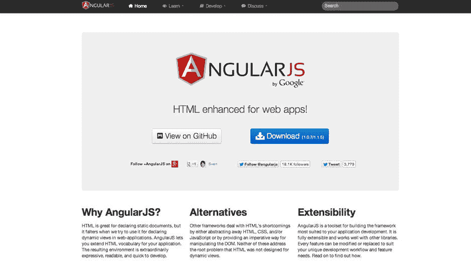
图 1-6. AngularJS 网站

Angular 提供了许多 `ng-*` 属性来在你的 HTML 中使用，以实现 UI 和模型之间的数据绑定。当 Backbone 使用 Underscore 或其他替代模板库时，Angular 允许模型数据直接注入到 HTML 源码中。

以下 HTML 片段展示了如何为一个 HTML 页面使用控制器，以及如何遍历并显示该控制器中的人员列表：

```html
<body ng-controller="AddressBookController">
  <ul>
    <li ng-repeat="person in people">
      {{person.name}}
    </li>
  </ul>
```

控制器写成一个简单的 JavaScript 对象，只需要允许视图检索数据即可。

```javascript
function AddressBookController($scope) {
  $scope.people = [
    {"name": "James"},
    {"name": "Sarah"},
  ];
}
```

一些开发者可能会觉得 Angular 太过于固执己见，强迫你以特定的方式编写应用。

#### Ember

Ember.js 于 2011 年发布，是 SproutCore 2.0 的品牌重塑。SproutCore 是一个稍早的框架，包含了它自己的小部件集。为了在不需要使用这些小部件的情况下，暴露 SproutCore 底层运行的 MVC 框架，Ember.js 应运而生。可以从 [`http://emberjs.com/`](http://emberjs.com/) 下载 Ember，如图 1-7 所示。

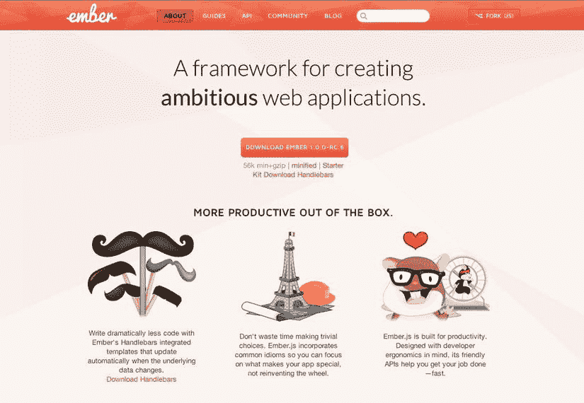
图 1-7. EmberJS 网站

Ember 是另一个使用数据绑定方法的框架，允许视图在模型变化时自动更新。这种数据绑定也在模型之间起作用，因此如果相关对象中的数据发生变化，两者会保持同步。

与 Backbone 一样，Ember 使用模板库（在 Ember 的情况下是 Handlebars）将模型数据注入到 HTML 中。Ember 还引入了一个专门的控制器来完成完整的 MVC 栈，但模型层是由简单的 JavaScript 对象表示的。

以下是 Handlebars 模板的一个示例：

```html
<script type="text/x-handlebars" id="index">
  <h1>Address Book</h1>
  <ul>
    {{#each person}}
      <li>Hello, <b>{{name}}</b>!</li>
    {{/each}}
  </ul>
</script>
```

同时，模型和应用是在 JavaScript 中创建的。

```javascript
App = Ember.Application.create();

App.Person = Ember.Object.extend({
  name: null,
});

App.IndexRoute = Ember.Route.extend({
  model: function() {
    var people = [
      App.Person.create({
        name: "James"
      }),
      App.Person.create({
        firstName: "Sarah"
      })
    ];
    return people;
  }
});
```

Ember 所需的 JavaScript 代码量与 Backbone 类似。但再次强调，Backbone 的优势在于其专用的模型对象。


## 摘要

你可能已经注意到，大多数其他框架都提供了一些内置功能，用于在模型发生变化时更新视图。`Backbone` 常被视为一个更低层次的框架，因为所有这些工作都需要程序员通过额外代码来完成。有人可能认为这是缺点，但这能让你更透明地了解应用在幕后是如何运作的。由于你自己编写 UI 更新代码，当出现问题时更容易调试。这种控制级别是开发者广泛提及的使用 `Backbone` 的原因之一。

此外，作为现有更成熟的框架之一，`Backbone` 在互联网上拥有更丰富的文档、教程和示例。

### Backbone 在实际应用中的采用

在权衡 `Backbone` 是否适合你的项目时，了解其他行业领导者如何在日常实际应用中使用该技术会很有帮助。本书本节列出了一些知名案例，并给出了五个使用 `Backbone` 的充分理由，同时另列一份清单描述了它可能不适合的场景。

### 使用 Backbone 的公司

全球一些最杰出的公司使用 `Backbone` 驱动其最新应用。让我们来看看其中三家公司，并了解他们为何选择 `Backbone`。你可以在 `Backbone` 官方网站上找到更多案例研究。

#### Airbnb

Airbnb 是 Y Combinator 最成功的案例之一，提供协作共享服务，让用户能在 192 个国家出租居住空间。Airbnb 在多个产品中使用了 `Backbone`，从移动网页应用到网站功能（包括心愿单和匹配），以及其内部应用。`Backbone` 在移动网站中的使用示例如图 1-8 所示。

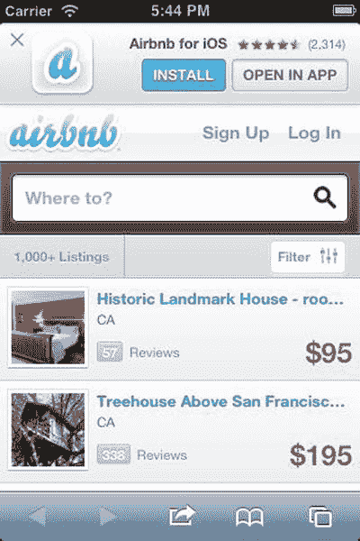

图 1-8. Backbone 在 Airbnb 技术栈中广泛应用

尽管 Airbnb 最初在后台使用 Rails，并在客户端使用 `Backbone`，但现已将移动应用演进为在服务器端使用 `Node.js`，其中也包含了 `Backbone`。这使得应用程序逻辑能够在两端共享，而无需用不同语言重写。

你可以在其开发者博客 [`http://nerds.airbnb.com/weve-launched-our-first-nodejs-app-to-product/`](http://nerds.airbnb.com/weve-launched-our-first-nodejs-app-to-product/) 上了解更多关于 Airbnb 使用 `Backbone` 的信息。

#### SoundCloud

SoundCloud 是一家总部位于德国的音乐分发平台，支持上传或收听用户创作的内容。其团队最初使用 `Backbone` 作为移动网页应用的基础，但后来也将其用于桌面网站的前端，示例如图 1-9 所示。

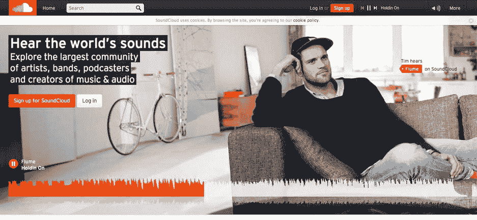

图 1-9. 带有播放器控件的 SoundCloud 桌面网站

工程团队选择 `Backbone` 的原因之一是“它没有过多规定应该如何使用”。与 Airbnb 类似，SoundCloud 决定使用 `Handlebars` 作为模板引擎，因为可以添加自定义辅助函数并预编译模板。

要了解更多关于 SoundCloud 架构的信息，请查看其博客 [`http://backstage.soundcloud.com/2012/08/evolution-of-soundclouds-architecture/`](http://backstage.soundcloud.com/2012/08/evolution-of-soundclouds-architecture/)。

#### Foursquare

Foursquare 是一款基于位置的社交网络应用，允许用户在世界各地签到并分享状态给朋友。Foursquare 使用 `Backbone` 为其问题领域中的所有真实世界对象（用户、地点和签到）创建模型类。使用 `Backbone` 是因为它提供“一种简单轻量的机制来捕获对象数据和状态，并具备经典继承的语义”。不过，团队提供了自己的服务 URI 来替代 `Backbone.sync`，以抽象化对 API 的 Ajax 调用。使用 `Backbone` 的网站示例如图 1-10 所示。

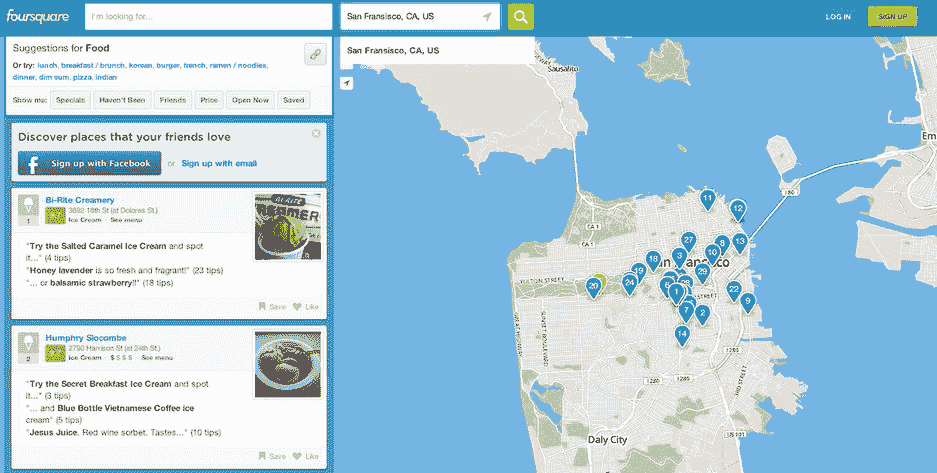

图 1-10. Foursquare 桌面网站

更多信息请参见 Foursquare 工程博客，地址为 [`http://engineering.foursquare.com/2011/12/08/web-sites-are-clients-too/`](http://engineering.foursquare.com/2011/12/08/web-sites-are-clients-too/)。

### 在项目中使用 Backbone 的五个理由

如果你仍不确定 `Backbone` 是否是项目的正确选择，以下是考虑使用它的五大理由。


*   `Backbone`是一个库，而非框架：库与框架之间存在微妙的差别。框架对项目中的使用方式有非常严格的规定，通常会强制采用某种可能并不适合的编码风格。正如你在比较不同 MV* 选项的章节中所看到的，`Backbone`是能留给你最大自由度的选项，并且它可以重构到任何现有的`JavaScript`应用程序中，而无需为了使用该库而彻底改造应用。如果你需要额外功能，还可以对`Backbone`进行扩展。你可以将任何模板库与`Backbone`一起使用，所以如果`Underscore`无法满足你的需求，或者你熟悉`Handlebars`之类的库，你可以改用它们。由于`Backbone`默认没有双向数据绑定，你不会遇到任何意外的性能问题。该库的简洁性使你免于此类问题的困扰。
*   应用程序需要结构：如果你想创建商业级的`JavaScript`应用程序，就需要施加某种结构。`Backbone`的`MV*`方法几乎适用于所有类型的应用，有助于分离处理数据模型和视图的代码。大多数客户端应用程序都会使用`RESTful API`，而这是`Backbone`擅长的领域之一，它提供了模型中的同步函数，能够为那个数据对象实现所有创建、更新和删除的`REST`调用。使用像`Backbone`这样的框架，为`JavaScript`开发带来了一种通用的、定义明确的方法，整个项目团队都能轻松遵循。`Backbone`鼓励的最佳实践易于维护。
*   丰富的文档和庞大的用户社区：使用任何新技术都可能令人望而生畏，但一套成熟的文档和庞大的用户群基础可以帮助缓解这种压力。使用`Backbone`，你会获得丰富的资源。在[`http://backbonejs.org`](http://backbonejs.org/)上提供的文档易于理解，并带有注释的源代码和示例，帮助你理解库的每一个方面。再结合你在互联网上找到的大量博客和教程，你就知道自己并不孤单。还有大量由用户社区创建的`Backbone`插件和扩展可用。如果你遇到问题，很可能已经有人找到了解决方法。我们将在本书后面更详细地介绍`Backbone`插件和扩展。
*   扩展性好，并且有信誉良好的公司在使用它：在上一节中，我们只看到了几家使用`Backbone`的大公司。但如果你访问[`http://backbonejs.org`](http://backbonejs.org/)，你会看到有大量的公司已经采用了`Backbone`。这个库不仅仅用于实验性项目；以`Airbnb`为例，`Backbone`被证明是一个非常优秀的解决方案，现在甚至在服务器端使用它。这证明了它是一个扩展性良好且能与任何其他`JavaScript`库（甚至`Node.js`）良好集成的库。该库的成熟度非常关键，并且因为`Backbone`已经存在了近三年并达到了 1.0.0 版本，它在许多其他`MV*`解决方案中具有优势。
*   你的代码库是一团乱麻：`Backbone`不仅仅适用于新项目。你可能有一些遗留应用程序需要清理。你可能一直在大量使用`jQuery`，手动操作`DOM`并进行`$.ajax`调用。如果是这种情况，`Backbone`可以是一个完美的替代品，通过`Backbone.Model`对象，你可以使用更简单的代码来实现相同的结果。别忘了，你不需要绝对使用`Backbone`提供的所有功能。你可以根据当时的应用需求进行选择。

### 三个可能不适合使用`Backbone`的原因

在某些情况下，为你的应用程序使用`Backbone`可能没有意义。为任何项目使用错误的库都可能产生毁灭性的后果。以下列表说明了`Backbone`不太适用的情况：

*   **概念验证型应用**：有时你只是想快速做一个实验，验证特定用户界面的外观。如果你要创建的东西非常简单，那么`Backbone`可能过于庞大，而使用像`AngularJS`这样的东西可能会让你更快地完成一些工作。如果你还不太熟悉`Backbone`的工作原理，其他一些解决方案能让你在更短的时间内从零开始构建应用。不过，如果这个概念验证最终变成了一个真正的应用，那么值得考虑在实际实现中使用`Backbone`。
*   **你不习惯处理较低级别的`JavaScript`**：作为限制较少的`MV*`解决方案之一，`Backbone`为开发者留下了很多工作要做。模型和视图之间的双向数据绑定就是其中一项任务。虽然许多开发者社区成员乐于为此绑定编写代码，但有些人可能会觉得它令人生畏。那些对整体应用实现细节提供更多指导的、更具约束性的框架可能会更有用，但要注意潜在的性能问题。
*   **你正在创建一个简单的网页**：`Backbone`适用于正在创建网络应用的开发者，而不仅仅是创建简单的网页。毫无疑问，对于如此简单的场景，使用`Backbone`将是小题大做。

对某些人来说，这条界线可能难以界定，所以我认为，除非满足以下任一条件，否则使用`Backbone`都是小题大做：

*   你需要进行`Ajax`调用来从服务器保存和检索数据
*   你的页面上有许多复杂的视图区域
*   你已经使用大量`jQuery`来操作`DOM`

很难找到理由不去使用像`Backbone`这样强大的库。如果你熟悉`JavaScript`，使用`Backbone`不会是一个巨大的跨越，并且随着你遵循库的代码库内所鼓励的最佳实践和模式，它将提升你的编码技能。

## 开始设置`Backbone`

既然你已经确定`Backbone`适合你，那么是时候设置你的开发环境了。


### 下载 Backbone

Backbone.js 的官方网站位于 [`http://backbonejs.org`](http://backbonejs.org/)。在撰写本文时，该库的版本已达到 1.0.0。

如图 1-11 所示，您有三个下载选项：开发版、生产版和尝鲜版。通常，在本地机器上工作时，您会希望使用开发版。开发版包含未压缩格式的代码，因此易于调试和阅读，并且包含了所有注释。

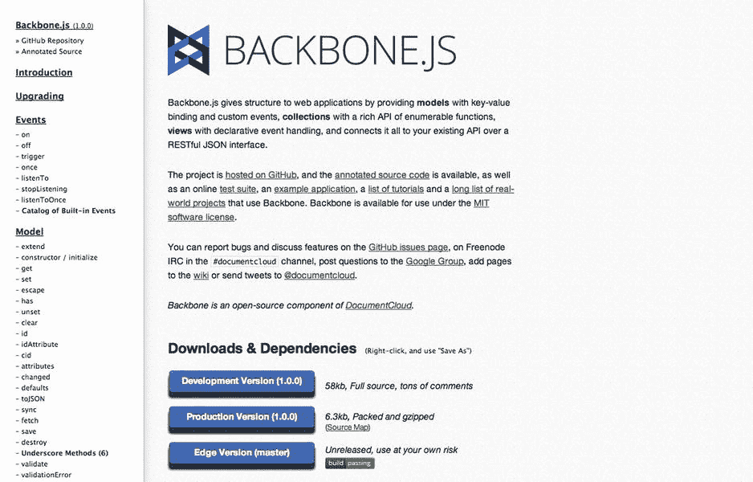

图 1-11.

[Backbonejs.​org](http://Backbonejs.org)

当您将应用部署到生产服务器时，应使用生产版。从图 1-11 可以看出，这是一个小得多的文件，因此它可以更快地下载到 Web 浏览器，从而提高网站性能。

尝鲜版是提交者目前正在开发的代码。除非您想探索团队正在开发的新功能，否则大多数情况下都应避免使用此版本。

现在，请下载开发版，并将 `backbone.js` 文件保存到您的开发目录中。

Backbone 始终依赖于 Underscore.js，您可以在 Backbone 网站上找到它的链接。该库可以从 [`http://underscorejs.org`](http://underscorejs.org/) 下载，如图 1-12 所示。同样，您应该下载该库的开发版。

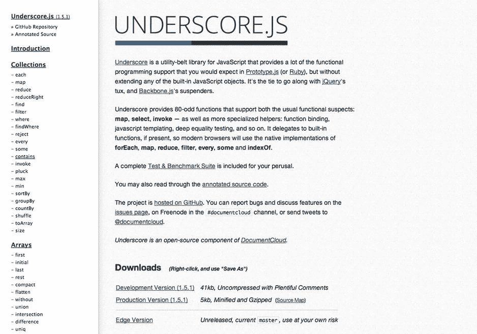

图 1-12.

[Underscorejs.​org](http://Underscorejs.org)

如果您打算使用 `Backbone.View`（我们将会用到），您需要依赖一个 DOM 操作库，可以选择 jQuery 或 Zepto。鉴于 jQuery 被视为行业标准，并且拥有丰富的信息资源和插件，我们也将依赖它。

您可以从 [`www.jquery.com`](http://www.jquery.com/) 下载 jQuery，如图 1-13 所示。在撰写本文时，可以选择 v1.10.12 或 v2.0.3。如果您有幸只需支持较新版本的浏览器，那么可以选择 v2.x 分支。但如果您需要支持 Internet Explorer 6、7 或 8（我们大多数人仍需如此），那么您应该从 v1.x 分支下载。

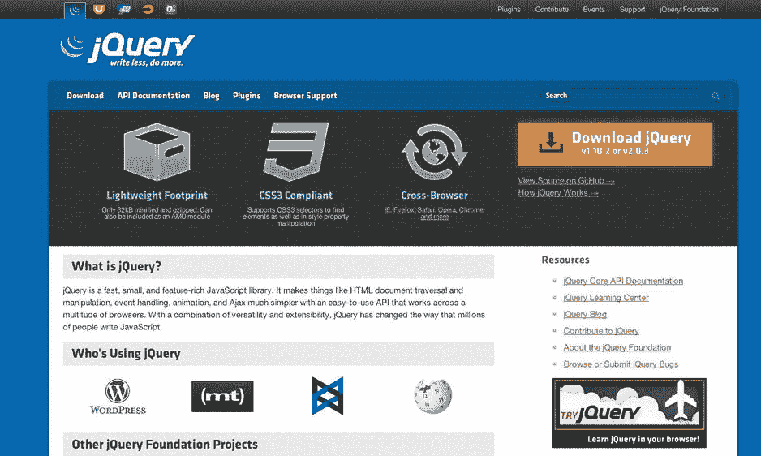

图 1-13.

[`jQuery.com`](http://jquery.com/)

#### 下载与否

一些开发者倾向于指向其 JavaScript 库的托管版本，这些版本来自内容分发网络（CDN）或直接从项目的开发网站获取。当您的项目部署到真实环境时，这种做法是合理的。但为了熟悉流程，我们将直接下载每个依赖库。在本书的后续部分，我们将讨论 CDN 如何帮助改善应用的性能。

### 测试你的环境：Backbone 项目结构

现在您已下载完所有库，我们可以测试一个非常简单的、加载 Backbone 库的项目，以确保一切设置正确。

所有这些库都应下载到 `js/external` 文件夹中。这只是一个惯例，用于将您自己编写的 JavaScript 与所依赖的库分隔开。

您需要创建一个 `index.html` 文件，以便应用可以在浏览器中运行。该文件应添加到根目录，最终形成如图 1-14 所示的文件夹结构。

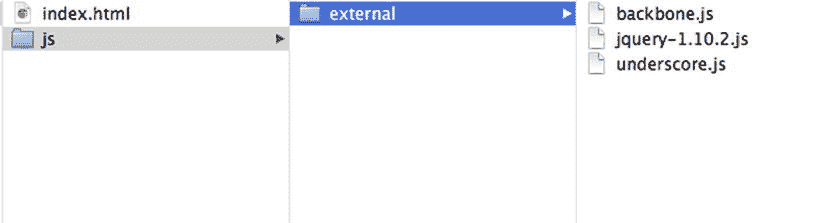

图 1-14.

简单 Backbone 应用的文件夹结构

在 `index.html` 中，我们将创建一个简单的 HTML 页面，并在页面底部包含依赖库。依赖库应按照依赖顺序加载；由于 Backbone 依赖于 Underscore 和 jQuery，因此应首先加载这两个库。

```html
<!DOCTYPE HTML>
<html>
<head>
    <meta charset="UTF-8">
    <title>我的应用</title>
</head>
<body>
<script src="js/external/jquery-1.10.2.js"></script>
<script src="js/external/underscore.js"></script>
<script src="js/external/backbone.js"></script>
<script>
  // 你的 Backbone 代码写在这里
</script>
</body>
</html>
```

目前，这个应用中还没有自定义的 Backbone 代码；这将在本书后续深入探讨 Backbone 时添加。现在，该文件只包含一个占位注释，用于指示您应该在哪里添加代码。请注意，所有脚本都加载在页面末尾，而不是头部。这是 JavaScript 开发者的一种标准做法，目的是让页面渲染更早进行，而不会被脚本阻塞。

现在，只需在浏览器中打开 `index.html`——如果加载库时没有出现错误，那么您就可以开始学习接下来的几章，构建一些真正的 Backbone 应用了。

### 开发环境的一些技巧

为 JavaScript 开发设置机器是比较个人化的事情；不同的人喜欢不同的工具。以下是我个人进行 JavaScript 开发时使用的一些工具。

#### Apache

您肯定需要某个版本的 Apache 来在本地托管您的 Web 应用。尽管对于本书中将要创建的应用类型，并不需要 PHP 和 MySQL，但在 Mac 或 Windows 平台上的安装便捷性方面，XAMPP（[`www.apachefriends.org/en/xampp.html`](http://www.apachefriends.org/en/xampp.html)）很难被超越。

#### Google Chrome

在开发 JavaScript 时，Chrome 是我首选的浏览器，完全是因为其内置开发者工具的强大功能。Chrome 开发者工具（图 1-15）是目前可用的最佳 Web 调试工具之一。从“Sources”标签中，您可以打开任何 JavaScript 文件并添加断点，从而检查变量的值，并逐步执行程序。图 1-15 展示了在前面代码加载脚本时，在 `backbone.js` 中设置断点的情景。

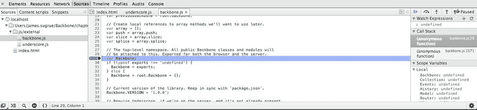

图 1-15.

Chrome 开发者工具

“Console”标签是 JavaScript 开发者的另一个不可或缺的工具。您可以直接在控制台中输入代码并让它执行。当调试器暂停时，您可以访问当前作用域内的所有变量。同样，您可以直接在“Sources”视图中修改您的 JavaScript。

稍后我们还将看到 Chrome 开发者工具提供的其他一些实用功能。值得一提的是，如果您偏好使用 Firebug，它也包含类似的工具。

#### Sublime Text 2

最后，您需要一个好的文本编辑器来编写 JavaScript。值得庆幸的是，在编写客户端 Web 应用时，无需任何重量级的 IDE。如今 Java 社区中首选的编辑器似乎是 Sublime Text 2（参见 [`www.sublimetext.com`](http://www.sublimetext.com/)）。除了明显的语法高亮功能外，该编辑器还有大量可用的插件，帮助您在源代码中运行 jslint 等。甚至还有插件允许您连接到 Chrome 开发者工具，并从 Sublime 内部调试您的 JavaScript。


