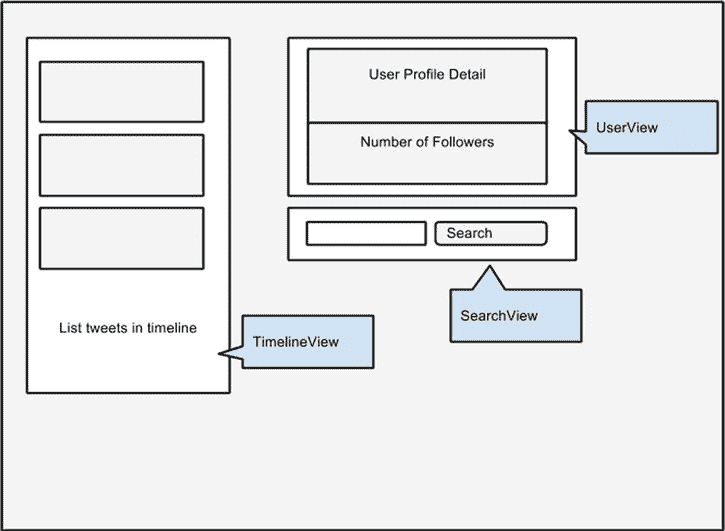
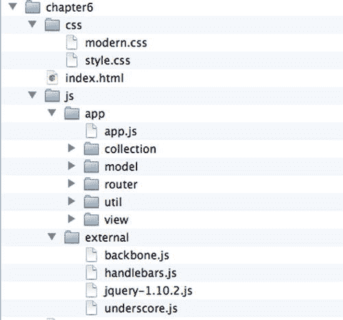
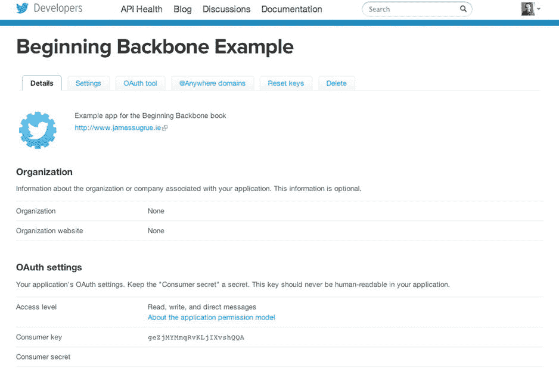
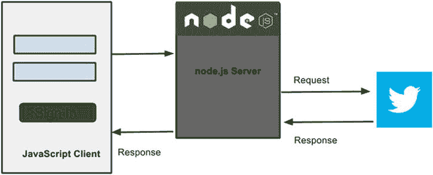
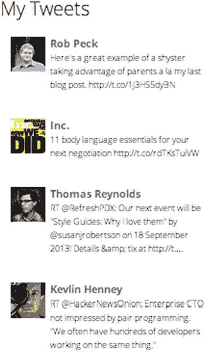
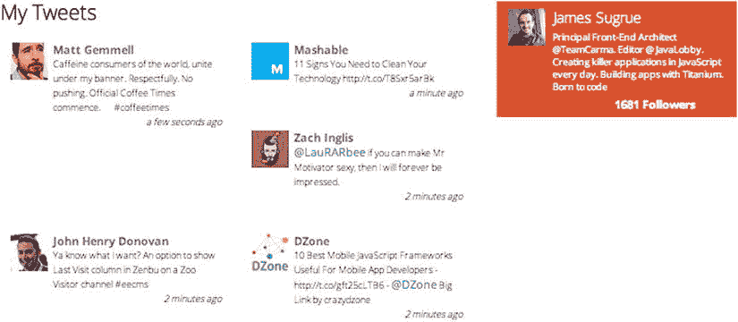
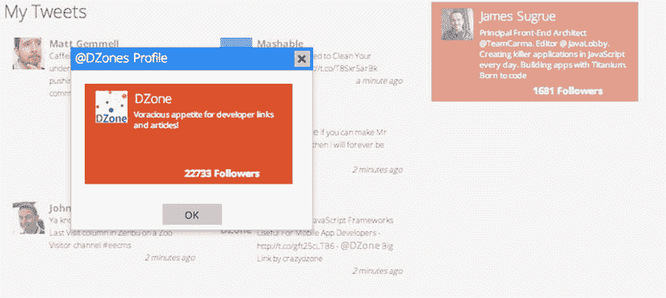
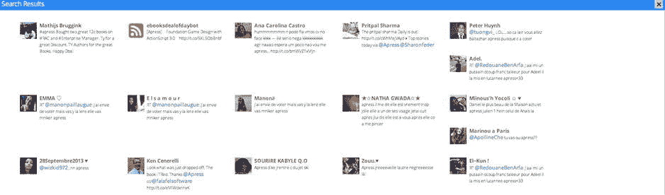

# 6. 从始到终：一个完整的应用示例

## 摘要

既然我们已经掌握了 Backbone 的核心概念，是时候将所有内容整合起来，创建一个功能完备的应用了。本章将带你经历构建由 Backbone 支持的应用所需的各个阶段，从设计阶段开始，最终打造出一个高质量的 Twitter 应用。我们还将介绍一种更具结构化的方法来编写应用代码，而不是像前几章那样仅仅将其插入 `<script>` 标签之间。

## 设计你的应用

在深入代码之前，重要的是退一步，明确应用的核心功能。这能让我们以更结构化的方式进行 JavaScript 开发。理解所表示的数据将有助于你决定如何定义模型。例如，了解屏幕的哪些部分需要动态更新，能告诉你需要哪些视图。

我们的示例是一个基于 Twitter 的应用，它将展示认证用户账户的概览，包括以下内容：

- 用户时间线中的最新推文
- 关注者数和正在关注的人数
- 搜索 Twitter 的功能

图 6-1 中的线框图标识了将出现的主要视图。



图 6-1. 展示主要视图的简单线框图

从图 6-1 中可以看出，应用有一个主视图以及若干子视图。很明显，主页面上至少有三个独立的视图部分。

- 时间线
- 用户个人资料数据
- 搜索视图

尽管搜索框是静态的，但其背后的功能需要为搜索结果构建一个视图，并可能使用路由器使搜索可添加书签。

### CSS 样式

为了避免需要处理 CSS 来设计应用样式，我使用了 MetroUI CSS 库（[`metroui.org.ua/`](http://metroui.org.ua/)），它给应用带来了一种锐利的 Windows 8 外观。当然，你也可以使用自己的自定义样式或其他 UI 库，如 Bootstrap（[`github.com/twbs/bootstrap`](https://github.com/twbs/bootstrap)）。

### 应用领域

我选择 Twitter 作为此应用的示例领域，这样我们可以避免过多担心后端服务，并轻松接入现有 API。本章所阐述的原则适用于任何应用，因此不要让对 Twitter 的关注分散你的注意力。主要任务是理解视图、集合、模型和路由器之间的交互。

## 应用代码结构

对于任何非琐碎的 Backbone 项目，在开始时定义清晰的代码结构都是至关重要的。虽然将 HTML、JavaScript 和 CSS 放在不同的目录中显然是好的做法，但也值得对 Backbone 对象类型进行分组。这意味着你应该为应用 JavaScript 设置以下类型的目录结构，位于 `js/app` 目录下。

- `app.js`
- `view/`
- `model/`
- `collection/`
- `router/`
- `util/`

`app.js` 文件充当应用的主入口点，而文件夹则充当项目其余部分的包结构。如果你曾使用过 Java 或 C# 等其他语言进行开发，那么这种组织代码的方法会令你感到熟悉。

这些文件夹内的每个对象还应进行命名空间处理，以使代码更具可读性并避免命名冲突。例如，我们稍后将在本章中创建的 `TimelineView` 定义了以下命名空间：

```javascript
var com = com || {};
com.apress = com.apress || {};
com.apress.view = com.apress.view || {};
com.apress.view.TimelineView = Backbone.View.extend({
```

这意味着当我们创建 `TimelineView` 的新实例时，可以使用以下代码：

```javascript
var timelineView = new com.apress.view.TimelineView();
```

作为应用的主入口点，`app.js` 负责创建应用的初始状态。这通常涉及创建若干视图、创建一个路由器以及启动 Backbone 历史记录。

在 `app.js` 中的代码执行之前，页面中的所有内容都需要加载完成，因此你通常会将代码放在一个块中，例如 jQuery 的 `$(function(){ });`。以下代码片段说明了这一点：

```javascript
$(function() {
    var timelineView = new com.apress.view.TimelineView(),
        router = new com.apress.router.AppRouter();
    Backbone.history.start();
});
```

### 外部依赖

此项目将有一些外部依赖项。正如我们已经看到的，要使用 Backbone，我们需要引入 `Backbone.js`、`Underscore.js` 和 `jQuery`。如果你愿意，也可以选择模板库。我通常为我的应用选择 Handlebars，因为我认为它的表达性和可扩展性最为实用。所有这些外部库都放在应用的 `js/external` 目录中。

在样式方面，该应用还将使用 MetroUI 项目中的 `modern.css`。该文件将包含在 `css` 目录中。

图 6-2 展示了应用的文件夹结构。



图 6-2. 典型 Backbone 应用的结构

### 整合所有组件

您的主 HTML 页面将负责整合所有组件，包括样式表、模板以及外部 JavaScript 库。

以下代码展示了您的主页（index page）代码可能呈现的样子。您会注意到每个 JavaScript 工件都是单独引入的。稍后我们会探讨如何将这些文件合并成一个脚本文件。然而，您会发现通过引入未压缩形式的文件来调试代码会容易得多。

```html
<html>
<head>
    <title>入门 Backbone Twitter 示例</title>
    <link rel='stylesheet' href='css/modern.css'>
    <link rel="stylesheet" href="css/style.css">
    <!-- 其他 CSS 文件在此处 -->
</head>
<body class='metrouicss'>
<!-- HTML 内容与 div 占位符 -->
<div id='timeline' class='timeline-view'>
     <h2>我的推文</h2>
</div>
<!-- Handlebars 模板 -->
<script type="text/x-handlebars-template" id="timeline-template">
<ul class='listview'>
        {{#each tweet}}
        <li>
          <div class='icon'>
                  </img>
          </div>
            <div class='data'>
                <h4>{{user.name}}</h4>
                <p>{{text}}</p>
            </div>
        </li>
        {{/each}}
</ul>
</script>
<!-- 外部库引入 -->
<script src="js/external/jquery-1.10.2.js"></script>
<script src="js/external/underscore.js"></script>
<script src="js/external/backbone.js"></script>
<script src="js/external/handlebars.js"></script>
<!-- 模型 -->
<script src="js/app/model/Tweet.js"></script>
...
<!-- 集合 -->
<script src="js/app/collection/Timeline.js"></script>
.....
<!-- 视图 -->
<script src="js/app/view/TimelineView.js"></script>
.....
<!-- 路由器 -->
<script src="js/app/router/AppRouter.js"></script>
.....
<!-- 此应用的主入口 -->
<script src="js/app/app.js"></script>
</body>
</html>
```

## 第一步：处理认证

在使用任何 API 时，您很可能需要处理一些安全要求，例如连接时的授权。本节将帮助您开始为使用 Twitter API 的客户端设置认证。

### 在 Twitter 上设置应用

# 使用Twitter API的准备工作

在让我们的应用使用 Twitter API 之前，我们需要在 `https://dev.twitter.com/apps` 上做一些准备工作，并为我们的客户端设置授权。

注意：为简单起见，我们的应用将使用应用级认证，这意味着在接下来的步骤中，您所使用的开发者账号在使用 Twitter API 时将被视为当前用户。这样我们就不需要在客户端应用中处理登录流程了。

假设您已经拥有一个 Twitter 账号，只需登录并点击“创建新应用”按钮，即可开始定义您应用的详细信息。在第一个页面上，您只需要填写一些关于应用的简单信息。请确保将应用设置为具有“读取、写入和发送直接消息”权限。

接下来的页面（如图 6-3 所示）是您需要提供应用最重要信息的地方：消费者密钥（`consumer key`）和消费者密钥密文（`consumer secret`）。



图 6-3. 来自 Twitter 应用的 OAuth 设置

图 6-3 中的消费者密钥密文已被遮挡，因为此信息必须保密。正如我在图中小心隐藏密钥密文一样，您也应在 JavaScript 代码中将其保密。任何人都能查看网页的源代码，因此您绝不应将密钥包含在 JavaScript 中。通过选择“OAuth 工具”选项卡，您将获得客户端应用连接所需的所有四个密钥。

## 在服务器端保存密钥

对于此应用，我们将运行一个中间 `node` 服务器，该服务器将接收来自客户端应用的所有调用，并将这些请求转发给 Twitter。这确保了密钥密文存储在服务器端。图 6-4 展示了这一管道流程。



图 6-4. `node.js` 服务器角色示意图

`node.js` 服务器的源代码与我们之前章节创建的类似。不过，为了使处理 Twitter API 更简便，我使用了 Tolga Tezel 开发的 Twitter `node` 包（`https://github.com/ttezel/twit`）。您只需使用 `npm install twit` 即可安装该包。

您需要在项目中使用 `require()` 函数引入这个库，然后按照下面 `connectToTwitter()` 函数中列出的步骤进行认证。

```
var Twit = require('twit')
var client = null;

function connectToTwitter(){
   client = new Twit({
        consumer_key:         '<您的消费者密钥>',
        consumer_secret:      '<您的消费者密钥密文>',
        access_token:         '<您的访问令牌>',
        access_token_secret:  '<您的访问令牌密文>'
  });
}

//让应用连接到 Twitter。
connectToTwitter();
```

一旦此代码执行完毕，`twitterClient` 对象将被设置好，能够与完整的 Twitter API 进行交互。为了完整性，以下是 `server.js` 到目前为止的完整源代码，尚未添加任何处理客户端 GET 和 POST 方法的功能：

```
/**
 * 一个在 localhost:8080/books 下提供的简单 API
 */
var express = require('express');
var app = express();
var Twit = require('twit')
var client = null;

function connectToTwitter(){
   client = new Twit({
        consumer_key:         '<您的消费者密钥>',
        consumer_secret:      '<您的消费者密钥密文>',
        access_token:         '<您的访问令牌>',
        access_token_secret:  '<您的访问令牌密文>'
  });
}

//让应用连接到 Twitter。
connectToTwitter();

//额外设置以允许 CORS 请求
var allowCrossDomain = function(req, response, next) {
    response.header('Access-Control-Allow-Origin', "http://localhost");
    response.header('Access-Control-Allow-Methods', 'OPTIONS, GET,PUT,POST,DELETE');
    response.header('Access-Control-Allow-Headers', 'Content-Type');
    if ('OPTIONS' == req.method) {
      response.send(200);
    }
    else {
      next();
    }
};

app.configure(function() {
    app.use(allowCrossDomain);
  //解析请求体中的 JSON 对象
    app.use(express.bodyParser());
});

//在端口 8080 上启动应用
app.listen(8080);
```

现在，我们可以开始为服务器构建额外功能，以便客户端应用可以接入。

## 展示Twitter时间线

我们要做的第一件事是创建一个简单的模型和视图，以便能够看到当前用户的 Twitter 时间线。

首先，我们需要在 `node.js` 服务器上设置一个端点，用来响应时间线的请求。这将利用 Twitter 库来检索多个“推文对象”。以下代码应放入 `node` 服务器的 `server.js` 文件中：

```
/**
 * 返回当前用户的 Twitter 时间线
**/
app.get('/timeline', function (request, response) {
    response.header('Access-Control-Allow-Origin', '*');
     client.get('statuses/home_timeline', { },  function (err, reply) {
      if(err){
        response.send(404);
      }
      if(reply){
        response.json(reply);
      }
    });
});
```

## 数据层

让我们重点关注用于从服务器访问时间线信息的模型和集合。模型无需设置任何默认属性，因为它们都将来自 Twitter API 的响应。这样，我们就得到了目前最简单的模型类，尽管随着进展，可能会添加更多细节。以下代码应放在 `model` 目录下的 `Tweet.js` 文件中：

```
var com = com || {};
com.apress = com.apress || {};
com.apress.model = com.apress.model || {};
com.apress.model.Tweet = Backbone.Model.extend({

});
```

集合将负责与服务器的连接，检索推文列表，每条推文将由一个 `Tweet` 对象表示。以下代码应放在 `collection` 目录下的 `Timeline.js` 文件中：

```
var com = com || {};
com.apress = com.apress || {};
com.apress.collection = com.apress.collection || {};
com.apress.collection.Timeline = Backbone.Collection.extend({
    //该集合使用的模型
    model: com.apress.model.Tweet,
    //集合连接的服务端 URL
    url: 'http://localhost:8080/timeline',
    initialize: function(options){
        //在此定义构造时需要初始化的内容
    },
});
```

集合的关键部分是 `model` 属性和 `url` 属性，前者指定了该集合使用哪个 Backbone 模型对象，后者定义了提供时间线信息的 REST 服务。

在进一步操作之前，您可以通过创建集合的新实例并调用 `fetch` 函数来测试它。现在，以下代码可以放在 `app.js` 中：

# 为时间线构建视图

数据层已经就绪，现在是时候为这些数据构建一个视图了。我们首先准备一些 HTML 代码，以便列出时间线中的所有推文。通常，您会为每个视图创建一个`div`，这个`div`的 ID 将作为 Backbone 视图中的`el`变量。以下所有 HTML 代码应放在`index.html`中：

```html
<div id='timeline' class='timeline-view'>
    <h2>我的推文</h2>
</div>
```

我们还将为集合创建一个 Handlebars 模板。我们无需在 JavaScript 代码中使用`for`循环来逐一渲染每条推文，而是可以利用 Handlebars 内置的辅助函数来遍历集合。

```html
<script type="text/x-handlebars-template" id="timeline-template">
    <ul class='listview'>
        {{#each tweet}}
            <li>
                <div class='icon'>
                    </img>
                </div>
                <div class='data'>
                    <h4>{{user.name}}</h4>
                    <p>{{text}}</p>
                </div>
            </li>
        {{/each}}
    </ul>
</script>
```

现在我们可以创建一个处理时间线的视图。首先，我们将视图与 HTML 中定义的元素挂钩：视图的`div`元素和用于渲染集合数据的模板。以下代码应放在`view`目录下的`TimelineView.js`文件中。

```javascript
var com = com || {};
com.apress = com.apress || {};
com.apress.view = com.apress.view || {};
com.apress.view.TimelineView = Backbone.View.extend({
    el: '#timeline',
    template: Handlebars.compile($("#timeline-template").html()),
    initialize:  function(options){
    },
    render: function(){
    },
});
```

正如我们之前所述，Backbone 不是一个固执己见的框架，这意味着在使用集合与视图时，您有几种选择。

- 您可以在视图内部初始化集合。
- 您可以在外部的`app.js`中，甚至在路由器中初始化集合，并将其作为参数传递给视图。

对于本示例，我们将在视图的`initialize`函数中创建集合。该集合（此处为`timeline`）作为类变量添加到视图中，以便不同函数可以共享它。

```javascript
initialize:  function(options){
    var self = this;
    //为此视图创建一个集合进行渲染
    self.timeline = new com.apress.collection.Timeline();
    //初始渲染
    self.render();
    //强制 fetch 触发 reset 事件
    self.timeline.fetch({reset:true});
    self.listenTo(self.timeline, 'reset', self.render);
},
```

最后两行在这个`initialize`函数中至关重要。我们强制对集合执行`fetch`操作，并传入一个布尔标志，指示`fetch`应触发 reset 事件。视图监听时间线的任何变化，当它发生变化时，`render`函数将被执行。

`render`函数非常简单；只要`timeline`集合中存在模型，它们就会被传递给模板。

```javascript
render: function(){
    var self = this;
    if(self.timeline.models.length > 0){
        var output = self.template({tweet: self.timeline.toJSON()});
        self.$el.append(output);
    }
    return self;
},
```

Handlebars 会遍历每条推文（`{{#each tweet}}`），因此传递给模板的 JSON 必须命名为`tweet`。该视图的完整代码清单如下：

```javascript
var com = com || {};
com.apress = com.apress || {};
com.apress.view = com.apress.view || {};
com.apress.view.TimelineView = Backbone.View.extend({
    el: '#timeline',
    template: Handlebars.compile($("#timeline-template").html()),
    timeline: null,
    initialize:  function(options){
        var self = this;
        //为此视图创建一个集合进行渲染
        self.timeline = new com.apress.collection.Timeline();
        //初始渲染
        self.render();
        //强制 fetch 触发 reset 事件
        self.timeline.fetch({reset:true});
        self.listenTo(self.timeline, 'reset', self.render);
    },
    render: function(){
        var self = this;
        if(self.timeline.models.length > 0){
            var output = self.template({tweet: self.timeline.toJSON()});
            self.$el.append(output);
        }
        return self;
    },
});
```

接下来，我们将设置`app.js`，使其只创建这个视图。因为视图负责创建集合，所以无需在视图中定义它。此外，我们还没有设置任何应用路由，因此暂时不必担心 history 或任何路由器。

```javascript
var timelineView = new com.apress.view.TimelineView();
```

只要您包含了迄今为止创建的所有 JavaScript，导航到您的`index.html`页面将运行整个应用程序，并显示类似图 6-7 的输出。



图 6-7. 使用`TimelineView`渲染 Twitter 时间线集合的结果

## 视图优化：显示时间戳

我们来看看如何优化应用中每条推文的显示效果。其中值得添加的一项内容是每条推文的时间戳。但如果你查看模型，会发现`created_at`属性下的时间戳又长又繁琐。更好的做法是效仿[`Twitter.com`](http://twitter.com/)网站的处理方式，显示推文发布的相对时间（如“多久以前”）。

为此，我们可以使用 [Moment.js](http://momentjs.com/) 库，它提供了用户友好的方式来解析、处理和格式化日期。首先，你需要下载该库并在 `index.html` 中引用它。在本示例中，我下载的是完整的 Moment.js 库，因此引用文件名为 `moment.js`，而默认的包实际上是压缩版本。

```html
<script src="js/external/moment.js"></script>
```

与其在负责渲染的 JavaScript 中添加格式化数据的代码，不如在 Backbone 从服务器返回数据并解析模型时，为模型新增一个属性。

为此，我们将在 `Tweet.js` 中扩展 `Tweet` 模型，添加一个 `parse` 函数。

```javascript
parse: function(model){

    //model.created_at "Wed Aug 28 06:32:07 +0000 2013"

    var friendly = moment(model.created_at, "ddd MMM DD HH:mm:ss ZZ YYYY").fromNow();

    model.friendlyDate = friendly;

    return model;

}
```

如果检查模型，你会发现 `created_at` 数据的格式类似于 `Wed Aug 28 06:32:07 +0000 2013`。要解读这个日期，你需要告诉 Moment.js 其格式，即 `ddd MMM DD HH:mm:ss ZZ YYYY`。一旦创建了有效日期，Moment.js 就会通过其 `fromNow` 函数生成一个友好的字符串，并在 `parse` 函数返回之前将其添加到模型中。

需要记住一点：如果你在模型中添加了 `parse` 方法的实现，请确保始终在末尾返回该模型。

### 视图优化：高亮显示用户名

另一个优化是从推文中提取所有 `@用户名` 部分，并将其转换为查看用户资料的链接。由于这是对推文显示方式的增强，而非数据本身的修改，因此将相关代码放在渲染端是完全可以接受的。

我们可以通过为 Handlebars 添加一个辅助函数来实现这一点。这样，我们就可以在模板中以表达式的形式实现高亮功能。

首先，创建一个新的 JavaScript 文件来存放辅助函数，并将其保存在 `util` 目录下。然后，使用 `Handlebars.registerHelper` 函数在此处创建一个新的辅助程序，传入将在模板中使用的辅助函数名称及其将处理的参数。别忘了将你为辅助程序创建的文件包含在主 HTML 页面中。在本例中，我将该文件命名为 `helpers.js`，并放在 `utils` 目录下。

我在 Simon Whatley 的博客（[www.simonwhatley.co.uk/parsing-twitter-usernames-hashtags-and-urls-with-javascript](http://www.simonwhatley.co.uk/parsing-twitter-usernames-hashtags-and-urls-with-javascript)）上找到了一段有用的 JavaScript 代码，它提供了一个正则表达式，用于将 `@用户名` 部分替换为链接。

请注意，字符串被解析后，需要作为 `SafeString` 返回。每当你添加一个创建自己 HTML 代码的辅助函数时，很可能需要使用此类型，因为它会对 HTML 代码进行转义，使其按预期显示。

```javascript
$(function() {

    Handlebars.registerHelper('format', function (str) {

        if(str){

            //高亮 @ 部分

            str = str.replace(/[@]+[A-Za-z0-9-_]+/g,

                function(u) {

                    var username = u.replace("@","");

                    return u.link("http://twitter.com/"+username);

                });

            return new Handlebars.SafeString(str);

        }else{

            return str;

        }

    });

});
```

现在，HTML 页面中的模板可以通过将 `{{text}}` 替换为 `{{format text}}` 来轻松处理此功能。

```html
<script type="text/x-handlebars-template" id="timeline-template">

    <ul class='listview'>

        {{#each tweet}}

        <li>

            <div class='icon'>

                </img>

            </div>

            <div class='data'>

                <h4>{{user.name}}</h4>

                <p>{{format text}}</p>

                <p class="timestamp"><i>{{friendlyDate}}</i></p>

            </div>

        </li>

        {{/each}}

    </ul>

</script>
```

## 添加个人资料视图

时间线只是我们整体应用程序中的一个视图。此示例的目的是展示如何将多个视图组合在一起并相互作用，以提供更好的用户体验。本节将展示如何向应用程序添加更多视图，以及如何处理单个模型而非集合。

### 个人资料数据层

个人资料视图将非常简单。我们所要做的就是从 Twitter API 显示你自己的个人资料详情——全名、简介和关注者数量。由于我们只会获取一条记录，因此在这种情况下不需要集合；一个模型就足够了。

与 `Tweet` 模型一样，以下内容应放置在 `model` 目录中，并带有命名空间前缀 `com.apress.model`：

```javascript
var com = com || {};

com.apress = com.apress || {};

com.apress.model = com.apress.model || {};

com.apress.model.Profile = Backbone.Model.extend({

    urlRoot: 'http://localhost:8080/profile',

    parse: function(model){

        return model;

    }

});
```

该模型无需额外操作，因为它只会返回从端点获取的数据。

在你的 node.js 服务器的 `server.js` 文件中，你需要包含一个响应 `/profile` 请求的函数。

```javascript
/**

 * 获取所提供 ID 用户的账户设置。

 **/

app.get('/profile', function(request, response){

    response.header('Access-Control-Allow-Origin', '*');

    client.get('users/show', {screen_name: 'sugrue'},  function (err, reply) {

        if(err){

            console.log('Error: ' + err);

            response.send(404);

        }

        if(reply){

            /// console.log('Reply: ' + reply);

            response.json(reply);

        }

    });

});
```

要从 Twitter API 获取个人资料详情，你需要使用 `users/show` API 端点并传递一个 screen name。由于我们只想获取你自己的个人资料详情，因此在此处传递你自己的 Twitter 用户名即可。

### 个人资料视图

需要修改主页面，为右侧的个人资料视图腾出空间。我们将使用 MetroUI 提供的部分 CSS 网格规则，以更合理的方式布局页面。

# 整合所有内容

只需再执行几个步骤，即可将个人资料视图正确地集成到应用程序中。首先，需要扩展`index.html`以包含新的 JavaScript 源文件。

```html
<script src="js/app/model/Profile.js"></script>
<script src="js/app/view/ProfileView.js"></script>
```

并且，当页面加载时，`app.js`需要创建一个新的`ProfileView`实例。

```javascript
var timelineView = new com.apress.view.TimelineView(),
    profileView = new com.apress.view.ProfileView();
```

重新加载应用程序，现在应呈现一个类似于图 6-9 的页面。



**图 6-9.** 包含时间线视图和个人资料视图的 Twitter 应用程序

## 重用个人资料视图

既然我们已经有了一个用于查看用户个人资料详情的简洁视图，我们可以改进时间线视图中为每个`@username`提及提供的链接。本节除了展示如何重用视图外，还将说明如何向其中一个视图添加事件。

### 使个人资料模型可重用

首先，我们需要将个人资料详情的请求参数化，而不是硬编码到特定用户。这需要更改服务器端的处理函数：向`server.js`添加代码以处理名为`id`的请求参数。

```javascript
/**
 * 获取所提供 id 用户的账户设置。
 **/
app.get('/profile/:id', function(request, response){
     response.header('Access-Control-Allow-Origin', '*');
     client.get('users/show', {screen_name: request.params.id},  function (err, reply) {
      if(err){
        console.log('Error: ' + err);
        response.send(404);
      }
      if(reply){
       /// console.log('Reply: ' + reply);
        response.json(reply);
      }
  });
});
```

在 Backbone 中，当模型拥有`id`属性时，它会被附加到用于从服务器检索信息的`urlRoot`末尾。这意味着我们只需在创建个人资料模型时设置其`id`参数即可。该参数可以从`app.js`一直传递到`ProfileView`的构造函数，然后构造函数再创建`Profile`模型的实例。

您还记得，任何 Backbone 对象都可以接受传递给构造函数的参数，这些参数随后会在`initialize`函数中使用。在`app.js`中，创建`ProfileView`时，按如下方式传递用户名：

```
# 为时间线视图添加事件

现在，时间线中每个渲染了 `@username` 链接的推文都将通过 `profile` 类来标识。我们可以通过向视图添加一个 `events` 哈希表来添加事件处理。

```
events: {
    'click .profile': 'showDialog'
},
```

现在，当点击个人资料时，`showDialog` 函数将被调用。Backbone 中的任何视图事件都会包含一个 `options` 对象，其中包含一个对事件源 HTML 元素的引用。利用这个引用，我们可以通过 `.data()` 函数获取用户名。

```
showDialog: function(options){
    var self =this,
        $target = $(options.currentTarget),
        username = $target.data('user');
    var profileView = new com.apress.view.ProfilePopupView({user: username});
}
```

你会注意到，这创建了一个新视图对象 `ProfilePopupView` 的实例。我们接下来将创建这个对象。

## 为个人资料创建弹出对话框

该对话框的源代码与 `ProfileView` 中的几乎相同。实际上，`initialize` 函数是直接复制过来的，它甚至重用了同一个 Handlebars 模板。唯一的区别在于 `render` 函数，它将创建一个新的对话框并显示在屏幕上，而不是将详情追加到主页面。以下代码应放在 `view` 目录下的 `ProfilePopupView.js` 文件中：

```
var com = com || {};
com.apress = com.apress || {};
com.apress.view = com.apress.view || {};
com.apress.view.ProfilePopupView = Backbone.View.extend({
    template: Handlebars.compile($("#profile-template").html()),
    model: null,
    initialize:  function(options){
        var self = this;
        //为此视图创建要渲染的集合
        self.model = new com.apress.model.Profile({id: options.user});
        //强制 fetch 触发 reset 事件
        self.model.fetch({});
        self.listenTo(self.model, 'change', self.render);
    },
    render: function(){
        var self = this;
        if(self.model.get('screen_name')){
            var output = self.template({user: self.model.toJSON()});
            $.Dialog({
                'title'       : '@'+self.model.get('screen_name') + ' 的个人资料',
                'content'     : output,
                'draggable'   : true,
                'overlay'     : true,
                'closeButton' : true,
                'buttonsAlign': 'center',
                'keepOpened'  : true,
                'position'    : {
                    'zone'    : 'left'
                },
                'buttons'     : {
                     '确定'     : {
                      'action': function(){}
                }
                }
            });
        }
        return self;
    },
});
```

MetroUI 提供了一些用于创建对话框的 JavaScript，你也需要引入它们才能使其正常工作。这些代码托管在 GitHub 上，地址为 [`https://raw.github.com/olton/Metro-UI-CSS/master/javascript/dialog.js`](https://raw.github.com/olton/Metro-UI-CSS/master/javascript/dialog.js)。为了解决页面上的其他错误，你还应该引入 `fonts` 目录。

同样，你需要更新 `index.html` 中的引入：

```
<script src="js/external/dialog.js"></script>
<script src="js/app/view/ProfilePopupView.js"></script>
```

现在，当你点击一个 `@username` 链接时，应该会看到类似于图 6-10 所示的效果。



**图 6-10.** 在弹出窗口中复用个人资料视图

现在你应该能够看到将模型、视图以及 HTML 中使用的模板进行分离所带来的好处了。我们以最小的努力为应用添加了额外的功能。之前在侧边栏中为个人资料所做的同一个模板和样式，现在可以用于应用中处理相同模型的其他部分。这带来了更一致的用户界面，以及易于维护的代码。

# 添加搜索功能

我们应用屏幕的最后一部分是添加一个搜索框，允许我们对 Twitter 搜索 API 执行查询并渲染结果。在本节中，我们将向应用引入一个路由器，使得搜索可以添加书签。

## 数据层

再次，我们需要在 `server.js` 文件中为 node.js 服务器创建一个端点来提供搜索请求。访问 Twitter API 进行搜索的路径是 `search/tweets`，它接受一个搜索词参数 (`q`) 以及一个返回结果的最大数量参数。
```

# Backbone.js 搜索功能实现

```javascript
/**
 * 根据查询执行搜索
 **/
app.get('/search/:query', function (request, response) {
    response.header('Access-Control-Allow-Origin', '*');
    //搜索词是
    var searchTerm = request.params.query;
    client.get('search/tweets', { q: searchTerm, count: 100 }, function(err, reply) {
      if(err){
        console.log('Error: ' + err);
        response.send(404);
      }
      if(reply){
       // console.log('Reply: ' + reply);
        response.json(reply);
      }
  });
});
```

这次，我们将对搜索模型采取不同的处理方式。因为搜索词作为参数包含在搜索 URL 中，所以每次请求结果时都需要重新构建模型的端点。为了处理这个问题，我们可以覆盖 `sync` 方法，允许在执行默认的 Backbone 同步函数之前执行一些自定义代码。

```javascript
var com = com || {};
com.apress = com.apress || {};
com.apress.model = com.apress.model || {};
com.apress.model.Search = Backbone.Model.extend({
    url : 'http://localhost:8080/search',
    sync: function(method, model, options){
        if(this.get('query')){
            this.url = this.url + '/' + this.get('query');
        }
        Backbone.sync.call(this, method, model, options);
    },
});
```

`sync` 函数会检查模型中是否存在 `query` 属性，如果存在则将其追加到 URL 末尾。

## 添加搜索视图

搜索功能的 HTML 将以一个简单的表单呈现。这种情况下，使用模板反而多余，因为它本质上是静态内容。

我们将在 `index.html` 的个人信息框下方，直接添加搜索视图的 HTML 代码。

```html
<div class="span4">
    <div id="profile" class="profile-view">
    </div>
    <div id="search" class="search-view">
        <form>
            <div class="input-control text">
                <input type="text" id="searchbox" autofocus="" placeholder="我正在查找…">
            </div>
            <button class="bg-color-blue" id="searchbutton">搜索</button>
        </form>
    </div>
</div>
```

现在我们可以创建一个 Backbone 视图来处理搜索功能。创建它的唯一目的是为搜索按钮添加监听器。这虽然可以在更高级别的视图中完成，但鉴于我们目前的所有视图都有清晰的职责划分，保持现有模式是合理的。

正如你在 `events` 哈希声明中看到的，这里处理的唯一事件是点击 ID 为 `searchbutton` 的元素。请注意，我们也可以为文本字段添加键盘监听器，用来执行 `runSearch` 方法。

另一个重要事项是：`Search` 模型对象是以参数形式传递给该视图的，而不是像之前示例那样让视图自行创建模型。这么做是因为该模型需要在多个对象之间共享。这一点将在接下来的段落中解释。以下代码应放置在 `view` 目录下的 `SearchView.js` 文件中。别忘了在你的主 HTML 页面中包含此文件。

```javascript
var com = com || {};
com.apress = com.apress || {};
com.apress.view = com.apress.view || {};
com.apress.view.SearchView = Backbone.View.extend({
    el: '#search',
    model: null,
    events: {
        'click #searchbutton': 'runSearch'
    },
    initialize:  function(options){
        var self = this;
        self.model = options.model;
    },
    runSearch: function(e){
        var self = this;
        query = $('#searchbox').val();
        e.preventDefault();
        console.log('对 ' +  query + ' 执行搜索');
        // 一个强制重置属性的小技巧
        self.model.set('query', '', {silent: true});
        self.model.set('query', query);
    }
});
```

关于 `runSearch` 函数，有几点需要注意。首先，函数中调用了 `e.preventDefault()`，这是一个 jQuery 事件，会阻止默认函数的执行。这可以防止整个页面刷新。

另一点是，该视图所做的只是设置模型的值。搜索的执行将依赖于模型对象的 change 事件。因此，我们在设置属性之前，先静默清除模型中的值。这纯粹是为了确保在点击按钮后能触发 change 事件。如果查询值与之前相同，change 事件就不会被触发。

## 在 Backbone 对象间共享模型

我们已经设置了 `SearchView` 来接收搜索模型作为参数。之所以这样做，是为了能有一个路由器来处理搜索 URL，使其可添加书签。这个路由器也会接受模型作为参数。这个共享模型的改变将触发导航功能。

`initialize` 函数为搜索模型的 query 属性变化设置了适当的监听器。这就是路由器如何与上一节创建的 `SearchView` 关联起来的。以下代码应放置在 `router` 目录下的 `AppRouter.js` 文件中：

```javascript
var com = com || {};
com.apress = com.apress || {};
com.apress.router = com.apress.router || {};
com.apress.router.AppRouter = Backbone.Router.extend({
   searchModel : null,
   initialize:  function(options){
       var self = this;
       self.searchModel = options.searchModel;
       self.listenTo(self.searchModel, 'change:query', self.navigateToSearch)
   },
   navigateToSearch: function(model, options){
       // 手动导航到搜索 URL
       this.navigate("search/" + model.get('query'), {trigger: true});
   },
});
```

`navigateToSearch` 函数简单地创建一个可在任何阶段重复使用的 URL。这提供了两种搜索方式：一种是通过搜索按钮，另一种是通过浏览器地址栏的 URL。调用 `navigate` 时，使用 `{trigger:true}` 会触发为此 URL 设置的路由。

接下来，我们需要为搜索创建路由和处理函数。`routes` 哈希需要包含 `query` 参数，并将调用一个名为 `search` 的函数。

```javascript
routes: {'search/:query' : 'search'},
```

当执行 `search` 函数时，它会检查模型是否已经为 `query` 属性设置了值。当从 UI 运行搜索时（即点击按钮后），这个值总是会被设置。但是，如果你使用 URL 栏，路由会被触发，但不会在搜索模型中设置任何属性。这允许该函数处理这两种情况。

```
search: function(query){
    var self = this;
    console.log('搜索 ' + query);
    if(self.searchModel.get('query') !== query){
        self.searchModel.set('query', query, {silent:true});
    }
    //现在转到那个视图
    self.searchModel.fetch(
        {
            success: function(model){
                //创建结果视图
                var resultsView = new com.apress.view.ResultsView({model:model});
            },
            error: function(e){
                alert('没有可用结果');
            }
        });
}
```

只要对搜索端点的调用成功，路由器就会创建一个 `ResultsView` 对象来呈现结果。

`ResultsView` 类的构建实际上与 `ProfilePopupView` 类似。它只是另一个对话框，将重用 Handlebars 模板（此处为 `TimelineView` 的模板）来呈现搜索结果。

在从服务器获取结果之前，搜索模型会被传递给这个视图。一旦检测到模型发生变化，就会调用 `render` 函数，该函数在填充模板后构建对话框。结果实际上存储在一个名为 `statuses` 的数组中。为了重用模板，这个数组需要用 `tweet` 这个名称进行标记。以下代码应放置在 `view` 目录下的 `ResultsView.js` 文件中，并且该文件应通过主 HTML 页面的 script 标签包含进来：

```javascript
var com = com || {};
com.apress = com.apress || {};
com.apress.view = com.apress.view || {};
com.apress.view.ResultsView = Backbone.View.extend({
    el: '#results',
    model: null,
    template: Handlebars.compile($("#timeline-template").html()),
    initialize:  function(options){
        var self = this;
        self.model = options.model;
        self.model.fetch();
        self.listenTo(self.model,'change', self.render);
        self.render();
    },
    render: function(){
        var self = this,
            output = self.template({tweet: self.model.get('statuses')});
        $.Dialog({
            'title'       : '搜索结果',
            'content'     : output,
            'draggable'   : true,
            'overlay'     : true,
            'closeButton' : true,
        });
    }
});
```

```javascript
'buttonsAlign': 'center',
'keepOpened'  : true,
'position'    : {
    'zone'    : 'left'
},
'buttons'     : {
    'OK'     : {
        'action': function(){}
    }
}
});
});
```

需要对 `app.js` 进行一些更新，以便在程序启动时就创建搜索模型，并在路由器和搜索视图之间共享该模型。我们创建的所有脚本都应通过 `script` 标签包含在主 HTML 页面中。

```javascript
$(function() {
    var timelineView = new com.apress.view.TimelineView(),
        profileView = new com.apress.view.ProfileView({user: 'sugrue'}),
        searchModel = new com.apress.model.Search(),
        searchView = new com.apress.view.SearchView({model: searchModel}),
        appRouter = new com.apress.router.AppRouter({searchModel: searchModel});
    Backbone.history.start();
});
```

现在，当你发起搜索时，系统会弹出一个对话框，如图 6-11 所示。



**图 6-11.** 搜索结果显示对话框的一部分

## 错误处理

到目前为止，我们所有的代码都假设对服务器的调用都会成功并返回结果。但是，在从服务器获取数据的任何调用中添加错误处理代码是非常重要的。

你可以通过增强对 `fetch` 的调用来实现这一点，使其同时包含成功和错误回调。当发生错误时，触发一个可以由全局监听器处理的事件会很有用。

这个监听器可以添加到应用的任何部分。由于我们没有单一的视图来管理整个应用，`AppRouter` 类可能是最合适的选择。但是，`AppRouter` 需要有一个在视图之间共享的对象来监听事件。

搜索示例允许我们这样做，因为它是一个共享对象。在 `initialize` 方法中，`AppRouter` 会监听错误事件。

```javascript
self.searchModel.on('app:error', function(error){
    alert(error.message);
});
```

在搜索中，当调用 `fetch` 时，错误处理程序会触发该事件，并附带供监听器使用的附加参数（即 `message`）。

```javascript
self.model.fetch({
    error: function(e){
        self.model.trigger("app:error", {message: '检索时间轴信息时出错'});
    },
});
```

你会发现，拥有一个在应用程序中共享的单一应用模型，将有助于更轻松地追踪应用状态中的错误。

# 总结

这个示例应用将我们在前三章中学习的所有概念结合在了一起。你学会了如何创建基于集合和模型的视图，这些视图与后端服务进行交互。你还学会了如何在应用中重用模型和模板，从而减少必要的代码量。外部库与 Handlebars 模板一起使用，并且为这些模板添加了扩展的辅助函数。

更细致的内容，如对 `parse` 和 `sync` 方法的定制，也通过具体的例子变得更加清晰，展示了在自有应用中扩展此功能的实用之处。我们还构建了一个路由器，并在整个应用中使用了事件。

最重要的是，你学会了如何构建你的 `Backbone` 应用，使用命名空间和目录进行关注点分离。这种结构应该为你自己的应用提供了一个框架。仅本章所涵盖的内容就足以向你展示如何创建由 `Backbone` 驱动的专业质量页面。
