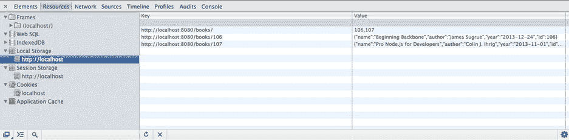
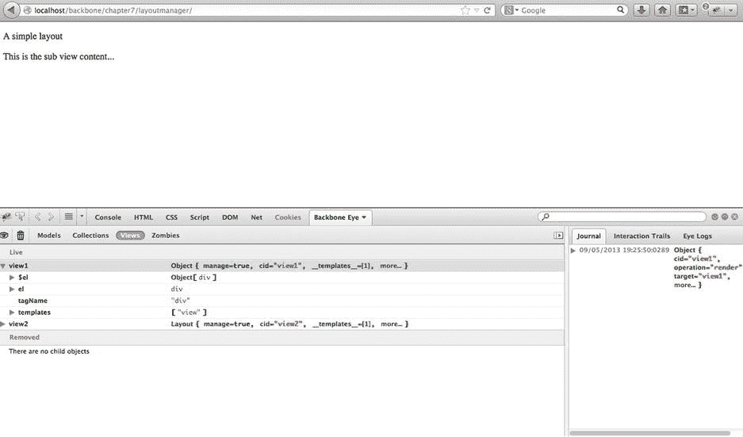

# 7. Backbone 生态系统

**摘要**

现在你已经看到使用 Backbone 开箱即用的功能可以构建什么，是时候深入探讨更高级的技术，这些技术可以使你的应用开发更容易，并保持代码更整洁。

仅仅几年时间，Backbone 已经拥有一个令人印象深刻的在线社区，以及许多开源项目，这些项目致力于解决一些人认为的该库的不足之处。

本章将介绍这些第三方组件，并探究它们如何在你的 Backbone 应用开发过程中提供帮助。这些组件按不同的用途进行分类，以便于在日益增多的选项中进行浏览。

在本章末尾，你将看到一个汇总了所有讨论过的第三方组件的表格。

## 代码示例

本章列出的每个项目都有一些代码示例。你可以从共享的 GitHub 仓库访问它们：[`https://github.com/jamessugrue/beginning-backbone`](https://github.com/jamessugrue/beginning-backbone)。

## 用户界面组件

以下插件将帮助你处理 Backbone 应用的用户界面。

### LayoutManager

托管在 [`http://layoutmanager.org/`](http://layoutmanager.org/) 上，Tim Branyen 的 `LayoutManager` 帮助你组装 Backbone 应用中的布局和子视图。除了帮助构建布局之外，该项目还帮助你管理嵌套视图，并确保为应用生命周期内创建的视图进行正确的内存管理。除此之外，`LayoutManager` 还提供了 `beforeRender()` 和 `afterRender()` 回调，以便你能够可靠地知道视图何时完成渲染。

让我们看看如何将这个项目集成到一个简单的应用中，并了解它如何影响你处理视图的工作。

#### 为什么使用 LayoutManager

如果你的应用有以下任何需求，那么 `LayoutManager` 可能会很有用：

- 应用中有多个子视图。

- 应用布局频繁变化，视图被添加和删除，你需要确保没有内存泄漏。

- 你想要知道每个视图何时即将渲染或已完成其渲染周期。

- 你想要在视图及其子视图之间共享事件。

- 在应用中管理嵌套视图变得难以处理。

#### 配置

你首先需要下载一个版本的库以供应用使用。可以在项目的 GitHub 列表中找到，文件名为 `backbone.layoutmanager.js`。与之前所有的外部库一样，这个文件应该放在 `js/external` 目录下，并且应该在 `index.html` 中位于 jQuery、Backbone 和 Underscore 之后引入，因为它依赖于这些库。

```html
<script src="js/external/jquery-1.10.2.js"></script>
<script src="js/external/underscore.js"></script>
<script src="js/external/backbone.js"></script>
<script src="js/external/handlebars.js"></script>
<script src="js/external/backbone.layoutmanager.js"></script>
```

#### 使用 `LayoutManager`

在第 7 章的示例中，我们在单个页面上展示了许多视图。当时我们并未探讨如何管理子视图，而是将每个视图视为独立个体。`LayoutManager` 将整体布局的概念引入应用程序，子视图便附着在此布局之上。

我们首先来看创建最简单布局的过程，这本质上与 Backbone 视图相同。为说明概念，本节将使用简单的 HTML，但请记住，你可以使用任意类型的模板和视图，甚至是上一章创建的。

HTML 页面需要添加两部分内容：一个作为布局主容器的 `div`，以及一个用于渲染布局内容的模板。

```html
<div class="container">

</div>

<script type="template" id="layout">
 <p>一个简单的布局</p>
</script>
```

与我们在大型应用示例中的做法相同，我们将主要的 JavaScript 源码放在独立的 `app.js` 文件中。

```html
<script src="js/app/app.js"></script>
```

创建布局需要设置两个属性：布局所在的主元素（具有 `container` 类的 `div`）以及用于渲染内容的模板（ID 为 `layout` 的脚本）。

```javascript
$(function() {
        var layout = new Backbone.Layout({
    el : '.container',
    template: '#layout'
});
layout.render();
});
```

最后调用布局的 `render` 函数即可完成 HTML 页面的构建并在浏览器中显示。

##### 添加子视图

`LayoutManager` 的真正强大之处在于可以在布局内添加子视图。首先，在布局模板的 HTML 中添加一个预期放置子视图的元素，如下所示：

```html
<script type="template" id="layout">
         <p>一个简单的布局</p>
         <div id="subview"></div>
</script>
```

同时还需要为子视图本身提供一个模板。

```html
<!-- 视图模板 -->
<script type="template" id="view">
  <i>这是子视图内容…</i>
</script>
```

回到 `app.js`，在使用布局之前需要先定义视图。

```javascript
var SimpleSubview = Backbone.Layout.extend({
     template: "#view"
});
```

为了将视图附加到布局，可以使用 `views` 哈希表，其用法与前面章节中的 `events` 和 `routes` 定义类似。该哈希表左侧标识应包含视图的元素，右侧引用 Backbone `View` 对象，从而将嵌套视图绑定到布局。

```javascript
var layout = new Backbone.Layout({
    el : '.container',
    template: '#layout',
    views: {
        '#subview' : new SimpleSubview()
    }
});
layout.render();
```

此代码的执行结果与之前一样，会渲染布局以及子视图的内容。

##### `LayoutManager` 的优势

这种构建视图的方式为你的应用程序带来了诸多优势。

事件监听器可以在布局层级声明，方式与普通视图相同。不过，由于你拥有对所有子视图的引用，这些事件可以被视为全局视图事件。

通过向 `Layout` 对象添加 `beforeRender` 和 `afterRender` 回调，可以正确跟踪布局的生命周期：

```javascript
var layout = new Backbone.Layout({
    //其他布局定义
    beforeRender: function(){
        console.log('即将渲染');
    },
    afterRender: function(){
        console.log('渲染完成');
    }
});
```

最后，通过在应用级别作用域（通常在 `app.js` 的开头）声明下面这行代码，你创建的所有视图都可以被增强为充当布局本身：

```javascript
Backbone.Layout.configure({ manage: true });
```

这是一种很好的方式，可以改造现有的 Backbone 应用，以使用由 `LayoutManager` 提供的改进视图机制。

### `Backgrid`

`Backgrid.js` ( [`backgridjs.com/`](http://backgridjs.com/) ) 提供了一套专门用于以表格形式展示数据集的用户界面元素。该项目还提供了对来自 Backbone 集合和模型的数据进行排序和编辑的功能。

#### 为何使用 `Backgrid`

如果你的应用程序数据量大，并且需要以表格形式显示、编辑和排序这些数据，`Backgrid` 是一个绝佳选择。它减少了在表格中提供编辑功能所需的自定义代码量，这无疑是件好事。

#### 配置

与大多数 Backbone 扩展一样，你需要在包含 `backgrid.js` 之前，确保页面上已加载 `Backbone`、`Underscore` 和 `jQuery` 这三件套。源码可以从 [`github.com/wyuenho/backgrid`](https://github.com/wyuenho/backgrid) 的 `lib` 目录下下载。

```html
<script src="js/external/backgrid.js"></script>
```

由于该库为表示层提供了许多功能，你还需要在页面中包含`backgrid.css`。

```
<link rel="stylesheet" href="css/backgrid.css">
```

## 使用 `Backgrid`

在你看到`Backgrid`的实际效果之前，需要先定义一个模型和集合，用于构建网格。这里我们将创建一个简单的集合，但在实际应用中，你可以使用任何已有的集合。

```
// 模型和集合定义
var Book = Backbone.Model.extend({});
var Library = Backbone.Collection.extend({});

// 定义内容
var backboneBook = new Book({name: 'Beginning Backbone', author: 'James Sugrue', year: '2013-12-24'});
var nodeBook = new Book({name: 'Pro Node.js for Developers', author: 'Colin J. Ihrig', year: '2013-11-01'});
var proJavascriptBook = new Book({name: 'Pro JavaScript Techniques', author: 'John Resig', year: '2006-02-01'});

// 创建集合
var myLibrary = new Library();
myLibrary.set([backboneBook, nodeBook, proJavascriptBook]);
```

集合准备就绪后，你就可以定义要显示的列了。每个列对象都有一个`name`属性，它将列映射到模型中的特定属性，此外还有显示标签和单元格类型。

```
var columns = [ {
 name: "name",
 label: "名称",
 cell: "string"
}, {
 name: "author",
 label: "作者",
 cell: "string"
}, {
 name: "year",
 label: "年份",
 editable: false,
 cell: "date",
}];
```

创建网格只需接受两个参数：集合和列。

```
// 初始化一个新的 Grid 实例
var grid = new Backgrid.Grid({
 columns: columns,
 collection: myLibrary
});
```

接下来，最后一步是将网格渲染到 HTML 页面上。以下示例假设你有一个带有`container`类的元素可用：

```
<div class="container"></div>
```

然后，只需将网格追加到这个元素上即可。

```
$(".container").append(grid.render().$el);
```

运行上述示例将提供一个所有数据的表格视图；也就是说，可以通过点击表头进行排序。每个标记为可编辑的元素都可以在表格内直接编辑。只需极少的编码，你的应用程序中就拥有了一个完整的数据网格。

通过使用其他第三方组件可以实现分页功能。除了十个内置的单元格类型外，对于更复杂的网格，还有许多额外的扩展可用。

### `Backbone UI`

`BackboneUI`，托管在[`perka.github.io/backbone-ui/`](http://perka.github.io/backbone-ui/)，它增加了其他 MV* 库提供的数据绑定功能。这意味着模型和集合可以表示为 UI 组件，并且这些数据会以不同的方式传递到 HTML 页面的各个部分。

#### 为何使用 Backbone UI

如果应用中使用的模型和集合对象可以紧密绑定到简单的 UI 元素（如菜单、按钮和表格），那么考虑使用`Backbone.UI`来减少所需的模板和自定义 HTML 数量是值得的。

### 配置

除了 Backbone 相关项目的常规依赖外，你还需要添加`Laconic`库，该库共享于[`https://github.com/joestelmach/laconic`](https://github.com/joestelmach/laconic)。

```
<script src="js/external/laconic.js"></script>
```

`Backbone.UI`的源码分发包含两个文件，你需要将它们包含到 HTML 页面中：`backbone-ui.js`和`backbone-ui.css`。

```
<link rel="stylesheet" href="css/backbone-ui.css">
```

`......`

```
<script src="js/external/backbone-ui.js"></script>
```

完成这个简单的配置后，你就可以在自己的应用中使用`Backbone.UI`了。

#### 使用 Backbone UI

一旦你准备好了模型和集合，使用`Backbone.UI`就再简单不过了。与`Backgrid`类似，UI 组件是用 JavaScript 构建的，并附加到 HTML 页面 DOM 的特定元素上。

例如，要创建一个显示书籍对象名称作为其文本的按钮，可以创建一个`Button`对象，该对象使用正在使用的模型实例，并通过`content`属性将模型属性映射到用户界面。

```
var button = new Backbone.UI.Button({
  model: backboneBook,
  content: 'name'
}).render();
```

一旦在 HTML 页面中找到具有`container`类的元素，以下代码将渲染一个显示文本“Beginning Backbone”的按钮：

```
$(".container").append(button.el);
```

前面的示例假设使用了与 Backgrid 代码示例中相同的模型和集合。

`Backbone.UI`包含许多其他可以绑定到模型的 UI 小部件，包括以下内容：

- Calendar（需要 Moment.js）

- Checkbox

- Date Picker（需要 Moment.js）

- Link

- Text Area

- Text Field

- Time Picker

还有一些可以绑定到模型并附带 alternatives（用于表示其他值的集合）的组件。这些小部件是多值小部件，例如菜单和下拉列表。

例如，你可能希望创建一个菜单小部件，以便从库中选择一本书。在这种情况下，`model`属性继续指向特定的书籍实例，而`alternatives`属性则映射到`myLibrary`集合。

```
var menu = new Backbone.UI.Menu({
  model: backboneBook,
  content: 'name',
  alternatives: myLibrary,
  altLabelContent: 'name'
}).render();

$(".container").append(menu.el);
```

`Backbone.UI`中提供的其他多选输入元素如下：

- `Menu`

- `Pulldown`

- `RadioGroup`

- `ListView`

- `TableView`

该库还提供了一些不绑定到模型的小部件：`Scroller`和`TabSet`。为了让你完全控制应用程序的外观，`Backbone.UI`提供了使用自定义皮肤（一组 CSS 和图像文件）的选项。

### Backbone.stickit

人们对 Backbone 的主要抱怨之一是需要处理模型和视图之间的大量样板代码，以便在模型更改时相应地更新视图。虽然我们在前几章中看到的事件处理系统很有用，但`Backbone.stickit`（[`http://nytimes.github.io/backbone.stickit/`](http://nytimes.github.io/backbone.stickit/)）提供了完整的绑定。

该库无需在 HTML 中添加任何额外标记即可工作，甚至承诺能让你的模板更简洁，因为在视图渲染时，对变量进行插值的需求更少。

#### 为何使用 Backbone.stickit

如果你觉得将模型属性更改与视图数据刷新关联起来过于繁琐，那么`Backbone.stickit`是最好的替代方案之一。它通过一些简单的代码，无缝地融入了 Backbone 视图的生命周期。使用过`Knockout`或`Ember`的 JavaScript 开发人员可能会对`Backbone.stickit`提供的绑定支持感到更舒适。

### 配置

将`Backbone.stickit`集成到你的应用中是一个轻松的过程。只需从[`http://nytimes.github.io/backbone.stickit/`](http://nytimes.github.io/backbone.stickit/)下载源码，并将其包含到HTML页面中即可。

```html
<script src="js/external/backbone.stickit.js"></script>
```

### 使用`Backbone.stickit`

首先，你需要准备一个模型，以便在Backbone视图中进行可视化。我们再次使用前几章中的简单`Book`模型。

```javascript
var Book = Backbone.Model.extend({});

//define contents
var backboneBook = new Book({name: 'Beginning Backbone', author: 'James Sugrue', year: '2013-12-24'});
```

在我们创建视图之前，这个示例中还需要在HTML页面上有一个带有特定类（此处为`container`）的`div`。

```html
<div class="container">
</div>
```

在创建使用`Backbone.stickit`绑定的视图时，你需要在模型中定义一个`bindings`哈希表。每个绑定都接受一对字符串：第一个是模板中将存储变量的部分的CSS选择器，第二个是被绑定的模型属性。在以下示例中，模型中的`name`属性绑定到视图HTML中ID为`title`的元素。

```javascript
//Define the Library View
MyView = Backbone.View.extend({
    el : '.container',
    bindings: {
        "#title" : 'name',
        '#author' : 'author'
    },
    model : null,
    content: null,
    initialize: function(options){
        this.model = options.model;
    },
    render: function(){
        var self = this;
        self.$el.html('<div id="title"/> <input id="author" type="text">');
        self.stickit();
        return self;
   },
});
```

第二个重要的部分是，`render()`调用了`self.stickit()`函数，该函数强制执行绑定。

当视图被创建，并传入模型作为参数时，它会按预期显示值。

```javascript
var view1 = new MyView({model: backboneBook});
view1.render();
backboneBook.set('name', 'Beginning Backbone.js');
```

然而，`Backbone.stickit()`的真正强大之处在于，只要绑定的模型属性有任何变化，视图就会自动更新。以下代码每六秒更新一次模型。插入此代码后，注意观察HTML如何自动更新。

```javascript
var count = 1;
setInterval(function(e){
        count++;
        backboneBook.set('name', 'New Name ' + count);
}, 6000);
```

当视图被销毁时，你可以通过调用`view.unstickit()`来移除所有绑定。在定义绑定时，还可以添加许多回调函数，这些函数允许更精细地控制视图是否更新，以及在视图更新完成时可以调用的函数。

## `Backbone.Notifications`

`Backbone.Notifications`（[`https://github.com/fatiherikli/backbone-notifications`](https://github.com/fatiherikli/backbone-notifications)）是一个针对Backbone应用的全局通知系统。该库提供了用于处理弹出通知（flash）、加载和进度条的CSS和JavaScript。

### 为什么使用`Backbone.Notifications`

当你从零开始构建一个应用时，为错误和成功状态添加通知可能会有些繁琐，并且经常被开发者忽略。然而，有了这样一个既能处理通知逻辑又能呈现通知给用户的简单库，就很难抗拒添加`Backbone.Notifications`的诱惑。

你可以在项目网站上看到完整的示例通知列表，网址是[`http://fatiherikli.github.io/backbone-notifications/`](http://fatiherikli.github.io/backbone-notifications/)。

### 配置

从[`https://github.com/fatiherikli/backbone-notifications`](https://github.com/fatiherikli/backbone-notifications)下载源码后，只需包含`src`目录中的CSS和JavaScript文件即可。

```html
<link rel="stylesheet" href="css/backbone-ui.css">
...
<script src="js/external/backbone-ui.js"></script>
```

这里包含CSS文件很重要，因为它负责通知在屏幕上的呈现样式。当然，你可以轻松更改这些样式以适配你的应用。

### 使用`Backbone.Notifications`

`Backbone.Notifications`可以与任何Backbone对象一起使用，因为它们已经包含了事件功能。但是，如果你想在非Backbone对象上使用这个库，你可以用`Backbone.Events`来扩展该对象，如下面的代码片段所示：

```javascript
var notifications = {};
_.extend(notifications, Backbone.Events);
```

为了清晰起见，我们这里实现的示例将使用我们已经创建的一个模型对象。

```javascript
var Book = Backbone.Model.extend({});
var backboneBook = new Book({name: 'Beginning Backbone', author: 'James Sugrue', year: '2013-12-24'});
```

在触发任何通知之前，你需要创建一个新的`Notifier`对象，并将其追加到HTML页面中的一个元素（通常是body）上。创建`Notifier`时，你需要指定哪个对象将触发通知，在本例中是`backboneBook`。

```javascript
new Notifier({
    model: backboneBook
}).render().$el.appendTo("body");
```

任何时候你想触发一个事件，比如保存完成或出错，你只需在该对象上调用`trigger`函数，即可显示通知。

```javascript
backboneBook.trigger("success", "Book saved");
```

该函数的第一个参数是要使用的通知类型，例如`start:loader`、`end:loader`、`start:progress`、`end:progress`、`update:progress`、`error`、`success`或`flash`。

至少，这个库为在Backbone应用中构建通知提供了一种一致且简单的方法。

## 模型与集合扩展

到目前为止，我们已经考虑了一些专门用于显示和输入的扩展，但同时也有许多选项可用于扩展模型和集合的功能。

### `Backbone.trackit`

`Backbone.trackit`（[`https://github.com/NYTimes/backbone.trackit`](https://github.com/NYTimes/backbone.trackit)）是纽约时报的另一个项目，用于管理Backbone模型中的变更，提供撤销先前更改以及在存在未保存更改时触发事件的能力。

### 为什么使用`Backbone.trackit`

正如你在第3章中看到的，Backbone只记录属性当前和上一组的值。虽然这很有用，但对于具有更复杂用户交互的应用来说，这种功能还不够，因为你可能希望记录多次更改。这就是`Backbone.trackit`的用武之地。

值得注意的是，这并没有提供一个完整的撤销/重做堆栈。如需此类扩展，可以查看 `Backbone.memento`。

## 配置

要将 `Backbone.trackit` 包含到你的应用中，只需从 [`https://github.com/NYTimes/backbone.trackit`](https://github.com/NYTimes/backbone.trackit) 的 `dist` 文件夹下载 `backbone.trackit.js`，并在你的 HTML 页面中包含该脚本即可。

```html
<script src="js/external/backbone.trackit.js"></script>
```

### 使用 `Backbone.trackit`

再次使用简单的 `Book` 模型来说明 `Backbone.trackit`。

```javascript
var Book = Backbone.Model.extend({
    urlRoot: 'http://localhost:8080/books/',
});

// 定义内容
var backboneBook = new Book({name: 'Beginning Backbone', author: 'James Sugrue', year: '2013-12-24'});
```

`Backbone.trackit` 并非跨应用配置，而是可以应用于单个模型对象，使用 `startTracking` 函数即可。

```javascript
backboneBook.startTracking();
```

一旦开始跟踪，`unsavedAttributes` 函数将返回模型中尚未保存的属性。以下代码中的日志语句将持续累积已更改的属性集合：

```javascript
backboneBook.set('name', 'Beginning Backbone.js');
console.log(backboneBook.unsavedAttributes());

backboneBook.set('author', 'J Sugrue');
console.log(backboneBook.unsavedAttributes());
```

但是，一旦成功保存，对 `unsavedAttributes()` 的调用将返回 `false`。如果你想重置属性以避免保存更改，可以调用 `resetAttributes()` 函数。

```javascript
console.log('Author is ' + backboneBook.get('author'));
backboneBook.resetAttributes();
console.log('Author is ' + backboneBook.get('author'));
```

上述代码会完全重置自开始跟踪或上次成功保存以来所做的属性更改。

## Backbone.memento

Derick Bailey 的 `Backbone.memento` 扩展 ([`https://github.com/derickbailey/backbone.memento`](https://github.com/derickbailey/backbone.memento)) 提供了一个堆栈，用于对 Backbone 模型和集合进行 push 和 pop 操作以管理更改。这为你的 Backbone 应用提供了一个更完整的撤销/重做堆栈。

### 为什么使用 `Backbone.memento`

虽然 `Backbone.trackit` 对跟踪模型更改很有用，但更复杂的 Web 应用（如文档编辑系统）可能需要执行多次撤销或重做操作。这正是 `Backbone.memento` 所能提供的功能。

## 配置

只需从 GitHub 项目页面 [`https://github.com/derickbailey/backbone.memento`](https://github.com/derickbailey/backbone.memento) 下载 `backbone.memento.js`，并在你自己的 HTML 页面中包含该脚本即可。

```html
<script src="js/external/backbone.memento.js"></script>
```

### 使用 `Backbone.memento`

对于每个你想要添加撤销/重做支持的模型或集合，你需要在 `initialize` 方法中添加两行额外的代码，将 `Backbone.memento` 添加到该对象中。

```javascript
var Book = Backbone.Model.extend({

    urlRoot: 'http://localhost:8080/books/',

    initialize: function(){
        var memento = new Backbone.memento(this);
        _.extend(this, memento);
    }

});
```

虽然上述代码处理的是模型，但同样的语法也可以应用于集合。你还可以让 `Backbone.memento` 插件忽略对特定属性所做的更改，并使用 `ignore` 数组将它们排除在堆栈之外。

每当你想将模型的状态保存到堆栈时，可以对模型调用 `store` 函数；而要重置到之前的状态，则可以使用 `restore` 函数。以下代码示例演示了这一流程：

```javascript
//define contents
var backboneBook = new Book({name: 'Beginning Backbone', author: 'James Sugrue', year: '2013-12-24'});
console.log('Before set: ' + backboneBook.get('name'));
backboneBook.set('name', 'Beginning Backbone.js');
backboneBook.store();
console.log('After store: ' + backboneBook.get('name'));
backboneBook.set('name', 'Beginning Backbone')
console.log('After set: ' + backboneBook.get('name'));
backboneBook.restore();
console.log('After restore: ' + backboneBook.get('name'));
```

执行结果如下：

```
Before set: Beginning Backbone
After store: Beginning Backbone.js
After set: Beginning Backbone
After restore: Beginning Backbone.js
```

如你所见，即使在第一次调用 `store` 后更改了书名，`restore` 调用也会将更改还原。

## Backbone.localStorage

到目前为止我们讨论的所有内容都假设模型/集合的数据通过 REST 接口存储在服务器上。`Backbone.localStorage` (https://github.com/jeromegn/Backbone.localStorage) 重写了 `Backbone.Sync`，允许你将 HTML5 本地存储作为数据存储。

### 为什么要使用 `Backbone.localStorage`

并非每个应用程序都需要将所有数据保存到服务器。你可能希望某些集合保存到客户端机器的本地数据库中，以存储偏好设置等项目。使用 `Backbone.localStorage`，你可以指定特定的集合使用这种本地存储，同时允许其他集合使用标准的 HTTP 同步方法。

## 配置

将 `Backbone.localStorage` 包含到你的应用程序中，只需从 GitHub 仓库 https://github.com/jeromegn/Backbone.localStorage 下载最新版本的 `backbone.localStorage.js`，然后将该 JavaScript 文件包含到你的 HTML 页面中即可。

```html
<script src="js/external/backbone.localStoage.js"></script>
```

### 使用 `Backbone.localStorage`

`Backbone.localStorage` 是一个非侵入式插件，它只需要你创建针对 HTML5 本地存储（而非远程服务器存储）的集合。为此，你的集合定义需要一个新的 `localStorage` 参数。

```javascript
localStorage : new Backbone.LocalStorage("libraryapp:MyLibrary"),
```

创建新的 `LocalStorage` 实例时使用的字符串参数是你应用程序内容的唯一标识符。

## Backbone.dualStorage

`Backbone.dualStorage` (https://github.com/nilbus/Backbone.dualStorage) 比 `Backbone.localStorage` 更进一步，它为你的数据提供了一种本地缓存机制，这样如果你的应用程序离线，数据仍能继续存储，并在连接恢复时与服务器同步。

### 为什么要使用 Backbone.dualStorage

这个插件对于基于 Backbone 构建的移动应用特别有用，因为连接可能是一个问题。如果你发现由于连接中断或服务器停机而导致数据丢失，这可能是处理该问题的一种相对简单的方法。此外，这允许用户始终拥有完整的应用程序体验。对于在各国之间漫游的用户来说，这可能是一个必不可少的移动功能。

### 配置

要将 `Backbone.dualStorage` 包含到你的应用程序中，只需从 https://github.com/nilbus/Backbone.dualStorage 下载该库，并将其包含到你的 HTML 页面中。

```
<script src="js/external/backbone.dualstorage.js"></script>
```

### 使用 Backbone.dualStorage

`Backbone.dualStorage` 是所有 Backbone 插件中最容易在你的项目中使用的插件之一，因为其默认行为无需更改代码。

```
//Model and Collection definitions
var Book = Backbone.Model.extend({});

var Library = Backbone.Collection.extend({
    model: Book,
    url: 'http://localhost:8080/books/',
});

//define contents
var backboneBook = new Book({name: 'Beginning Backbone', author: 'James Sugrue', year: '2013-12-24'});
var nodeBook = new Book({name: 'Pro Node.js for Developers', author: 'Colin J. Ihrig', year: '2013-11-01'});
var proJavascriptBook = new Book({name: 'Pro JavaScript Techniques', author: 'John Resig', year: '2006-02-01'});

//create collection
var myLibrary = new Library();

myLibrary.create(backboneBook);
myLibrary.create(nodeBook);
```

运行上述代码后，你的应用程序的本地存储中会出现一个缓存副本。再次检查 Chrome 开发者工具以确认这一点，如图 7-2 所示。



图 7-2. Chrome 开发者工具显示本地缓存的项目

如果你检测到客户端和服务器不同步，你可以对集合调用一个特殊的同步函数，将所有本地更改发送到服务器。

```
myLibrary.syncDirtyAndDestroyed();
```

请注意，你需要编写自己的代码来检测连接的丢失和重新建立。

如果你希望某些集合有不同的行为，你可以在创建时使用 `remote: true` 参数将它们设置为从不缓存。你还可以使用 `local: true` 参数将集合设置为仅本地保存更改。

## Backbone.ViewModel

`Backbone.ViewModel` 可从 http://github.com/tommyh/backbone-view-model 获取，它允许你创建一个能够处理更复杂视图的模型。如果你为了视图而更改了模型的属性，这些属性可能会同步到服务器。因此，将你的视图模型与持久化模型分离是合理的。

### 为什么要使用 Backbone.ViewModel

当应用中的视图在显示前需要对持久化模型中存储的数据进行大量转换时，就需要进行适当的关注点分离。

### 配置

`Backbone.ViewModel` 只是一个单独的 JavaScript 文件，其中包含一种不同类型的模型定义。你可以从 [https://github.com/tommyh/backbone-view-model](https://github.com/tommyh/backbone-view-model) 下载它，并将其包含在你的 HTML 页面中。

```
<script src="js/external/view-model.js"></script>
```

### 使用 Backbone.ViewModel

`Backbone.ViewModel` 会扩展你已创建的普通模型，允许你指定一组用于视图的计算属性。首先，让我们创建一个作为视图基础的简单模型。

```
var Book = Backbone.Model.extend({});
```

```
var backboneBook = new Book({name: 'Beginning Backbone', author: 'James Sugrue', year: '2013-12-24'});
```

`ViewModel` 将基于此模型，该模型会作为 `source_model` 属性存储在 `ViewModel` 对象中。创建 `ViewModel` 对象时，`computed_attributes` 哈希表允许你创建函数，用于转换 `source_model` 属性中属性的表示形式。

```
var BookViewModel = Backbone.ViewModel.extend({

     'truncated_book_title' : function(){

       return this.get('source_model').get('name').substring(0, 10) + '...';

     },

     'author' : function(){

           return this.get('source_model').get('author');}

     }

});
```

虽然这对于截断书名很有用，但您还需要暴露原始模型中需要在视图中显示的变量。

请注意，在视图的 `render` 函数中，你现在处理的是 `ViewModel` 中出现的属性。

# 定义图书馆视图

```javascript
//定义图书馆视图

MyView = Backbone.View.extend({

 el : '.container',

 model : null,

 content: null,

 initialize: function(options){

   this.model = options.model;

 },

 render: function(){

   var self = this;

   self.$el.html('作者是 ' + this.model.get('author') + ' 标题是 ' + this.model.get('truncated_book_title'));

   return self;

   },

});
```

创建视图实例时，`ViewModel` 作为 `model` 传入，而不是 `backboneBook`，而 `backboneBook` 本身是 `ViewModel` 的一个参数。

```javascript
var backboneBookViewModel = new BookViewModel({source_model: backboneBook});

var view1 = new MyView({model: backboneBookViewModel});

view1.render();
```

虽然这会使你的代码稍微复杂一些，但某些应用可能希望以这种方式强制分离持久化模型和视图模型。我更喜欢使用 Handlebars 辅助函数在渲染时修改属性。

## `Backbone-Validator`

有许多扩展可以帮助你在内置的 Backbone `validate()` 函数之外对模型进行验证。其中之一是 `Backbone-Validator`（[`https://github.com/fantactuka/backbone-validator`](https://github.com/fantactuka/backbone-validator)），它提供模型验证功能，并允许将事件绑定到视图，以便在需要时显示验证错误。

### 为什么要使用 `Backbone-Validator`

当应用需要大量验证，并且视图需要显示任何验证错误时，此插件消除了使用标准 Backbone JavaScript 代码时需要编写的大量自定义代码。基于表单的应用是该插件最明显的受益者。

### 配置

`Backbone-Validator` 只需从 [`https://github.com/fantactuka/backbone-validator`](https://github.com/fantactuka/backbone-validator) 下载并包含在你的 HTML 页面中。

```html
<script src="js/external/backbon-validator.js"></script>
```

### 使用 `Backbone-Validator`

任何模型都可以通过传递一个 `validation` 哈希表来扩展以使用 `Backbone-Validator`，该哈希表包含要验证的属性名称以及许多验证设置，例如是否可以为空、应使用何种格式以及验证失败时要显示的消息。

以下示例将此验证添加到 `Book` 模型中：

```javascript
//模型和集合定义

var Book = Backbone.Model.extend({

 validation:

 {

   name: {

     blank: false,

     message: '每本书都需要一个名字'

   },

 }

});
```

可以通过创建一个未设置 `name` 属性的 `Book` 对象来轻松测试这一点。

```javascript
var backboneBook = new Book();

console.log('这是有效的吗？ ' + backboneBook.isValid());
```

上一个日志语句的结果将返回 `false`。此外，如果你强制 `set` 函数使用验证，你将强制填充对象的 `validationError` 数组。

```javascript
backboneBook.set({name: ''}, {validate: true});

console.log(backboneBook.validationError);
```

最重要的是，你可以通过在视图的 `initialize` 函数中添加对 `bindValidation` 的调用，轻松地让视图绑定处理无效字段的 `callbacks`。

```javascript
//定义图书馆视图

MyView = Backbone.View.extend({

 el : '.container',

 model : null,

 content: null,

 initialize: function(options){

   this.model = options.model;

   this.bindValidation();

 },

 onInvalidField: function(attrName, attrValue, errors, model){

   alert(attrName + ' 有一个无效的值');

 },

 render: function(){

   var self = this;

   self.$el.html('作者是 ' + this.model.get('author') + ' 书名是 ' + this.model.get('name'));

   return self;

   },

});

var view1 = new MyView({model: backboneBook});

view1.render();
```

当传递给视图的模型中使用了无效字段时，前面的代码将显示一个警告对话框。该扩展包含了许多验证器，涵盖格式、长度以及是否需要值。

## Query Engine

虽然在小集合中查找变量很容易，但对于更复杂的实际应用，你可能需要更强大的搜索和过滤功能来处理更大的集合。Query Engine（[`https://github.com/bevry/query-engine`](https://github.com/bevry/query-engine)）开箱即用地提供了这些功能，甚至支持 NoSQL 查询，并且可以在 node.js 服务器以及你的浏览器上运行。

### 为什么要使用 Query Engine

如果你正在处理大型集合，并且需要为应用提供大量搜索、过滤和查询功能，Query Engine 将使你的代码更易于理解，并且可能比自定义解决方案性能更好。如果你正在构建一个提供数据库搜索功能且不想将所有过滤都推迟到服务器端的应用，那么使用这个库是合理的。

### 配置

要将 `QueryEngine` 包含到你的项目中，你只需从 [`https://github.com/bevry/query-engine/blob/master/out/lib/query-engine.js`](https://github.com/bevry/query-engine/blob/master/out/lib/query-engine.js) 下载 `query-engine.js` 文件，并将其包含在你的 HTML 页面中。

```html
<script src="js/external/query-engine.js"></script>
```

### 使用 QueryEngine

`QueryEngine` 为自定义的 `QueryCollection` 类提供两种状态：标准状态（standard）和实时状态（live）。实时集合会监听集合事件，以便集合中的任何更改都会导致相关查询被重新执行。

您无需创建标准的 `Backbone.Collection`，而是需要使用 `queryEngine.QueryCollection.extend` 来创建一个 `QueryCollection`，如下代码所示：

```javascript
// 模型和集合定义
var Book = Backbone.Model.extend({

});

var Library = queryEngine.QueryCollection.extend({
    model: Book,
});
```

通过这样的设置，现在可以使用 `QueryCollection` 的任何函数。例如，以下代码将一个包含四本书的集合初始化：

```
// 定义内容
var backboneBook = new Book({name: 'Beginning Backbone', author: 'James Sugrue', year: '2013-12-24'});
var nodeBook = new Book({name: 'Pro Node.js for Developers', author: 'Colin J. Ihrig', year: '2013-11-01'});
var proJavascriptBook = new Book({name: 'Pro JavaScript Techniques', author: 'John Resig', year: '2006-02-01'});
var backboneBook2 = new Book({name: 'Backbone: The Sequel', author: 'James Sugrue', year: '2014-12-01'});

// 创建集合
var myLibrary = new Library();
myLibrary.set([backboneBook, nodeBook, proJavascriptBook, backboneBook2]);
```

现在，要查找特定作者的所有书籍，可以使用 `findAll` 函数，并传入相应的过滤属性：

```
var results =  myLibrary.findAll({author: 'James Sugrue'});
console.log('Returned ' + results.length + ' results');
```

在 `results` 变量中，将包含两个模型，它们对应作者为 `James Sugrue` 的书籍。

## ModelAttrs

`ModelAttrs` ([`github.com/rhysbrettbowen/Backbone.ModelAttrs`](https://github.com/rhysbrettbowen/Backbone.ModelAttrs)) 是一个简单的 Backbone 插件，它允许您使用更简洁、类似于 jQuery 的格式来检索和设置属性。

### 为什么要使用 ModelAttrs

如果您觉得 `model.set('attribute name', 'attribute value')` 这种语法过于冗长，而更倾向于使用更简洁的格式，那么 `ModelAttrs` 可以成为您项目代码中的一个简单改动。

### 配置

`ModelAttrs` 是一个非常小的 JavaScript 文件，可以从 [`github.com/rhysbrettbowen/Backbone.ModelAttrs`](https://github.com/rhysbrettbowen/Backbone.ModelAttrs) 下载并包含在您的 HTML 页面中。

```
<script src="js/external/attrs.js"></script>
```

### 使用 ModelAttrs

要使用 `ModelAttrs`，您需要使用该库提供的 `toAttrs` 函数将您的 `model` 对象转换为 `ModelAttrs` 对象。

```
toAttrs(<model>)
```

以下代码展示了如何使用该库从现有的 Backbone 模型中获取变量：

```
// 模型定义
var Book = Backbone.Model.extend({

});

// 定义内容
var backboneBook = new Book({name: 'Beginning Backbone', author: 'James Sugrue', year: '2013-12-24'});
var backboneAttrs = toAttrs(backboneBook);
console.log(backboneAttrs.name());
```

现在，您可以通过调用 `.name()` 函数来获取书名，而无需使用 `backboneBook.get('name')`。

设置变量也同样简单，最重要的是，对变量的设置会反映到原始的模型对象中，如下代码所示：

```
backboneAttrs.name('Beginning Backbone.js');
console.log(backboneAttrs.name());
console.log(backboneBook.get('name'));
```

## 开发者工具和实用工具

Backbone 生态系统并不仅限于库的扩展。借助 Chrome 和 Firefox 中强大的开发者工具，您可能会认为不需要其他任何东西了。然而，Firefox 有一个名为 Backbone Eye ([`dhruvaray.github.io/spa-eye/`](http://dhruvaray.github.io/spa-eye/)) 的附加组件，它可以帮助开发者理解 Backbone 应用程序的行为，而无需调试 JavaScript。

该附加组件扩展了 `Firebug`，因此，一旦您安装了 `Firebug` 和 Backbone Eye 附加组件，您就会在 `Firebug` 浏览器中看到一个新选项卡，如图 7-3 所示。



图 7-3.

Backbone Eye 附加组件在运行中

图 7-3 是使用 Backbone Eye 检查 LayoutManager 插件示例的结果。模型、集合和视图都在该工具中列出。然而，最重要的视图是 `僵尸（Zombies）` 方面，它列出了即使通过 Backbone 的 `remove` 或 `destroy` 调用从应用程序中移除后仍在使用中的对象。

`交互工具（Interaction Tools）` 视图绘制序列图，说明项目中的视图、模型和应用程序之间的交互流程。

当新开发者加入项目并需要了解代码基础时，`Backbone Eye` 可以成为一个非常有用的工具。它也是定位内存泄漏的好方法。

## 快速参考

表 7-1 描述了本章中列出的所有项目。所有项目均采用 MIT 许可。

表 7-1.

本章提及项目的快速参考

| 项目 | 描述 |
| --- | --- |
| LayoutManager | 提供 Backbone 应用中视图和子视图的管理。 |
| Backgrid | 提供数据网格用户界面元素，例如表格。 |
| BackboneUI | 提供许多小部件，这些小部件在小部件和模型之间提供完整的数据绑定。 |
| Backbone.stickit | 当模型发生变化时，无需任何额外代码即可动态更新 Backbone 视图。 |
| Backbone.Notifications | 用最少的代码在用户界面上提供全局通知。 |
| Backbone.trackit | 允许跟踪模型属性中的多个更改。 |
| Backbone.memento | 提供完整的撤销/重做栈，用于在应用程序生命周期内跟踪模型的变化。 |
| Backbone.localStorage | 提供将集合数据存储在本地 HTML5 存储中而非服务器上的选项。 |
| Backbone.dualStorage | 提供一个适配器，将更改缓存在本地存储中，允许 Backbone 应用离线使用。 |
| Backbone.ViewModel | 在持久化模型和用于视图的模型之间创建分离。 |
| Backbone.Validator | 增强了模型的验证功能，包括对任何验证错误的视图绑定。 |
| QueryEngine | 为 Backbone 集合提供强大的搜索和过滤功能。 |
| ModelAttrs | 更简洁地设置和获取 Backbone 模型的属性值。 |

# 总结

在本章中，我们介绍了一些有助于增强 Backbone 应用程序的项目。视图层和模型层都存在一些优秀的扩展，使 Backbone 能够获得一些人在基础 Backbone 产品中认为缺失的额外功能。

本章只是触及了 Backbone 社区中所提供内容的皮毛。通常会有多个项目可以帮助解决类似的问题，因此，如果这里描述的库不完全符合您的要求，您应该看看一些替代方案。有关社区项目的全面列表，请查看 Jeremy Ashkenas 在 [`github.com/jashkenas/backbone/wiki/Extensions,-Plugins,-Resources`](https://github.com/jashkenas/backbone/wiki/Extensions,-Plugins,-Resources) 上的列表。
