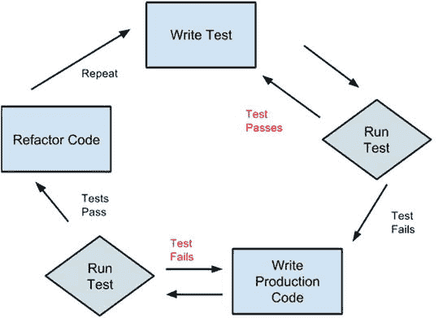
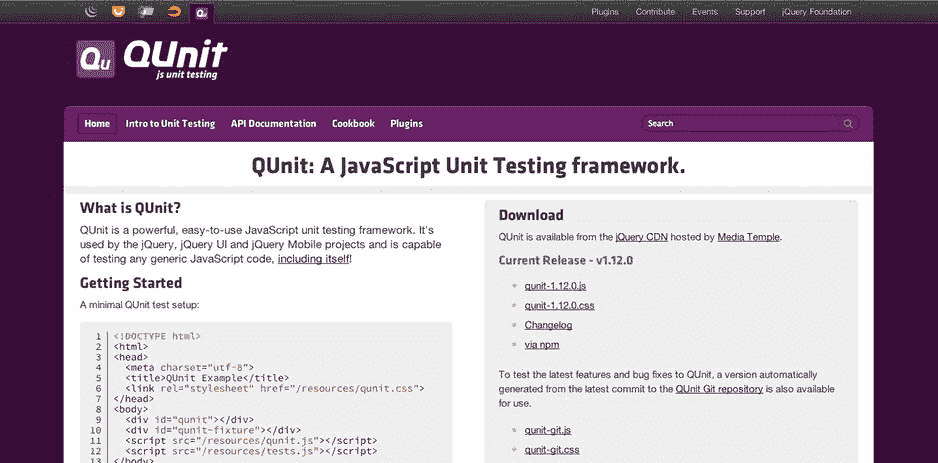
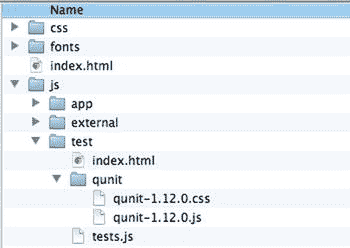
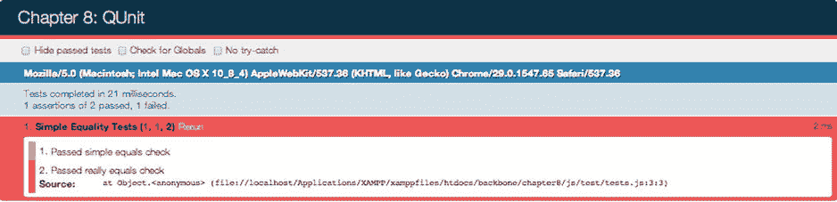
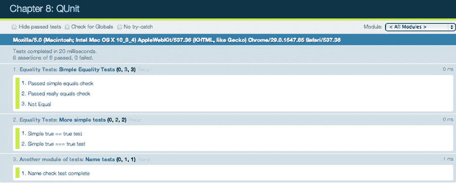
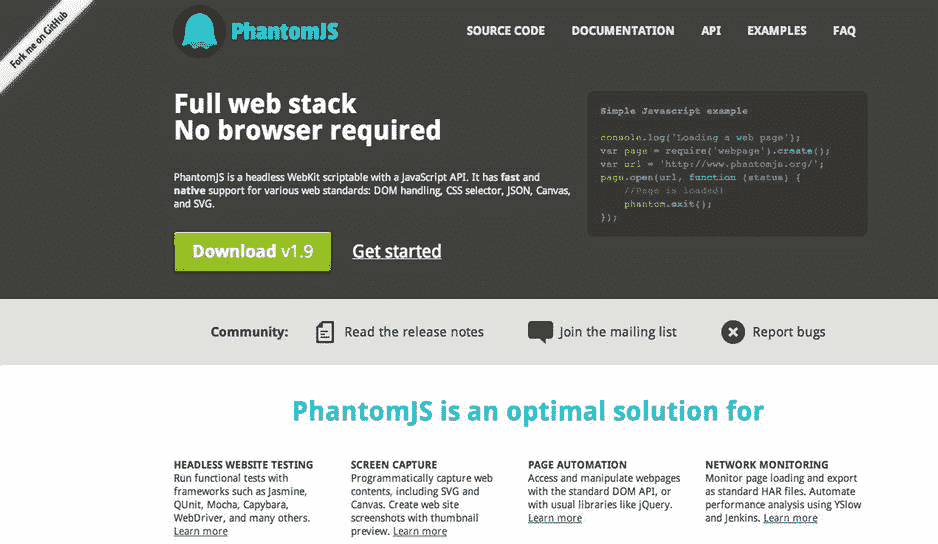
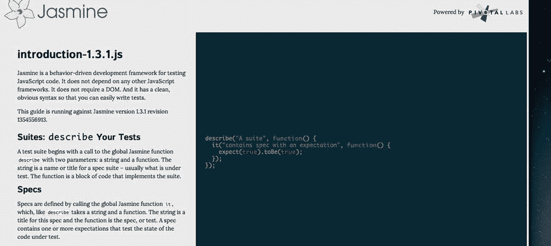
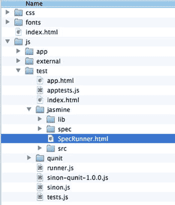
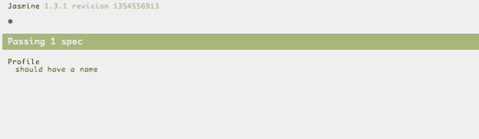

# 8. 测试你的 Backbone.js 应用

## 摘要

测试是大型 JavaScript 应用开发中最重要的活动之一。在庞大的 JavaScript 生态系统中，有众多测试应用的工具可选，这意味着我们再没有理由不去测试 JavaScript 代码。本章将介绍一些主流的测试框架，并探讨如何编写可测试代码，这不仅会提升应用的稳定性，还能带来更清晰的架构。此外，本章还将分析将测试驱动开发应用于 JavaScript 代码的几个关键原因。

## 测试驱动开发的优势

测试驱动开发（TDD）源自极限编程的若干理念，它描述了一个要求开发者在编写应用代码的同时编写测试的过程。理想情况下，测试应首先编写，并预期其会失败。随后再编写代码，使下一次运行测试时能够通过。之后，如果有更多测试失败，则对代码进行重构。整个过程是迭代式的，如图 8-1 所示。


**图 8-1.** 测试驱动开发的迭代本质

当以最严格的方式遵循测试驱动开发时，你需要按以下顺序执行步骤：

- **编写测试：** 在编写任何新代码之前，你需要先编写一个会失败的测试。当然，测试不可能通过，因为待实现的功能尚不存在。这样做的好处是，它能迫使你在开始编码之前，仔细思考新代码在特定条件下应有的行为。在开始这一过程之前，你需要对需求有良好的理解。
- **运行测试并预期失败：** 下一步是执行你刚刚编写的测试用例，预期结果将是失败。这是一个关键步骤，因为它能验证测试确实被纳入了你的测试套件（即应用中所有测试用例的集合）。同时，它也确保在功能代码未就绪时，测试不会通过。有了会失败的测试，你就可以相当确信自己在测试正确的行为。
- **编写生产代码：** 在有了会失败的测试用例后，你就可以开始开发工作了。此时编码的重点从“为完成功能而编码”转变为“专门让失败的测试用例通过”。这使得编码过程更加审慎和科学。你可能会忍不住添加一些覆盖需求但与当前测试用例无关的代码。这应当避免，而应利用这个机会再次迭代此过程，从针对该功能编写一个会失败的测试开始。
- **运行测试套件：** 现在你可以重新运行测试套件，预期此时它应该全部通过。如果测试失败，你可能需要调整部分生产代码。一旦测试通过，就可以进入重构步骤。
- **重构代码：** 重构是指优化代码，使其更整洁、质量更高的过程。你刚刚为了使测试通过而编写的代码很可能并不理想。重构的一个常见主题是将重复代码提取到共享函数或工具类中。
- **重复：** 当你进入下一个需求时，你会不断重复这个过程。如果你是测试驱动开发的新手，可能会觉得有些别扭和缓慢。但如果你能投入时间遵循这一过程，回报将是巨大的，而且这个过程会逐渐变得自然。

### 为测试驱动开发提供论据

可以想象，推行如此严格的开发流程可能会引发争议，尤其是在那些测试很少或根本没有的团队中。显而易见，拥有一套随时间增长的测试套件会提升项目质量，但对开发者而言，这似乎是一条漫长的道路，因为他们往往只想尽快实现功能。项目经理可能会发现，采用这种流程后，初始交付速度会变慢。考虑到这一点，以下要点列出了采用这一流程的主要理由：

## 测试驱动开发的优势

从长远来看，你将节省时间：回想一下你参与过的任何没有单元测试的项目。你是否需要修复大量缺陷？你是否花了很多时间调试？你是否在将代码交付给 QA 团队后，却因为代码被记录了一个又一个缺陷而感到沮丧？你是否希望在交付前编写更多测试，并更好地理解开发目标？如果这些问题中的部分或全部都适用于你，别担心——你并不孤单。事实上，现有的大量测试框架就证明了这一点。如果不是每个开发者都经历过这些问题，那么构建这些库的工作就没必要了。提前编写测试是有成本。你需要先搭建基础设施，比如选择一个测试框架。你还需要设置某种持续集成系统，我们将在后续章节中讨论。但相比于未测试代码所需付出的代价，这个成本只是很小的一部分。将单元测试与生产代码一起编写，可以降低从 QA 返回的缺陷数量。即使你的构建中确实存在缺陷，你也会开始遵循一个流程：首先编写一个测试来复现该缺陷，然后按照 TDD 流程清除它。这将减少功能回归的可能性，因为你的自动化测试套件会持续检查相关问题的存在。采用测试驱动开发方法，会在项目交付给客户时带来更平稳的收尾阶段。它能避免软件开发项目中常见的那些深夜修复缺陷的马拉松，从长远来看让你感觉更好。与其浪费时间处理本不该出现的缺陷，不如腾出时间持续开发新功能。哪个开发者不想这样呢？

执行测试用例将会很快：可能存在一种误解，认为如果代码库庞大，单元测试数量众多，那么测试套件的执行就会花费很长时间。也许过去确实如此，但在当今时代，有许多测试框架可以实现闪电般的测试执行速度，即使是测试浏览器中的 UI 也是如此。本章后面你会看到 PhantomJS 如何彻底改变了 Web 应用 UI 测试的速度。一些遗留系统可能在后端数据的规模和容量方面存在问题。与这些数据的交互可能需要时间，特别是当 REST 调用返回大量数据时。不过，你可以为单元测试创建一个“模拟服务器”，它能以可预测且可重复的方式更快地返回数据。通过用这些模拟版本替换执行缓慢的真实系统，你可以几乎毫不费力地加快单元测试的速度。

代码将更容易理解：在加入一个新项目时，理解代码可能需要一段时间，尤其是在文档很少或根本没有的情况下。测试用例可以作为现有代码的宝贵文档。测试展示了如何调用对象、代码预期做什么，以及它如何与服务器和其他类交互。编写测试实际上可以减少新开发者熟悉你的项目所需的时间。此外，遵循 TDD 方法可以确保在将构建交给 QA 团队之前，需求已被充分理解并经过测试。虽然你在测试驱动开发的最初几次迭代中可能并不完全理解需求，但你无疑会越来越擅长它。当你交付质量更高、缺陷更少的代码时，你作为成熟开发者的声誉会在 QA 部门和管理团队中得到提升。

最终的代码结构将更加良好：无需在测试工具中隔离运行代码，你可以自由地决定如何组织代码结构。代码可以紧密耦合到你想要的程度，比如将模型代码放在视图类中，以及其他反模式。你会发现，你必须遵循 MV*范式，将模型、视图和逻辑清晰地分离，以便于更容易地进行测试。

框架已经存在，你应该使用它们：一个反对测试 JavaScript 代码的常见理由是它太难了。诚然，JavaScript 仍然感觉像是一门“新”语言，并且没有 Java 和 C#等语言中存在的类型安全，这可能会显得有些混乱。在本书中，我们看到了 Backbone 如何在你代码结构中强制推行一种新的纪律：有控制的、面向对象的 JavaScript 是可行的。随着为构建繁荣的 JavaScript 生态系统所付出的所有努力，许多测试框架已经涌现出来，以确保质量达到你的预期。作为 Backbone 用户，如果某些功能不能按预期工作，你会感到非常失望。正如 Backbone 开发团队包含了大量测试（如果不信，可以查看`https://github.com/jashkenas/backbone/tree/master/test`！），你在自己的代码交付中也应抱有同样的自豪感。在本章中，你将看到将这些测试框架集成到你的项目中是多么容易。当如此简单的事情能为你赢得如此多的尊重时，你就很难抗拒了。

### 处理遗留代码库

在还没有生产代码的全新项目中，测试驱动开发总是一个好主意。然而，在现实中，你将处理现有的、可能根本没有测试的代码。在项目生命周期的这个阶段引入 JavaScript 代码的单元测试纪律可能会充满挑战。

处理这种情况的广泛接受的经验法则是增量地添加测试，而不是一头扎进数月艰苦的单元测试中，却几乎看不到投资回报。相反，值得确定一些关键领域，在这些领域添加测试可以带来益处。

- 任何正在添加到项目中的新功能都可以受益。
- 如果代码的某些部分正在进行重构，值得先编写测试，以确保重构前后的代码行为一致。
- 每个应用程序都有一些容易产生大多数缺陷的问题区域。值得以可管理的数量（例如三个）为一组来确定这些区域，并为每个区域添加全面的测试。
- 应用童子军规则，正如 Robert C. Martin 的《代码整洁之道》中所列，即代码应“比你发现它时更整洁”。如果你要向一个 JavaScript 文件添加一些代码，请花时间添加一个额外的测试以增加测试覆盖率。

## 测试自动化

在介绍 JavaScript 世界中可用的各种测试框架之前，值得指出的是，在理想情况下，每当代码库发生变更时，你的所有测试用例都应该以自动化方式运行。这确保了测试失败能被尽早发现，并免除了开发者必须始终运行测试的责任。下一章将介绍这种形式的持续集成，以及使用 Grunt 任务运行器的其他 JavaScript 构建流程。虽然本章的主要焦点是使用`QUnit`编写测试，但我们也会看看`Jasmine`和`Selenium`。

### 使用 QUnit 进行测试

QUnit（[`www.qunitjs.com`](http://www.qunitjs.com/)）可以被视为 JavaScript 开发者的默认测试框架。它最初由 Jörn Zaefferer 作为 `jQuery` 的一部分开发，用于测试该框架本身，并于 2009 年成为一个独立项目，现在被广泛用于最流行的 JavaScript 库中，其中就包括 `Backbone`。本节将介绍如何开始使用 QUnit，重点关注对第 6 章中所编写代码的测试。

## QUnit 入门

将 QUnit 集成到你的项目中异常简单。首先，从 [`http://qunitjs.com`](http://qunitjs.com/) 引入 JS 和 CSS 文件，如图 8-2 所示。



图 8-2. [`QUnitjs.com`](http://qunitjs.com/)

代码库的结构至关重要：你不会希望生产代码和测试代码混杂在一起，因此明智的做法是创建一个单独的测试文件夹。由于本章的目标是测试第 6 章中编写的代码，我们可以简单地复制该文件夹，并在 `app` 目录旁边创建一个名为 `test` 的文件夹。由于我们还将使用其他测试库，QUnit 的 JavaScript 和 CSS 文件应放置在 `qunit` 目录中。最后，我们将包含一个充当测试驱动器的 `index.html` 文件和一个包含测试套件的 `tests.js` 文件。目录结构现在应如图 8-3 所示。



图 8-3. QUnit 测试的目录结构

注意：你也可以从 jQuery 内容分发网络（CDN）[`http://code.jquery.com/`](http://code.jquery.com/) 引入这些文件。

有了这个结构，我们现在就可以编写一个简单的测试用例了。首先，你需要在 `index.html` 中添加一些代码，以链接 QUnit 的 CSS 和 JavaScript 文件，以及你自己的测试套件 `tests.js`。由于此文件还将展示测试执行的结果，你应包含一个 ID 为 `qunit` 的 `div`，结果将被追加到该元素中。

```html
<html>
<head>
<title>第 8 章：QUnit</title>
<link rel="stylesheet" href="qunit/qunit-1.12.0.css">
</head>
<body>
<div id="qunit"></div>
<div id="qunit-fixture"></div>
<script src="qunit/qunit-1.12.0.js"></script>
<script src="tests.js"></script>
</body>
</html>
```

请注意第二个与 QUnit 相关的 `div`，名为 `qunit-fixture`。此元素将包含来自每个测试的 DOM 元素。随着每个测试的执行，该部分的内容会被重置，因此你无需担心一个测试的执行会影响另一个测试。

现在我们可以继续定义简单的 QUnit 测试用例了。任何测试的结构都遵循以下格式：

```javascript
test( "测试名称", function() {
//断言
});
```

传入的第一个参数是测试的名称，应尽可能描述清晰。第二个参数是执行测试实际代码的函数。它将包含一个或多个断言来检查特定行为。

以下测试用例包含两个断言，其中一个会失败。`ok()` 断言检查第一个参数是否为真，如果是，则测试通过。两个断言都通过检查两个相等运算符来测试类似的功能。然而，由于第二个断言检查值和类型是否相同，该测试将失败。

```javascript
test( "简单相等性测试", function() {
ok( 1 == "1", '通过简单相等检查');
ok( 1=== "1", '通过严格相等检查')
});
```

执行此测试用例的方法是打开在 `test` 目录中创建的 `index.html` 文件。由于其中一个测试失败，结果将报告一个测试通过，一个测试失败，如图 8-4 所示。



图 8-4. QUnit 测试结果

要使测试通过，只需更改第二条语句使其返回真值即可。

```javascript
ok( 1 !== "1", '通过严格相等检查');
```

表 8-1 列出了 QUnit 中所有可用的断言。

表 8-1. QUnit 断言

| 断言 | 用途 |
| --- | --- |
| `deepEqual(actual, expected, message)` | 执行深度递归比较断言，适用于所有基本类型、数组、对象、正则表达式、日期和函数 |
| `equal(actual, expected, message)` | 执行非严格比较 |
| `notDeepEqual(actual, expected, message)` | `deepEqual()` 的逆运算，执行深度递归比较，如果对象不相等则返回成功 |
| `notEqual(actual, expected, message)` | `equal()` 的逆运算，执行非严格比较，如果对象不相等则返回成功 |
| `notStrictEqual(actual, expected, message)` | `strictEqual` 的逆运算，使用 `!==` 条件进行值和类型比较 |
| `ok(condition, message)` | 执行布尔断言，如果第一个参数为真则返回 true |
| `strictEqual(actual, expected, message)` | 执行严格的值和类型断言，类似于普通 JavaScript 条件中的 `===` |
| `throws()` | 断言回调函数在执行时抛出异常 |
| `expect(number)` | 定义在此文本执行期间期望的断言数量 |

## 将测试组织成模块

将你的测试套件组织成测试模块会很有用。QUnit 通过 `module()` 函数支持这一点，该函数接受一个 `String` 参数来指定模块名称。这应该放在属于该模块的每组测试声明之前，如下面的代码片段所示：

```javascript
module('相等性测试');
test( "简单相等性测试", function() {
 ok( 1 == '1', '通过简单相等检查');
 ok( 1 !== '1', '通过严格相等检查')
 notEqual(1, '2', '不相等');
});
test('更多简单测试', function(){
 expect(2);
 equal(true, true, '简单的 true == true 测试');
 strictEqual(true, true, '简单的 true === true 测试');
});
module('另一个测试模块');
test('名称测试', function(){
 var name = 'James';
 equal(name, 'James', '名称检查测试完成');
});
```

当运行上述测试套件时，输出应与图 8-5 中的一致。请注意每组测试如何以其所属的模块名称作为前缀。右上角还有一个有用的下拉框，用于仅选择从其中一个模块获取的结果。



图 8-5. 带模块的 QUnit 测试结果

## 测试异步函数

你无疑会遇到代码库中需要测试的异步函数。QUnit 提供了一种非常有用的方法，通过 `asyncTest()` 函数来表示测试运行中包含此类需要测试的函数。

```javascript
module('异步测试');
asyncTest('asyncTest', function() {
 expect(1);
 var actual = true;
 setTimeout(function() {
   ok(actual, '证明异步的简单测试');
   start();
 }, 1000);
});
```

在此测试用例中调用 `start()` 至关重要，因为它会重新启动测试运行器，该运行器本会等待一秒钟的超时过去后才能执行测试。没有这个调用，测试就会看似停滞。请注意，包含异步测试会增加你的测试套件的执行时间。

## QUnit 回调函数

QUnit 提供了多个回调函数，使你能够在测试套件开始、模块运行前或测试用例完成后执行代码。如果你需要在测试套件的特定节点进行数据设置或清理，或者只是想要使用自定义的监控和报告工具来捕获测试结果，这些回调函数会非常有用。

表格 8-2 列出了 QUnit 测试套件可用的回调函数，并为每个函数提供了示例代码片段。

# 表 8-2. QUnit 回调函数列表

| 回调用途 | 代码片段 |
| --- | --- |
| 在 QUnit 测试套件运行开始时执行 | `QUnit.begin = function(){};` |
| 在 QUnit 测试套件结束时执行，提供断言的通过总数和失败总数作为参数 | `QUnit.done = function(failures, total){};` |
| 在每个断言执行后运行，提供测试用例的结果（`log` 或 `error`）以及消息 | `QUnit.log = function(results, message){};` |
| 在每个测试执行前运行，测试名称作为参数传入 | `QUnit.testStart = function(name){};` |
| 在每个测试执行后运行，测试名称、断言数和失败数作为参数传入 | `QUnit.testDone = function(name, failures, total){};` |
| 在每个模块执行前运行，模块名称作为参数传入 | `QUnit.moduleStart = function(name){};` |
| 在每个模块执行后运行，模块名称、失败断言数和断言总数作为参数传入 | `QUnit.moduleDone = function(name, failures, total){};` |

## 测试执行期间的设置与清理

单元测试用例中的一个常见需求是在测试之间包含两个阶段：一个设置阶段，可以添加某些数据或设置变量；一个清理阶段，在测试执行后进行清理，确保所有测试相互独立，且没有数据干扰其他测试运行。

设置和清理函数不是为每个测试单独定义的，而是作为模块的一部分定义，并将应用于该模块中执行的每个测试。例如，以下代码将在模块中的两个测试执行前运行`setup`方法，并在每个测试完成时运行`teardown`逻辑：

```
module('Equality Tests', {
  setup: function(){
    console.log('setting things up');
  },
  teardown: function(){
    console.log('clearing things down');
  }
});

test( "Simple Equality Tests", function() {
  ok( 1 == '1', 'Passed simple equals check');
  ok( 1 !== '1', 'Passed really equals check')
  notEqual(1, '2', 'Not Equal');
});

test('More simple tests', function(){
  expect(2);
  equal(true, true, 'Simple true == true test');
  strictEqual(true, true, 'Simple true === true test');
});
```

## 使用 Fixtures 测试 DOM 交互

除了测试 JavaScript 逻辑，你可能还需要编写测试来确保任何 DOM 操作都能按预期工作。为此准备的第一步是确保在你的 QUnit 测试所在的 HTML 页面中，有一个`id`为`qunit-fixture`的`div`元素。

```
<div id="qunit-fixture"></div>
```

每当测试执行时，QUnit 会自动重置此`qunit-fixture`内的 HTML，让你无需为此担心。同时，请确保你的 HTML 页面中包含了 jQuery，因为你很可能需要使用它来搜索和操作 DOM。

```
<script src="../external/jquery-1.10.2.js"></script>
```

现在，让我们通过创建一个简单的测试来看看 fixtures 如何工作，这个测试会向 fixture 中添加元素，并验证它们是否已成功附加到 DOM。

首先，确保在测试套件开始时 fixture 中包含正确的内容。我们不是静态地将内容添加到 HTML 中，而是使用 begin 回调将其添加到页面。

```
var fixtureEl = null;

QUnit.begin = function() {
  fixtureEl = $('#qunit-fixture');
  fixtureEl.append('<p id=\'myparagraph\'>New Paragraph</p>');
};
```

请注意，通过使用回调，HTML 可以在任何时间点进行设置，例如在某个模块之前或每个测试之前。我们现在提供一个包含一个测试的模块，用于检查该段落是否存在。

```
//tests for DOM manipulation
module('Fixture Test');

test('Check for paragraph', function(){
  var results = fixtureEl.find('#myparagraph').length;
  console.log(fixtureEl);
  console.log(results);
  ok(results === 1, 'Found the correct paragraph');
});
```

正如你所见，编写用于验证 DOM 完整性的 JavaScript 测试相当简单。

## 记录 QUnit 测试结果

如果你在持续集成服务器上运行测试（我们将在下一章中探讨），你将需要能够记录测试结果，而无需刷新运行测试的 HTML 页面。

虽然你可以基于 QUnit 回调函数自己实现解决方案，但也有现成的插件提供了以持续集成系统中最常见的格式（JUnit 风格）存储结果的能力。作为 Java 世界领先的单元测试框架，JUnit 的报告风格成为了事实上的标准。要将此报告功能集成到你自己的测试套件中，你只需在你的测试套件中再添加一个引用文件即可。

首先，从 [`github.com/jquery/qunit-reporter-junit`](https://github.com/jquery/qunit-reporter-junit) 下载`qunit-reporter-junit.js`，并将其包含在存放其他 QUnit 脚本的`index.html`文件中。你应该在主 QUnit 脚本之后包含此文件。

```
<script src="../external/jquery-1.10.2.js"></script>
<script src="qunit/qunit-1.12.0.js"></script>
<script src="../external/qunit-reporter-junit.js"></script>
<script src="tests.js"></script>
```

现在，剩下要做的就是在`test.js`文件中为`jUnitReports`添加一个新的处理程序。报告对象包含 JUnit 格式的测试运行结果。然后，你可以将它们写入文件或上传到服务器。

```
QUnit.jUnitReport = function(report) {
   console.log(report.xml);
};
```

需要注意的重要一点是，你之前定义的`QUnit.Begin`会覆盖`qunit-report`插件中存在的同一个回调。为了避免这种情况，我调整了一些代码，将我的 fixture 定义移到了 DOM 测试模块的`setup`函数中。

```
QUnit.jUnitReport = function(report) {
   console.log(report.xml);
};

//tests for DOM manipulation
'Fixture Test', {
  setup: function(){
    fixtureEl = $('#qunit-fixture');
    fixtureEl.append('<p id=\'myparagraph\'>New Paragraph</p>');
  }
});

test('Check for paragraph', function(){
  var results = fixtureEl.find('#myparagraph').length;
  console.log(fixtureEl);
  console.log(results);
  ok(results === 1, 'Found the correct paragraph');
});
```

在下一章探讨构建系统时，我们将发现一些报告测试结果的其他方法。

### 无浏览器运行 QUnit

如果你在后台运行测试，无论是在夜间构建机器上还是在持续集成系统中，你都需要具备无需打开浏览器就能执行测试套件的能力，尤其是在没有显示器的情况下。

`PhantomJS` ([`phantomjs.org`](http://phantomjs.org/)) 被认为是此类任务的最佳解决方案。该库为你提供了一个无头 WebKit 浏览器和一个完整的 JavaScript API。除了能让你在无头模式下运行测试（即不渲染用户界面元素）之外，`PhantomJS` 甚至能够在任何特定时刻对浏览器进行截图。



图 8-6. 位于 [`phantomjs.org`](http://phantomjs.org/) 的 PhantomJS 网站

`PhantomJS` 的安装说明可在项目网站 [`phantomjs.org/download.html`](http://phantomjs.org/download.html) 上找到，如图 8-6 所示，你将被指示下载适用于你操作系统的安装程序。但是，如果你已经在使用 Node.js，你可以使用 Node 包管理器通过以下命令安装 `PhantomJS`：

```
npm install phantomjs
```

现在你已经安装了 `PhantomJS`，你需要从 [`github.com/jquery/qunit/tree/master/addons/phantomjs`](https://github.com/jquery/qunit/tree/master/addons/phantomjs) 获取 QUnit 的 PhantomJS Runner 插件，即 `runner.js`。与本书中下载的其他脚本不同，`runner.js` 将从命令行执行。因此，你可以将此文件放置在 `index.html` 的同一层级。

`PhantomJS` 在命令行中使用，以测试套件的 URL 作为关键参数：

```
phantomjs runner.js [你的 qunit 测试套件 URL] [超时时间（秒）]
```

要运行测试套件，请在保存 `runner.js` 的目录下执行以下命令，暂时忽略 `timeout` 参数。

```
phantomjs runner.js http://localhost/backbone/chapter8/js/test/index.html
```

当测试正在执行时，你之前放置在 `console.log` 中的所有内容都会打印到控制台上。此外，最终一行会打印到屏幕上，显示测试套件的汇总结果。

```
耗时 1034ms 运行了 8 个测试。8 个通过，0 个失败。
```

结合 `PhantomJS` 和上一节提到的自定义测试记录，你可以轻松创建自己的持续测试系统。别忘了我们将在第 9 章深入探讨这个主题。

## 一个简单的 Backbone 模型测试

既然我们已经对 QUnit 的工作原理有了扎实的理解，现在让我们创建一个简单的测试来运行第 6 章中创建的某个 Backbone 模型。

因为这是独立的测试，我们将创建一个不同的 HTML 页面来承载测试套件，命名为 `app.html`。我们正在测试 Backbone 对象，所以我们需要包含此类应用程序常用的脚本（Backbone，Underscore）以及包含我们要测试对象的任何文件。

```html
<html>
<head>
 <title>第 8 章：QUnit 应用程序测试</title>
 <link rel="stylesheet" href="qunit/qunit-1.12.0.css">
</head>
<body>
 <div id="qunit"></div>
 <div id="qunit-fixture"></div>
<!-- 通用包含 -->
<script src="../external/underscore.js"></script>
<script src="../external/backbone.js"></script>
<script src="../external/moment.js"></script>
<!-- 模型 -->
<script src="../app/model/Tweet.js"></script>
<script src="../app/model/Profile.js"></script>
<script src="../external/jquery-1.10.2.js"></script>
<script src="qunit/qunit-1.12.0.js"></script>
<script src="apptests.js"></script>
</body>
</html>
```

测试套件将存放在名为 `apptests.js` 的文件中，其中只有一个测试模块，用于检查创建模型新实例时设置的变量是否正确。

```javascript
//DOM 操作测试
module('模型测试: Tweet');

test('检查初始化参数', function(){
 expect(2);
 //创建一个 Tweet 模型的新实例
 var user = {name: 'James'};
 var tweet = new com.apress.model.Tweet({user: user, text: 'Hello World'});
 equal(tweet.get("text"), "Hello World", "Tweet 文本设置正确");
 equal(tweet.get("user").name, "James", "用户名称对象设置正确");
});
```

当测试套件完成后，你应该会看到 100% 的通过率。然而，这些测试并不复杂，也没有测试系统的全部功能。理想的单元测试套件应该以此为基础，构建成一套更完整的测试。

### 一个简单的 Backbone 视图测试

除了测试 Backbone 模型外，你还需要编写一些测试来确保你创建的任何视图都能正常工作。这同样可以通过 QUnit 轻松实现，尽管其设置过程有些复杂。

首先，你需要确保为 Handlebars 和 jQuery 包含的完整脚本集也包含在测试 HTML 页面中，并且还应该包含相应的 CSS 文件。在实践中，如果你使用 QUnit 测试视图，HTML 的结构将与实际应用程序类似，只是额外加入了 QUnit。

每个包含视图的 `div` 都应该位于 QUnit 的 fixture 元素内，如下例所示：

# 第 8 章：QUnit 应用程序测试

```html
<html>
<head>
<title>第 8 章：QUnit 应用程序测试</title>
<link rel="stylesheet" href="qunit/qunit-1.12.0.css">
<link rel='stylesheet' href='../../css/modern.css'>
<link rel="stylesheet" href="../../css/style.css">
</head>
<body>
<div id="qunit"></div>
<div id="qunit-fixture">
<div id="app" class="grid">
<div class="row">
<div class="span8">
<div id='timeline' class='timeline-view'>
<h2>我的推文</h2>
</div>
</div>
<div class="span4">
<div id="profile" class="profile-view">
<!-- 此处应为模板 -->
</div>
<div id="search" class="search-view">
<form>
<div class="input-control text">
<input type="text" id="searchbox" autofocus="" placeholder="我在找..">
</div>
<button class="bg-color-blue" id="searchbutton">搜索</button>
</form>
</div>
</div>
</div>
</div>
</div>
<!-- 个人资料模板 -->
<script type="text/x-handlebars-template" id="profile-template">
<div class='tiles clearfix'>
<div class="tile double bg-color-orangeDark">
<div class="tile-content">

<h3 style="margin-bottom: 5px;">{{user.name}}</h3>
<p>{{user.description}}</p>
<div class="brand">
<div class="badge">{{user.followers_count}} 关注者</div>
</div>
</div>
</div>
</div>
</script>
<!-- 通用包含文件 -->
<script src="../external/jquery-1.10.2.js"></script>
<script src="../external/underscore.js"></script>
<script src="../external/backbone.js"></script>
<script src="../external/moment.js"></script>
<!-- 通用包含文件 -->
<script src="../external/handlebars.js"></script>
<script src="../external/moment.js"></script>
<script src="../external/dialog.js"></script>
<!-- 模型 -->
<script src="../app/model/Tweet.js"></script>
<script src="../app/model/Profile.js"></script>
<!-- 视图 -->
<script src="../app/view/ProfileView.js"></script>
<script src="qunit/qunit-1.12.0.js"></script>
<script src="apptests.js"></script>
</body>
</html>
```

由于应用程序中使用的所有视图都是由我们在第 6 章中创建的服务器提供的内容填充的，因此你需要确保服务器正在运行以进行这些测试。更重要的是，由于每个视图在渲染之前都需要等待响应，因此测试需要编写为异步测试。以下代码片段测试了个人资料视图在 `h3` 标签内是否包含了正确的名称文本：

```javascript
module('视图测试：个人资料');

asyncTest( "异步视图测试", function() {
  expect( 1 );
  var profileView = new com.apress.view.ProfileView({user: 'sugrue'});
  profileView.render();
  setTimeout(function() {
    equal(profileView.$('h3').text(), "James Sugrue", "个人资料视图渲染了正确的名称");
    start();
  }, 1000);
});
```

## Sinon.JS

在运行单元测试时，在后台运行一个完整的服务器来响应 API 请求并不总是方便。虽然这确实提供了最完整的测试集，因为它使用了真实世界系统，但很难测试代码在错误条件下是如何反应的。

Sinon.JS (`http://sinonjs.org/`) 是一个与任何 JavaScript 测试框架兼容的库，它允许你创建模拟对象。当你想要模拟一段代码可能具有的依赖关系而无需创建真实对象（包括服务器请求）的开销时，就会使用模拟对象。这可以针对系统中可能发生的各种情况实现更高的测试覆盖率。

要将 Sinon.JS 与 QUnit 集成，你需要从 `http://sinonjs.org` 包含基础的 Sinon 库。为了使集成更顺畅，你还可以使用来自 `http://sinonjs.org/qunit/` 的 Sinon-QUnit 插件。以下代码片段显示了你的测试 HTML 中需要添加的内容：

```html
<script src="sinon.js"></script>
<script src="sinon-qunit-1.0.0.js"></script>
```

Sinon 有许多有用的补充功能，可以使测试更容易，例如测试间谍（test spies）、存根（stubs）、模拟对象（mocks）和伪造服务器（fake servers）。我们将逐一介绍这些功能，并了解它们如何帮助我们提高 Backbone 测试的质量。

**注意**

在撰写本文时，包含 Sinon-QUnit 插件会破坏所有异步测试，因为该插件包含了伪造的计时器。要解决这个问题，可以在任何异步测试的开头添加一个声明来恢复时钟，即 `this.clock.restore();`。

### 测试间谍

测试间谍用于测试代码中的回调和函数。你可以使用间谍来跟踪某个特定函数被执行了多少次。

以下人为示例跟踪了个人资料视图的 `render` 调用是否实际运行过。然而，使用间谍的理想场景是检查调用栈中“更深层”的函数是否已被执行，例如 `render` 函数可能需要的实用方法。

通过 `spy` 函数创建间谍，该函数接受两个参数：被测试的对象和被跟踪的函数。

```javascript
module('视图测试：个人资料');

asyncTest( "异步视图测试", function() {
  this.clock.restore();
  expect( 2 );
  var profileView = new com.apress.view.ProfileView({user: 'sugrue'});
  this.spy(profileView, 'render');
  profileView.render();
  ok(profileView.render.calledOnce, '个人资料视图渲染函数执行了一次');
  setTimeout(function() {
      equal(profileView.$('h3').text(), "James Sugrue",                  "个人资料视图渲染了正确的名称");
      start();
  }, 1000);
});
```

除了提供简单的 `calledOnce` 断言（返回布尔值）之外，Spy 接口还提供了许多其他函数。这些函数包括通过 `calledWith` 断言来检查调用的参数。在我们的例子中，其用处有限，因为 `render` 函数不接受任何参数。

```javascript
ok(profileView.render.calledWith(), '个人资料视图渲染调用没有参数');
```

通常，期望与函数一起使用的参数会包含在 `calledWith` 函数的参数列表中。其他检查函数包括检查函数调用顺序的功能（使用 `calledBefore`/`calledAfter`）和 `callCount`，它返回特定函数被调用的次数。

除了使用 `Chrome` 开发者工具进行标准调试技术外，这些检查技术可以作为另一种有用的方式，确保对象在你的应用程序中被正确使用。通常，当特定函数被执行时触发了事件处理程序，你会使用间谍。

### 测试桩与模拟对象

测试桩用于替换函数的行为，或轻松模拟错误情况。事实上，如果你严格遵循测试驱动开发方法，应该从构建测试桩开始。

以下简单示例展示了如何通过 `Sinon` 为 `Tweet` 模型对象创建一个新的 `save` 函数桩。首先，在模块设置中创建测试桩，随后在测试中为 `Tweet` 对象提供 `save` 函数。

```
module('Sinon 测试桩', {

 setup:function() {

    this.tweetModel = new com.apress.model.Tweet({user: {name: 'James'}, text: 'Hello World'});

     sinon.stub(this.tweetModel, 'save',

     function(cb){ //此处存根

     });

 }

});

test('使用存根后的 save 函数', function(){

 expect(0);

 console.log(this.tweetModel.save());

});
```

不过，你可能会发现 `Sinon` 中的模拟功能对你的应用更加实用。模拟对象与测试桩的区别在于：创建模拟对象时，你需要对该对象中的一个或多个函数设定预期行为。测试必须满足所有这些预期才能通过。

下面的测试简单模拟了正在使用的集合。由于我们在集合中创建的所有函数都会在初始化时被调用，因此首先在 `Timeline.js` 中添加一个额外函数。尽管这个函数没有实际作用，但足以用来提供模拟示例。

```
com.apress.collection.Timeline = Backbone.Collection.extend({

   //之前的 Timeline 集合代码

   organizeCollection: function(){

      console.log('organizing');

   }

});
```

创建模拟对象非常简单，只需使用 `Sinon` 内置的 `mock` 函数，将你要模拟的对象作为参数传入。然后，你可以为模拟对象中的函数设定一组预期。在本例中，我们预期 `organiseCollection` 函数在此测试套件中至少被执行一次。

```
module('Sinon 模拟对象', {

});

test('使用模拟集合', function(){

 expect(1);

 var collection = new com.apress.collection.Timeline();

 //模拟该集合

 var mock = sinon.mock(collection);

 mock.expects('organizeCollection').atLeast(1);

 collection.organizeCollection();

 mock.verify();

});
```

在这个示例中，由于我们在测试中直接调用了 `organiseCollection` 函数，测试将通过。通常，这些模拟对象会通过测试脚本中的其他对象来调用，而不是直接调用。

### 使用假服务器

`Sinon` 最实用的功能之一，是能够使用假服务器来响应 XHR（`XMLHttpRequest`）实例。这在需要检查代码是否能处理来自服务器的错误请求（例如 404 响应），以及确保正常路径能被验证时非常有用。

首先，你需要使用 `this.sandbox.useFakeServer()` 创建一个假服务器。一旦调用此方法，所有请求都会被 `Sinon` 拦截。然后，你需要预置服务器以返回特定内容。向服务器发出请求后，你还需要在测试完成前强制触发一次响应。

以下代码片段演示了这一切，其中模拟了对时间线内容的请求：

```
module('假服务器');

test('使用假服务器', function(){

    expect(2);

    //设置假服务器

    var server = this.sandbox.useFakeServer();

    var timeline = new com.apress.collection.Timeline();

    //准备响应文本

    var timelineResponse = '[{"created_at": "Tue Sep 24 06:23:09 +0000 2013", "text" :

    "模拟推文"},{"created_at": "Tue Sep 24 04:23:09 +0000 2013", "text" :

    "另一条模拟推文"}]';

    //预置服务器，使其在特定 URL 上返回特定文本

    server.respondWith("GET", "/test", [200, {"Content-Type":

    "application/json"},timelineResponse]);

    //更改集合的 URL

    timeline.url = '/test';

    //获取集合内容

    timeline.fetch({reset: true});

    //强制服务器响应

    server.respond();

    console.log('时间线包含 ' + timeline.length);

    ok(timeline.length === 2, '集合大小正确');

    ok(timeline.at(0).get('text') === '模拟推文', '推文中文本正确');

});
```

注意，集合的 URL 已从默认值（`http://localhost:8080/timeline`）更改为 `/test`，以匹配在假服务器上设置的值。严格来说，只有当你在一次测试运行中需要处理两个不同的请求时，才需要这样做。不过，这确实让测试更明确且更易读。

如果你只选择 `Sinon` 的一个功能用于 `Backbone` 应用的单元测试，那么假服务器功能很可能是你的首选。

## 使用 Jasmine 进行测试

虽然 `QUnit` 提供了更传统的单元测试风格（在软件行业中通常称为 xUnit），但 Pivotal Labs 的 Jasmine 库（`http://pivotal.github.io/jasmine/`）遵循的是行为驱动开发（BDD）方法。

BDD 建立在测试驱动开发的技术之上，并让更广泛的群体能够编写和理解测试。这意味着业务分析师、需求工程师和 QA 人员也可以参与测试工作，而不仅仅是那些精通 JavaScript 的开发人员。

在本节中，我们将简要介绍 Jasmine 的语法，以及如何使用它来测试你的 `Backbone` 应用。



图 8-7. Jasmine 网站 [`http://pivotal.github.io/jasmine/`](http://pivotal.github.io/jasmine/)

### Jasmine 入门指南

与 `QUnit` 类似，在项目中引入 Jasmine 非常简单。你需要从 [`https://github.com/pivotal/jasmine/downloads`](https://github.com/pivotal/jasmine/downloads) 下载 Jasmine，如图 8-7 所示。下载的文件是一个 ZIP 压缩包，包含了你入门所需的所有文件。你应该将其复制到 `test` 目录下，也就是上一节我们放置 QUnit 测试文件的地方。该分发包已经包含了主运行文件 `SpecRunner.html`。为了确认一切就绪，请导航到 `http://localhost/backbone/chapter8/js/test/jasmine/SpecRunner.html` 查看示例测试运行器的结果。一旦你的目录结构如图 8-8 所示，该 URL 应该就能正常工作了。



图 8-8. 引入 Jasmine 后的 HTML 应用结构

# Jasmine 测试基础

你的 Jasmine 测试将由测试套件（suites）和测试用例（specs）组成。一个测试套件是对一组测试的归类，这些测试应专注于特定场景。测试套件使用 `describe` 函数定义，该函数接受一个测试名称和一个包含测试用例的函数。一个专注于用户资料的测试套件可以定义如下：

```
describe('Profile', function() {

});
```

一个测试用例使用 `it` 函数定义，该函数接受一个用例名称和一个包含构成测试的断言（assertions）的函数。传入的用例名称应易于阅读，并能标识该用例中测试的目的。例如，如果测试是为了检查每个用户资料是否都有用户名，你可以这样定义：

```
describe('Profile', function() {
   it('should have a user name', function(){
   });
});
```

如果你将上面的代码片段保存到 `AppSpec.js` 文件中，并将该用例包含在 Jasmine 分发包中的 `SpecRunner.html` 文件里，那么你就拥有了第一个真正的 Jasmine 测试用例。该 HTML 文件中已经有一处注释，指明了你应该在哪里放置你的引入声明。

```
<!-- include spec files here... -->
 <script type="text/javascript" src="spec/ProfileSpec.js"></script>
```

尽管我们的测试用例还没有包含任何断言，但是运行该 HTML 文件应该会显示用户资料测试用例已经运行，如图 8-9 所示。



图 8-9. 简单 Jasmine 测试运行的输出

## 期望（Expectations）

为了构建一个完整的测试，每个测试用例都应包含多个期望（expectations），类似于 QUnit 中的断言。期望通过 `expect` 函数构建，该函数接收实际结果，后跟一个接收期望值的匹配器（matcher）。以下测试确保了用户资料对象正确设置了 `id` 属性：

```
describe('Profile', function() {
   it('should have an id', function(){
      var profile = new com.apress.model.Profile({id: 'sugrue'});
      expect(profile.get('id')).toBe('sugrue');
      expect(profile.get('id')).not.toBe('james')
   });
});
```

请注意，任何匹配器都可以在前面加上 `not` 来进行否定检查，如第二个检查所示。

现在，由于我们引入了自己的对象以及 Backbone 的依赖，测试运行器将需要一个更完整的引入列表。

```
<!DOCTYPE HTML PUBLIC "-//W3C//DTD HTML 4.01 Transitional//EN"
 "http://www.w3.org/TR/html4/loose.dtd">
<html>
<head>
 <title>Jasmine Spec Runner</title>
 <link rel="shortcut icon" type="image/png" href="lib/jasmine-1.3.1/jasmine_favicon.png">
 <link rel="stylesheet" type="text/css" href="lib/jasmine-1.3.1/jasmine.css">
 <script type="text/javascript" src="lib/jasmine-1.3.1/jasmine.js"></script>
 <script type="text/javascript" src="lib/jasmine-1.3.1/jasmine-html.js"></script>
 <!-- include source files here... -->
 <!-- General Includes -->
<script src="../../external/jquery-1.10.2.js"></script>
<script src="../../external/underscore.js"></script>
<script src="../../external/backbone.js"></script>
<script src="../../external/moment.js"></script>
<!-- General Includes -->
<script src="../../external/handlebars.js"></script>
<script src="../../external/moment.js"></script>
<script src="../../external/dialog.js"></script>
 <script src="../../app/model/Profile.js"></script>
 <!-- include spec files here... -->
 <script type="text/javascript" src="spec/ProfileSpec.js"></script>
 <script type="text/javascript">
   (function() {
     var jasmineEnv = jasmine.getEnv();
     jasmineEnv.updateInterval = 1000;
     var htmlReporter = new jasmine.HtmlReporter();
     jasmineEnv.addReporter(htmlReporter);
     jasmineEnv.specFilter = function(spec) {
       return htmlReporter.specFilter(spec);
     };
     var currentWindowOnload = window.onload;
     window.onload = function() {
       if (currentWindowOnload) {
         currentWindowOnload();
       }
       execJasmine();
     };
     function execJasmine() {
       jasmineEnv.execute();
     }
   })();
 </script>
</head>
<body>
</body>
</html>
```

如你所想，Jasmine 提供了许多内置匹配器，并且还支持创建自定义匹配器。表 8-3 列出了内置的匹配器集合。

表 8-3. Jasmine 可用的匹配器

| 匹配器 | 用途 |
| --- | --- |
| `toBe(value)` | 使用 `===` 函数进行比较（严格相等） |
| `toEqual(value)` | 对简单字面量和变量进行相等性检查 |
| `toMatch(regularExpression)` | 正则表达式匹配器 |
| `toBeDefined()` | 检查变量是否不为 `undefined` |
| `toBeUndefined()` | 检查变量是否为 `undefined` |
| `toBeNull()` | 检查变量是否为 null |
| `toBeTruthy()` | 检查布尔值是否计算为 true |
| `toBeFalsy()` | 检查布尔值是否计算为 false |
| `toContain(value)` | 在数组中查找某个元素 |
| `toBeLessThan(value)` | 检查结果是否小于 value 参数 |
| `toBeGreaterThan(value)` | 检查结果是否大于 value 参数 |
| `toBeCloseTo(e, value)` | 浮点数的精确数学比较 |
| `toThrow()` | 检查函数是否抛出异常 |

### 设置与清理

除了包含一个或多个测试用例外，一个测试套件还可以包含一个 `beforeEach` 函数（在每个测试用例执行前运行），以及一个 `afterEach` 函数（在测试用例完成后执行清理工作）。请注意，在这些函数中设置的对象可以通过 `this` 引用前缀来访问。

# Jasmine测试指南

```javascript
describe("Profile", function() {
   beforeEach(function(){
        console.log('Any code required for setup');
        this.profile = new com.apress.model.Profile({id: 'sugrue'});
   });
   it('should have an id', function(){
      expect(this.profile.get('id')).toBe('sugrue');
      expect(this.profile.get('id')).not.toBe('james');
   });
   afterEach(function(){
      console.log('Cleanup code...');
   });
});
```

## 测试视图

Jasmine 有一个实用的插件，允许你使用 jQuery 语法执行匹配器。可以从 [`https://github.com/velesin/jasmine-jquery`](https://github.com/velesin/jasmine-jquery) 下载 Jasmine-jQuery 插件。要使用该插件，请从 `lib` 目录下载 `jasmine-jquery.js` 文件，并将其包含在测试运行器中，紧跟在其他 Jasmine 相关引用之后。不过，请确保首先包含 jQuery，因为该插件依赖于它。

```html
<script src="../../external/jquery-1.10.2.js"></script>
<script type="text/javascript" src="lib/jasmine-1.3.1/jasmine.js"></script>
<script type="text/javascript" src="lib/jasmine-1.3.1/jasmine-html.js"></script>
<script type="text/javascript" src="lib/jasmine-jquery.js"></script>
```

你无需将测试固件 HTML 直接包含在 `specRunner.html` 页面中，实际上可以使用 `loadFixture` 函数单独引入所需的 HTML，该函数接受 HTML 文件的路径作为参数。即使没有传递路径，HTML 文件也应位于 `spec/javascripts/fixtures` 目录下。如果你的测试固件 HTML 托管在服务器上，也可以使用 URL。

HTML 文件的内容将只是实际应用中使用的内部 HTML，不包含模板。任何 Handlebars 模板都应包含在 `specRunner.html` 文件中，并在加载依赖它们的视图之前引入。

以下测试确保 `ProfileView` 能够在页面上渲染：

```javascript
it('should have a view', function(){
    loadFixtures('./app-fixture.html');
    var profileView = new com.apress.view.ProfileView({user: 'sugrue'});
    expect(profileView.render().$el).toExist();
});
```

**表 8-4. Jasmine-jQuery 匹配器**

| 匹配器 | 用途 |
| --- | --- |
| `toBe( jQuerySelector )` | 检查页面上的元素是否正确渲染 |
| `toBeChecked()` | 用于具有 `checked` 属性的标签，例如复选框 |
| `toBeEmpty()` | 检查是否没有 DOM 元素或文本 |
| `toBeHidden()` | 检查元素是否隐藏 |
| `toHaveCss( css )` | 检查应用到元素的 CSS 样式 |
| `toBeSelected()` | 用于具有 `selected` 属性的标签，例如 `option` |
| `toBeVisible()` | 检查元素是否可见（即在文档中占据空间） |
| `toContain( jQuerySelector )` | 检查元素内部是否包含其他元素 |
| `toBeMatchedBy( jQuerySelector )` | 检查是否可以通过给定的选择器找到该元素 |
| `toExist()` | 检查元素是否存在 |
| `toHaveAttr( name, value )` | 检查元素是否具有特定名称和值的属性 |
| `toHaveProp( name, value )` | 检查元素是否具有给定值的属性 |
| `toHaveBeenTriggeredOn( selector )` | 检查事件是否已在给定选择器的元素上触发 |
| `toHaveBeenTriggered()` | 检查事件是否在元素上触发 |
| `toHaveBeenTriggeredOnAndWith( selector, params )` | 检查事件是否在与选择器匹配的元素上触发，并带有参数哈希中的参数 |
| `toHaveClass( className )` | 检查元素是否使用了给定的 CSS 类 |
| `toHaveData( key, value )` | 检查元素是否包含数据属性 |
| `toHaveHtml( string )` | 检查元素是否具有特定的 HTML |
| `toContainHTML( string )` | 检查元素是否包含某些 HTML 字符串 |
| `toContainText( string )` | 检查元素是否包含提供的字符串数据 |
| `toHaveId( id )` | 检查元素是否具有特定的 ID |
| `toHaveText( string )` | 检查元素是否包含给定的字符串，也可以是正则表达式 |
| `toHaveValue( value )` | 用于具有 value 属性的标签，例如 `input` |
| `toHaveLength( value )` | 检查返回的元素数量，例如输入框或列表项的数量 |
| `toBeDisabled()` | 检查表单元素是否被禁用 |
| `toBeFocused()` | 检查元素是否获得焦点 |
| `toHandle( event )` | 检查元素是否具有特定事件类型的处理程序 |
| `toHandleWith( event, handler )` | 检查元素是否使用特定的处理程序处理事件 |

如你所见，这个插件提供了大量的匹配器，使测试视图更加直接。如果你的应用程序视图密集，Jasmine 以及这个插件可能是更好的选择。

## 模拟服务器

与 QUnit 一样，通过在测试中包含 `sinon.js` 来创建模拟服务器。你只需在 SpecRunner 中包含 `sinon.js` 文件，然后就可以开始使用了。

以下代码片段展示了一个独立的测试套件，专注于测试 Timeline 集合，并将使用 Sinon 的模拟服务器来实现这一点。如果你已经阅读过关于 `Sinon.js` 的部分，应该对此很熟悉。

```
describe("Timeline", function(){
    beforeEach(function(){
        this.server = sinon.fakeServer.create();
    });
    afterEach(function(){
        this.server.restore();
    });
    it ('Should return some tweets', function(){
        var timeline = new com.apress.collection.Timeline();
        //准备响应文本
        var timelineResponse = '[{"created_at": "Tue Sep 24 06:23:09 +0000 2013",
        "text" : "a simulated tweet"},{"created_at": "Tue Sep 24 04:23:09 +0000 2013",
        "text" : "another simulated tweet"}]';
        //预置服务器以在特定 URL 上响应特定文本
        this.server.respondWith("GET", "/test", [200, {"Content-Type":
        "application/json"},timelineResponse]);
        //更改集合的 url
        timeline.url = '/test';
        //获取集合内容
        timeline.fetch({reset: true});
        //强制服务器响应
        this.server.respond();
        console.log('Timeline has ' + timeline.length);
        expect(timeline.length).toBe(2);
    });
});
```

该套件利用 `beforeEach` 和 `afterEach` 函数来设置服务器并在每个测试完成后清理。

### 从命令行运行

为了完成 Jasmine 的概述，让我们看看如何使用 PhantomJS 从控制台运行测试，就像我们对 QUnit 所做的那样。假设你已经按照 QUnit 部分的详细步骤安装了 PhantomJS，你只需要获取 Jasmine 运行器脚本，该脚本位于 PhantomJS 的 GitHub 仓库的 `examples` 目录中，地址为 [`https://raw.github.com/ariya/phantomjs/master/examples/run-jasmine.js`](https://raw.github.com/ariya/phantomjs/master/examples/run-jasmine.js)。

要运行测试，只需在存储 `run-jasmine.js` 脚本的目录下，从命令行执行以下命令：

```
phantomjs run-jasmine.js http://localhost/backbone/chapter8/js/test/jasmine/SpecRunner.html
```

# 总结

本章我们探讨了所有软件开发项目中最重要的规范之一：单元测试。`QUnit` 是所有单元测试库中最易上手的，它拥有大量插件，能够减轻处理测试结果的痛苦。我们还了解了 `PhantomJS` 如何减少在测试过程中使用标准浏览器的需求，使得测试能够在后台无缝运行。

结合 `Sinon.JS`，我们看到了 `QUnit` 测试如何包含模拟对象和间谍（spies）。更重要的是，我们讨论了如何利用 `Sinon` 提供的虚假服务器功能来模拟 `API` 调用。

我们简要了解了 `Jasmine`，这是一个行为驱动的测试框架，它使描述测试用例的语法更易理解。我们还将 `Sinon` 的虚假服务器集成到了 `Jasmine` 测试中，并使用 `PhantomJS` 从命令行运行测试。

`QUnit` 和 `Jasmine` 都非常强大，选择哪个库取决于你偏好的语法。更传统的开发者可能会选择 `QUnit` 方式，而好奇的开发者可能想尝试 `Jasmine` 的 `BDD` 方法。
