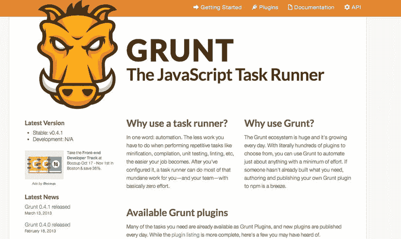
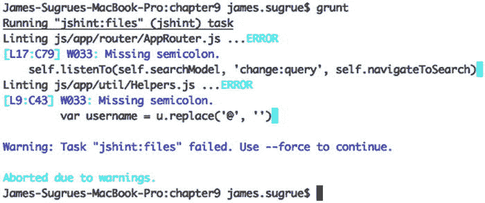
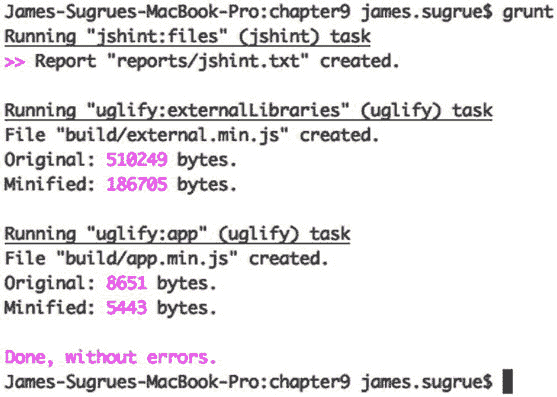
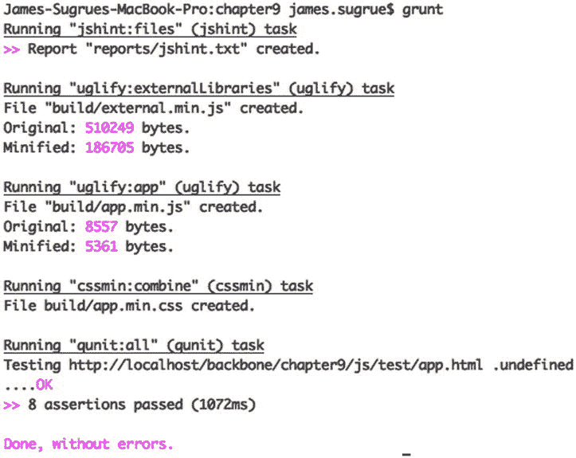
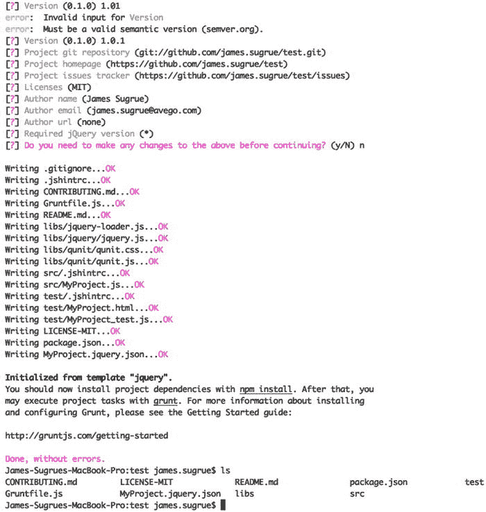

# 9. 使用 Grunt 进行构建流程

## 摘要

任何语言成功的关键因素之一，是其可用的自动化重复任务的工具数量。C 语言有`makefiles`，Java 有`Ant`和`Maven`，Ruby 有`rakefiles`。JavaScript 迎来合适的工具只是时间问题，而这个工具似乎就是`Grunt`。在本章中，我们将向你介绍`Grunt`，并解释如何使用它来提高质量、生成生产就绪的代码等等。承接上一章，你还将看到如何利用`Grunt`自动化执行单元测试。

## Grunt 简介

持续集成的目的是通过确保代码变更时执行测试，来提高软件质量并缩短交付生产就绪应用程序的时间。当然，持续过程中还会涉及许多其他任务，但运行单元测试被认为是最重要的。

由 Ben Alman 于 2012 年创建的`Grunt`（[`http://gruntjs.com`](http://gruntjs.com/) ，见图 9-1），已成为 JavaScript Web 应用程序的默认持续集成工具。`Grunt`脚本是用 JavaScript 编写的，无需编写自定义构建脚本从 shell 执行，也无需采用其他语言的构建工具。它是一个基于任务的系统，只需从命令行执行。它唯一的依赖是`Node.js`。

现在已有庞大的插件生态系统，你可以从`Grunt`中运行几乎任何所需的任务。如果你发现它缺少某些功能，甚至可以编写自己的自定义任务。



图 9-1. Grunt 网站，位于 [`http://gruntjs.com`](http://gruntjs.com/)

### 选择 Grunt 的一些理由

使用`Grunt`有很多充分的理由，除了你可以用 JavaScript 定义构建脚本之外。

`Grunt`遵循配置优于脚本的理念，意味着你可以用声明式的方式创建任务，而无需使用任何底层 JavaScript。不过，如果你更喜欢，编写自己的任务也允许你采用脚本方法。这是每个开发者都乐于拥有的自由度。

其插件生态系统非常庞大，正如你将在本章后面看到的，Web 项目中你想做的任何事情几乎都有对应的插件。`Node.js`生态系统中有这么多可用的包来帮助处理与 Web 相关的任务，`Grunt`使得封装这些包并将功能作为`Grunt`任务使用变得非常容易。

即使不下载额外的插件，内置任务也足以满足 JavaScript 项目的基本持续集成需求。

通过本章，你将看到`Grunt`如何革新你编写和交付 Web 应用程序的方式。

### 安装 Grunt

如果你想使用`Grunt`，首先需要安装`Node.js`。如果你一直跟随着本书的示例操作，应该已经安装了`Node.js`。如果没有，请前往[`http://nodejs.org`](http://nodejs.org/)并按照你操作系统的安装步骤进行安装。

`Grunt`命令行界面（CLI）通过 Node 包管理器（`npm`）安装，在命令行上执行以下命令，使用`-g`标志确保全局安装。请注意，你需要以管理员权限执行此操作；在 Mac OS X 上，这意味着在命令前加上`sudo`。

```
npm install -g grunt-cli
```

要检查是否安装成功，请在命令行运行`grunt --help`。

### 将 Grunt 添加到现有项目中

在终端中运行`grunt`命令时，会收到一条错误消息，提示找不到`Gruntfile`。这个文件`Gruntfile.js`是项目的主构建脚本。它用 JavaScript（或 CoffeeScript）编写，包含构建所需的任务。

让我们看一个为 Twitter 应用程序使用`Grunt`的示例。由于我们已经从上一章的源代码中获得了可用的单元测试，只需复制该目录即可。

接下来，在该目录的根目录下创建一个名为`Gruntfile.js`的文件，与应用程序的`index.html`文件放在一起。该文件的结构应如下所示：

```
module.exports = function(grunt) {

    //所有 grunt 任务写在这里..

};
```

这被称为包装函数，你创建的每个`Gruntfile`都需要使用这种格式。我们将在本章中逐步向其中添加一些任务。

#### 指定依赖项

每个项目都应该有一个`package.json`文件，其中列出了脚本的依赖项。至少应包含项目名称、版本以及对`Grunt`包的依赖。在撰写本文时，`Grunt`的当前版本是 0.4.1，因此在下面的`package.json`代码中使用该版本：

```
{
  "name": "Beginning_Backbone",
  "version": "0.1.0",
  "devDependencies": {
    "grunt": "∼0.4.1"
  }
}
```

如果你在与`package.json`相同的目录下从命令行运行以下命令，`Node.js`会负责安装项目的所有依赖项：

```
npm install
```

该脚本读取`package.json`的内容，并在本地安装`devDependencies`中列出的所有包。随着新任务添加到`Gruntfile`中，你应该在该文件的`devDependencies`部分添加相应的条目。

请注意，你也可以在`install`命令中使用`--saveDev`标志，将插件下载到本地，同时将其名称和版本与`package.json`中的其他依赖项一起保存。以下命令将最新版`Grunt`的相应条目添加到`.json`文件中：

```
npm install grunt --save-dev
```

这是一种有用的方法，可以用一个简单的命令在本地安装插件的同时，为团队中的其他开发者更新依赖配置。如果使用版本控制系统，你通常希望排除`node_modules`文件夹，让检出你代码的其他开发者在本地重新安装模块。

#### 项目配置

除了提供依赖项的详细信息外，任何其他与项目相关的属性都可以存储在 `package.json` 中。通常，这个文件在 Grunt 脚本初始化期间会作为 JSON 对象被读取。

所有这些初始配置都在 `grunt.initConfig` 函数中完成，该函数也用于任务配置，我们稍后会看到。存储在此文件中的属性，特别是版本号，可能对你的构建脚本也很有用。Grunt 提供了一个文件 API，允许你轻松地将 JSON 读取到脚本中。

```
module.exports = function(grunt) {

grunt.initConfig({

    pkg: grunt.file.readJSON('package.json'),

 });

};
```

此时，Gruntfile 仍然无法正确执行。如果你现在在命令行运行 `grunt`，你将会被告知缺少一个默认任务。

```
Warning: Task "default" not found. Use --force to continue.
```

## 添加任务

现在来看看如何为我们的构建脚本添加一个默认任务来执行。我们将使用与 [`http://gruntjs.org`](http://gruntjs.org/) 相同的示例，该示例使用了 JavaScript `uglify` 插件。`uglify` 插件提供了将你所有的 JavaScript 源代码压缩到一个文件中的能力。你从第三方下载的任何脚本通常都会有这样一个版本，其名称末尾带有 `.min.js`，作为生产版本。

`uglify` 任务可以从 GitHub 上获取，地址是 [`https://github.com/gruntjs/grunt-contrib-uglify`](https://github.com/gruntjs/grunt-contrib-uglify) 。它提供了入门所需的说明，但让我们一步一步地来操作。

首先，你需要使用 Node 包管理器，并带上 `--save-dev` 标志来安装 `uglify` 任务。

```
npm install grunt-contrib-uglify --save-dev
```

这将导致 `package.json` 更新如下，在依赖项中添加了 `uglify`：

```
{
"name": "Beginning_Backbone",
"version": "0.1.0",
"devDependencies": {
"grunt": "∼0.4.1",
"grunt-contrib-uglify": "∼0.2.4"
}
}
```

现在任务已可用，需要在 Gruntfile 中加载它。任何包含在 node 模块中的任务都可以使用 `grunt.loadNpmTasks` 函数来加载，如下代码片段所示：

```
// Load the plugin that provides the "uglify" task.
grunt.loadNpmTasks('grunt-contrib-uglify');
```

下一步是设置 `uglify` 任务的配置。这和任何任务的配置一样，都在 `initConfig` 块中进行。`uglify` 任务有许多不同的配置选项，但我们只使用最简单的。

首先，需要将 uglify 插件的配置对象包含在 `initConfig` 中，并带有一个 `options` 属性，该属性定义了在压缩文件中使用的横幅（注释）。所有任务都允许包含一个 `options` 属性，以覆盖任何内置的默认值。

请注意 `<%= %>` 标签如何允许在任务中包含配置属性。在本例中，`pkg.name` 是从 `package.json` 中读取的。同时，Grunt 提供了其他配置变量，例如 `grunt.template.today`，用于打印格式化日期。

`build` 对象包含使用 `src` 属性定义的源文件的详细信息，在本例中，是存储在 `js/app` 内的所有 JavaScript 文件。它还包含一个 `dest` 属性，用于定义输出文件的位置。

```
grunt.initConfig({
pkg: grunt.file.readJSON('package.json'),
uglify: {
options: {
banner: '/*! <%= pkg.name %> <%= grunt.template.today("yyyy-mm-dd") %> */\n'
},
build: {
src: 'js/app/**/*.js',
dest: 'build/<%= pkg.name %>.min.js'
}
}
});
```

你遇到的每个任务都会有不同的配置对象。如果你定义了一个不必要的属性，它会被脚本忽略。如果你发现简单的属性不够用，你甚至可以向配置中添加完整的 JavaScript 代码。

任何 Gruntfile 的最低要求是必须存在一个默认任务。这可以使用 `grunt.registerTask` 函数来添加，该函数接受任务名称和一个子任务数组，这些子任务将作为该任务的一部分执行。在本例中，只需要包含一个任务：`uglify`。

```
grunt.registerTask('default', ['uglify']);
```

Gruntfile 的完整清单现在如下所示：

```
module.exports = function(grunt) {
grunt.initConfig({
pkg: grunt.file.readJSON('package.json'),
uglify: {
options: {
banner: '/*! <%= pkg.name %> <%= grunt.template.today("yyyy-mm-dd") %> */\n'
},
build: {
src: 'js/app/**/*.js',
dest: 'build/<%= pkg.name %>.min.js'
}
}
});

// Load the plugin that provides the "uglify" task.
grunt.loadNpmTasks('grunt-contrib-uglify');

// Default task(s).
grunt.registerTask('default', ['uglify']);
};
```

现在在命令行执行 `grunt` 将会执行 `uglify` 任务，在 `build` 目录中生成一个名为 `Beginning_Backbone.min.js` 的文件。在本章中，我们将继续扩展这个 Gruntfile，以创建一个用于持续集成的完整构建脚本。

### 任务配置

我们已经介绍了任务配置的基础知识，包括 `options` 对象的定义。你可能会发现需要在每个任务中有不同的目标。这可以通过在配置对象中将额外的子任务定义为属性来实现。为了说明这一点，让我们向 `uglify` 目标添加一个子任务。

例如，假设我们只想压缩一个单独的 JavaScript 文件 `app.js`。我们可以在 `uglify` 任务中为此定义一个属性。

```
grunt.initConfig({
   pkg: grunt.file.readJSON('package.json'),
   uglify: {
     options: {
       banner: '/*! <%= pkg.name %> <%= grunt.template.today("yyyy-mm-dd") %> */\n'
     },
     build: {
       src: 'js/app/**/*.js',
       dest: 'build/<%= pkg.name %>.min.js'
     },
     singleFile: {
       src: 'js/app/app.js',
       dest: 'build/appmin.js'
     }
   }
 });
```

如果我们只想调用 `uglify` 的子任务，我们可以按如下方式注册任务：

```
grunt.registerTask('default', ['uglify:singleFile']);
```

这将只运行子任务，但如果我们在注册任务时使用了旧的 `uglify` 目标，那么 `build` 和 `singleFile` 这两个目标都会被执行。

### 处理文件

鉴于持续集成的性质，你在 Grunt 中使用的大多数任务都会与文件系统进行一些交互。最常见的模式是使用源文件和目标文件的映射，这可以通过多种方式来表示。源文件出现在 `src` 属性之后，目标文件出现在 `dest` 属性之后。

#### 紧凑格式

紧凑格式是指 `src` 和 `dest` 属性都以文件数组的形式表示。以下是使用 `uglify` 任务压缩两个特定文件的示例：

```
models: {
       src: ['js/model/Profile.js','js/model/Tweet.js'],
       dest: ['build/models.min.js']
}
```

#### 文件对象格式

当某个目标需要多个`src-dest`映射时，可使用此格式。文件列表被放入`files`属性中，该属性包含一个数组，用于在目标文件与源文件数组之间建立映射。

例如，当你希望在`uglify`任务中为应用程序的模型、视图和集合分别显式创建不同文件时，可以使用此格式。

```
uglify: {
     options: {
       banner: '/*! <%= pkg.name %> <%= grunt.template.today("yyyy-mm-dd") %> */\n'
     },
     individuals: {
       files : {
         'build/models.min.js'       : ['js/app/model/Profile.js', 'js/app/model/Tweet.js', 'js/app/Search.js'],
         'build/collections.min.js'  : ['js/app/collection/Timeline.js'],
         'build/views.min.js'          : ['js/app/view/ProfilePopupView.js', 'js/app/view/ProfileView.js',
 'js/app/view/ResultsView.js', 'js/app/view/SearchView.js', 'js/app/view/TimeView.js'],
         'build/routers.min.js'js/app/router/AppRouter.js'], /app/router/AppRouter.js'],
         'build/util.min.js'         : ['js/app/util/Helpers.js']
       }
     }
```

会创建多个目标文件，每个文件都包含一个源文件列表。请注意，使用此格式时，你无法添加其他属性（我们稍后将介绍这些属性）。

#### 文件数组格式

此格式与前一种对象格式非常相似，区别在于每个映射不再是一个字符串，而是一个包含`src`文件列表和`dest`文件列表的对象。每个条目都是一个对象而非字符串，并且显式标记了`src`和`dest`属性。

```
uglify: {
     options: {
       banner: '/*! <%= pkg.name %> <%= grunt.template.today("yyyy-mm-dd") %> */\n'
     },
     individuals: {
       files : {
{dest:'build/models.min.js', src:['js/app/model/Profile.js', 'js/app/model/Tweet.js', 'js/app/Search.js']},
{dest: 'build/collections.min.js', src: ['js/app/collection/Timeline.js']}
       }
     }
```

## 附加属性

你可以在简洁格式和文件数组格式的文件列表中添加多个属性，这些属性有助于精确筛选要使用的文件。具体属性列于表 9-1 中。

**表 9-1.** Grunt 中的附加文件属性

| 属性 | 描述 |
| --- | --- |
| `filter` | 接受一个函数，该函数接收`src`文件路径并返回`true`或`false`。通常使用`fs.Stats`方法名，可包含以下方法：`isFile` `isDirectory` |
| `nonull` | 当未找到匹配项时，返回一个包含模式本身的列表。这在脚本使用`--verbose`标志执行时，有助于调试文件路径问题。 |
| `dot` | 允许模式匹配以点号开头的文件名。 |
| `expand` | 设为`true`时，允许你动态构建文件对象，具体描述见表 9-2。 |

使用`expand`属性可以设置多个其他可选参数，从而对文件对象进行更精细的控制，这些参数列于表 9-2 中。

**表 9-2.** 当`expand = true`时可使用的属性

| 属性 | 描述 |
| --- | --- |
| `cwd` | 所有`src`文件需相对于此路径。 |
| `src` | 要匹配的模式，相对于`cwd`设置。 |
| `dest` | 目标路径。 |
| `ext` | 目标文件中使用的扩展名。使用此属性时，它会替换`dest`文件已定义的任何扩展名。 |
| `flatten` | 从`dest`路径中移除所有路径部分。 |
| `rename` | 用于重命名文件的函数。该函数会在`ext`和`flatten`处理完成后执行。 |

## 通配符

Grunt 允许使用通配符来查找文件集合，而无需手动列出所有需要处理的文件。这也称为文件通配（globbing）。我们最初指定的构建目标在`src`属性中使用了其中一种模式。

```
build: {
     src: 'js/app/**/*.js',
     dest: 'build/<%= pkg.name %>.min.js'
},
```

表 9-3 列出了最常用的可用模式。

**表 9-3.** Grunt 中的文件通配模式

| 模式 | 描述 |
| --- | --- |
| `*` | 匹配任意数量字符（但不匹配`/`）。例如，`js/app/model/*.js` 会接收`model`包中的所有 JS 文件。 |
| `?` | 匹配单个字符（但不匹配`/`）。 |
| `**` | 匹配任意数量字符（包括`/`）。例如，`js/app/**/*.js` 会接收`app`目录及其子目录中的所有 JS 文件。 |
| `{}` | 允许使用逗号分隔的模式集合。 |
| `!` | 取反匹配。 |

## 为项目使用 Grunt

既然我们已经了解了 Grunt 的基本概念，接下来可以为项目构建一个更全面的构建脚本。至少，你需要在 Backbone 项目中持续执行以下步骤：

- 使用 lint 插件对代码进行静态分析。
- 压缩 JavaScript 和 CSS 源代码。
- 对生成的源代码自动执行单元测试。

### 添加静态分析工具

JSHint（[`www.jshint.com`](http://www.jshint.com/)）是一个静态分析工具，有助于检测 JavaScript 代码中的潜在错误。该工具源自 Douglas Crockford 的 JSLint，由社区维护。JSHint 项目的核心理念是关注那些可能实际破坏代码的错误，而非像 JSLint 那样严格地强制执行规范。

对源代码运行 JSHint 可以避免打字错误和语法错误。此类质量检查非常值得，尤其是在编写生产代码时。你可以在[`https://github.com/gruntjs/grunt-contrib-jshint`](https://github.com/gruntjs/grunt-contrib-jshint)找到 JSHint 的 Grunt 插件。

#### 静态分析的重要性

随着 JavaScript 多年来的成熟，大多数浏览器已增加了更宽松的容错机制，能够接受“不合格”代码。由于 JavaScript 是一门动态语言，很容易产生不合规的代码，这些代码可能导致代码审查人员和经验不足的开发人员难以察觉的问题。大多数成熟语言都具备静态分析工具，而鉴于 JavaScript 代码可能出现的随意性问题，静态分析显得更为重要。通过添加自动化检查，可以确保你的代码获得最佳表现机会。尽管静态分析揭示的错误有时乍看之下令人不适，但使用 lint 工具最终会让你拥有一个更加整洁的代码库。

#### 安装与配置

要安装 JSHint 并将依赖添加到项目中，请在命令行中运行以下命令：

```
npm install grunt-contrib-jshint --save-dev
```

现在，在 `Gruntfile` 中，我们需要加载 JSHint 的 Node 模块。

```
grunt.loadNpmTasks('grunt-contrib-jshint');
```

`jshint` 任务的配置主要发生在 `options` 配置对象中，该对象接受许多不同的 lint 检查项。您想要执行的任何检查都应设置为 `true`。表 9-4 列出了一些最常用的 JSHint 检查项。完整的检查项列表可在 [`www.jshint.com/docs/options/`](http://www.jshint.com/docs/options/) 找到。

**表 9-4.** 常用的 JSHint 检查项

| 选项 | 用途 |
| --- | --- |
| `curly` | 要求在循环和条件语句中的代码块周围使用花括号 |
| `eqeqeq` | 要求所有相等操作都必须使用精确相等运算符（`===` 或 `!==`） |
| `eqnull` | 当设置为 `true` 时，抑制对 `== null` 比较的警告 |
| `browser` | 定义现代浏览器暴露的全局变量，例如 `window`、`document` 和 `navigator` |
| `globals` | 一组 `<库名>:<暴露方式>` 对，用于定义那些具有全局变量的库，包括 jQuery、MooTools、Phantom 等 |
| `latedef` | 禁止在变量定义之前使用该变量 |
| `plusplus` | 禁止使用 `++` 或 `--` |
| `undef` | 禁止使用未声明的变量；对于发现拼写错误非常有用 |
| `unused` | 禁止使用已定义但在源代码中从未使用的变量 |
| `maxdepth` | 接受一个数字，表示允许的嵌套层数；有助于管理复杂代码 |

该任务的选项还包含一个 `ignores` 属性，您可以在其中指定要忽略的文件列表。通常，您会忽略项目中包含的任何外部库。

`initConfig` 部分现在应该包含一个类似于下面定义的 JSHint 任务。请注意，并非前面列出的所有检查项都已启用。

```
grunt.initConfig({
  pkg: grunt.file.readJSON('package.json'),
  jshint: {
    options: {
      curly: true,
      eqeqeq: true,
      eqnull: true,
      browser: false,
      globals: {
        jQuery: true
      },
      ignores: ['js/external/**/.*.js']
    },
    files: {
      src: ['js/app/**/*.js']
    },
  },
});
```

最后，需要将该任务添加到默认任务中。`registerTask` 函数接受两个参数：任务的别名和将在该别名下执行的任务数组。

```
grunt.registerTask('default', ['jshint']);
```

您的源代码中可能会出现一些格式错误，例如混用空格和制表符。您可以选择使用 JavaScript 源码格式化工具（如 Sublime Text 中的 JSFormat）来修复它们。或者，您也可以选择直接从 JSHint 配置中移除该项检查。
```

格式化源代码后，可能仍然存在一些错误，这些错误会输出到控制台，如图 9-2 所示。JSHint 抛出的错误大多比较容易理解，但如果您遇到任何困难，可以在 [`http://jslinterrors.com/`](http://jslinterrors.com/) 上找到相关解释。



**图 9-2.** JSHint 的输出

如果您是在本地机器上运行，将输出打印到控制台是可以的。但是，在持续集成服务器上运行时，更希望将输出写入文件。为此，该任务自然提供了一个配置选项，即使用 `reporterOutput` 属性，该属性接受一个文件路径作为参数。

```
jshint: {
    options: {
        curly: true,
        eqeqeq: true,
        eqnull: true,
        browser: false,
        globals: {
            jQuery: true
        },
        ignores: ['js/external/**/.*.js'],
        reporterOutput : 'reports/jshint.txt'
    },
    files: {
        src: ['js/app/**/*.js']
    },
}
```

上面的代码片段展示了 JSHint 运行的报告现在将如何被写入 `reports` 目录下的 `jshint.txt` 文件中。

### 压缩 JavaScript 源码

有许多插件可以帮助您压缩 JavaScript 源码。正如本章前面提到的，压缩是将所有 JavaScript 合并到一个文件中，以减少加载脚本时的开销。由于我们之前使用了 Uglify，这里我们将继续使用它。作为其压缩流程的一部分，UglifyJS ([`http://lisperator.net/uglifyjs/`](http://lisperator.net/uglifyjs/)) 会移除空白字符并缩短变量名。

Uglify 的 Grunt 插件地址是 [`https://github.com/gruntjs/grunt-contrib-uglify`](https://github.com/gruntjs/grunt-contrib-uglify)。

#### 代码压缩的重要性

在开发机器上运行 JavaScript 代码时，您的重点是让一切都能正常工作。这本身没有错，但当您的代码投入生产环境时，就需要考虑性能问题。运行诸如 YSlow ([`http://developer.yahoo.com/yslow/`](http://developer.yahoo.com/yslow/)) 之类的工具可以分析您的 Web 应用是否存在性能问题，并给出如何修复这些问题的建议。

最常见的问题之一是包含了过多的外部 JavaScript 脚本。加载这些脚本所需的每个 HTTP 请求都要花费时间。除了网络开销之外，未压缩的 JavaScript 还意味着需要传输更多的数据。通过压缩 JavaScript，您可以确保避免 Web 应用中最常见的性能问题之一。

#### 安装与配置

要安装 uglify 并将依赖项添加到项目中，请在命令行中运行以下命令：

`npm install grunt-contrib-uglify --save-dev`

现在，在 `Gruntfile` 中，我们需要加载 uglify 的 node 模块：

`grunt.loadNpmTasks('grunt-contrib-uglify');`

表 9-5 列出了配置 `uglify` 任务时可用的一些选项。

**表 9-5.** UglifyJS 任务配置选项

| 选项 | 用途 |
| --- | --- |
| `banner` | 将被添加到压缩文件顶部的字符串。 |
| `mangle` | 开启或关闭变量名缩短（混淆）功能。 |
| `report` | 报告 uglify 处理的结果。可选值包括 `false`（默认）、`min`（压缩结果）和 `gzip`（gzip 压缩结果）。 |
| `preserveComments` | 指定是否应丢弃注释。可选值包括 `false`（默认；删除所有注释）、`all`（保留所有注释）和 `some`（保留以 `!` 开头的注释）。 |
| `wrap` | 将所有代码包裹在一个闭包中，以确保没有变量泄漏。 |
| `footer` | 将被追加到压缩输出末尾的字符串。 |

为了确保压缩成功，你首先需要考虑未压缩脚本的加载顺序。在我们的应用示例中，所有外部脚本都按照特定顺序首先被加载，然后才加载我们自己的 Backbone 代码。

虽然你可以选择使用外部库的压缩版本，但我们还是将它们包含在一个单独的压缩文件中。这样，脚本加载数量将从以下代码片段中的 18 个减少到 2 个。

```
<!-- 通用引用 -->
<script src="js/external/jquery-1.10.2.js"></script>
<script src="js/external/underscore.js"></script>
<script src="js/external/backbone.js"></script>
<script src="js/external/handlebars.js"></script>
<script src="js/external/moment.js"></script>
<script src="js/external/dialog.js"></script>

<!-- 模型 -->
<script src="js/app/model/Tweet.js"></script>
<script src="js/app/model/Profile.js"></script>
<script src="js/app/model/Search.js"></script>

<!-- 集合 -->
<script src="js/app/collection/Timeline.js"></script>

<!-- 视图 -->
<script src="js/app/view/TimelineView.js"></script>
<script src="js/app/view/ProfileView.js"></script>
<script src="js/app/view/ProfilePopupView.js"></script>
<script src="js/app/view/SearchView.js"></script>
<script src="js/app/view/ResultsView.js"></script>

<!-- 路由 -->
<script src="js/app/router/AppRouter.js"></script>

<!-- 工具 -->
<script src="js/app/util/Helpers.js"></script>

<!-- 应用主入口 -->
<script src="js/app/app.js"></script>
```

由于我们可以在任何任务中创建子任务，因此我们将 `uglify` 拆分为两个：一个用于外部脚本，另一个用于我们自己的 JavaScript 源码。

```
uglify: {
   options: {
      banner: '/*! <%= pkg.name %> <%= grunt.template.today("yyyy-mm-dd") %> */\n'
   },
   externalLibraries: {
      // 处理外部库
   },
   individuals: {
      // 处理我们的源码
   }
}
```

用于 `externalLibraries` 分段的文件列表应明确指定，以确保源文件按加载顺序进行压缩。所有这些文件将被压缩到构建目录中的 `external.min.js` 文件里。

```
externalLibraries: {
   files:{
      'build/external.min.js' : ['js/external/jquery-1.10.2.js',
                                  'js/external/underscore.js',
                                  'js/external/backbone.js',
                                  'js/external/handlebars.js',
                                  'js/external/moment.js',
                                  'js/external/dialog.js']
   }
},
```

# JavaScript 压缩

对我们自己源代码的压缩任务可以稍有不同。同一个子目录中的文件之间不存在相互依赖关系。例如，没有模型对象依赖于另一个模型。因此，我们可以使用 `**` 模式来一次性包含一个子目录中的所有文件。

```
app: {
   files : {
      'build/app.min.js'       : ['js/app/model/*.js', 'js/app/collection/*.js',
                                   'js/app/view/*.js', 'js/app/router/*.js',
                                   'js/app/util/.*.js', 'js/app/*.js' ],
   }
}
```

现在，需要将 `uglify` 任务添加到默认任务列表中。

`grunt.registerTask('default', ['jshint','uglify' ]);`

运行之后，你可以修改应用的 `index.html` 文件，改用压缩后的文件。以下应该是该应用所需的唯一脚本引用：

```
<script src="build/external.min.js"></script>
<script src="build/app.min.js"></script>
```

当你使用压缩脚本测试应用时，可能会发现加载过程中出现一些 JavaScript 错误。如果发生这种情况，请确保你已按正确顺序包含了所有必需的文件。

作为参考，`uglify` 任务的完整代码清单应如下所示：

```
uglify: {
   options: {
      banner: '/*! <%= pkg.name %> <%= grunt.template.today("yyyy-mm-dd") %> */\n',
      report: 'min'
   },
   externalLibraries: {
      files:{
         'build/external.min.js' : ['js/external/jquery-1.10.2.js',
                                     'js/external/underscore.js',
                                     'js/external/backbone.js',
                                     'js/external/handlebars.js',
                                     'js/external/moment.js',
                                     'js/external/dialog.js']
      }
   },
   app: {
      files : {
         'build/app.min.js'       : ['js/app/model/*.js', 'js/app/collection/*.js',
                                      'js/app/view/*.js', 'js/app/router/*.js',
                                      'js/app/util/.*.js', 'js/app/*.js' ],
      }
   }
}
```

请注意在任务选项中添加了 `report` 属性。这会导致在任务执行完成后，将压缩节省的空间信息打印到控制台。图 9-3 展示了对我们源码运行 `uglify` 所节省的空间。



**图 9-3.** `uglify` Grunt 任务的输出

# 压缩 CSS

压缩 JavaScript 代码很重要，出于同样的原因，压缩应用程序中的 CSS 也值得一做。同样，有多个插件可以实现这一点。CSSMin ( [`https://github.com/gruntjs/grunt-contrib-cssmin`](https://github.com/gruntjs/grunt-contrib-cssmin) ) 就是这样一个插件。

## 安装与配置

要安装 CSSMin 并将依赖项添加到项目中，请在命令行中执行以下命令：

`npm install grunt-contrib-cssmin --save-dev`

现在，我们需要在 `Gruntfile` 中加载这个 node 模块。

`grunt.loadNpmTasks('grunt-contrib-cssmin');`

CSSMin 是一个简单的工具，因此该任务的配置选项并不多。表 9-6 列出了配置 CSSMin 任务时可用的部分选项。

**表 9-6.** CSSMin 任务配置选项

| 选项 | 用途 |
| --- | --- |
| `banner` | 为压缩后的源码添加特定的头部信息。 |
| `report` | 报告压缩过程的结果。可选值包括 `false`（默认）、`min`（压缩结果）和 `gzip`（gzip 结果）。 |
| `keepSpecialComments` | 保留或移除特殊注释。默认情况下会保留特殊注释。值设为 `1` 将保留第一个，设为 `0` 则将移除所有特殊注释。 |

我们创建的应用程序包含的 CSS 数量有限，但为了减小文件体积并降低加载开销，仍然值得进行压缩。当前 `index.html` 引用了两个样式表。

`<link rel='stylesheet' href='css/modern.css'>`

`<link rel="stylesheet" href="css/style.css">`

Grunt 任务配置相当简单，包含一个 `combine` 对象，其中列出了生成 `app.min.css` 文件所需包含的文件列表。

`cssmin:{ combine:{ files: { 'build/app.min.css' : ['css/**.css'] } } }`

现在，需要将 `CSSMin` 任务添加到默认任务列表中。

`grunt.registerTask('default', ['jshint','uglify','cssmin' ])`

完成压缩后，这两个 CSS 文件可以被这一个压缩后的 CSS 文件替代：

`<link rel='stylesheet' href='css/app.min.css'>`

# 自动化你的测试套件

在上一章中，我们介绍了两个测试库：QUnit 和 Jasmine。以下部分将展示如何为它们分别添加任务。

## QUnit 任务

QUnit Grunt 插件（ [`github.com/gruntjs/grunt-contrib-qunit`](https://github.com/gruntjs/grunt-contrib-qunit) ）允许你自动化执行上一章创建的 QUnit 测试套件。当你下载该插件时，它会自动将 PhantomJS 作为依赖项下载。这意味着该任务可以在后台运行，无需标准浏览器。

### 安装与配置

要安装 QUnit 并将依赖项添加到项目中，请在命令行中执行以下命令：

`npm install grunt-contrib-qunit --save-dev`

现在，我们需要在 `Gruntfile` 中加载 QUnit 的 node 模块。

`grunt.loadNpmTasks('grunt-contrib-qunit');`

**表 9-7.** QUnit 任务配置选项

| 选项 | 用途 |
| --- | --- |
| `timeout` | 在超时失败前，Grunt 等待 QUnit `start()` 的时间（毫秒）。默认值为 5,000 毫秒。 |
| `urls` | 要传递给 PhantomJS 的测试套件 URL。 |
| `force` | 当设置为 `true` 时，允许任务忽略失败并继续运行。默认值为 `false`。 |

我们的 QUnit 任务配置相当简单。真正需要做的只是将 QUnit 测试套件的 URL 传递给 `urls` 属性。

`qunit:{ all: { options: { urls: ['http://localhost/backbone/chapter9/js/test/app.html'] } } }`

表 9-7 列出了 QUnit 任务的其他配置选项。最后，需要将 QUnit 任务作为默认任务的一部分。

`grunt.registerTask('default', ['jshint', 'uglify', 'cssmin', 'qunit']);`

运行脚本时，最终会执行 QUnit 测试，并将测试结果写入控制台。图 9-4 显示了更新后的 Grunt 脚本执行结果。



**图 9-4.** 添加 QUnit 测试后 Grunt 脚本的输出

请注意，修改测试脚本以加载测试的压缩版本（而非开发版本）会很有用。

## 生成 QUnit 报告

诸如 Hudson 和 Jenkins 等持续集成服务器允许你安排构建任务在夜间运行，或在代码提交到版本控制后经过特定时间后运行。这些系统还允许你查看单元测试结果，只要报告以特定格式生成即可。正如我们在上一章关于测试的内容中提到的，JUnit 报告格式被认为是标准格式。

尽管 QUnit 任务本身不包含报告配置，但有一个名为 QUnit-JUnit（[`github.com/sbrandwoo/grunt-qunit-junit`](https://github.com/sbrandwoo/grunt-qunit-junit)）的独立任务可用于创建这些报告。

要安装该插件，只需运行常规命令。

`npm install grunt-qunit-junit --save-dev`

在你的 `Gruntfile` 中，加载 `npm` 任务。

`grunt.loadNpmTasks('grunt-qunit-junit');`

现在，你可以在 `initConfig` 块中为报告任务创建配置。主要参数是保存报告的目标路径。

```
//qunit reports
qunit_junit: {
   options: {
      //生成报告的位置
      dest: 'reports/'
   }
}
```

该任务需要在 QUnit 测试任务本身之前执行。这样报告模块才能监听所有的测试。

`grunt.registerTask('default', ['jshint', 'uglify', 'cssmin', 'qunit_junit', 'qunit']);`

当你运行脚本时，所有测试结果应位于 `reports` 目录下的 `TEST-app.xml` 文件中。该报告文件应能被任何持续集成系统轻松处理。

## Jasmine 任务

在前一章中，我们还探讨了使用 Jasmine 作为 QUnit 的替代方案来编写测试。存在一个用于执行 Jasmine 测试的 `grunt` 任务（参见 [`https://github.com/gruntjs/grunt-contrib-jasmine`](https://github.com/gruntjs/grunt-contrib-jasmine)）。与 QUnit 任务类似，Jasmine 依赖于 PhantomJS，并在需要时会自动安装它。

### 安装与配置

要安装 Jasmine 插件并将依赖项添加到项目中，请从命令行运行以下命令：

```
npm install grunt-contrib-jasmine --save-dev
```

现在，在 `Gruntfile` 中，我们需要加载 Jasmine 的 Node 模块。

```
grunt.loadNpmTasks('grunt-contrib-jasmine');
```

**表 9-8. Jasmine 任务配置选项**

| 选项 | 用途 |
| --- | --- |
| `src` | 一个字符串或文件数组，表示正在被测试的文件。 |
| `specs` | 一个字符串或文件数组，指向正在使用的测试规范文件。这应该是 `.js` 规范文件，而不是 `SpecRunner.html` 文件。 |
| `vendor` | 一个字符串或第三方库文件数组，应在测试执行前加载。 |
| `junit.path` | 输出 JUnit XML 文件的路径。 |
| `junit.consolidate` | 是否将所有 JUnit XML 合并到一个文件中。 |
| `host` | 运行测试的主机。 |
| `template` | 用于生成你的 SpecRunner 的自定义模板，以 Underscore.js 模板形式解析。 |

在你的 `Gruntfile` 中，加载 `jasmine` 任务。

```
grunt.loadNpmTasks('grunt-contrib-jasmine');
```

现在你可以配置你的 Jasmine 测试运行。因为我们没有使用前一章创建的 `SpecRunner`，你需要在此配置上多花一些功夫。

我们只会传入正在测试的源文件，并使用 `vendor` 属性来加载额外的外部库，例如 `Sinon`、压缩后的外部依赖项以及 `jasmine-jquery`。完整的配置选项列表见表 9-8。

你会注意到我们省略了 `ProfileView.js`。原因是视图通过 Jasmine 插件进行测试稍微复杂一些，所以专注于数据测试会更简单。

```
//jasmine 测试
jasmine: {
   main: {
      src: ['js/app/model/Profile.js', 'js/app/model/Tweet.js', 'js/app/collection/Timeline.js'],
      options: {
         specs: 'js/test/jasmine/spec/ProfileSpec.js',
         vendor : ['js/test/sinon.js', 'build/external.min.js', 'js/test/jasmine/lib/jasmine-jquery.js'],
         junit :{
            path: 'reports/'
         }
      }
   }
}
```

我们还添加了导出 JUnit 报告的路径。这些报告都将根据测试套件命名，因此在这种情况下，我们将有两个套件。

最后，我们只需要将任务添加到默认任务列表中。

```
grunt.registerTask('default', ['jshint', 'uglify', 'cssmin', 'qunit_junit', 'qunit', 'jasmine']);
```

### 创建不同的任务集

我们创建的附加任务并非总是适用于所有机器。开发者工作空间需要运行与持续集成服务器不同的任务集。这可以通过 Grunt 中的 `registerTask` 函数很简单地进行控制。

例如，假设开发者在命令行运行 `grunt dev`，而持续集成服务器运行 `grunt build`。我们将为这两者创建不同的任务集。

```
grunt.registerTask('dev', ['jshint',  'qunit_junit', 'qunit', 'jasmine']);
grunt.registerTask('build', ['jshint',  'uglify', 'cssmin', 'qunit_junit', 'qunit', 'jasmine']);
grunt.registerTask('default', ['jshint', 'uglify', 'cssmin', 'qunit_junit', 'qunit', 'jasmine']);
```

在开发者机器上，会运行静态分析和测试任务，而构建机器还会运行压缩任务。这种运行任务的方式极其有用，因为构建文件的不同用户会有不同的目标。

## 项目脚手架

Grunt 对其 `grunt-init` 模块提供了出色的支持，用于启动新项目。无需编写大量样板代码，你可以直接利用此功能。

首先，你需要通过 Node 包管理器安装 `grunt-init` 插件。建议使用 `-g` 标志进行全局安装。

```
npm install -g grunt-init
```

运行 `grunt-init` 时，你需要提供一个用于项目的模板。有许多可用的模板，包括位于 [`https://github.com/gruntjs/grunt-init-jquery`](https://github.com/gruntjs/grunt-init-jquery) 的标准 jQuery 插件模板。你可以下载源码，或者使用以下命令克隆 Git 仓库：

```
git clone https://github.com/gruntjs/grunt-init-jquery.git ~/.grunt-init/jquery
```

现在，模板已可用，可以通过使用以下命令来调用 `grunt-init` 任务使用它：

```
grunt-init   ~/.grunt-init/jquery
```

在回答一系列问题后，你将获得一个完整的 jQuery 插件启动模板。图 9-5 显示了运行上述代码后的输出。



**图 9-5.** `grunt-init` 任务后的输出

当然，还有许多模板可以帮助启动 Backbone 项目，包括 [`https://bitbucket.org/nicopigelet/grunt-init-backbone`](https://bitbucket.org/nicopigelet/grunt-init-backbone)。要下载模板，请运行以下命令克隆 Git 仓库：

```
git clone https://bitbucket.org/nicopigelet/grunt-init-backbone.git ~/.grunt-init/backbone
```

然后，你只需要运行以下命令来创建构建 Backbone 项目所需的基础文件即可。

```
grunt-init backbone
```

## 一些有用的 Grunt 插件

本章只是浅尝辄止地介绍了大量可用插件中的一小部分。表 9-9 描述了一些你可能发现有用的其他插件。

**表 9-9. 有用的 Grunt 插件**

| 插件 | 描述 |
| --- | --- |
| Grunt 监视任务 ( [`https://github.com/gruntjs/grunt-contrib-watch`](https://github.com/gruntjs/grunt-contrib-watch) ) | 监视你机器上的一组文件变化，并在检测到变化时运行 Grunt 任务。这还可以强制在浏览器中进行实时重载，以便更改立即可见。 |
| SAAS 预处理器 ( [`https://github.com/gruntjs/grunt-contrib-sass`](https://github.com/gruntjs/grunt-contrib-sass) ) | CSS 预处理器任务，用于将 SASS 文件转换为 CSS。SASS 允许你以比纯 CSS 更简洁的方式为应用程序定义样式。 |
| Handlebars ( [`https://github.com/gruntjs/grunt-contrib-handlebars`](https://github.com/gruntjs/grunt-contrib-handlebars) ) | 用于预编译 Handlebars 模板的 Grunt 任务。模板预编译，配合使用 Handlebars 引擎库（而非完整版本），可以极大地提高应用程序性能。 |
| Backbone 样板 ( [`https://github.com/backbone-boilerplate/grunt-bbb`](https://github.com/backbone-boilerplate/grunt-bbb) ) | 与 `grunt-init` 协同工作，帮助生成 Backbone 项目所需的所有样板代码和结构。 |

# 总结

本章介绍了 Grunt 任务运行器系统，并解释了它如何通过启用持续集成来帮助为你的项目增加高质量水平。涵盖了任何 JavaScript 项目的典型任务，包括 JavaScript 和 CSS 源码的压缩与精简、单元测试以及静态分析。Grunt 生态系统非常庞大，对于任何特定问题，总会有可用的任务。我强烈建议你在应用程序中采用 Grunt，即使你已经在使用其他构建系统。由于任务和配置都是用纯 JavaScript 编写的，这降低了学习曲线。
