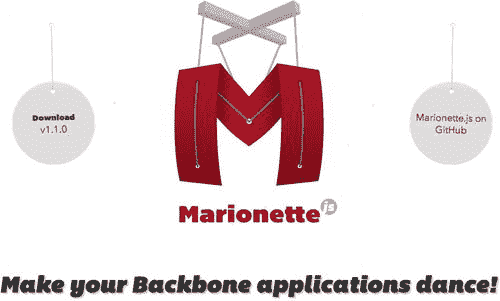
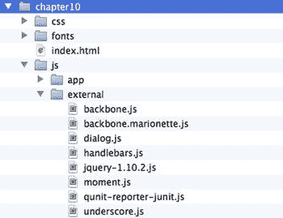
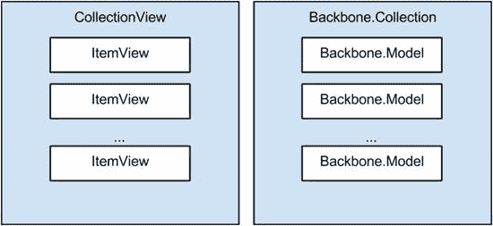
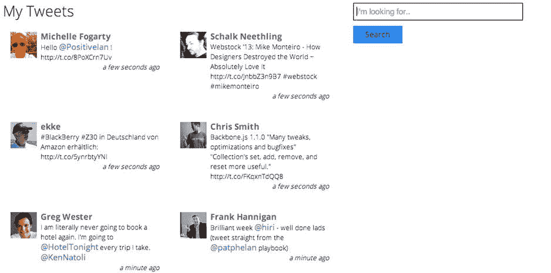
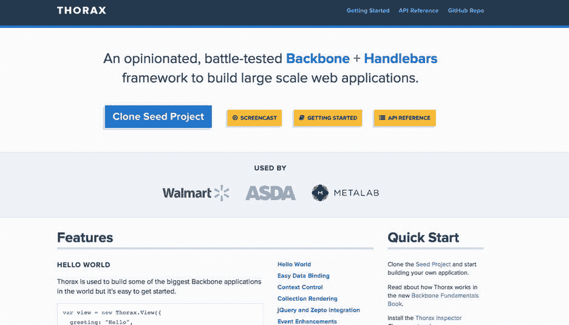
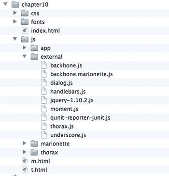
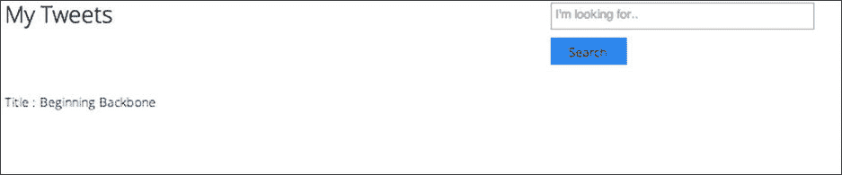
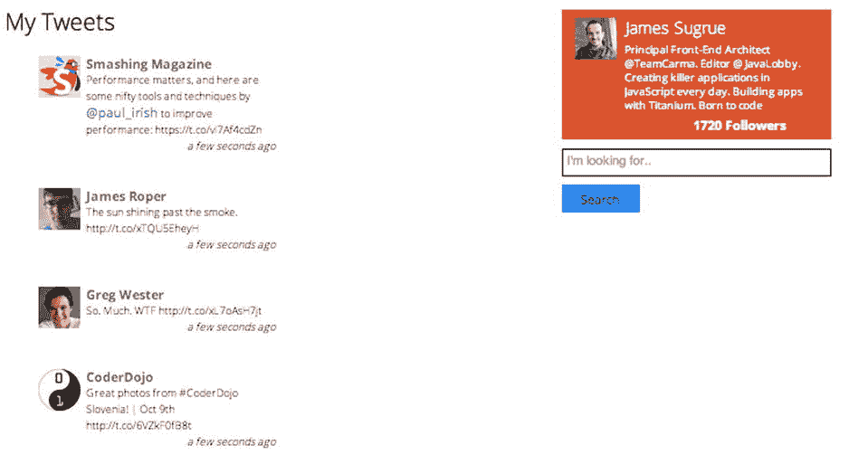

# 10. 使用 Marionette 和 Thorax 扩展 Backbone

## 摘要

对于小型项目，我们构建 Backbone 应用的方法效果不错。然而，随着 Backbone.js 应用规模的扩大，或许就该考虑使用 Marionette 或 Thorax 来让代码库更易于管理，并减少样板代码的数量。本章将介绍这两个插件，并展示它们对编写应用方式所带来的改变。

## Marionette

Marionette ([`http://marionettejs.com`](http://marionettejs.com/) ，图 10-1) 由 Derick Bailey 创建，旨在简化大规模 Backbone 应用的构建。它集合了他在构建 Backbone 应用时发现的一些模式。

该框架解决了 Backbone 本身是一个非制约性框架这一事实，它为开发者提供了所有需要的部件，但并未严格规定应如何将它们组合在一起。使用 Backbone 时，开发者常遇到的两个关键问题领域是视图管理和内存管理。Marionette 旨在缓解应用中的这些顾虑。



**图 10-1.** 位于 [`http://marionettejs.com`](http://marionettejs.com/) 的 Marionette 网站

尽管 Marionette 功能丰富，你仍然可以选择哪些功能用于你的 Backbone 应用。这让你可以自由地将应用逐步迁移到使用 Marionette，而不是面临一次重大的应用改造。

### 开始使用 Marionette

当你访问 [`http://marionettejs.com`](http://marionettejs.com/) 时，会看到几种不同的下载选项，包括一个包含 Marionette、Backbone、jQuery 以及所有其他依赖项的预打包 zip 文件。还有一个捆绑版本，它排除了主要的第三方库，但仍然包含一些其他的 Marionette 依赖项。最后，还有一个简单的核心版本，仅包含标准的 `backbone.marionette.js` 文件。

预打包的 zip 文件非常适合那些从头开始新应用的人，但由于我们将使用 Marionette 扩展现有应用，最好选择捆绑版本。下载这个版本的 `backbone.marionette.js` 并将其添加到应用的外部目录中。假设你正在基于第 6 章的示例进行构建，你的源代码目录结构应如图 10-2 所示。



**图 10-2.** 包含 `backbone.marionette.js` 的应用结构

### Marionette 功能集

以下是构成 Marionette 基础的几个关键部分。

#### 应用基础设施

Marionette 应用围绕模块和子模块构建，这些模块和子模块允许更高的复用性和可组合性。所有这些的核心是 `Marionette.Application` 对象，它组织整个应用。还有一个专用的 `Controller` 对象，用于控制模块（乃至整个应用）的工作流程和进程。

#### 视图

Marionette 引入了一些特定的视图对象来满足应用中不同的需求。提供了 `ItemView` 用于渲染单个项目，而 `CollectionView` 则遍历集合并渲染各个 `ItemView` 实例。`Layout` 对象允许将复杂的用户界面布局到一组 `Region` 对象中。

## 视图管理

框架内提供了多种机制来管理区域和子视图。还有一个渲染器，允许以一致的方式渲染模板。通过使用 `TemplateCache`，你的视图还可以加速运行。

#### 消息传递

Marionette 提供了一个请求-响应框架和一个命令执行框架，以实现更好的应用代码解耦。这两个组件都允许应用的一个部分请求执行某项工作，而无需与执行该工作的组件绑定在一起。

综合起来，Marionette 提供的功能将 Backbone 带入了一个新高度。具有更传统语言和 Web 应用框架背景的开发者会发现这些功能更熟悉，并且它使 JavaScript 代码更易于管理。

### 一个简单的 Marionette 应用

本节将带你逐步创建一个基于 Marionette 的应用。

要创建该应用，可以复制一份 `index.html` 并将其命名为 `m.html`。我们将使用一个不同的 `app.js` 来使用 Marionette（而非纯 Backbone）管理应用。该文件将存储在 `js` 目录下的 `Marionette` 子目录中。

主 `m.html` 页面需要包含你下载的 Marionette 以及这个新的 `app.js`。

```
<!-- 通用包含文件 -->
<script src="js/external/jquery-1.10.2.js"></script>
<script src="js/external/underscore.js"></script>
<script src="js/external/backbone.js"></script>
<script src="js/external/handlebars.js"></script>
<script src="js/external/moment.js"></script>
<script src="js/external/dialog.js"></script>
<script src="js/external/backbone.marionette.js"></script>
<!-- 此应用的“主”文件 -->
<script src="js/marionette/app.js"></script>
```

#### 创建应用

`Backbone.Marionette.Application` 对象是任何 Marionette 应用的核心。这是需要首先创建的对象，如果需要，还可以使用许多选项对其进行扩展。该对象最简单的调用方式如下：

```
$(function() {
    //创建一个新的 Marionette 应用
    MApp = new Backbone.Marionette.Application();
});
```

从这里开始，你将能够添加区域、设置初始化器以特定方式准备应用，或设置应用级别的事件监听器。

#### 添加区域

`Marionette.Region` 对象提供了在你的应用中管理视图的功能。区域可以通过以下三种形式之一添加：使用 jQuery 选择器、创建你自己的自定义 `Region` 对象，或结合使用这两种方法。

一个应用可以包含多个 `Region` 对象，稍后我们将看到如何添加 `Layout` 对象来封装多个区域。

要将页面的主要内容区域作为区域添加到这个应用中，只需添加以下几行代码：

```
MApp.addRegions({
     mainRegion: '#app'
});
```

实现同样效果的另一种方式是自己创建一个 `Region` 对象，并为该 `Region` 设置根元素。

```
AppRegion = Marionette.Region.extend({
el: '#app'
});

MApp.addRegions({
     mainRegion: AppRegion
});
```

以下两个代码片段都将在应用中创建一个 `Region`，使用一个 ID 为 `content` 的 `div` 作为渲染区域。

可以通过 `Backbone.Marionette.Application` 引用，使用区域名称（本例中为 `mainRegion`）来访问该区域。你可以直接将其作为属性访问。

```
var region = MApp.mainRegion;
```

或者，你也可以使用 `getRegion` 函数。

```
var region = MApp.getRegion('mainRegion');
```

### 向区域添加视图

Marionette 定义了许多不同类型的视图，包括 `ItemView`（理想用于渲染单个项目）和 `CollectionView`（应在处理集合时用于渲染多个 `ItemView`）。

举个简单的例子，之前定义为 `Backbone.View` 的 `TimelineView` 可以重构为继承 `Backbone.Marionette.ItemView`。可以将原始 `Timeline.js` 的副本重命名为 `MarionetteTimeline`，并调整如下：

```
var com = com || {};
com.apress = com.apress || {};
com.apress.view = com.apress.view || {};
com.apress.view.MarionetteTimelineView = Backbone.Marionette.ItemView.extend({
```

这个新视图需要被包含在主 HTML 页面的脚本列表中。

```
<script src="js/app/view/MarionetteTimelineView.js"></script>
```

最后，可以将视图添加到 `Region` 中。有两种方法可以实现：一种是在创建区域时通过 `currentView` 属性包含该视图。

```
var timelineView = new com.apress.view.MarionetteTimelineView();
AppRegion = Marionette.Region.extend({
     el: '#app',
    currentView: timelineView
});
```

这会使视图在 `Region` 显示时立即渲染。你也可以在 `Region` 创建后使用 `attachView` 函数附加视图。

```
var timelineView = new com.apress.view.MarionetteTimelineView();
MApp.mainRegion.attachView(timelineView);
```

由于 `Region` 对象管理视图，因此自然存在可用于显示或隐藏特定视图的方法。`Region` 还有一个好处是包含一个重置函数，可以完全清除在其中显示过的所有视图。

```
MApp.getRegion('mainRegion').reset();
```

你也可以使用 `close` 函数关闭 `Region` 中的单个视图。

```
MApp.mainRegion.close(timelineView);
```

## 区域事件

当在 Marionette 视图上调用 `show()` 或 `close()` 时，会触发事件，`Region` 可以监听并在必要时做出反应。监听器可以按如下方式添加到 `Region`：

```
MApp.mainRegion.on("show", function(view){
    console.log( ' 视图已显示 ');
});
MApp.mainRegion.on("close", function(view){
    console.log( ' 视图已关闭 ');
});
```

执行显示或关闭视图的代码现在将触发相应的函数。

```
MApp.mainRegion.show(timelineView);
MApp.mainRegion.close(timelineView);
```

此外，`Region` 和 `View` 类都可以定义 `onShow` 和 `onClose` 函数来处理这些事件。

```
AppRegion = Marionette.Region.extend({
    el: '#app',
    onShow: function(view){
        console.log('视图已显示');
    },
    onClose: function(view){
        console.log('视图已关闭');
    }
});
```

### Marionette CollectionView

严格来说，最好使用 `CollectionView` 作为 Marionette 视图的类型，因为 Twitter 时间线实际上是一系列 `Tweet` 对象。在上一节使用 `ItemView` 时，仍然使用第 6 章中的同一个 `render` 函数，因此并未使用 Marionette 的渲染机制。

Marionette 实际上为 `ItemView` 提供了基于其模板和从集合中提供的 Model 对象的默认渲染。图 10-3 展示了 `CollectionView` 和 `ItemView` 如何协同工作。



**图 10-3.** `CollectionView`、`ItemView`、`Backbone.Collection` 和 `Backbone.Model` 之间关系的示意图

从图 10-3 可以看出，一个 `CollectionView` 代表一个 `Backbone.Collection`。对于该集合中的每个 `Backbone.Model` 对象，都会创建一个 `ItemView` 来渲染该模型。

创建 `ItemView` 通常是一项简单的任务，只需传递所需的模板，无需渲染函数。来自第 6 章的 `showProfile` 事件监听器和处理器也会添加到 `ItemView` 中，因为这是一个与每个子视图相关的事件。

为了正确表示模型对象，你可以在 `view` 目录下创建一个名为 `TimelineItemView` 的新 JavaScript 文件。

请注意，所有 `ItemView` 都必须包含的 `template` 参数引用了 Handlebars 模板的编译版本。如果你的 Marionette 应用使用 Underscore 模板，则无需如此，而可以直接传递该 Underscore 模板的 ID。

```
var com = com || {};
com.apress = com.apress || {};
com.apress.view = com.apress.view || {};
com.apress.view.TimelineItemView = Backbone.Marionette.ItemView.extend({
    template: Handlebars.compile($("#timeline-item-template").html()),
    events: {
        'click .profile': 'showDialog'
    },
    showDialog: function(options) {
        var self = this,
        $target = $(options.currentTarget),
        username = $target.data('user');
        var profileView = new com.apress.view.ProfilePopupView({
            user: username
        });
    }
});
```

之前用于渲染时间线信息的模板是对整个集合进行迭代。现在我们处理的是单个项目，因此模板需要在主 HTML 页面 `m.html` 中反映这一点。

```
<!-- 时间线项目模板 -->
<script type="text/x-handlebars-template" id="timeline-item-template">
    <li>
        <div class='icon'>
            </img>
        </div>
        <div class='data'>
            <h4>{{user.name}}</h4>
            <p>{{format text}}</p>
            <p class="timestamp"><i>{{friendlyDate}}</i></p>
        </div>
    </li>
</script>
```

同时在 HTML 页面中，我们应该将时间线的根元素更新为 `ul` 标签，将其添加到带有时间线标识符的 `div` 下。

```
<div id='timeline' class='timeline-view'>
    <h2>我的推文</h2>
    <ul id='timeline-list' class='listview fluid'>
    </ul>
</div>
```

下一步是构建一个 `CollectionView`，它将使用新创建的 `TimelineItemView`。同样，与之前使用 `Backbone.View` 类的 `TimelineView` 相比，所需的重构工作量将非常少。为消除歧义，应将此 JavaScript 对象命名为 `MarionetteTimelineView`。它也可以放在应用的 `view` 目录中。

它需要继承 `Backbone.Marionette.CollectionView`，而不是 `Backbone.View`。
```

# Marionette 视图：CollectionView 与 CompositeView

## CollectionView 基础

```javascript
var com = com || {};
com.apress = com.apress || {};
com.apress.view = com.apress.view || {};
com.apress.view.MarionetteTimelineView = Backbone.Marionette.CollectionView.extend({
});
```

在 `CollectionView` 中，最重要的属性是用于渲染 `Model` 对象的 `ItemView`。

```javascript
com.apress.view.MarionetteTimelineView = Backbone.Marionette.CollectionView.extend({
    itemView : com.apress.view.TimelineItemView,
});
```

请注意，`itemView` 引用的是所用的类，而不是使用 `new` 运算符创建的视图实例。务必以这种方式引用 `ItemView`，以避免在应用程序中出现难以排查的错误。

`CollectionView` 中的另一个重要属性是 `collection` 属性，它引用了要使用的 `Backbone.Collection`。之前存在的 `initialize` 函数可以保留，因为它只负责获取集合，并在集合重置时调用 `render`。如果需要，你也可以在此视图外部构建 `Backbone.Collection`，并将其作为参数传入。

点击用户个人资料链接的事件处理程序已移至 `TimelineItemView`，根元素也已更新为带有 `timeline-list` 标识的 `ul`，而非使用层级更高的 `div` 元素。

```javascript
var com = com || {};
com.apress = com.apress || {};
com.apress.view = com.apress.view || {};
com.apress.view.MarionetteTimelineView = Backbone.Marionette.CollectionView.extend({
    el: '#timeline-list',
    itemView : com.apress.view.TimelineItemView,
    initialize: function(options) {
        var self = this;
        //为要渲染的视图创建一个集合
        self.collection = new com.apress.collection.Timeline();
        //强制 fetch 触发 reset 事件
        self.collection.fetch({
            reset: true
        });
        self.listenTo(self.collection, 'reset', self.render);
    }
});
```

为了正常运行所有功能，请确保在主 HTML 页面中正确包含了新视图。

```html
<script src="js/app/view/TimelineItemView.js"></script>
<script src="js/app/view/MarionetteTimelineView.js"></script>
```

现在，在 `app.js` 中，区域可以使用 `MarionetteTimelineView` 来替代旧视图。

```javascript
var timelineView = new com.apress.view.MarionetteTimelineView();
MApp.mainRegion.show(timelineView);
```

运行应用程序时，你应该会看到 Twitter 时间线再次渲染，如图 10-4 所示。



图 10-4. 使用 `CollectionView` 渲染 Twitter 时间线

本章稍后讨论 Marionette `Layout` 对象时，我们将了解如何整合第 6 章示例中出现在右侧的个人资料视图。

## Marionette Composite View

除了 `ItemView` 和 `CollectionView` 之外，Marionette 还提供了一种名为 `CompositeView` 的视图类型。该视图扩展了 `CollectionView` 提供的功能。对于需要集合的复杂用户界面，这是一个不错的选择，因为它允许你为整个集合提供一个模板，同时也能够为集合中的单个模型对象使用模板。

为了说明这一点，我们来看看之前的例子，其中使用 `CollectionView` 来渲染集合内容。必须修改 HTML，以包含用于渲染 `TimelineItemView` 对象列表的 `ul` 容器标签。以下代码片段展示了主 HTML 页面中的实现：

```html
<div id='timeline' class='timeline-view'>
    <h2>我的推文</h2>
    <ul id='timeline-list' class='listview fluid'>
    </ul>
</div>
```

使用 `CompositeView`，我们可以移除这个额外的 `ul` 声明，并将其移至一个模板中，仅在渲染集合时使用。

```html
<script type="text/x-handlebars-template" id="timeline-template">
    <ul id='timeline-list' class='listview fluid'>
    </ul>
</script>
```

这使得时间线的 `div` 恢复为更简洁的形式。

```html
<div id='timeline' class='timeline-view'>
    <h2>我的推文</h2>
</div>
```

为了利用这一更改，需要创建一个新版本的 `CompositeView`，基于之前的 `MarionetteTimelineView`。在本例中，我们将其命名为 `MarionetteCompositeTimelineView`。首先复制 `MarionetteTimelineView`，并将声明更改为使用正确的视图。

```javascript
var com = com || {};
com.apress = com.apress || {};
com.apress.view = com.apress.view || {};
com.apress.view.MarionetteCompositeTimelineView = Backbone.Marionette.CompositeView.extend({
});
```

你还可以添加一个模板属性，使用之前创建的新的 `timeline-template`。根元素属性 `el` 需要更改为层级更高的时间线 `div`，但 `itemView` 可以保持不变。

```javascript
com.apress.view.MarionetteCompositeTimelineView = Backbone.Marionette.CompositeView.extend({
    el: '#timeline',
    template: Handlebars.compile($("#timeline-template").html()),
    itemView : com.apress.view.TimelineItemView,
});
```

最后，应重写 `appendHtml` 函数，以便添加到视图中的每个项目都被放置在 `ul` 标签下。默认实现会将其添加到根 `el` 下，这在我们当前的场景中会导致渲染错误。

```javascript
appendHtml: function(compositeView, itemView){
    compositeView.$('#timeline-list').append(itemView.el);
}
```

`MarionetteCompositeView` 的完整代码清单如下：

# Marionette 视图详解

```javascript
var com = com || {};
com.apress = com.apress || {};
com.apress.view = com.apress.view || {};
com.apress.view.MarionetteCompositeTimelineView = Backbone.Marionette.CompositeView.extend({

el: '#timeline',
template: Handlebars.compile($("#timeline-template").html()),
itemView : com.apress.view.TimelineItemView,
initialize: function(options) {
var self = this;
self.itemView =  com.apress.view.TimelineItemView ;
//为要渲染的视图创建一个集合
self.collection = new com.apress.collection.Timeline();
//初始渲染
//self.render();
//强制 fetch 触发 reset 事件
self.collection.fetch({
reset: true
});
self.listenTo(self.collection, 'reset', self.render);
},
appendHtml: function(compositeView, itemView){
compositeView.$('#timeline-list').append(itemView.el);
}

});
```

要使此功能与 `TimelineItemView` 对象协同工作，需要进行两项小的修改。首先，向 `TimelineItemView` 添加一个值为 `li` 的 `tagName` 属性。这指示 Backbone 将此视图的 HTML 包裹在 `li` 标签中。如果不这样做，默认会将 HTML 包裹在 `div` 中。

```javascript
com.apress.view.TimelineItemView = Backbone.Marionette.ItemView.extend({

//el: '#timeline',
template: Handlebars.compile($("#timeline-item-template").html()),
tagName: 'li',
//其他 TimelineItemView 源码

});
```

这需要修改 `timeline-item-template`，使其不再包含 `li` 标签。

```html
<!-- 时间线模板 -->
<script type="text/x-handlebars-template" id="timeline-item-template">
<div class='icon'>
</img>
</div>
<div class='data'>
<h4>{{user.name}}</h4>
<p>{{format text}}</p>
<p class="timestamp"><i>{{friendlyDate}}</i></p>
</div>
</script>
```

最后，要在应用程序中使用这个新视图，只需将 `app.js` 中 `timelineView` 的声明改为使用新的 `MarionetteCompositeView`。

```javascript
var timelineView = new com.apress.view.MarionetteCompositeTimelineView();
MApp.mainRegion.attachView(timelineView);
```

根据个人偏好，可以在应用程序中使用更简单的 `CollectionView` 或 `CompositeView`。在我们的应用示例中，要在两者之间切换，只需记得在时间线 `div` 中设置好初始的 `ul` 即可。

## 通用视图事件

所有视图共享若干通用事件。当任意 Marionette 视图关闭时，被关闭的视图上会依次触发以下事件：

- 执行 `onBeforeClose` 回调（若存在）。
- 执行 `onClose` 回调（若存在）。
- 解绑所有自定义视图事件。
- 解绑所有 DOM 事件。
- 从 DOM 中移除视图的 `el` 元素。
- 解绑所有 `listenTo` 事件。

表 10-1 列出了这些回调及其用法说明。

**表 10-1.** 可跨所有 Marionette 视图类型使用的回调

| 回调 | 说明 |
| --- | --- |
| `onBeforeClose` | 在视图实际关闭前执行额外检查。若返回 `false`，视图将保持打开状态，并终止后续关闭事件序列。 |
| `onClose` | 视图关闭并清理完毕后，可在此执行额外的自定义清理代码，而无需覆盖 `close` 函数。 |
| `onDomRefresh` | 当视图渲染完毕并显示在 DOM 上后，可通过 `onDomRefresh` 函数对视图的 HTML 进行操作。 |

## ItemView

如本章前面所述，`ItemView` 是 Marionette 中较简单的视图之一。在 `ItemView` 的生命周期中，除了所有视图共有的通用事件外，还会触发一系列事件。表 10-2 列出了可添加到 `ItemView` 中以处理这些事件的回调。

**表 10-2.** ItemView 生命周期事件回调

| 回调 | 说明 |
| --- | --- |
| `onBeforeRender` | 在视图渲染之前触发。必要时，可在渲染开始前执行准备代码。 |
| `onRender` | 视图渲染完成后触发。可用于添加自定义代码，以便进一步操作视图的 `el` 元素。 |

## CollectionView

我们已经看到 `CollectionView` 如何利用 `Backbone.Collection` 和 Marionette `ItemViews` 的组合，为在屏幕上展示集合中的模型对象提供了一种简洁的方式。

与 `ItemView` 类似，`CollectionView` 也有许多回调事件，可用于处理视图生命周期中触发的各种事件。表 10-3 列出了这些回调。

**表 10-3.** CollectionView 生命周期事件回调

| 回调 | 说明 |
| --- | --- |
| `onBeforeRender` | 在 `CollectionView` 渲染之前触发，可在渲染视图前对根元素进行额外准备。 |
| `onRender` | `CollectionView` 渲染完成后触发。可用于添加自定义代码，以便进一步操作视图的 `el` 元素。 |
| `onBeforeItemAdded` | 在向 `CollectionView` 添加 `ItemView` 之前触发。即将被添加的 `ItemView` 会作为参数传入此回调。可用于决定是否添加该 `ItemView`，例如当 `CollectionView` 启用了筛选器时。 |
| `onAfterItemAdded` | 当 `ItemView` 被添加到 `CollectionView` 后触发。已添加的 `ItemView` 实例会作为参数包含在此回调中。 |
| `onItemRemoved` | 当模型对象从原始集合中被移除，并因此从 `CollectionView` 中被移除时触发。 |

请注意，当集合通过 `add`、`remove` 或 `reset` 事件发生变化时，`CollectionView` 会自动重新渲染。这免去了开发者监听这些事件并手动重新渲染视图的麻烦。

### 向 ItemView 传递参数

除了为 `itemView` 属性提供一个值（该值必须是对象定义而非实例）之外，还可以传递额外的 `itemViewOptions`，用于处理 `ItemView` 中 `initialize` 函数需要参数的情况。

例如，如果 `TimelineItemView` 定义了如下的 `initialize` 函数：

```
initialize: function(options){
    console.log('Initialized with ' + JSON.stringify(options));
},
```

那么，只需在构造函数中声明这些 `itemViewOptions`，即可通过 `CollectionView` 轻松传递所需参数：

```
var timelineView = new com.apress.view.MarionetteTimelineView({itemViewOptions: {parameter: 'hello itemview'}});
```

## 为空数据集提供视图

在某些情况下，集合可能为空，没有内容可渲染。考虑到 `CollectionView` 级别上不存在模板，这需要另寻处理方法。幸运的是，Marionette 的创建者引入了 `emptyView` 属性，当没有待渲染项目时，可使用一个备用视图。

通常，`emptyView` 属性的值是另一个 `ItemView` 定义，该定义使用专门的模板。

## 访问子视图

当需要访问 `CollectionView` 内的特定 `ItemView` 时，可以使用 `children` 属性，它提供了指向每个 `ItemView` 的指针列表。如果你拥有与 `ItemView` 相关的模型引用，还可以使用 `children.findByModel( model )` 来通过模型访问特定的 `ItemView`。

### 嵌套区域

Marionette 提供了 `Layout` 对象，允许你在应用程序中创建多个区域并控制整体布局。`Layout` 对象由多个 `Region` 对象组成，并继承自 `ItemView`。这意味着你可以为整体应用布局结构提供模板，然后使用 `regions` 属性指定应用程序内将由其他视图（甚至其他嵌套布局）填充的区域。

布局的定义包含两个关键属性：将使用的模板以及模板内标记的区域。以下是一个 `Layout` 定义的示例：

```
MyLayout = Backbone.Marionette.Layout.extend({
  template: '#layout-template',
  regions: {
    main: '#main',
    nav: '#nav'
  }
});
```

与主 `Backbone.Marionette.Application` 对象类似，可以使用适当的函数（`addRegion`、`removeRegion`）添加和移除区域。将区域管理委托给 `Layout` 对象而非全局 `Application` 对象，可使代码库更清晰。

由于 `Layout` 继承自 `ItemView`，因此它也继承了关闭功能。这意味着你可以通过关闭一个布局并用新布局替换来切换布局。

#### 在示例中使用布局

我们可以扩展当前示例来使用 `Layout` 对象，为时间线视图和个人资料创建独立的区域。首先，我们需要将现有的 `ProfileView` 改为 Marionette 的 `ItemView`。像之前一样，直接复制 `ProfileView` 并重命名为 `MarionetteProfileView` 即可。要将其变为 `ItemView`，我们只需将类型从 `Backbone.View` 改为 `Backbone.Marionette.ItemView`。

```
com.apress.view.MarionetteProfileView = Backbone.Marionette.ItemView.extend({

    //现有源代码

});
```

接下来，需要创建整个应用的模板。这只需将 `body` 标签内（除其他模板外）的所有内容，移到一个 ID 为 `app-layout-template` 的新模板中。

```
<!-- 整个应用的模板 -->
<script type="text/template" id="app-layout-template">
    <div id="app" class="grid">
        <div class="row">
            <div class="span8">
                <div id='timeline' class='timeline-view'>
                    <h2>我的推文</h2>
                    <div id="timeline-area">
                        <ul id='timeline-list' class='listview fluid'>
                        </ul>
                    </div>
                </div>
            </div>
            <div class="span4" id="side">
                <div id="profile" class="profile-view">
                </div>
                <div id="search" class="search-view">
                    <form>
                        <div class="input-control text">
                            <input type="text" id="searchbox" autofocus="" placeholder="我在找……">
                        </div>
                        <button class="bg-color-blue" id="searchbutton">搜索</button>
                    </form>
                </div>
            </div>
        </div>
    </div>
</script>
```

之前，`Application` 对象使用 ID 为 `app` 的 `div` 作为其主区域。现在我们将其改为 `body` 标签。

```
AppRegion = Marionette.Region.extend({
    el: 'body',
});
```

创建布局现在只需定义要使用的模板以及标记为待添加视图的区域。这段代码可以直接放在 `app.js` 中。

```
AppLayout = Backbone.Marionette.Layout.extend({
    //template: Handlebars.compile($("#app-layout-template").html()),
    template: "#app-layout-template",
    regions: {
        timeline: '#timeline-area',
        profile: '#side'
    }
});
```

必须实例化 `Layout` 并将其添加到应用的 `mainRegion` 中。

```
var layout = new AppLayout();
MApp.mainRegion.show(layout);
```

最后，可以创建每个视图并将其添加到相应的区域。

```
layout.timeline.show(new com.apress.view.MarionetteTimelineView({itemViewOptions: {parameter: 'hello itemview'}}));
layout.profile.show(new com.apress.view.MarionetteProfileView({user: 'sugrue'}));
```

`Layout` 为应用用户界面提供了额外的控制能力，无需在整个应用中创建多层复杂的子视图。虽然 `Application` 和 `Layout` 看起来很相似，但您应该考虑到 `Layout` 具有可视化的表现形式，而 `Application` 则应作为管理应用生命周期的轻量级对象使用。

## Thorax

在详细了解了 Marionette 之后，值得研究另一个有助于管理 Backbone 应用的替代框架。Thorax（[`thoraxjs.org`](http://thoraxjs.org/)，图 10-5）由 Ryan Eastridge 和 Kevin Decker 为沃尔玛移动应用编写。虽然在某些方面与 Marionette 相似，但该框架更具主观性，强制使用 `Handlebars` 作为模板机制。



*图 10-5. Thorax 网站，地址为 http://thoraxjs.com*

### Thorax 特性集

Thorax 提供了与 Marionette 类似的特性集，下文将逐一介绍。

#### 视图
```

# Thorax

Thorax 包含对标准 `Backbone.View` 的扩展，这些扩展使用了 Handlebars 模板。与 Marionette 一样，它也有一个 `CollectionView`，用于处理完整的项目列表显示。

## 视图管理

视图可以轻松嵌入其他视图中，并由 Thorax 妥善管理，以避免任何内存泄漏或僵尸视图。此外，还有一个 `LayoutView`，它充当另一个视图的容器，并允许轻松替换其中包含的视图。

### 模型和集合的专用版本

当将模型或集合传递给视图时，Thorax 期望使用框架中提供的包装器。

## Thorax 入门指南

开始使用的最简单方法是从 CDN 下载库，地址为 [`cdnjs.cloudflare.com/ajax/libs/thorax/2.0.0rc6/thorax.js`](http://cdnjs.cloudflare.com/ajax/libs/thorax/2.0.0rc6/thorax.js)。最新版本的详细信息可在 [`github.com/walmartlabs/thorax`](https://github.com/walmartlabs/thorax) 找到。应该下载此文件并将其添加到外部目录，就像我们处理所有外部依赖项一样。您的目录结构应类似于图 10-6。



*图 10-6. 包含 Thorax 的应用目录结构*

为了快速上手，您可以从 [`github.com/walmartlabs/thorax-seed`](https://github.com/walmartlabs/thorax-seed) 克隆 Thorax Seed 项目，并按照说明构建一个基本应用，利用 `grunt` 任务来生成一个存根项目。

我们将构建一个基于 Thorax 的 Twitter 版本，因此请从第 6 章复制 `index.html` 并将其重命名为 `t.html`。目前，除了标准的依赖组合（Backbone、jQuery 和 Handlebars）外，您只需要包含新的 Thorax 库。

```
<!-- 通用包含 -->
<script src="js/external/jquery-1.10.2.js"></script>
<script src="js/external/underscore.js"></script>
<script src="js/external/backbone.js"></script>
<script src="js/external/handlebars.js"></script>
<script src="js/external/moment.js"></script>
<script src="js/external/dialog.js"></script>
<script src="js/external/thorax.js"></script>
```

与上一节类似，在说明 Marionette 的特性时，最好在 `thorax` 目录下创建一个单独的 `app.js`，该文件也应包含在 HTML 页面中。

```
<!-- 此应用的“主文件” -->
<script src="js/thorax/app.js"></script>
```

在接下来的几节中，我们将介绍一些 Thorax 基础知识，然后重新使用 Thorax 实现 Twitter 应用。

## Thorax 类型简介

Thorax 包含许多 Backbone 对象的专用版本，例如 `Thorax.Model`、`Thorax.Collection` 和 `Thorax.View`，它们都能无缝地协同工作。本节将首先关注可用的数据类型。Thorax 视图无法与普通的 `Backbone.Model` 或 `Backbone.Collection` 对象一起工作，因此理解这些测试类型至关重要。在了解了模型和集合类型之后，我们将看一些 Thorax 视图的示例。

### Thorax.Model

`Thorax.Model` 在 Backbone 默认模型的基础上增加了两个函数，一个用于检查模型是否为空（`isEmpty()`），另一个用于检查模型是否已填充数据（`isPopulated()`）。当模型被传递给视图时，会使用 `isPopulated()` 函数来检查是否需要获取模型数据。

要创建 Thorax 模型，只需使用 `Thorax.Model.extend` 来定义模型，而不是 `Backbone.Model.extend`。

```
MyModel = Thorax.Model.extend({
    //其他方面和模型一致
});
```

### Thorax.Collection

与 `Thorax.Model` 类似，`Thorax.Collection` 在默认的 Backbone 实现中增加了两个函数，功能也相同：如果集合的长度为零，`isEmpty()` 返回 `true`；而 `isPopulated()` 用于确定将集合传递给视图时是否应该获取数据。

创建 `Thorax.Collection` 只需用 `Thorax.Collection.extend` 替换通常的 `Backbone.Collection.extend` 即可。

```
MyCollection = Thorax.Collection.extend({
    //其他方面和集合一致
});
```

在其他所有方面，Thorax 的集合与标准的 Backbone 集合完全相同。

### Thorax.View

Thorax 库的核心是 `View` 对象，它为默认的 `Backbone.View` 对象增加了简洁性和数据绑定的元素。

每个视图都需要有一个可供渲染的 Handlebars 模板，该模板通过 `template` 属性引用。视图通常还会包含 `model` 或 `collection` 属性，但请注意，这些属性可以在稍后阶段传递。

大多数视图至少会定义 `template` 和 `model` 属性，如下所示：

```
var view = new Thorax.View({
  template: //一个已编译的模板
  model:    //你的模型
});
```

该模板可以访问视图中列出的任何属性，以及模型对象中的所有属性。以下示例演示了如何将属性提供给视图的模板：

```
var view = new Thorax.View({
  label: "标题",
  template: Handlebars.compile("{{label}} : {{bookname}}"),
  model: new Thorax.Model({
    bookname: 'Beginning Backbone'
  }),
});
```

视图必须添加到页面的某个部分后才能可见。这是通过 `appendTo` 函数完成的，该函数接受一个 CSS 选择器，用于决定将视图生成的 HTML 附加到何处。

```
view.appendTo('body');
```

通过在 `app.js` 中运行上述代码，你将看到一个简单的视图显示，如图 10-7 所示。



图 10-7. 一个简单的 Thorax 视图

#### 使用视图上下文

`Thorax.View` 包含一个 `context` 属性，允许你仅向模板公开模型的部分属性。如果你希望控制模板使用哪些模型属性，或者希望在将属性显示在视图之前以某种方式更改它们，这将非常有用。

以下代码片段说明了如何使用 `context` 属性将 `bookname` 值更改为大写。由于在上下文中未提供作者信息，因此它不会显示在最终的 HTML 输出中。

```
var view = new Thorax.View({
  model: new Thorax.Model({
    bookname: 'Beginning Backbone',
    author: 'James Sugrue'
  }),
  label: '标题',
  context: function() {
    return {
      bookname: this.model.get('bookname').toUpperCase()
    };
  },
  template: Handlebars.compile("{{label}} : {{bookname}} 作者 {{author}}"),
});
view.appendTo('body');
```

> `注意`：`context` 仅适用于模型属性；视图中定义的任何属性将始终对模板可见。

#### 嵌入视图

使用 Thorax 的主要原因之一是简化子视图的管理并消除对内存泄漏的担忧。使用内置的众多 Handlebars 助手之一 `view`，您可以轻松地将视图嵌入到视图模板中。

首先，创建一个要用作子视图的视图。

```
var subview = new Thorax.View({
  model: new Thorax.Model({
    description: '一本帮助您入门 Backbone.js 的书',
  }),
  template: Handlebars.compile("{{description}}"),
});
```

然后，可以将子视图作为另一个属性传递给主视图。在以下示例中，该属性标记为 `subview`，但您可以使用任何想要的名称。

此处包含的模板期望有一个名为 `subview` 的视图可用。只需在模板中使用 `{{view subview}}` 语句，子视图即可成功渲染。

```
var view = new Thorax.View({
  model: new Thorax.Model({
    bookname: 'Beginning Backbone',
    author: 'James Sugrue'
  }),
  label: '标题',
  context: function() {
    return {
      bookname: this.model.get('bookname').toUpperCase()
    };
  },
  subview: subview,
  template: Handlebars.compile("{{label}} : {{bookname}} 作者 {{author}} <br/> {{view subview}}"),
});
view.appendTo('body');
```

## 布局

`Thorax.LayoutView` 是一种在文档中为其他视图包含占位符的简单方法。当您需要在一个视图中替换另一个视图时，它会很有用。

```
var layout = new Thorax.LayoutView();
layout.appendTo('body');
```

`LayoutView` 有两个函数：`setView` 和 `getView`。使用这些函数时，会在视图本身内触发某些生命周期事件。考虑以下视图：

```
var view = new Thorax.View({
  events: {
    ready: function() { console.log('视图已就绪');},
    destroyed: function() { console.log('视图已销毁');},
    rendered: function() { console.log('视图已渲染');}
  },
  model: new Thorax.Model({
    bookname: 'Beginning Backbone',
    author: 'James Sugrue'
  }),
  template: Handlebars.compile("{{bookname}} 作者 {{author}}"),
});
```

当通过 `setView` 函数将视图添加到布局时，将触发 `rendered` 事件。

```
layout.setView(view);
```

如果视图被另一个视图替换，则会触发 `destroyed` 事件。

```
//用此视图替换。原始视图被销毁
var replacementView = new Thorax.View({
  events: {
    ready: function() { console.log('替换视图已就绪');},
    destroyed: function() { console.log('替换视图已销毁');},
    rendered: function() { console.log('替换视图已渲染');}
  },
  model: new Thorax.Model({
    bookname: 'Beginning Backbone',
    author: 'James Sugrue'
  }),
  template: Handlebars.compile("{{bookname}}"),
});
layout.setView(replacementView);
```

上述代码的结果是原始视图被销毁，新视图被渲染。

> **注意**：有一个名为 Thorax `Inspector` 的实用 Chrome 扩展程序，它允许您检查应用程序中的 Thorax 视图并查看关联的模型和集合。

### 为 Twitter 示例使用 Thorax

为了说明如何将现有应用程序迁移到 Thorax，我们将迁移时间线视图（使用集合）和个人资料视图（使用模型）。

### 迁移配置文件视图

在处理视图之前，需要将 `Profile` 模型更改为 `Thorax.Model` 对象。为此，只需复制原始 `Profile.js` 模型并更改 `extends` 声明。为清晰起见，您可能希望将所有 Thorax 模型放在单独的命名空间下，如本例所示。可以看出，所需更改的量非常有限。

```
var com = com || {};
com.apress = com.apress || {};
com.apress.model = com.apress.model || {};
com.apress.model.thorax = com.apress.model.thorax || {};
com.apress.model.thorax.Profile = Thorax.Model.extend({
  urlRoot: 'http://localhost:8080/profile',
  parse: function(model) {
    return model;
  }
});
```

有了模型之后，我们可以复制原始 `ProfileView.js` 并创建 `ThoraxProfileView.js` 文件。Thorax 将处理渲染，因此生成的代码要简单得多。此外，由于模型将在视图使用之前创建，因此不需要 `initialize` 函数。

```
var com = com || {};
com.apress = com.apress || {};
com.apress.view = com.apress.view || {};
com.apress.view.ThoraxProfileView = Thorax.View.extend({
  el: '#profile',
  template: Handlebars.compile($("#profile-template").html()),
});
```

确保模型和视图在 HTML 页面中可用。

```
<!-- Model -->
<script src="js/app/model/thorax/Profile.js"></script>
<!-- View -->
<script src="js/app/view/ThoraxProfileView.js"></script>
```

HTML 页面中的配置文件模板也略有更新，因为模型不再通过 `username` 引用。

```
<!-- Template for profile -->
<script type="text/x-handlebars-template" id="profile-template">
<div class='tiles clearfix'>
   <div class="tile double bg-color-orangeDark">
     <div class="tile-content">
         
         <h3 style="margin-bottom: 5px;">{{name}}</h3>
         <p>{{description}}</p>
         <div class="brand">
             <div class="badge">{{followers_count}} Followers</div>
         </div>
     </div>
   </div>
 </div>
</script>
```

最后，更新 `app.js` 以检索配置文件模型，并在成功时显示配置文件视图。

```
var profileModel = new com.apress.model.thorax.Profile({id: 'sugrue'});
//ensure we have the model before rendering
profileModel.fetch({success: function(){
       //get the profile model first
       var profileView = new com.apress.view.ThoraxProfileView({model: profileModel});
     profileView.appendTo('#profile');
}
});
```

运行应用程序将导致配置文件显示在 HTML 页面上。

### 迁移时间线视图

虽然时间线视图的迁移与之前的类似，但您还需要处理集合而不是简单的模型。这通过使用 Thorax 提供的特殊集合 Handlebars 助手来处理。

在处理集合之前，需要像`Profile`模型示例中那样更新`Tweet`模型，以扩展`Thorax.Model`。同样，`Tweet.js`的 Thorax 版本被放置在不同的命名空间下。

```
var com = com || {};
com.apress = com.apress || {};
com.apress.model = com.apress.model || {};
com.apress.model.thorax = com.apress.model.thorax || {};
com.apress.model.thorax.Tweet = Thorax.Model.extend({
parse: function(model) {
//USE moment here
//mode.created_at "Wed Aug 28 06:32:07 +0000 2013"
var created = model.created_at;
var friendly = moment(model.created_at, "ddd MMM DD HH:mm:ss ZZ YYYY").fromNow();
model.friendlyDate = friendly;
return model;
}
});
```

以同样的方式，`Timeline.js`将需要扩展`Thorax.Collection`。除了命名空间之外，不需要其他更改。

```
var com = com || {};
com.apress = com.apress || {};
com.apress.collection = com.apress.collection || {};
com.apress.collection.thorax = com.apress.collection.thorax || {};
com.apress.collection.thorax.Timeline = Thorax.Collection.extend({
//the model that this collection uses
model: com.apress.model.thorax.Tweet,
//the server side url to connect to for the collection
url: 'http://localhost:8080/timeline',
initialize: function(options) {
//anything to be defined on construction goes here
},
organiseCollection: function() {
console.log('organising');
}
});
```

之前的`TimelineView.js`被大大简化了；因为 Thorax 将处理所有渲染，`TimelineView.js`不需要`render`函数。`initialize`函数也是不必要的，因为集合将在视图创建之前可用。

```
var com = com || {};
com.apress = com.apress || {};
com.apress.view = com.apress.view || {};
com.apress.view.ThoraxTimelineView = Thorax.View.extend({
template: Handlebars.compile($("#timeline-template").html()),
});
```

之前的模板假设将提供一个集合并使用 Handlebars 提供的`each`进行迭代。然而，Thorax 提供了一个集合助手。这个助手允许您定义列表开头和结尾使用的标签和类，同时遍历集合。

```
<!-- Template for timeline -->
<script type="text/x-handlebars-template" id="timeline-template">
{{#collection tag="ul" class="listview fluid"}}
<li>
<div class='icon'>
</img>
</div>
<div class='data'>
<h4>{{user.name}}</h4>
<p>{{format text}}</p>
<p class="timestamp"><i>{{friendlyDate}}</i></p>
</div>
</li>
{{/collection}}
</script>
```

在更新 HTML 时，确保有一个专门的部分用于追加视图。在这种情况下，它是带有`timeline-section`标识符的`div`。

```
<div id='timeline' class='timeline-view'>
<h2>My Tweets</h2>
<div id="timeline-section"></div>
</div>
```

您还需要确保在 HTML 中包含了所有必要的脚本，以及已经为`Profile`视图包含的脚本。

```
<!-- Model -->
<script src="js/app/model/thorax/Tweet.js"></script>
<!-- Collections -->
<script src="js/app/collection/thorax/Timeline.js"></script>
<!-- View -->
<script src="js/app/view/ThoraxTimelineView.js"></script>
<!-- Util -->
<script src="js/app/util/Helpers.js"></script>
```

最后，要渲染视图，请检索集合并在其成功获取后构建时间线视图。

```
var timeline = new com.apress.collection.thorax.Timeline();
//force the fetch to fire a reset event
timeline.fetch({reset:true, success: function(){
var timelineView = new com.apress.view.ThoraxTimelineView({collection: timeline});
timelineView.appendTo('#timeline-section');
}});
```

运行上述代码后，生成的 HTML 应类似于图 10-8。



**图 10-8.** Thorax 微博应用示例的最终视图

# 总结

在本章中，我们了解了两个主流 `Backbone` 扩展——`Marionette` 和 `Thorax` 的优势。借助 `Marionette`，通过模块构建的应用程序以及采用事件驱动架构（能消除对象间不必要的耦合）后，你的应用显然更具可扩展性。与标准 `Backbone` 相比，应用程序背后的代码更加简洁，并且由于减少了样板代码，也不容易出错。其内存管理功能意味着你不会像许多 `Backbone` 开发者那样，成为典型的僵尸视图问题的受害者。最棒的是，`Marionette` 允许你挑选适合项目的框架功能。

尽管 `Thorax` 有些固执己见（要求使用 `Handlebars` 模板），但它提供了一种将模型和集合绑定到视图的非常简便的方法。与 `Marionette` 一样，嵌套视图和渲染都由框架处理，让开发者能够专注于核心业务逻辑。

本章内容足以让你入门 `Marionette` 或 `Thorax`。如果你选择基于其中任何一个框架来构建 `Backbone` 应用，你会发现还有很多值得探索的地方。无论你选择哪一个，你的应用都会因此变得更加结构化和可扩展。
