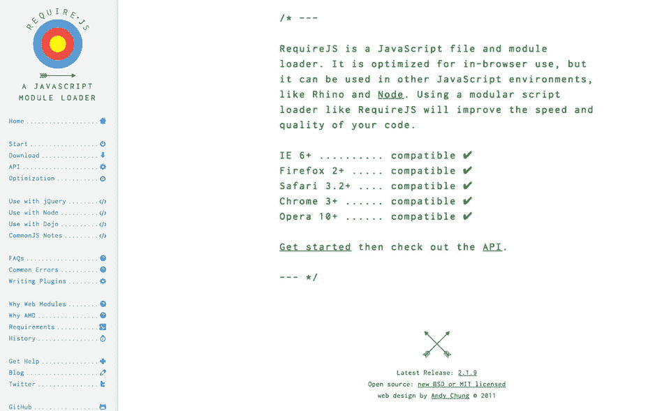
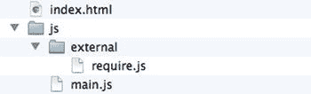
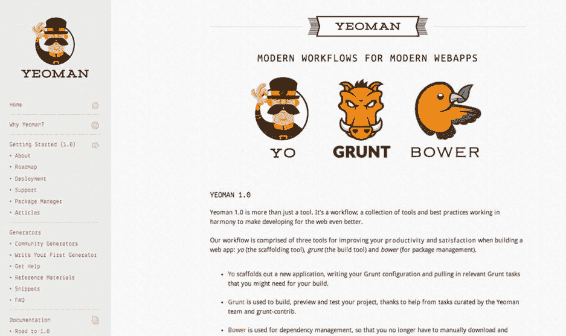
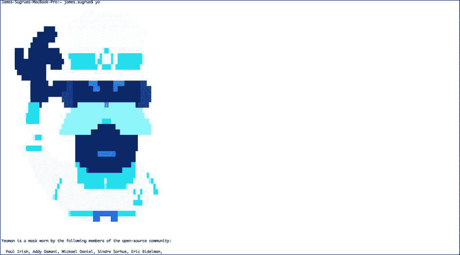
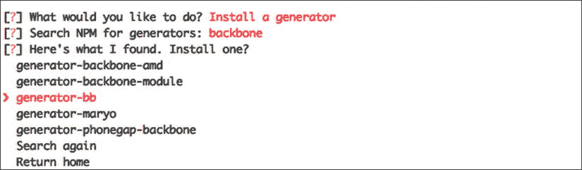
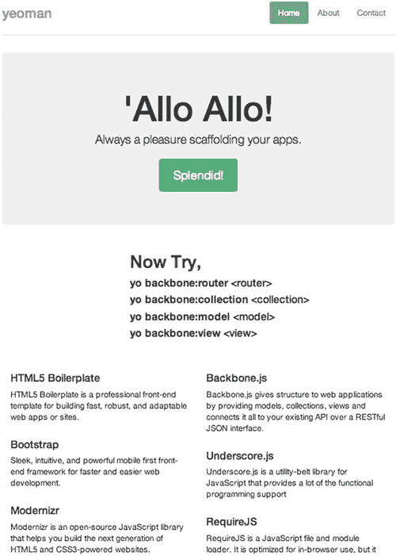

# 12. 创建可管理的 JavaScript 代码库

摘要

现在你已经知道如何构建 Backbone 应用、引入构建系统以及使用测试框架确保代码质量。最后一块拼图是保持代码的可维护状态。JavaScript 应用经常因随着时间的推移变得像一团意大利面条式的代码而受到批评，如果不加控制，你的 Backbone 应用也可能如此。本章为你带来一些技巧，帮助确保你的代码在其生命周期内保持可理解、模块化和可测试。在本章中，我们将介绍 RequireJS 作为一种确保你的应用真正模块化的方式，并讨论一些有助于在你的 Backbone 应用中强制执行结构和清晰度的有用设计模式。

## 使用 RequireJS 创建模块化应用

在本书中，我们一直使用命名空间来确保当视图和模型具有相同名称时不会发生冲突。然而，这仅解决了模块化的一个方面。你仍然需要确保基于依赖关系，脚本以正确的顺序加载。一旦应用规模扩大，不同对象之间的交互会变得难以管理。RequireJS 是处理此问题的最佳方式之一。

应用的另一个重要考量是可重用性。有些代码部分可能适合嵌入到其他视图中。一个典型的例子是 Google Talk：你可以通过独立视图与他人通信，同时也可以在 Gmail 网页侧边栏嵌入一个视图，或作为 Google Docs 中对话的一部分。与其多次编写相同代码，或者更糟的是复制代码，采用模块化方法意味着代码部分可以在多个地方使用。

传统语言，如 Java、C++ 和 C#，都有各自的方式使用 `import`/`include` 语法声明对其他类的依赖。在 JavaScript 中，这是不可能的。相反，开发者必须确保加载顺序正确，以便特定 JavaScript 代码所依赖的任何文件都首先被正确加载。虽然这在较小的应用中可行，但很快会变得规模失控并成为维护噩梦。

当涉及在 JavaScript 中创建模块时，RequireJS 被认为是领先的选择，并为前面列出的所有问题提供了出色的解决方案。

### 什么是 RequireJS？

RequireJS（[`www.requirejs.org`](http://www.requirejs.org/)，图 12-1）是异步模块定义（AMD）API 的一种实现。该 API 指定了一种定义模块的方式，使得模块及其任何依赖项都可以异步加载。这解决了依赖关系问题，同时也提升了 Web 应用的性能，因为脚本不再以同步方式加载。



图 12-1. [`Requirejs.org`](http://yeoman.io/)

将 RequireJS 集成到 JavaScript 应用中需要在整个应用范围内进行一些更改，包括模块定义以及主 HTML 页面中使用的初始脚本标签集。下一节将详细讨论 RequireJS 的使用。


### 使用 RequireJS

在探讨如何将 RequireJS 集成到 Backbone 应用程序之前，通过单独观察其使用方式（不依赖任何其他 JavaScript 库）来理解 RequireJS 的工作原理会更容易。

你需要从官方网站 [`www.requirejs.org/docs/download.html`](http://www.requirejs.org/docs/download.html) 下载 RequireJS。与前例一样，可以将其保存在 `js/external` 目录下。但是，当从 HTML 页面加载时，RequireJS 在其 `script` 标签中应使用额外的属性。`data-main` 属性用于指示 RequireJS 在自身加载完毕后，加载它所指向的脚本。这是整个应用程序的单一入口点，因此你的 HTML 页面中无需再包含其他脚本。

以下 HTML 代码说明了这一点：

```
<!DOCTYPE html>
<html>
<head>
<title>RequireJS 示例</title>
<!-- data-main 属性告诉 require.js 在加载完毕后
加载 scripts/main.js -->
<script data-main="js/main" src="js/external/require.js"></script>
</head>
<body>
<h1>我的应用程序</h1>
</body>
</html>
```

在此例中，`data-main` 指向 `js/main`，这意味着位于 `js` 目录中的 `main.js` 将成为第一个被加载的脚本。RequireJS 总是假设任何脚本依赖项都是 JavaScript 文件，因此文件名末尾无需指定 `.js`。图 12-2 展示了这个简单应用程序所需的文件夹结构。



图 12-2. RequireJS 应用程序的简单结构

从现在起，RequireJS 加载的所有代码都将来自 `js` 目录，因为主脚本加载所在的文件夹会被视为 RequireJS 中 `baseUrl` 配置的值。不过，你也可以手动设置这个值。其他针对 RequireJS 的额外配置（例如本例）通常会在主脚本中进行。

表 12-1 描述了设置 RequireJS 时一些最有用的配置选项。

表 12-1. 有用的 RequireJS 配置选项

| 选项 | 描述 |
| --- | --- |
| `baseUrl` | 这是用于加载 RequireJS 中所有模块的根目录。如果配置中未设置此项，且没有 `data-main` 可供计算，那么默认值将是加载 `require.js` 的 HTML 页面所在的位置。可以将 `baseUrl` 设置为不同域名，因为 RequireJS 支持跨域脚本加载。以下示例说明了如何将 `baseUrl` 设置为指向 `app` 目录：`require.config({ baseUrl: "/js/app", });` |
| `paths` | `paths` 哈希可用于为那些无法直接在指定 `baseUrl` 下找到的模块设置映射。这在需要缩短详细说明模块依赖关系时所使用的路径时非常有用。以下示例展示了如何将 `lib` 路径映射到 `js/external/lib`：`require.config({ paths: { 'lib': 'js/external/lib' } });` |
| `shim` | 这允许为那些未使用 `define()` 的旧脚本配置依赖关系、导出项和自定义初始化。在应用程序中添加 jQuery、Underscore 和 Backbone 的依赖项时，将需要此配置。shim 列表中的每一项都被赋予一个模块 ID 导出，并且可以选择性地包含一个依赖项列表。关于此配置的示例将在“在 Backbone 应用程序中包含 RequireJS”一节中提供。 |
| `map` | 这允许针对给定的模块前缀，将一个模块 ID 映射到另一个模块 ID。当你拥有两个不同版本的模块，但其他模块依赖于不同版本时，这会很有用。以下示例展示了两个不同的模块（`modone` 和 `modtwo`）如何都能将 `api` 模块引用为 `api`，但使用不同的版本：`requirejs.config({ map: { 'modone': { 'api': 'api1.0' }, 'modtwo': { 'api': 'api1.1' } } });` |
| `config` | `config` 选项允许将一个通用的配置对象传递给 RequireJS。它可以包含任何你希望模块可用的选项。在你的模块中通过使用 `require.config()` 即可访问此配置。 |
| `waitSeconds` | 此选项设置在放弃加载脚本之前等待的秒数。默认值为 `7`，将此值设置为 `0` 将禁用此超时，从而使 RequireJS 永远不会放弃加载脚本。 |
| `deps` | 此选项指定一个依赖项数组，这些依赖项在 RequireJS 配置处理完毕后会立即加载。 |

注意

RequireJS 将使用模块 ID 来加载所有模块。但是，如果你需要包含非模块文件，可以确保依赖项字符串以 `.js` 结尾，或者以 `http://` 或 `https://` 等协议开头。

对于这个简单的示例，无需额外配置，因此 `main.js` 保持为空。不过，一旦定义了一些模块，它就会负责启动应用程序。

### 定义和使用模块

创建模块可以让你创建一个具有定义域的对象，并且该对象依赖于应用程序中存在的其他模块列表。`define` 函数用于创建这些模块，根据你所定义模块的类型及其设置方式，该函数的参数会有所不同。

#### 具有名称-值对的模块

如果你创建的模块没有函数，只是一组名称-值对，可以通过将一个包含名称-值对的对象传递给 `define` 函数来定义它。例如，以下包含在 `Book.js` 中的代码将创建一个名为 `Book` 且包含特定数据集的模块。

```
define({
   title: "Beginning Backbone.js",
   author: "James Sugrue"
});
```

要在 `main.js` 中包含此模块，需使用 `require` 函数。`require` 函数有两个参数：一个所需模块名称的数组，以及一个将这些模块都作为参数的回调函数。

在此示例中，你可以简单地引用 `Book` 并将其作为回调函数中的一个参数使用。请注意，你可以随意命名这个参数。参数到模块的映射取决于模块在数组中列出的顺序及其在参数列表中的位置。

```
require(['Book'], function(book){
   console.log('标题: ' + book.title);
});
```

执行上述代码的结果应为在控制台输出“标题: Beginning Backbone.js”。

#### 具有设置逻辑的模块

更复杂的模块可能需要在返回模块定义之前执行一些逻辑。在这种情况下，`define` 函数可以接受一个函数作为其参数。该函数应在返回模块之前执行适当的步骤。

以下示例将把书籍标题转换为大写，作为初始设置步骤：

```
define(function(){
   var title = 'Beginning Backbone.js';
   var author = 'James Sugrue';
   title = title.toUpperCase();
   return {
          title: title,
          author: author
   };
});
```

假设将前面的模块保存在 `SetupBook.js` 中，当它在 `main.js` 中被使用时，它将输出大写的书籍标题。

```
//设置函数示例
require(['SetupBook'], function(book){
   console.log('标题: ' + book.title);
});
```


### 具有依赖关系的模块

当模块存在依赖关系时，可以在其 `define()` 函数中加载这些依赖，这与 `require()` 函数的使用方式类似。在这种情况下，`define()` 函数接受两个参数。第一个参数是一个模块 ID 数组，表示该模块所依赖的模块。第二个参数是一个回调函数，该函数将每个被依赖的模块作为参数接收。此函数返回一个定义 `Library` 模块的对象。

在以下示例中，`Library.js` 依赖 `Book.js` 来为图书馆定义一些内容。该模块返回一个包含函数的对象，而不仅仅是像之前那样简单的键值对。

```
define(["./Book"], function(book) {
    return {
        name: "My Library",
        getContents: function() {
            var books = [];
            books.push(book);
            return books;
        }
    }
});
```

此函数只有在依赖模块 `Book` 被加载之后才会执行。`Main.js` 将不再需要 `Book` 模块，而是会加载 `Library` 模块。

```
require(['Library'], function(library){
    console.log('Library Name: ' + library.name);
    for(var i = 0; i < library.getContents().length; i++){
        console.log('Book: ' + library.getContents()[i].title);
    }
});
```

运行此代码将在控制台输出图书馆的名称以及图书馆内容的列表（当前内容列表仅包含之前定义的简单 `Book` 模块）。

请注意，模块并非必须返回对象，也可以添加一个提供返回值的函数。

### 在 Backbone 应用程序中包含 RequireJS

如果你正在重构一个 Backbone 应用程序以利用 RequireJS 所倡导的模块化结构，则需要做一些准备工作来让代码就绪。如果你正在构建一个新的 Backbone 应用程序，可以直接跳到关于 Yeoman 的部分，其中描述了创建基于 RequireJS 的 Backbone 应用程序的简单快速启动方法。

为了说明如何将 RequireJS 整合到现有应用程序中，让我们再次审视一下 第 6 章 中的 Twitter 示例应用程序。

#### 初始 RequireJS 包含

首先，创建 第 6 章 代码的完整副本，并将 `require.js` 添加到 `js/external` 目录中。为了遵循标准的 RequireJS 约定，创建一个负责初始配置的 `main.js` 文件。该文件应放置在 `js` 目录中。原始 `index.html` 文件中的所有脚本包含都可以缩减为标准的 RequireJS 包含。

```
<script data-main="js/main" src="js/external/require.js"></script>
```

这个初始步骤不提供任何功能，但它涵盖了开始迁移到 RequireJS 的三个主要步骤：

- 下载 RequireJS。
- 移除主 HTML 页面中现有的脚本标签。
- 包含 RequireJS 并附带一个负责初始设置的 `main.js` 文件。

#### 为 RequireJS 配置 Backbone

有了 `main.js` 之后，你现在可以执行一些 RequireJS 的初始配置，以使像 Backbone 这样未以模块形式编写的库能够被 RequireJS 系统使用。这在 “使用 RequireJS” 部分的 shim 配置选项中已有简要提及。

首先，我们需要在 `main.js` 中为 RequireJS 创建一个初始配置对象。

```
require.config({

});
```

各个库的路径应添加到配置的 `paths` 部分。这告诉 RequireJS 可以在哪里找到像 Backbone、jQuery 和 Underscore 这样的库。每个库都会被赋予一个 ID。

```
require.config({
    paths: {
        jquery: './external/jquery-1.10.2',
        backbone: './external/backbone',
        underscore: './external/underscore',
    }
});
```

请注意，无需在库的路径末尾附加 `.js`；RequireJS 会自动添加。

这种配置的好处之一是，即使我们将 jQuery 引用为 `jquery`，它也可以指向一个特定的版本。这是整个代码中唯一需要考虑版本的地方。随着你的应用程序中使用新的 jQuery 版本，只需在此位置更新路径即可。需注意，在 RequireJS 中，jQuery 必须始终被称为 `jquery`。它已经兼容 AMD，但它是一个具名模块，该名称不得偏离 `jquery`。

需要处理的下一部分配置是 shim。对于所有未使用 RequireJS `define()` 语法创建的库，需要在此处使其可用。由于 jQuery 已经将自身定义为一个模块，因此不需要将其包含在 `shim` 部分中。

每个库都使用在 `paths` 部分中给出的相同名称进行标识。每个库可能有一些依赖项，这些依赖项在 `deps` 属性中以字符串数组的形式列出。在以下示例中，Backbone 同时依赖于 Underscore 和 jQuery。由于 Underscore 本身没有依赖关系，因此不需要为其定义任何 `deps`。

shim 中列出的每个库都需要定义一个 `exports` 属性，该属性提供对用于访问该库的全局变量的访问权限。对于 Underscore，这是 `_`，就像你在没有 RequireJS 的情况下使用该库一样；Backbone 显然使用 `Backbone` 作为其导出值。

```
shim: {
    underscore: {
        exports: '_'
    },
    backbone: {
        deps: [
            'underscore',
            'jquery'
        ],
        exports: 'Backbone'
    },
},
```

为确保一切正常，在 `main.js` 的 RequireJS 配置之后添加以下代码行。它简单使用 RequireJS 加载 Backbone 并调用启动历史记录。如果这里出现问题，你将在浏览器控制台中看到错误信息。

```
require([
    'backbone'
], function (Backbone) {
    Backbone.history.start();
    console.log('All ok');
});
```

我们的示例应用程序还依赖于其他一些库，包括 Handlebars 和 Moment.js。这些也需要包含在配置的 `path` 和 `shim` 部分中。以下代码展示了 Twitter 示例应用程序的完整 RequireJS 配置：

```
require.config({
    shim: {
        underscore: {
            exports: '_'
        },
        backbone: {
            deps: [
                'underscore',
                'jquery'
            ],
            exports: 'Backbone'
        },
        handlebars: {
            exports: 'Handlebars'
        },
        moment: {
            exports: 'moment'
        },
        dialog: {
            exports: 'Dialog'
        },
    },
    paths: {
        jquery: './external/jquery-1.10.2',
        backbone: './external/backbone',
        underscore: './external/underscore',
        handlebars: './external/handlebars',
        moment: './external/moment'
    }
});
```


好的，作为一名高级文档工程师和翻译员，我将严格遵循您的注意事项和示例格式，将给定的英文文本翻译成中文。


#### 使用 RequireJS 重构你的应用

在为所有外部库配置好 RequireJS 之后，接下来的任务是重构你为应用程序创建的所有 JavaScript 代码，使其适应这种模块化方法。

总的来说，你应该能够将以下模式应用于你的所有代码，以确保其符合规范。首先，将以下内容附加到文件的开头。这是你定义文件依赖项的地方，每个依赖项都将作为参数传递给回调函数。

`define([ ], function() {`

文件中已存在的代码可以保持不变，文件可以用下面的代码来结尾：

```
// 导出的内容：
return object;
```

`});`

现在，每当另一个 JavaScript 文件对已定义的模块调用 `require` 时，它都会收到正确的对象。为了更好地理解如何迁移应用程序代码，让我们首先考虑 `Timeline` 视图，它是应用的核心。`TimelineView` 对象本身有许多依赖项：

- 集合：`Timeline.js`
- 模型：`Tweet.js`
- Handlebars 助手：`Helpers.js`

要使视图成为一个模块，所有下游依赖项也需要转换为模块。最好的起点是堆栈的底层，即 `Tweet` 模型对象。它有一个简单的依赖项列表：Backbone 和 Moment.js，这两个库都已经在 RequireJS 配置中定义好了。首先，需要将这些定义放在文件的开头。

```
define(['backbone', 'moment'], function(Backbone, moment) {
    var com = com || {};
    com.apress = com.apress || {};
    com.apress.model = com.apress.model || {};
    com.apress.model.Tweet = Backbone.Model.extend({
        parse: function(model){
            var created = model.created_at;
            var friendly = moment(model.created_at, "ddd MMM DD HH:mm:ss ZZ YYYY").fromNow();
            model.friendlyDate = friendly;
            return model;
        }
    });
    return com.apress.model.Tweet
});
```

该文件的末尾追加了一条 return 语句，该语句引用了 `com.apress.model.Tweet` 变量，然后关闭了 `define` 函数。这是最简单的重构，因为它不依赖于任何其他自定义创建的对象。

接下来，需要重构集合 `Timeline.js`。这会有点不同，因为它是第一个依赖于其他自定义对象的对象。该集合对象依赖于 Backbone 和刚刚被转换为模块的 `Tweet` 模型。

```
define([ 'backbone', 'app/model/Tweet'], function(Backbone, Tweet) {
    var com = com || {};
    com.apress = com.apress || {};
    com.apress.collection = com.apress.collection || {};
    com.apress.collection.Timeline = Backbone.Collection.extend({
        //该集合使用的模型
        model: Tweet,
        //为集合连接的服务器端 URL
        url: 'http://localhost:8080/timeline',
        initialize: function(options){
            //此处定义在构造时需要初始化的内容
        },
    });
    return com.apress.collection.Timeline;
});
```

尽管转换模式与之前所述相同，但对 `Tweet` 模型的任何引用都已从 `com.apress.model.Tweet` 更改为 `Tweet`。这是因为该模块已以此名称公开，而不是使用命名空间版本。实际上，在使用 RequireJS 时，你可以考虑从代码中删除命名空间概念。

`TimelineView` 遵循相同的方法，尽管它有更长的依赖项列表，包括 Handlebars 和 jQuery，以及 `Timeline` 对象。

```
define(['jquery', 'handlebars', 'backbone', 'app/collection/Timeline'], function($, Handlebars, Backbone, Timeline) {
    var com = com || {};
    com.apress = com.apress || {};
    com.apress.view = com.apress.view || {};
    com.apress.view.TimelineView = Backbone.View.extend({
        el: '#timeline',
        template: Handlebars.compile($("#timeline-template").html()),
        timeline: null,
        events: {
            'click .profile': 'showDialog'
        },
        initialize: function(options){
            var self = this;
            //为该视图创建一个要渲染的集合
            self.timeline = new Timeline();
            //初始渲染
            self.render();
            //强制 fetch 触发 reset 事件
            self.timeline.fetch({reset:true});
            self.listenTo(self.timeline, 'reset', self.render);
        },
        render: function(){
            var self = this;
            if(self.timeline.models.length > 0){
                var output = self.template({tweet: self.timeline.toJSON()});
                self.$el.append(output);
            }
            return self;
        },
        showDialog: function(options){
            var self = this,
                $target = $(options.currentTarget),
                username = $target.data('user');
            /**
            * 重用 profile 视图
            **/
            var profileView = new com.apress.view.ProfilePopupView({user: username});
        }
    });
    // 导出内容：
    return com.apress.view.TimelineView;
});
```

请注意，此处对 `Timeline` 集合的引用也已更改。不再是下面这样：

`self.timeline = new com.apress.collection.Timeline();`

它使用了 RequireJS 模块引用：

`self.timeline = new Timeline();`

最后，需要使 Handlebars 助手可以从 RequireJS 访问。该模块不需要导出任何东西；它只需要执行代码以将助手添加到 `Handlebars` 模块。

```
define(['handlebars'], function (Handlebars) {
    Handlebars.registerHelper('format', function (str) {
        if(str){
            //高亮 @ 部分
            //http://www.simonwhatley.co.uk/parsing-twitter-usernames-hashtags-and-urls-with-javascript
            str = str.replace(/[@]+[A-Za-z0-9-_]+/g, function(u) {
                var username = u.replace('@','')
                return '<a href="#" data-user="' + username +'" class="profile">@'+username+'</a>';
            });
            return new Handlebars.SafeString(str);
        } else {
            return str;
        }
    });
});
```

为了执行这些模块并查看 `TimelineView` 的效果，需要向 `main.js` 添加一些额外的代码。现在，应用程序需要 Backbone 和 `TimelineView`，它们中的每一个都会加载自己依赖的模块。`Helpers` 模块也作为需求包含在此处，以便将其助手添加到 `Handlebars`。

```
require([
    'backbone', 'app/view/TimelineView', 'app/util/Helpers'
], function (Backbone, TimelineView) {
    var timelineView = new TimelineView();
});
```

该视图是通过引用作为依赖项传递的 `TimelineView` 模块来创建的。只要每个对象都已转换为模块，`main.js` 末尾的这一部分将完成整个应用程序的配置，正如之前在 `app.js` 中介绍的那样。密切关注每个文件拥有的依赖关系非常重要。视图通常需要导入 jQuery (`$`) 和 Handlebars，以及 Backbone 和你自己的自定义模块。如果你一直遵循命名空间约定，则可以轻松识别它们，因为它们都以 `com.apress` 开头。

一旦所有代码成功迁移，下面的代码应该能够在与第 6 章相同的条件下运行该应用：

```
require([
    'backbone', 'app/view/TimelineView', 'app/view/ProfileView', 'app/model/Search',
    'app/view/SearchView', 'app/router/AppRouter', 'app/util/Helpers'
], function (Backbone, TimelineView, ProfileView, Search, SearchView, AppRouter) {
    var timelineView = new TimelineView(),
        profileView = new ProfileView({user: 'sugrue'}),
        searchModel = new Search(),
        searchView = new SearchView({model: searchModel}),
        appRouter = new AppRouter({searchModel: searchModel});
    Backbone.history.start();
});
```


## 使用 Yeoman 快速上手

在第 10 章中，我们讨论了 `Grunt` 如何通过生成器帮助你快速构建完整的应用结构。Yeoman ([`http://yeoman.io`](http://yeoman.io/)，图 12-3) 让这一过程更加便捷，它提供了适用于 Backbone 应用的生成器，并利用了 `RequireJS`。



图 12-3. Yeoman 网站 [`http://yeoman.io`](http://yeoman.io/)

Yeoman 由 Google Chrome 开发者关系团队创建，是一个工具栈，整合了三种工具以提升你在创建 Web 应用时的生产力。它包含我们在第 9 章中深入讨论过的 `Grunt`，以及另外两个工具：`Bower` 和 `Yo`。

`Bower` 是一个用于 Web 应用中库和框架的包管理器。与 `NPM` 类似，`Bower` 允许你通过命令行下载所需的库，并自动附带所有依赖库。这大大改进了下载库并查找其依赖项的过程。

`Yo` 是 Yeoman 的核心，提供了一种脚手架工具，用于从命令行从头构建 Web 应用。目前已有许多生成器可用，包括 Backbone 生成器，我们将在后续章节中重点介绍。

### 安装 Yeoman

与许多 JavaScript 工具一样，Yeoman 通过 Node.js 的 `npm` 命令安装。你只需使用以下命令：

```
npm install -g yo
```

如果你使用的是 Node 1.2.10 或更新版本，此时 `grunt-cli` 和 `bower` 也会自动安装。如果没有，你可以使用以下命令手动安装这些依赖项：

```
npm install -g grunt-cli bower
```

通过在命令行输入 `yo` 来测试安装是否成功。你应该会看到类似图 12-4 的输出。



图 12-4. 运行 `yo` 命令的输出

默认安装将包含两个生成器：一个 mocha 生成器和一个 web 应用生成器。下一节将介绍如何安装和使用 Backbone 生成器。

### 使用 Backbone 生成器

生成器的安装是在 `yo` 命令行中进行的。输入 `yo` 后，你会看到“安装一个生成器”的选项。选中后，你可以搜索生成器并选择所需的那一个。在此情况下，选择 `generator-bb`，如图 12-5 所示。



图 12-5. Yeoman 安装 Backbone 生成器时的输出

要运行 Backbone 生成器，只需在命令行输入 `yo backbone`。系统会为你提供一系列 Backbone 应用的选项。在撰写本文时，这些选项包括：

*   是否使用 Twitter Bootstrap 搭配 SASS 或 CoffeeScript
*   是否包含 RequireJS

默认情况下，生成的应用将包含 jQuery、Backbone.js、Modernizr 和 HTML5 Boilerplate。HTML5 Boilerplate 项目是一个前端模板，而 Modernizr 则为你的应用提供特性检测功能，让你了解当前浏览器支持哪些特性。

该生成器还会创建一个 `Grunt` 脚本，并预配置好任何 JavaScript 应用所需的标准任务集。这些任务包括压缩、静态分析和测试，如第 9 章所述。默认情况下，还包含了实时重载任务。当服务器任务运行时，若对任何源文件做出更改，你的 Web 浏览器实例将自动刷新。

要启动示例应用，只需在命令行运行以下命令：

```
grunt server
```

这将在你的 Web 浏览器中打开页面，效果应如图 12-6 所示。



图 12-6. 由 Yeoman Backbone 生成器生成的 Backbone 应用

生成器提供了有用的快捷方式来创建额外的视图，而无需手动添加模型、集合、视图和路由器。例如，要创建一个简单的视图，只需使用如下命令：

```
yo backbone:view Timeline
```

这将生成两个文件。首先是一个 `ejs` 模板，如果你希望改用本书讨论的其他模板系统，可以将其替换。同时还会创建一个与传入名称匹配的视图，在本例中为 `Timeline.js`。如果你选择在应用中使用 `RequireJS`，生成的代码将如下所示：

```
/*global define*/

define([
   'jquery',
   'underscore',
   'backbone',
   'templates'
], function ($, _, Backbone, JST) {
   'use strict';
   var TimelineView = Backbone.View.extend({
       template: JST['app/scripts/templates/Timeline.ejs']
   });
   return TimelineView;
});
```

我认为这是开始一个新应用并使用 `RequireJS` 的最简单方式，无需处理所有样板代码。

## Backbone 应用的设计模式

在设计应用时，应用一些设计模式是值得的，例如著名的“四人帮”书籍《设计模式：可复用面向对象软件的基础》中讨论的那些模式。这些模式涵盖了一些被广泛理解的方法，用于解决软件设计中常见的共性问题。虽然有很多模式可以应用到你的应用中，但本节重点介绍对 Backbone 应用最实用的两种模式：外观模式和中介者模式。


### 利用外观模式

外观模式背后的理念是隐藏复杂的实现细节，使模块只向调用代码暴露最必要的内容。这种模式被称为结构型模式，因为它定义了一种实现实体间关系的简单方法。《设计模式》一书中的经典定义指出，外观模式应实现以下目标：“为子系统中的一组接口提供一个统一的接口。外观定义了一个更高层级的接口，使子系统更易于使用。”

在 Backbone 应用中创建的外观，可能会将多个模块的工作封装到调用方使用的单个模块中，但更常见的做法是，你只需创建那些仅导出核心功能的模块。使用外观模式的主要目的是，确保使用你模块的其他开发者永远无需担心底层细节。

外观模式的一个实用场景是`Model`对象。使用默认的 Backbone 模型对象时，你可以通过名称获取任意属性。虽然这简单方便，但如果数据结构发生变化，使用该模型的代码可能会面临风险。添加 getter 和 setter 函数可以将你与这些变化隔离开来，这样一来，唯一需要处理数据结构变化的代码就只存在于模型内部。

请参考以下来自第 6 章的示例，我们通过第三方 API（如 Twitter）获取数据，并用 Backbone 模型表示它：

```
var com = com || {};
com.apress = com.apress || {};
com.apress.model = com.apress.model || {};
com.apress.model.Tweet = Backbone.Model.extend({
   parse: function(model){
      var created = model.created_at;
      var friendly = moment(model.created_at, "ddd MMM DD HH:mm:ss ZZ YYYY").fromNow();
      model.friendlyDate = friendly;
      return model;
   }
});
```

如果推文的数据结构发生变化，且`Tweet`对象在多个地方被使用，那么这些变化将对我们的代码造成干扰。更好的做法是提供 getter 函数来获取所需属性。

```
var com = com || {};
com.apress = com.apress || {};
com.apress.model = com.apress.model || {};
com.apress.model.Tweet = Backbone.Model.extend({
   parse: function(model){
      var created = model.created_at;
      var friendly = moment(model.created_at, "ddd MMM DD HH:mm:ss ZZ YYYY").fromNow();
      model.friendlyDate = friendly;
      return model;
   },
   getText: function(){
      return this.get('text');
   },
   getProfileImage: function(){
      return this.get('user').profile_image_url;
   },
   getUserName: function(){
      return this.get('user').name;
   }
});
```

外观模式可用于应用中创建的任意模块。例如，你可以不返回基础模型对象，而是直接导出一个模块使用者所需的函数。在下面的代码示例中，表示复杂操作的两个函数对模块保持私有，而一个简单的`convert`函数则对调用方开放。

```
/*global define*/
define([
   'underscore',
   'backbone'
], function (_, Backbone) {
   'use strict';
   var ConversionModel = Backbone.Model.extend({
       defaults: {
       },
       complexOperation: function(value){
   //此处执行复杂工作
       },
        secondOperation: function(value){
   //第二个操作
}
});
   return {
convert: function(value){
      return ConversionModel.complexOperation(value) + ConversionModel.secondOperation(value);
   }
}
});
```

使用外观模式后，底层的实现细节可以任意变化，而无需担心任何使用你模块的其他代码。

### 利用中介者模式

JavaScript 应用中另一个流行的模式是中介者模式，它有助于在模块之间实现更高程度的解耦。中介者模式被称为行为型模式，因为它处理的是对象之间的关系和职责。《设计模式》一书中的定义指出，该模式实现以下目标：“通过封装不同对象集之间交互和通信的方式，实现松耦合。允许每个对象集的行为独立于其他对象集而变化。”

这种模式最好的类比是机场控制塔：控制塔（中介者）负责管理谁可以起飞和降落，所有进出飞机的通信都通过控制塔进行，而不是让各架飞机之间相互通信。

大型应用可以通过引入一个单一的中介者来获益，该中介者提供事件传递的单一节点，由这个中央模块决定哪些模块应收到通知。

以下代码片段展示了一个中介者的实现示例。该模块暴露了两个函数。首先是`subscribe`函数，模块可以使用它来注册对特定事件类型的兴趣。此外还有一个`notify`函数，允许任何模块向中介者通知新事件。

```
define( function(){
      //一个频道列表，每个频道本身又含有一个订阅者列表
      var channels = [];
      var publish  = function(eventType, params){
         //查找订阅者
         if(channels[eventType]){
            for(var i= 0; i < channels[eventType].length; i++){
               var channel = channels[eventType][i];
               channel.callback.call(channel.context, params);
            }
         }
      };
       return {
           subscribe: function(eventType, callback){
              if(!channels[eventType]){
                 channels[eventType] = [];
              }
              channels[eventType].push({context: this, callback: callback});
           },
           notify: function(eventType, params){
              publish(eventType, params);
           }
       }
   }
);
```

每个模块注册时，它会被添加到一个频道列表中。请注意，这是一个简单的实现，没有提供取消注册的函数。

这个模块的使用方法非常简单。任何模块都可以通过回调函数注册对特定事件的处理兴趣。

```
require(['Mediator'], function(mediator){
   var callback = function(args){
      console.log('处理名称更改。值为 ' + args.name);
   };
   mediator.subscribe('name.change', callback);
});
```

在以上代码中，有一个回调函数订阅了`name.change`通知的处理。要触发该通知，需要调用`notify`函数。

```
mediator.notify('name.change', {name: 'Beginning Backbone.js'});
```

这会导致与该事件相关的回调函数被触发。这是一个小规模的示例，用于说明该模式的使用方式。你会在常见的代码仓库（如 GitHub）中找到大量此类发布-订阅模式的实现。

为应用中的所有事件提供一个中央控制模块，会使你的应用更易于管理。除了能够跨所有模块分发通知外，中介者还可以扩展，以便在应用处于特定状态时抑制通知。


