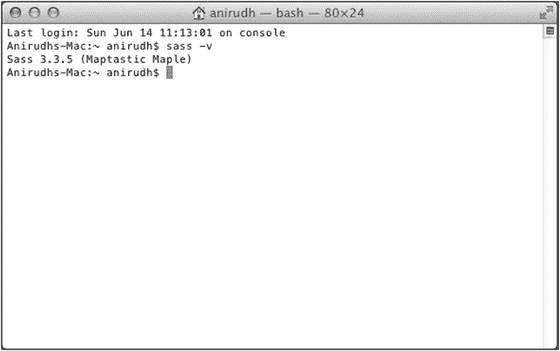
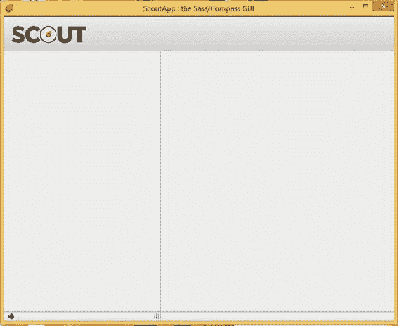
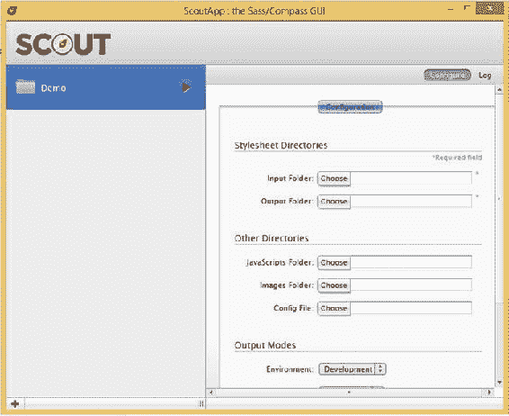
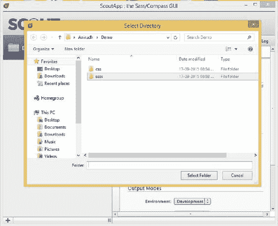
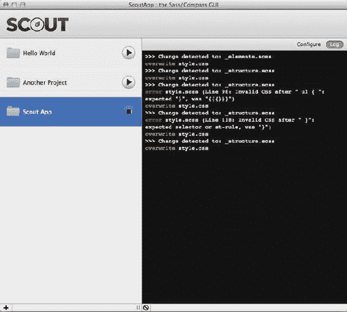

# 第 2 章


# Sass 简介

在上一章中，你了解了预编译器，包括为什么使用它们，哪些是知名的预处理器，以及它们的特性。本章将介绍最流行的预处理器之一：Sass。

在本章中，你将探索 Sass 的以下方面：

*   安装
*   运行代码
*   变量
*   注释
*   数据类型
*   括号
*   嵌套规则
*   嵌套属性
*   引用父选择器
*   插值
*   占位符选择器
*   逻辑及控制指令

## 安装 Sass

你可以通过 Ruby gem 安装 Sass，因此首先需要确保机器上已安装 Ruby。如果你使用 Mac OS X，系统已预装 Ruby。如果使用 Windows 或 Linux，则需要从 [`rubyinstaller.org/downloads/`](http://rubyinstaller.org/downloads/) 下载并安装 Ruby。

安装 Ruby 后，可以通过运行 `gem` 命令来安装 Sass。你可以将 `gem` 视为一种扩展工具，它能够扩展使用 Ruby 的应用程序的功能。按照代码清单 2-1 所示的命令，即可在命令行中安装 Sass。该命令的简单解释是：“Ruby，请安装名为 sass 的 gem”。

**代码清单 2-1**. 安装 Sass 的命令

```
sudo gem install sass
```

安装完成后，可以通过运行代码清单 2-2 中的命令进行验证。

**代码清单 2-2**. 验证 Sass 安装的命令

```
sass -v
```

这将会显示如图 `2-1` 所示的输出信息。



图 2-1. `sass -v` 命令的输出

完成此安装后，你就可以开始使用 Sass 了。

## 查看其他版本的 Sass

除了最新版本，你还可以通过执行代码清单 2-3 所示的命令来查看其他可用版本。

**代码清单 2-3**. 查看其他版本的 Sass

```
gem list sass –a –r
```

该命令要求 Ruby 列出所有名称中包含“sass”的 gem。其中，`-r` 命令属性指示 Ruby 进行远程检查，以获取所有可用的 Sass 版本；`-a` 命令属性用于列出所有可用版本。

该 `gem list` 命令的输出如代码清单 2-4 所示。

**代码清单 2-4**. `gem list` 命令的输出文本

```
sass (3.4.18, 3.4.17, 3.4.16, 3.4.15, 3.4.14, 3.4.13, 3.4.12, 3.4.11, 3.4.10, 3.4.9, 3.4.8, 3.4.7, 3.4.6, 3.4.5, 3.4.4, 3.4.3, 3.4.2, 3.4.1, 3.4.0, 3.3.14, 3.3.13, 3.3.12, 3.3.11, 3.3.10, 3.3.9, 3.3.8, 3.3.7, 3.3.6, 3.3.5, 3.3.4, 3.3.3, 3.3.2, 3.3.1, 3.3.0, 3.2.19, 3.2.18, 3.2.17, 3.2.16, 3.2.15, 3.2.14, 3.2.13, 3.2.12, 3.2.11, 3.2.10, 3.2.9, 3.2.8, 3.2.7, 3.2.6, 3.2.5, 3.2.4, 3.2.3, 3.2.2, 3.2.1, 3.2.0, 3.1.21, 3.1.20, 3.1.19, 3.1.18, 3.1.17, 3.1.16, 3.1.15, 3.1.14, 3.1.13, 3.1.12, 3.1.11, 3.1.10, 3.1.9, 3.1.8, 3.1.7, 3.1.6, 3.1.5, 3.1.4, 3.1.3, 3.1.2, 3.1.1, 3.1.0)
sass-960gs (1.0.0, 0.1.0, 0.0.3, 0.0.2, 0.0.1)
sass-a11y (0.1.0)
sass-aleksi (0.1.2)
sass-align (0.1.1, 0.1.0)
sass-buttons (0.1.2, 0.1.1)
sass-capucine (0.0.3, 0.0.2, 0.0.1)
sass-color-helpers (2.0.0)
sass-color-schemes (0.4.0, 0.3.1, 0.3.0, 0.2.0, 0.1.0)
sass-extractor (0.0.1)
sass-extras (1.1.0, 1.0.2, 1.0.1, 1.0.0, 0.0.1)
sass-flexi (1.0.6, 1.0.5, 1.0.4, 1.0.3, 1.0.2, 1.0.1, 1.0.0)
sass-fontimage (0.1.1, 0.1.0)
sass-getunicode (1.0, 0.0.2, 0.0.1, 0.0.0)
sass-globbing (1.1.1, 1.1.0, 1.0.0)
sass-globbing-pr-20 (1.1.2)
sass-images (0.0.2, 0.0.1)
sass-import_once (0.1.3, 0.1.2, 0.1.0)
sass-json-vars (0.3.3, 0.3.2, 0.3.1, 0.3.0, 0.2.1, 0.2.0, 0.1.0, 0.0.1)
sass-list-maps (1.0.0, 0.9.9, 0.9.7, 0.9.6, 0.9.5, 0.9.3, 0.9.2, 0.9.1)
sass-material-colors (0.0.5, 0.0.4.2, 0.0.4.1, 0.0.4, 0.0.3, 0.0.2, 0.0.1)
sass-media_query_combiner (0.0.7, 0.0.6, 0.0.5, 0.0.4, 0.0.3, 0.0.2, 0.0.1)
sass-mediaqueries-rails (1.3, 1.2.3.1, 1.2.3)
sass-mixin-collection-rails (0.0.11, 0.0.1)
sass-pantones (0.0.1)
sass-pygments-rails (0.1)
sass-rails (5.0.4, 5.0.3, 5.0.2, 5.0.1, 5.0.0, 4.0.5, 4.0.4, 4.0.3, 4.0.2, 4.0.1, 4.0.0, 3.2.6, 3.2.5, 3.2.4, 3.2.3, 3.2.2, 3.2.1, 3.2.0, 3.1.7, 3.1.6, 3.1.5, 3.1.4, 3.1.3, 3.1.2, 3.1.1, 3.1.0)
sass-rails-bootstrap (2.2.2.3, 2.2.2.2, 2.2.2.1, 2.2.2, 2.2.1, 2.1.1, 2.1.0.1, 2.1.0, 2.0.4, 2.0.2)
sass-rails-source-maps (0.1.0, 0.0.4, 0.0.3, 0.0.2, 0.0.1)
sass-rails3 (4.0.1)
```

- 执行命令 `gem list sass –pre –r` 可查看可用的预发布版本，如代码清单 2-5 所示。

**代码清单 2-5**：通过命令行查看预发布版本

```
gem list sass –pre –r
```

- 如需试用稳定版中尚未包含的最新功能，可安装预发布版本。使用代码清单 2-6 所示的命令进行安装。

**代码清单 2-6**：安装预发布版本

```
sudo gem install sass –pre
```

- 某些情况下可能需要卸载已安装的 Sass 版本（例如使用支持项目中某些弃用功能的旧版本），可通过代码清单 2-7 所示方法操作。

**代码清单 2-7**：卸载 Sass 的命令

```
gem uninstall sass –-version versionnumber
```

## 命令行替代方案

除终端方式外，还有图形用户界面应用可运行并编译 Sass，适合不熟悉或畏惧终端操作的用户。各平台均有免费及付费版本，部分应用如下：

*   Codekit（付费，仅 Mac）
*   Compass（付费，支持 Mac/Windows/Linux）
*   Prepros（付费，支持 Mac/Windows/Linux）
*   Mixtures（免费，仅 Mac）
*   Scout（开源，支持 Mac/Windows/Linux）
*   Koala（免费，支持 Mac/Windows/Linux）

## 编译 Sass 文件

安装 Sass 后即可开始编码与编译。需指定 Sass 监听的哪个文件，使用代码清单 2-8 所示的命令。

**代码清单 2-8**：Sass 监听并编译文件的命令

```
sass --watch style.scss:style.css
```

代码清单 2-8 所示命令会监听 `.scss` 文件的变更。每当修改并保存 `.scss` 文件时，Sass 会编译并生成对应的 `.css` 文件。该命令可分解为：

*   `sass`（主组件，表明这是一个 Sass 命令）
*   `--watch`（该命令需执行的操作）
*   `style.scss:style.css`（输入与输出文件，以冒号分隔）

在终端中输入代码清单 2-9 所示命令可查看更多命令选项。

## 代码清单 2-9：访问 Sass 文档的命令

```
sass --help
```

## 使用应用避免命令行：Scout

Scout 是一款基于 Adobe Air 构建的免费应用，可从[`mhs.github.io/scout-app/`](http://mhs.github.io/scout-app/)下载。打开应用后，点击左下角的加号图标添加项目。图 2-2 展示了 Scout 应用的界面。



图 2-2 Scout 应用界面；需点击左下角加号图标开始操作

点击加号后，将看到图 2-3 所示的界面。



图 2-3 向 Scout 添加项目

如图所示，可配置多种参数，包括样式表目录、JavaScript 目录和图像目录。还可在“Config File”字段中指定 Sass 编译的配置文件。请注意“Output Modes”选项。保持默认设置可获得优化且可读的代码，不进行压缩。

可设置不同的输出样式以进一步压缩输出结果。本示例中使用前两个字段指定样式表的输入和输出文件夹。

设置好所需字段后，点击项目名称旁的“Start”按钮启动 Scout 项目，将看到图 2-4 所示的界面。



图 2-4 选择输入和输出文件夹

Scout 会监听所有变更并编译为相应的 CSS（参见图 2-5）。若存在语法问题，用户会立即收到通知。随后可最小化应用，继续开发。



图 2-5 Scout 已启动并正在监听项目

## 自动化工作流

与 Scout 类似，还有许多免费工具可加速前端开发。若希望进一步自动化开发流程且不畏惧命令行操作，可了解 Yeoman（[`yeoman.io/`](http://yeoman.io/)），参见图 2-6。Yeoman 不仅编译 Sass，还是一个完整的构建系统，可优化图像、刷新浏览器等。其核心功能包括：

*   **脚手架**（根据维基百科：“脚手架是某些模型-视图-控制器框架支持的技术，程序员可指定应用程序数据库的使用方式。编译器或框架利用此规范及预定义的代码模板，生成应用程序可用于创建、读取、更新和删除数据库条目的最终代码，有效地将模板视为构建更强大应用程序的‘脚手架’。公司通常用于创建基于 Web 的程序。”）
*   构建系统，生成压缩/编译后的代码构建版本。
*   包管理器，自动获取所有必需的库。

另一个知名的自动化工具是 Bower（[`bower.io/`](http://bower.io/)）。


图 2-6 访问 Yeoman.io 获取 Yeoman 框架

### 变量

与其他编程语言类似，变量用于将值关联到一个名称，以便在代码中重复使用。因此，您只需引用名称，而无需克隆值。在 Sass 中，可存储颜色、排版信息等可复用内容。使用`$`符号创建 Sass 变量，如代码清单 2-10 所示。

### 代码清单 2-10：在 Sass 中创建变量

```
$fontColor:#666;

body{
        color:$fontColor;
}
```

当此 Sass 代码编译为普通 CSS 时，`body`样式定义中的`$fontColor`会被实际值替换。

变量如果在任何样式声明之外声明，则是全局可访问的；如果在特定选择器内声明，则仅对该选择器可用。参见代码清单 2-11 中的示例。

### 代码清单 2-11：演示变量作用域的代码

```
body{
  $fontColor:#666;
  color:$fontColor;
}
p{
  color:$fontColor;
}
```

此代码会报错：

```
Undefined variable: "$fontColor".
```

这是因为`$fontColor`在`body`标签的样式块内声明。

变量可与样式规则的部分组合，形成单一样式规则。在此类实现中，变量会被其实际值替换。如代码清单 2-12 所示。

#### 结合变量组合 CSS 规则代码

### 代码清单 2-12 结合变量组合 CSS 规则代码

```
$border-color: #000;
.containerBlock {
  border: 2px $border-color solid;
}
```

你可以基于一个变量来创建另一个变量，具体做法如 **清单 2-13** 所示。

### 代码清单 2-13 基于一个变量声明另一个变量

```
$border-color: #000;
$borderDeclaration: 2px $border-color solid;
.containerBlock {
  border:$borderDeclaration;
}
```

Sass 允许你在代码中互换使用下划线和连字符。因此，**清单 2-14** 所示的代码是有效的，不会报错。

### 代码清单 2-14 演示下划线与连字符的互换使用

```
$color-positive: #0F0;
.note {
color: $color_positive;
}
```

#### 数据类型

Sass 支持多种数据类型：

- 数值（例如：`2.0`、`15`、`12px`）
- 字符串（例如：`"foo"`、`bar`）
- 颜色值（例如：`#f00`、`rgb(255,255,150)`）
- 布尔值（例如：`true`、`false`）
- 逗号或空格分隔的值（例如：`10px 20px`、`'Tahoma','Arial',san-serif`）

Sass 也支持 CSS 的 `!important` 声明。

#### 变量的默认值

变量可以被赋予默认值，当未给变量指定具体值时，该默认值就会生效。当你想在代码中统一使用某个默认值，并只在特定情况下修改它时，这一特性会非常有用，如 **清单 2-15** 和 **2-16** 所示。

### 代码清单 2-15 默认值示例

```
$borderRadius: 5px !default;
```

### 代码清单 2-16 显式指定值时默认值被忽略的示例

```
$borderRadius:10px;
.notArea{
        Border-radius:$borderRadius;
}
```

### 代码清单 2-17 代码清单 2-16 的输出结果

```
.notArea{
        Border-radius:10px;
}
```

如果在运行 **清单 2-16** 的代码时，没有显式指定 `borderRadius` 的值，代码会继续使用默认值。因此，输出结果将如 **清单 2-18** 所示。

### 代码清单 2-18 未显式定义 `borderRadius` 值时代码清单 2-16 的输出结果

```
.notArea{
        Border-radius:5px;
}
```

### Sass 中的样式嵌套

编写 CSS 时，你必须重复选择器来为某些元素下的子元素分配样式规则。**清单 2-19** 所示的代码就是一个常见的选择器重复示例。

### 代码清单 2-19 CSS 中的代码重复

```
.article .h1 {
  font-weight: bold;
}

.article p {
  line-height: 1em;
}

.article img {
  float: left;
}
```

在 Sass 中，你可以通过嵌套 CSS 选择器来避免这种代码重复。因此，**清单 2-19** 的代码用 Sass 重写后会如 **清单 2-20** 所示。

### 代码清单 2-20 代码清单 2-19 的 Sass 版本

```
.article{
  .h1{
    font-weight:bold;
  }
  p{
    line-height:1em;
  }
  img{
    float:left;
  }
}
```

这种方法不仅消除了代码重复，还使代码更具可读性。

选择器组同样可以进行嵌套，如 **清单 2-21** 所示。

### 代码清单 2-21 嵌套选择器组

```
.article{
  p,section{
    line-height:1em;
  }
}
```

**清单 2-22** **清单 2-21** 的输出结果

```
.article p, .article section {
  line-height: 1em;
}
```

### 引用父选择器：`&`

在 Sass 中嵌套样式时，很多情况下你可能需要引用父选择器。例如，如果你想为元素的悬停状态编写样式，可以通过在 `&` 选择器前加前缀来引用父元素，如清单 2-23 所示。

***清单 2-23***. 使用 `&` 引用父选择器

```
a {
        text-decoration:none;
        &:hover {
                text-decoration:underline;
        }
}
```

编译此代码时，`&` 会被替换为父选择器。编译后的输出如清单 2-24 所示。

***清单 2-24***. 清单 2-23 的输出

```
a {
        text-decoration:none;
}
a:hover{
        text-decoration:underline;
}
```

`&` 的另一个特性是，无论嵌套深度如何，它都能解析父选择器。考虑清单 2-25 中的代码。

***清单 2-25***. `&` 在样式声明中嵌套了两层

```
#contentArea {
        font-size:1em;
        a#referenceLinkContainer{
                background:#CCC;
                &:hover{
                        border:1px solid #000;
                }
        }
}
```

输出如清单 2-26 所示。

***清单 2-26***. 清单 2-25 的编译输出

```
#contentArea{ font-size: 1em;}
#contentArea a#referenceLinkContainer{background: #CCC;}
#contentArea a#referenceLinkContainer:hover{border:1px solid #000;}
```

### 在 SCSS 中使用组合器

组合器选择器——`+`、`>` 和 `~`——用于组合选择器。它们告诉浏览器哪些元素处于上下文中。

`>` 也被称为*子组合器*。它用于选择父元素的直接子元素。在前面的例子中，它会选择 `section` 的直接子元素 `h1`，而不会定位嵌套在子元素内部的任何 `h1`。参见清单 2-27。

***清单 2-27***. 在 CSS 中使用组合器的示例

```
.article{
  section > h1{
    line-height:1em;
  }
}
```

`+` 也被称为*相邻组合器*。它用于选择同一层级的下一个元素，不会检查父元素的子元素。如清单 2-28 和 2-29 所示。

***清单 2-28***. 演示相邻组合器的 HTML 标记

```
<section>
        <article>
                <p>This is a child paragraph</p>
        </article>
        <p>This is an adjacent paragraph</p>
        <article>
                <p>This is a child paragraph</p>
        </article>
</section>
```

***清单 2-29***. 演示相邻组合器的 CSS

```
Article + p{
        Color: #F00;
}
```

在清单 2-29 所示的代码中，规则将应用于 `article` 标签之后的任何 `p` 标签，而不应用于 `article` 标签内部的 `p` 标签。

`~` 被称为*通用兄弟*组合器。它会选择任意 `article` 之后出现的每个 `article`，无论它们之间有什么元素。参见清单 2-30。

***清单 2-30***. 演示通用兄弟组合器的 CSS

```
Article ~ article{
        Color: #F00; 
}
```

### 注释

与其他编程语言一样，Sass 支持单行注释和多行注释。单行注释通过在代码前添加 `//` 创建。多行注释则包含在 `/**/` 中。清单 2-31 展示了一些示例。

***清单 2-31***. 注释示例

```
// 这是单行注释
/* 这是
多行注释 */
```

当 Sass 文件被编译时，多行注释会被保留，而单行注释会被删除。

## 嵌套属性

与嵌套规则类似，Sass 也允许嵌套属性。例如，考虑 `font-family`、`font-size` 和 `font-weight` 等属性，它们都属于 `font` 命名空间。

在 Sass 中，你可以嵌套属于同一命名空间的属性，如清单 2-32 所示。

***清单 2-32***. 嵌套属性

```
.content{
font:{
        family: 'Tahoma';
        size: 13px;
        weight: bold;
        }
}
```

此代码编译后如清单 2-33 所示。

***清单 2-33***. 清单 2-32 的输出

```
.content{
        font-family: 'Tahoma';
        font-size: 13px;
        font-weight: bold; 
}
```

## 插值

如果你想要动态构建选择器或属性，就需要使用插值。当你想用循环来生成样式时，这非常有用。例如，你有一个包含社交媒体图标名称的数组，你可以使用循环配合插值来生成这类样式。它也可以用在简单的场景中，比如你想在类名中使用存储在变量中的值，如清单 2-34 所示。

插值使用 `#{}` 语法实现。

***清单 2-34***. 展示插值的示例

```
$innerContainerClass: container;
.left .#{$innerContainerClass} {
        width:50%;
        display:inline-block;
}
```

***清单 2-35***. 清单 2-34 的输出

```
.left .container{
        width:50%;
        display:inline-block;
}
```

## 占位选择器

占位选择器是一种特殊类型的选择器，看起来与普通的 ID 或类选择器相似，但前缀是 `%` 而不是 `#` 或 `.`。占位符与其他选择器的不同之处在于，它们不会在最终的输出 `.css` 文件中呈现。

占位选择器（参见清单 2-36）用于扩展某些样式集，同时不将该样式集渲染到最终输出中。你将在下一章学习 `@extend` 时看到它的实现。

***清单 2-36***. 占位选择器示例

```
%importantText{
        Color:red;
        Font-weight:bold;
}

.notice{
        @extend %importantText;
}
```

***清单 2-37***. 清单 2-36 的输出，其中 `%importantText` 已被渲染

```
.notice {
  Color: red;
  Font-weight: bold;
}
```

## Sass 的逻辑能力

Sass 不仅通过融入 DRY 原则使编写 CSS 变得简单且易于维护，还增加了核心 CSS 所缺失的逻辑和计算等能力。使用 Sass，你可以执行数学计算，根据某些条件执行操作，或者进行循环。让我们更详细地探讨这些方面。

### Sass 中的数学运算

Sass 支持加法、减法、乘法和除法。

#### 加法

加法可以如清单 2-38 所示进行操作。

***清单 2-38***. 展示加法的示例

```
.container{ width: 20%+80%;}
```

请注意，数学运算只能发生在相同类型的操作数之间。换句话说，你不能在像素和百分比之间执行数学运算。

#### 减法

减法可以如清单 2-39 所示进行操作。

***清单 2-39***. 展示减法的示例

```
.container{ width: 80%-40%;}
```

#### 乘法

乘法可以如清单 2-40 所示进行操作。

***列表 2-40***. 展示乘法示例

```
.container{ width: 80%*40%;}
```

#### 除法

除法可按列表 2-41 所示的方式实现。

***列表 2-41***. 展示除法示例

```
.container{ width: 80%/40%;}
```

#### 括号

在 Sass 中，括号用于控制运算顺序，如列表 2-42 所示。

# 列表 2-42. 括号的实际应用

```
.leftSide{
        Font-size:1em + (.2em*2);
}
```

# 列表 2-43. 列表 2-42 的输出

```
.leftSide{
        Font-size:1.4em;
}
```

## 使用变量进行计算

计算也可以使用变量进行。请参考列表 2-44。

# 列表 2-44. 使用变量进行计算的示例

```
$container:100%;
$contentArea:50%;
$gutter:10%;
.sidebar{
  width: $container - ($contentArea+$gutter);
}
```

## 控制指令

Sass 提供了控制指令，用于根据某些条件包含样式或引入样式变体。

控制指令较为复杂，通常不用于日常开发。它们主要用于混合（mixins）中，以增强其灵活性。这在诸如 Compass 等库的混合中很常见，后续章节会对此进行介绍。

### `@if`

该控制指令接受一个表达式，如果表达式计算结果不为 `false` 或 `null`，则应用关联的样式，如列表 2-45 所示。

# 列表 2-45. 使用 `@if` 的示例

```
$isVisible : true !default;
.container{
  @if $isVisible{
    display: block;
  }
  @else{
    display: none;
  }
}
```

在上述代码中，`$isVisible` 在 `.container` 内部被求值，并根据结果应用样式。

# 列表 2-46. 列表 2-45 的输出

```
.container {
  display: block;
}
```

`@if` 可以与一个或多个 `@else if` 语句以及一个 `@else` 语句组合使用。列表 2-47 展示了一个示例，其中背景颜色根据文本形式的颜色应用十六进制代码。

# 列表 2-47. `@if`、`@else if` 和 `@else` 的组合使用

```
$blockColor: green;
.container {
  @if $blockColor == red {
    background-color: #f00;
  } @else if $blockColor == green {
    background-color: #0f0;
  } @else if $blockColor == blue {
    background-color: #00f;
  } @else {
    background-color: #000;
  }
}
```

# 列表 2-48. `@if`、`@else if` 和 `@else` 的组合使用

```
.container {
  background-color: #0f0;
}
```

### `@for`

`@for` 指令用于通过循环输出样式。使用 `@for` 循环，你可以根据计数器的值调整样式。它有两种变体：

*   使用 `through`（`$counter` 从 `<开始值>` 到 `<结束值>`，包含结束值）

*   使用 `to`（`$counter` 从 `<开始值>` 到 `<结束值>`，不包含结束值）

当 `<开始值>` 大于 `<结束值>` 时，计数器会递减。`through` 和 `to` 的主要区别在于前者包含 `<结束值>`，而后者不包含。请参见列表 2-49 至 2-52。

# 列表 2-49. 使用 `@for` 配合 `through` 的示例

```
@for $size from 1 through 3 {
  .header-#{$size} { font-size: 2em * $size; }
}
```

# 列表 2-50. 列表 2-49 的输出

```
.header-1 {
  font-size: 2em;
}

.header-2 {
  font-size: 4em;
}

.header-3 {
  font-size: 6em;
}
```

# 列表 2-51. 使用 `@for` 配合 `to` 的示例

```
@for $size from 1 to 3 {
  .header-#{$size} { font-size: 2em * $size; }
}
```

# 列表 2-52. 列表 2-51 的输出

```
.header-1 {
  font-size: 2em;
}

.header-2 {
  font-size: 4em;
}
```

### `@each`

`@each` 指令是另一个与 `@for` 类似的循环指令，区别在于它不使用计数器，而是提供一个列表来决定执行何种操作。

思考一个构建社交图标样式的例子，如列表 2-53 所示。你遍历一个包含社交图标名称的数组，并利用插值生成带有名称和背景图片的样式类。

# 列表 2-53. 演示 `@each` 实现的示例

```
$socials: twitter linkedin pinterest;
@each $social in $socials {
  .#{$social} {
    background-image: url(/images/icons/#{$social}.png);
    width:16px;height:16px;
  }
}
```

# 列表 2-54. 列表 2-53 的输出

```
.twitter {
  background-image: url(/images/icons/twitter.png);
  width: 16px;
  height: 16px;
}

.linkedin {
  background-image: url(/images/icons/linkedin.png);
  width: 16px;
  height: 16px;
}

.pinterest {
  background-image: url(/images/icons/pinterest.png);
  width: 16px;
  height: 16px;
}
```

可以在 `@each` 中使用多个变量并将其列出，如列表 2-55 所示。在此示例中，你将两个变量作为循环中的一个元素使用。`$notification` 和 `$color` 这一对被视作单个循环实体，经过求值后，相应地生成样式。

# 列表 2-55. 演示使用多个列表实现 `@each` 的示例

```
@each $notification, $color in (success, green),(warning, amber),(error,red) {
  .#{$notification}-icon {
    background-color: $color;
  }
}
```

# 列表 2-56. 列表 2-55 的输出

```
.success-icon {
  background-color: green;
}

.warning-icon {
  background-color: amber;
}

.error-icon {
  background-color: red;
}
```

### `@while`

`@while` 指令会一直迭代，直到给定的条件不再满足为止，并输出 while 循环体内部嵌套的样式。列表 2-57 展示了一个为响应式设计构建列布局的示例。它使用 while 循环构建了一个四列网格。

# 列表 2-57. 演示 `@while` 的示例

```
$col: 4;
@while $col > 0 {
  .cols-#{$col} {
    width: 100% / $col;
  }
  $col: $col - 1;
}
```

# 列表 2-58. 列表 2-57 的输出

```
.cols-4 {
  width: 25%;
}

.cols-3 {
  width: 33.33333%;
}

.cols-2 {
  width: 50%;
}

.cols-1 {
  width: 100%;
}
```

## 本章小结

本章介绍了 Sass 的基本组件。在下一章中，你将深入学习 Sass 的高级方面，例如创建混入和扩展已有样式。
