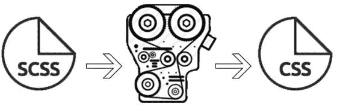

# 第一章


## 预处理器简介

`HTML5` 和 `CSS3` 正在改变网页的设计方式。`CSS3` 为 Web 开发者提供了诸如渐变、过渡和动画等高级特性。然而，这些新特性也增加了 CSS 代码的复杂性，使其更难以维护。

除了 `CSS3` 引入的复杂性，随着时间的推移，手写 CSS 可能会变得痛苦，因为程序员不得不反复执行许多相同的操作（例如在 CSS 中查找颜色值以及声明外边距/内边距）。这些微小的重复性任务累积起来，造成了相当程度的低效率。预处理器正是解决这些以及其他低效问题的方案。

CSS 预处理器通过引入现代编程语言的概念来扩展 CSS。要使用 `Sass`（语法上很棒的样式表），你必须先掌握如何用 CSS 编码。CSS 预处理器允许你在编写 CSS 时使用变量、函数、运算，甚至是规则或选择器的嵌套。通过 CSS 预处理器，你可以将“不要重复自己”（`DRY`）原则应用到你的 CSS 代码中。遵循 `DRY` 原则有助于避免代码重复。

## 什么是预处理器？

预处理器接收一种形式的数据并将其转换为另一种形式。在 CSS 的语境下，`Less` 和 `Sass` 是流行的预处理器语言，它们接收 `Less` 或 `SCSS` 格式的输入，并生成处理后的 CSS。

这些 CSS 预处理器通过消除低效之处，使网站的构建更简单、更符合逻辑，从而增强了 CSS 的能力。预处理器的流行也催生了基于它们的各种框架；其中较为流行的一个是 `Compass`。

图 1-1 展示了预处理器是如何获取预处理格式的文件并将其转换为浏览器能理解的 CSS 的。



图 1-1. 预处理器友好的文件被转换为普通 CSS

借助预处理器，你可以像使用 `PHP` 或 `JavaScript` 等其他语言一样来组织 CSS。因此，预处理器给开发者带来了安心。它让你编写出的代码具有前瞻性且易于维护，从而节省时间和精力。

预处理器是 CSS 的扩展，这意味着有效的 CSS 代码也是有效的预处理器代码。熟悉 CSS 的开发者在学习任何预处理器时都不会有任何学习曲线。

## 为什么使用预处理器？

CSS 使用声明式编程形式。这意味着你在代码中编写的样式会直接被浏览器使用，无需任何编译。

许多开发者更倾向于手写样式表。他们认为预处理器会给他们的工作流增加额外的复杂性，或者存在陡峭的学习曲线。但实际上，CSS 预处理器能让你的日常工作轻松很多。本书将向你展示预处理器如何在不干扰你工作流的情况下，更高效地编写 CSS。

让我们考虑一个例子：你需要逐个查找并替换站点范围内使用的某个颜色的多个实例。如果 CSS 能简化这个过程，岂不是很棒？类似于清单 1-1 所示就是一个例子。

**清单 1-1. 颜色可复用变量**

```
$site-color:#eee;

a {
        color: $site-color;
}
#topBar {
        background-color: $site-color;
        color:#fff;
}
```

使用预处理器，只需更改一个地方的值就能改变整个样式表。如清单 1-2 所示。

**清单 1-2. 清单 1-1 的输出**

```
a {
  color: #eee;
}

#topBar {
  background-color: #eee;
  color: #fff;
}
```

让我们再考虑一个代码重复的例子。很多时候，样式表中会有多个地方使用相同的代码块，如清单 1-3 所示。

**清单 1-3. 重复的代码块**

```
p{
        padding-bottom:45px;
        text-align:center;
}
footer {
        padding-bottom:45px;
        text-align:center;
}
```

使用预处理器，你可以将这些冗余的规则放入一个`混入 (mixin)`中，该混入只需定义一次，并可按需引入。如清单 1-4 所示。

**清单 1-4. 在预处理器中创建和使用可复用代码块**

```
@mixin containerSettings {
        padding-bottom: 45px;
        text-align:center;
}
p {
        @include containerSettings;
}
footer {
        @include containerSettings;
}
```

**清单 1-5. 清单 1-4 的输出**

```
p {
  padding-bottom: 45px;
  text-align: center;
}

footer {
  padding-bottom: 45px;
  text-align: center;
}
```

作为所有预处理器基础的 CSS，在理解不同属性的工作原理、层叠机制、浏览器对各种属性的支持、选择器、怪癖行为等方面，本身就有一个陡峭的学习曲线。除了前述所有要点之外，还要考虑到在当今复杂的界面中维护样式表也是一个巨大的挑战。

大多数时候，样式表都非常重复，充斥着属性或属性组等。典型的 CSS 文件是一个线性文档。这足以让来自面向对象领域的程序员抓狂。

根据 `DRY` 原则：*系统中的每一份知识都必须有单一、明确、权威的表述。*

对此最简单的解释是，代码中的冗余可能导致失败，并给开发者带来困惑。CSS 不遵循 `DRY` 原则。大多数时候，CSS 文件会包含重复的规则、声明和值。开发者不断地在样式表中编写相同的代码片段。

CSS 缺乏其他所有编程语言都具备的特性，如变量、符号常量、条件语句、基于变量的表达式等。

CSS 预处理器位于你的预处理器友好文件和将提供给浏览器的已编译 CSS 文件之间。CSS 预处理器允许你按照 `DRY` 原则编写代码，使其更快速、高效且易于维护。然后，代码通过命令行或应用程序被编译成常规的 CSS 文件。