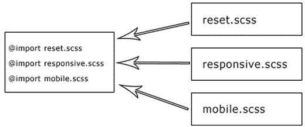
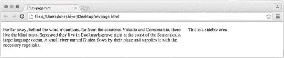

# 高级 Sass

在上一章中，你了解了安装步骤以及使用 Sass 所需的基本组件。在本章中，你将学习 Sass 中更为高级的概念。

本章将探索 Sass 的以下方面：

*   `@import`
*   `@media`
*   `@extend`
*   `@at-root`
*   混入指令
*   函数指令
*   输出样式
*   构建你自己的网格系统

## `@import`

Sass 也支持类似于原生 CSS 中可用的导入功能。但与 CSS 不同——CSS 在遇到 `@import` 时会下载 CSS 文件——使用 Sass `@import` 规则导入的 Sass 和 SCSS 文件将在编译后合并并输出为单个文件。

当你在文件中指定 Sass 导入时，它会在当前目录中查找。可以使用 `load_paths` 选项指定额外的搜索路径。默认情况下，它采用文件名。

***列表 3-1***。`@import` 示例

```
@import "main"
```

`@import` 也可用于导入多个文件。

***清单 3-2***。使用 `@import` 获取多个文件的示例

```
@import "main", "mobile"
```

此行为如图 图 3-1 所示。



图 3-1。`@import` 在 Sass 中工作方式的直观展示

### Partials

假设你有一些可复用的 Sass 代码块想要导入，但又不希望它在最终的输出文件中出现。你可以使用 partials 来实现这一效果。Partials 有助于将样式代码分割到不同文件中，从而实现更好的组织管理。

假设你有一个名为 `typography.scss` 的 Sass 文件，其中包含有关排版的字体大小和字重等信息。要将其变为 partial 文件，你需要在文件名前加上下划线前缀。因此，文件名会变成 `_typography.scss`。这个下划线告诉 Sass 编译器，该文件是一个 partial，不需要编译成完整的 CSS。

随着项目不断增长，通过将代码按逻辑块分类，这一方法能更轻松地管理项目中的样式代码。

因此，延续上一段的示例，将文件重命名为 `_typography.scss` 后，你可以使用简单的 `@import typography` 语句将其导入代码中。

### 嵌套的 @import

导入操作也可以用于在样式规则中导入代码片段。使用 `@import`，你还可以导入 CSS 规则。

我们来看一个例子，假设你有两个文件——`parent.scss` 和 `file2.scss`。假设你想将 `parent.scss` 的内容导入到 `file2.scss` 中。你可以按照清单 3-3 所示的方式操作。

***清单 3-3***。使用 `@import` 导入样式的示例：`_parent.scss` 的内容

```
.parent{
        Background-color:#CCC;
}
```

***清单 3-4***。使用 `@import` 导入样式的示例：`file2.scss` 的内容

```
.child{
        @import "parent";
}
```

当执行清单 3-4 中所示的代码时，你会得到清单 3-5 所示的输出结果。

***清单 3-5***。清单 3-4 的输出结果

```
.child .parent{
        Background-color:#CCC;
}
```

因此，当你在样式规则内应用导入时，所有被导入的规则都会嵌套在该特定规则内部。最终效果与这些样式直接嵌套在该特定选择器内完全相同。

### 纯 CSS 导入

除了自身的导入方式外，Sass 也支持 CSS 风格的 `@import`。有两种情况会触发此类行为，具体如下：

*   要导入的文件的 URL/路径以 `.css` 扩展名结尾
*   要导入的文件的 URL/路径以 `http(s)://` 开头

因此，你无法直接在 Sass 中导入纯 CSS。不过，有一个变通方法。由于 Sass 与 CSS 兼容，你只需将文件的扩展名从 `.css` 改为 `.scss`，然后即可导入。

### @media

媒体查询是当今网页设计过程中最核心的部分。通过媒体查询，你可以根据视口宽度、视口高度、设备宽度、设备高度以及屏幕方向等条件自定义你的 Web 应用。

通常，开发者在构建网页时，会先编写“普通”样式，然后在末尾编写媒体查询。对于代码行数较少的样式表来说，这样没问题；但当代码增加到成千上万行时，管理起来将是一场噩梦。

Sass 提供了更简便的方法。`@media` 用于编写类似 CSS 的媒体查询。然而，它有一个额外功能，即可以嵌套在样式规则内部。Sass 会自动构建媒体查询声明，并将相应的样式放入其中，如清单 3-6 所示。

***清单 3-6***。Sass 中的 `@media`

```
#container{
        Width:960px;
        @media screen and (min-width:500px){
                Width:100%;}
}
```

***清单 3-7***。清单 3-6 的输出结果

```
#container {
  Width: 960px;
}

@media screen and (min-width: 500px) {
  #container {
    Width: 100%;
  }
}
```

现在你可能会想，为什么要用预处理器来写媒体查询，而不是使用传统的 CSS 方法？其中一个优点是代码可读性。通过使用 Sass 集成的媒体查询方式，代码非常易于理解。

Sass 还允许嵌套媒体查询，以构建复杂的媒体查询。参考清单 3-8 中的示例，我们在 `#container` 内部为不同的宽度嵌套了媒体查询。这使得代码易于理解，可读性也大大增强。

***清单 3-8***。媒体查询的嵌套

```
@media screen {
  #container {
    @media (min-width:500px) {
      width: 500px;
    }
    @media (min-width:700px) {
      width: 700px;
    }
  }
}
```

***清单 3-9***。清单 3-8 的输出结果

```
@media screen and (min-width: 500px) {
  #container {
    width: 500px;
  }
}

@media screen and (min-width: 700px) {
  #container {
    width: 700px;
  }
}
```

更进一步，你可以创建一个包含媒体查询的 partial 文件，然后在需要的地方引入它们。

使用 Sass，你还可以内联包含媒体查询。考虑一个示例，你想要一个容器在不同视口大小下有不同的宽度。这可以通过清单 3-10 中演示的方式实现。

***清单 3-10***。内联媒体查询

```
$color1:#CCC;
.color {
   color: $color1;
   @include setQuery(sm) {
      width: 80%;
   }
   @include setQuery(md) {
      width: 70%;
   }
   @include setQuery(lg) {
      width: 60%;
   }
}
```

使用 Sass 编写媒体查询的另一个好处是，你可以将媒体查询的断点赋值给变量。然后这些变量就可以在媒体查询中使用。这在清单 3-11 中得到了演示，它是前一个示例的更详细版本。

***清单 3-11***。使用变量分配断点

### @extend

在编写 CSS 时，我们经常会遇到这样一种情况：某个类需要拥有另一个类的所有样式规则，同时还要有自己的样式。使用纯 CSS 编写这种需求会需要重复代码。而使用 Sass，你就可以通过 `@extend` 来继承所需的样式。

`@extend` 被称为选择器继承。在选择器继承中，Sass 会继承另一个选择器中定义的所有样式。参考`代码清单 3-13`中的示例，其中`notification`被`.success`继承。

`代码清单 3-13`。使用`@extend`的示例

```css
.notification{
  border-radius:5px;
  padding:5px;
}

.success{
  @extend .notification;
  background-color:#0F0;
}
```

`代码清单 3-14`。代码清单 3-13 的输出

```css
.notification, .success {
  border-radius: 5px;
  padding: 5px;
}

.success {
  background-color: #0F0;
}
```

使用`@extend`有一些缺点。例如，在一个大型文件中，如果被扩展的 CSS 选择器多次出现，扩展的结果有时可能会难以预测。这可能导致不合预期的输出。

使用`@extend`的另一个问题是它不能在`@media`声明中使用。

`@extend`也不如使用 mixin 灵活，因为它不能接受参数。

可以通过扩展多个选择器来创建一个单一的选择器，如代码清单 3-15 所示。

`代码清单 3-15`。从多个选择器扩展

```css
.notification {
          border-radius: 5px;
          padding: 5px;
}
.errorLooks{
        Color:#F00;
        Background-color:rgba(255,0,0,0.5);
}
.error {
          @extend .notification;
        @extend .errorLooks;
}
```

`代码清单 3-16`。代码清单 3-15 的输出

```css
.notification, .error {
  border-radius: 5px;
  padding: 5px;
}

.errorLooks, .error {
  Color: #F00;
  Background-color: rgba(255, 0, 0, 0.5);
}
```

你也可以通过在下一个选择器中扩展选择器来进行链式操作，如代码清单 3-17 所示。

`代码清单 3-17`。`@extend`中的链式操作

```css
.notification {
          border-radius: 5px;
          padding: 5px;
}
.errorLooks{
  @extend .notification;
        Color:#F00;
        Background-color:rgba(255,0,0,0.5);
}
.error {
  @extend .errorLooks;
}
```

`代码清单 3-18`。代码清单 3-17 的输出

```css
.notification, .errorLooks, .error {
  border-radius: 5px;
  padding: 5px;
}

.errorLooks, .error {
  Color: #F00;
  Background-color: rgba(255, 0, 0, 0.5);
}
```

### `@extend` 幕后原理

继承并不像看起来那么简单。理解扩展是如何工作的，能让你深入了解选择器是如何被继承的，从而让你能够预测输出结果。

让我们使用上一节中的例子。`@extend`背后的原理是：如果`.error`扩展了`.notification`，那么在最终样式表中，`.error`的每个实例都将被替换为`.notification, .error`。

关于`@extend`，有两件事你应该牢记：

*   与功能类似的 mixin 相比，继承生成的 CSS 相对较少。它只是将选择器添加到一个逗号分隔的列表中，而不会克隆属性。

*   层叠（Cascading）对继承的适用方式与普通 CSS 相同。当两个具有不同值的规则应用于同一个元素时，层叠规则决定应用哪个规则。因此，总是应用最后一个规则。

### 何时使用选择器继承

假设你正在开发一个网页并编写样式规则，你发现你的一个类（`.errorLooks`）是另一个类（`.notification`）的更具体版本。你会如何编写样式规则？

*   你可以在这两个类中复制相同的样式规则。但这会导致大量重复代码，违背了 DRY 原则。

*   你可以将样式应用于一组选择器（`.notification, .error`）。这很好，但随着时间的推移，会增加样式代码的复杂性。

*   你可以使用 Sass 提供的`@extend`，让`.error`继承`.notification`。这使代码更具可读性，也更容易理解。

### 占位符选择器

在使用 Sass 时，你可能会遇到这样的情况：你想编写一些类，用于被其他类扩展，但又不希望它们被渲染到最终编译的 CSS 文件中。例如，你想使用一个包含圆角或边距代码的类，但这个类本身并没有独立用途。

在 Sass 中，可以通过一种称为占位符选择器的方式来实现这一点，方法是在类名前加上`%`前缀——例如`%notification`。

`代码清单 3-19`。`@extend`选择器的示例

```scss
%notification {
          border-radius: 5px;
          padding: 5px;
}
.errorLooks{
  @extend %notification;
}
```

`代码清单 3-20`。代码清单 3-19 的输出

```css
.errorLooks {
  border-radius: 5px;
  padding: 5px;
}
```

正如你在代码清单 3-20 中所见，`notification`这个扩展类并未出现在最终输出中。

### 使用 `@extend` 做更多事

前面的代码示例将宽度值存储在变量中。然后，根据我们传递给 mixin（类似于一个函数，用于在需要时注入带有计算的、可复用的样式，本章稍后会介绍这个概念）的参数变量，生成并注入媒体查询。前面代码的输出结果如清单 3-12 所示。

`清单 3-12`。清单 3-11 的输出结果

```scss
$color1:#CCC;
$sm:320px;
$md:720px;
$lg:1280px;
@mixin setQuery($type){
  @if $type == sm {
    @media only screen and (min-width: $sm) and (max-width: $md - 1) {
      @content;
    }
  }
  @else if $type == md {
    @media only screen and (min-width: $md) and (max-width: $lg - 1) {
      @content;
    }
  }
  @else if $type == lg {
    @media only screen and (min-width: $lg){
      @content
    }
  }
}
.container {
  color: $color1;
  @include setQuery(sm) {
    width: 80%;
  }
  @include setQuery(md) {
    width: 70%;
  }
  @include setQuery(lg) {
    width: 60%;
  }
}
```

```css
.container {
  color: #CCC;
}

@media only screen and (min-width: 320px) and (max-width: 719px) {
  .container {
    width: 80%;
  }
}

@media only screen and (min-width: 720px) and (max-width: 1279px) {
  .container {
    width: 70%;
  }
}

@media only screen and (min-width: 1280px) {
  .container {
    width: 60%;
  }
}
```

类并不是唯一可以被扩展的元素。也可以扩展像 `a:hover`、`.notification` 和 `.error` 这样的复杂元素，如代码清单 3-21 所示。

### 代码清单 3-21。演示扩展复杂元素的示例

```scss
a{
  color:#F00;
  &:hover{
    font-weight:bold;
  }
}
.notification{
        @extend a:hover ;
}
```

也可以在一个选择器中通过扩展多个 CSS 类来创建多个规则，如代码清单 3-22 所示。

### 代码清单 3-22。演示扩展多个类的示例

```scss
.notification{
        Border-radius:50%;
}
.strongText{
        Font-weight:bold;
}
.error{
        @extend .notification;
        @extend .strongText;
        Color:#F00;
}
```

这段代码将产生如代码清单 3-23 所示的输出。

### 代码清单 3-23。代码清单 3-22 的输出

```css
.notification, .error {
  Border-radius: 50%;
}

.strongText, .error {
  Font-weight: bold;
}

.error {
  Color: #F00;
}
```

在扩展时也可以链式操作选择器；也就是说，扩展一个已经扩展了另一个选择器的选择器。以下是代码清单 3-24 中修改后的代码，用于演示这种现象。

### 代码清单 3-24。演示 `@extend` 链式操作的示例

```scss
.notification{
        Border-radius:50%;
}
.strongText{
  @extend .notification;
        Font-weight:bold;
}
.error{
        @extend .strongText;
        Color:#F00;
}
```

这段代码的输出与代码清单 3-23 所示相同。

有时可能会遇到这种情况：如果被扩展的选择器出错或不存在，你希望 `@extend` 被忽略。在这种情况下，你可以使用 `!optional` 标志。这将阻止 `@extend` 产生结果。这在代码清单 3-25 中进行了演示。

### 代码清单 3-25。展示 `!optional` 的示例

```scss
.success{
  @extend .lightText !optional;
}
```

## `@at-root`

Sass 的 `@at-root` 指令会使其内部的规则被渲染到文档的根级别，无论它们原本嵌套在何处。参见代码清单 3-26。

### 代码清单 3-26。`@at-root` 的示例

```css
.notification {
          border-radius: 5px;
          padding: 5px;
}
.errorLooks{
  @extend .notification;
  @at-root{
    .icon{
      border-radius:50%;
    }
  }
}
```

在这个示例中，`.icon` 嵌套在 `errorLooks` 中。这段代码编译后，将会得到代码清单 3-27 所示的结果。

### 代码清单 3-27。代码清单 3-26 的输出

```css
.notification, .errorLooks {
  border-radius: 5px;
  padding: 5px;
}

.icon {
  border-radius: 50%;
}
```

请注意，`@at-root` 中的内容将出现在它被嵌套的规则之后。

你可能会想，“我什么时候能用上这个呢？”

其实，有了 `@at-root`，你的代码会更易读、更易管理。请参考代码清单 3-28 中的示例。

### 代码清单 3-28。实现 `@at-root` 的示例

```css
.productImage {
  height: 150px;
  width: 150px;

@at-root {
    @keyframes panimate {
      0% { transform: scale(1.0); }
      25% { transform: scale(1.1); }
      50% { transform: scale(1.2); }
      75% { transform: scale(1.1); }
      100% { transform: scale(1.0); }
    }
  }
  &:hover {
    animation: panimate .8s infinite;
  }
}
```

在此示例中，你可以看到，使用 `@at-root` 将专用于该特定元素的动画声明放在其定义内部，提高了整体代码的可读性。

### 代码清单 3-29。代码清单 3-28 的输出

```css
.productImage {
  height: 150px;
  width: 150px;
}

@keyframes panimate {
  0% {
    transform: scale(1);
  }
  25% {
    transform: scale(1.1);
  }
  50% {
    transform: scale(1.2);
  }
  75% {
    transform: scale(1.1);
  }
  100% {
    transform: scale(1);
  }
}

.productImage:hover {
  animation: panimate 0.8s infinite;
}
```

## Mixin 指令

随着 CSS 的增长，你会遇到需要按原样或稍微修改地重复使用整个样式块的情况。

混入（Mixin）使用 `@mixin` 声明，用于创建可在整个样式表中重用的样式代码。Mixins 可以包含完整的 CSS 规则。Mixins 可以接受参数，这使其更加灵活。

Mixins 使用 `@mixin` 指令定义，后跟混入的名称、可选参数和包含代码的块，如代码清单 3-30 所示。

### 代码清单 3-30。一个 Mixin 的示例

```scss
@mixin roundedEdges($radius:5px) {
  -webkit-border-radius: $radius;
     -moz-border-radius: $radius;
      -ms-border-radius: $radius;
          border-radius: $radius;
}
.container {@include roundedEdges(10px);}
```

此示例展示了生成圆角代码的混入，它接受一个参数，如果未提供参数，其默认值设为 `5px`。

### 代码清单 3-31。代码清单 3-30 的输出

```css
.container {
  -webkit-border-radius: 10px;
  -moz-border-radius: 10px;
  -ms-border-radius: 10px;
  border-radius: 10px;
}
```

此示例展示了如何定义和包含 Mixins。Mixins 使用 `@mixin` 定义。它们使用 `@include` 包含。在此示例中，我们还提供了一个带有默认值的参数。

你还可以通过包含其他 Mixins 来创建复合 Mixins，如代码清单 3-32 所示。

### 代码清单 3-32。一个复合 Mixin 的示例

```scss
@mixin success {
  @include notification;
  @include successTheme;
}
```

Mixin 的参数以变量格式编写，如果有多个参数，则用逗号分隔。这些参数可以有默认值，如果未提供参数值，则将使用这些默认值。

### 代码清单 3-33。将代码块作为参数传递给 Mixin

```scss
@mixin clearFix {
  &:after {
    @content;
  }
}

.btn {
  display: inline-block;
  @include clearFix {
    clear:both;
  }
}
```

### 代码清单 3-34。代码清单 3-33 的输出

```css
.btn {
  display: inline-block;
}

.btn:after {
  clear: both;
}
```

### Mixins 与类

Mixins 使得在样式表中重用样式变得非常容易。任何重复的样式代码片段都是使用 Mixin 的绝佳候选。例如，一组适合一起设置的属性，如边框半径、背景渐变等，就适合做成一个 Mixin。

# Sass Mixins 与函数指南

Mixins 与 CSS 类非常相似。两者都允许你存储样式块。这两者最重要的区别在于，类旨在用于 HTML 中，而 Mixin 则用于创建可在样式表中重用的块。

因此，类应该有一个有意义的名称，能够正确标识元素。Mixin 的名称应该与它们提供的功能相关。

## Mixins 与 CSS 选择器

Mixins 除了可以包含属性外，还可以包含 CSS 选择器。代码清单 3-35 演示了这一点。

代码清单 3-35。Mixin 内的 CSS 选择器

```scss
@mixin importantInfo {
  font-weight:strong;
  li {
    margin: 0px 5px;
  }
}

.notfication{
  border-radius:35%;
  @include importantInfo;
}
```

此示例创建了一个名为 `importantInfo` 的 mixin，它包含自己的样式规则以及带有自身规则的 CSS 选择器 `li`。这在 `notification` 类中被包含。此代码的结果如代码清单 3-36 所示。

代码清单 3-36。代码清单 3-35 的输出

```css
.notfication {
  border-radius: 35%;
  font-weight:strong;
}

.notfication li {
  margin: 0px 5px;
}
```

## Mixins 的参数

Sass 中的 Mixins 可以接受在调用该 mixin 时提供的参数。这有助于 mixin 根据提供的参数提供不同的行为，从而使其适用于广泛的应用场景。

参数作为逗号分隔的变量列表，放在 mixin 名称后的括号内传递。代码清单 3-37 演示了这一点。

代码清单 3-37。在 Mixins 中传递参数

```scss
@mixin fancyBorder($fbColor, $fbWidth) {
  border-color: $fbColor;
  border-width: $fbWidth;
  border-style: dashed;
}

.specialNote{
  @include fancyBorder(#000,2px)
}
```

此示例包含一个名为 `fancyBorder` 的 mixin，它接受两个参数：`borderColor` 和 `borderWidth`。其输出如代码清单 3-38 所示。

代码清单 3-38。代码清单 3-37 的输出

```css
.specialNote {
  border-color: #000;
  border-width: 2px;
  border-style: dashed;
}
```

Mixins 也可以为其参数设定默认值。因此，当你不向 mixin 传递任何值时，它将采用默认值。这可以通过修改代码清单 3-39 中的代码来演示。

代码清单 3-39。演示默认变量的示例

```scss
@mixin fancyBorder($fbColor:#000, $fbWidth:2px) {
  Border-color: $fbColor;
  Border-width: $fbWidth;
  Border-style: dashed;
}

.specialNote{
  @include fancyBorder;
}
```

Mixins 还允许你传递关键字参数。这使得 Mixins 更加灵活，允许参数以任意顺序传递。代码清单 3-40 展示了这一点。

代码清单 3-40。关键字参数示例

```scss
.specialNote{
  @include fancyBorder($borderColor:#00F, $borderWidth:1px)
}
```

## Mixins 与可变参数

你可以通过允许 mixins 处理未知数量的变量，使其更加灵活。Sass 支持可变参数。这些参数在 mixins/函数的参数列表末尾声明，包含所有额外的参数，并以列表形式存在。这些参数看起来像普通参数，但在末尾有额外的 `…`。清单 3-41 展示了之前代码的修改版本，它传递了一个名为 `fontProp` 的可变参数来设置字体属性。

清单 3-41。可变参数示例

```scss
@mixin fancyBorder($borderColor:#000, $borderWidth:2px,$fontProp…) {
  border: {
    color: $borderColor;
    width: $borderWidth;
    style: dashed;
  }
  font:$fontProp;
}

.specialNote{
  @include fancyBorder(#00F, 1px,1px arial,sans-serif)
}
```

清单 3-42。清单 3-41 的输出

```css
.specialNote {
  border-color: #00F;
  border-width: 1px;
  border-style: dashed;
  font: 1px arial, sans-serif;
}
```

## 在 Mixins 中使用内容块

你还可以将样式块传递给 mixin，这些样式块可以放置在 mixin 提供的样式之外。这些样式会添加在声明 `@content` 规则的地方。上一个示例的修改版本如清单 3-43 所示。

清单 3-43。内容块示例

```scss
@mixin fancyBorder($borderColor:#000, $borderWidth:2px,$fontProp…) {
  border: {
    color: $borderColor;
    width: $borderWidth;
    style: dashed;
  }
  font:$fontProp;
  @content;
}

.specialNote{
  @include fancyBorder(#00F, 1px,1px arial,sans-serif){
    line-height:0.8em;
  }
}
```

此代码片段的输出如清单 3-44 所示。

清单 3-44。清单 3-43 的输出

```css
.specialNote {
  border-color: #00F;
  border-width: 1px;
  border-style: dashed;
  font: 1px arial, sans-serif;
  line-height: 0.8em;
}
```

## 函数指令

Sass 中的函数对提供的参数执行指定的操作。这些函数的语法类似于 CSS 函数，如 `rgb()`。与 CSS 函数不同，Sass 函数可以包含关键字参数，并返回对 Sass 操作有用的值。

Sass 提供了内置函数，这些函数旨在广泛应用于各种不同场景，例如颜色操作等。除此之外，Sass 还允许用户定义自己的函数，类似于定义 mixins。

Sass 提供的一些内置函数分类如下：

*   数值函数

*   颜色函数

*   列表函数

### 数值函数

Sass 提供了一些用于处理数值的函数，特别是在使用 Sass 编写样式表时经常遇到的情况。

以下讨论其中一些函数。

#### `abs($number)`

此函数将返回数字的绝对值，如清单 3-45 所示。

清单 3-45。使用 `abs` 的示例

```scss
$fontsize:1.1em;
.container{
  // Will use 1.1em
  font-size:abs($fontsize);
}
```

#### `ceil($number)`

此函数将返回数字的向上取整值，如清单 3-46 所示。

清单 3-46。使用 `ceil` 的示例

```scss
$fontsize:1.1em;
.container{
  // Will use 2em
  font-size:ceil($fontsize);
}
```

#### `floor($number)`

此函数将返回数字的向下取整值，如清单 3-47 所示。

清单 3-47。使用 `floor` 的示例

```scss
$fontsize:1.1em;
.container{
  // Will use 1em
  font-size:floor($fontsize);
}
```

#### `percentage($number)`

此函数将提供的数字转换为百分比并返回。作为参数提供的数字应该是无单位的，即它不应具有作为后缀的单位。参见清单 3-48。

清单 3-48。使用 `percentage` 的示例

```scss
$fontsize:1.1;
.container{
  // Will use 110%
  font-size:percentage($fontsize);
}
```

#### `round($number)`

此函数将返回所提供数字的最接近的整数值，如 `清单 3-49` 所示。

`清单 3-49`. 使用 `round` 的示例

```
$fontsize:1.1em;
.container{
  // Will use 1em
  font-size:round($fontsize);
}
```

### 颜色函数

Sass 提供了多种用于转换颜色的函数，例如 `adjust_color`、`complement`、`grayscale`、`invert` 等。以下描述其中一些函数。

#### `adjust_color($color,…)`

此函数用于分配颜色的个别属性，例如红色、绿色、蓝色等。属性被指定为关键字参数，值将从原始值中加或减（参见 `清单 3-50`）。可以使用此函数转换颜色的以下属性：

*   红色
*   绿色
*   蓝色
*   色相
*   明度
*   透明度

`清单 3-50`. 展示 `adjust_color` 的示例

```
$fontcolor:#900;
.container{
  color:adjust_color($fontcolor,$red:-5);
}
```

#### `complement($color)`

此函数返回颜色的补色，如 `清单 3-51` 所示。

`清单 3-51`. 展示 `complement` 的示例

```
$fontcolor:#FF0000;
.container{
  color:complement($fontcolor);
}
```

上一个代码片段的输出如 `清单 3-52` 所示。

`清单 3-52`. `清单 3-53` 的输出

```
.container {
  color: cyan;
}
```

#### `grayscale($color)`

此函数返回颜色的灰度版本。这在 `清单 3-53` 中演示。

`清单 3-53`. `grayscale` 的示例

```
$fontcolor:#FFCC00;
.container{
  color:grayscale($fontcolor);
}
```

### 列表函数

列表函数中最重要的函数之一是 `nth($list, $n)`。它用于从列表中获取单个项目。与 JavaScript 不同，Sass 列表从 1 开始计数。因此，`nth(10px 20px 30px, 1)` 将返回 `10px` 作为结果。

另一个重要的函数是 `join`。`join($list1, $list2, [$separator])` 用于通过合并两个列表生成一个新列表。列表中的每个值都计为一个单独项目，该函数也可用于从单个项目生成列表。可选的 `$separator` 参数决定列表的类型；可以是空格或逗号。如果省略，则使用 `$list1` 的类型。

另一个简单但重要的函数是 `length($list)`。它返回 `$list` 中的项目数量。所以 `length(10 22 33)` 的结果是 `3`。

## 用户定义函数

`@function` 指令用于定义你自己的函数。当你要执行原生不支持的操作时，这很有用。`@function` 类似于 `@mixin`，不同之处在于 `@function` 会返回结果。

`@return` 指令是 `@function` 的重要组成部分，其行为类似于 JavaScript 中的 `return`。它接受 Sass 表达式，处理它们，并返回结果。此外，在触发 `@return` 后，它会停止函数执行。

考虑一个构建函数的简单示例。此示例编写一个函数，根据提供的列数生成每列的宽度，如 `清单 3-54` 所示。

`清单 3-54`. 用户定义函数的示例

```scss
@function generateGrid($columns) {
  @return percentage(1/$columns);
}
.two-column{
  width:generateGrid(2);
}
```

此代码的输出如 `清单 3-55` 所示。

`清单 3-55`. `清单 3-54` 的输出

```css
.two-column {
  width: 50%;
}
```

## 输出样式

默认情况下，Sass 会以一种结构良好的格式输出 CSS。但同时，它也提供了多种样式选项。Sass 允许您从四种输出样式中进行选择，并通过 `--style` 命令行参数指定。

### `nested`（嵌套样式）

这是 Sass 的默认样式。它以普通格式显示 CSS 样式。缩进遵循原始 Sass 文档中的嵌套层级，如 `清单 3-56` 所示。

`清单 3-56`. 嵌套样式示例

```css
#container {
  color: #000; }
  #container p {
    padding: 10px; }
```

### `expanded`（展开样式）

选择此样式时，生成的输出与手写 CSS 的格式完全相同。规则之间不会有像嵌套样式那样的缩进，如 `清单 3-57` 所示。

`清单 3-57`. 展开样式示例

```css
#container {
  color: #000;
}

#container p {
  padding: 10px;
}
```

### `compact`（紧凑样式）

紧凑输出比前两种样式占用更少的空间。它将所有属性放在一行上，每条规则占一行，如 `清单 3-58` 所示。

`清单 3-58`. 紧凑样式示例

```css
#container {color: #000;}
#container p {padding: 10px;}
```

### `compressed`（压缩样式）

压缩样式总体占用空间最小。它会消除所有空白，如 `清单 3-59` 所示。

`清单 3-59`. 压缩样式示例

```css
#container {color: #000;}#container p {padding: 10px;}
```

## 构建您自己的网格系统

在本节中，您将构建属于您自己的网格系统，该系统可用于构建响应式网站。这将帮助您理解网格系统的工作原理，并在需要时帮助您创建自定义网格系统。网格系统允许内容以一致且灵活的模式进行垂直和水平排列。

网格系统由两个组件构成：行（rows）和列（columns）。行是容纳列的容器。列决定内容的最终结构和排列。

要开始构建您自己的网格，首先需要设置一些必要的类和变量。如 `清单 3-60` 所示。

`清单 3-60`. 设置初始类和变量

```scss
// Building custom grid system
$column-spacing:2%;
.col{
  float:left;
  margin-right:$column-spacing;
}
```

此代码将两列之间的间距设置为 `2%`，并定义了一个 `.col` 类，该类将与特定列类一起使用。接下来，您需要为可变数量的列创建列类。该示例最多支持 12 列，如 `清单 3-61` 所示。

`清单 3-61`. 计算各种列类

```scss
// Building custom grid system
$column-spacing:2%;
.col{
  float:left;
  margin-right:$column-spacing;
}

.col-1   { width:percentage(1 / 12) - $column-spacing; }
.col-2   { width:percentage(1 / 6) - $column-spacing; }
.col-3   { width:percentage(1 / 4) - $column-spacing; }
.col-4   { width:percentage(1 / 3) - $column-spacing; }
.col-5   { width:percentage(1 / 2.4) - $column-spacing; }
.col-6   { width:percentage(1 / 2) - $column-spacing; }
.col-7   { width:percentage(1 / 1.714285714285714) - $column-spacing; }
.col-8   { width:percentage(1 / 1.5) - $column-spacing; }
.col-9   { width:percentage(1 / 1.333333333333333) - $column-spacing; }
.col-10  { width:percentage(1 / 1.2) - $column-spacing; }
.col-11  { width:percentage(1 / 1.090909090909091) - $column-spacing; }
.col-12  { width:percentage(1); }
```

这段代码以百分比形式生成输出。您可以先假设只有一列，相当于 12 列网格。因此，当您要计算单列（`.col-1`）时，计算公式如下：

您需要减去列间距，因为`.col`类中指定了`margin-right`。为了计算不同列配置下的列宽，您需要更改所需列数的值。此代码的输出如清单 3-62 所示。

***清单 3-62***. 清单 3-61 的输出

```css
.col {
  float: left;
  margin-right: 2%;
}

.col-1 {
  width: 6.33333%;
}

.col-2 {
  width: 14.66667%;
}

.col-3 {
  width: 23%;
}

.col-4 {
  width: 31.33333%;
}

.col-5 {
  width: 39.66667%;
}

.col-6 {
  width: 48%;
}

.col-7 {
  width: 56.33333%;
}

.col-8 {
  width: 64.66667%;
}

.col-9 {
  width: 73%;
}

.col-10 {
  width: 81.33333%;
}

.col-11 {
  width: 89.66667%;
}

.col-12 {
  width: 100%;
}
```

现在，进入本示例的最后部分，您将为`.row`类添加样式，它将作为所有列的容器。添加样式后，最终的代码应如清单 3-63 所示。

***清单 3-63***. 为 row 添加样式

```scss
// Building custom grid system
$column-spacing:2%;
.row{
  margin-top:$column-spacing;
  &:after{
    clear:both;
  }
}
.col{
  float:left;
  margin-right:$column-spacing;
}

.col-1   { width:percentage(1 / 12) - $column-spacing; }
.col-2   { width:percentage(1 / 6) - $column-spacing; }
.col-3   { width:percentage(1 / 4) - $column-spacing; }
.col-4   { width:percentage(1 / 3) - $column-spacing; }
.col-5   { width:percentage(1 / 2.4) - $column-spacing; }
.col-6   { width:percentage(1 / 2) - $column-spacing; }
.col-7   { width:percentage(1 / 1.714285714285714) - $column-spacing; }
.col-8   { width:percentage(1 / 1.5) - $column-spacing; }
.col-9   { width:percentage(1 / 1.333333333333333) - $column-spacing; }
.col-10  { width:percentage(1 / 1.2) - $column-spacing; }
.col-11  { width:percentage(1 / 1.090909090909091) - $column-spacing; }
.col-12  { width:percentage(1); }
```

此代码的输出将如清单 3-64 所示。

***清单 3-64***. 清单 3-63 的输出

```css
.row {
  margin-top: 2%;
}

.row:after {
  clear: both;
}

.col {
  float: left;
  margin-right: 2%;
}

.col-1 {
  width: 6.33333%;
}

.col-2 {
  width: 14.66667%;
}

.col-3 {
  width: 23%;
}

.col-4 {
  width: 31.33333%;
}

.col-5 {
  width: 39.66667%;
}

.col-6 {
  width: 48%;
}

.col-7 {
  width: 56.33333%;
}

.col-8 {
  width: 64.66667%;
}

.col-9 {
  width: 73%;
}

.col-10 {
  width: 81.33333%;
}

.col-11 {
  width: 89.66667%;
}

.col-12 {
  width: 100%;
}
```

现在，您可以通过其类在 HTML 标记中使用这个生成的网格系统，如清单 3-65 和图 3-2 所示。

***列表 3-65***. 在 HTML 中使用生成的响应式网格（示例）

```html
<div class="row">
  <div class="col col-8">
    Far far away, behind the word mountains, far from the countries Vokalia and Consonantia, there live the blind texts. Separated they live in Bookmarksgrove right at the coast of the Semantics, a large language ocean. A small river named Duden flows by their place and supplies it with the necessary regelialia.
  </div>
  <div class="col col-4">
    This is a sidebar area
  </div>
</div>
```



图 3-2. 列表 3-65 的输出

## 总结

本章讲解了 Sass 的高级主题，例如使用`import`包含其他 Sass 文件和使用指令、使用`@media`、使用`@extend`进行扩展、使用 mixins，以及 Sass 提供的一些常用函数，并使用`@function`定义函数。

除了这些主题之外，你还学习了如何构建自己的网格系统。

在下一章中，你将学习另一个类似 Sass 的框架，它提供了类似的功能，并且同样著名。