# 第 5 章


## Compass 简介

在前面的章节中，您了解了两种著名的预编译语言——Sass 和 Less，并学习了它们提供的各种特性。现在，您将了解一个基于 Sass 的著名 CSS 框架，名为 Compass。

本章将探讨 Compass 的以下方面：

- 安装
- 理解 `config.rb`
- 使用 Sass 和 Compass 创建响应式网格
- Compass 和 CSS3
- 图像精灵和 Compass
- Compass 扩展

正如其网站 ([`compass-style.org/`](http://compass-style.org/)) 所描述的，Compass 是“一个开源的 CSS 创作框架”。

Compass 是一个使用 Sass 构建的框架。除了 Sass 之外，安装 Compass 还能为您提供可重用的模式和工具，从而进一步减少编写 CSS 所需的时间和精力。

使用 Compass，您可以通过单个语句使用像 `box-shadow`、`columns` 等 CSS3 特性。Compass 将为其生成跨浏览器兼容的 CSS。

## Compass 安装

Compass 与 Sass 有类似的要求，即需要 Ruby 才能运行。安装过程在第 2 章中已解释。要开始使用，您需要运行清单 5-1 中的命令，其结果如图 5-1 和 5-2 所示。

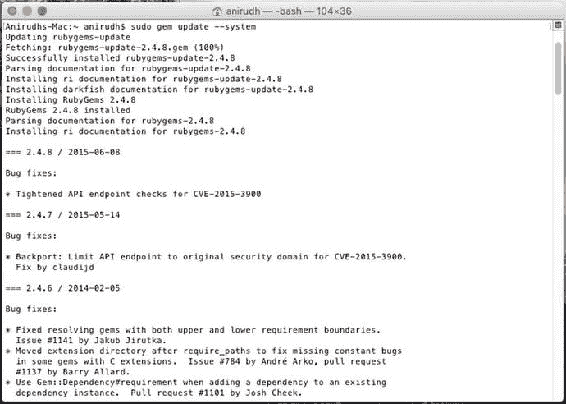

图 5-1. 命令 `gem update -system` 的输出

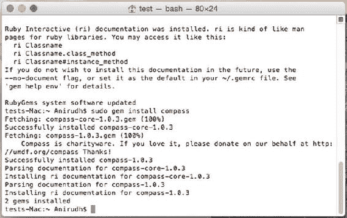

图 5-2. `sudo gem install Compass` 命令的输出

`清单 5-1`. 安装 Compass 的命令

```
gem update --system
gem install compass
```

如果你想使用 Compass 提供的实验性功能，可以通过执行清单 5-2 中的命令来安装其预览版本。

`清单 5-2`. 安装 Compass 预览版的命令

```
gem install compass --pre
```

运行此命令时，输出结果将如图图 5-3 所示。

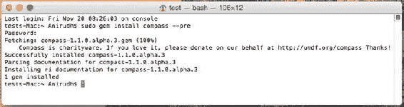

图 5-3. 清单 5-2 的输出

完成 Compass 安装后，你可以通过执行清单 5-3 中所示的命令来开始使用。

`清单 5-3`. 使用 Compass 创建项目的命令

```
compass create <projectName>
```

对于 Mac 用户，Compass 的创建者 Chris Eppstein 提供了一个无需使用终端即可安装的安装程序包。该程序包可在 [`github.com/chriseppstein/compass/downloads`](https://github.com/chriseppstein/compass/downloads) 获取。

最新版本的 Mac OS X 对于之前定义的安装方法似乎存在一些问题。你可能会遇到如下错误：

```
ERROR: While executing gem ... (Errno::EPERM)
Operation not permitted - /usr/bin/compass
```

这是由于最新版 OS X 中引入的无根模式导致的。在无根模式下，即使使用 `sudo`，`/usr/bin` 目录也无法写入。

可以使用以下命令解决此问题：

```
sudo gem install -n /usr/local/bin compass
```

## 在 Compass 中创建项目

首先，你将使用 Compass 创建一个空白项目。为此，请使用清单 5-4 中的命令（结果如图图 5-4 所示）。

`清单 5-4`. 使用 Compass 创建项目的命令

```
compass create learnCompass
```

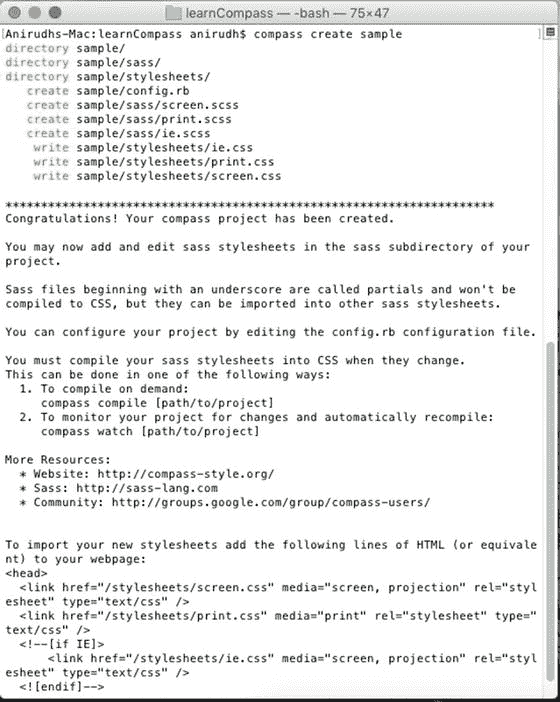

图 5-4. `compass create` 命令的输出

此命令将创建必要的目录结构和 CSS 文件。它还会创建一个配置文件，用于配置 Compass 和 Sass 选项。

基于 GUI 的工具也提供了创建 Compass 项目的选项。例如，CodeKit 提供了一个名为 `Create New Compass Project` 的选项。

你可以自定义这种默认的项目创建方式，例如，使用不同的文件夹名称来创建项目。这可以通过在 `compass create` 命令中提供附加选项来实现，如清单 5-5 所示。

`清单 5-5`. 在 Compass 中自定义项目创建

```
compass create customProject --sass-dir "scss" --javascripts-dir "scripts"
```

在此命令中，你根据需求指定了文件夹名称。这些自定义设置会保存在项目生成的 `config.rb` 文件中。

`compass create` 命令不会创建 JavaScript 文件夹。你需要手动创建它。

`compass create` 有一个名为 `--bare` 的选项，使用该选项将不会创建默认情况下会创建的文件和文件夹。创建的项目将只包含 `config.rb` 文件和 Sass 文件夹。图 5-5 显示了 `compass create` 命令创建的默认结构。

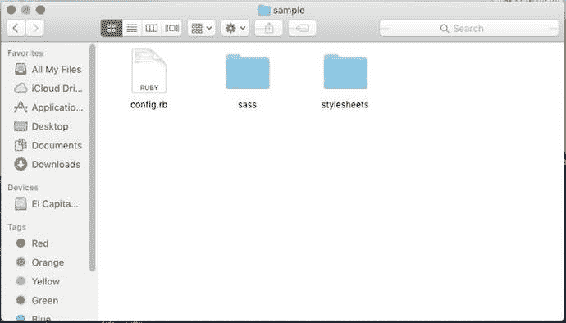

图 5-5. `compass create` 命令创建的默认结构

## 理解 `config.rb`

`config.rb` 是 Compass 项目中的主要文件。它定义了项目的几个重要方面，例如文件的位置以及如何从 Sass/Scss 生成 CSS。

如果你在编辑器中打开这个文件，文件内容将类似于清单 5-6 所示的内容。

`清单 5-6`. 默认 `config.rb` 文件的内容

```
require 'compass/import-once/activate'
# Require any additional compass plugins here.

# Set this to the root of your project when deployed:
http_path = "/"
css_dir = "stylesheets"
sass_dir = "sass"
images_dir = "images"
javascripts_dir = "javascripts"

# You can select your preferred output style here (can be overridden via the command line):
# output_style = :expanded or :nested or :compact or :compressed

# To enable relative paths to assets via compass helper functions. Uncomment:
# relative_assets = true

# To disable debugging comments that display the original location of your selectors. Uncomment:
# line_comments = false

# If you prefer the indented syntax, you might want to regenerate this
# project again passing --syntax sass, or you can uncomment this:
# preferred_syntax = :sass
# and then run:
# sass-convert -R --from scss --to sass sass scss && rm -rf sass && mv scss sass
```

当你对 `config.rb` 文件进行更改时，建议清除 `.sass-cache`，可以通过手动删除 sasscache 文件夹，或者运行 `compass clean` 命令来实现。

你可以使用以下命令来监视项目更改：`compass watch`。

其他用于灵活网格、样板框架等的 gem 是可用的，并且可以通过 `config.rb` 文件在项目中引用。这是在 `config.rb` 文件的第一部分完成的。但请注意，你需要先将这些插件安装好，然后才能将它们导入到你的 Compass 项目中。

让我们考虑一个例子，你想要导入 960 Grid CSS 框架插件。为此，你首先需要安装清单 5-7 所示的插件（结果如图 5-6 所示）。

`清单 5-7`. 在 Compass 项目中安装自定义插件

```
sudo gem install compass-960-plugin
```

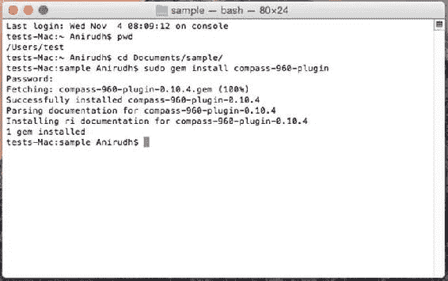

图 5-6. 在 Compass 项目中安装插件

安装插件后，下一步是将其包含到你的项目中。如果是现有项目，你需要修改 `config.rb` 的第一部分，在其中添加一个 `require` 语句，如清单 5-8 所示。

`清单 5-8`. 在 `config.rb` 中添加 `require`

```
require "ninesixty"
```

一旦你将其添加到配置文件中，你就可以通过在 SCSS 中使用 `@import` 语句将 960 网格添加到你的项目中，如清单 5-9 所示。

`清单 5-9`. 导入 960 网格

```
@import "960/grid";
@include grid-system-complete(12);
```

这将把 960 网格系统添加到你的 SCSS 文件中。由于我使用默认的 `compass create` 命令创建了这个项目，我将使用 `screen.scss`，如清单 5-9 所示。现在，为了将所有代码放入最终的 CSS 中，你可以在项目目录中简单地运行清单 5-10 所示的命令。

`清单 5-10`. 在 Compass 中编译并监视 SCSS 文件的命令

```
compass watch
```

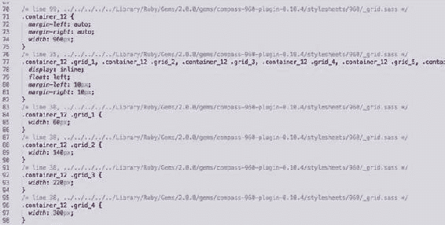

图 5-7. `compass watch` 命令会将 960 网格类添加到你的样式表中

 **注意** 如果在添加这些插件后遇到 Sass 或 Compass 版本冲突，请根据插件的兼容性卸载并重新安装相应版本的 Sass 和 Compass。此外，在 `compass watch` 运行时，对 `config.rb` 的更改不会被注册。需要重新启动它。

除了在项目中包含插件外，你还可以为各种资源设置文件夹路径。在 `config.rb` 中，有一个类似于清单 5-11 所示的部分。

`清单 5-11`. `config.rb` 中设置各种资源路径的部分

```
# Set this to the root of your project when deployed:
http_path = "/"
css_dir = "stylesheets"
sass_dir = "sass"
images_dir = "images"
javascripts_dir = "javascripts"
```

你还可以设置 CSS 输出的最终样式，如清单 5-12 所示。

`清单 5-12`. `config.rb` 中设置 CSS 输出样式的部分

```
# You can select your preferred output style here (can be overridden via the command line):
# output_style = :expanded or :nested or :compact or :compressed
```

`config.rb` 中的最后一部分是启用相对资源，即设置资源的相对路径。此设置默认未启用。启用此设置后，你可以在 CSS 中指定图像名称，它将知道去哪里找到它。你无需指定完整路径。因此，通过取消注释 `config.rb` 中的相应行来启用相对资源设置后，它应如清单 5-13 所示。

`清单 5-13`. `config.rb` 中设置相对资源的部分

```
# To enable relative paths to assets via compass helper functions. Uncomment:
relative_assets = true
```

# 使用 Sass 和 Compass 实现响应式网格

响应式网格是非常有用的开发工具。第 3 章讨论了网格以及如何构建它们。然而，开发者反对使用它们的一些常见原因。

一个常见原因是，当你使用 Bootstrap 框架时，会在编写的 HTML 标记中添加非语义类（例如 `col-md-8`）。

另一个避免使用网格的原因是它们限制了创造力。

然而，使用 Sass 和 Compass，你将使用灵活的网格系统，可以根据需要实现。随心所欲地设计，然后使用 Sass 和 Compass 将其变为现实。你可以在网格内灵活设置列数。

使用 Sass 和 Compass 网格系统的优势在于，它们将复杂数学计算的负担从你肩上卸下。因此，即使不了解太多数学知识，你也可以构建复杂的网格系统。本章的示例使用 *Susy* 来构建网格系统。

## Susy 简介

Susy 是一个基于 Sass 和 Compass 的网格系统。它灵活且易于使用。除了简单和灵活之外，它还能生成干净的代码，并有良好的文档记录。

Susy 可以在 [`susy.oddbird.net/`](http://susy.oddbird.net/) 获取；该网站包含很好的教程和参考文档。

在开始构建网格任务之前，让我们澄清一个重要的概念。Susy 将帮助你创建网格，但不会自动生成一个。

你定义你要构建什么，然后 Susy 进行所有计算。简单来说，这就像是告诉 Susy：“我想要一个 12 列的网格，每列宽 10em，间距为 2em，网格两侧各有 0.5em 的内边距”。然后 Susy 进行计算以生成这个网格。

## 获取 Susy

为了获取 Susy 的 Compass 插件，你需要打开终端并输入清单 5-14 所示的命令。

`清单 5-14`. Susy Compass 扩展的命令

```
sudo gem install susy
```

这将产生如图 5-8 所示的输出。

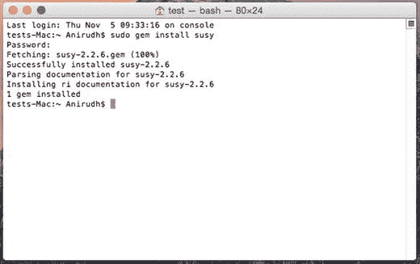

图 5-8. `Gem Install Susy` 的输出

## 在你的项目中使用 Susy

现在您已经安装了 `Susy for Compass`，下一步是将其引入到项目中。在本章的前面部分，您已经学习了如何通过 `config.rb` 文件引入插件。不过，这次您将创建一个从一开始就包含了插件的新项目。为此，您需要使用带一些额外参数的 `compass create` 命令，如清单 5-15 所示。

`清单 5-15`. 使用 Susy 插件创建 Compass 项目的命令

```
compass create sampleSusyProj -r susy -u susy
```

这将输出 Compass 项目，如图 5-9 所示。

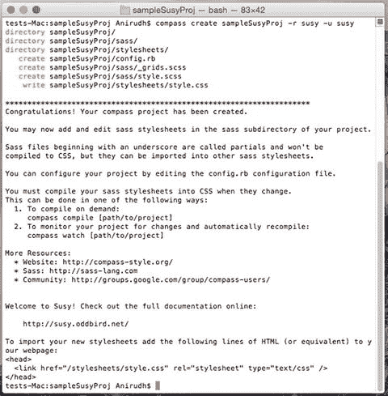

图 5-9. 为 Susy 添加了额外参数的 `compass create` 命令的输出

创建项目后，您会在 `SCSS` 目录中得到两个文件：`_grid.scss` 和 `style.scss`。现在让我们开始设置网格。

要使用 Susy 设置网格，您首先需要为此任务定义所有 Susy 特定的变量。这些变量是：

*   `$total-column`：总列数

*   `$column-width`：每列的宽度

*   `$gutter-width`：列之间的间距

*   `$grid-padding`：网格左侧和右侧的间距

您将在 `_grid.scss` 中定义这些属性。第一行是导入 `"susy"`，这是将所有与 Susy 相关的代码引入 `_grid.scss` 所必需的。

对于此示例，您将假定这些变量具有以下值：

*   `$total-column`：12

*   `$column-width`：10em

*   `$gutter-width`：4em

*   `$grid-padding`：4em

代码应如清单 5-16 所示。

`清单 5-16`. 为 Susy 设置必要参数

```
@import "susy";

$susy: (
   columns: 12,
   gutters: 1/5
);
```

接下来，您需要为网格提供上下文。为此，您需要将某个元素设置为容器元素。假设您想要作为容器的元素是 `page`。这是在 `style.scss` 中完成的，如清单 5-17 所示。

`清单 5-17`. 在 `style.scss` 中将元素设置为容器

```
@import "grids";

.page{
   @include container;
}
```

这告诉 Susy `.page` 将充当容器。

## 显示网格背景

Susy 使您能够在浏览器中查看容器的网格列。如果您想知道网格的效果，这会非常方便。这可以通过修改一条规则来实现，如清单 5-18 所示。

***清单 5-18***。告诉 Susy 显示网格

```
@import "grids";

.page{
   @include container(show overlay);
   Height:500px; // 已手动设置高度以在空白页面上显示网格
}
```

此页面的 HTML 代码如清单 5-19 所示。

***清单 5-19***。清单 5-18 的 HTML 标记

```
<!DOCTYPE html>
<html>
  <head>
    <title>Sample susy project</title>
    <link rel="stylesheet" type="text/css" href="stylesheets/style.css">
  </head>
  <body>
    <div class="page"></div>
  </body>
</html>
```

这段代码的结果如图 5-10 所示。请注意，当您将鼠标悬停在右上角的图标上时，网格是可见的。

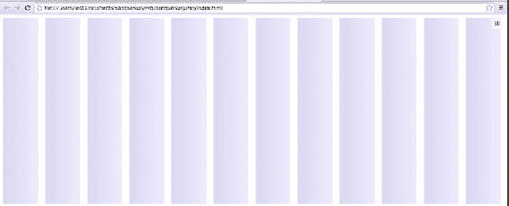

图 5-10。显示网格覆盖层

接下来，您将设置 Susy 使用 `border-box` 的 `box-sizing` 模型。您可以通过将此变量添加到网格设置中来实现，如清单 5-20 所示。

***清单 5-20***。为网格系统设置添加盒模型设置

```
@import "susy";

$susy: (
   columns: 12,
   gutters: 1/5,
   global-box-sizing:border-box
);
```

在开发响应式页面或应用程序时，您首先应该考虑的是完全可访问的设计。这意味着无论设备或其性能如何，内容都应该在您的页面或应用程序上可访问。这当然不能保证在所有设备上都有相同的布局和行为。

现在让我们看看如何在 Susy 中设置断点。CSS 中的断点是指布局发生变化以适应视口大小的地方。Susy 允许您灵活地定义任意数量的断点。考虑两个断点。您将在 `_grid.scss` 中为中屏幕和大屏幕定义两个变量，如清单 5-21 所示。

***清单 5-21***。在 Susy 中定义断点

```
@import "susy";

$susy: (
   columns: 12,
   gutters: 1/5,
   global-box-sizing:border-box
);

// 定义断点的变量
$mediumScreen:750px;
$largeScreen:1200px;
```

您可能已经注意到，该示例只声明了两个断点。这是因为您将以移动优先的理念构建示例布局，这使得布局在各种设备上均可访问，无论其性能如何，然后再针对更大尺寸的视口进行增强。

对于此示例，您将使用位于 [`breakpoint-sass.com/`](http://breakpoint-sass.com/) 的断点插件。要开始使用它，首先需要在系统上安装该插件，如清单 5-22 所示（输出见图 5-11）。

***清单 5-22***。安装断点插件

```
gem install breakpoint
```

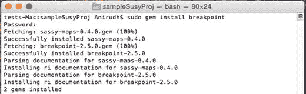

图 5-11。安装断点插件

下一步是使用 `require "breakpoint"` 将该插件包含到项目的 `config.rb` 文件中。

将其包含到配置文件后，您需要使用 `@import "breakpoint"` 将其包含到您正在使用的 SCSS 文件中。

现在，您将开始在代码中使用断点。为此，让我们先为您之前定义的大屏幕断点设置 `font-size` 为 `1.5em`，如清单 5-23 所示。

***清单 5-23***。在 `_grids.scss` 中为大屏幕断点设置样式

```
@import "susy";
@import "breakpoint";

$susy: (
   columns: 12,
   gutters: 1/5,
   global-box-sizing:border-box
);

// 定义断点值的变量
$mediumScreen:750px;
$largeScreen:1200px;

.page {
   @include breakpoint($largeScreen) {
      font-size: 1.5em;
   }
}
```

这段代码将为更大的屏幕生成一个媒体查询，如清单 5-24 所示。

***清单 5-24***。清单 5-23 在 `style.css` 中的输出

```
@media (min-width: 1200px) {
   /* line 17, ../sass/_grids.scss */
   .page {
      font-size: 1.5em;
   }
}
```

现在，假设您想要声明一个具有最小和最大宽度的媒体查询。您可以通过以空格分隔的格式提供值来实现。为此，让我们修改 `$mediumScreen` 变量的值。如清单 5-25 所示。

***清单 5-25***。在 `_grids.scss` 中为具有最小和最大值的中屏幕断点设置值

```
@import "susy";
@import "breakpoint";

$susy: (
columns: 12,
gutters: 1/5,
global-box-sizing:border-box
);

// 定义断点值的变量
$mediumScreen:480px 750px;
$largeScreen:1200px;

.page {
   @include breakpoint($largeScreen) {
   font-size: 1.5em;
}
@include breakpoint($mediumScreen){
   font-size: 1em;
}
}
```

***列表 5-26***. 列表 5-25 在`style.css`中的输出

```
@media (min-width: 480px) and (max-width: 750px) {
/* line 17, ../sass/_grids.scss */
.page {
font-size: 1em;
}
}
```

你可以在媒体查询定义中添加媒体类型。媒体类型的值必须是媒体查询的第一个参数。开发人员通常会省略`all`媒体类型，以创建更简洁的媒体查询。如果你希望始终可以使用`all`媒体类型，需要设置`$breakpoint-force-media-all: true;`

你可以在列表 5-27 中看到这种高级媒体查询。

***列表 5-27***. 在`in_grids.scss`开头指定媒体类型的高级媒体查询

```
@import "susy";
@import "breakpoint";

$susy: (
columns: 12,
gutters: 1/5,
global-box-sizing:border-box
);

// 定义断点值的变量
$mediumScreen:480px 750px;
$largeScreen:1200px;
$advancedQuery: 'not screen' 320px;

.page {
   @include breakpoint($largeScreen) {
      font-size: 1.5em;
   }
   @include breakpoint($mediumScreen){
      font-size: 1em;
   }
   @include breakpoint($advancedQuery) {
      color:#777;
   }
}
```

***列表 5-28***. 列表 5-27 在`style.css`中的输出

```
@media (min-width: 1200px) {
  /* line 19, ../sass/_grids.scss */
  .page {
    font-size: 1.5em;
  }
}
@media (min-width: 480px) and (max-width: 750px) {
  /* line 19, ../sass/_grids.scss */
  .page {
    font-size: 1em;
  }
}
@media not screen and (min-width: 320px) {
  /* line 19, ../sass/_grids.scss */
  .page {
    color: #777;
  }
}
```

多个特性可以组合成一个复合媒体查询。这样可以评估多个特性，如列表 5-29 所示。

### 列表 5-29. 在`_grid.scss`中展示复合媒体查询的示例

```scss
@import "susy";
@import "breakpoint";

$susy: (
   columns: 12,
   gutters: 1/5,
   global-box-sizing:border-box
);

// 定义断点值的变量
$mediumScreen:480px 750px;
$largeScreen:1200px;
$advancedQuaery: 'not screen' 320px;
$compoundQuery: print (orientation landscape) (min-width 520px);

.page {
   @include breakpoint($largeScreen) {
      font-size: 1.5em;
   }
   @include breakpoint($mediumScreen){
      font-size: 1em;
   }
   @include breakpoint($advancedQuery) {
      color:#777;
   }
   @include breakpoint($compoundQuery) {
      font-weight: bold;
   }
}
```

### 列表 5-30. 列表 5-29 的输出

```css
@media (min-width: 1200px) {
  /* line 19, ../sass/_grids.scss */
  .page {
    font-size: 1.5em;
  }
}
@media (min-width: 480px) and (max-width: 750px) {
  /* line 19, ../sass/_grids.scss */
  .page {
    font-size: 1em;
  }
}
@media not screen and (min-width: 320px) {
  /* line 19, ../sass/_grids.scss */
  .page {
    color: #777;
  }
}
@media print and (orientation: landscape) and (min-width: 520px) {
  /* line 19, ../sass/_grids.scss */
  .page {
    font-weight: bold;
  }
}
```

## Compass 与 CSS3

Compass 已成为众多开发者的心头好，因为它允许通过预定义的混入，以单行语法编写 CSS3 特性；编译后，会生成带有正确供应商前缀的属性集。这非常实用，可以节省大量时间，开发者也无需记住所有语法。在本节中，你将了解 Compass 支持的部分 CSS3 特性。

为此，你首先需要创建一个新的 Compass 项目，如列表 5-31 所示。

### 列表 5-31. 创建新的 Compass 项目

```bash
compass create effects
```

创建项目后，你将创建一个 HTML 文件，在其中查看所研究的 Compass 所有 CSS3 特性的输出结果。该文件的结构如列表 5-32 所示。

### 清单 5-32 创建一个 HTML 文件

```html
<!DOCTYPE html>
<html>
  <head>
    <title>Built in compass effects</title>
  </head>
  <body>
  </body>
</html>
```

### 背景渐变

Compass 提供了多种 mixin 来支持 `background-gradient`（背景渐变）的不同变体，包括：

- 线性渐变
- 径向渐变
- 水平线性渐变
- 带角度的渐变

对应的 HTML 代码如清单 5-33 所示。

### 清单 5-33 `background-gradient` 的修改版 HTML

```html
<!DOCTYPE html>
<html>
  <head>
    <title>Built in compass effects</title>
    <link rel="stylesheet" type="text/css" href="stylesheets/screen.css">
  </head>
  <body>
    <h1>Background Gradient</h1>
    <div class="gradElement"></div>
  </body>
</html>
```

现在，你将添加 `background-gradient` 的代码，如清单 5-34 所示。

### 清单 5-34 `screen.scss` 中的背景渐变代码

```scss
@import "compass";

.gradElement{
   width:64px;
   height:64px;
   @include background-image(linear-gradient(to bottom right, #FF0000, #888888));
   display:inline-block;
}
```

在上述代码中，你首先导入了 Compass，以便能够使用其 CSS 特性。然后定义了元素的 `width` 和 `height`，并将其 `display` 值设置为 `inline-block`，以使元素可见。接着调用了 `background-image` 这个 mixin，它会为你渲染渐变。其语法与 CSS 中的对应属性类似，值之间用逗号或空格分隔。上述代码最终生成的 CSS 如清单 5-35 所示。

### 清单 5-35 清单 5-34 代码输出的 CSS

```css
/* line 9, ../sass/screen.scss */
.gradElement {
width: 64px;
height: 64px;
background-image: url('');
background-size: 100%;
background-image: -webkit-gradient(linear, 0% 0%, 100% 100%, color-stop(0%, #ff0000), color-stop(100%, #888888));
background-image: -moz-linear-gradient(top, #ff0000, #888888);
background-image: -webkit-linear-gradient(top, #ff0000, #888888);
background-image: linear-gradient(to bottom right, #ff0000, #888888);
display: inline-block;
}
```

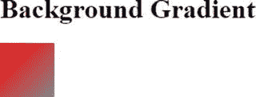

图 5-12. 线性渐变的输出效果

正如你在最终输出中所见，Compass 会自动添加必要的浏览器厂商前缀。类似地，你还可以创建其他类型的渐变；例如，尝试在清单 5-36 中创建一个径向渐变。

### 清单 5-36 使用 Compass 创建径向渐变

```scss
.radGradElement{
   width:64px;
   height:64px;
   @include background-image(radial-gradient(30px 30px, #FF0000 10px, #888888 30px));
   display:inline-block;
}
```

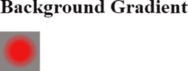

图 5-13. 径向渐变的输出效果

更多关于 `background-gradient` 的示例可以在这里查看：

[`compass-style.org/examples/compass/css3/gradient/`](http://compass-style.org/examples/compass/css3/gradient/).

### 边框圆角

另一个常用的 CSS3 特性是 `border-radius`。它用于为元素添加圆角。为了演示其用法，让我们在 HTML 文件中添加一些标记，如清单 5-37 所示。

***清单 5-37*** `border-radius` 的附加标记

```html
<h1>Border Radius</h1>
<div class="br1 rounded"></div>
```

现在让我们在 SCSS 文件中添加代码。在第一个示例中，你将看到一个所有角都为圆角的元素，如清单 5-38 所示。

***清单 5-38*** 简单的边框圆角 mixin 实现

```scss
// Code for border radius mixin
.rounded{
   width:64px;
   height:64px;
   display:inline-block;
   background:#FF0000;
}
.br1{
   @include border-radius(30px);
}
```

***清单 5-39*** 清单 5-38 的输出 CSS

```css
/* line 23, ../sass/screen.scss */
.rounded {
width: 64px;
height: 64px;
display: inline-block;
background: #FF0000;
}

/* line 29, ../sass/screen.scss */
.br1 {
-moz-border-radius: 30px;
-webkit-border-radius: 30px;
border-radius: 30px;
}
```

除了这个简单的 `border-radius` mixin 之外，Compass 还提供了 `border-radius` mixin 的变体，通过它们可以只对单个或两个角进行圆角处理。下面我们来看每个变体的示例。首先，你将看到 HTML 文件所需的标记，如清单 5-40 所示。

***清单 5-40*** 边框圆角变体

```html
<div class="br2 rounded"></div>
<div class="br3 rounded"></div>
```

接下来是 SCSS 文件的代码，如清单 5-41 所示。

***清单 5-41*** 边框圆角变体

```scss
.br2{
  @include border-top-left-radius(30px);
}
.br3{
  @include border-bottom-radius(30px);
}
```

在上一个示例中，你可以看到 `border-radius` 的两种变体，一种是仅对单个角进行圆角处理，另一种是对两个角进行圆角处理。上述代码的输出如清单 5-42 所示。

***清单 5-42*** 清单 5-41 的输出 CSS

```css
/* line 32, ../sass/screen.scss */
.br2 {
  -moz-border-radius-topleft: 30px;
  -webkit-border-top-left-radius: 30px;
  border-top-left-radius: 30px;
}

/* line 35, ../sass/screen.scss */
.br3 {
  -moz-border-radius-bottomleft: 30px;
  -webkit-border-bottom-left-radius: 30px;
  border-bottom-left-radius: 30px;
  -moz-border-radius-bottomright: 30px;
  -webkit-border-bottom-right-radius: 30px;
  border-bottom-right-radius: 30px;
}
```


图 5-14. 前几个清单中 `border-radius` 代码的输出效果

你可以在以下网址查看这些特性的更多示例：

[`compass-style.org/examples/compass/css3/border_radius/`](http://compass-style.org/examples/compass/css3/border_radius/).

### 透明度

Compass 还提供了一个用于 `opacity` 的 mixin，通过它你可以控制元素的透明度。这在清单 5-43 中进行了演示。

***清单 5-43*** Compass 提供的透明度 mixin

```html
<h1>Opacity</h1>
<div class="opacity light0"></div>
<div class="opacity light1"></div>
<div class="opacity light2"></div>
<div class="opacity light3"></div>
<div class="opacity light4"></div>
```

***清单 5-44*** Compass 提供的透明度 mixin

```scss
// Code for opacity mixin
.opacity{
   width:32px;
   height:32px;
   display:inline-block;
   background:#000;
}
.light0{
   @include opacity(0);
}
.light1{
   @include opacity(0.1);
}
.light2{
   @include opacity(0.2);
}
.light3{
   @include opacity(0.3);
}
.light4{
   @include opacity(0.4);
}
```

在这个示例中，你可以通过设置不同的 `opacity` 值，实现元素从完全透明到部分不透明的过渡效果。这段代码的输出如清单 5-45 所示。

***清单 5-45*** 清单 5-44 的输出 CSS

```scss
/* line 40, ../sass/screen.scss */
.opacity {
  width: 32px;
  height: 32px;
  display: inline-block;
  background: #000;
}

/* line 46, ../sass/screen.scss */
.light0 {
  filter: progid:DXImageTransform.Microsoft.Alpha(Opacity=0);
  opacity: 0;
}

/* line 49, ../sass/screen.scss */
.light1 {
  filter: progid:DXImageTransform.Microsoft.Alpha(Opacity=10);
  opacity: 0.1;
}

/* line 52, ../sass/screen.scss */
.light2 {
  filter: progid:DXImageTransform.Microsoft.Alpha(Opacity=20);
  opacity: 0.2;
}

/* line 55, ../sass/screen.scss */
.light3 {
  filter: progid:DXImageTransform.Microsoft.Alpha(Opacity=30);
  opacity: 0.3;
}

/* line 58, ../sass/screen.scss */
.light4 {
  filter: progid:DXImageTransform.Microsoft.Alpha(Opacity=40);
  opacity: 0.4;
}
```

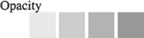

图 5-15： 代码清单 5-45 的输出结果

### 文本阴影

接下来要介绍的 Compass 插件是文本阴影。Compass 让文本阴影插件的实现变得非常简单，如代码清单 5-46 所示。

***代码清单 5-46***。 使用 Compass 实现文本阴影

## 文本阴影

```scss
// 文本阴影代码
.singleShadow{
   @include single-text-shadow;
}
```

这段代码会将文本阴影应用于 class 为`singleShadow`的元素。该代码的输出结果如代码清单 5-47 所示。

***代码清单 5-47***。 代码清单 5-46 的输出结果

```css
/* line 63, ../sass/screen.scss */
.singleShadow {
  text-shadow: 0px 0px 1px #aaaaaa;
}
```

可以使用 Compass 提供的三个变量来自定义这个单一文本阴影，具体如下：

*   `$default-text-shadow-color`：阴影的默认颜色
*   `$default-text-shadow-blur`：模糊的默认值
*   `$default-text-shadow-v-offset`：阴影偏移的默认值

***代码清单 5-48***。 演示在混入守卫中使用比较运算符的示例

```scss
$default-text-shadow-color: rgba(255,250,0, 0.6);
$default-text-shadow-blur: 5px;
$default-text-shadow-v-offset: 3px;
.singleShadow{
   @include single-text-shadow;
}
```

***代码清单 5-49***。 代码清单 5-48 的输出结果

```css
.singleShadow {
   text-shadow: 0px 3px 5px rgba(255, 250, 0, 0.6);
}
```

***代码清单 5-50***。 代码清单 5-49 对应的 HTML

```html
<h1>Text shadow</h1>
<span class="singleShadow">This is a text with single shadow</span>
```

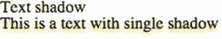

图 5-16。 代码清单的输出结果

你也可以为文本应用多重阴影，如代码清单 5-51 所示。

***代码清单 5-51***。 为文本应用多重阴影

```scss
.customMultipleshadows {
   @include text-shadow(rgba(0,0,0, 0.2) 1px 1px 0, rgba(10,10,10, 0.2) 2px 2px 0, rgba(11,11,11, 0.2) 3px 3px 0);
}
```

***代码清单 5-52***。 代码清单 5-51 的输出结果

```css
/* line 69, ../sass/screen.scss */
.customMultipleshadows {
  text-shadow: rgba(0, 0, 0, 0.2) 1px 1px 0, rgba(10, 10, 10, 0.2) 2px 2px 0, rgba(11, 11, 11, 0.2) 3px 3px 0;
}
```

***代码清单 5-53***。 代码清单 5-52 对应的 HTML

```html
<h1>Text shadow</h1>
<span class="singleShadow">This is a text with single shadow</span>
<span class="customMultipleshadows">This is a text with custom Multiple shadows</span>
```

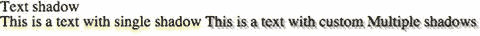

图 5-17。 单一文本阴影与多重文本阴影

## 盒阴影

Compass 支持的另一个很酷的 CSS3 特性是盒阴影。盒阴影与文本阴影类似，但它是应用于容器而非文本。这在代码清单 5-54 中进行了演示。

***代码清单 5-54***。 使用 Compass 演示盒阴影的示例

```scss
// 盒阴影代码
.shadow{
   width:32px;
   height:32px;
   display:inline-block;
   margin-right:10px;
   background:#CCC;
}
.defaultBoxShadow {
   @include single-box-shadow;
}

.customBoxShadow {
   @include box-shadow(#222 4px 3px 5px);
}

.multipleCustomBoxShadow {
   @include box-shadow(rgba(255,0,0 , 0.5) 0 0 25px, rgba(0,0,0, 0.7) 0 0 6px 2px inset);
}
```

***代码清单 5-55***。 代码清单 5-54 的输出结果

```css
/* line 74, ../sass/screen.scss */
.shadow {
  width: 32px;
  height: 32px;
  display: inline-block;
  margin-right: 10px;
  background: #CCC;
}

/* line 81, ../sass/screen.scss */
.defaultBoxShadow {
  -moz-box-shadow: 0px 5px #333333;
  -webkit-box-shadow: 0px 5px #333333;
  box-shadow: 0px 5px #333333;
}

/* line 85, ../sass/screen.scss */
.customBoxShadow {
  -moz-box-shadow: #222 4px 3px 5px;
  -webkit-box-shadow: #222 4px 3px 5px;
  box-shadow: #222 4px 3px 5px;
}

/* line 89, ../sass/screen.scss */
.multipleCustomBoxShadow {
  -moz-box-shadow: rgba(255, 0, 0, 0.5) 0 0 25px, rgba(0, 0, 0, 0.7) 0 0 6px 2px inset;
  -webkit-box-shadow: rgba(255, 0, 0, 0.5) 0 0 25px, rgba(0, 0, 0, 0.7) 0 0 6px 2px inset;
  box-shadow: rgba(255, 0, 0, 0.5) 0 0 25px, rgba(0, 0, 0, 0.7) 0 0 6px 2px inset;
}
```

***代码清单 5-56***。 代码清单 5-54 对应的 HTML

```html
<h1>Box shadow</h1>
<div class='defaultBoxShadow shadow'></div>
<div class='customBoxShadow shadow'></div>
<div class='multipleCustomBoxShadow shadow'></div>
```

这个混入有以下可配置的参数：

*   `$default-box-shadow-color`：提供默认的阴影颜色
*   `$default-box-shadow-h-offset`：提供默认的水平偏移值
*   `$default-box-shadow-v-offset`：提供默认的垂直偏移值
*   `$default-box-shadow-blur`：提供默认的模糊量
*   `$default-box-shadow-spread`：提供默认的扩展量
*   `$default-box-shadow-inset`：提供默认的阴影内嵌量

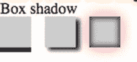

图 5-18。 代码清单 5-46 的输出结果

## 过渡

Compass 还提供了混入，可轻松实现各种 CSS3 过渡效果。这在代码清单 5-57 中进行了演示。

***代码清单 5-57***。 使用 Compass 混入实现 CSS3 过渡的示例

# CSS过渡与占位符样式示例

```scss
.transition {
   width: 32px;
   height: 32px;
   display: block;
   margin-bottom: 10px;
}
// 通过设置将发生过渡的属性来启动过渡
.default{
   background:#F00;
   @include transition-property(all);
}
.default:hover{
   background:#BBB;
}
.withDuration{
   background:#F00;
   @include transition-property(all);
   @include transition-duration(3s);
}
.withDuration:hover{
   background:#BBB;
}
.widthDurationEaseIn{
   background:#F00;
   @include transition-property(all);
   @include transition-duration(3s);
   @include transition-timing-function(ease-out);
}
.widthDurationEaseIn:hover{
   background:#BBB;
}
.widthDelay{
   background:#F00;
   @include transition-property(all);
   @include transition-duration(3s);
   @include transition-timing-function(ease-out);
   @include transition-delay(3s);
}
.widthDelay:hover{
   background:#BBB;
}
```

在本示例中，你首先设置了将随过渡变化的属性。在此例中，你对任何属性应用的所有更改都将伴随过渡效果。第二个示例中，你设置了过渡的持续时间（即过渡完成所需的时间）。第三个示例中，你设置了过渡的缓动属性（即过渡开始和结束时的平滑程度）。最后一个示例中，你设置了延迟（过渡开始前的延迟时间）。其输出结果如清单 5-58 所示。

**清单 5-58**。清单 5-57 的输出结果

```
/* line 94, ../sass/screen.scss */
.transition {
  width: 32px;
  height: 32px;
  display: block;
  margin-bottom: 10px;
}

/* line 102, ../sass/screen.scss */
.default {
  background: #F00;
  -moz-transition-property: all;
  -o-transition-property: all;
  -webkit-transition-property: all;
  transition-property: all;
}

/* line 106, ../sass/screen.scss */
.default:hover {
  background: #BBB;
}

/* line 109, ../sass/screen.scss */
.withDuration {
  background: #F00;
  -moz-transition-property: all;
  -o-transition-property: all;
  -webkit-transition-property: all;
  transition-property: all;
  -moz-transition-duration: 3s;
  -o-transition-duration: 3s;
  -webkit-transition-duration: 3s;
  transition-duration: 3s;
}

/* line 114, ../sass/screen.scss */
.withDuration:hover {
  background: #BBB;
}

/* line 117, ../sass/screen.scss */
.widthDurationEaseIn {
  background: #F00;
  -moz-transition-property: all;
  -o-transition-property: all;
  -webkit-transition-property: all;
  transition-property: all;
  -moz-transition-duration: 3s;
  -o-transition-duration: 3s;
  -webkit-transition-duration: 3s;
  transition-duration: 3s;
  -moz-transition-timing-function: ease-out;
  -o-transition-timing-function: ease-out;
  -webkit-transition-timing-function: ease-out;
  transition-timing-function: ease-out;
}

/* line 123, ../sass/screen.scss */
.widthDurationEaseIn:hover {
  background: #BBB;
}

/* line 126, ../sass/screen.scss */
.widthDelay {
  background: #F00;
  -moz-transition-property: all;
  -o-transition-property: all;
  -webkit-transition-property: all;
  transition-property: all;
  -moz-transition-duration: 3s;
  -o-transition-duration: 3s;
  -webkit-transition-duration: 3s;
  transition-duration: 3s;
  -moz-transition-timing-function: ease-out;
  -o-transition-timing-function: ease-out; 
  -webkit-transition-timing-function: ease-out;
  transition-timing-function: ease-out;
  -moz-transition-delay: 3s;
  -o-transition-delay: 3s;
  -webkit-transition-delay: 3s;
  transition-delay: 3s;
}

/* line 133, ../sass/screen.scss */
.widthDelay:hover {
  background: #BBB;
}
```

## 文本字段占位符

你将看到的最后一个示例是设置输入字段占位符文本的样式。这在清单 5-59 中通过使用 `input-placeholder` 混合宏进行了演示。

**清单 5-59**。设置输入字段占位符样式的示例

```
// Code for styling input placeholder
input[type="text"] {
   font-size:15px;
   @include input-placeholder {
      color: #AAA;
      font-weight: bold;
      font-size: 15px;
   }
}
```

**清单 5-60**。清单 5-59 的输出结果

```
/* line 138, ../sass/screen.scss */
input[type="text"] {
  font-size: 15px;
}
/* line 61, ../../../../../../Library/Ruby/Gems/2.0.0/gems/compass-core-1.0.3/stylesheets/compass/css3/_user-interface.scss */
input[type="text"]:-moz-placeholder {
  color: #AAA;
  font-weight: bold;
  font-size: 15px;
}
/* line 64, ../../../../../../Library/Ruby/Gems/2.0.0/gems/compass-core-1.0.3/stylesheets/compass/css3/_user-interface.scss */
input[type="text"]::-moz-placeholder {
  color: #AAA;
  font-weight: bold;
  font-size: 15px;
}
/* line 67, ../../../../../../Library/Ruby/Gems/2.0.0/gems/compass-core-1.0.3/stylesheets/compass/css3/_user-interface.scss */
input[type="text"]:-ms-input-placeholder {
  color: #AAA;
  font-weight: bold;
  font-size: 15px;
}
/* line 56, ../../../../../../Library/Ruby/Gems/2.0.0/gems/compass-core-1.0.3/stylesheets/compass/css3/_user-interface.scss */
input[type="text"]::-webkit-input-placeholder {
  color: #AAA;
  font-weight: bold;
  font-size: 15px;
}
```

这个混合宏会自动生成带有合适厂商前缀的代码，使得实现此类功能变得非常简单。

***清单 5-61***。清单 5-60 的 HTML 代码

```
<input name='input' placeholder='This is styled input place holder' type='text'>
```

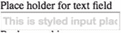

**图 5-19.** 清单 5-53 的输出结果

## `image-url()` 函数

在 CSS 中，指定背景图片时需要指定相对路径。Compass 简化了这一过程。Compass 提供的功能允许你在 `config.rb` 中为所有图片定义路径，然后在指定背景图片时直接使用图片名称即可。这在以下清单中进行了演示。

***清单 5-62***。用于 `image-url()` 的 `config.rb`

```
# Set this to the root of your project when deployed:
http_path = "../"
css_dir = "stylesheets"
sass_dir = "sass"
images_dir = "images"
javascripts_dir = "javascripts"
```

清单 5-63。演示 `image-url()` 的示例

```
// Background image using image-url
.bgImage{
   width:128px;
   height:128px;
   background:image-url("facebook.png");
}
```

在这段代码中，`image-url` 会自动为背景图片添加相对路径。

***清单 5-64***。清单 5-63 的输出结果

```
/* line 148, ../sass/screen.scss */
.bgImage {
  width: 128px;
  height: 128px;
  background: url('../images/facebook.png?1447046278');
}
```

## `image-width()` 函数

无需手动查找背景图片的宽度，你可以使用 Compass 提供的 `image-width` 函数。

该函数接收背景图片的路径/名称作为输入，并以 `px` 为单位返回宽度。这在清单 5-65 中进行了演示。

***清单 5-65***。使用 `image-width` 的示例

```
// Background image using image-url
.bgImage{
  width:image-width("facebook.png");
  height:128px;
  background:image-url("facebook.png");
}
```

其输出结果与清单 5-64 相同。

## `image-height()` 函数

与 `image-width` 函数类似，还有一个 `image-height` 函数，它返回传入图片的高度。这在清单 5-66 中进行了演示。

***清单 5-66***。使用 `image-height` 的示例

```
// Background image using image-url
.bgImage{
  width:image-width("facebook.png");
  height:image-height("facebook.png");
  background:image-url("facebook.png");
}
```

其输出结果与清单 5-64 相同。

## 图片精灵与 Compass

### 使用 Compass 实现 CSS 图像精灵

Web 开发的最佳实践指出，使用图像精灵比使用单个图像更好。图像精灵是将所有其他图像合并而成的单个图像。然后通过 `background-position` 属性在可视区域内移动这个单个图像。由于这个图像在加载之初就会被加载，因此查看图像时不会有延迟。

这是一个实用的技术，但如果手动操作，需要花费大量精力。Compass 简化了使用图像精灵的过程，消除了相关的工作量和复杂性。

### 使用 Compass 创建图像精灵

要使用 Compass 创建图像精灵，你需要一个文件夹来存放所有要放入图像精灵中的图片。你需要在项目根目录下创建一个名为 `image-sprite` 的文件夹，并将图片放入其中。你需要向该文件夹添加四个文件，如图 5-20 所示。

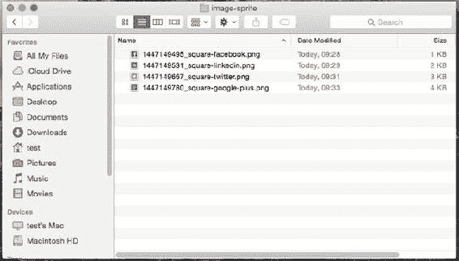

图 5-20。向精灵文件夹添加图片

接下来，你需要将这些图片导入到 SCSS 文件中。具体操作如代码清单 5-67 所示。

***代码清单 5-67***。生成图像精灵

```
// 创建图像精灵的示例
@import "image-loaded/*.png";
.socials{
   @include all-image-loaded-sprites;
}
```

在上述代码中，`import` 语句将创建图像精灵文件。接下来的 `@include` 语句将生成使用该精灵所需的 CSS 代码。此代码的输出如代码清单 5-68 所示。

***代码清单 5-68***。代码清单 5-67 的输出

### 文本隐藏

Compass 提供了几个混入（mixin），用于在使用 `background-image` 时处理文本隐藏。

首先要介绍的混入是 `hide-text` 混入。其实现如代码清单 5-69 所示。

***代码清单 5-69***。演示 `hide-text` 的示例

```
// 创建图像精灵的示例
@import "image-loaded/*.png";
.socials{
   @include all-image-loaded-sprites;
   @include hide-text;
}
```

在上述代码中，包含该混入是为了在创建社交图标图像精灵后隐藏文本。此代码的输出如代码清单 5-70 所示。

***代码清单 5-70***。代码清单 5-69 的输出

```
.image-loaded-sprite, .socials .image-loaded-facebook, .socials .image-loaded-googleplus, .socials .image-loaded-linkedin, .socials .image-loaded-twitter {
  background-image: url('/images/image-loaded-sbf38a83327.png');
  background-repeat: no-repeat;
}

/* line 156, ../sass/screen.scss */
.socials {
  text-indent: -119988px;
  overflow: hidden;
  text-align: left;
  text-transform: capitalize;
}
```

这显然能完成任务；但有一个问题。当添加 `@include hide-text` 时，它会偏移文本。这意味着浏览器正在渲染一个包含文本的元素，该文本在屏幕外 119988px 处。这在计算机上运行良好，但在移动设备上可能会引起问题。因此，Compass 提供了一些替代技术。

Compass 提供了另一个名为 `squish-text` 的混入，用于压缩文本。这意味着文本在视觉上将被隐藏，但屏幕阅读器仍然可以访问。这在代码清单 5-71 中进行了演示。

***代码清单 5-71***。演示 `squish-text` 的示例

```
// 创建图像精灵的示例
@import "image-loaded/*.png";
.socials{
   @include all-image-loaded-sprites;
   @include squish-text;
   .icons {
      width:128px;
      height:128px;
   }
}
```

视觉上，这与前面的示例相同，但与前面的示例不同，它是内联隐藏文本。这可以在代码清单 5-72 中看到。

***代码清单 5-72***。代码清单 5-71 的输出

```
/* line 72, image-loaded/*.png */
.image-loaded-sprite, .socials .image-loaded-facebook, .socials .image-loaded-googleplus, .socials .image-loaded-linkedin, .socials .image-loaded-twitter {
  background-image: url('../images/image-loaded-sbf38a83327.png');
  background-repeat: no-repeat;
}

/* line 156, ../sass/screen.scss */
.socials {
  font: 0/0 serif;
  text-shadow: none;
  color: transparent;
}
/* line 84, ../../../../../../Library/Ruby/Gems/2.0.0/gems/compass-core-1.0.3/stylesheets/compass/utilities/sprites/_base.scss */
.socials .image-loaded-facebook {
  background-position: 0 0;
}
/* line 84, ../../../../../../Library/Ruby/Gems/2.0.0/gems/compass-core-1.0.3/stylesheets/compass/utilities/sprites/_base.scss */
.socials .image-loaded-googleplus {
  background-position: 0 -128px;
}
/* line 84, ../../../../../../Library/Ruby/Gems/2.0.0/gems/compass-core-1.0.3/stylesheets/compass/utilities/sprites/_base.scss */
.socials .image-loaded-linkedin {
  background-position: 0 -256px;
}
/* line 84, ../../../../../../Library/Ruby/Gems/2.0.0/gems/compass-core-1.0.3/stylesheets/compass/utilities/sprites/_base.scss */
.socials .image-loaded-twitter {
  background-position: 0 -384px;
}
/* line 159, ../sass/screen.scss */
.socials .icons {
  width: 128px;
  height: 128px;
}
```

***代码清单 5-73***。代码清单 5-71 的 HTML 代码

```
<h1>Implementation of Image sprite</h1>
<div class="socials">
<div class="image-loaded-facebook icons"></div>
</div>
```

当不使用图像精灵时，Compass 提供了一个用于用图像替换文本的混入。这在你想用 Logo 替换标题标签的情况下非常有用。

这个混入会根据所用图像的尺寸设置元素的尺寸。这可以在代码清单 5-74 中看到。

**代码清单 5-74**。`replace-text-with-dimensions` 的示例

```scss
.singleSocial{
   @include replace-text-with-dimensions("../images/facebook.png");
}
```

**代码清单 5-75**。代码清单 5-74 的输出

```css
/* line 161, ../sass/screen.scss */
.singleSocial {
  text-indent: -119988px;
  overflow: hidden;
  text-align: left;
  text-transform: capitalize;
  background-image: url('/images/../images/facebook.png?1447046278');
  background-repeat: no-repeat;
  background-position: 50% 50%;
  width: 128px;
  height: 128px;
}
```

## 使用 Compass 实现内联图像

内联图像可直接将图像嵌入网页，遵循 RFC 2397 规范。内联图像使用的数据 URI 旨在嵌入数据项，就像它们是从外部引用一样。使用内联图像可以节省 HTTP 请求。列表 5-76 对此进行了演示。

**列表 5-76**。内联图像演示示例

```scss
.singleSocialInline{
   background-image: inline-image("../images/facebook.png");
}
```

**列表 5-77**。列表 5-76 的输出结果

```css
.singleSocialInline {
background-image: url('');
}
```

### CSS 变换

Compass 提供了一个混合宏来支持 CSS3 变换。Compass 2D 变换混合宏的语法与 CSS 2D 变换函数相同。

我们来了解一下 CSS 变换的可配置参数：

*   `$default-origin-x`：设置变换的默认 x 轴原点
*   `$default-origin-y`：设置变换的默认 y 轴原点
*   `$default-origin-z`：设置变换的默认 z 轴原点

这三个参数的默认值均为 50%。

*   `$default-scale-x`：设置 x 轴缩放的默认倍数
*   `$default-scale-y`：设置 y 轴缩放的默认倍数
*   `$default-scale-z`：设置 z 轴缩放的默认倍数

这三个参数的默认值为 1.25。

*   `$default-rotate`：设置旋转的默认角度
*   `$default-vector-x`：设置 3D 旋转轴的默认 x 向量
*   `$default-vector-y`：设置 3D 旋转轴的默认 y 向量
*   `$default-vector-z`：设置 3D 旋转轴的默认 z 向量
*   `$default-translate-x`：设置平移的默认 x 轴距离
*   `$default-translate-y`：设置平移的默认 y 轴距离
*   `$default-translate-z`：设置平移的默认 z 轴距离
*   `$default-skew-x`：设置倾斜的默认 x 轴角度
*   `$default-skew-y`：设置倾斜的默认 y 轴角度
*   `$default-skew-z`：设置倾斜的默认 z 轴角度

现在，我们将介绍 Compass 提供的一些用于执行这些变换的混合宏。我们要介绍的第一个变换是缩放。它用于缩放元素。列表 5-78 对此进行了演示。

**列表 5-78**。缩放混合宏演示示例

```scss
.elementToScale{
   width:32px;
   height:32px;
   display:block;
   background:#F00;
}
.elementToScale:hover{
   @include scale(2.0);
}
```

在上一个示例中，您使用了缩放变换将元素缩放为其原始大小的两倍。此操作的输出结果见列表 5-79。

**列表 5-79**。列表 5-78 的输出结果

```css
/* line 169, ../sass/screen.scss */
.elementToScale {
  width: 32px;
  height: 32px;
  display: block;
  background: #F00;
}

/* line 175, ../sass/screen.scss */
.elementToScale:hover {
  -moz-transform: scale(2, 2);
  -ms-transform: scale(2, 2);
  -webkit-transform: scale(2, 2);
  transform: scale(2, 2);
}
```

接下来您要了解的变换是平移。平移用于将元素从一个位置移动到另一个位置。列表 5-80 对此进行了演示。

**列表 5-80**。平移变换演示示例

```scss
.elementToTranslate{
   width:32px;
   height:32px;
   display:block;
   background:#F00;
}
.elementToTranslate:hover{
   @include translate(30px);
}
```

在上一个示例中，您将元素沿 x、y 和 z 轴正方向平移了 30 像素。此操作的输出结果如列表 5-81 所示。

**列表 5-81**。列表 5-80 的输出结果

# 使用 Compass 扩展

在本节中，您将运用 Sass 和 Compass 技能编写一个 Compass 扩展，通过这种方式您能与社区共享代码。您将探讨构建扩展所需的设计决策，并了解相关的最佳实践。

Compass 扩展是共享 Sass 脚本以便他人使用的方式。除了共享之外，它们还可以作为框架中的独立模块使用。编写 Compass 扩展比复制粘贴 Sass 代码片段是更好的方法。

在此示例中，您将创建一个输出自定义按钮样式的函数，并将其打包成一个名为 `colorExtension` 的简单扩展。

您首先需要创建一个以扩展名命名的目录，并在其中添加一个同名的 SCSS 文件。这是最基本、最简单的扩展形式，也称为*临时*扩展。

用户只需将目录复制到项目下的扩展文件夹中，即可安装临时扩展。将扩展复制到正确的目录后，该扩展的 Sass 文件就可以像项目中其他 Sass 文件一样被导入。

对于独立项目，扩展应放置在项目文件夹根目录下的扩展文件夹中，例如 `projectDirectory/extensions/customButton/`。请注意，Compass 不会自动创建此文件夹。用户需要手动添加。

接下来，你需要在扩展文件中添加所需的代码，如代码清单 5-82 所示。为了方便起见，请注意文件名和扩展混合宏的名称保持一致。在实际场景中，它们可能会有所不同。

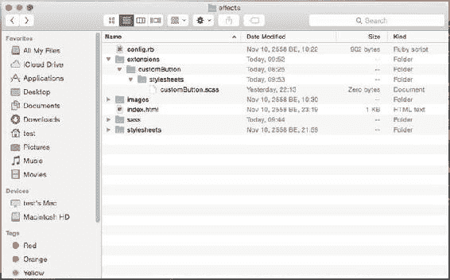

图 5-22. 包含扩展的目录结构

***代码清单 5-82***. 向扩展文件`customButton.scss`中添加代码

```
@mixin customButton() {
   cursor: pointer;
   padding: 10px 15px;
   background-color: #eee;
   border: #bbb 1px solid;
   color: #555;
   @include border-radius(25%);
   @include transition-property(all);
   &:hover {
      background-color:#bbb;
   }
}
```

接下来，你需要在 `screen.scss` 文件中导入此扩展，以便能够使用它。如代码清单 5-83 所示。

***代码清单 5-83***. 在你的`screen.scss`中导入扩展

```
// Code for custom extension
@import "customButton";
.primaryAction{
   @include customButton;
}
```

除了将扩展导入 `SCSS` 文件之外，你还需要在 `.primaryAction` 类中包含来自该扩展的混合宏。

该代码的输出如代码清单 5-84 所示。

***代码清单 5-84***. 代码清单 5-83 的输出

```
/* line 191, ../sass/screen.scss */
.primaryAction {
  cursor: pointer;
  padding: 10px 15px;
  background-color: #eee;
  border: #bbb 1px solid;
  color: #555;
  -moz-border-radius: 25%;
  -webkit-border-radius: 25%;
  border-radius: 25%;
  -moz-transition-property: all;
  -o-transition-property: all;
  -webkit-transition-property: all;
  transition-property: all;
}
/* line 9, ../extensions/customButton/stylesheets/customButton.scss */
.primaryAction:hover {
background-color: #bbb;
}
```

你可以将之前学到的关于混合宏的所有概念应用于扩展中的混合宏。

更多变换的参考资料可访问 [`compass-style.org/reference/compass/css3/transform/`](http://compass-style.org/reference/compass/css3/transform/)。

# 本章小结

在本章中，你了解了 Compass 框架，它是一个基于 Sass 的框架。你看到了它在网格、颜色、图像精灵等方面提供的各种特性。此外，你还学习了如何在 Compass 中创建自定义扩展。

# 索引

  A

@arguments 变量

  B

边框半径标记

边框半径变体

Bower

盒模型

`_grids.scss`中的断点

断点插件

  C

Cardinal CSS 框架

客户端变体

编译器

HTML 标记

更少的代码

颜色函数

混合函数

通道操作方法

颜色混合函数

`contrast()` 函数

变亮和变暗函数

RGB 格式

阈值

组合器, SCSS

相邻兄弟组合器, HTML 标记

通用兄弟组合器

在 CSS 中

Compass

`config.rb`

与 CSS3

背景渐变

边框半径

盒子阴影

HTML 文件

新建 Compass 项目

不透明度

文本字段占位符

文字阴影

过渡效果

CSS 变换

描述

扩展

辅助工具

`image-url()`

在 `config.rb` 中

演示

`image-height()`

`image-width()`

内联图像

安装

Mixins

项目创建

响应式网格

优势

`box-sizing` 模型

断点插件

断点

`style.scss` 中的容器

`gem install susy`

入门

HTML 标记

在 `_grid.scss` 中

`_grids.scss` 中的大屏断点

必要参数

非语义类

叠加

使用 Sass 和 Compass

在 `style.css` 中

Susy 附加组件

Susy Compass 扩展

Susy 定义

Susy 专用变量

告知 Susy

精灵图与 Compass

文本隐藏

排版

内容分发网络 (CDN)

CSS3 过渡。*参见* Compass

CSS 预处理器

误区

问题

扩展选择器

使用 Mixins

自定义附加组件（Compass 项目）

 D

默认 `config.rb` 文件

DRY 原则

 E

扩展文件 `customButton.scss`

外部框架

Cardinal CSS

Ionic

 F

函数指令 (Sass)

颜色函数

`adjust_color($color,…)`

`complement($color)`

`grayscale($color)`

列表函数，`nth($list, $n)`

数值函数

`abs($number)`

`ceil($number)`

`floor($number)`

`percentage($number)`

`round($number)`

用户自定义

函数

CSV 列表

类型

G、H

通过 Gem 安装 Susy

通过 Gem 更新系统

网格系统，Sass

添加样式

设置类与变量

计算列类

列配置

HTML

行与列

I、J

@import 语句

K

已知的预处理器

Compass

框架

Less

Sass

L

语言特性

注释

变量

Less 预处理器语言

客户端变体

CSS 语法

合并属性

数字与颜色

预编译器

线性渐变

M

数学函数

杂项函数

Mixins（混合）

歧义行为

边框圆角

类定义

默认值

分离的规则集

函数式编程语言

守卫（Guards）

ID 与类

# ID 选择器

内部样式

循环

重载

参数半径

问题

返回值

可重用代码块

Sass

参数

代码块

复合混合

内容块

CSS 选择器

默认变量

`@include`

关键字参数

`@mixin`

传递参数

可变参数

与类比较

选择器

样式规则

N

嵌套规则

代码冗余

元素

嵌套样式，Sass

代码重复，CSS

选择器分组

属性

代码版本

# O

输出样式，Sass

紧凑型

压缩型

展开型

嵌套型

 P, Q

- 父选择器

- 颜色层级

- 嵌套顺序

- 伪类

- 预处理器

  - 定义

  - 扩展/继承

  - 导入

  - 已知 `参见`（已知的预处理器）

  - 混入

  - 嵌套

  - 运算符

  - 变量

  - 用法

 R

- 径向渐变

 S, T, U

- Sass

  - `@at-root`

  - 动画声明

  - 错误查看

  - 实现

  - 编码与编译

  - 组合器

  - 命令行，替代方案

  - 注释

  - 数据类型

  - 默认值，变量

  - `@extend`

    - 级联

    - 链式

    - 复杂元素

    - CSS 选择器

    - 继承

    - 多个类

    - 多个选择器

    - 占位符选择器

    - 选择器继承

  - 函数指令 `参见`（函数指令，Sass）

  - 网格系统 `参见`（网格系统，Sass）

  - `@import`

    - 获取多个文件

    - `load_paths`

    - 嵌套

    - 纯 CSS 导入

    - `typography.scss`

    - 可视化表示

  - 安装

    - 命令

    - `gem list` 命令，输出

    - 预发布版本，确定与安装

    - Sass 卸载

    - `sass -v` 命令，输出

    - 验证

    - 版本

  - 插值

  - 逻辑能力

    - 控制指令

      - `@each`

      - `@for`

      - `@if`

    - 数学运算

    - 括号

    - 变量

    - `@while`

  - `@media`

    - 内联

    - 嵌套

    - 变量，断点

    - 视口尺寸

    - 基于 Web 应用的，自定义

  - 混入指令 `参见`（混入指令，Sass）

  - 嵌套属性

  - 嵌套样式

  - 输出风格 `参见`（输出风格，Sass）

  - 父选择器，`&`

  - 占位符选择器

  - Scout 应用

  - 变量

  - 工作流

- 脚手架

- Scout 应用

  - 添加项目

  - 启动与监控项目

  - 输入与输出，文件夹选择

  - 用户界面

- 语义网格系统

- 服务器端变体

- 字符串函数

```
sudo gem install Compass
```

 V, W, X, Y, Z

- 变量，Sass

  - 创建

  - CSS 规则

  - 声明，来自另一个变量

  - 默认值

  - 作用域

  - 下划线与连字符，用法