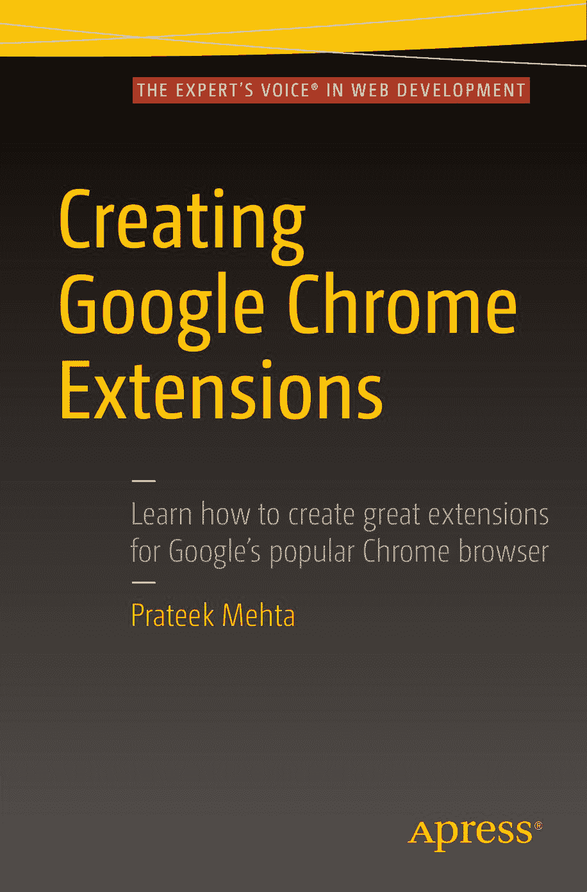

专家之声® 系列：Web 开发

**创建 Google Chrome 扩展程序**

学习如何为谷歌广受欢迎的 Chrome 浏览器创建出色的扩展程序

Prateek Mehta

**创建 Google Chrome 扩展程序**

Prateek Mehta

印度，新德里

ISBN-13（平装）：978-1-4842-1774-0  
ISBN-13（电子版）：978-1-4842-1775-7  
DOI 10.1007/978-1-4842-1775-7

美国国会图书馆控制编号：2016943479

版权所有 © 2016 Prateek Mehta

本作品受版权保护。出版商保留所有权利，无论是全部还是部分材料，特别是翻译、重印、重用插图、朗诵、广播、缩微胶片复制或任何其他物理形式的复制权，以及电子信息存储和检索、电子改编、计算机软件，或使用目前已知或未来开发的类似或不同方法的传输权。法律保留的例外情况包括与评论或学术分析相关的简短摘录，或专门为输入计算机系统并执行而提供的材料，仅供作品购买者独家使用。仅可根据出版商所在地现行版权法的规定复制本出版物或其部分内容，且必须始终获得斯普林格（Springer）的许可。使用许可可通过版权清算中心的 RightsLink 获取。违反者将根据相应的版权法被起诉。

本书中可能出现的商标名称、标识和图像。我们不针对每个商标名称、标识或图像都使用商标符号，而是仅在编辑风格下使用这些名称、标识和图像，以维护商标所有者的利益，且无意侵犯商标权。

本出版物中使用的商品名称、商标、服务标志和类似术语，即使未被标识为此类，也不应被视为对它们是否受专有权利保护的意见表达。

尽管本书中的建议和信息在出版时被认为是真实和准确的，但作者、编辑和出版商均不对可能存在的任何错误或遗漏承担法律责任。出版商对本书所含内容不作任何明示或暗示的担保。

总经理：Welmoed Spahr  
策划编辑：Ben Renow-Clarke  
开发编辑：Matthew Moodie  
技术审稿人：Massimo Nardone  
编辑委员会：Steve Anglin, Pramila Balen, Louise Corrigan, James DeWolf, Jonathan Gennick, Robert Hutchinson, Celestin Suresh John, Nikhil Karkal, James Markham, Susan McDermott, Matthew Moodie, Douglas Pundick, Ben Renow-Clarke, Gwenan Spearing  
协调编辑：Nancy Chen  
文字编辑：Kezia Endsley  
排版：SPi Global  
索引编制：SPi Global  
美工：SPi Global

全球图书贸易发行由 Springer Science+Business Media New York, 233 Spring Street, 6th Floor, New York, NY 10013 负责。电话 1-800-SPRINGER，传真 (201) 348-4505，电子邮件 `orders-ny@springer-sbm.com`，或访问 `www.springer.com`。Apress Media, LLC 是一家加利福尼亚州有限责任公司，其唯一成员（所有者）是 Springer Science + Business Media Finance Inc (SSBM Finance Inc)。SSBM Finance Inc 是一家**特拉华州**公司。

有关翻译的信息，请发送电子邮件至 `rights@apress.com`，或访问 `www.apress.com`。

Apress 和 friends of ED 图书可批量购买用于学术、企业或促销用途。大多数图书也提供电子书版本和许可。如需更多信息，请参考我们的特殊批量销售–电子书许可网页，网址为 `www.apress.com/bulk-sales`。

作者在本文中引用的任何源代码或其他补充材料，读者可在 `www.apress.com` 获取。有关如何找到本书源代码的详细信息，请访问 `www.apress.com/source-code/`。

采用无酸纸印刷

*谨以此书献给我的父母和兄弟，感谢他们*  
*一如既往的支持与鼓励。*  
*以及献给 Stack Overflow 社区，感谢他们让计算机*  
*编程不再那么棘手。*

**内容一览**

**关于作者 .............................................................................. xi**  
**关于技术审稿人 ........................................................ xiii**  
**致谢 ........................................................................... xv**  
**引言 ................................................................................... xvii**

■ **第 1 章：Google Chrome 扩展程序简介 ................... 1**  
■ **第 2 章：架构概述 ................................................ 35**  
■ **第 3 章：API 可用性与消息传递 .................................. 79**  
■ **第 4 章：关于扩展程序的更多内容 ............................................. 145**  
**索引 .............................................................................................. 163**

v

**目录**

**关于作者 .............................................................................. xi**  
**关于技术审稿人 ........................................................ xiii**  
**致谢 ........................................................................... xv**  
**引言 ................................................................................... xvii**

■ **第 1 章：Google Chrome 扩展程序简介 ................... 1**

什么是 Google Chrome 扩展程序？.................................................... 1  
对浏览器扩展程序的支持 ............................................................................... 1  
扩展程序不是插件 ..................................................................................... 2  
扩展程序与插件 ........................................................................................... 3  
著名示例 .................................................................................... 4  
从商店添加扩展程序 ........................................................... 5  
创建扩展程序的技术 .......................................................... 8  
如何使用这些技术？ .................................................................................... 8  
扩展程序 API ......................................................................................... 8  
创建您的第一个扩展程序 .......................................................... 9  
验证 JSON 文件 ............................................................................................ 11  
创建清单文件 ............................................................................................. 12  
添加按钮：浏览器操作 ........................................................................ 12  

■ **目录**

加载扩展程序文件夹 ................................................................ 15  
调试扩展程序 ........................................................................ 17  
检查弹出窗口 .............................................................................................. 18

