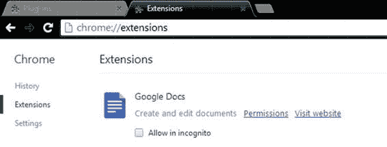
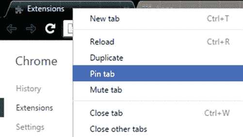
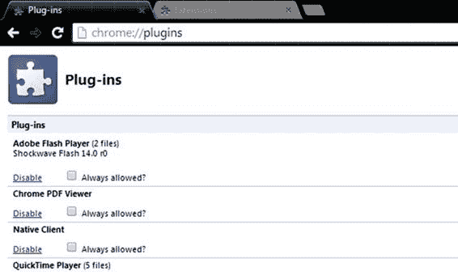

# 来自意大利萨莱诺大学。他曾担任过

项目经理、软件工程师、研究工程师、首席安全架构师、信息安全经理、`PCI`/`SCADA` 审计员以及高级首席 IT 安全/云计算/`SCADA` 架构师多年。他现任卡尔玛集团首席信息安全官（`CISO`）。他在`IT`领域拥有超过 22 年的工作经验，参与过国内和国际项目，涉及安全、`SCADA`、云计算、`IT`基础设施、移动、安全以及`WWW`技术等领域。

他曾担任赫尔辛基理工大学（阿尔托大学）网络实验室的客座讲师和练习导师。他从事编程工作并教授人们如何使用 Android、`Perl`、`PHP`、`Java`、`VB`、`Python`、`C`/`C++` 和 `MySQL` 进行编程，已有超过 20 年。

他拥有四项国际专利（涉及`PKI`、`SIP`、`SAML`和 Proxy 领域）。

他还是《Pro Android Games》（Apress, 2015）的合著者。

## 致谢

衷心感谢 Steve Anglin 和 Ben Renow-Clarke 给我这次为 Apress 写作的绝佳机会！感谢我的协调编辑 Nancy Chen 负责本项目的完成。

感谢 Matthew Moodie 为改进内容所做的努力，以及本书的技术审阅者 Massimo Nardone 提供的宝贵见解。感谢 Tom Welsh 和 Jill Balzano——我的第一本书《Learn OpenGL ES》的编辑——指导我并培养我成为作者。

感谢我的朋友——Anupam Appar 和 Pratik Sharma——审阅源代码并给予我写这本书的必要鼓励。也感谢我的职业游戏玩家同志 Tejas Tilak 提供了他出色的摄影技巧。

## 引言

《创建谷歌浏览器扩展程序》是一本中级水平的书籍，教导如何为谷歌 Chrome 网页浏览器开发浏览器扩展程序。浏览器扩展程序在增强网页浏览器功能方面非常有效。它们几乎可以访问浏览器提供的所有功能。并且可以将这些功能封装成一个捆绑的应用程序，为用户提供有针对性的功能——例如，一个可以总结你当前正在阅读页面的扩展程序，或者另一个可以保存你正在浏览页面中所有图片的扩展程序。扩展程序在沙盒环境中运行，这使得它们非常安全——这是一个巨大的优势！

Chrome 扩展程序框架提供的 API 有助于通过将网络应用程序与谷歌 Chrome 网页浏览器提供的惊人功能（如书签、历史记录、标签页、操作、存储、通知、搜索等更多功能）相结合，从而增强网络应用程序。

理解了本书中的示例和课程后，你将能够将现有的网络应用程序转变为谷歌 Chrome 浏览器扩展程序，并创建全新的、具有实用价值的扩展程序。

在本书中，我们将从了解什么是谷歌 Chrome 扩展程序开始，学习如何创建它们、扩展程序的组件和消息传递，最后介绍如何在 Chrome 网上应用店（原谷歌 Chrome 扩展程序库）发布扩展程序。

“扩展程序”是在谷歌 Chrome 浏览器上提高生产力的唯一途径。

因此，通过“创建谷歌 Chrome 扩展程序”，以一种全新的现代化方式展示你现有的网页开发技能。

# 第 1 章 谷歌 Chrome 扩展程序简介

在本章中，你将了解谷歌 Chrome 扩展程序，这是一种向谷歌 Chrome 网页浏览器添加功能的有用方法。我们首先会快速了解一些流行的谷歌 Chrome 扩展程序以及用于编写 Chrome 扩展程序的技术。然后，在描述了 Chrome 扩展程序的特性和功能之后，你将学习如何创建自己的“Hello World”风格的 Chrome 扩展程序。最后，你将学习如何在 Chrome 网上应用店（原谷歌 Chrome 扩展程序库）发布 Chrome 扩展程序。

本章假设你具备使用 `HTML`、`CSS` 和 `JavaScript` 等编写简单网页的经验。话不多说，让我们开始吧！

### 什么是谷歌 Chrome 扩展程序？

谷歌 Chrome 扩展程序是针对谷歌 Chrome 网页浏览器的浏览器扩展程序。

浏览器扩展程序是在网页浏览器上下文（安全沙盒）中运行的程序。它们通过结合网页浏览器的现有功能来提供新的功能，使用户能够同时完成许多事情！

> **注意** 在撰写本文时，谷歌 Chrome 扩展程序仅支持谷歌 Chrome 网页浏览器的桌面版本。

### 对浏览器扩展程序的支持

谷歌 Chrome 网页浏览器自 2010 年发布的第四个版本开始支持浏览器扩展程序。也可以为 Safari、Mozilla Firefox 和 Opera 等浏览器创建扩展程序。自 Opera 转向 Chromium 的扩展模型后（Opera 放弃了自家的 Presto 引擎，转而采用源自 Chromium 项目的谷歌 Chrome 网页浏览器所使用的 WebKit 引擎），为谷歌 Chrome 网页浏览器创建的扩展程序可与 Opera 网页浏览器兼容。

为 Safari 网页浏览器开发扩展程序的学习曲线与为谷歌 Chrome 网页浏览器开发扩展程序相似，而且为这两者开发扩展程序都很容易，因为不需要学习任何新技术（仅使用现有的网页技术）。但为 Firefox 网页浏览器开发扩展程序相对困难，因为它涉及除网页技术之外的其他技术，例如 `XUL`、`XPCOM` 等（你可以在 [`en.wikipedia.org/wiki/Add-on_(Mozilla)#Extension_technologies`](https://en.wikipedia.org/wiki/Add-on_(Mozilla)#Extension_technologies) 了解更多信息）。本书仅涵盖在谷歌 Chrome 网页浏览器上开发扩展程序的内容。

> **注意** Chrome 网上应用店是一个在线市场，用户可以在其中浏览 Chrome 应用、扩展程序和主题。该商店帮助用户查找、购买并在 Chrome 浏览器上安装内容。

### 扩展程序不是插件

需要重点注意的是，浏览器扩展程序不同于浏览器插件。浏览器扩展程序被沙盒化在宿主网页浏览器（软件）中，而插件则不是。在这里，沙盒可以被视为一个软件容器——允许执行网页技术，同时提供对浏览器功能的访问，例如标签页、历史记录、按钮、弹出窗口等。

除此之外，扩展程序通过结合浏览器上已有的现有功能来为浏览器添加新功能（对于 Chrome 扩展程序，这是通过扩展程序框架提供的 API 完成的）。而插件则通过为浏览器提供对特定媒体类型的支持来提供新功能。就前者而言，举例来说，可以是一个允许用户将所有未处于无痕模式的已打开标签页保存到本地存储的扩展程序。就后者而言，举例来说，可以是一个允许在浏览器上读取和渲染 `PDF` 文件的插件。

还要注意，开发人员可以为 Chrome 浏览器创建另一种网络应用程序。这些应用程序被称为 *谷歌 Chrome 应用*。从开发的角度来看，谷歌 Chrome 应用介于谷歌 Chrome 扩展程序和浏览器插件之间。

本书不讨论如何开发 Google Chrome 应用，而是专注于 Google Chrome 扩展的开发。但请记住，开发 Chrome 应用与开发 Chrome 浏览器的扩展非常相似。如果你想了解更多关于 Google Chrome 应用的信息，可以访问以下链接：

- [`en.wikipedia.org/wiki/Google_Chrome_Apps`](https://en.wikipedia.org/wiki/Google_Chrome_Apps)
- [`developer.chrome.com/apps/about_apps`](https://developer.chrome.com/apps/about_apps)
- [`stackoverflow.com/questions/tagged/google-chrome-app`](http://stackoverflow.com/questions/tagged/google-chrome-app)

### 扩展与插件

要获取已安装（添加）到 Chrome 浏览器上的扩展完整列表，请将标签页导航至 `chrome://extensions`，如图 1-1 所示。此页面（称为扩展管理页面）用于管理 Chrome 浏览器中的扩展。

***图 1-1.** 查看 Google Chrome 扩展*

> **注意** 图 1-1 中的项目（即 Google Docs）并不是一个扩展，而是一个 Google Chrome 应用。应用和扩展都列在 Chrome 浏览器的同一页面（`chrome://extensions`）上，这个页面被称为扩展管理页面。此外，应用也会列在网址为 `chrome://apps` 的页面上。

建议将此标签页固定（右键单击标签页，然后选择“固定标签页”选项——见图 1-2），因为本书内容将经常用到它。

***图 1-2.** 固定 `chrome://extensions` 标签页*

## 第 1 章 ■ GOOGLE CHROME 扩展简介

> **注意** *沙盒技术*是一种常用于测试和/或执行未经验证的程序（这些程序可能包含病毒或其他恶意代码）的技术，使其无法损害宿主软件。

同样地，要获取 Chrome 浏览器上运行的插件完整列表，请将标签页导航至 `chrome://plugins`（如图 1-3 所示）。

***图 1-3.** 查看 Google Chrome 插件*

常见的浏览器插件包括 Adobe Flash Player、Chrome PDF Viewer、QuickTime Player 和 Java 插件。

### 著名示例

截至 2010 年 2 月，Chrome 网上应用店中约有 2,000 个扩展（[`en.wikipedia.org/wiki/Google_Chrome_Extensions#cite_note-4`](http://en.wikipedia.org/wiki/Google_Chrome_Extensions#cite_note-4)）。但令人惊讶的是，截至 2014 年 9 月，Chrome 网上应用店中已有超过 30,000 个扩展！

> **注意** 本书中，“浏览器”和“网页浏览器”这两个术语可互换使用。请注意，它们都指代同一事物，即桌面版网页浏览器。

Google Chrome 用户严重依赖扩展来提高工作效率、增强访问网络数据（已有数据）的能力，以及从他们喜爱的网页浏览器中获得最大收益。以下列表提供了一些流行的 Google Chrome 扩展，这些扩展可从 Chrome 网上应用店免费安装。请注意，所提供的使用数据统计截至 2016 年 3 月：

- Adblock Plus——超过 10,000,000 名用户
- AddThis：分享与书签——超过 600,000 名用户
- Awesome Screenshot：截图与标注——超过 900,000 名用户
- Evernote Web Clipper——超过 4,500,000 名用户
- Google Dictionary——超过 3,000,000 名用户
- Google 翻译——超过 6,000,000 名用户
- Hangouts——超过 6,500,000 名用户
- LastPass：免费密码管理器——超过 4,000,000 名用户
- Photo Zoom for Facebook——超过 1,500,000 名用户
- Pin It Button——超过 10,000,000 名用户

> **注意** 要查看 Chrome 网上应用店中所有（免费和付费的）Google Chrome 扩展，[请访问网址 `https://chrome.google.com/webstore/category/extensions`](https://chrome.google.com/webstore/category/extensions)。

### 从网上应用店添加扩展