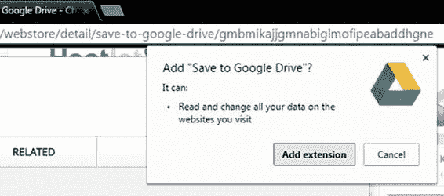
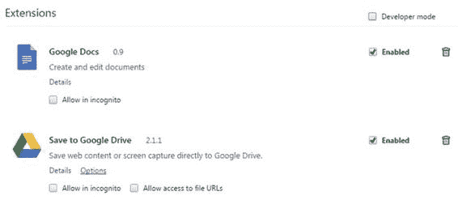
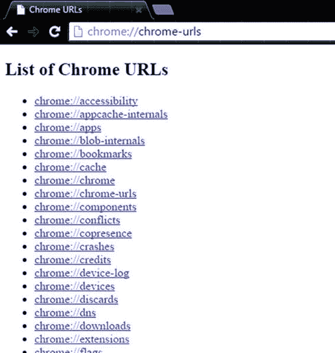

# 为 Chrome 浏览器添加扩展程序

为 Chrome 浏览器添加 Chrome 网上应用店中的扩展程序非常简单。首先，你需要访问扩展程序商店，其网址为 `https://chrome.google.com/webstore/category/extensions`。进入商店后，你可以选择任何一个（或多个）扩展程序添加到你的 Chrome 浏览器中。

接下来，在选定的页面中，你需要点击 **添加至 Chrome** 按钮，如图 1-4 所示。

***图 1-4.** 从商店添加扩展程序*

最后，点击 **添加扩展程序** 按钮（图 1-5）以确认你的选择。

恭喜，你已经成功为 Chrome 浏览器添加了一个扩展程序！

***图 1-5.** 从商店添加扩展程序：确认选择*

如前所述，你可以转到网址 `chrome://extensions` 查看已添加的扩展程序列表。刚刚添加的扩展程序将出现在该列表中（见图 1-6）。

***图 1-6.** 从商店添加扩展程序：保存至 Google 云端硬盘*

> **注意：** 与 `chrome://plugins` 和 `chrome://extensions` 类似，还有其他有用的网址（图 1-7），你可以访问这些网址获取关于 Chrome 浏览器的更多详细信息。要获得这些网址的完整列表，请在 Chrome 浏览器中打开 `chrome://chrome-urls` 页面，如图 1-7 所示。

***图 1-7.** `chrome://chrome-urls` 中的 Chrome 内部网址*

