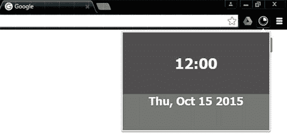
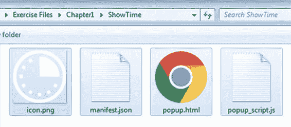
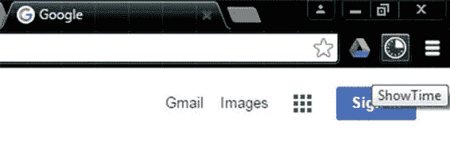

# 创建你的第一个扩展程序

你将创建的第一个扩展程序名为 `ShowTime`。这个扩展程序将在 Google Chrome 工具栏中添加一个可点击的按钮（也称为浏览器操作按钮）。点击此按钮将打开一个弹出窗口（见图 1-8），显示当前时间和日期。

***图 1-8.** 点击扩展程序按钮后显示的扩展程序弹出窗口*

> **注意：** `manifest.json` 是扩展程序中唯一保留的文件名。所有其他文件可以根据需要任意命名。

首先，你需要创建一个包含以下文件的文件夹：`popup.html`、`popup_script.js`、`icon.png` 和 `manifest.json`（见图 1-9）。

***图 1-9.** 练习文件：ShowTime*

稍后，当你学习发布时，你会发现刚刚创建的同一个文件夹会被压缩并上传到 Chrome 网上应用店。

> **注意：** 当你发布此扩展程序时，同一个文件夹的压缩包将通过*开发者信息中心*上传到 Chrome 网上应用店。这在图 1-30 至 1-32 中也有演示。对于你开发的每一个扩展程序，这一点都同样适用。

