# Chrome 扩展开发指南

## 简介

`"default_icon" : "icon.png"`, //用作 Chrome 工具栏中的图标

`"default_popup" : "popup.html"`

},

## 第 1 章 ■ Google Chrome 扩展入门

`"icons" : {`

`"16" : "icon16.png"`, //用作扩展页面的网站图标

`"48" : "icon48.png"`, //用于扩展管理页面

`"128" : "icon128.png"` //安装期间和 Chrome Web Store 中使用

`}`

`}`

现在你可以继续学习其他部分，即弹出视图的 JavaScript 和 HTML 代码。毫不意外地，创建弹出窗口与创建任何其他静态网页并无区别。关于 JavaScript 代码，Chrome 扩展框架在提供其专用 API 的同时，仍然提供所有标准的 JavaScript API。

这基本上意味着 `ShowTime` 扩展的所有 JavaScript 代码都可以使用标准 JavaScript API 编写。这包括 `Date` API（用于获取当前日期和时间）和 `DOM` API（用于访问 DOM 树）。

你可以尝试创建用于显示当前时间和日期的 JavaScript 代码，例如在标题标签（`h1`、`h2` 等）内部。清单 1-2 和 1-3 展示了实现此功能的一种方式。

***清单 1-2.*** 第 1 章 / ShowTime/popup_script.js

```
//region {variables and functions}

var timeId = "time";
var dateId = "date";
var days = ["Sun","Mon","Tue","Wed","Thu","Fri","Sat"];
var months = ["Jan","Feb","Mar","Apr","May","Jun","Jul","Aug","Sep","Oct","Nov","Dec"];
var consoleGreeting = "Hello World! - from popup_script.js";

function setTimeAndDate(timeElement,dateElement) {
    var date = new Date();
    var minutes = (date.getMinutes() < 10 ? '0' : '') + date.getMinutes();
    var time = date.getHours() + ":" + minutes;
    //在"date.getMonth"中，0 表示每年的第一个月
    //在"date.getDay"中，0 代表星期日
    var date = days[date.getDay()] + ", " + months[date.getMonth()] + " " + date.getDate() + " " + date.getFullYear();
    timeElement.innerHTML = time;
    dateElement.innerHTML = date;
}

//end-region
```

清单 1-2 中需要注意的一个重要点是，`getMonth` 方法（`Date` 对象的方法）对每年的第一个月返回 0。而 `getDay` 方法（`Date` 对象的方法）对星期日返回 0。此外，`setTimeAndDate` 函数接受两个参数，这些参数代表用于显示当前时间和日期的元素。

## 第 1 章 ■ Google Chrome 扩展入门

***清单 1-3.*** 第 1 章 / ShowTime/popup_script.js

```
//region {calls}

console.log(consoleGreeting);
document.addEventListener("DOMContentLoaded",function(dcle) {
    var timeElement = document.getElementById(timeId);
    var dateElement = document.getElementById(dateId);
    setTimeAndDate(timeElement,dateElement);
});

//end-region
```

清单 1-3 包含剩余的 JavaScript 代码，其中调用了 `setTimeAndDate` 函数。如代码所示，在文档加载完成后访问 DOM 是一种良好实践（这就是为什么 `setTimeAndDate` 函数在 `DOMContentLoaded` 事件的监听器内部被调用）。

你可能想知道 `console.log` 方法的输出。这将在后续关于调试扩展的主题中讨论。但在此之前，你首先需要知道如何在浏览器中加载扩展。这将在下一节"加载扩展文件夹"中讨论。

***清单 1-4.*** 第 1 章 / ShowTime/popup.html

```
<!DOCTYPE html>
<html>
<head>
<!-- 以下标签不生效 -->
<title>ShowTime (Custom)</title>
<!--
<script>
// 不允许内联脚本
alert('Hello World');
</script>
-->
<!-- 允许引用脚本 -->
<script src="popup_script.js"></script>
<style>
body {
    padding:0px;
    margin:0px;
    width:300px;
    height:200px;
}
```

## 第 1 章 ■ Google Chrome 扩展入门

查看清单 1-4 和 1-5，其中包含 HTML 代码。这里有一个非常重要的点需要注意：在弹出窗口中***不允许***内联脚本！但可以引用脚本，如代码所示。`src` 属性应始终指向脚本文件的*相对*路径（即相对于扩展文件夹）。此外，你也可以将应用逻辑拆分为多个 JavaScript 文件，但每个文件都需要单独引用。

`style` 标签内的 CSS 也可以提取到外部 CSS 文件中，并通过 `<link type="text/css" rel="stylesheet" href="some_file.css" />` 进行引用。

***清单 1-5.*** 第 1 章 / ShowTime/popup.html

```
h1,h2 {
    display:table-row;
    vertical-align:middle;
    text-align:center;
}
h2 {
    background-color:#777;
}
.unselectable {
    -webkit-user-select:none;
    cursor:default;
}
</style>
</head>
<body>
<div class="unselectable">
    <h1 class="empty"></h1>
    <h1 id="time"></h1>
    <h2 id="date"></h2>
</div>
</body>
</html>
```

## 加载扩展文件夹

Chrome 浏览器提供了一种非常快速简便的方法来加载扩展文件夹（用于测试目的）。请注意，浏览器不需要任何额外文件，它只期望找到一个包含 HTML、JavaScript 和 JSON 文件的文件夹。以下步骤演示了如何加载扩展文件夹：

1. 切换到扩展管理页面。回忆一下，该页面位于 URL `chrome://extensions`（图 1-1）。
2. 在此页面上打开"开发者模式"选项（见图 1-11）。

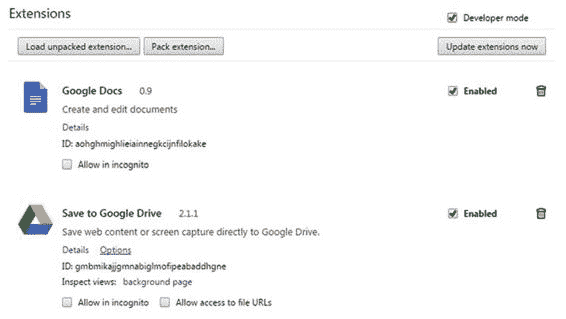
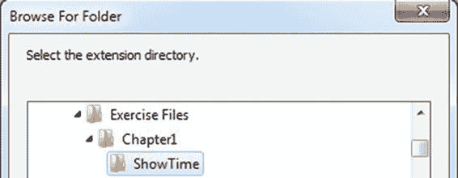

## 第 1 章 ■ Google Chrome 扩展入门

***图 1-11.** 加载扩展：选择开发者模式选项*

3. 这将为页面添加一个额外的区域，其中包含用于加载、打包和更新扩展的按钮（如图 1-11 所示）。
4. 点击"加载已解压的扩展程序"按钮来加载扩展。如图 1-12 所示，会弹出一个"浏览文件夹"或类似的窗口，提示你选择扩展文件夹。

***图 1-12.** 加载扩展：浏览扩展文件夹* 16

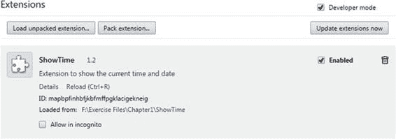

## 第 1 章 ■ Google Chrome 扩展入门

5. 选择你创建的 `ShowTime` 文件夹，然后点击"确定"继续。成功了！你终于成功在浏览器中加载了你的扩展（见图 1-13 和 1-14）。如前所述，如果你的清单文件格式错误，此时会显示错误信息（"Manifest is not valid JSON"），并要求你更正后重新加载。

■ **注意** 你还可以通过从扩展管理页面选择"允许在无痕模式下运行"选项来启用扩展在*无痕模式*下运行（见图 1-13）。

***图 1-13.** 加载扩展：扩展已列在扩展管理页面中*

一旦扩展成功加载，它也会显示在扩展管理页面上供你配置，如图 1-13 所示。最后，要查看弹出窗口，你需要点击 `ShowTime` 扩展对应的浏览器操作按钮。将鼠标悬停在此按钮上时，你还可以看到浏览器操作的提示信息（回想一下，提示字符串是通过清单文件中的 `default_title` 键设置的）。接下来，你将了解如何调试 Chrome 扩展。

## 调试扩展

在本节中，你将学习如何调试 Chrome 扩展。毫不意外地，这种调试与在 Chrome 浏览器上调试简单网页并无区别。你完成此任务的最佳伙伴是——你猜对了——Chrome DevTools。


我们不会深入探讨 Chrome DevTools 的细节，因为 Google 开发者社区已经为新手和有经验的 Web 开发者提供了优秀的资源，帮助他们熟悉如何在 Chrome 浏览器上调试 Web 应用。以下 URL 即可访问：[`developers.google.com/web/tools/chrome-devtools/`](https://developers.google.com/web/tools/chrome-devtools/)。

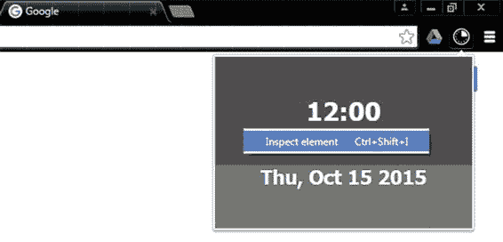

## 检查弹出窗口

你可以进行的第一种调试是检查弹出窗口。为此，只需右键点击弹出窗口（在点击浏览器按钮后窗口弹出时执行此操作），然后选择“检查元素”，如图 1-14 所示。

***图 1-14.** 调试扩展：检查弹出窗口*

> **注意** 另一种检查弹出窗口的方法是选择“检查弹出窗口”菜单项，该菜单项在你右键点击扩展图标（即浏览器按钮）时会显示。

如图 1-15 所示，Chrome DevTools 窗口将会出现，并默认选中“元素”面板。你可以使用此面板以迭代的方式编辑样式，甚至编辑 DOM，从而查看哪种设计效果最佳。

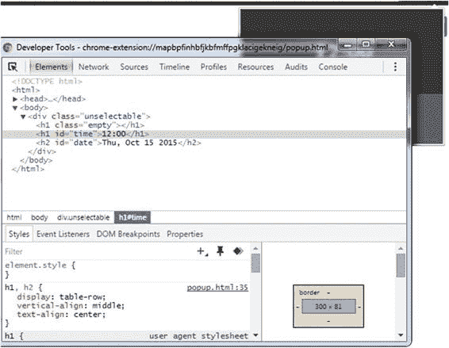

***图 1-15.** 调试扩展：元素面板*

## 源代码面板和资源面板

调试过程中其他有用的面板包括“源代码”面板和“资源”面板。使用“源代码”面板，你可以通过在脚本中设置*断点*来调试 JavaScript 代码。为此，首先需要选择要调试的特定脚本（见图 1-16）。然后，点击你想要设置断点的行号。最后（在 DevTools 窗口内），重新加载 DevTools 窗口以激活断点。

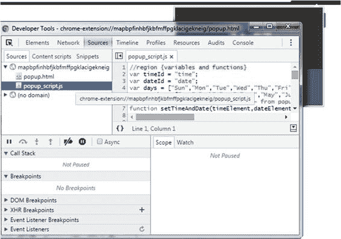

***图 1-16.** 调试扩展：源代码面板*

> **注意** 你也可以在“源代码”面板中通过点击每行的行号，为脚本添加多个断点。

使用“资源”面板，你可以检查其他已加载的资源，例如本地存储和会话存储。然而，出于本书的目的，我们不会使用这类存储，因为 Google Chrome 扩展框架提供了一个更好的存储 API。该 API 允许存储的数据跨多个设备同步，这是 `localStorage` 和 `sessionStorage` API 所不具备的功能。

你仍然可以在开发的扩展中尝试使用它们。通过“资源”面板检查存储极其简单。如图 1-17 所示，你只需选择与你要检查的存储类型相对应的资源项即可。

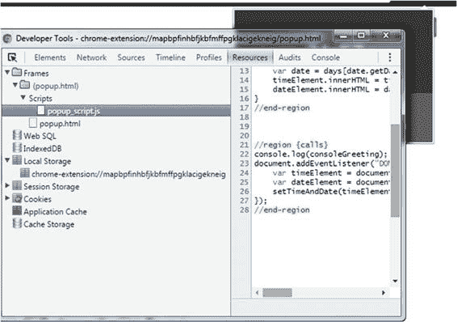
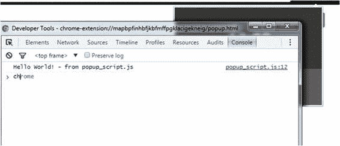

***图 1-17.** 调试扩展：资源面板*

## 控制台面板

“控制台”面板是 Chrome DevTools 窗口中的一个典型（JavaScript）REPL 环境。使用它，你不仅可以记录诊断信息，还可以将其用作 shell，与页面上的 JavaScript 进行交互。控制台面板如图 1-18 所示。

***图 1-18.** 调试扩展：控制台面板*

在扩展开发的背景下，这意味着你可以使用控制台面板来记录脚本中的数据。记录数据的方法是使用 `console.log()` 方法。该方法接受一个可变数量的 JavaScript 对象列表作为输出。

> **注意** 使用 `console.clear()` 方法清除控制台日志。

除此之外，使用控制台面板，你还可以与 Google Chrome 扩展框架提供的各种 API 进行交互。请记住，所有这些都是在扩展开发的上下文中进行的，因此此类 API 仅对属于扩展的（脚本或）页面可用。例如，在你开发的 ShowTime 扩展中，你可以添加以下代码行来记录扩展是否拥有隐身访问权限。事实上，你可以直接在控制台面板中执行此代码（在检查弹出窗口时）。

```
chrome.extension.isAllowedIncognitoAccess(function(isAllowed) {
    console.log(isAllowed);
});
```

随着你对构建扩展的其他组件了解得更多，你会发现控制台面板是一个不可或缺的工具，可以帮助你快速调试扩展。在接下来的创建新扩展的章节中，将更详细地演示其用法。现在，让我们来探讨如何通过 Chrome 网上应用店分发扩展。

## 在应用商店分发

一旦你创建了出色的扩展，很快你就会发现需要将其分发到 Chrome 网上应用店。这将帮助你向大量正在为其 Chrome 浏览器寻找此类应用的、主题或扩展的用户推广你的产品。Chrome 网上应用店允许你通过其开发者控制面板来分发扩展。在撰写本书时，开发者控制面板的访问网址为：[`chrome.google.com/webstore/developer/dashboard`](https://chrome.google.com/webstore/developer/dashboard)。在本节中，我们将逐步演示如何将 ShowTime 扩展上传到 Chrome 网上应用店。

1.  导航至以下 URL，即开发者控制面板：[`chrome.google.com/webstore/developer/dashboard`](https://chrome.google.com/webstore/developer/dashboard)。如果你未登录 Google 账号，系统将要求你登录，如图 1-19 所示。登录成功后，你将被重定向到如图 1-20 所示的开发者控制面板。

    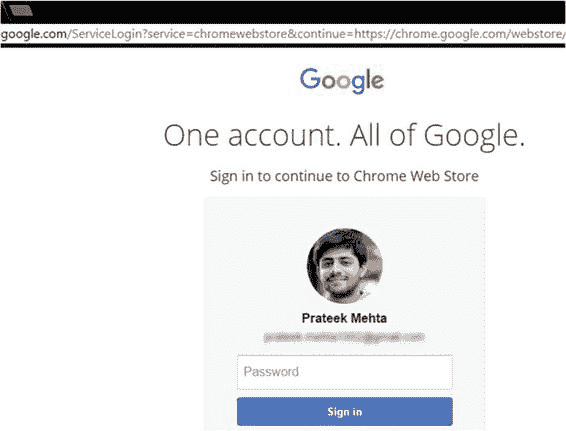
    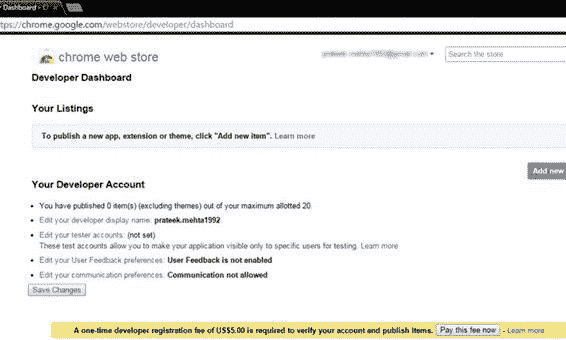

    ***图 1-19.** 分发扩展：登录 Google 账号*
    ***图 1-20.** 分发扩展：使用控制面板*

    > **注意** Google 账号 ID 不一定是 Gmail ID，但通常情况下的确如此。

2.  进入开发者控制面板后，你需要查看开发者账号的基本信息。在撰写本书时，可以在支付开发者注册费之前查看这些信息。

    > **注意** 需要支付一次性开发者注册费 5.00 美元，以验证你的账号并发布项目。

3.  接下来，你需要支付开发者注册费。这是一次性费用，用于验证你的账号并发布项目。在撰写本书时，费用为 5.00 美元。点击“立即支付此费用”按钮启动支付流程。
4.  如图 1-21 和图 1-22 所示，你需要添加一种支付方式来进行支付。如果你的 Google 账号已关联支付方式，可以直接进入下一步。

    ***图 1-21.** 分发扩展：选择支付方式*
    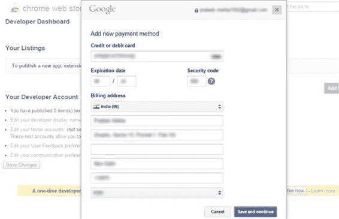

    ***图 1-22.** 分发扩展：添加新支付方式*

5.  核对你的购买信息（见图 1-23），然后点击“购买”进入下一步。

    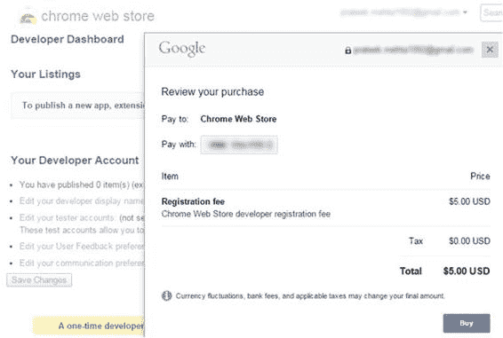
    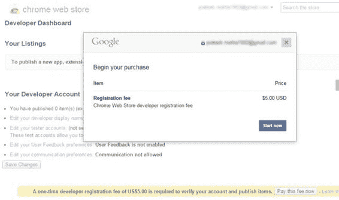

    ***图 1-23.** 分发扩展：核对购买信息*

6.  最后，你可以点击如图 1-24 所示的“立即开始”按钮，启动支付网关。


**图 1-24.** 分发扩展程序：确认购买

第 1 章 ■ GOOGLE CHROME 扩展程序简介

7. 成功完成支付流程后，`Google Wallet` 将显示一个窗口，感谢您的购买。如图 1-25 所示，点击“完成”即可返回开发者控制台。

**图 1-25.** 分发扩展程序：完成购买

**注意** 货币汇率波动、银行手续费及适用税费可能会导致最终金额发生变化。

8. 在开发者控制台中，点击`添加新项目`按钮（见图 1-26），即可将新扩展程序上传到您的控制台。

第 1 章 ■ GOOGLE CHROME 扩展程序简介

**图 1-26.** 分发扩展程序：添加新扩展程序

9. 此时，您需要上传扩展程序文件夹的压缩包。为此，您必须点击图 1-27 中所示的`选择文件`按钮。但在执行此操作之前，您需要对`ShowTime`扩展程序进行一些快速补充。

**图 1-27.** 分发扩展程序：上传压缩包

10. 如代码清单 1-1 所示，您需要在清单文件中添加`icons`属性。该属性接受一个包含以下键值对的对象值（即`{}`）：
    a. `"16" : "icon16.png"`：此 16 像素图标用作扩展程序页面的网站图标。
    b. `"48" : "icon48.png"`：此 48 像素图标用于扩展程序管理页面（如图 1-28 所示）。
    c. `"128" : "icon128.png"`：此 128 像素图标在安装过程中以及 Chrome 网上应用店中使用。

第 1 章 ■ GOOGLE CHROME 扩展程序简介

**图 1-28.** 分发扩展程序：48 像素图标

11. 现在您已将`icons`属性添加到清单文件中，还需要添加相应的图片。您可以自行创建，或使用第 1 章练习文件文件夹中提供的图片（见图 1-29）。请注意，键`16`、`48`和`128`代表要使用的 PNG 图片资源的（相对）路径。

**图 1-29.** 分发扩展程序：添加图标

12. 最后，您可以创建此扩展程序文件夹的压缩包，然后从第 9 步继续操作。

13. 选择压缩包后，点击`上传`按钮（见图 1-30）。

第 1 章 ■ GOOGLE CHROME 扩展程序简介

**图 1-30.** 分发扩展程序：上传`ShowTime`压缩包

14. 成功上传压缩包后，控制台将重新加载（见图 1-31）以反映更改。

**图 1-31.** 分发扩展程序：上传`ShowTime`压缩包

第 1 章 ■ GOOGLE CHROME 扩展程序简介

15. 如果您的清单文件格式错误（或存在任何其他相关缺陷，例如缺少图片资源等），此时将显示错误信息，如图 1-32 所示。

**图 1-32.** 分发扩展程序：上传`ShowTime`压缩包

16. 随后您将进入扩展程序的编辑模式（见图 1-33）。您可以按照自己的意愿自由填写各个字段。

第 1 章 ■ GOOGLE CHROME 扩展程序简介

**图 1-33.** 分发扩展程序：编辑草稿

17. 最后，您可以选择发布所做的更改（这也会将扩展程序发布到商店），也可以选择保存草稿。如果您想重新尝试，还可以放弃当前草稿。现在，请点击`保存草稿并返回控制台`来保存草稿，如图 1-34 所示。


