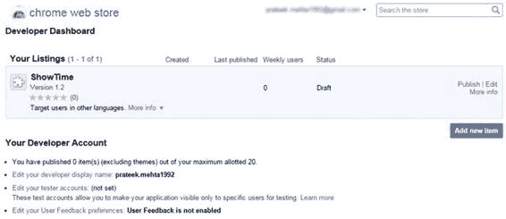
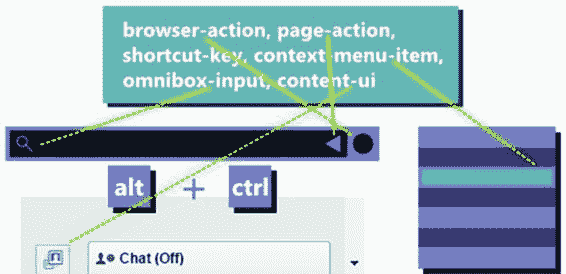
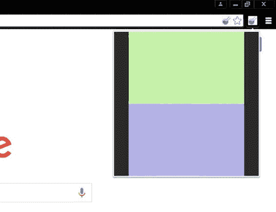
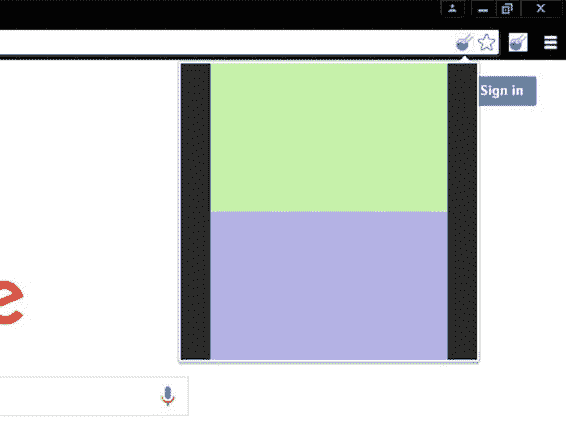
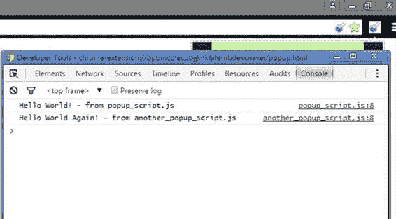

# 图 1-34. 分发扩展：保存草稿



## 第 1 章：Google Chrome 扩展程序简介

返回信息中心后，您会发现扩展程序的草稿已列在“您的列表”部分下，如图 1-35 所示。随着您对扩展程序开发了解的深入，您可以改进并更新此草稿。最后，当您准备好此扩展程序后，可以更新第 16 步中讨论的字段并发布该扩展程序。

**图 1-35. 分发扩展：项目列表**

### 本章小结

本章从浏览器扩展程序的基本定义开始，包括它们是什么以及不是什么。然后，您学习了如何通过“扩展程序管理”页面列出 Chrome 浏览器中已安装的扩展程序。

接下来，讨论了一些值得注意的扩展程序，之后您还学习了如何在 Chrome 浏览器上安装扩展程序。还描述了创建 Chrome 扩展程序所使用的技术，并将其与其他浏览器上使用的技术进行了比较。

最后，您创建了第一个扩展程序——名为 `ShowTime`——并学习了如何在 Chrome 浏览器中加载它。不仅如此，您还学习了如何调试扩展程序并将其上传到 Chrome 网上应用商店。在第 2 章中，您将了解更多关于 Chrome 扩展程序的开发及其架构的信息。但在继续之前，请确保对您创建的 `ShowTime` 扩展程序进行一些尝试和实验，以更好地感受开发过程。这将使您对下一章中使用的示例扩展程序更加熟悉，在下一章中您将学习扩展程序的架构。

## 第 2 章：架构概览

本章从用户和开发者的角度描述 Chrome 扩展程序的架构。这样做将帮助您快速掌握用于创建 Chrome 扩展程序的各种组件。阅读完本章后，您将像用户一样理解 Chrome 扩展程序的构建块——从所涉及的交互功能角度，同时也像开发者一样——从可用于提供各种功能的内部技术角度。

与前一章一样，本章假设您具有使用 HTML、CSS 和 JavaScript 等技术编写简单网页的一些经验。您应该了解网页的事件驱动特性，例如，在单击按钮后显示一些用户界面（使用事件监听器等）。那么，让我们开始吧！

### 什么是用户视角？

一个 API（在我们的案例中，是 Google Chrome 扩展程序 API）可以从提供各种功能（如用户界面、存储等）所涉及的内部技术角度来理解，也可以从交互功能角度——具体到需要用于访问这些功能的技术——来理解。后者，即根据扩展程序 API 提供的*交互功能*来理解它，被描述为用户视角（或用户观点）。本章的内容会不时切换视角，以帮助您学习 Google Chrome 扩展程序 API。

### 创建 Chrome 扩展程序所涉及的组件

Google Chrome 扩展程序与任何其他软件应用程序没有什么不同。您通过按钮（或快捷键等）等输入与其交互，它处理一些数据并显示结果。听起来很抽象，不是吗？好吧，其实不然。您很快就会明白。

与其他应用程序开发框架类似，Google Chrome 扩展程序框架为其开发者提供了提供用户界面以及诸如存储、消息传递、网络请求等功能的技术。以下是用于创建 Chrome 扩展程序的组件。

© Prateek Mehta 2016

P. Mehta，《创建 Google Chrome 扩展程序》，DOI 10.1007/978-1-4842-1775-7_2



#### 输入组件

提供交互功能，由用户界面/非用户界面输入元素组成，例如工具栏按钮、快捷键、上下文菜单项等。Chrome 扩展程序提供以下输入组件（见图 2-1）：

- `Browser-Action`

- `Page-Action`

- `Shortcut-Key`

- `Context-Menu-Item`

- `Omnibox-Input`

- `Content-UI`

**图 2-1. 用于创建 Chrome 扩展程序的输入组件**

#### 脚本组件

顾名思义，这些组件是包含应用程序逻辑的脚本，当用户与扩展程序交互时，这些逻辑可能在不同时间需要。有三种类型的脚本组件：

- *事件脚本（后台脚本）*

- *弹出窗口脚本*

- *内容脚本*

> **注意：** 每种*类型*的脚本组件都有自己独立的*作用域*。因此，例如，弹出窗口脚本不能使用事件脚本中定义的变量和函数，反之亦然。这同样适用于其他脚本对——内容脚本和弹出窗口脚本，以及内容脚本和事件脚本。脚本之间能够访问彼此数据（变量、函数等）的唯一方式是通过*消息传递*，您将在下一章中学习到。



#### 弹出窗口组件

弹出窗口是一个特殊的（可选的）视图，仅对 `Browser-Action` 和 `Page-Action` 输入组件可用。弹出窗口完全由一个 HTML 页面构成（见图 2-2 和 2-3）。请注意，弹出窗口*仅*在用户单击与 `Browser-Action` 或 `Page-Action`（取决于扩展程序使用的是哪一个）对应的工具栏按钮时才会出现。是的，您猜对了——弹出窗口脚本是与弹出窗口组件一起使用的。

**图 2-2. 一个 Browser-Action 弹出窗口**



**图 2-3. 一个 Page-Action 弹出窗口**

弹出窗口脚本是普通的 JavaScript 文件。因为它们用于弹出窗口中，所以被称为弹出窗口脚本。请注意，弹出窗口脚本的代码*不能*内联到弹出窗口的 HTML 页面中。脚本内联意味着将 JavaScript 代码直接放置在 `<script>` 标签内，例如 `<script>alert('Hello World');</script>`。

因此，弹出窗口脚本只能被引用，其中 `src` 需要指向相对于扩展程序文件夹的路径，例如 `<script src="popup_script.js"></script>`。并且，是的，可以引用多个弹出窗口脚本（见清单 2-1）以使代码模块化。这些脚本在扩展程序加载（到浏览器中）时不会合并，并且可以在 DevTools 窗口的“源”和“资源”面板中单独识别（见第 1 章的图 1-16 和 1-17），这已在第 1 章中讨论过。此外，“控制台”面板也有助于分类来自不同（被引用的）弹出窗口脚本的日志，如图 2-4 所示。



**图 2-4. 检查弹出窗口：控制台面板**

弹出窗口脚本的一个非常重要的特性是它们可以访问 Chrome 扩展程序 API。此外，作为 JavaScript 文件，弹出窗口脚本可以访问所有标准的 JavaScript API，包括用于监听和响应弹出窗口内节点触发的 DOM 事件的事件 API。

**清单 2-1.** 第 2 章/HelloBrowserAction/popup.html

```html
<head>
    <!-- 以下标签不被遵守 -->
    <title>HelloBrowserAction (自定义)</title>
    <!--
    <script>
        // 不允许内联脚本
        alert('Hello World');
    </script>
    -->
    <!-- 允许引用脚本 -->
    <script src="popup_script.js"></script>
    <script src="another_popup_script.js"></script>
    <style>
        ...
    </style>
</head>
```