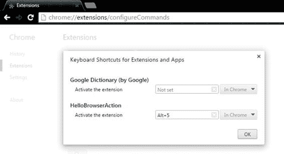
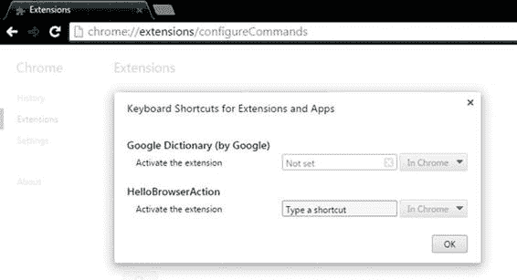

# 第 2 章 ■ 架构概述

***清单 2-4.*** 第 2 章/HelloShortcutKey/manifest.json

```json
{
  "manifest_version": 2,
  "name": "HelloShortcutKey",
  "description": "Extension to demonstrate a Shortcut-Key as an input component",
  "version": "1.2",
  "browser_action": {
    "default_title": "HelloShortcutKey",
    "default_icon": "icon-1.png"
  },
  "background": {
    "scripts": ["event_script.js"],
    "persistent": false
  },
  "commands": {
    "shortcut-key to change the extension icon": {
      "suggested_key": { "default": "Alt+Shift+9" },
      "description": "Change the extension icon"
    }
  }
}
```

在清单 2-4 中，只使用了一个快捷键。如前所述，快捷键（`shortcut-key to change the extension icon`）被列为`commands`清单属性的一个属性。映射到该快捷键的实际键盘快捷方式被定义为`suggested_key`属性的`default`属性的值。之所以命名为`default`，是因为它可以被覆盖。

用户可以从`chrome://extensions/configureCommands`窗口手动添加更多快捷方式（见图 2-6 和 2-7）。与快捷键输入组件功能相关的 API 可通过`chrome.commands`对象访问。除内容脚本外，所有脚本组件都可以使用此 API。



