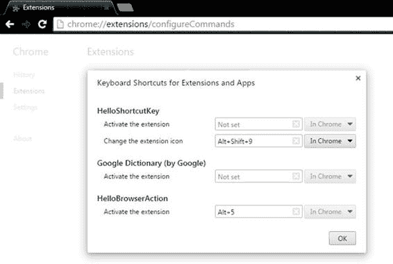

# 第 2 章 ■ 架构概述

*图 2-6.* 为 `HelloBrowserAction` 扩展注册快捷方式

*图 2-7.* 为 `HelloBrowserAction` 扩展注册的快捷方式

除此之外，`_execute_browser_action` 和 `_execute_page_action` 是 Chrome 保留的，用于分别执行浏览器动作和页面动作。命令属性不应以 `_` 作为其名称的前缀，因为这会导致命令 API 静默失败。

请注意，在图 2-6 和 2-7 中，`HelloBrowserAction` 扩展只能看到一个属性。此属性由 Chrome 自动生成。

如果您定义自定义快捷方式，它们将显示在 `chrome://extensions/configureCommands` 窗口中，如图 2-8 中的 `HelloShortcutKey` 扩展所示。

