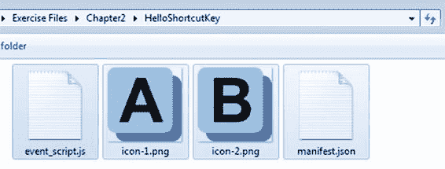

# 第 2 章 ■ 架构概述

***图 2-8.** 具有自定义快捷键的 HelloShortcutKey 扩展*

## `onCommand`事件

为扩展定义了快捷键后，您可以通过监听`onCommand`（`chrome.commands.onCommand`）事件来实现其监听器函数。

如前所述，只有扩展运行时（不要与`chrome.runtime` API 混淆）才能监听此类事件。具体来说，能够执行此操作的脚本是扩展中的事件脚本（请参考“表示运行时的脚本”主题，以提醒自己有关扩展运行时的内容）。

***清单 2-5.*** 第 2 章/HelloShortcutKey/event_script.js

```javascript
//region {variables and functions}
var consoleGreeting = "Hello World! - from event_script.js";
var details = { "path": "icon-2.png" };
//end-region

//region {calls}
console.log(consoleGreeting);
chrome.commands.onCommand.addListener(function(command) {
  chrome.browserAction.setIcon(
    details,
    function() { /**/ }
  );
});
//end-region
```

