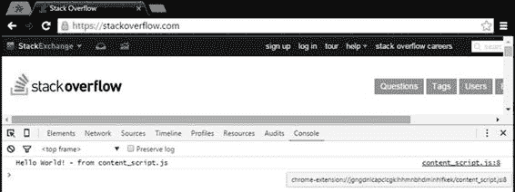
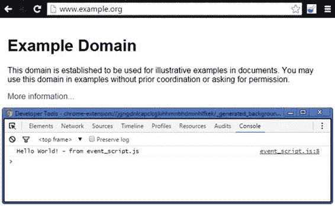
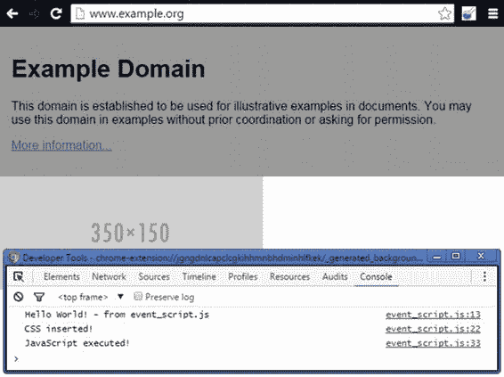
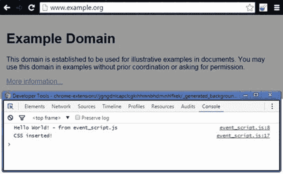
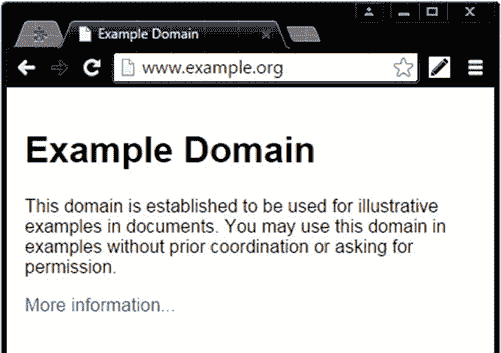
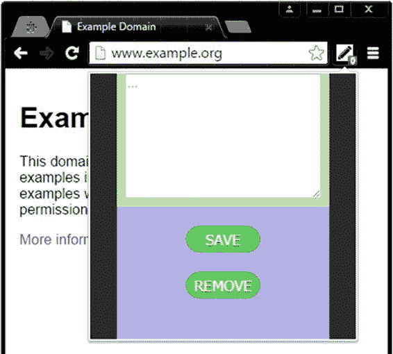

# [`developer.chrome.com/extensions/declarativeContent`](https://developer.chrome.com/extensions/declarativeContent)

如清单 2-9 所示，`ruleStackOverflowHost` 是使用一个条件和相应动作创建的。该条件通过 `PageStateMatcher` 对象表示。

`PageStateMatcher` 仅在满足所有列出的条件时才会匹配网页。在清单 2-9 中，这些条件包括 `pageUrl.hostEquals` 和 `pageUrl.schemes`（用于匹配 `stackoverflow.com` 上的所有网页）。除了使用 `pageUrl` 条件外，还可以使用 `css` 条件。例如，考虑以下规则：当 [`www.google.com`](https://www.google.com/) 的网页上存在密码字段时，显示一个 `PageAction`：

```
var rule1 = {
  "conditions" : [
    new chrome.declarativeContent.PageStateMatcher({
      "pageUrl" : {
        "hostEquals" : "www.google.com",
        "schemes" : ["https"]
      },
      "css" : ["input[type='password']"]
    })
  ],
  "actions" : [new chrome.declarativeContent.ShowPageAction()]
};
```

如前所述，`declarativeContent` API 仅支持两个动作。动作作为 `actions` 数组的一个元素列出（如清单 2-9 所示，`actions` 是 `rule` 实例的一个属性）。最后，要注册这些规则，需要执行以下调用。由于规则在浏览器会话之间是持久的，因此它们仅在扩展程序安装时添加一次。此外，要清除所有先前定义的规则，需将 `undefined` 作为第一个参数调用 `removeRules`。

```
chrome.runtime.onInstalled.addListener(function() {
  // 替换所有规则
  chrome.declarativeContent.onPageChanged.removeRules(undefined, function() {
    // 使用新规则
    chrome.declarativeContent.onPageChanged.addRules(
      [ruleStackOverflowHost]
    );
  });
});
```

#### 内容脚本

在之前关于 `declarativeContent` API 的主题中，你了解了如何无需读取网页内容，仅通过声明某些条件即可执行特定操作。这可能并不总是足够，因为 `declarativeContent` API（通过 `PageStateMatcher` 对象）只允许有限的匹配条件。此外，动作也非常有限。这正是内容脚本发挥作用的地方。

内容脚本是一种注入到访问的网页中的脚本组件。它们对 Chrome 扩展程序 API 的访问非常有限（因为它们不代表扩展程序运行时）。但是，它们可以使用 DOM API 读取和修改访问网页的内容（即 HTML 元素）。由于可以访问 DOM API，它们还可以将内容（即 HTML 元素）添加到被注入的网页中。这种使用内容脚本创建的用户界面被称为内容界面。在你进一步了解内容脚本之前，请记住内容脚本不能：

- 使用 `chrome.*` API，以下情况除外：
  - `extension`（`getURL`、`inIncognitoContext`、`lastError`、`onRequest`、`sendRequest`）
  - `i18n`
  - `runtime`（`connect`、`getManifest`、`getURL`、`id`、`onConnect`、`onMessage`、`sendMessage`）
  - `storage`
- 使用其他脚本组件中定义的变量或函数。
- 使用网页（它们被注入到的）或其他内容脚本中定义的变量或函数。

> **注意：** 内容脚本可以间接使用完整的 `chrome.*` API，并且也可以间接访问其他脚本组件中定义的变量和函数。它们可以通过使用消息传递 API（将在第 3 章讨论）来实现这一切。

#### 清单文件在此组件中的作用

现在让我们看看如何配置清单文件以使用内容脚本组件。

如果内容脚本的代码总是需要自动注入，你需要在清单文件中声明并定义 `content_scripts` 属性，如下面的代码所示：

```
"content_scripts" : [
  {
    "matches" : ["http://www.google.com/*"],
```


`"css"` : `["mystyles_A.css"]`,
`"js"` : `["jquery.js","myscript_A.js"]`
}
]

该属性是一个数组，其中每个元素（一个内容脚本）在其定义中包含以下属性——`matches`、`css` 和 `js`。显而易见，`css` 和 `js` 分别是需要注入到与 `matches` 数组中指定的 URL 相匹配的网页中的 CSS 和 JavaScript 文件数组。

除此之外，还可以使用 `tabs` API 以编程方式注入 JavaScript（或 CSS）代码（这需要在 manifest 中申请 `tabs` 权限，以便获得所有标签页的访问权限并与之交互；但如果只需访问当前活动标签页，则 `activeTab` 权限就足够了）。

对于编程式注入，可以在 manifest 中使用 `tabs` 或 `activeTab` 权限。当用户调用扩展时（例如，通过点击其 `BrowserAction`），`activeTab` 权限会授予扩展对当前活动标签页的临时访问权限。对该标签页的访问权限将持续到标签页被导航或关闭为止。

## 第 2 章 ■ 架构概述

当扩展运行时的代码通过监听函数（例如事件 `chrome.browserAction.onClicked` 或 `chrome.pageAction.onClicked` 的监听函数）访问当前活动标签页，并希望通过注入 JavaScript 或 CSS 代码与该标签页交互时，可以使用 `activeTab` 权限。要与其余标签页交互，请使用 `tabs` 权限。以下方法（在 `tabs` API 中）分别用于注入 CSS 和 JavaScript 代码。

`chrome.tabs.insertCSS(integer tabId, object details, function callback)`

`chrome.tabs.executeScript(integer tabId, object details, function callback)`

**注意** 当你的 JavaScript 或 CSS 代码不应注入到每个与 `matches` 模式匹配的网页中，而只需在某些特定情况下注入时，编程式注入非常有用。例如，在点击 `BrowserAction` 或 `PageAction` 按钮时。

`tabId` 参数是要在其中注入 CSS 或 JavaScript 代码的标签页的 ID；默认为当前窗口的（当前）活动标签页。`details` 参数是一个对象，包含要注入的（CSS/JavaScript）代码或文件的详细信息。在此对象中，必须设置 `code` 或 `file` 属性，但两者*不得*同时设置。第 2 章练习文件文件夹中的 `HelloContentScript` 扩展演示了如何在扩展中使用内容脚本。

***清单 2-11.*** 第 2 章/HelloContentScript/manifest.json

```
{
    "manifest_version" : 2,
    "name" : "HelloContentScript",
    "description" : "用于演示内容脚本的扩展",
    "version" : "1.2",
    "content_scripts" : [
        {
            "matches" : ["*://stackoverflow.com/*"],
            "js" : ["content_script.js"]
        }
    ],
    "background" : {
        "scripts" : ["event_script.js"],
        "persistent" : false
    },
    "permissions" : ["activeTab"],
    "browser_action" : {
        "default_icon" : "icon.png"
    }
}
```



## 第 2 章 ■ 架构概述

### HelloContentScript 扩展

此扩展通过两种方式注入内容脚本——使用 manifest 中的 `content_scripts` 属性以及使用编程式注入（来自事件脚本）。

首先，我们来研究前者。注意清单 2-11 中的 `matches` 模式。模式开头的星号（`*`）代表任意协议——`http`、`https` 等。同样，模式结尾的星号代表 `stackoverflow.com` 主机上的所有路径。

如图 2-16 所示，内容脚本（`content_script.js`）会在访问上述主机时被注入。你可以尝试运行此扩展，并访问 `stackoverflow.com` 主机上的其他路径。

***图 2-16.** 已注入的内容脚本组件*

***清单 2-12.*** 第 2 章/HelloContentScript/event_script.js

```
//region {variables and functions}
```


```javascript
var consoleGreeting = "Hello World! - from event_script.js";

var cssCode = "a {text-decoration:underline !important;}";

cssCode += "div {background-color:#999 !important;}";

var javascriptCode = "var imgElement = document.createElement('img');"; javascriptCode += "imgElement.src = 'http://placehold.it/350x150';"; javascriptCode += "document.body.appendChild(imgElement);";

//end-region

//region {calls}

console.log(consoleGreeting);

chrome.browserAction.onClicked.addListener(function(tab) {

chrome.tabs.insertCSS(

{

//要注入的 CSS 文件或代码
//file : "mystyles.css",

code : cssCode

},

function() {

console.log("CSS inserted!");



第 2 章 ■ 架构概述

}

);

chrome.tabs.executeScript(

{

//要注入的 JavaScript 文件或代码
//file : "content_script.js",

code : javascriptCode

},

function() {

console.log("JavaScript executed!");

}

);

});

//end-region
```

此扩展中的**程序化注入**是通过事件脚本执行的，具体是使用了`BrowserAction`的`onClicked`监听器（如代码清单 2-12 所示）。

`insertCSS`和`executeScript`方法均在监听器函数中调用，分别用于注入 CSS 和 JavaScript 代码。图 2-17 至图 2-19 展示了`HelloContentScript`扩展与位于[该 URL](http://www.example.org/)的网页进行交互的各个阶段。[www.example.org](http://www.example.org/)。请注意，图 2-18 表示不完整的扩展（它仅包含`insertCSS`方法）。

***图 2-17.** HelloContentScript：背景页面*





第 2 章 ■ 架构概述

***图 2-18.** HelloContentScript：背景页面*

***图 2-19.** HelloContentScript：背景页面*

第 2 章 ■ 架构概述

■ **注意** 在扩展框架中，与`matches`属性配合使用的每个模式都称为*匹配模式*。您可以通过以下网址了解更多信息：[`developer.chrome.com/extensions/match_patterns`](https://developer.chrome.com/extensions/match_patterns)。

点击`BrowserAction`按钮后，监听器函数被调用，从而注入 CSS 和 JavaScript 代码。`cssCode`变量包含用于给锚点标签（即`a`标签）添加下划线的 CSS 代码，以及为所有`div`标签设置背景颜色的代码——`div {background-color:#999 !important;}`。请注意使用了`!important`来覆盖被访问网页上任何现有的（相似）样式。类似地，`javascriptCode`变量包含用于在被访问网页中注入图片元素的 JavaScript 代码。

### 组件示例

本主题包含用于学习目的的演示扩展。本节将研究两个扩展——`BrowserActionNotes`和`PageActionNotes`（本书前面也提到过）。这两个都是笔记扩展，允许在不同页面上做笔记。

■ **注意** 如果在 API 方法回调期间发生错误，`chrome.runtime.lastError`对象将被定义。

#### BrowserActionNotes 扩展

此扩展允许在所有被访问的网页上做笔记。它使用`BrowserAction`输入组件（如图 2-20 所示）和一个带有弹出脚本的弹出组件（图 2-21）。目前您应该已经明白，清单组件对于每个扩展都是强制性的。请注意，此扩展仅允许为一个 URL 保存一条笔记。该笔记可以被覆盖或从存储中完全删除。





第 2 章 ■ 架构概述

***图 2-20.** BrowserActionNotes：`BrowserAction`组件*

***图 2-21.** BrowserActionNotes：弹出组件*

弹出窗口包含一个`textarea`和两个按钮——SAVE（保存）和 REMOVE（删除）。`textarea`用于包含要保存的笔记（如图 2-22 所示）。代码清单 2-13


