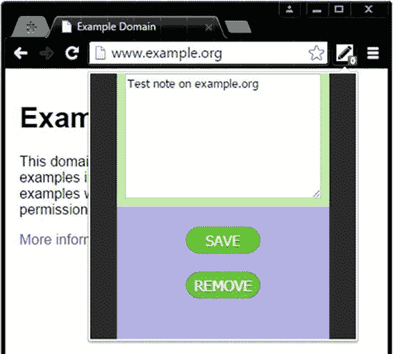
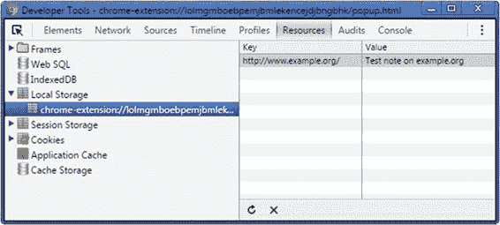
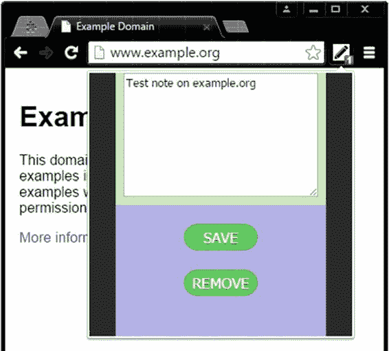
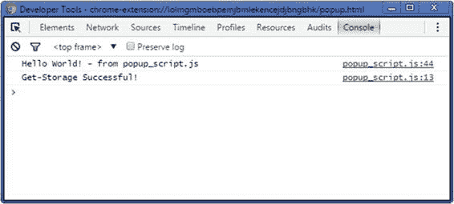
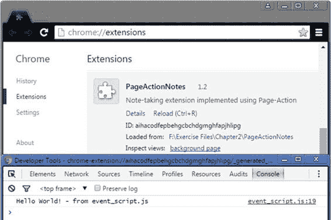
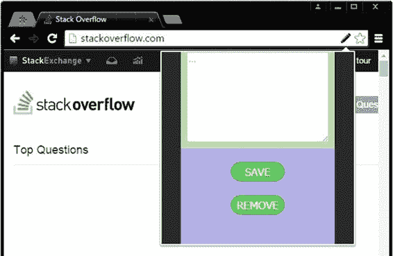
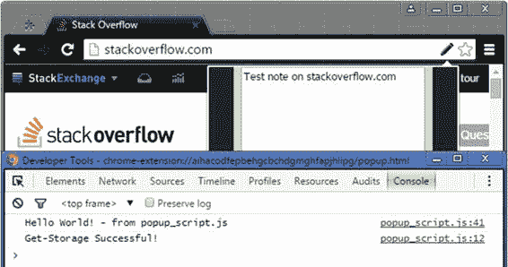
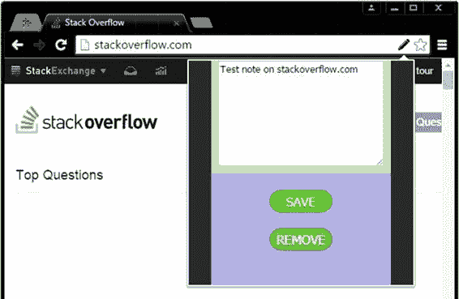

# 架构概述

提供了弹窗的相关代码。请注意此处使用了 `textarea` 和 `button` 标签。





## 图 2-22. BrowserActionNotes：弹窗组件

另外，请注意所引用的弹窗脚本，名为 `popup_script.js`。**保存**按钮用于保存输入的笔记，它使用了 `localStorage` API（一个标准的 JavaScript API）。保存的笔记会映射到为其保存笔记的网址（参见图 2-23，在资源面板中）。

**移除**按钮用于移除对应网址已保存的笔记。

## 图 2-23. BrowserActionNotes：资源面板

## 代码清单 2-13. 第 2 章 /BrowserActionNotes/popup.html

```html
<script src="popup_script.js"></script>
<style>
...
</style>
</head>
<body>
<div id="container">
<div id="top"><textarea id="note" placeholder="..."></textarea></div>
<div id="bottom">
<br>
<button id="save_button">保存</button>
<br>
<button id="remove_button">移除</button>
</div>
</div>
</body>
</html>
```

弹窗脚本在加载时，会获取对 `textarea` 和 `button` 元素的引用。这是通过使用 `getElementById` 方法（一个标准的 JavaScript API）完成的。

弹窗脚本中定义的最重要的函数（见代码清单 2-14）是 `hardSave` 和 `removeNote`。这两个函数都使用标签页 API 来访问当前活动的标签页。

请注意，此扩展在清单文件中使用了 `tabs` 权限。

在弹窗中点击 `saveButton` 时，会调用 `hardSave` 函数。

类似地，点击 `removeButton` 会调用 `removeNote` 函数。通过调用 `localStorage.setItem` 方法保存笔记——`localStorage.setItem(activeURL,noteText)`。

通过调用 `localStorage.removeItem` 方法移除笔记。

## 代码清单 2-14. 第 2 章 /BrowserActionNotes/popup_script.js

```javascript
//region {variables and functions}
var consoleGreeting = "Hello World! - from popup_script.js";

//Active-URL can also be cached
//var activeURL = "";
var noteElementID = "note";
var saveButtonID = "save_button";
var removeButtonID = "remove_button";
var noteElement = null;
var saveButton = null;
var removeButton = null;
var queryInfo = {"active":true};

function logSuccess(task) {
    console.log("%s Successful!",task);
    chrome.browserAction.setBadgeText({"text":localStorage.length.toString()});
}

//function logFailure(task) {console.log("%s Failed!",task);}

function loadNoteForActiveURL(noteElement) {
    chrome.tabs.query(queryInfo,function(tabs) {
        var activeURL = tabs[0].url;
        noteElement.value = localStorage.getItem(activeURL);
        logSuccess("Get-Storage");
    });
}

function softSave(noteText) {} //appends the text

function hardSave(noteText) { //overwrites the text
    chrome.tabs.query(queryInfo,function(tabs) {
        var activeURL = tabs[0].url;
        localStorage.setItem(activeURL,noteText);
        logSuccess("Set-Storage");
    });
}

function removeNote() {
    chrome.tabs.query(queryInfo,function(tabs) {
        var activeURL = tabs[0].url;
        localStorage.removeItem(activeURL);
        logSuccess("Remove-Storage");
    });
}
//end-region
```

弹窗一打开，就会调用 `loadNoteForActiveURL` 函数（代码清单 2-15）来获取与当前活动网址对应的笔记，并将该笔记加载到 `textarea` 元素中。请注意 `logSuccess` 函数的使用。除了作为日志记录函数使用外，它还用于设置浏览器操作的徽章文本（参见图 2-24 和 2-25）。当你与扩展进行交互时，该文本会在不同时刻随 `localStorage.length` 的值进行更新。





## 图 2-24. BrowserActionNotes：设置徽章文本

## 图 2-25. BrowserActionNotes：弹窗的控制台面板

■ **注意**：浏览器操作可以选择性地显示一个徽章，它是一层叠加在图标上的文本。徽章可以方便地更新浏览器操作，以显示少量关于扩展程序状态的信息。由于徽章空间有限，它应该包含四个或更少的字符。

你可以分别使用 `browserAction.setBadgeText` 和 `browserAction.setBadgeBackgroundColor` 来设置徽章的文本和颜色。

## 代码清单 2-15. 第 2 章 /BrowserActionNotes/popup_script.js

```javascript
//region {calls}
console.log(consoleGreeting);

document.addEventListener('DOMContentLoaded',function(dcle) {
  saveButton = document.getElementById(saveButtonID);
  removeButton = document.getElementById(removeButtonID);
  noteElement = document.getElementById(noteElementID);

  //Load note for active URL (if it was stored before)
  loadNoteForActiveURL(noteElement);

  chrome.browserAction.setBadgeBackgroundColor({"color":[255,0,0,255]})

  //Add listeners to buttons
  saveButton.addEventListener('click',function(ce) {
    var noteText = noteElement.value;
    if(noteText.length > 0) hardSave(noteText);
  });

  removeButton.addEventListener('click',function(ce) {
    removeNote();
  });
});
//end-region
```

## PageActionNotes 扩展

此扩展几乎与前一个相同。主要区别在于，它通过控制此扩展中使用的 `PageAction` 的外观，允许仅在特定页面上做笔记。为了控制 `Page-Action` 的外观，它使用了扩展框架提供的 `declarativeContent` API。扩展这一方面的所有代码已在本章前面介绍过。其余代码（用于弹出窗口和弹出脚本组件）与前一个扩展相同。

因此，我们只需要讨论此扩展的流程。

如图 2-26 所示，此扩展有一个事件脚本组件。事件脚本（清单 2-9 和 2-10）包含注册规则的代码，以允许 `Page-Action` 仅在属于 `stackoverflow.com` 主机的网页上显示。





**图 2-26.** `PageActionNotes`：后台页面

`Page-Action` 及其弹出窗口如图 2-27 至 2-29 所示。

**图 2-27.** `PageActionNotes`：弹出组件





**图 2-28.** `PageActionNotes`：弹出组件

**图 2-29.** `PageActionNotes`：弹出窗口的控制台面板

这样，当访问任何属于 `stackoverflow.com` 主机的网页时，`Page-Action` 按钮将会显示。点击 `Page-Action` 后，弹出窗口将会打开。如前所述，此弹出窗口（及其弹出脚本）与前一个扩展中使用的弹出窗口相同。此弹出窗口允许你与 `textarea` 交互，输入要保存的笔记。最后，点击“保存”按钮将保存笔记。你可以再次访问“资源”面板来确认笔记的存储。当你再次访问已保存笔记的 URL 时，打开弹出窗口将自动在 `textarea` 中加载该笔记（如图 2-29 所示）。

## 总结

在本章中，你了解到了用于创建扩展的特定组件。这些组件包括清单组件（每个扩展都必须有！）、输入组件、脚本组件和可选的弹出组件。你还了解了扩展的生命周期，其中你理解了如何使用事件脚本来监听从输入组件触发的各种事件，以及从特性 API（例如 `tabs`、`alarms`、`storage`、`bookmarks`、`history` 等 API）触发的事件。

你还了解了为什么仅使用事件脚本来表示扩展运行时，并列出了它们相对于弹出脚本（仅在弹出窗口打开时执行）的许多优势。你了解了为什么输入组件在扩展中是必要的，因为它们提供了（供用户）交互的入口点。但请记住，完全不需要任何输入组件也可以创建功能完整的扩展！

最后，你了解了 `declarativeContent` API，用于在扩展中注册自定义规则，以及内容脚本组件，用于将 JavaScript 和 CSS 文件注入到访问的网页中（可以以声明方式，也可以以编程方式）。

在下一章中，你将阅读 Chrome 扩展框架提供的各种 API。你还将了解用于在不同脚本组件之间以及在网页脚本和脚本组件之间进行通信的消息传递 API。