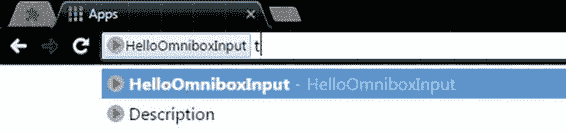

# 第 3 章

## API 可用性与消息传递

本章描述了脚本组件使用 Google Chrome 扩展框架提供的消息传递 API 进行相互交互的各种方式。除此之外，你还将了解普通网页如何与扩展进行交互。

此外，你还将检查扩展框架提供的许多有用 API 的用法。但在这一切之前，你首先将了解剩余的其他输入组件。

与前几章一样，本章假定你拥有使用诸如 HTML、CSS 和 JavaScript 等技术编写简单网页的一些经验。你应该了解网页的事件驱动特性，例如——在点击按钮后显示一些 UI（使用事件监听器）等。除此之外，你还应该了解扩展的体系结构，它由清单文件、输入、脚本和弹出窗口等组件组成。话不多说，让我们开始吧！

### 输入组件：第二部分

前一章留了一些输入组件未讨论。本章节将在你开始研究扩展框架中的各种 API 和理解消息传递 API 之前，介绍这些组件。这里讨论的输入组件包括多功能框输入和上下文菜单项。除了这些组件，还将讨论内容 UI 组件的应用。

#### 多功能框输入

多功能框输入是一个非常特殊的输入组件，它允许你向 Google Chrome 的地址栏（也称为*多功能框*）注册一个关键字。使用此输入组件非常简单，因为它只需要一个事件脚本组件和对清单的一处微小添加，如下所示：

```json
"omnibox" : {
  "keyword" : "OI"
}
```

如图所示，要使用多功能框输入组件，需要 `omnibox` 清单属性。此属性有一个 `keyword` 属性。当在地址栏中输入相应的关键字值（在本例中为 `OI`，不区分大小写）时（确认后），用户就可以开始完全与扩展进行交互。如图 3-2 和 3-3 所示。

**图 3-1.** 扩展管理页面：HelloOmniboxInput

此外，为了在用户交互时在地址栏中使用图标，你可以在清单中定义 `icons` 属性（请参见清单 3-1）。请注意，Chrome 会自动为清单中列出的 16px 图标创建一个灰度版本。另请参见图 3-1 和 3-3，以注意图标彩色版本和灰度版本之间的区别。

**图 3-2.** HelloOmniboxInput：输入关键字



### `列表 3-1` `HelloOmniboxInput/manifest.json`

```json
{
  "manifest_version" : 2,
  "version" : "1.2",
  "name" : "HelloOmniboxInput",
  "description" : "用于演示 Omnibox（多功能框）的扩展程序",
  "background" : {
    "scripts" : ["event_script.js"],
    "persistent" : false
  },
  "omnibox" : {
    "keyword" : "OI"
  },
  "icons" : {
    "16" : "icon-16.png",
    "128" : "icon-128.png"
  }
}
```

### 事件脚本（Event Script）在此组件中的作用

现在来看使用此输入组件所需的事件脚本部分。与其他输入组件的事件脚本用法类似，omnibox 输入组件也使用事件脚本来监听相关事件。这些事件包括 `onInputStarted`、`onInputChanged`、`onInputEntered` 和 `onInputCancelled`。请注意，这些事件隶属于 `chrome.omnibox` API。此 API 无需在清单文件中声明任何权限。

这些事件的使用方法在`列表 3-2`中进行了演示。

`图 3-3` `HelloOmniboxInput`：与 omnibox 交互

### `列表 3-2` `HelloOmniboxInput/event_script.js`

```javascript
//region {变量和函数}
var ON_INPUT_ENTERED_DISPOSITION = {
  "CURRENT_TAB" : "currentTab",
  "NEW_FOREGROUND_TAB" : "newForegroundTab",
  "NEW_BACKGROUND_TAB" : "newBackgroundTab"
};

var suggestResultOne = {
  "content" : "Some content",
  "description" : "Description"
};

var suggestResults = [suggestResultOne];

var searchService = "https://www.google.com/";
searchService += "search?q=chrome+extensions+developers+";

function CreateWindow(url) {
  var windowCreateData = {"url" : ""};
  windowCreateData.url = url;
  chrome.windows.create(windowCreateData);
}
//end-region

//region {调用}
chrome.omnibox.onInputStarted.addListener(function() {
  console.log("<InputStarted>");
});

chrome.omnibox.onInputChanged.addListener(function(text, suggest) {
  console.log("<InputChanged> Text: " + text);
  //suggest(suggestResults);
  suggest(getSuggestResults(text));
});

chrome.omnibox.onInputEntered.addListener(function(text, disposition) {
  console.log("<InputEntered> Text: " + text);
  CreateWindow(searchService + text);
  //默认 disposition 为 ON_INPUT_ENTERED_DISPOSITION.CURRENT_TAB
});
//end-region
```

`图 3-4` `HelloOmniboxInput`：建议结果

需要监听的最重要事件是 `chrome.omnibox.onInputChanged` 和 `chrome.omnibox.onInputEntered`。前者（事件）触发意味着用户更改了在 omnibox 中输入的内容，后者（即 `onInputEntered` 事件）触发则意味着用户已确认输入的内容或建议的内容。与不同事件相关的日志可以在图 3-6 中查看。

`图 3-5` `HelloOmniboxInput`：与 omnibox 交互

当 `onInputChanged` 事件被触发时，您需要提供建议结果供用户确认。可以通过向 `suggest` 回调函数传递一个数组来提供建议结果（参见`列表 3-2`）。请注意，此数组中的每个元素都必须是 `SuggestResult` 类型，该类型是一个包含 `content` 和 `description` 属性的对象。例如，建议结果 `suggestResultOne` 定义如下：

```javascript
var suggestResultOne = {"content":"Some content","description":"Description"};
```

您需要将数组 `[suggestResultOne]` 传递给 `suggest` 回调函数。图 3-4 和图 3-5 展示了建议结果，其中图 3-4 的建议结果是 `Description`，而图 3-5 的建议结果分别是“搜索 'tabs' 于...”和“搜索 'themes' 于...”。

请注意，真正被确认的是这些描述对应的 `content`。而所谓的“被确认”，我指的是将 `content` 传递给 `onInputEntered` 事件的监听函数。