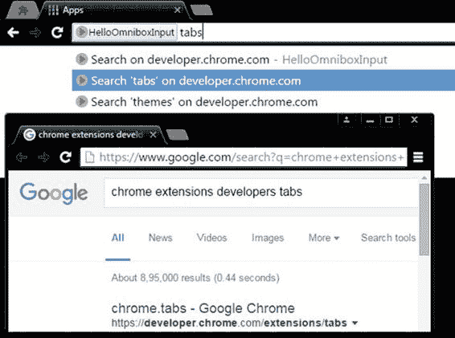
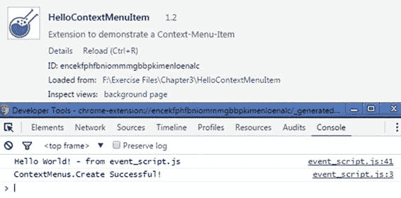

# 第 3 章 ■ API 可用性与消息传递

***图 3-6.** `HelloOmniboxInput`：后台页面*

内容作为 `text` 参数传递给此监听函数，如清单 3-2 所示。第二个参数称为 `disposition`，是用于显示结果的推荐上下文。这通常不是必需的，因为它默认值为 `current tab`。清单 3-2 中的文本用于在新窗口中显示相关的搜索网页。注意使用 `chrome.windows.create` 方法来创建新窗口（参见图 3-8）。

***图 3-7.** `HelloOmniboxInput`：设置默认建议*

注意在 `HelloOmniboxInput` 扩展中看到的默认建议 `Run HelloOmniboxInput command ...`，如图 3-5 所示。通过在事件脚本组件中执行以下代码行，可以轻松将其覆盖为 `Search on developer.chrome.com`（显示在图 3-7 中）：

```
chrome.omnibox.setDefaultSuggestion(
    {"description":"Search on developer.chrome.com"}
);
```

### 上下文菜单项

在 Chrome 扩展框架中，提供的最先进且功能丰富的输入组件之一是上下文菜单项。此组件允许扩展在上下文菜单中创建项目，如图 3-10 所示。创建的项目可以在其内部嵌套其他此类项目。当扩展提供多个相关功能（每个功能显示为单独的上下文菜单项）并且可以分组到单个项目下时，这变得极为有用。此输入组件需要 `contextMenus` 权限。

***清单 3-3.*** 第 3 章 / `HelloContextMenuItem` / `manifest.json`

```
{
    "manifest_version" : 2,
    "name" : "HelloContextMenuItem",
    "description" : "Extension to demonstrate a Context-Menu-Item",
    "version" : "1.2",
    "permissions" : ["contextMenus"],
    "icons" : {
        "16" : "icon-16.png",
        "128" : "icon-128.png"
    },
    "background" : {
        "scripts" : ["event_script.js"],
        "persistent" : true
    }
}
```

与上一主题中讨论的输入组件类似，使用上下文菜单项组件也非常直接。首先，您需要在清单中使用 `contextMenus` 权限。然后，您需要使用事件脚本组件来在上下文菜单中创建项目。此事件脚本组件需要在清单中定义 `persistent` 为 `true`，以便在浏览器打开时保持其持久性。之所以需要这样做，是因为上下文菜单中的项目是在事件脚本组件内部定义的，因此它需要持续足够长的时间。事件脚本组件和 `contextMenus` 权限的相应代码在清单 3-3 中提供。



■ **注意** 回忆一下，将 `persistent` 定义为 `true` 的事件脚本是 *后台脚本*，如第[2](http://dx.doi.org/10.1007/978-1-4842-1775-7_2)章所述。

***图 3-8.** `HelloOmniboxInput`：设置默认建议*

#### 创建项目

上下文菜单项有不同的形式，包括 `normal`、`separator`、`checkbox` 等。在这里，您将创建一个 "normal" 项目。注意，如果您的扩展需要在上下文菜单中使用多个项目，您也可以使用 "separator" 项目来（视觉上）对项目进行分组。

■ **注意** 上下文菜单项可以采取不同的形式。它可以是 "normal" 项目（您在上下文菜单中总是注意到的典型项目）、"separator" 项目、"checkbox" 项目或 "radio" 项目。就本书而言，我们只处理前两种项目。这将帮助您更专注于 Chrome 浏览器中上下文菜单可用的各种上下文。



***图 3-9.** `HelloContextMenuItem`：后台页面*

每个上下文菜单项都使用一个唯一的`ID`来标识。在清单 3-4 中，这是通过`ID_CONTEXT_MENU_ITEM_HELLO`变量定义的。接下来是菜单项可以出现的不同类型的上下文。这些不同的上下文类型使用`TYPES_CONTEXT`变量定义，见清单 3-4。请注意，`browser_action`和`page_action`上下文与这些操作的按钮及其弹出组件相关联。其余的上下文保持其通常的含义。我们不会涉及`launcher`上下文。

**清单 3-4.** 第[3 章](http://dx.doi.org/10.1007/978-1-4842-1775-7_3) / `HelloContextMenuItem/event_script.js`

```
//region {variables and functions}

var consoleGreeting = "Hello World! - from event_script.js";

function logSuccess(task) {console.log("%s Successful!",task);}

function logFailure(task) {console.log("%s Failed!",task);}

var ID_CONTEXT_MENU_ITEM_HELLO = "ID_CONTEXT_MENU_ITEM_HELLO";

var TYPES_CONTEXT_MENU_ITEM = { //Object used as an enum

"NORMAL" : "normal",

"CHECKBOX" : "checkbox",

"RADIO" : "radio",

"SEPARATOR" : "separator"

};

var TYPES_CONTEXT = {

"ALL" : "all",

"PAGE" : "page",

"FRAME" : "frame",

"SELECTION" : "selection",

"LINK" : "link",

"EDITABLE" : "editable",

"IMAGE" : "image",

"VIDEO" : "video",

"AUDIO" : "audio",

"LAUNCHER" : "launcher",

"BROWSER_ACTION" : "browser_action",

"PAGE_ACTION" : "page_action"

};

var match_pattern_stackoverflow = "*://*.stackoverflow.com/*";

var createProperties = {

"type" : TYPES_CONTEXT_MENU_ITEM.NORMAL,

"id" : ID_CONTEXT_MENU_ITEM_HELLO,

"title" : "Custom search '%s'",

"contexts" : [TYPES_CONTEXT.SELECTION],

"documentUrlPatterns" : [match_pattern_stackoverflow],

//Use "targetUrlPatterns" for TYPES_CONTEXT.IMAGE,

//TYPES_CONTEXT.VIDEO, TYPES_CONTEXT.AUDIO, etc.

"targetUrlPatterns" : []

};

//end-

region
```

清单 3-4 和 3-5 中的事件脚本代码来自`HelloContextMenuItem`扩展。在此扩展中，仅当在访问的网页中进行了文本选择时，才会创建一个上下文菜单项（见图 3-10）。此外，为了仅允许在`stackoverflow.com`主机上执行此操作，还在`createProperties`对象中定义了`documentUrlPatterns`属性，如清单 3-4 所示。

**图 3-10.** `HelloContextMenuItem`：上下文菜单项组件 88

**清单 3-5.** 第[3 章](http://dx.doi.org/10.1007/978-1-4842-1775-7_3) / `HelloContextMenuItem/event_script.js`

# 重温内容 UI

在上一章中，你学习了如何创建内容 UI。但除了作为注入网页的静态内容（参见图 2-19）之外，你并未学习如何精确地使用或与之交互。你将通过`HelloContentUI`扩展来检验其用途，该扩展位于第 3 章的练习文件文件夹中。在此扩展中，内容 UI 用于显示页面操作组件。

第 3 章 ■ API 可用性和消息传递

■ **注意** 本书随附的源代码可（免费）在 [`www.apress.com/9781484217740`](http://www.apress.com/9781484217740) 的下载区获取。

## HelloContentUI 扩展

此扩展包含一个内容脚本组件，该组件会注入到属于`example.org`主机的已访问网页中（从其`manifest`文件中的`matches`属性推断得出，见清单 3-6）。除此之外，它还包含一个页面操作和一个事件脚本组件（参见图 3-12）。注意使用`activeTab`权限仅与当前活动标签页交互（在此情况下，是通过内容脚本组件）。

**图 3-12.** *HelloContentUI：后台页面*

**清单 3-6.** 第 3 章/HelloContentUI/ manifest.json

```json
{
    "manifest_version" : 2,
    "name" : "HelloContentUI",
    "description" : "Show Page-Action using Content-UI",
    "version" : "1.2",
    "page_action" : {
        "default_title" : "HelloContentUI",
        "default_icon" : "icon.png",
        "default_popup" : "popup.html"
    },
    "background" : {
        "scripts" : ["event_script.js"],
        "persistent" : false
    },
    "permissions" : [
        "activeTab"
    ],
    "content_scripts" : [
        {
            "matches" : ["*://www.example.org/*"],
            "js" : ["content_script.js"]
        }
    ]
}
```

第 3 章 ■ API 可用性和消息传递

**图 3-13.** *HelloContentUI：注入的内容脚本组件*

**清单 3-7.** 第 3 章/HelloContentUI/ content_script.js

```javascript
//region {variables and functions}
var consoleGreeting = "Hello World! - from content_script.js";
var requestMessage = {"data":"Test message X"};
var responseCallback = function(responseMessage) {
    console.log("responseMessage: " + responseMessage.data);
};
function createButton() {
    var button = document.createElement("button");
    button.style.width = "70px";
    button.style.height = "40px";
    button.style.position = "fixed";
    button.style.top = "10px";
    button.style.right = "10px";
    button.innerText = "Send Message";
    document.body.appendChild(button);
    return button;
}
//end-region
```

第 3 章 ■ API 可用性和消息传递

```javascript
//region {calls}
console.log(consoleGreeting);
var button = createButton();
button.addEventListener("click",function() {
    console.log("Button clicked!");
    chrome.runtime.sendMessage(/*extensionId,*/
        requestMessage,
        responseCallback
    );
});
//end-region
```

如图 3-13 所示，内容脚本组件（`content_script.js`）用于在其注入的网页中创建一个按钮元素（“发送消息”）。

使用此组件有两个阶段：首先是创建上下文菜单项（图 3-9 显示了相应的日志），其次是监听此菜单项的`onClicked`事件。创建上下文菜单项是通过`chrome.contextMenus.create`方法完成的。此方法将一个对象作为其第一个参数，以使用定义的属性创建上下文菜单项。如果创建不成功，`chrome.runtime.lastError`对象将被定义为导致的上一个错误。

相反，如果创建成功，则可以定义`onClicked`事件的监听函数，如清单 3-5 所示。

**图 3-11.** `HelloContextMenuItem`：后台页面

请注意，这个监听器接收一个`info`对象和一个`tab`对象（类型为`Tab`）。当上下文菜单项被点击时，`info`对象包含重要信息。这些信息可用于根据被点击的菜单项执行操作。例如，在清单 3-5 中，`info.menuItemId`属性被简单地记录到控制台（图 3-11 显示了相应的日志）。

其他重要属性包括`parentMenuItemId`、`mediaType`、`linkUrl`、`selectionText`等。完整的属性列表可在 [该 URL https://](https://developer.chrome.com/extensions/contextMenus) 获取。

```javascript
//region {calls}

console.log(consoleGreeting);

chrome.contextMenus.create(createProperties,function() {

if(!chrome.runtime.lastError) {

logSuccess("ContextMenus.Create");

chrome.contextMenus.onClicked.addListener(

function(info,tab) {

console.log(

"id: %s, selection: %s, url: %s",

info.menuItemId,info.selectionText,

tab.url

);

}

);

} else {

logFailure("ContextMenus.Create");

}

});

//end-

region
```