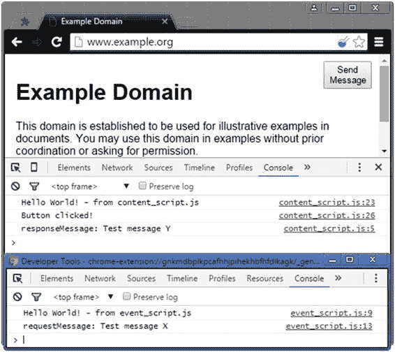
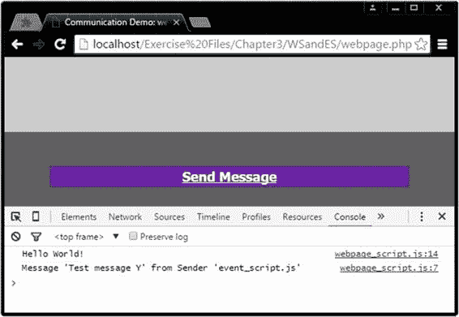
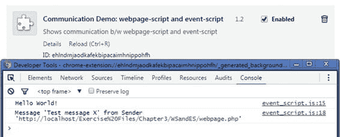

# `addEventListener` 方法

`addEventListener` 方法（参见清单 3-7）用于提供一个回调函数，以处理该按钮上的 `click` 事件（回顾[第 2 章](http://dx.doi.org/10.1007/978-1-4842-1775-7_2)的内容，内容脚本组件可以访问所有标准 JavaScript API）。点击该按钮后，`Page-Action` 将会显示。你可能想知道这是如何实现的。这正是消息传递 API 发挥作用的地方。

如前所述，扩展框架中提供的消息传递 API 允许不同的脚本组件相互交互。这一点在清单 3-7 和 3-8 中进行了展示。

该扩展中的内容脚本组件使用消息传递 API 的 `runtime.sendMessage` 方法向扩展运行时发送一条消息。回顾一下，事件脚本用于表示扩展运行时（请参阅“表示运行时的脚本”主题，以提醒自己关于扩展运行时的内容）。

## 清单 3-8

**第 3 章 / HelloContentUI / `event_script.js`**

```javascript
//region {variables and functions}

var consoleGreeting = "Hello World! - from event_script.js";

var responseMessage = {"data":"Test message Y"};

//end-region

//region {calls}

console.log(consoleGreeting);

//使用 onMessage 事件显示 Page-Action

chrome.runtime.onMessage.addListener(

function(requestMessage,sender,sendResponse) {

chrome.pageAction.show(sender.tab.id);

console.log("requestMessage: " + requestMessage.data);

sendResponse(responseMessage);

}

);

//end-region
```



## API 可用性与消息传递

如清单 3-8 所示，事件脚本组件（`event_script.js`）可以使用 `runtime.onMessage` 事件的监听器函数来监听消息。在本例中，监听器函数包含用于显示对应标签页的 `Page-Action`（参见图 3-14）的代码，该标签页源自 `sender` 对象的 tab ID。不要被这个例子吓到，因为你将在本章后面的主题中了解更多关于消息传递 API 的内容。

**图 3-14.** *HelloContentUI: Page-Action 组件*

### 用于通信的消息传递

到目前为止，你已经尝试了不同的脚本组件来实现不同的目的。但在某些场景下，单一类型的脚本组件不足以完成工作——例如，考虑前面讨论过的 `HelloContentUI` 扩展。在该扩展中，你需要内容脚本和事件脚本（即扩展运行时）相互通信，以便显示 `Page-Action` 组件。



除此之外，除了属于某个扩展的脚本组件之外，普通的（外部）网页也可能希望与扩展进行交互。所以，总的来说，有四种类型的脚本可以相互通信：内容脚本、弹出脚本、事件脚本（或后台脚本）以及（属于需要与扩展交互的外部网页的）网页脚本。

**图 3-15.** *检查网页：控制台面板*

### API 与事件

现在我们可以讨论用于不同脚本组件之间通信的实际消息传递 API。这些 API 来自标准 JavaScript API 和扩展框架。标准 JavaScript API 提供的消息传递 API 包括 `window.postMessage` 方法。同样，扩展框架提供的消息传递 API 包括以下方法：

- `chrome.runtime.sendMessage`
- `chrome.runtime.connect`（以及对应的 `port.postMessage` 方法）
- `chrome.tabs.sendMessage`
- `chrome.tabs.connect`（以及对应的 `port.postMessage` 方法）



**图 3-16.** *后台页面控制台面板*


